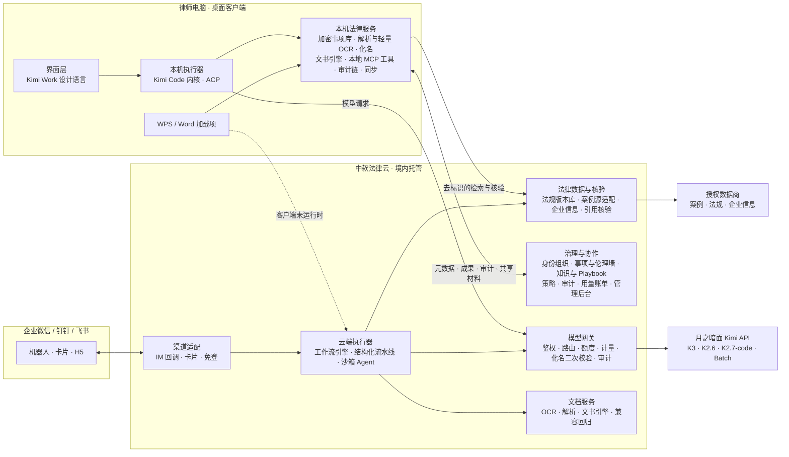

# Kimi Work 法律行业发行版：完整产品整合方案

日期：2026-09-23｜性质：在 astra 方案（09-22）与 Claude 独立审计（09-23）基础上的整合终稿，用于立项、研发排期与商务谈判｜依据：两份前序方案及附录、09-14 以来的全部调研、本轮联网调研与源码核验（附录 B）｜说明：价格、指标、人力均为待试点校准的假设；标「待核实」的事项在第 0 阶段关闭。

---

## 0. 结论先行

**一句话定义**：「Kimi Work 法律行业发行版」是中软国际与月之暗面联合推出、面向中国律所律师的法律 Agent 工作台。律师在自己电脑上安装客户端，像用 Kimi Work 一样交代任务，拿到按本所标准完成、每条依据都能点回原文、下载即可交付的 Word/Excel 文书；在 WPS/Word 里就地审合同，在企业微信/钉钉/飞书里转材料、收结果、做签发；团队负责人在云端分派、复核、签发并管理用量。中软负责产品、法律云与服务，按席位收费；月之暗面提供模型（token 由中软采购，计入成本）与品牌背书。

**产品形态：四端一云。** 桌面客户端（主工作台）、WPS/Word 加载项、企业微信/钉钉/飞书入口、管理后台，加上中软托管的「法律云」（境内）。同一个法律内核（同一套技能、工具、Playbook、模板）在两个位置执行：律师电脑（交互任务，原件默认不出本机）和法律云（手机入口、批量、定时任务）。

**对上一轮审计的三处纠偏**（详见第 2 节）：

1. 本产品不是装在上游 Kimi Work 上的插件，而是中软自建、自有客户端的托管 SaaS，客户端借用 Kimi Work 的设计语言并获品牌授权。模型出口、策略下发、审计因此都在我们手里，审计依赖月之暗面开放的「L1/L2/L3 授权分层」「OEM 客户端」「集中策略下发」不再是关键路径。
2. token 是成本，不是收入。企业模型网关保留，但定位从「分成账本」改为成本控制、合规出口与计量计费的中枢。07-20 协议的 Token 分成若能覆盖法律，只作为降低净成本的条款。
3. 云端执行不能推迟到 V2。手机入口、批量与定时任务都要在云端跑，MVP 就需要云端执行器（确定流程走结构化流水线，开放任务走受控 Agent）。

**十二个关键决策**

| # | 决策 | 要点 |
|---|---|---|
| 1 | 定位 | 自建托管 SaaS 形态的行业发行版。中软拥有产品、客户关系、法律内容资产；月之暗面是模型供应商与品牌伙伴 |
| 2 | 形态 | 四端一云；桌面客户端是主工作台，Office 与 IM 是入口；不做独立手机 App |
| 3 | Agent 内核 | Kimi Code（MIT，与 Kimi Work 同源）作为本机与云端的统一内核，经 ACP 协议与界面解耦，opencode 作备份；ZCode 不作内核、不作底座，只借用 Office 预览集成、模型提供方配置、风险披露写法与桌面打包配置 |
| 4 | 执行位置 | 交互任务在本机执行，原件默认不出本机；手机、批量、定时任务在云端执行；高敏事项只在本机或私有化环境 |
| 5 | 首发场景 | 6 个生产场景：合同审查与修订（含下一稿比对）、案卷整理、要素式文书、法律研究与类案检索报告、法律问答与答复函、文件脱敏；Demo 的 36 个入口按「生产 / Beta / 模板」三档呈现 |
| 6 | 可信 | 引用四级核验且拦截可见、信任账本、签发与 AI 标识、可逆化名；生成、核验、签发三态分明 |
| 7 | 数据 | 法规与案例一律走授权：国家法律法规数据库 robots 全站禁止并明示禁止自动化采集，人民法院案例库协议禁止汇编建库，「采集官方站自建法规库」的旧口径作废；官方示范文本与文书样式可用于自建模板；企业信息采购 API |
| 8 | 内容 | 法律工程团队生产 Playbook（24→40→60 套）与模板；评测集 200→1,000 个任务；与月之暗面共建中文法律 Agent 任务环境 |
| 9 | 模型与成本 | K3 做法律判断，K2.6 做抽取，Batch 跑夜间批量，代码做核验；结构化流水线把一份 30 页合同的模型成本压到约 ¥5；席位含团队共享额度，超额买加量包 |
| 10 | 商业 | 专业版 ¥4,800/席/年、团队版 ¥9,800/席/年、律所版 ¥8,800/席/年 + 平台费、私有化首年 ¥150 万起（均为假设）；团队是首要购买单元；公开标准版价格 |
| 11 | 合规 | P0：与月之暗面签「不用于训练与服务优化、限期留存」的企业数据条款（公开 API 协议默认可用于服务优化）；属地登记、等保三级、标识办法、律协指引、智能体实施意见逐条落到功能 |
| 12 | 组织与节奏 | 首期约 33 人（含 5 名法律工程师），商用期约 55 人；2026-10 启动，2027-01 设计合作律所试点，2027-02 起收费 |

**需要领导层拍板的六件事**：① 架构与内核选型（第 10、11 节）；② 与月之暗面的谈判清单，尤其数据条款与并发配额（第 25 节）；③ 版本与价格假设（第 22 节）；④ 首期投入约 33 人、4 个月（第 29 节）；⑤ 三家设计合作律所（第 26 节）；⑥ IM 平台优先顺序（第 7.3 节）。

---

# 第一部分　前提、纠偏与取舍

## 1. 已确定的前提

| 前提 | 来源 | 对方案的含义 |
|---|---|---|
| 面向中国大陆律所律师；场景按诉讼仲裁、非诉、企业法务三条业务线组织 | 用户 09-14 拍板 | 首页与场景目录按业务线分组；央国企法务只是企业法务线下的客户类型 |
| 本质是自建托管 SaaS，交付形态为本机安装的 exe（类似 Kimi Work 桌面版） | 用户 09-23 拍板 | 自有客户端 + 中软法律云；不依赖上游客户端开放接口 |
| 已获授权使用「Kimi Work 法律行业发行版」标识，可借用 Kimi Work 的设计、布局、配色、版式及部分能力 | 用户 09-23 | 视觉与交互直接沿用 Kimi Work 实测规格；品牌层做成可替换的主题包，以备授权范围变化 |
| Demo 后端考虑接入 ZCode 部分能力，有更优选择也可 | 用户 09-23 | 第 11、15 节给出比较与结论 |
| 按席位收费，底层 token 由中软从 Kimi 采购，作为成本 | 用户 09-23 | 单位经济按「席位收入 − token − 数据授权 − 云资源 − 服务」计算毛利 |
| 产品形态含客户端、WPS/Word 加载项、企业微信/钉钉/飞书入口；按角色定义价值；逐场景写交付件规格与验收标准；规划内容与数据资产 | 用户 09-23 | 第 6–8 节与第四部分 |

## 2. 对上一轮审计的纠偏

上一轮审计对 astra 方案的判断，有一部分建立在「发行版 = 上游 Kimi Work 客户端 + 法律插件」的误读上。以下逐条纠正，并说明本方案怎么处理。

| # | 审计口径 | 为什么不成立或需要修正 | 本方案处理 |
|---|---|---|---|
| 1 | P1「定位漂移」：astra 把产品做成自建托管 SaaS 是方向错误 | 用户的商业设定就是自建托管 SaaS；「发行版」指获授权的联合品牌行业版，不是上游客户端的插件 | astra 的托管工程设计（事项、状态机、核验、网关、审计、恢复语义）回到主路，再加上本机执行 |
| 2 | L1/L2/L3 授权分层；OEM 客户端、集中策略下发、企业网关计量需要月之暗面开放 | 客户端是我们自己的，模型出口、策略、审计天然可控 | 删去这条依赖；与月之暗面的谈判重点改为 token 供给、数据条款、品牌细则、联合训练 |
| 3 | Token 分成是中软收入的一块；网关是「分成账本」 | 用户明确按席位收费、token 为成本 | 网关定位为成本、合规、计量中枢；07-20 分成若覆盖法律，只作净成本优化（第 25 节） |
| 4 | 托管 Agent 降为 V2 | IM、批量、定时任务离不开云端执行；demo 本身就要接真实 Agent | 云端执行器进入 MVP；强隔离沙箱按阶段加固 |
| 5 | Legal Companion（插件包之外再装一个本地伴随服务） | 客户端是自有的，不需要「插件 + 伴随进程」的拼接 | 加密事项库、本地工具、化名、文书引擎并入客户端的本机法律服务 |
| 6 | 自建法规版本库，采集国家法律法规数据库等官方站 | flk.npc.gov.cn 的 robots.txt 全站 Disallow，并写明禁止任何自动化工具采集或复制（一手，本轮实测） | 法规数据走授权数据商；官方链接用于律师人工核验；另向官方申请数据授权（第 17 节） |
| 7 | 人民法院案例库作权威核验源 | 其用户协议第 3.1 条禁止复制、汇编、建立镜像网站和数据库（一手） | 案例库只作律师点开核验的权威链接；自动核验依靠授权数据商 |
| 8 | K2.8 已全量上线，可评测后替代 K3 做部分步骤 | K2.8 目前只以 `kimi-for-coding` 在 Kimi 会员额度内提供，开放平台没有独立计价（一手） | 成本模型只用 K3、K2.6、K2.7-code；K2.8 开放 API 后再评测 |
| 9 | 「企业版数据不用于训练」 | 这是 Kimi Business 的口径；开放平台 API 协议（2026-08-31 生效）默认可将输入输出用于模型服务优化，关闭需主动申请（一手） | 列为 P0 谈判项；签署前真实客户材料不进入模型 |
| 10 | Word/WPS 插件、私有化、审计协作已是入场券 | 与 09-14 调研「竞品无一家公开 Word/WPS 原生插件」矛盾。本轮核实：iCourt Alpha 有桌面端、Word 插件与律所管理后台（一手）；智合 AI 3.0 接入微信、飞书、钉钉，未查到桌面端、Word 插件与私有化；国内没有一家同时具备桌面 Agent、IM 入口与律所后台。两份旧口径都不准确 | Office 与 IM 入口是必要条件，不是差异化本身；差异化放在交付件质量、Playbook、可信与治理（第 26.3 节） |
| 11 | 人力：astra 6–8 人 14 周；审计约 25 人 | 自有客户端、两类 Office 加载项、三家 IM 入口都是新增工作量 | 首期约 33 人，商用期约 55 人（第 29 节） |

审计里判断正确、本方案继续沿用的部分：astra 缺商业闭环、缺用户价值与内容资产设计；团队是首要购买单元；首发场景的选择；Playbook 内容工程；禁止用浏览器驱动律师个人的北大法宝、威科、企查查账号；标识办法的申请与留痕流程；律协指引到功能的映射。

## 3. 从前两轮保留什么

| 来源 | 保留内容 | 在本方案中的位置 |
|---|---|---|
| astra | 四种责任划分（平台管身份与资源，法律业务层管材料、法源与交付，Agent 在授权内干活，律师签发） | 第 5、9 节 |
| astra | 事项是权限与知识边界，成果是交付单位；执行状态与成果状态分两条线 | 第 9、13 节 |
| astra | 底稿与正式交付分离；内部版、客户版、对方版分别生成并做受众检查 | 第 8.2 节 |
| astra | 下一稿回流：只让受影响的结论失效 | 场景 S1 |
| astra | 引用四级核验；检索计划冻结与履行检查；生成 Agent 无权写「已核验」 | 第 9 节、场景 S4 |
| astra | 权限过滤在召回之前；工具网关失败即拒绝；Hook 失败放行只能作辅助；审批绑定具体对象 | 第 14 节 |
| astra | 文档管线与锚点字段；DOCX 真修订、清洁稿、受众分版；Word/WPS 往返验收 | 第 13.4 节 |
| astra | `AgentRuntimeAdapter` 契约、ACP 优先于 KAP、Kimi Code 法律化改造的配置要点与十项 PoC | 第 11、15 节 |
| astra | 持久化与幂等语义、取消与恢复、外部副作用账本 | 第 13.2 节（作为验收标准，用成熟工作流引擎实现） |
| astra | 上线验收维度与评测纪律（盲测分离、双律师标注、版本变更触发回归） | 第 31 节 |
| 审计 | 用户与买方分析；团队为首要购买单元 | 第 6 节 |
| 审计 | 首发场景（合同、案卷与要素式文书、研究与类案报告）与交付件规格初稿 | 第 8 节（扩展为 14 张规格卡） |
| 审计 | 化名放在工具层而不是 Hook；网关二次校验 | 第 9.4 节 |
| 审计 | Playbook 结构、产量与质量线；评测集与任务环境；联合后训练的权属安排 | 第四部分 |
| 审计 | 模型分级 + 结构化流水线的成本判断 | 第 23 节（按本轮核实价格重算） |
| 审计 | 标识办法第九条申请流程；律协指引到功能的映射；刑事材料只走本地或私有化 | 第 27 节 |
| 审计 | 设计合作律所组合、交付三步法、LTS 通道 | 第 26、28 节 |

## 4. 本轮新核实、改变了方案的事实

证据等级：一手＝官方原文/源码/价格页；交叉＝多源一致；推测。完整来源见附录 B。

| 领域 | 事实 | 等级 | 影响 |
|---|---|---|---|
| 模型价格 | K3 输入 ¥20、缓存命中 ¥2、输出 ¥100（每百万 token），另有缓存写入费（5 分钟 TTL ¥20、1 小时 TTL ¥40）；K2.6 为 ¥6.5 / ¥1.1 / ¥27；K2.7-code 为 ¥6.5 / ¥1.3 / ¥27 | 一手 | 单位经济按此重算 |
| 模型供给 | K2.8 未上开放平台计价，只在 Kimi 会员额度内提供；Batch API 支持 K2.6 与 K2.7-code，按标准价 60% 计费，不支持 K3 | 一手 | 夜间批量走 K2.6 Batch；K2.8 暂不进成本模型 |
| 并发 | 公开最高档（累计充值 ¥2 万）为并发 100、RPM 300、TPM 500 万 | 一手 | 数百名活跃律师同时跑任务就会触顶，企业配额是谈判项 |
| 数据条款 | API 服务协议默认可将输入输出及反馈用于模型服务优化，关闭需联系申请 | 一手 | P0 谈判项 |
| 开放权重许可 | K3 许可证的 MaaS 门槛与署名门槛只约束自部署权重；经月之暗面官方产品或认证推理伙伴访问可豁免 | 一手 | 调用 API 的 SaaS 由服务协议约束；私有化自部署才涉及权重许可 |
| 自部署 | K3 约 2.8 万亿参数 MoE，vLLM 最低 8×B300 级；官方建议生产 64 卡以上；昇腾已 0day 适配 | 交叉 | 私有化默认「治理与数据在本所 + 模型经网关化名调用」，本地大模型只给最大客户 |
| Kimi Work | 最新 3.2.12（09-22）；仍无 SSO、审计、集中策略、白标；个人会员 ¥49/¥99/¥199/¥699 每月四档，K3 从 ¥99 档起 | 一手 | 律师自购 Kimi Work 的年成本约 ¥1,200–2,400，是我们必须回答的替代品价格 |
| Kimi Code | MIT；2.0.0 于 09-17 发布、2.0.2 于 09-19 发布；有 ACP 服务端与实验性 REST/WS 服务端；原生支持 Moonshot 的 OpenAI 与 Anthropic 兼容端点 | 一手 | 选作统一内核，但大版本刚发布，需锁版本、回归与补丁能力 |
| ZCode | 智谱 2026-09-20 开源（Apache-2.0，公开提交只有 2 条，issue 关闭）；Electron 桌面，已配 Windows 安装包；内置 Kimi 提供方模板；登录、网关转发、更新源默认指向 z.ai；核心 HTTP 服务只允许本机监听且未接鉴权；无操作系统沙箱；非交互 CLI 默认 yolo | 一手 | 不作内核与底座；按 Apache-2.0 借用部分模块 |
| 其他运行时 | opencode（MIT，约 21 万星，内置 Moonshot 提供方，曾有未鉴权本地服务的高危漏洞，已修）；OpenClaw 有 CVSS 8.8 漏洞与大规模恶意 Skill 投毒事件 | 一手 / 交叉 | opencode 作备份内核；OpenClaw 生态不进入法律产品 |
| Word | 修订与批注 API 需 WordApi 1.4/1.6：M365 与零售版（更新到 2208/2308 以上）、Office 2024 LTSC 支持；批量许可的 Office 2016/2019 最高到 1.3，2021 LTSC 不在支持列表 | 一手 | Office.js 覆盖不了大量批量许可版 Word，需要 COM 加载项与「导出修订稿」兜底 |
| WPS | JS 加载项基于 Chromium，适配 Windows 与 Linux（未列 Mac）；个人版自 12.1.0.16910 起不再支持 oem.ini + jsplugins.xml 方式，须改用 publish 模式发布 | 一手 | WPS 加载项由客户端安装器注册，个人版兼容性列为第 0 阶段 PoC |
| DOCX 引擎 | Open XML SDK（MIT，活跃）；微软原版 Open-Xml-PowerTools 已归档（2019），社区分支活跃；Python-Redlines（MIT）可在不装 Word 的情况下生成原生修订 | 一手 | 文书引擎用 .NET + Open XML SDK + WmlComparer 分支，本机与云端同一实现 |
| 法源 | flk robots 全站禁止并明示禁止自动化采集；人民法院案例库协议禁止汇编建库；市场监管总局合同示范文本库约 500 种免费下载；全国律协业务操作指引是出版物，有著作权 | 一手 / 交叉 | 第 17、18 节 |
| 数据商 | 法意 MCP 有按 token 计费套餐，年度企业版可谈私有化与数据授权；元典开放平台已接入 Kimi 全系；北大法宝须单独签商业授权；新发现「法律之星」提供法规检索与校验 MCP | 一手 / 交叉 | 第 17 节 |
| 司法政策 | 法发〔2026〕10 号第六条：在合理范围内处理已合法公开的个人信息用于模型训练，个人未明确拒绝的，一般不认定侵权 | 一手 | 用公开裁判文书构建训练与评测资产有了依据，但不豁免违反网站协议的采集 |
| 智能体监管 | 《智能体规范应用与创新发展实施意见》第 6 条（用户享有知情权与最终决策权，不得超出授权）、第 7 条（重要场景行为可验证、可追溯）、第 9 条（模型接入与扩展工具的供应链安全）、第 11 条（敏感领域与重点行业可能实行备案、检测、召回）、第 30 条（鼓励案件材料梳理、证据审查、辅助文书生成类智能体） | 一手 | 第 9、14、27 节 |
| 竞品形态 | iCourt Alpha：桌面端、Word 插件、律所后台（一手），AlphaClaw 智能体 2026-04 起；智合 AI 3.0：统一 Agent + Skill 中心，接入三家 IM，团队价不公开 | 一手 / 交叉 | 第 26.3 节 |
| 价格锚点 | WPS 365 商业旗舰版含全套 AI ¥599/人/年；通义法睿合同审查 ¥1 万–80 万/年、按量 ¥4/页；北大法宝、无讼个人 ¥3,600 与 Alpha「47 万/90 账号」找不到出处 | 一手 / 查不到 | 第 22.1 节；旧口径停用 |
| 海外信号 | 2026-01-30 Claude Cowork 开放插件（含法律插件）；02-03 汤森路透盘中跌 17%，RELX、威科跌超 10%；05 月 Claude for Legal 上线，CoCounsel 经 MCP 接入 Claude；08 月 Gemini Enterprise for Legal | 一手 / 交叉 | 「通用桌面 Agent + 法律插件」形态已被验证，也说明插件本身不是壁垒 |
| 律协采购 | 已核实的都是数据库与检索类：海南 2025-04 组织全省律师免费试用元典问达（不是 iCourt）、青岛 2025-08 集中采购威科先行、安徽与广东 2023 年采购法信；未见按 AI 席位采购的公开案例 | 一手 | 律协渠道先做培训与试用合作，不计首年收入 |
| IM 入口 | 企业微信智能机器人只能在单聊收文件，下载链接 5 分钟有效，收不到合并转发的聊天记录；飞书可解析合并转发；会话存档原文不能带出企业微信数据专区；微信 ClawBot 只对接 OpenClaw | 一手 / 交叉 | 第 7.3 节 |
| 评测资源 | LegalAgentBench（ACL 2025，300 个中文法律 Agent 任务）、J1-Bench（ACL 2026，交互式中文法律 Agent 环境）；Harvey LAB 为 MIT 但偏英美法 | 一手 | 评测体系可借用结构，许可证逐项核实后再用于商业 |

---

# 第二部分　产品

## 5. 产品定义与边界

### 5.1 四端一云

| 组成 | 主要用户 | 做什么 | 阶段 |
|---|---|---|---|
| 桌面客户端（Windows 10/11 优先，macOS Apple Silicon 次之） | 律师、助理 | 主工作台：建事项、挂载本机案卷、交代任务、看执行过程、审阅成果、导出交付件 | MVP（Windows）；V1（macOS） |
| WPS/Word 加载项 | 律师 | 在文档里审合同、插入原生修订与批注、逐条接受拒绝、核验一份文书里的全部引用、下一稿比对 | MVP（WPS Windows + Word 新版）；V1（旧版 Word） |
| 企业微信 / 钉钉 / 飞书入口 | 律师、助理、团队负责人 | 把聊天里的材料转进事项、问答、接收任务完成通知、查看结果、签发或退回、分派任务、扫码登录 | MVP（一家）；V1（三家） |
| 管理后台（Web） | 管理员、知识管理、团队负责人 | 席位与成员、事项与伦理墙、策略、Playbook 发布、知识库、审计、用量与账单 | MVP 基础版；V1 完整版 |
| 法律云（中软境内托管） | 以上各端 | 身份与组织、事项与协作、模型网关、法律数据与核验、云端执行、文档服务、同步 | MVP |

不做独立手机 App。手机端需求（转材料、看结果、签发）通过 IM 入口满足；Harvey 的经验也是移动端「只做输入和查看，不做作业」。

### 5.2 与 Kimi Work 标准版的关系

| 类别 | 内容 |
|---|---|
| **沿用** | 视觉与版式（实测：侧栏 #fbfaf9、主区 #fff、正文 #0e1219、次级 #888、Kimi 蓝 #167ffb、黑色主按钮 #191919、输入框圆角 16px、侧栏约 260px）；执行态三栏（侧栏 / 对话与步骤 / 成果预览约 45%）；输入框 `/` 唤起技能、`@` 引用材料、`+` 上传；任务化的会话管理；Skills 与 MCP 的扩展机制；Office 文件直出 |
| **增强** | 「项目」升级为「事项」（客户、相对方、立场、法域、关键日期、成员、保密级别）；Skills 升级为带版本、评测和发布审批的法律技能与 Playbook；成果预览区增加修订卡、证据矩阵、引用面板、信任账本；定时任务改在云端执行，不依赖电脑开机 |
| **收敛** | 默认关闭 Shell 与任意代码执行；WebBridge 与内置浏览器默认关闭，管理员可开启白名单站点，禁止驱动律师个人的付费数据库账号；插件只允许中软签名的法律连接器；不开放通用编程模式 |
| **新增** | 法规版本库与引用核验、真修订文书引擎、可逆化名、签发与 AI 标识、信任账本、团队协作与伦理墙、管理后台与 SSO、席位与额度、WPS/Word 加载项、IM 入口、私有化 |

左侧导航由 Kimi Work 的「新建任务 · 看板 · 插件 · 技能 · 定时任务 · WebBridge · 项目 · 对话」调整为：**新建任务 · 事项 · 看板 · 技能与 Playbook · 知识库 · 连接 · 定时任务 · 交付中心 · 对话**。品牌元素（名称、标识、主色）集中在一个主题包里，授权范围变化时可整体替换。

设计上补充法律场景特有的规格（沿用 09-14 调研结论）：阅读区 16px/1.75、表格区 13px/1.6 双密度；案号与法条号用等宽字体；风险分级用红橙黄，法规效力状态（现行有效 / 已修改 / 已废止）用独立标签样式；深色模式下文档纸面保持浅色。

### 5.3 律师为什么要为发行版付费

律师最现实的替代品是：自己买 Kimi 会员（¥99–199/月，含 Kimi Work 与 K3）再装元典插件，或者用 ¥698/年的智合 AI。发行版必须在下面七点上给出他们自己搭不出来的东西：

| # | 发行版给的 | 自己搭能否得到 |
|---|---|---|
| 1 | 交付件级成品：原生修订稿、审查意见书、要素式起诉状、符合第八条要素的类案检索报告，下载即可交付 | 通用 Agent 只能出「差不多」的文件，修订痕迹、格式与法定要素靠律师返工 |
| 2 | 按本所标准干活：Playbook 与本所覆盖层，每条建议都说明触发了哪条规则 | 没有 |
| 3 | 可信：引用核验与拦截可见、法规版本随基准时点、信任账本、签发与标识 | 没有，出错责任全在律师 |
| 4 | 数据与合规：原件默认不出本机、可逆化名、敏感信息拦截、不训练的数据条款、登记与等保 | 个人会员走公开协议，默认可用于服务优化 |
| 5 | 团队：事项共享、分派、复核签发、伦理墙、用量看板 | Kimi Work「项目」官方明确不是知识库、不能共享 |
| 6 | 入口：WPS/Word 里就地审，企业微信/钉钉/飞书里转材料和签发 | 没有 |
| 7 | 服务：本所规则上线、培训、支持 SLA | 没有 |

### 5.4 不是什么

不是法律数据库（数据商是供应商）；不是律所管理系统（不做案件收费、财务，可对接）；不是自动出具法律意见的机器（律师签发）；不是通用编程或电脑操控 Agent；不向律师个人开放任意插件市场。

### 5.5 设计原则

1. **事项为中心**：材料、任务、成果、权限、成本都挂在事项上。
2. **交付件为单位**：每个场景用「下载即可交付」的文件定义完成。
3. **本机优先，云端补位**：原件默认留在律师电脑；只有需要共享、手机发起、批量或定时的任务才上云。
4. **每个论断可回溯，每个动作有记录。**
5. **律师签发**：AI 起草，律师定稿；生成、核验、签发三态分明。
6. **本所标准由 AI 执行**：Playbook 是人和 AI 之间的契约。
7. **状态诚实**：只显示可核验的事实，不显示模型自报的置信度和虚假进度。
8. **经济性内建**：路由、流水线、额度与计量是架构要求，不是事后优化。

## 6. 按角色定义价值

### 6.1 角色—价值矩阵

| 角色 | 核心任务 | 痛点 | 发行版给什么 | 看什么指标 | 主要触点 |
|---|---|---|---|---|---|
| **执业律师 / 授薪律师**（主力用户） | 审合同、写文书、做研究、整理案卷、回复客户 | 加班；返工；怕 AI 编造引用被追责 | 下载即可交付的文书；每条依据点回原文；修订卡键盘流；下一稿只重审改动 | 单件用时、返工次数、被合伙人退回次数 | 客户端、WPS/Word |
| **律师助理 / 实习律师** | 材料整理、证据目录、初稿、检索 | 不熟本所标准；机械劳动多 | 案卷自动入库与编号；Playbook 解释「为什么这样改」，边做边学 | 整理用时、初稿通过率 | 客户端、IM（转材料） |
| **团队负责人 / 合伙人**（买方、签发人） | 接案、分派、复核、签发、维护客户 | 产能上限；质量不一；新人带教；执业风险 | 团队按本所标准产出；签发流与信任账本；用量与效率看板，可向客户说明工作量 | 团队产能、交付周期、差错率、客户满意 | 客户端、IM（签发）、后台看板 |
| **律所管理层**（主任、管委会） | 品牌、风控、规模化 | 数据泄露与执业风险；各团队各自买工具 | 统一合规口径、伦理墙、审计、集中采购与额度、私有化选项 | 采用率、风险事件、IT 支出 | 后台 |
| **知识管理 / 法律科技负责人** | 沉淀范本与规则 | 知识散在个人电脑 | 本所 Playbook 覆盖层、范本库、发布审批与版本、拒绝原因回流 | 规则覆盖率、采纳率 | 后台、客户端 |
| **IT / 信息安全 / 行政** | 部署、账号、合规 | 装机、权限、审计要求 | 静默安装包、SSO、策略下发、审计导出、数据处理协议、等保证明 | 部署时长、工单量、合规材料齐全 | 后台 |
| **客户（企业法务）**（交付对象，常是推荐人） | 收交付件、提意见 | 不知道律师做了多少工作 | 审查意见书与出处附件；进展汇报（V1）；协作空间（V2） | 交付周期、质量 | 交付件、协作空间 |
| **律协 / 司法局**（渠道，待验证） | 会员服务、行业规范 | 规范落地手段少 | 合规使用培训 + 会员试用额度 | 覆盖律师数 | — |

### 6.2 价值量化（待试点实测的假设）

| 交付件 | 人工基线 | 使用发行版（含律师复核） | 节省 |
|---|---|---|---|
| 30 页合同审查（修订稿 + 意见书） | 3–5 小时 | 1–1.5 小时 | 约 2.5 小时 |
| 300 页案卷整理（证据目录 + 时间线 + 争点矩阵） | 1–2 天 | 3–4 小时 | 约 10 小时 |
| 要素式起诉状（已有整理好的案卷） | 1–2 小时 | 20–30 分钟 | 约 1.2 小时 |
| 类案检索报告（3 个争点） | 1 天 | 2–3 小时 | 约 5 小时 |
| 常年顾问答复函 | 30–60 分钟 | 10–15 分钟 | 约 0.6 小时 |
| 50 页文件脱敏 | 1–2 小时 | 10 分钟 | 约 1.3 小时 |

按一名诉讼与非诉兼做的律师每月 6 份合同、1 个案卷、2 份起诉状、1 份研究、20 次答复估算，每月节省约 44 小时。按授薪律师综合成本 ¥200/小时的保守口径，价值约 ¥8,900/月；团队版席位 ¥9,800/年，折合 ¥817/月。即使实际节省只有估算的四分之一，投入产出比仍在 2.5 倍以上。试点第 4 周按真实数据冻结这张表，写进销售材料。

### 6.3 买方与用户的分裂

合伙人买的是「团队按本所标准产出、风险可控」，律师用的是「少加班、不返工」。海外的教训是「助理律师讨厌、合伙人觉得神奇」。对策：试点同时测两组指标；首个交付件用时 ≤ 30 分钟作为激活标准；Playbook 由团队负责人确认后生效，让律师感到是「按我们团队的做法」而不是「按 AI 的做法」；拒绝原因一键回流，让律师的反馈看得见结果。

## 7. 产品形态与触点

### 7.1 桌面客户端

**安装与更新**：按用户安装、无需管理员权限的安装包（面向个人）与 MSI 静默安装包（面向律所 IT）；EV 代码签名；境内 CDN 增量更新、分批灰度、可回滚；提供 LTS 通道（季度发布，锁定 Agent 内核与技能版本）与快速通道。首发前向 360、火绒、腾讯电脑管家报备白名单，避免 Agent 子进程被误报。

**主界面**：

| 页面 | 内容 |
|---|---|
| 首页 | 大输入框；本团队常用场景卡（只露生产档）；继续上次的事项与任务；待我复核/签发 |
| 事项 | 事项列表与详情：客户、相对方、立场、法域、关键日期、成员、保密级别、驻留模式；材料（本机挂载目录 + 共享材料）；任务；成果；时间线 |
| 执行视图 | 三栏：左侧栏 / 中间计划、步骤流、提问与审批 / 右侧成果预览（文档、修订卡、证据矩阵、引用面板、信任账本多标签） |
| 审阅视图 | 原文与建议对照；修订卡键盘操作（J/K 切换、A 接受、R 拒绝、E 编辑）；拒绝原因可选标签；引用点击后原文滚动高亮 |
| 交付中心 | 按事项列出成果版本、状态（草稿/待核验/待复核/已签发）、受众版本、导出记录 |
| 技能与 Playbook | 场景库（生产/Beta/模板）、Playbook 浏览、本所覆盖层（知识管理员维护） |
| 知识库 | 本所范本、常用条款、法规收藏；只收经批准的内容 |
| 连接 | 已授权的数据源与工具状态（律师看到「案例库授权到期」这类业务状态，技术配置在后台） |
| 定时任务 | 期限提醒、法规变更追踪、事项周报（云端执行） |

**关键交互**：计划先行（长任务先给步骤计划，律师可改）；执行中可离开，完成后客户端与 IM 双通知；失败给出人能懂的原因（「第 37–41 页扫描不清，请重扫」）；每个事实、引用可点回原文；导出前自动做受众检查。

**验收**：Windows 10/11 安装成功率 ≥ 99%（含主流杀软环境）；冷启动 ≤ 5 秒；空闲内存 ≤ 600 MB；会话无崩溃率 ≥ 99.5%；断网时本机事项、材料、已生成成果可读；更新失败自动回滚。

### 7.2 WPS/Word 加载项

**功能**：侧边栏里「按 Playbook 审查本文」→ 风险清单与修订卡 → 接受后写入原生修订与批注；选中条款问「这条对我方有什么风险」「给个更有利的写法」；「核验本文引用」逐条检查法条版本与案号；「与上一稿比对」找出静默改动；「脱敏导出」。

**宿主与实现分层**（Office.js 与 WPS 能力按本轮一手文档核实）：

| 宿主 / 版本 | 实现方式 | 能力 | 阶段 |
|---|---|---|---|
| WPS（Windows，企业版与个人版） | WPS JS 加载项，由客户端安装器以 publish 模式注册 | 接口沿用 WPS 的 VBA 对象模型（交叉），可开关修订、读写批注与区域 | MVP；个人版 12.1.0.16910 以后的兼容性在第 0 阶段 PoC |
| WPS（Linux / 信创） | 同上 | 同上 | V2，按客户需求 |
| Word：Microsoft 365、零售版 2021/2024（已更新到 2308 以上）、Office 2024 LTSC | Office.js 加载项（WordApi 1.6） | 修订模式、批注、逐条接受拒绝 | MVP |
| Word：批量许可的 2016 / 2019 / 2021（含大量 KMS 激活环境） | COM 加载项（.NET），随客户端安装 | Word 对象模型完整支持 Revisions、Comments、Range | V1 |
| Word for Mac | Office.js | 同 M365 | V1 |
| 任何宿主都不可用时 | 客户端文书引擎直接生成修订稿 | 打开即见原生修订 | 始终可用 |

加载项界面是一套 Web 代码，通过适配层接 Office.js 与 WPS API；业务逻辑在客户端的本机服务里（本机回环接口 + 令牌 + 来源校验），客户端未运行时直连法律云。条款定位用段落与书签锚点，不依赖页码。

**验收**：在 50 份真实结构合同上，加载项写入的修订在 Word 与 WPS 中都能逐条接受/拒绝、保存再打开无损；侧边栏首屏 ≤ 2 秒；定位错误率 0（无法安全定位时退为批注并提示）。

### 7.3 企业微信 / 钉钉 / 飞书入口

**律师的真实材料流**：客户多数用个人微信发材料，律所内部可能用企业微信、飞书或钉钉，也可能什么都不用。入口设计要覆盖三条路径，而不是只押一个平台。

| 路径 | 做法 | 能力边界（本轮核实） | 阶段 |
|---|---|---|---|
| ① 企业微信智能机器人 + 代开发 H5 | 律师在单聊里把文件、图片、语音转给「法律助手」，选定事项后归档；机器人推送任务完成通知与「签发 / 退回」按钮卡片；工作台 H5 免登查看成果；桌面客户端扫码登录 | 图片、文件、视频、语音只能在单聊收，语音只给转写文字；群里只收 @机器人 的文本；下载链接 5 分钟有效且加密；收不到合并转发的聊天记录；主动推送前用户须先给机器人发过消息，每个会话每分钟 30 条（一手） | MVP |
| ② 飞书机器人 + 网页应用 | 同上；另可解析合并转发的聊天记录，逐条归档为证据 | 单聊与群 @ 可收文件，小于 100MB 直接下载、更大分片；卡片回调 3 秒内响应；收群内全部消息需申请敏感权限（一手） | V1 |
| ③ 钉钉应用机器人 + 微应用 | 同上 | 单聊与群 @ 可收附件（downloadCode 换下载链接）；互动卡片与 AI 流式卡片（交叉） | V1 |
| ④ 个人微信 → 桌面客户端 | 客户端提供「微信文件快速导入」：律师开启后，列出本机微信下载目录中的新文件，一键归入事项；配合微信「文件传输助手」 | 只读律师自己的文件目录，不读聊天记录；默认关闭，由律师开启 | MVP |
| ⑤ 个人微信小程序 | 律师在小程序里直接从微信会话中选取客户发来的文件上传到事项（`wx.chooseMessageFile`，单次最多 100 个，手机与 Windows/Mac 版微信均支持，并返回文件在会话中的发送时间，可记为收件时间）；订阅消息通知；查看成果 | 一手接口；需以运营主体注册小程序并备案；只能由律师本人选择文件，不读聊天内容 | V1（第 0 阶段做原型） |

**不做或暂不做**：

- 用企业微信「会话内容存档」自动抓取客户聊天：需要客户同意，原文只能在企业微信的数据专区内处理、不能带出发给模型，且每人每年 ¥900–1,800（交叉），性价比与合规观感都差。
- 机器人直接收群里客户发的文件：平台不支持。
- 通过「微信 ClawBot」接个人微信：2026-03 上线，只对接 OpenClaw、由用户扫码绑定自己的实例，不是面向企业的开放平台（交叉）；OpenClaw 生态的安全问题也不适合法律场景。

**平台优先级**：企业微信 → 飞书 → 钉钉。理由：只有企业微信能与客户的个人微信互通，规模所也在用企业微信管理客户关系；飞书接口最完整；钉钉在律所有个案（交叉），依据最少。最终顺序按三家设计合作律所实际使用的平台调整——这是需要拍板的第六件事。律所 IM 使用占比没有公开数据。

**接入模式与费用**：多家律所共用的 SaaS 在企业微信走「代开发应用」，逐所授权；接口调用许可只对服务商应用收费，基础账号按规模 ¥1–5/账号/年、安装后 90 天免费（一手），成本可忽略。飞书走商店应用，钉钉走应用市场（服务商称佣金 15%，非官方口径）。

**数据处理**：机器人收到文件后立即下载进事项并加密存储，不在 IM 平台留存成果文件；对外结果默认以 H5 链接呈现（链接鉴权、可撤回），不把成果文件直接发进聊天；离线模式事项禁用 IM 入口。

**验收**：从转发到归档进事项 P50 ≤ 30 秒；长任务完成通知送达率 ≥ 99%；卡片签发与客户端签发写入同一条签发记录；IM 发起的任务与客户端任务在同一事项里可见、状态一致。

### 7.4 管理后台

| 模块 | MVP | V1 |
|---|---|---|
| 组织与席位 | 成员邀请、角色、席位分配、IM 账号绑定 | AD/LDAP、SCIM 式批量同步、离职一键回收并远程吊销本机事项库密钥 |
| 事项与伦理墙 | 事项成员、保密级别 | 伦理墙（被隔离成员检索不到、不知道存在）；利益冲突线索提示（只提示，不替代律所流程） |
| 策略 | 场景白名单、本机/云端处理策略、敏感信息规则 | 工具与目录白名单下发、出站白名单、导出与标识策略 |
| Playbook 与知识 | 基础 Playbook 浏览、本所覆盖层编辑与发布审批 | 回归评测报告、变更影响分析、范本库 |
| 审计 | 按事项、人员、动作查询；导出 | 信任账本检索、异常告警 |
| 用量与账单 | 按人、按事项的用量；额度余量；发票 | 效率看板（交付件数、采纳率、节省时长）、同业基准 |

### 7.5 一个事项在四端之间的流转

周一上午，客户在个人微信上把对方发来的股权转让协议发给经办律师。律师把文件转给企业微信里的「法律助手」，选择事项「甲公司受让乙公司股权」，云端按受让方立场做首轮审查，15 分钟后推送风险摘要卡片。律师回到办公室，在客户端打开任务，逐条处理修订卡，拒绝两条并选了原因；再在 WPS 里打开修订稿微调措辞。合伙人在手机上收到签发请求，看过审查意见书摘要后签发。客户端生成客户版修订稿、审查意见书和出处附件。周四对方回稿，律师拖进事项，系统只重审被改动的 6 个条款，并标出一处未开修订的静默改动。

## 8. 场景与交付件规格

### 8.1 场景目录与成熟度

Demo 的 36 个入口全部保留在场景库中，按成熟度分三档呈现。首页只露「生产」档；「Beta」档使用前提示已知局限；「模板」档只生成结构化底稿，不宣称分析能力。

| 档位 | 定义 | 上线门槛 |
|---|---|---|
| 生产 | 有完整交付件规格、评测集、验收报告，纳入 SLA | 通过本节对应验收标准 |
| Beta | 有交付件规格，评测集 ≥ 30 个任务，不纳入 SLA | 设计合作律所 2 名律师确认可用 |
| 模板 | 只有底稿结构与材料清单 | 法律工程师审定 |

| 业务线 | 生产（MVP，2027-01 试点） | 生产（V1，2027-05 前） | Beta / 模板（逐个升档） |
|---|---|---|---|
| 诉讼仲裁 | 案卷整理；要素式起诉状/答辩状（首批 11 类，含劳动仲裁申请书）与金额测算；类案检索报告 | 质证意见；期限计算与提醒；事项进展汇报 | 诉讼攻防演练、首次会见提纲、用人单位应诉方案；刑事三项（阅卷与辩点、类案与量刑、辩护意见）只在私有化或离线事项开放 |
| 非诉 | 合同审查与修订（含下一稿比对） | 尽调矩阵与尽调报告；合同起草 | 投资条款与谈判方案、授信与增信审查、交易时间线、上市公告核查、经营者集中判断、个人信息合规等 |
| 企业法务 / 常年顾问 | 合同与制度审查（与合同审查同一引擎）；法律问答与答复函 | 批量合同审查与合同台账；律师函/催告函 | 违纪员工处理、员工优化成本测算、税务合规自查、监管函复、业务合规评估、纠纷谈判方案 |
| 横切 | 文件脱敏；法律研究备忘录 | 会见/会议纪要 | 法律翻译（术语库） |

### 8.2 交付件通用规格

1. **格式**：交出去的一律是 Office 原生文件（.docx / .xlsx），PDF 只用于固定版式归档，不交付 Markdown。
2. **署名与标识**：显式 AI 标识位置与文字按 GB 45438-2025 与机构策略；文档属性写入隐式标识；作者字段为审阅律师。无显式标识版本按第 9.5 节申请。
3. **出处**：每个事实性陈述、法律依据、案例都能回到来源（材料页码与段落、法规条文与版本、案号与段落）；交付件内以脚注或引用列呈现，客户端内可点击跳转。
4. **状态**：「草稿 → 待核验 → 待复核 → 已签发」；未签发的文件导出时带「草稿」水印。
5. **受众分版**：内部版、客户版、对方版、法院版由同一批准版本按规则生成；导出前自动检查隐藏批注、修订痕迹、作者与文档属性、嵌入对象和内部备注。
6. **信任账本**：每份签发交付件可附「出处与复核记录」（输入材料 hash、Playbook/模板/模型版本、核验结果、人工修改、签发人与时间）。
7. **可编辑**：Word 修订可逐条接受/拒绝；Excel 保留公式与筛选；字体、字号、行距按本所模板。

### 8.3 生产场景规格卡（MVP）

以下数值是 MVP 验收门槛的初值，在设计合作律所试点第 4 周按实测基线冻结。「直接可用」指律师判断无需结构性修改即可交付（措辞润色不算结构性修改）。

#### S1 合同审查与修订（含下一稿比对）

| 项 | 规格 |
|---|---|
| 业务线 / 角色 | 非诉、企业法务、常年顾问；经办律师执行，合伙人复核签发 |
| 入口 | 桌面客户端（主）；WPS/Word 加载项；IM 转发合同（云端执行，卡片返回摘要与下载） |
| 输入 | 合同 .docx（首选）/ .pdf / 扫描件（降级并标出）；我方身份与立场（甲/乙，强势/均衡/弱势）；审查尺度（严格/标准/宽松）；交易背景（可选）；交付对象；Playbook（按合同类型推荐，律师确认）。MVP 单份上限 200 页 |
| 处理 | ① 解析条款树、定义术语、交叉引用、金额/日期/主体 ② 合同分类并匹配 Playbook ③ 逐条规则检查：不利条款、缺失条款、表述歧义、合规问题 ④ 确定性一致性校验：定义术语、金额大小写、日期、主体名称、交叉引用、条款编号 ⑤ 生成风险项并核验引用 ⑥ 律师在修订卡上接受/修改/拒绝（拒绝原因回流 Playbook） ⑦ 生成交付件 ⑧ 对方回稿后导入，比对并只重审受影响条款 |
| 交付件 | **修订稿**（.docx，原生修订 + 批注，作者为审阅律师）；**清洁稿**（.docx）；**审查意见书**（.docx，给客户：审查范围与假设、总体结论「可签 / 修改后可签 / 不建议签」、红橙黄分级风险清单、原文—建议—理由—依据对照表、待客户确认事项、限制声明、律师署名）；**谈判要点表**（.xlsx，内部：条款、首选立场、可退让至、底线、优先级）；**对方版**（.docx，可选，只含有意提供的修订与外部批注）；**比对报告**（.docx，回稿时：新增/删除/修改清单、我方修订被接受情况、未开修订的静默改动、新增风险） |
| 验收 | 红色风险项召回 ≥ 95%，同时报告精确率（初值 ≥ 80%）；金额、主体、日期、编号误改 = 0；每个风险项定位到原条款 100%；签发版所引法条的版本与效力经确定性核验 100%；修订稿在 Word 2016 及以上与 WPS 2019 及以上打开、逐条接受/拒绝、保存再打开，50 份回归样本零损坏；静默改动检出率 100%（确定性比对）；直接可用率 ≥ 70% |
| 时效与成本 | 30 页合同首轮结果 P50 ≤ 8 分钟；模型成本 P50 ≤ ¥6 |
| 边界 | 不替律师决定是否签约；复杂嵌套表格、图片中的条款降级为批注并提示 |

#### S2 案卷整理（证据目录、时间线、争点—证据矩阵）

| 项 | 规格 |
|---|---|
| 业务线 / 角色 | 诉讼仲裁；助理/实习律师执行，经办律师确认 |
| 入口 | 桌面客户端（挂载本机案卷目录）；IM 转发材料进事项 |
| 输入 | 起诉状/答辩状、合同、发票、转账凭证、微信聊天截图、邮件、笔录、裁判文书等；我方地位、案由、程序阶段。MVP 单事项上限 1,000 页，更大分批 |
| 处理 | ① 入库：去重、分类、OCR，文件页/印刷页/卷内编号分别记录，聊天截图识别为结构化消息 ② 事实抽取：日期、主体、行为、金额 + 原页锚点；类型标签「材料记载 / 当事人陈述 / 推断 / 有争议」 ③ 时间线按发生日排序，同时保留文件形成日 ④ 证据目录 ⑤ 争点—证据矩阵 ⑥ 补证清单 ⑦ 律师确认 |
| 交付件 | **证据目录**（.docx + .xlsx：序号、证据名称、来源、页码、原件/复印件、证明目的、对应待证事实）；**事实时间线**（.xlsx + .docx 叙述版：日期、事件、主体、金额、来源文件与页码、类型标签、争议标记）；**争点—证据矩阵**（.xlsx：争议焦点 × 支持/反对证据 × 证明力说明（律师填写）× 缺口）；**补证清单**（.docx：缺口、取证建议、优先级）；**材料质量报告**（低质量页、缺页、无法识别的文件） |
| 验收 | 每条事实可回链原页 100%；清晰件的日期/金额/主体抽取准确率 ≥ 98%；低质量页标记 100%；不擅自认定证明力（抽检零违例）；证据目录字段完整 100%；直接可用率 ≥ 70% |
| 时效与成本 | 300 页扫描件 P50 ≤ 30 分钟；成本 P50 ≤ ¥15（含 OCR） |

#### S3 要素式起诉状 / 答辩状（含金额测算）

| 项 | 规格 |
|---|---|
| 业务线 / 角色 | 诉讼仲裁；经办律师 |
| 入口 | 桌面客户端（通常接在案卷整理之后）；IM 发起（云端，基于已有事项） |
| 输入 | 案卷整理成果或事实摘要；案由；诉讼请求意向。首批 11 类：民间借贷、离婚、买卖合同、金融借款合同、物业服务合同、银行信用卡、机动车交通事故责任、劳动争议、融资租赁合同、保证保险合同、证券虚假陈述责任（以法〔2025〕82 号所附样式为准，试点前逐类核对） |
| 处理 | 按官方样式逐栏抽取要素并标来源；缺失要素显式留空并列入待补清单；本金、利息、逾期利息、违约金、LPR 分段用确定性计算器计算，公式可见 |
| 交付件 | **要素式起诉状 / 答辩状**（.docx，严格对齐官方样式表格）；**诉讼请求金额测算表**（.xlsx，含公式与分段）；**立案材料清单**（.docx） |
| 验收 | 样式栏目一致 100%（逐栏比对官方样式）；要素填写正确率 ≥ 95%（金标）；金额与确定性计算器一致 100%；无来源要素自动填写 = 0；律师修改用时 P50 ≤ 15 分钟 |
| 时效与成本 | 基于已整理事项 P50 ≤ 3 分钟；成本 P50 ≤ ¥2 |

#### S4 法律研究备忘录与类案检索报告

| 项 | 规格 |
|---|---|
| 业务线 / 角色 | 诉讼仲裁、非诉通用；经办律师执行，合伙人复核 |
| 入口 | 桌面客户端；IM（简化版，云端） |
| 输入 | 争点、事实摘要（默认化名）、法域、法律适用基准时点（事实发生日/合同签订日）、立场、检索范围与平台 |
| 处理 | ① 生成「争点 × 规范类型 × 法域 × 时间」检索计划，律师确认后冻结 ② 按基准时点从法规版本库取适用版本（含司法解释、地方规定） ③ 案例检索：授权案例源，按权威层级排序（指导性案例 → 最高法典型/参考案例 → 本省高院参考案例 → 上级法院与本院生效裁判），近三年优先，支持与相反类案都列 ④ 类案比对：基本事实、争议焦点、法律适用三个维度分别说明异同 ⑤ 确定性核验：案号格式与法院代字、存在性、摘录一致、法条版本与效力 ⑥ 履约检查：检索计划每一格是否执行、结果如何 |
| 交付件 | **研究备忘录**（.docx：问题、简要结论、分析、相反观点、风险、未决问题、检索记录附录）；**类案检索报告**（.docx：《关于统一法律适用加强类案检索的指导意见（试行）》第八条全部要素——检索主体、时间、平台、方法、结果、类案裁判要点、待决案件争议焦点、参照或参考的说明）；**引用清单**（.xlsx：来源、版本、效力、核验状态、官方链接） |
| 验收 | 签发版伪造引用 = 0；法条与版本匹配 100%（确定性核验）；适用基准时点判断正确率 ≥ 98%（律师金标）；第八条要素齐全 100%；检索计划覆盖情况可见；数据源不可用时标「部分完成」100%；支持性误用率按类型报告 |
| 时效与成本 | 3 个争点 P50 ≤ 15 分钟；成本 P50 ≤ ¥25（含数据调用，按数据商报价校准） |

#### S5 法律问答与答复函（常年顾问高频场景）

| 项 | 规格 |
|---|---|
| 业务线 / 角色 | 企业法务、常年顾问；所有律师 |
| 入口 | IM（主）；桌面客户端；WPS/Word 侧边栏 |
| 输入 | 问题（可附文件）；可选事项上下文 |
| 处理 | 检索法规版本库与本所知识库 → 回答并逐条挂依据 → 核验 → 可一键转为答复函 |
| 交付件 | 即时答复（结论、依据（可点开条文原文与版本）、注意事项、建议下一步）；**法律咨询答复函**（.docx，可选） |
| 验收 | 实质性结论带可点开依据 ≥ 95%；无可靠依据时明确说「无法确认」；敏感个人信息硬拦截 100%；首字 P50 ≤ 5 秒、完整回答 P50 ≤ 30 秒 |
| 成本 | P50 ≤ ¥0.3 |

#### S6 文件脱敏

| 项 | 规格 |
|---|---|
| 入口 | 桌面客户端（本机执行，不上云）；WPS/Word 加载项 |
| 输入 | .docx / .pdf / 图片；脱敏档位（标识符 / 加自然人 / 加机构）与例外名单 |
| 交付件 | **脱敏件**（同格式）；**脱敏报告**（覆盖范围、替换统计、未能处理的对象）；**映射表**（只在本机加密保存，用于还原） |
| 验收 | 直接标识符（身份证号、手机号、银行卡号、统一社会信用代码、车牌、邮箱、详细地址）漏脱 = 0；自然人姓名召回 ≥ 99%；覆盖正文、批注、修订、页眉页脚、文档属性、嵌入图片文字；输出文件可正常打开 100% |

### 8.4 生产场景规格卡（V1，要点）

| 场景 | 交付件 | 核心验收 |
|---|---|---|
| S7 尽调矩阵与尽调报告 | 尽调矩阵 .xlsx（行=文件，列=问题，格=答案 + 引用）；尽调报告 .docx（主体、股权、资产、债务、诉讼、合规、劳动等章节）；问题清单 | 单元格引用可回链 100%；预设字段抽取准确率 ≥ 95%；50 份文件 P50 ≤ 30 分钟（云端并行） |
| S8 合同起草 | 合同初稿 .docx；起草说明（关键条款选择理由）；缺失信息清单 | 优先使用本所范本条款；Playbook 必备条款齐全 100%；定义术语与交叉引用一致性错误 = 0 |
| S9 质证意见 | 质证意见表 .docx（逐项：真实性、合法性、关联性、证明力、证明目的） | 每条意见关联对方证据页码 100%；律师采纳率持续跟踪 |
| S10 批量合同审查与台账 | 合同台账 .xlsx（主体、金额、期限、关键条款、风险等级、到期提醒）；每份审查摘要 | 台账字段准确率 ≥ 97%；100 份 P50 ≤ 60 分钟（夜间可走 Batch） |
| S11 律师函 / 催告函 | 函件 .docx；金额测算附表 | 事实要素 100% 来自材料或律师输入；金额与计算器一致 100% |
| S12 期限计算与提醒 | 期限表 .xlsx；IM 与日历提醒 | 计算与规则一致 100%（测试集）；律师确认后才生效；提醒送达可追踪 |
| S13 事项进展汇报 | 进展报告 .docx（本期进展、下步安排、风险与需客户配合事项） | 事实均来自事项记录；签发后才可外发 |
| S14 会见/会议纪要 | 纪要 .docx（要点、待办、争议事实）；逐字稿 | 发言人区分；关键事实回链时间戳；音频只在本机转写 |

## 9. 可信设计

### 9.1 三种状态，不混用

「生成成功」「引用存在且版本正确」「律师已签发」是三件事。执行状态（排队、执行、待输入、成功、部分完成、失败、取消）与成果状态（草稿、待核验、待复核、已签发、已替代、已撤回）分两条线；编辑已签发的结论或替换来源版本，会让受影响的核验与签发失效。界面不显示模型自报的置信度，只显示可核验的事实，例如「基于 3 份材料中的 5 处明确表述」「已处理 18/24 份，2 份需要重扫」。

### 9.2 引用核验与「拦截可见」

| 层级 | 做法 | 谁执行 |
|---|---|---|
| 1 存在性 | 法规名称与条号、案号在授权数据中存在；案号格式、法院代字、序号异常模式（如 12345、1111）确定性检查 | 核验服务（代码） |
| 2 一致性与时效 | 摘录与原文一致；法条版本与法律适用基准时点匹配；效力状态（现行、已修改、已废止） | 核验服务（代码） |
| 3 支持性 | 来源是否真的支持该论断、是否断章取义、有无相反内容 | 模型辅助 + 律师 |
| 4 律师复核 | 关键事实、适用差异、风险取舍 | 律师 |

生成 Agent 没有把引用标为「已核验」的权限。核验未通过的引用不能进入签发版，界面明示「本次拦截 2 条无法核实的案号」，不静默删除。每条引用旁放官方链接，方便律师到国家法律法规数据库或人民法院案例库人工复核。

### 9.3 信任账本

每份交付件记录：输入材料版本与 hash、检索计划与实际执行记录、法源版本、Playbook/模板/技能/模型版本、核验结果、人工修改与拒绝原因、复核与签发人及时间。追加写入并做 hash 链，可导出为「出处与复核记录」附件。它同时满足上海律协指引第十七条（记录输入、生成与审查修改过程）与《智能体规范应用与创新发展实施意见》第 7 条（重要场景行为可验证、可追溯），也是律所在纠纷中证明已尽注意义务的证据。

### 9.4 可逆化名与敏感信息拦截

- **做法**：发往模型之前，把证件号、电话、账号、地址、自然人姓名、可选的企业名称替换为事项内一致的化名（「甲公司」「自然人 A（原告）」），模型返回后在本机还原。映射表只存本机，按事项隔离。四档策略：关闭 / 仅标识符 / 加自然人 / 加机构。
- **位置**：化名在客户端本机服务返回材料时完成（Kimi Code 的 Hook 只能放行或拦截，不能改写模型输入，且失败时放行，不能依赖 Hook）；模型网关做二次校验，发现未替换的直接标识符即拦截。
- **敏感信息**：生物识别、宗教信仰、医疗健康、金融账户、行踪轨迹、未满十四周岁未成年人信息识别后，默认禁止发往云端模型（上海律协居村指引第十五条），只能本机处理或在私有化环境处理。
- **质量约束**：化名与明文对照测试，高风险项召回下降超过 2 个百分点的场景，默认只做标识符级化名。

### 9.5 签发与 AI 标识

1. 默认导出带显式标识，并写入隐式元数据标识（《人工智能生成合成内容标识办法》第四条第二款，GB 45438-2025）。
2. 无显式标识版本：律所在用户协议中明确律师的标识义务与使用责任后，律师可在签发完成后按事项申请；系统留存申请人、事项、文件版本等日志不少于六个月（第九条）。
3. 隐式标识不提供删除功能；不提供批量清除标识的工具（第十条第二款）。
4. 证据类材料（图片、音视频、聊天记录）的任何 AI 处理结果一律保留标识，不提供去标识（法发〔2026〕10 号第十九条把删改标识取得虚假证据列为虚假诉讼手段）。
5. 标识办法对内部应用是否适用有解释空间，产品按最严口径默认，律所合规负责人确认后可在允许范围内调整。

### 9.6 人机决策权限

按《智能体规范应用与创新发展实施意见》第 6 条「确保用户对智能体自主决策享有知情权和最终决策权，执行操作不得超出用户授权范围」划三档：

| 档位 | 动作 | 规则 |
|---|---|---|
| 仅律师决策 | 签发；对外发送；向法院或客户提交；删除原件；无显式标识导出 | 界面必须由有权限的律师本人操作，审批绑定对象版本、接收方与有效期 |
| 律师授权后执行 | 覆盖写入正式成果；批量任务；超出预算的付费检索；扩大材料访问范围 | 一次授权只对本次对象有效，不跨事项复用 |
| Agent 自主 | 读取本事项材料、检索授权法源、起草、格式化、确定性校验 | 在事项与工具白名单内自动执行，全程记录 |

---

# 第三部分　技术

## 10. 总体架构

### 10.1 一个法律内核，两个执行位置，四个触点，一朵法律云

共享的东西只有一套：法律技能与 Playbook（SKILL.md 格式，本机与云端的 Kimi Code 都能加载）、法律 MCP 工具定义、模型网关、事项与审计后端、文书引擎、前端组件库。

### 10.2 执行位置怎么选

| 触发来源 | 默认执行位置 | 理由 |
|---|---|---|
| 桌面客户端里的交互任务（本机材料） | 本机 | 材料在本机；原件不上传；响应快 |
| IM 转发材料或提问 | 云端 | 手机端没有本机环境；成果要在事项里共享 |
| WPS/Word 加载项 | 客户端在运行 → 本机；否则 → 云端 | 与客户端共享同一事项库 |
| 批量任务（超过 20 份文件）与夜间任务 | 云端，K2.6 走 Batch | 并行快，Batch 价格为标准价 60% |
| 定时任务（期限提醒、法规追踪、事项周报） | 云端 | Kimi Work 的本地定时任务要求客户端常开，错过不补跑，这正是律师的痛点 |
| 高敏事项（刑事卷宗、敏感个人信息为主的材料） | 只在本机或私有化环境；模型调用只发化名后的内容，或完全不调用 | 律协指引第十二、十五、二十九条 |

### 10.3 事项的数据驻留模式

| 模式 | 原件在哪里 | 发给模型的内容 | 适用 |
|---|---|---|---|
| 本机模式（个人版默认） | 律师电脑的加密事项库 | 按化名策略处理后的必要片段 | 个人与小团队 |
| 团队共享模式（团队版默认） | 本机 + 律所租户的加密对象存储 | 同上 | 团队协作、IM 入口、批量 |
| 离线模式 | 只在本机 | 不发送，或只发标识符级化名后的片段 | 高敏事项 |
| 私有化 | 律所机房 | 经律所内网网关化名后调用 Kimi API，或调用本地部署的模型 | 头部所、刑事业务多的律所 |

驻留模式在建事项时选定，由管理员策略约束，界面在事项头部常显。以前 demo 里「文件不外传」「仅本浏览器处理」之类文案一律替换为按模式如实说明数据去向。

## 11. Agent 运行时选型：ZCode、Kimi Code 与替代方案

### 11.1 结论

**Kimi Code 做统一内核，ACP 做边界，opencode 做备份，ZCode 只借模块。**

- 本机执行器与云端沙箱里跑同一个 Kimi Code 版本（锁定 2.0.x 的某个补丁版本），加载同一套法律 profile、工具白名单与技能。
- 界面与内核之间只走 ACP（Agent Client Protocol，stdio JSON-RPC），我方在其上实现 astra 定义的 `AgentRuntimeAdapter`。这样内核可替换：Kimi Code 出问题时切到同样支持 ACP、内置 Moonshot 提供方的 opencode，界面与业务层不改。
- 确定流程（合同审查、案卷整理、要素式文书等）的主干用结构化流水线直接调模型网关，Agent 只负责开放式任务和对话式追问。这是成本与稳定性的共同要求（第 23 节）。

### 11.2 比较

| 维度 | ZCode（智谱） | Kimi Code（月之暗面） | opencode | 自研（直接调模型 + 工作流） |
|---|---|---|---|---|
| 许可证 | Apache-2.0 | MIT | MIT | — |
| 与 Kimi Work 的关系 | 竞品厂商的编程工作台 | Kimi Work 的内核 | 无 | 无 |
| Kimi 模型支持 | 内置 Kimi 提供方模板（Anthropic 兼容端点） | 默认提供方，OpenAI 与 Anthropic 兼容端点均支持 | 内置 Moonshot 提供方 | 直接调用 |
| 与界面的接口 | 自研 stdio 协议与自研 RPC；核心 HTTP 服务只许本机监听、未接鉴权 | ACP；另有实验性 REST/WS 服务端 | ACP；成熟的 HTTP 服务与 SDK | 自定 |
| 服务端无界面运行 | 可 `--web` 运行，但为单用户、远程开发设计 | ACP 可在沙箱内运行；REST/WS 服务端刚支持多会话 | HTTP 服务成熟 | 天然 |
| 权限与沙箱 | 五档权限，共享配置默认 build，非交互 CLI 默认 yolo；无操作系统沙箱 | 工具白名单、profile、审批回调；Hook 失败放行；无操作系统沙箱 | 权限配置；曾有未鉴权本地服务漏洞（已修） | 自建 |
| 成熟度 | 2026-09-20 开源，公开提交 2 条，issue 关闭；内部版本号 3.14.0 | 2.0.0 于 09-17 发布，更新频繁 | 约 21 万星，社区最大 | — |
| 对外依赖 | 登录、订阅网关转发、更新源、反馈默认指向 z.ai；官方端点会被自动改发到 ZCode 网关 | 遥测可关，需按 astra 清单核查 | 需核查 | 无 |
| 合作关系观感 | Kimi 联合品牌产品用智谱的壳，易生误解 | 同源，最顺 | 中性 | 中性 |
| 改造工作量 | 大：逐一替换 z.ai 相关服务、补鉴权与沙箱、跟进上游困难 | 中：法律 profile、工具白名单、禁用自动发现、补丁 | 中 | 大：会话、工具循环、审批、恢复都要自己做 |
| 结论 | 不作内核、不作底座；借用部分模块 | **首选** | **备份** | 只用于结构化流水线 |

### 11.3 从 ZCode 借什么

在 Apache-2.0 下可以借用，前提是保留许可证与 NOTICE、在修改过的文件中注明修改：

| 借用对象 | 位置 | 用途 |
|---|---|---|
| Office 文档预览组件 | `packages/ui/src/previewPaneOffice*.tsx`（docx、旧版 doc、xlsx 预览，约 570 行） | 成果预览区的文档渲染。它本身是对 docx-preview（Apache-2.0）与 @extend-ai/react-xlsx（MIT）的轻量封装，另带文档内链接的安全处理；价值在于现成的集成，工作量节省有限，也可直接使用底层库 |
| 模型提供方抽象与 Kimi 预置 | `packages/provider` 的三种协议枚举；`config/provider/zcode-builtin.json` 中的 moonshot-kimi 模板 | 设计网关与客户端的提供方配置；在法律版里只指向我方网关 |
| 权限与数据流披露的写法 | `NOTICE.md` 第一、二、三节 | 法律版「数据去向与权限说明」的结构范本，直接对应律协指引第十五、十七条的告知义务 |
| 桌面打包配置 | `packages/desktop/electron-builder.config.js` | Windows 安装包、签名、macOS 公证的参考 |

用户提出「demo 后端接入 ZCode 的部分能力」，按上表落实即可达到目的：拿到它现成的桌面打包与预览集成，但不把产品内核、安全边界与上游维护压在一个刚开源三天、依赖竞品云服务的项目上。若仍希望以 ZCode 为执行内核，需要额外做四件事：移除全部 z.ai 服务依赖（登录、网关转发、更新、反馈、提供方目录）；锁定权限模式并补操作系统级隔离；为核心 HTTP 服务加鉴权；把模型出口改到我方网关。估计增加 3–4 周，并承担长期跟随上游的合并成本。

### 11.4 把 Kimi Code 改成法律执行器

沿用 astra 运行时附录中经源码确认的机制，另加本机场景的要求：

1. **法律 profile**：签名的 `agents/agent.md`（`name: agent`，`override: true`），明确工具列表，正文不引用默认编程提示；profile 缺失、校验失败或工具集合不符时拒绝启动，不回落到编程助手。
2. **工具白名单**：全局 `[tools] enabled` 只放法律 MCP 工具（`mcp__legal__*`）与受限的只读工具；禁用 Bash、内置 Agent 与 AgentSwarm；子任务并行由我方编排器做。注意全局 `enabled = []` 表示不约束，profile 里 `tools: []` 表示全部禁用，两者不能共用一套表单。
3. **禁止自动发现**：隔离 `KIMI_CODE_HOME` 与进程 HOME；案卷目录中的 `.kimi-code`、`.agents`、`AGENTS.md`、hooks、skills 不得被发现为系统规则（上游会自动扫描项目内 skills 目录，需以补丁或目录隔离关闭）。
4. **审批**：ACP 的 `request_permission` 映射到第 9.6 节的业务审批，只提供「本次批准」，不提供「本会话始终允许」。
5. **恢复**：会话元数据绑定内核版本、profile hash、策略版本与材料清单；恢复时重新鉴权并重新注入 MCP 配置。
6. **计量**：ACP 返回的 `usage_update` 是上下文占用，不是累计用量；费用一律以模型网关的账本为准。
7. **版本**：锁定补丁版本，建立 fork 只放必要补丁；上游只对最新版本提供安全支持，因此设定内部补丁窗口（高危 7 天内评估并灰度）。

## 12. 客户端与本机服务

| 组件 | 实现 | 要点 |
|---|---|---|
| 外壳与界面 | Electron + TypeScript + React；设计令牌取自 Kimi Work 实测值 | Demo 的信息架构与交互保留，页面逐步迁移到 TypeScript |
| 本机执行器 | Kimi Code 子进程，ACP over stdio | 见第 11.4 节 |
| 本机法律服务 | 常驻子进程；.NET 8 独立运行时承载文书引擎与解析，Node 承载 MCP 工具与同步 | 对执行器暴露本地 MCP 工具：`matter.*`、`materials.list / read_excerpt / get_page`、`findings.propose`、`citations.check`、`docx.apply_revisions / compare / render`、`redact.*` |
| 加密事项库 | SQLCipher + 加密文件库；密钥放 Windows 凭据管理器 / macOS 钥匙串，并由租户密钥包裹 | 席位回收后远程吊销；离线宽限 7 天 |
| 解析与 OCR | PDF 文本层与 DOCX 解析在本机；轻量 OCR（PaddleOCR，Apache-2.0）处理少量扫描页；大批量扫描件在律师同意后交云端 GPU | 低质量页可见、可重扫、可人工纠正（纠正生成新解析版本，不改原件） |
| 化名引擎 | 规则（证件号、手机号、银行卡、统一社会信用代码、案号）+ 中文实体识别 + 事项当事人词典 | 映射表只在本机 |
| 审计链 | 追加写入 + hash 链，按策略同步到云端 | 本机篡改可检出 |
| 本机接口 | 只监听 127.0.0.1 随机端口；一次性令牌握手；校验来源 | 专门防范 opencode 曾出现的「任意网页经 CORS 调用本地服务」类漏洞 |
| 同步 | 元数据、成果、审计增量同步；原件只在「共享到团队」时上传 | 冲突不覆盖，保留两个版本由律师选择 |
| 更新 | 签名增量包；分批灰度；失败回滚；LTS 与快速两个通道 | 企业可锁定通道与版本 |
| 遥测 | 只采集不含内容的产品事件；租户可关闭 | 出站以网络实测验收，不只看开关 |

## 13. 法律云

### 13.1 模型网关（成本与合规的中枢）

| 能力 | 设计 |
|---|---|
| 接口 | 同时提供 OpenAI 兼容与 Anthropic 兼容端点；本机与云端执行器、流水线都只连网关，月之暗面主密钥只存在于网关 |
| 身份 | 每个请求带短期令牌，绑定租户、席位、事项、任务、尝试 ID；拒绝模型或客户端自报身份 |
| 路由 | 按步骤类型选模型（见第 23.1 节），只在经评测等价的模型间故障切换，不为可用率静默降级 |
| 缓存 | 提示词按「系统提示 → Playbook → 文档 → 任务」排列，稳定前缀在前以命中自动前缀缓存 |
| 额度与预算 | 团队共享额度、个人软上限、单任务预算；超限先保存部分结果再暂停，请律师选择续做或加量 |
| 计量 | 输入、缓存命中、输出 token，工具调用，费用；按租户/人/事项/任务归集，驱动账单与毛利看板 |
| 化名二次校验 | 发现未替换的直接标识符即拦截或补替换，并记录 |
| 并发池 | 统一调度月之暗面企业配额，按租户公平分配，批量任务让路交互任务 |
| 日志 | 默认只记元数据与 hash；正文按租户策略加密留存，限定人员查看 |

实现上以成熟的开源网关做流量层，计量、额度、路由与化名校验自研，因为这几项是商业闭环本身。

### 13.2 云端执行器

- **编排**：Temporal（MVP 规模小也可先用 PostgreSQL 任务表），承担多阶段流程、长时间等待、重试与补偿。astra 第 6 节的语义（租约与 fencing、幂等键、事件先落库再发布、取消的完整进程树回收、外部副作用账本、审批绑定对象）作为验收标准保留。
- **结构化流水线**：确定场景的主干步骤由代码编排，逐步调用网关。
- **沙箱 Agent**：开放式任务在每次运行独占的沙箱里跑 Kimi Code（ACP）；首期用轻量虚拟机或 gVisor，进入多租户共享集群后用 Kata 等强隔离运行时；沙箱只能访问模型网关与法律工具网关，没有数据库凭据和长期密钥。
- **批量**：抽取类批量任务提交月之暗面 Batch API（K2.6，标准价 60%），结果回写事项。

### 13.3 法律数据与核验服务

- **法规版本库**：以授权数据为底（第 17 节），归一为 `LegalSourceVersion`（机关、文号、效力层级、公布/施行/修改/失效日期、条文、官方链接、许可策略）；每日增量；「现行有效」与「某时点适用」分开建模。
- **案例源适配**：数据商的 API/MCP 统一挂在我方工具网关后面；对外默认只发抽象争点与必要事实要素，不发客户名称；按各家许可控制缓存、展示与导出。
- **企业信息**：天眼查或企查查企业 API，按调用计费，成本计入席位额度。
- **引用核验**：第 9.2 节的确定性规则 + 模型辅助支持性检查；核验服务独立于生成 Agent。

### 13.4 文档服务与文书引擎

- **OCR**：自部署 PaddleOCR-VL（Apache-2.0）或 DeepSeek-OCR（MIT）；MinerU 为 AGPL，对外服务默认不用；不默认调用公有云 OCR。
- **文书引擎**：.NET + Open XML SDK（MIT）。两种生成修订的方式并用：对条款级建议直接写入 `w:ins / w:del` 与批注，作者为审阅律师；对整体改写用 WmlComparer（社区维护分支）比对原稿与改后稿生成修订。无法安全定位时退为批注，禁止错位替换。本机与云端同一实现。
- **兼容回归农场**：Word 2016 / 2019 / 2021 / 2024 / M365 与 WPS 个人版、企业版的虚拟机，自动执行「打开 → 逐条接受/拒绝 → 保存 → 再打开 → 比对」，每次引擎或模板变更都跑全量回归。

### 13.5 治理与协作

事项与成员、伦理墙（检索前过滤，被隔离者看不到、搜不到、不知其存在；缓存键含授权范围）、复核与签发流、评论与分派、Playbook 与技能注册表（草稿 → 回归评测 → 知识管理员批准 → 发布 → 灰度 → 撤回）、审计、用量与账单、管理后台。身份、流程引擎、规则引擎、集成总线可评估复用中软 AllMeta 的现成模块，第 0 阶段按适配度决定。

### 13.6 数据模型

沿用 astra 的核心对象（Matter、DocumentVersion、EvidenceAnchor、LegalSourceVersion、Claim、CitationEdge、Finding/Revision、ArtifactVersion、Run/Approval/AuditEvent）与审计补充的对象（PlaybookVersion、PseudonymMap、Deliverable、SignOff、UsageRecord），再加：

| 对象 | 作用 |
|---|---|
| Seat / Entitlement / Quota | 席位、版本权益、团队共享额度与个人软上限 |
| ResidencyMode | 事项的数据驻留模式与策略版本 |
| ChannelBinding | IM 账号与平台用户、事项的绑定 |
| DevicePolicy | 下发到客户端的签名策略（工具、目录、出站、场景、标识） |

## 14. 安全

**端侧（律师电脑）**

1. 默认不开放 Shell 与任意代码执行；金额、期限、诉讼费等计算做成确定性工具，不让 Agent 写脚本算。
2. 文件访问只限事项库与律师挂载的目录，原件只读，输出写入独立目录。
3. 出站只允许模型网关与法律云；内置浏览器与 WebBridge 默认关闭，开启后只允许白名单站点，禁止驱动律师个人的北大法宝、威科、企查查账号。
4. 技能、连接器、Playbook 覆盖层都要签名；不接受 ClawHub 等公共技能市场的内容（OpenClaw 生态出现过大规模恶意技能投毒）。
5. 案卷内容一律作为数据：工具返回带来源标记，材料中的指令性文字不能改变权限或工具集。
6. 本机接口、事项库加密、远程吊销、杀软报备见第 12 节。

**云侧**

astra 的三道边界（资源、工具、业务）全部保留：每次运行独立受限环境；只开放受控工具网关与模型出口；每次读取、检索、导出、签发重新检查权限。PostgreSQL 行级安全作第二道防线；运维查看案卷须经律所授权的限时访问并留痕。

**供应链**：固定版本与镜像 digest，保留 SBOM 与许可证清单；Kimi Code、Electron、OCR 模型、文书引擎的安全补丁有明确窗口；Apache-2.0 与 MIT 的声明义务在发布流程里检查。

**红队与发布门槛**：提示注入导致跨事项读取、非白名单出站、标识符泄露（参照 EchoLeak 类零点击外泄案例）作为每次发布的必测项；任一失败即阻断发布。

## 15. Demo 后端接入方案（6 周）

**目标**：2026-11 中旬前，把现有 HTML 交互演示变成可安装、能在真实材料上跑通 4 个场景的桌面 demo，用于设计合作律所签约与月之暗面联合立项。

**范围**：S1 合同审查（DOCX 进、原生修订稿出）、S2 案卷整理（≤ 100 页）、S4 研究备忘录（限定数据源）、S5 法律问答；WPS 加载项原型；一个 IM 入口原型（转文件 → 云端审查 → 卡片返回）。

**架构**：

| Demo 现有模块 | 接入的真实能力 |
|---|---|
| `legal-launcher.js`（事项 → 材料 → 指令 → 能力） | 生成结构化任务单，经 Electron 主进程调用 Kimi Code ACP：`session/new` + `session/prompt`；事件流回显到任务区 |
| `legal-materials.js` | 本机法律服务入库：hash、解析、页锚点、轻量 OCR |
| `legal-skills.js` | 45 个配置中挑 4 个改写为 SKILL.md 技能包，由法律 profile 加载 |
| `legal-connections-plus.js` | 连接配置改为只读展示已授权连接；真实 MCP 由后台注册 |
| `legal-workpapers.js` | 成果来自文书引擎（修订稿、清洁稿、意见书），预览区借用 ZCode 的 Office 预览组件 |
| `legal-workspace.js` | 事项与任务改存本机 SQLite；localStorage 里的「已核对」「模拟就绪」不迁移为有效状态 |
| （新增）模型网关 v0 | 云端轻量代理：密钥托管、按人与任务计量、K3 / K2.6 路由 |
| （新增）法律 MCP v0 | `materials.*`、`law.search / get_article`（数据商试用接口经我方代理）、`citations.check`（确定性规则）、`findings.propose`、`docx.apply_revisions / compare`、`redact.*` |

**节奏**：第 1–2 周，外壳、ACP 接入、网关 v0、第一个工具打通；第 3–4 周，文书引擎与 S1 端到端、引用核验；第 5–6 周，S2/S4/S5、WPS 加载项原型、IM 原型、十项探针。人员 6–8 名工程师、2 名法律工程师、1 名产品兼设计。

**十项探针**（全部通过才进入第 1 阶段，沿用并扩展 astra 的 PoC 清单）：

1. ACP 创建、提示、取消、恢复正常；法律 profile 在新建、恢复、重启后都生效。
2. 禁用工具在模型可见层与执行层都被拒绝；缺 profile 时失败关闭。
3. 案卷里放 `AGENTS.md`、伪工具指令、隐藏 skills 目录、路径穿越压缩包，无法改变策略。
4. 50 份真实结构合同的修订稿在 Word 与 WPS 中往返零损坏。
5. WPS 个人版（12.1.0.16910 以后）能否以 publish 模式注册并运行加载项；Word 批量许可版上 COM 加载项写修订。
6. 化名：直接标识符漏替换为 0；化名前后高风险项召回下降 ≤ 2 个百分点。
7. 成本与时延：S1/S2/S4 的 P50/P95 token、费用、耗时实测，校准第 23 节。
8. 并发：模拟 100 名律师同时执行，观察月之暗面限流行为与网关排队。
9. Windows 安装：签名、SmartScreen、360/火绒/腾讯电脑管家环境下安装与运行不被拦截。
10. IM：从企业微信（或选定平台）转发 PDF 与聊天截图进入事项，云端处理后卡片回传。

---

# 第四部分　内容与数据资产

一句话分工：**中软拥有方法，律所拥有知识，数据商拥有数据，月之暗面拥有权重。** 发行版的长期壁垒不在模型，也不在数据规模（数据商是供应商，竞品同样能买到），而在中软自己生产、持续维护的方法资产、模板资产与评测资产，以及由此形成的「按本所标准干活」的能力。Harvey Tenet 的经验说明了同一件事：它基于 K3 后训练，真正的资产是约 1,750 个由律师标注的法律任务环境。

## 16. 资产地图与归属

| 类别 | 内容 | 归属 | 来源 | 目标（MVP → V1 → V2） |
|---|---|---|---|---|
| A 法源数据 | 法律法规与历史版本、司法解释、案例、企业信息 | 数据商或官方；中软只拥有许可范围内的加工层（版本链、效力标注、条文关联） | 授权采购 + 官方链接 | 1 家法规源 + 1 家案例源 → 2 + 2 → 按需 |
| B 方法资产 | Playbook、场景技能包、检查清单、确定性规则库 | 中软 | 法律工程团队 + 外部专家 + 设计合作律所反馈 | Playbook 24 → 40 → 60+；技能 6 → 14 → 20+ |
| C 模板资产 | 交付件模板、要素式文书样式、合同范本 | 中软（官方样式本身不受著作权保护，结构化改编成果归中软） | 官方样式与示范文本 + 自建 | 要素式 11 → 67 类；交付件模板 12 → 25 |
| D 评测资产 | 金标评测集、红队集、Word/WPS 兼容回归集、化名测试集 | 中软 | 授权脱敏材料、公开裁判文书、合成数据 | 评测任务 200 → 1,000 → 2,000 |
| E 训练资产 | 中文法律 Agent 任务环境、律师标注数据 | 中软（与月之暗面按协议共享使用） | 公开数据 + 合成 + 律师标注 | 2027-06 300 个环境 → 2027-12 1,000 个 |
| F 客户知识资产 | 本所 Playbook 覆盖层、范本库、历史成果、知识库 | 律所 | 律所自有 | 每家律所版客户至少 1 套覆盖层 |
| G 使用反馈 | 修订卡的接受、拒绝、修改与拒绝原因 | 律所；中软经合同授权获得去标识的聚合统计 | 产品使用 | 全量记录，聚合使用 |

## 17. 法源数据

### 17.1 策略：授权为底，官方为证，加工层自建

| 数据 | 获取方式 | 注意 |
|---|---|---|
| 法律、行政法规、司法解释、部门规章、地方性法规 | 采购一到两家数据商的法规数据与更新服务（候选：法律之星、法意、元典、北大法宝），合同写明可缓存、可建索引、可向终端用户展示、可送入模型；同时向全国人大常委会办公厅与司法部探询官方数据授权 | 国家法律法规数据库 robots 全站禁止并明示禁止自动化采集（一手），不能爬取；官方链接用于律师人工核验 |
| 案例 | 元典或法意的企业授权优先（元典已接入 Kimi 全系，合作基础最好；法意年度企业版可谈私有化与数据授权）；北大法宝须单独签多租户商业授权，列 V1 | 人民法院案例库协议禁止复制、汇编、建库（一手），只作点开核验的权威链接；裁判文书网 robots 对通用爬虫全站禁止 |
| 企业信息 | 天眼查或企查查企业 API（天眼查公开价：免费版每日 500 次，超出按次计费） | 不爬取；按调用计入席位额度成本 |
| 加工层（中软自建） | 法条版本链（公布、施行、修改、失效）、「某时点适用版本」查询、条文与 Playbook 规则的引用关系、效力状态标签 | 只在数据许可范围内加工；许可到期按合同处理全文，保留最小审计信息 |

**明确禁止**：采集国家法律法规数据库、裁判文书网、人民法院案例库；用浏览器自动化驱动律师个人的北大法宝、威科、企查查账号检索或建库；把数据商数据汇编后对外分发；使用来源不明的企业数据。

**检索去标识**：向数据商只发送抽象争点与必要事实要素，不发送客户名称、证人身份或整份事实摘要；需要实名查询企业时，走单独授权的工具并留痕。

### 17.2 MVP 最小权威数据集

1. 授权法规全文与更新服务，其中 300 部高频法律法规做完整版本链；
2. 一家授权案例源；
3. 最高法诉讼文书样式与首批 11 类要素式文书样式（自建）；
4. 市场监管总局合同示范文本库（约 500 种，免费下载，一手）改编的结构化范本（自建）；
5. 一家企业信息 API。

北大法宝多租户授权、人民法院案例库的机构级授权、全国律协业务操作指引的版权授权，列为 V1 合作清单，不进入 MVP 关键路径。

### 17.3 预算假设

首年数据授权按 ¥150–400 万准备（假设，第 0 阶段询价后更新）。研究场景的成本大头是数据调用，谈判优先争取按租户或按年打包，而不是按次计费。

## 18. 方法与模板资产

### 18.1 Playbook

**结构**：合同类型 × 我方立场 × 审查尺度 → 条款规则集。每条规则含编号、适用条件、首选立场、可接受范围、可退让至、不可接受情形、标准修改文本、法律依据（链接法规版本库的具体版本）、风险等级、对客户的解释、谈判说明。

**覆盖计划**：MVP 24 套（12 类高频合同 × 甲乙两方立场：买卖、采购、服务、技术开发、软件许可、股权转让、增资与投资、借款、担保、房屋租赁、劳动合同、保密协议）；V1 40 套（加建设工程、融资租赁、特许经营、数据处理、委托代理等）；V2 60 套以上。

**质量线**：每套至少 20 份真实结构合同、2 名律师回测；红色风险项召回 ≥ 95%；每次修改跑回归，回归不通过不发布。

**法规变更联动**：规则引用的是法规版本库中的具体版本。法规修改或废止时，系统自动列出受影响的规则，法律工程师 5 个工作日内复核。这是「规则库会过期」问题的结构性解法。

**本所覆盖层**：FDE 与法律工程师在上线期把律所标准写成覆盖层，叠加在基础 Playbook 之上，合伙人签发生效；历史任务固定引用当时的版本。

### 18.2 场景技能包

每个生产场景是一个技能包：SKILL.md（方法与步骤）+ 确定性工具 + 交付件模板 + 评测集 + 版本号与变更说明。发布走「草稿 → 回归评测 → 知识管理员批准 → 发布 → 灰度 → 撤回」。运行时只加载相关技能，不把全部技能塞进上下文。MVP 6 个，V1 14 个。

### 18.3 确定性规则库（被低估的资产）

凡是能用规则算清楚的，不交给模型：

| 规则 | 用途 |
|---|---|
| 案号格式、全国法院代字表、序号异常模式 | 拦截编造案号（通州法院指出 AI 编造案号有 12345、1111 之类规律） |
| 法条引用格式与存在性 | 核验「某法第某条」是否存在、是否为适用版本 |
| 金额大小写、日期、主体名称、定义术语、交叉引用 | 合同一致性校验 |
| LPR 历史表、民间借贷利率上限、逾期利息与违约金计算 | 要素式文书与律师函的金额测算 |
| 《诉讼费用交纳办法》计算规则 | 诉讼费测算 |
| 期间计算、诉讼时效、上诉与举证期限 | 期限计算与提醒 |

规则库单元测试覆盖 100%，每条规则有来源依据与生效日期。

### 18.4 模板库

- **要素式文书**：MVP 首批 11 类，V1 扩到 67 类（法〔2025〕82 号），官方无统一电脑端下载入口，需从人民法院在线服务与各地法院逐类采集核对并跟踪地方差异。
- **交付件模板**：审查意见书、谈判要点表、比对报告、证据目录、事实时间线、争点—证据矩阵、补证清单、研究备忘录、类案检索报告、答复函、脱敏报告、出处与复核记录；V1 加质证意见、尽调报告、律师函、法律意见书、进展汇报等。
- **合同范本**：以市场监管总局合同示范文本为底，按 Playbook 改编成可审、可起草的结构化范本。

### 18.5 内容来源的版权边界

官方规范性文件（法律法规、司法解释、文书样式、示范文本）可以使用；全国律协《律师业务操作指引》是出版物，有著作权，未经授权不入库、不摘录进产品；商业数据商内容严格按许可使用。

## 19. 评测与训练资产

### 19.1 评测集

| 场景 | MVP 任务数 | 标注方式 |
|---|---|---|
| S1 合同审查 | 60 | 双律师标注风险项与修改；分歧仲裁 |
| S2 案卷整理 | 40 | 事实、日期、金额、页码金标 |
| S3 要素式文书 | 30 | 逐栏金标 |
| S4 研究与类案报告 | 40 | 引用真实性、版本适用、支持性 |
| S5 问答 | 20 | 依据正确性 |
| S6 脱敏 | 10（覆盖 2,000+ 个实体） | 实体金标 |

V1 扩到 1,000 个，V2 到 2,000 个。调优样本与盲测样本严格分开；按场景、合同类型、文件质量、复杂度分层；按错误类型报告，不用平均分掩盖重大错误；模型、技能、解析器、检索器、模板任一变更都触发对应回归。

材料来源：设计合作律所授权的脱敏材料（只用于该所租户与本项目评测，另签书面授权才可进入通用评测集）；去标识的公开裁判文书；合成合同与案卷；官方示范文本。

另建三类专项集：红队集（提示注入、越权、外泄、标识删除请求、敏感信息，300 例起）；Word/WPS 兼容回归集（500 份文档）；化名测试集。

### 19.2 借用外部基准的结构

LegalAgentBench（ACL 2025，300 个中文法律 Agent 任务）与 J1-Bench（ACL 2026，交互式中文法律 Agent 环境）的任务设计可以参考；Harvey LAB（MIT）的「任务 + 评分细则 + 执行沙箱」方法可以直接借用。这些数据集的许可证逐项核实前，不用于商业训练。

### 19.3 中文法律 Agent 任务环境与联合后训练

- **任务环境**：任务说明 + 材料 + 模拟工具 + 律师评分细则。2027-06 建成 300 个，2027-12 达到 1,000 个以上，覆盖三条业务线的首发场景。
- **数据依据**：公开裁判文书等已合法公开的信息用于训练，法发〔2026〕10 号第六条提供了依据（个人明确拒绝的除外），但仍做去标识；不使用任何客户材料，除非另签书面授权。
- **与月之暗面的安排**：月之暗面在 K 系列上做法律后训练，中软提供任务环境与标注。条款要点：环境与标注归中软；权重归月之暗面；发行版享有优先或一定期限的独占使用；推理价格给予优惠；效果评测双方共享。这也回答了「律所为什么不自己买 K3 自训」：环境、标注、评测、治理与交付，单个律所都负担不起。

## 20. 客户知识资产与反馈飞轮

- **本所覆盖层**：从律所的历史审查意见、范本与内部指引中提炼规则，回归后由合伙人签发生效。
- **范本库**：律所上传范本 → 条款拆解与标注 → 起草时优先引用。
- **历史成果**：律所选择把已签发成果（经脱敏审批）纳入知识库。
- **反馈**：修订卡的接受、拒绝、修改与拒绝原因，在律所层面生成覆盖层改进建议，由知识管理员审批；在平台层面，只在合同约定下使用去标识的聚合统计（例如某条基础规则的拒绝率）改进基础 Playbook，不用于模型训练。

飞轮：律师使用 → 拒绝原因与修改沉淀 → 覆盖层与基础 Playbook 改进 → 采纳率与直接可用率上升 → 更多团队采用。事项记忆默认只在本案有效，本所知识库只收经批准的内容，不从所有案件自动学习。

## 21. 生产组织、质量线与预算

| 项 | 安排 |
|---|---|
| 法律工程团队 | 首期 5 人（负责人 1 + 法律工程师 4，执业 3 年以上），商用期 10 人；按业务线分工 |
| 外部专家网络 | 30–50 名执业律师按件计酬，承担 Playbook 审校与评测标注；设计合作律所可借调 |
| 产能 | 1 名法律工程师约 2 周完成 1 套 Playbook（起草 + 20 份合同回测）；双标评测任务约 1.5 小时/个 |
| 维护 | 法规数据 T+1 更新；法规变更影响的规则 5 个工作日内复核；要素式样式地方差异每季度巡检 |
| 首年预算（假设） | 数据授权 ¥150–400 万；外部专家与标注 ¥150–250 万；法律工程团队人力计入编制 |
| 资产指标 | Playbook 套数与规则数；规则覆盖率（风险项中由规则触发的比例）；采纳率；评测任务数；回归通过率；法规更新时效 |

---

# 第五部分　商业闭环

## 22. 版本与席位定价

### 22.1 价格锚点（本轮核实）

| 锚点 | 价格 | 等级 | 对我们的含义 |
|---|---|---|---|
| Kimi 个人会员（含 Kimi Work，K3 从 ¥99 档起） | ¥49 / ¥99 / ¥199 / ¥699 每月 | 一手 | 律师自己搭的替代方案约 ¥1,200–2,400/年 |
| WPS 365 商业旗舰版（含全套 AI） | ¥599/人/年 | 一手 | 通用办公 AI 的心理价位 |
| 智合 AI 个人版 | ¥598–698/年 | 交叉（多为软文来源） | 个人律师的低价锚 |
| 威科先行信息库标准版 / 小威 AI+·合同 | ¥3,999 / ¥1,999（周期未标） | 一手 | 专业工具个人价 |
| 通义法睿合同审查 | 基础版 ¥1 万/年（17 份/月）、标准版 ¥10 万/年（250 份/月）、专业版 ¥25 万、旗舰版 ¥80 万；按量 ¥4/页 | 一手 | 折合每份合同 ¥33–120，我们的模型成本约 ¥5/份 |
| Harvey | 约 $1,200/席/月以上 | 单一来源 | 海外高端锚点 |
| 北大法宝、无讼个人 ¥3,600/年；Alpha 47 万/90 账号 | — | 本轮找不到出处 | 不再引用 |

### 22.2 版本

| 版本 | 目标客户 | 席位价（假设） | 起订 | 包含 | 额度 | 部署 |
|---|---|---|---|---|---|---|
| 专业版 | 个人律师、合伙人自购、1–4 人小团队 | ¥4,800/席/年（可月付 ¥480） | 1 席 | 桌面客户端、WPS/Word 加载项、6 个生产场景、基础 Playbook、法规库、微信文件快速导入 | 每席每月 200 点 | SaaS |
| **团队版**（首要） | 5–49 人业务团队，团队负责人付费 | ¥9,800/席/年 | 5 席，年付 | 专业版 + 团队事项与共享、分派与复核签发、IM 入口、1 套本所覆盖层（含 5 人天上线服务）、团队后台与用量看板 | 每席每月 500 点，团队共享 | SaaS |
| 律所版 | 50 人以上规模所 | ¥8,800/席/年 + 平台费 ¥20 万/年起 | 50 席 | 团队版 + 专属租户、AD/SSO、伦理墙、多套覆盖层、完整后台与审计导出、专属客户成功、LTS 通道、可用性 99.9% | 同团队版 | 专属租户 / 专属云 |
| 私有化版 | 头部所、刑事与高敏业务多的律所 | 首年 ¥150–300 万（含实施、培训、首年运维），此后年服务费 18% | — | 律所版能力 + 治理、可信服务、网关在律所机房部署；刑事阅卷等高敏场景 | 模型按量另计：经律所网关化名调用 Kimi API，或另报价本地部署 | 律所机房 |

**点数**：1 点 ≈ ¥0.5 模型成本。参考消耗：一份 30 页合同审查约 10 点，300 页案卷整理约 15–20 点，一次研究约 15 点加数据调用，一次问答约 0.3 点，开放式 Agent 会话 10–30 点。点数让律师看得懂、能挂到事项上核算，也让重度的开放式使用有边界。

**加购**：加量包（¥2,000 = 2,000 点）；数据源包（北大法宝等按成本加 20%）；本所覆盖层与定制（FDE ¥4,000/人天）；培训。

**试用**：团队 14 天、最多 5 席、每席 100 点。设计合作律所前 6 个月免费，转付费首年 7 折。

### 22.3 定价纪律

1. **不做「不限次」**。席位含额度，额度团队共享，超出买加量包；问答类限速不计点。
2. **公开专业版与团队版价格**。国内同类几乎都不公开；透明价格能把团队负责人的决策周期从几周缩短到几天。
3. **团队负责人是钱包**。提成制律所的所级预算有限，前期调研判断「按所卖 ¥3–5 万/年」是死亡地带——那是向律所机构卖、走合伙人会议的决策链。团队版卖给团队负责人，钱出自团队自己的分成，决策以天计，是另一类买方。
4. **私有化要贵**。它同时是价格区分工具和高敏需求的出口。
5. **防共享**：每席最多绑定 2 台设备，同一时间一个活跃会话，异常登录告警。

## 23. 单位经济

测算脚本：`research/2026-09-23-单位经济测算.py`（价格为 2026-09-23 一手价格，token 量与用户画像为假设，试点期用实测替换）。

### 23.1 模型路由

| 步骤类型 | 模型 | 理由 |
|---|---|---|
| 法律判断：风险分析、起草、研究综合、复核 | K3 | 质量决定交付件是否可用 |
| 抽取、分类、摘要、候选筛选、支持性初筛 | K2.6（实时）/ K2.6 Batch（夜间批量，标准价 60%） | 价格约为 K3 的三分之一 |
| 核验、计算、格式、比对 | 代码 | 不能有幻觉的环节不用生成模型 |

路由规则在评测集上验证后才生效；K2.8 开放 API 后重新评测；模型切换触发回归。

### 23.2 单任务成本

| 任务 | 结构化流水线 | 通用 Agent 循环（对照） |
|---|---|---|
| S1 合同审查（30 页） | 约 ¥5.2 | 约 ¥10–15（缓存命中变差时更高） |
| S2 案卷整理（300 页） | 约 ¥4.5，加云端 OCR 约 ¥6 | — |
| S3 要素式起诉状 | 约 ¥1.3 | — |
| S4 研究与类案报告（3 争点） | 约 ¥7.5，另加数据调用约 ¥9–15（假设） | — |
| S5 问答（路由后） | 约 ¥0.14 | — |
| 开放式 Agent 会话 | ¥5–15 | — |

**上下文工程是最大的毛利杠杆**：同一份合同，流水线比通用 Agent 循环便宜一半以上。稳定前缀（系统提示、Playbook、合同原文）放在最前面以命中缓存，命中价是未命中的十分之一。

### 23.3 席位成本与毛利

| 画像（每月） | 用量 | 模型成本/年 |
|---|---|---|
| 轻度（30%） | 2 份合同、15 次问答、2 次开放会话 | 约 ¥390 |
| 中度（50%） | 6 份合同、1 个案卷、2 份起诉状、1 次研究、40 次问答、8 次开放会话 | 约 ¥1,610（另加数据调用 ¥144） |
| 重度（20%） | 20 份合同、4 个案卷、6 份起诉状、4 次研究、150 次问答、40 次开放会话 | 约 ¥7,110（另加数据调用 ¥576） |
| 加权 | — | 约 ¥2,340（另加数据调用 ¥190） |

团队版每席每月 500 点、团队共享，即每席每年最多约 ¥3,000 模型成本；加权用量低于额度池，重度用户由轻度用户的余量覆盖。非 token 成本（云资源、数据授权分摊、支持与客户成功）按稳态每席每年 ¥1,000–1,900 假设。

| 团队版（¥9,800/席/年） | 非 token ¥1,000 | 非 token ¥1,900 |
|---|---|---|
| 预期用量 | 毛利率 64% | 55% |
| 额度池用满 | 57% | 48% |
| token 降价 30% | 71% | 62% |

结论：团队版稳态毛利可以做到 55–65%，前提是四件事同时成立——流水线化、缓存命中、额度池、支持效率。开放式 Agent 会话是重度用户成本的大头，必须计点。上行空间来自三处：模型降价（过去两年 token 单价持续下降）；K2.8 开放 API；07-20 协议的 Token 分成若覆盖法律消耗，可直接降低净成本。第一年席位少，数据授权与支持的分摊偏高，毛利会低于稳态，属于预期内。

## 24. 收入模型与盈亏（基准情形，假设）

| 年份 | 团队版与专业版 | 律所版 | 私有化 | 年末经常性收入（ARR） |
|---|---|---|---|---|
| 2027 | 约 80 个团队、约 1,000 席 | 3–4 家 | 1–2 家（合同额约 ¥200–400 万） | 约 ¥1,200–2,000 万 |
| 2028 | 约 4,000 席 | 约 12 家 | 累计约 6 家 | 约 ¥4,000–6,000 万 |
| 2029 | 约 9,000 席 | 约 25 家 | 累计约 12 家 | 约 ¥0.8–1.2 亿 |

2027 年的数字与 09-14 调研自下而上测算的第一年 ¥800 万–2,000 万一致。按商用期约 55 人、年运营费用（不含销售成本）约 ¥3,500–4,000 万、稳态毛利 60% 估算，盈亏平衡在经常性收入约 ¥6,000 万，即 2028 年底到 2029 年。对中软的额外价值：私有化实施与 FDE 服务收入、央国企法务客户的交叉销售、Kimi 生态中的行业标杆位置。

## 25. 与月之暗面的合作条款（谈判清单）

| 优先级 | 条款 | 我们要什么 | 为什么 |
|---|---|---|---|
| P0 | 数据处理 | 企业协议写明：输入输出不用于训练与服务优化；留存期限（建议不超过 30 天或零留存）；境内处理；次级受托人清单；删除证明；安全事件通知时限 | 公开 API 协议默认可用于服务优化；这是律所采购与个保法第二十一条委托链的前提 |
| P0 | 并发与 SLA | 专属企业配额（首期并发 ≥ 500、TPM ≥ 5,000 万，可随席位扩容）；可用性与故障通报 | 公开最高档只有并发 100、TPM 500 万 |
| P0 | token 价格 | 年度承诺量阶梯折扣；缓存与 Batch 价格适用；K3 纳入 Batch | 直接决定毛利 |
| P0 | 品牌授权细则 | 名称与标识使用规范、Kimi Work 设计资产（含字体与图标）的使用范围、联合宣传、期限与退出过渡期 | 客户端直接沿用 Kimi Work 设计，需要书面边界 |
| P1 | 模型生命周期 | 版本锁定、下线提前 6 个月通知、新模型提前评测通道；K2.8 开放 API 的时间表 | 法律交付件需要可复现与回归 |
| P1 | Token 分成 | 07-20 协议的分成是否覆盖法律发行版的 token 消耗 | 降低净成本 |
| P1 | Kimi Code 上游协作 | Windows 质量、ACP 稳定性、安全通告、允许 fork 分发并标注「Powered by Kimi」 | 我们的内核依赖它 |
| P1 | 渠道规则 | 月之暗面直营的法律客户（海问、竞天公诚等）与中软的分工和转介 | 避免撞单 |
| P2 | 私有化 | K3/K2.x 开放权重在昇腾上的部署支持；许可确认 | 私有化版的本地模型选项 |
| P2 | 联合后训练 | 中文法律模型的数据、标注、权重归属与独占期 | 第 19.3 节 |
| P2 | 联合市场 | 官方渠道推荐、联合发布 | 获客 |

## 26. 市场进入与渠道

### 26.1 目标客户与顺序

| 顺序 | 客户 | 为什么 | 周期 | 首单形态 |
|---|---|---|---|---|
| 1 | 百人以上规模所中的业务团队（北上广深杭优先） | 团队负责人有预算与决策权；交付压力明确 | 1–3 个月 | 团队版试用转付费 |
| 2 | 中软央国企与金融客户的外聘律所 | 客户法务牵引外部律师使用统一工具与标准；中软独有的关系杠杆 | 6–12 个月 | 团队版 |
| 3 | 头部所与高敏业务律所 | 客单价高，要私有化 | 6–18 个月 | 私有化版 |
| 4 | 律协、区律工委、司法局 | 已核实的集中采购都是数据库与检索类（海南 2025-04 发文组织全省律师免费试用元典问达、青岛 2025-08 集中采购威科先行、安徽与广东 2023 年采购法信），未见按 AI 席位采购的公开案例 | 先做合规使用培训与会员试用合作 | 不计入首年收入 |
| — | 月之暗面直营的头部所 | 与月之暗面联合拜访，只卖治理与本所规则层 | 视约定 | 律所版增量 |

### 26.2 设计合作律所（第 0 阶段签 3 家）

组合：1 家非诉为主（合同审查、尽调）+ 1 家诉讼为主（案卷、要素式文书）+ 1 家已有内部科技团队的区域规模所；避开月之暗面直营与 iCourt 深度绑定的所。我们给：6 个月免费、联合品牌、优先定制。对方给：每所不少于 10 名律师持续使用、脱敏样本、每周反馈、评测标注投入。

### 26.3 竞争定位（本轮核实）

| 对手 | 已核实形态 | 价格 | 我们不比 | 我们赢在 |
|---|---|---|---|---|
| 智合 AI 3.0 | 统一 Agent + Skill 中心；接入微信、飞书、钉钉；未查到桌面端、Word 插件、私有化 | 个人 ¥598–698/年；团队与律所价不公开 | 个人低价、场景数量 | 交付件级成品、本所 Playbook、本机处理与化名、签发与信任账本、WPS/Word |
| iCourt Alpha / AlphaClaw | 桌面端、Word 插件、律所管理后台（利冲、财务、审批）（一手）；AlphaClaw 智能体 2026-04 起 | 不公开 | 律所管理系统 | 与律所管理系统互补；可信核验与签发；Kimi 模型与品牌 |
| 通义法睿 | 云端服务，按份或按页计费 | 见第 22.1 节 | 云价格体系 | 律师工作流内的交付件、治理与本机处理 |
| 数据商（北大法宝、威科、元典、法意） | 数据库 + AI 助手 + MCP | 见第 22.1 节 | 数据规模 | 他们是供应商与伙伴：我们把数据接进交付件并做确定性核验 |
| 通用 AI 与 Kimi 会员 | 通用 Agent | ¥49–699/月 | 价格 | 第 5.3 节的七点 |

国内没有一家同时具备「桌面 Agent + IM 入口 + 律所后台」，Alpha 最接近。

**海外的信号**：2026-01-30 Anthropic 为 Claude Cowork 开放插件，其中的法律插件（合同审查、NDA 分诊、按自家 Playbook 配置）上线后，汤森路透 02-03 盘中跌 17%，RELX 与威科跌超 10%；05 月 Claude for Legal 带 12 个插件与 20 多个数据连接器上线，汤森路透的 CoCounsel 转而通过 MCP 接入 Claude；08 月谷歌推出 Gemini Enterprise for Legal。「通用桌面 Agent + 法律插件 + 数据商连接器」已被证明是有威胁力的形态，Kimi Work 法律发行版正是这一形态的中国版本。它同时提醒我们：光有插件和技能不构成壁垒，要靠交付件、Playbook、可信与治理、本土入口和服务。

### 26.4 叙事

- **给合伙人**：全球估值最高的法律 AI 公司选用的模型底座；按本所标准干活；每份交付件都有出处与复核记录。
- **给律师**：在自己电脑上处理案卷，结果直接是能交出去的 Word，每一条都能点回原文。
- **给管理层与 IT**：按律协 AI 指引与智能体实施意见逐条设计：本机处理、化名、交叉验证、全程留痕、律师签发、合规标识、不训练的数据条款。

---

# 第六部分　合规、交付与组织

## 27. 合规设计

合规专项调研见 `research/2026-09-23-法律合规专项调研.md`。应用登记的材料与周期、ICP 经营许可证的业务分类，公开渠道查不到权威口径，标「待确认」的事项在第 0 阶段向属地网信办、通信管理局个案咨询，并由中软法务与外部律师出具意见后定稿。

### 27.1 三方角色与合同链（SaaS 与专属云）

| 主体 | 角色 | 合同与文件 |
|---|---|---|
| 律所 | 个人信息处理者（决定处理目的与方式） | 与中软签服务协议、数据处理协议（DPA）；用户协议写明律师的标识义务与复核责任 |
| 中软 | 受托人 | DPA 列明处理范围、安全措施、次级受托人清单；个保法第五十五条影响评估模板随交付，报告保存三年 |
| 月之暗面 | 再受托人（个保法第二十一条：转委托须经律所同意） | 中软与月之暗面的企业协议须覆盖第 25 节 P0 数据条款；月之暗面若对数据有训练等自主决定，可能成为独立处理者，必须在协议中排除 |
| 数据商 | 默认只接收去标识的检索请求；涉及实名企业查询时同样列为次级受托人 | 数据授权合同 |
| IM 平台 | 律所自有的企业微信/飞书/钉钉组织下的平台服务 | 律所与平台之间既有协议；我方只做授权范围内的消息与文件处理 |

对律师与客户的告知借用 ZCode `NOTICE.md` 的结构，写一份「数据去向与权限说明」：各端各功能会把什么数据发到哪里、保存多久、谁能看到。它同时回应上海律协居村指引第十五条（使用云端 AI 前的告知与同意）。

### 27.2 监管手续（按版本）

| 事项 | SaaS 多租户 | 专属云 | 私有化 |
|---|---|---|---|
| 生成式 AI 应用登记 | **上线前办理**：多家律所共用已超出单一法人内部使用，不主张「内部应用」豁免；按「调用已备案模型的应用」向属地省级网信办登记，产品页公示模型名称与备案号（截至 2026-04-30 全国累计 530 款应用完成登记）；材料与周期待确认 | 是否需独立登记无一手口径，个案咨询 | 律所内部应用，可主张《暂行办法》第二条不适用，由律所合规负责人书面确认 |
| 深度合成算法备案 | 《深度合成规定》针对具有舆论属性或社会动员能力的服务；B2B 法律工具是否落入存疑，待确认 | 同 | 不涉及 |
| 等级保护 | 按三级建设与测评（类比承载大量企业数据的 SaaS 个案，推测）；桌面客户端随整体系统一并测评 | 三级 | 律所自身系统定级；我们提供部署安全基线 |
| 电信业务 | ICP 备案必需；ICP 经营许可证对纯软件 SaaS 的分类有争议，向属地通信管理局个案咨询；EDI 许可证通常不需要（不撮合第三方交易） | 同 | 不涉及 |
| 生成内容标识 | 默认显式 + 隐式标识；第九条申请流程（第 9.5 节） | 同 | 律所确认后在允许范围内配置 |
| 个人信息 | 服务协议显式列明「转委托月之暗面处理」并由律所勾选同意（个保法第二十一条）；DPA；影响评估；按《个人信息保护合规审计管理办法》（2025-05-01 施行）定期审计 | 同 | 律所自主；我们作为运维受托方仅限时授权访问 |
| 智能体规范 | 按第 27.4 节落地；跟踪第 11 条分类分级治理是否把法律列入敏感领域 | 同 | 同 |

**需要持续跟踪的规则**：《律师法》修订草案（2026-06 全国人大常委会审议并公开征求意见，是否新增 AI 或保密条款待跟踪）；TC260《智能体系统开发安全指南（征求意见稿）》（2026-09-18 公开征求意见）与此前的智能体部署使用安全指引征求意见稿；修订后《网络安全法》（2026-01-01 施行，新增支持人工智能发展的原则性条款，无新增具体义务）。北京、广东、浙江律协与全国律协、司法部暂未发布针对律师使用 AI 的专门规范。

### 27.3 律协指引 → 产品功能

| 条款（上海律协居村指引，一手） | 产品功能 |
|---|---|
| 第十二条：鼓励本地化部署 | 本机执行与本机事项库；离线模式；私有化版 |
| 第十五条：云端 AI 使用前告知与同意；生物识别、宗教、医疗、金融账户、行踪轨迹等不宜提供给云端 | 建事项时记录客户同意；敏感信息识别后硬拦截发往云端，只能本机或私有化处理 |
| 第十六条：交叉验证法条与案例的真实性、有效性、时效性 | 引用四级核验；拦截可见；官方链接人工复核入口 |
| 第十七条：记录输入、生成结果与审查修改过程 | 信任账本 |
| 第二十九条：未脱敏材料不得提供给非本地化部署的 AI 工具 | 可逆化名；敏感材料只走本机 |
| 上海律协企业法律顾问 AI 应用操作指引（2026-07-07 通过，试行一年）：律师承担最终判断责任 | 签发门禁与签发声明 |

### 27.4 《智能体规范应用与创新发展实施意见》→ 产品功能

| 条款（一手） | 产品功能 |
|---|---|
| 第 6 条：用户对智能体自主决策享有知情权和最终决策权，执行不得超出授权 | 第 9.6 节三档决策权限；审批绑定对象 |
| 第 7 条：规则内嵌、行为围栏；重要场景行为可验证、可追溯 | 工具白名单与策略下发；信任账本 hash 链 |
| 第 9 条：模型接入、接口调用、扩展工具的供应链安全 | 签名技能与连接器、SBOM、MCP 白名单、禁用公共技能市场 |
| 第 10 条：人机协同审核、拦截阻断 | 引用核验与拦截可见；红队门槛 |
| 第 11 条：敏感领域与重点行业可能实行备案、检测、召回 | 合规负责人跟踪；产品保留召回与远程停用能力 |
| 第 12 条：第三方评测与认证 | 商用后申请第三方智能体评测认证，作为销售材料 |
| 第 30 条：探索案件材料梳理、证据审查、辅助法律文书生成等智能体 | 政策叙事：首发场景与之一致 |

### 27.5 判例对产品设计的要求

- **杭州互联网法院 AI 幻觉案（2026-01）**：法院认定服务商已尽合理注意义务——显著提示内容可能不准确、采用检索增强等技术提升可靠性——因而无过错。对应到产品：场景化的风险提示（贴在具体结论旁，而不是只放页脚）、确定性核验、全程留痕，这三样同时是质量手段与抗辩证据。
- **北京通州法院 AI 虚假案例案（2025-12 入选人民法院案例库）**：诉讼参与人提交未经核实的 AI 虚假案例应承担相应后果。对应到产品：核验未通过的引用不得进入签发版；签发时律师确认已复核；信任账本可证明律师尽到了核实义务。

### 27.6 刑事与高敏材料

刑事卷宗只能用于本案辩护与代理（高检发办字〔2025〕314 号），能否交给第三方工具处理没有明确规定。刑事阅卷只在私有化版或离线事项中提供，默认不经云端模型；产品页明示这一承诺。

### 27.7 数据生命周期

沿用 astra 第 9.3 节：数据流清单（端、云、模型、OCR、数据商、日志、备份、子处理方逐项记录目的、地域、保存时间、访问人、删除方式）；事项记忆只在本案有效；知识库只收批准内容；删除覆盖原件、派生物、索引、会话与缓存；备份到期清除并留记录；法律保留可表达；审计正文单独加密。本机事项库随席位回收远程吊销密钥。

### 27.8 客户端分发

Windows EV 代码签名；macOS 公证；首发前向 360、火绒、腾讯电脑管家报备；自动更新包签名校验；软件著作权登记。信创（统信、麒麟）目前不是律所采购的普遍要求，WPS 加载项已支持 Linux，按客户需求在 V2 评估。

## 28. 交付与客户成功

- **上线三步**：沙盒（2–4 周，1–2 个团队、10–20 名律师、20–30 个真实事项）→ 本所规则上线（4–8 周，法律工程师与合伙人把标准写成覆盖层，回归后签发）→ 铺开与运营。一组 FDE、法律工程师、客户成功经理覆盖 3–5 家律所。
- **培训**：按业务线 2 小时实操课，结合律协指引讲「合规地用」；每个团队设一名「AI 联络律师」；季度业务回顾（交付件数、采纳率、直接可用率、节省时长、Playbook 变更）。
- **支持**：工作日 9–21 点在线；P1 故障 30 分钟响应、4 小时恢复或给出绕行方案；律所版 P1 全天候。
- **发布通道**：LTS（季度）与快速通道，律所可锁定通道与版本。
- **质量事故响应**：错误引用或错误修订进入已签发交付件时，24 小时内通知受影响律所、给出根因与修复、补充回归用例，并更新评测集。

## 29. 组织与编制

| 职能 | 首期（2026-10 至 2027-01） | 商用期（2027-02 起） | 说明 |
|---|---|---|---|
| 产品与设计 | 3 | 4 | 含 1 名有律所背景的产品负责人 |
| 法律工程 | 5 | 10 | 执业 3 年以上；Playbook、模板、评测、覆盖层上线 |
| 桌面客户端与本机服务 | 5 | 6 | 外壳与界面、Agent 内核集成、文书引擎（.NET）、化名与解析 |
| Office 加载项 | 2 | 3 | WPS JS 加载项；Word Office.js 与 COM 加载项 |
| IM 入口 | 1 | 2 | 企业微信起步 |
| 法律云 | 5 | 8 | 治理与协作、模型网关、云端执行器、同步 |
| 法律数据与核验 | 2 | 3 | 法规版本库、数据商适配、引用核验 |
| 评测与模型 | 2 | 3 | 评测平台、路由、联合后训练对接 |
| 安全与运维 | 2 | 4 | 等保、红队、SRE |
| 测试 | 2 | 3 | 含 Word/WPS 兼容回归农场 |
| FDE 与解决方案 | 2 | 4 | |
| 销售与客户成功 | 2 | 5 | |
| **合计** | **33** | **55** | |

比审计的 25 人多出的 8 人来自自有客户端、两类 Office 加载项与 IM 入口。可复用中软 AllMeta 的权限、流程、集成模块与既有 Windows/Office 开发力量；兼容性回归可外包。法律工程师是最稀缺的岗位，占比约 15–20%（Harvey 约 20% 员工是律师），可与设计合作律所约定借调或兼职顾问。

## 30. 路线图与阶段门

| 阶段 | 时间 | 交付 | 退出条件 |
|---|---|---|---|
| 0 合作与验证 | 2026-10-08 至 11-15（约 6 周） | Demo 后端接入与十项探针（第 15 节）；与月之暗面谈 P0 条款；签 3 家设计合作律所；数据商询价与试用；法律工程师到岗；DPA、影响评估、用户协议模板；登记、等保、电信许可路径的法务意见；AllMeta 复用评估 | 十项探针通过；数据条款与并发配额至少达成书面意向；三家律所签约；预算批准 |
| 1 设计合作试点（MVP） | 2026-11-16 至 2027-01-31（约 11 周） | Windows 客户端 v1；法律云 MVP；6 个生产场景；WPS 加载项（Windows）与 Word Office.js 加载项；1 家 IM；管理后台基础版；24 套 Playbook；11 类要素式样式；200 个评测任务 | 第 31 节质量门槛全部达标；律师盲测「开始到可交付」总时长中位节省 ≥ 30%；4 周留存 ≥ 60%；≥ 2 家同意转付费 |
| 2 商用 V1 | 2027-02 中旬（春节后）至 2027-05 | 专业版、团队版、律所版收费；macOS 客户端；Word COM 加载项；另两家 IM 与微信小程序；V1 八个场景；67 类要素式；40 套 Playbook；1,000 个评测任务；等保三级测评；属地登记；LTS 通道 | 付费团队 ≥ 30、付费席位 ≥ 400；毛利率 ≥ 50%；P1 事故为 0；续费意向 ≥ 80% |
| 3 V2 扩展 | 2027-06 至 2027-12 | 私有化版；刑事阅卷（私有化与离线事项）；客户协作空间；法律翻译；效率与质量分析台；联合法律模型 alpha；任务环境 1,000 个 | 私有化客户 ≥ 2 家；经常性收入达到第 24 节 2027 年目标 |

**关键路径（第 0 阶段同时启动）**：① 月之暗面数据条款与并发配额（不签，真实材料不能进模型）；② 法律工程师招聘与 Playbook 生产；③ 数据授权；④ 文书引擎与 Office 兼容；⑤ Windows 分发（签名与杀软报备）。

## 31. 指标体系

**质量门槛（发布前必须达标）**：沿用 astra 第 11 节的全部维度——跨租户与跨事项零越权；禁用工具在服务端被拒绝；签发版零伪造引用；关键命题律师复核；红色风险项召回 ≥ 95% 并同时报告精确率；DOCX 在 Word 与 WPS 往返零损坏；不丢不重；取消 P95 ≤ 10 秒；可用性 99.5%（律所版 99.9%）；RPO ≤ 15 分钟、RTO ≤ 4 小时。补充：化名后直接标识符漏替换为 0、高风险项召回下降 ≤ 2 个百分点；直接可用率 ≥ 70%；红队测试零跨事项读取、零非白名单出站；安装与运行在主流杀软环境下零拦截。

**产品指标**：新用户首个交付件用时 ≤ 30 分钟；周活跃律师 / 付费席位 ≥ 60%；每席每周交付件数；建议采纳率（按风险等级与 Playbook）；直接可用率；4 周与 12 周留存。

**商业指标**：试点转付费率；经常性收入；净收入留存 ≥ 110%；稳态毛利率 ≥ 60%；每席模型成本 P50 / P90；获客回收期 ≤ 12 个月；加量包渗透率。

**资产指标**：见第 21 节。

## 32. 风险与对策

| # | 风险 | 可能性 / 影响 | 对策 |
|---|---|---|---|
| 1 | 月之暗面数据条款或并发配额不到位 | 中 / 高 | P0 谈判；签署前试点只用合成与脱敏材料；网关排队，交互任务优先 |
| 2 | Kimi Code 2.0 刚发布，上游变更频繁或不稳定 | 高 / 中 | 锁定版本；fork 只放必要补丁；回归套件；ACP 抽象与 opencode 备份 |
| 3 | 重度用户与开放式会话吃掉毛利 | 中 / 高 | 点数与额度池；流水线化；缓存；限速；按团队的毛利预警 |
| 4 | Office 兼容：批量许可版 Word、WPS 个人版加载项限制 | 高 / 中 | Office.js、COM、导出修订稿三层实现；第 0 阶段 PoC |
| 5 | 数据授权贵或条款受限；官方站点不能采集 | 中 / 中 | 授权为底；研究场景按数据成本计点；向官方申请数据授权 |
| 6 | 质量事故（错误引用进入交付件） | 中 / 高 | 确定性核验；签发门禁；拦截可见；事故响应；职业与产品责任保险 |
| 7 | 端侧安全（提示注入外泄）与杀软误报 | 中 / 高 | 默认无 Shell；出站白名单；签名技能；红队门槛；杀软报备 |
| 8 | 品牌授权范围或期限变化；上游推出企业版或法律版 | 中 / 高 | 书面授权细则与退出过渡期；品牌主题包可替换；与月之暗面约定行业分工 |
| 9 | 竞品降价或跟进；通用 Agent 厂商直接做法律版 | 高 / 中 | 不比价格与场景数；以交付件、Playbook、可信与治理、本土入口、服务形成组合壁垒 |
| 10 | 法律工程师招不到 | 高 / 高 | 外部专家网络；设计合作律所借调；有竞争力的薪酬与署名 |
| 11 | 监管收紧（智能体分级治理、标识口径） | 中 / 中 | 最严口径默认；合规负责人跟踪；第三方评测认证 |
| 12 | IM 平台选择或律协渠道判断失误 | 中 / 低 | 按设计合作律所实际平台排序；律协不计入首年收入 |

## 33. 待决策事项与 30 天行动

### 33.1 需要领导层拍板

| # | 决策 | 建议 |
|---|---|---|
| 1 | 架构与内核 | 自有客户端 + 中软法律云；Kimi Code 为统一内核，ACP 解耦，opencode 备份；ZCode 只借模块 |
| 2 | 与月之暗面的谈判清单 | 第 25 节；数据条款、并发、价格、品牌四项为 P0 |
| 3 | 版本与价格假设 | 专业版 ¥4,800、团队版 ¥9,800、律所版 ¥8,800 + 平台费、私有化首年 ¥150 万起；进入试点校准 |
| 4 | 首期投入 | 约 33 人、4 个月（第 0–1 阶段） |
| 5 | 设计合作律所 | 3 家组合，避开月之暗面直营与 iCourt 深度绑定的所 |
| 6 | IM 优先级 | 企业微信 → 飞书 → 钉钉，按三家律所实际平台调整 |

### 33.2 30 天行动

1. **第 1 周**：成立项目组（产品、法律工程、架构、合规、商务各一名负责人）；向月之暗面提交 P0 条款清单；启动法律工程师招聘；锁定 Kimi Code 版本并建 fork。
2. **第 1–2 周**：接触 5–6 家候选律所，摸清各自的 IM 平台、Office 版本（批量许可比例、WPS 版本）与首发场景意愿，签 3 家；元典、法意、法律之星、北大法宝询价与试用。
3. **第 1–4 周**：Demo 后端接入第 1–4 周工作（第 15 节）；完成探针 1–5。
4. **第 2–4 周**：DPA、影响评估、用户协议（含标识义务）模板；登记、等保、电信许可的法务意见；AllMeta 复用评估。
5. **第 4 周**：第 0 阶段中期评审，根据探针结果确认内核与 Office 方案。

---

## 附录 A　与前两轮方案逐项对照

| 前序内容 | 处理 | 说明 |
|---|---|---|
| astra 1 核心决策 | 保留并调整 | 四种责任、三闭环、底稿与交付分离保留；执行位置加入本机 |
| astra 2 调研事实 | 保留并更新 | kimi-cli 退役、Kimi Code 为继任成立；补充 Kimi Code 2.0 发布、ZCode 开源等 |
| astra 3 Demo 迁移 | 保留 | 迁移映射落到第 15 节 Demo 接入表 |
| astra 4 产品闭环 | 保留并扩展 | 扩展为 14 张场景规格卡与交付件通用规格 |
| astra 5 总体架构与运行时适配 | 保留为主路 | 托管 SaaS 回到主路；`AgentRuntimeAdapter` 与 ACP 优先保留；新增本机执行 |
| astra 6 执行与恢复 | 保留语义 | 作为云端执行器验收标准，用成熟工作流引擎实现 |
| astra 7 知识与文档 | 保留并修正 | 法源改为授权为底；文书引擎选型具体化 |
| astra 8 Skills 与多 Agent | 保留并补充 | 加 Playbook 内容工程与确定性规则库 |
| astra 9 安全与合规 | 保留并补充 | 加端侧安全、三方合同链、标识流程、智能体实施意见映射 |
| astra 10 成本与运营 | 重写 | 单位经济、版本定价、额度设计 |
| astra 11 上线验收 | 保留并补充 | 加化名、直接可用率、红队、杀软 |
| astra 12 路线与人员 | 重写 | 四阶段、33 → 55 人 |
| 审计 P1 定位漂移 | 推翻 | 见第 2 节 |
| 审计 11.10 授权分层、14.3 计量归属 | 推翻 | 自有客户端，token 为成本 |
| 审计 11.3 Legal Companion | 并入客户端 | 本机法律服务 |
| 审计 12.1 自建法规库 | 修正 | 官方站不可采集，改为授权 |
| 审计 7、10、12.2–12.4、13、15、16 | 保留并更新 | 用户价值、场景、内容工程、合规、市场、交付 |
| 审计 14 商业模式 | 修正 | 价格锚点重核；毛利按一手价格重算；删除 Token 分成收入 |

## 附录 B　证据

本轮联网调研、源码核验与一手文档摘录见 `research/2026-09-23-完整产品整合方案-调研证据.md`；合规专项见 `research/2026-09-23-法律合规专项调研.md`；单位经济测算脚本见 `research/2026-09-23-单位经济测算.py`；上一轮证据见 `research/2026-09-23-整合方案-调研证据.md`。外部页面会变化，引用前复核。
