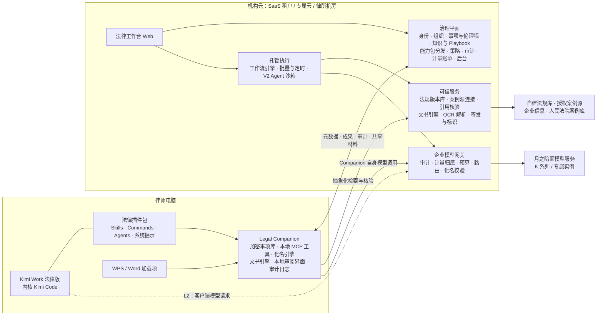

# Kimi Work 法律行业发行版：独立审计与整合方案

日期：2026-09-23｜性质：对 astra 整合方案的独立审计 + 可直接指导立项与研发的整合方案｜证据：6 路联网调研（附录 B），全部结论标注证据等级；价格与指标均为待试点校准的假设。

---

## 0. 结论先行

**一句话定义**：Kimi Work 法律版是面向中国律所的律师 Agent 工作台。律师在本机用 Kimi Work 处理案卷，按本所标准产出可以直接交付的法律文书；每份交付件附带可核验的出处与复核记录；律所在机构云或本所机房统一管理事项、知识、权限、审计与用量。

**审计结论**：astra 的方案是一份高质量的「工程可信性方案」，但还不是「产品整合方案」。它把状态机、引用核验、权限、审批、评测讲得很透，这些应整体保留；问题在于：定位从「Kimi Work 发行版」漂移成「自建托管法律 SaaS、Kimi 作可替换内核」，没有商业闭环，缺用户价值与内容资产设计，人力周期明显低估。

**十个关键决策**

| # | 决策 | 要点 |
|---|---|---|
| 1 | 定位 | Kimi Work 的法律行业发行版＝上游客户端与模型 + 五个增量（能力包、治理、可信服务、服务、生命周期），不是另起炉灶的法律 SaaS |
| 2 | 架构 | **客户端执行，机构治理**。新增 Legal Companion（本地伴随服务）与企业模型网关；托管执行只做批量、定时、Web/Office 渠道。Kimi Work 内核就是 Kimi Code，同一套法律插件两处都能运行 |
| 3 | 授权分层 | L1 插件级立即可做；L2（企业网关与计量归属、集中策略、OEM 客户端、LTS）是与月之暗面谈判的首要目标 |
| 4 | 首发场景 | 合同审查与谈判、案卷整理（含首批 11 类要素式文书）、法律研究与类案检索报告；横切能力：可逆化名、引用核验、签发与标识 |
| 5 | 数据 | 自建官方法规版本库；授权 1–2 家案例源；人民法院案例库作权威核验。**明确禁止**用浏览器自动化驱动律师个人的北大法宝、威科、企查查账号检索或建库（违反服务条款，有判赔先例） |
| 6 | 内容 | 组建法律工程团队生产 Playbook（MVP 24 套 → V2 60 套以上）；本所覆盖层由 FDE 上线；要素式文书与类案报告模板库自建并持续维护 |
| 7 | 模型 | 分级路由 + 结构化流水线（同一份合同，流水线约 ¥4.6，通用 Agent 循环 ¥12–23）；与月之暗面联合建设中文法律 Agent 任务环境与后训练 |
| 8 | 合规 | 按版本确定合同链与监管手续；导出默认带标识，无显式标识导出按《标识办法》第九条走申请与留痕；刑事与高敏材料只走本地或私有化 |
| 9 | 商业 | 团队是首要购买单元；五个版本与价格假设；Token 计量归属写进合作条款 |
| 10 | 组织与节奏 | 首期约 25 人（含 4 名法律工程师），商用期约 50 人；四个阶段，每阶段有退出条件；2027-02 起商用收费 |

**需要领导层拍板的五件事**：架构方向；与月之暗面的谈判清单（第 20.1 节）；首期投入与编制；三家设计合作律所；首发场景与版本定价假设。

---

# 第一部分　独立审计

## 1. 审计范围与方法

| 轮次 | 材料 | 性质 |
|---|---|---|
| 09-14 立项调研 | `kimi-work-legal-research.html`、`research/00-关键判断-running.md` | 市场、竞品、合规、定价、交互范式 |
| 09-17～09-22 Demo V1–V4 | `research/2026-09-17…09-22` 各篇、`演示说明.md`、前端源码 | 信息架构与交互原型 |
| 09-22/23 整合方案 | `research/2026-09-22-Kimi法律发行版-产品与技术整合方案.md` 及 runtime / legal-product / security 三份附录 | 产品与技术整合（本次主要审计对象） |

用五个问题检验：

1. **战略**：它还是不是「Kimi Work 发行版」？凭什么赢？
2. **产品**：律师为什么天天用，合伙人为什么付钱，交付件能不能直接用？
3. **技术**：架构是否建立在已核实的底座事实上，复杂度与阶段是否匹配？
4. **合规与安全**：决定合规负担的结构性决策有没有做出？
5. **商业与交付**：怎么定价、怎么卖、多少人多长时间做成？

## 2. 总体评价

astra 方案回答了「怎样让法律 Agent 的输出可靠、可追溯、可恢复」，这部分质量很高。它没有回答「做什么产品、卖给谁、凭什么赢、怎么赚钱、怎么交付」。约四成篇幅在讨论运行时协议、租约与 fencing token、检查点恢复；律师的日常环境（Word/WPS、微信、本机文件夹）、本所规则的内容生产、交付件规格、买方与用户的分裂、定价与渠道，着墨很少或没有。

## 3. 应当保留的判断（13 条）

1. **四种责任划分**：平台管身份与资源；法律业务层管材料、事实、法源、流程与交付；Agent 在有限授权内分析与调用工具；律师负责专业判断与签发。
2. **事项是权限与知识的边界，成果是交付单位**，不是聊天记录。
3. **三种状态不混用**：生成成功、引文存在、律师签发。执行状态与成果状态分两条线。
4. **底稿与正式交付分离**；内部版、客户版、对方版分别生成，导出前按受众检查隐藏批注、修订痕迹与文档属性。
5. **先做深三条闭环**，不把 36 个入口都当作生产能力。
6. **下一稿回流**：导入新版本、选比较基线，只让受影响的结论失效。
7. **引用四级核验**（存在性、元数据与时效、支持性、律师复核）；生成 Agent 无权写「已核验」。
8. **检索计划冻结与履行检查**：承诺覆盖约定计划，不承诺穷尽。
9. **权限过滤在召回之前**，缓存键含授权范围。
10. **工具网关失败即拒绝**；Hook 失败时放行，只能作辅助（本轮源码核验再次确认）；审批绑定具体对象。
11. **不展示虚假进度与置信度**，只显示可验证的事实。
12. **评测纪律**：盲测与调优分离、双律师标注、按错误类型报告、版本变更触发回归。
13. **Demo 迁移策略**：保留信息架构与交互资产；localStorage 里的「已核对」「模拟就绪」不迁移为有效状态。

## 4. 必须修正的问题（按严重度）

### P1　定位漂移：从「发行版」变成「自建托管 SaaS」（严重）

**现象**：架构把 Kimi Work 放在「入口」，Agent 在服务端 worker 中运行；主路写「已授权 Work Runtime」，备选是「隔离环境内 Kimi Code」。安全附录结论是「可把 Kimi 当可更换的智能执行内核」。

**问题**：
- **主路没有依据**。本轮调研没有找到任何面向第三方的 Kimi Work 服务端 Runtime、SDK 或 headless 接口（查不到）。主路不成立，备选路径「在沙箱里托管 Kimi Code」就成了事实主路，也就是自建托管 Agent 平台，工作量和运维负担最大。
- **放弃了 Kimi Work 对法律行业最有价值的原生能力**：直接处理律师本机文件、原生读写 Office 文件、本地定时任务。上海律协指引第十二条鼓励本地化部署（一手）。
- **与合作模式冲突**。收入的一块来自 Token 分成，「可替换」在商业上自相矛盾；更要紧的是没有设计 Token 消耗如何归属到中软。
- **把中软放进与智合、通义法睿、iCourt 正面竞争的「云端法律助手」赛道**，而这些对手在数据、渠道或价格上有先发优势。

**关键新事实**：Kimi Work 官方表述其内核就是 Kimi Code，第三方逆向也显示两者目录结构一致（一手 + 交叉印证）。这意味着 astra 为服务端设计的 Kimi Code 适配工作并不浪费，但**同一个引擎本来就在律师电脑上运行**，服务端托管不必是主路。

**修正**：客户端执行、机构治理。律师在 Kimi Work 法律版里本地处理案卷；中软建设治理平面、法律能力包、可信服务和企业模型网关。托管执行只用于批量、定时、Web/Office 渠道和禁止本地 Agent 的律所。`AgentRuntimeAdapter` 保留为托管执行与私有化的适配层，目的是韧性，不是替换 Kimi。

### P2　没有商业闭环（严重）

方案第 10 节只写成本构成，明确「首期不写固定单价」；全文没有目标买方、版本、价格区间、渠道、竞品对比、与月之暗面的收益结构。09-14 调研已给出的硬约束（提成制下律所缺所级预算、团队负责人才是钱包、个人工具价格锚 ¥698–3,600、Token 成本与价格锚倒挂）没有被承接。

**修正**：第 14–15 节给出五个版本、价格假设、单位任务成本、计量归属机制与分层进入顺序。

### P3　用户价值与日常工作环境缺位（严重）

律师旅程只以状态机形式出现；Word/WPS 集成「后续再接」；没有微信材料流转、本机文件夹、律所管理系统的设计；没有区分买方（合伙人、团队负责人）与用户（执业律师、助理）。

**修正**：第 7、9、10 节按角色定义价值，把客户端、WPS/Word 加载项、企业微信/钉钉/飞书入口纳入产品形态，逐个场景写明交付件规格与验收标准。

### P4　内容与数据资产没有规划（严重）

没有回答谁来写审查规则、写多少、质量线是什么；法源只写「至少一个授权商业检索源」；没有利用月之暗面在合作中承诺的微调与定制训练。LegalOn 靠律师编写的 Playbook 在同为大陆法系的日本取胜；Harvey Tenet 的真正资产是律师标注的 Agent 任务环境。律所愿意付高价，是因为「AI 按本所标准干活」。

**修正**：第 12 节提出法规版本库自建、案例多源授权、内容工程产量目标、评测集与任务环境资产、联合后训练安排。

### P5　复杂度与阶段错配（中）

租约与 fencing token 逐请求校验、outbox、两类 checkpoint、ACP/KAP 对比、Kimi Code profile 加固，被写成首期内容；而直接决定质量的文书引擎（WPS 兼容）、可逆化名、端侧安全策略、同步模型没有展开。

**修正**：托管 Agent 后移到 V2；首期持久化用成熟工作流引擎或 PostgreSQL 任务表，astra 的语义要求作为验收标准保留。工程资源优先投给文书引擎、引用核验、化名与解析管线。

### P6　合规分析审慎，但结构性决策没做（中）

方案反复强调「需按实际情况判定」，却没有决定：谁和月之暗面签模型服务合同（决定个保法第二十一条下的委托链）、哪个版本需办应用登记、交付文书的标识策略、平台等保级别。

**修正**：第 13 节按版本给出安排，并把 DPA、PIA、登记材料做成交付物。

### P7　人力与周期明显低估（中）

6–8 人、14 周到「有限范围正式服务」。实际范围包含 OCR 管线、真修订 DOCX 与 WPS 兼容、引用核验与法源接入、多租户安全、100–200 个双律师标注评测任务、数据授权谈判、等保测评。**修正**：首期约 25 人、商用期约 50 人，路线图见第 17 节。

### P8　场景目录与竞品同构（中）

Demo 的 36 个场景是「3 业务线 × 9 领域 × 4 任务」，V4 验收记录写明是逐一点击智合 AI 首页 36 个预设后原创改写；只有 2 个场景有完整示例成果。对外演示容易被看作模仿，也稀释焦点。**修正**：场景目录按自有交付件和成熟度重建（生产可用 / 试用 / 模板），首页只露生产可用场景；三条业务线分组保留。

## 5. 三轮成果之间的冲突与裁决

| 议题 | 09-14 立项调研 | Demo V1–V4 | astra 整合方案 | 本方案裁决 |
|---|---|---|---|---|
| 产品形态 | 双形态：Web 管协作与后台，桌面端做本地处理 | 仿 Kimi Work 外观的 Web 工作台 | 托管 SaaS，Agent 跑在服务端 | 客户端执行 + 机构治理；托管执行只做批量、定时、Web/Office 渠道 |
| 主场景 | 企业法务合同审查（已被用户否决） | 3 线 × 9 领域 × 36 场景 | 合同审查、民商事案卷、法律研究 | 同三条闭环，要素式文书提前到 MVP；目录按成熟度分级 |
| 数据来源 | WebBridge 复用律所订阅是「最有价值的差异化」 | MCP 模拟 | 授权商业法源 + 官方核验 | 自建法规库 + 授权案例源 + 官方案例库；**WebBridge 复用订阅违反服务条款，放弃** |
| 标识 | 律师定稿后可去除标识 | — | 预留可配置标识 | 导出默认带标识；无显式标识版本只按《标识办法》第九条申请与留痕；隐式标识始终保留 |
| 模型与成本 | 路由与缓存是毛利工具 | — | 「默认同一已评估模型」 | 分级路由 + 结构化流水线 + 额度；成本模型写入方案 |
| 商业与渠道 | 律协集采优先、规模所私有化 | — | 未定价 | 团队为首要单元；律协渠道降级为待验证（四起集采案例本轮未找到一手公告） |
| Kimi 的角色 | 底座与最强背书 | 外观参照 | 可替换的执行内核 | 发行版底座；Kimi 原生能力是差异化来源 |

## 6. 事实核验与更正

以下口径在既有材料中出现，本轮核验后需要更正或补充（来源见附录 B）：

| 口径 | 核验结果 | 等级 | 对方案的影响 |
|---|---|---|---|
| Kimi Work 最新 3.2.8 | 已到 3.2.12（09-22）；新版均为体验更新，仍无企业版、SSO、审计、集中策略、私有化 | 一手 | 治理层仍须中软自建 |
| 存在可用的 Work 服务端 Runtime/SDK | 未找到官方文档；官方称 Kimi Work 内核是 Kimi Code | 查不到 / 一手 | P1 的依据；客户端执行与托管执行可共用插件 |
| 元典 MCP 2026-08-06 入驻 Kimi | 实为 06-26 接入 Kimi 全系；08-06 是「95% 用户免费」公告；另已接入腾讯 WorkBuddy、阿里 QoderWork、Dify、WPS 智能体 | 一手 | 数据源已同质化，不能作卖点 |
| 07-20 协议即「登月计划」 | 07-20 为《Token 分成及联合创新合作协议》，首期聚焦能源电力，未提法律；「登月计划」是 09-10 的企业合作伙伴计划，5 家并列，未见排他 | 一手 / 交叉 | 法律需单独立项争取资源；没有渠道保护，要快 |
| 海问、竞天公诚使用 Kimi K3 | 属实，为月之暗面直营 | 一手 | 首批目标避开月之暗面直营账户，聚焦规模所中的业务团队 |
| WebBridge 复用北大法宝/威科订阅 | 北大法宝条款第 3.2 条禁止自动化访问，第 4.2 条禁止汇编衍生数据库；企查查爬取有判赔 | 一手 | 放弃该路线，并在法律模式默认禁止 |
| 律师定稿后可去除 AI 标识 | 《标识办法》第四条第二款：导出文件应含显式标识；第九条：用户申请无显式标识内容，须用户协议明确义务、日志留存不少于六个月；第十条禁止恶意删除。法发〔2026〕10 号第十九条把删改标识取得虚假证据列为虚假诉讼手段 | 一手 | 标识流程重设计（第 13.4 节） |
| Hooks 可做化名或强制授权 | kimi-code hooks 仅能放行或拦截，不能改写模型输入与工具返回；失败时放行 | 一手 | 化名放在 Companion 工具层与网关出口 |
| 可以把模型请求指向企业网关 | kimi-code 支持自定义 provider 与 `base_url`；Kimi Work 客户端是否开放待月之暗面确认 | 一手 / 待确认 | 企业网关技术可行，列为 L2 谈判项 |
| Word 加载项可做修订 | Office.js 修订 API（1.4/1.6）只有 Office 2024 LTSC 与 M365 支持，2019/2021 LTSC 不支持；WPS JS API 原生支持修订对象 | 一手 | WPS 加载项优先；服务端 DOCX 引擎是兜底 |
| 律协集采四起案例 | 本轮未找到一手公告 | 查不到 | 律协渠道列为待验证，不作首年收入假设 |
| 宁夏律协 2026-03 指引 | 未找到原文 | 查不到 | 对外材料暂不引用 |
| 人民法院案例库「5,000 余件」 | 5,040 件（2025-07-15 最高法） | 一手 | 作为权威核验源，不作检索主源 |
| K3 / K2.6 价格 | K3 ¥20 / 缓存 ¥2 / 输出 ¥100；K2.6 ¥6.5 / 缓存 ¥1.1 / ¥27（每百万 token） | 一手 | 成本模型已按此更新 |
| Kimi Business ¥4,200/席/年 | 2 席起、上限 150 席确认；单价未在官方页查到 | 部分确认 | 定价时向月之暗面书面确认 |
| Harvey 近况 | Tenet 于 8 月下旬发布，仅向现有企业客户开放；09-09 融资 5.5 亿美元，估值 156 亿美元，ARR 超 4 亿美元；公开部署为多租户 + 区域数据驻留 | 一手 / 交叉 | 背书可用；也要回答「律所为何不直接买 K3 自训」 |
| 新增监管 | 2026-05-08 三部门《智能体规范应用与创新发展实施意见》；TC260《OpenClaw 类智能体部署使用安全指引（征求意见稿）》（2026-03-31）；《人工智能法》尚未提请审议 | 一手 / 交叉 | 端侧 Agent 安全策略须对标 |
| 刑事阅卷 | 《依法保障律师阅卷权利工作规定》（高检发办字〔2025〕314 号，2025-11-10）未明确卷宗能否交第三方工具处理，只要求不得用于辩护代理以外用途 | 一手 | 刑事阅卷只做本地或私有化 |

---

# 第二部分　整合方案

## 7. 产品定义与定位

### 7.1 发行版的五个增量

上游（Kimi Work 客户端与 Kimi 模型）负责通用 Agent 能力。发行版在上面加五样律所单独买不到、月之暗面也不会为单一行业做的东西：

| 增量 | 内容 | 谁建设 |
|---|---|---|
| 法律能力包 | 场景、Skills/Playbook、文书模板、法律连接器（MCP） | 中软法律工程团队 + 设计合作律所 |
| 机构治理 | 身份与 SSO、组织与团队、事项与伦理墙、知识库、策略下发、审计、计量账单、管理后台 | 中软 |
| 可信服务 | 法规版本库与引用核验、真修订 DOCX 文书引擎、可逆化名、标识与签发、信任账本 | 中软 |
| 服务 | 本所规则上线（FDE）、培训、客户成功、支持 SLA | 中软 |
| 生命周期 | LTS 发布通道、版本锁定与回归评测、合规文件（DPA、PIA、登记材料） | 中软 + 月之暗面 |

它**不是**：另起炉灶的法律 SaaS；法律数据库（数据商是供应商）；律所管理系统（不依赖、可对接）；自动出具法律意见的机器（律师签发）。

中软自身在法律与政法领域没有既有业务，AllMeta 平台也没有法律模块（一手核验）。所以法律专业能力要靠自建法律工程团队与设计合作律所，中软贡献的是平台工程、交付与政企客户关系。

### 7.2 用户与买方

| 角色 | 在产品中做什么 | 在乎什么 | 产品给什么 |
|---|---|---|---|
| 执业律师 / 授薪律师 | 主力使用者 | 少加班；交付件能直接用；不被 AI 坑 | 下载即可交付的文书；每条依据能点回原文；下一稿回流 |
| 律师助理 / 实习律师 | 材料整理、初稿 | 学会本所标准，少返工 | Playbook 解释「为什么这样改」 |
| 团队负责人 / 合伙人 | 买单、分派、签发 | 团队产能、质量一致、客户满意、执业风险 | AI 执行本所规则；签发流；团队用量与质量看板；效率证明（可向客户解释收费） |
| 律所管理层 / 知识管理 / IT | 采购与治理 | 保密、合规、可控、可审计 | 伦理墙、审计、策略下发、私有化 |
| 律协 / 司法局 | 集中采购（待验证） | 会员福利；规范落地 | 合规使用培训 + 联合品牌版本 |

提成制律所的钱包在团队负责人手里，**第一购买单元是团队**，不是个人，也不是全所。

### 7.3 竞争定位

| 对手类型 | 代表 | 他们的强项 | 我们不比什么 | 我们赢在哪里 |
|---|---|---|---|---|
| 云端法律助手 | 智合 AI 3.0、iCourt AlphaClaw、慧多宝 | 场景广、渠道深、已宣称 Agent 与私有化 | 场景数量、价格 | 本机执行 + 可逆化名；真修订与下一稿回流；本所 Playbook；信任账本 |
| 数据商 | 北大法宝、威科、元典、法信 | 数据规模与权威 | 数据规模 | 把数据接进律师工作流并做确定性核验；数据商是供应商 |
| 云厂商法律产品 | 通义法睿 | 云与价格体系 | 通用问答 | 交付件、机构治理、律师工作流 |
| 通用 AI | DeepSeek、豆包、Kimi 通用版 | 免费 | 对话体验 | 权威法源、核验、本所规则、机构治理 |
| 律所「买 K3 自训」 | Harvey 路径 | 模型可控 | — | 联合法律模型 + 治理 + 内容 + 交付，自训成本与周期律所承担不起 |

注意：Word/WPS 插件、私有化、审计协作在 2026 年已是入场券，不是亮点。竞品已普遍宣称具备；我们按最低配置规划，差异化放在上表右列。

## 8. 设计原则

1. **事项为中心**：材料、任务、成果、权限、成本都挂在事项上。
2. **交付件为单位**：每个场景用「下载即可交付」的文件定义完成标准。
3. **本地执行，机构治理**：案卷默认留在律师本机或本所；治理数据进机构云。
4. **每个论断可回溯，每个动作有记录**。
5. **律师签发**：AI 起草，律师定稿；生成、核验、签发三态分明。
6. **本所标准由 AI 执行**：Playbook 是人机之间的契约。
7. **状态诚实**：只显示可验证的事实，不显示虚假置信度。
8. **经济性内建**：路由、结构化流水线、额度与计量是架构要求。

## 9. 产品形态与触点

| 触点 | 主要用户 | 用途 | 阶段 |
|---|---|---|---|
| Kimi Work 法律版（桌面客户端） | 律师 | 主工作台：处理本机案卷、执行 Agent 任务、生成文书 | MVP |
| 法律工作台（Web；本机 Companion 与机构云共用一套前端） | 律师、合伙人 | 结构化审阅：修订卡、证据矩阵、引用面板；签发；团队协作 | MVP |
| 管理后台 | 管理员、知识管理 | 组织与成员、策略、Playbook 发布、插件版本、审计、用量 | MVP 基础 / V1 完整 |
| WPS 加载项（优先）/ Word 加载项 | 律师 | 在文档里审阅与应用建议；Word 侧只覆盖 M365 与 Office 2024 | V1 |
| 企业微信 / 钉钉 / 飞书入口 | 律师、助理 | 把客户发来的材料转进事项；任务通知；移动签发 | V1 |
| 客户协同空间 | 企业法务 + 外部律师 | 共享事项、交付与反馈 | V2 |

Demo 的信息架构（工作台、项目与文件、法律 Skills、知识与资料、连接、任务中心、交付中心）整体保留为法律工作台骨架，「事项」取代「项目」成为一级对象。Demo 源码作为设计规格与销售演示基线保留，生产前端用 TypeScript 重建（astra 第 3 节的迁移映射表沿用）。

律所管理系统（iCourt、法蝉等）没有公开 API（查不到），产品不依赖它们；核心流程必须独立跑通，对接走商务合作，V2 以后再议。

## 10. 首发工作流与交付件

### 10.1 首发范围

| 候选场景 | 频次 | 交付件清晰度 | 外部数据依赖 | 差异化空间 | 风险 | 结论 |
|---|---|---|---|---|---|---|
| 合同审查与谈判 | 高 | 高 | 低 | 本所规则、真修订、下一稿回流、受众分版 | 中 | **MVP** |
| 案卷整理（证据、时间线、质证） | 高 | 高 | 低 | 长卷宗流水线、页级回链、微信截图证据 | 中 | **MVP** |
| 要素式起诉状 / 答辩状 | 高 | 高（法定结构） | 低 | 复用案卷要素；自建 67 类样式库（无官方统一下载） | 低 | **MVP 首批 11 类，V1 扩到 67 类** |
| 法律研究与类案检索报告 | 中高 | 高（第八条要素） | 高 | 法定要素、权威顺序、时效核验、检索留痕 | 中 | **MVP（限定数据源）** |
| 尽调矩阵 | 中 | 高 | 中 | 行=文件、列=问题 | 中 | V1 |
| 刑事阅卷 | 中 | 高 | 低 | 仅本地 / 私有化 | 高 | V2（私有化旗舰） |
| 法律翻译 | 中 | 高 | 低 | 术语库 | 低 | V2 |

### 10.2 合同审查与谈判（非诉 / 企业法务）

**输入**：合同（DOCX 优先；PDF 与扫描件降级处理并标出）、我方身份与立场、交易背景、本所 Playbook、审查尺度、交付对象。

**流程**：
1. 解析：条款树、定义术语、交叉引用、金额 / 日期 / 主体抽取；低质量页单列。
2. 选 Playbook：按合同类型与立场推荐，律师确认。
3. 逐条审查：每个风险项含原条款定位、触发的规则（首选立场、可退让至）、问题、影响、建议文本、依据（法条带版本与效力状态）、谈判说明。红（不可接受）/ 橙（需谈判）/ 黄（提示）。
4. 完整性与一致性：缺失条款按 Playbook 清单查；定义术语、金额大小写、日期、主体名称、交叉引用用确定性规则校验。
5. 律师审阅：修订卡（原文 / 建议 / 规则 / 接受、修改、拒绝），键盘操作；拒绝原因回流 Playbook。
6. 生成交付件：修订稿（真修订，作者可署律师本人）、清洁稿、审查意见书（给客户）、谈判要点（内部，不外发）、对方版（只保留有意提供的修订）。
7. 下一稿回流：对方回稿后对比，区分已确认修改与新变更，只重审受影响条款。

**验收**：Word 与 WPS 均能打开、逐条接受或拒绝修订、保存再打开；编号、表格、页眉页脚不损坏；金额与主体不被误改；每个风险项定位到原条款；引用法条的版本与效力经核验。

### 10.3 案卷整理与诉讼文书（诉讼仲裁）

**输入**：起诉状 / 答辩状、证据（合同、发票、转账凭证、微信聊天截图、邮件）、笔录、裁判文书；我方地位、案由、程序阶段。

**流程**：
1. 材料入库：OCR、证据类型分类、去重、页码与卷内编号；聊天截图识别为结构化消息；低质量页提示重扫。
2. 事实抽取：事件（日期、主体、行为、金额）加原页锚点；标注「材料记载 / 当事人陈述 / 推断 / 有争议」。
3. 时间线：按发生日排序，同时保留文件形成日。
4. 证据目录：编号、名称、来源、页码、证明目的、对应待证事实。
5. 争点—证据矩阵：争议焦点 × 支持 / 反对证据 × 缺口。
6. 质证意见：对对方证据三性与证明力的意见草稿，逐条由律师确认。
7. 补证清单：按对争点的重要程度排序。
8. 要素式文书：用已抽取要素填入要素式起诉状 / 答辩状样式（MVP 首批 11 类）。

**验收**：每项事实能回到原页；不擅自认定证明力；证据目录与要素式文书稍改即可提交。

### 10.4 法律研究与类案检索报告

**输入**：争点、事实摘要、法域、适用基准时点（事实发生日或合同签订日）、立场、检索范围。

**流程**：
1. 检索计划：争点 × 规范类型 × 法域 × 时间矩阵，律师确认后冻结。
2. 法规检索：按基准时点从法规版本库取适用版本；司法解释、地方规定一并处理。
3. 案例检索：授权案例源 + 人民法院案例库；按权威顺序排列（指导性案例、最高法典型或参考案例、本省高院参考案例、上级法院与本院生效裁判），近三年优先；支持与相反类案都列。
4. 类案比对：基本事实、争议焦点、法律适用三个维度分别说明相似与差异。
5. 核验：案号格式与法院代字、存在性、摘录一致性、法规时效。
6. 输出：研究备忘录（结论、依据、相反观点、风险、未决问题、检索记录）；类案检索报告（按《关于统一法律适用加强类案检索的指导意见（试行）》第八条要素：检索主体、时间、平台、方法、结果、类案裁判要点、待决案件争议焦点、参照或参考的说明）。

**验收**：零伪造引用进入签发版；检索计划覆盖情况可见；数据源不可用时标「部分完成」。

### 10.5 横切能力

- **可逆化名**：发往云端模型前，把证件号、电话、账号、地址、自然人姓名、可选的企业名称换成事项内一致的化名（如「甲公司」「自然人 A（原告）」），本地还原；需要真名的工具在本地执行。研究显示，保持实体一致映射的可逆化名明显优于删除或泛化（交叉印证，附录 B）。**对外交付的脱敏**另做，覆盖正文、批注、修订、属性、图片与附件。
- **引用核验与拦截可见**：显示「本次拦截 2 条无法核实的案号」，不静默删除。
- **签发与标识**：草稿 → 律师编辑 → 复核 → 签发；导出标识按第 13.4 节。
- **信任账本**：每份交付件记录输入材料版本、法源版本、Playbook 版本、模型版本、核验结果、人工修改与签发，可导出「出处与复核记录」附件。
- **效率证明**：按事项统计处理量、修订轮次与用时，供合伙人向客户解释固定收费或成果收费。

### 10.6 场景目录重构

- 生产可用：合同审查、案卷整理、要素式文书、法律研究与类案报告、脱敏。
- 试用（标 Beta）：尽调矩阵、合同起草、律师函、合规审查、劳动争议测算等。
- 模板：其余场景只提供结构化底稿。
- 首页只露生产可用场景；诉讼仲裁、非诉业务、企业法务三条业务线分组保留。

## 11. 技术架构

### 11.1 总体：一套法律内核，两种驻留，两种执行

- **两种驻留**：案卷原件默认在律师本机加密事项库；律师选择「共享到团队」后才进入机构存储。成果、元数据、审计按策略同步。
- **两种执行**：交互式工作在客户端执行；批量、定时、Web/Office 渠道、禁止本地 Agent 的律所用托管执行。
- **共享部分**：同一套法律能力包（SKILL.md 格式，客户端与托管 Kimi Code 通用）、同一企业模型网关、同一事项与审计后端、同一套前端代码。

### 11.2 运行时策略

| 运行时 | 用途 | 实现 | 阶段 |
|---|---|---|---|
| 客户端（主） | 律师交互式处理本机材料 | Kimi Work + 法律插件包 + Companion | MVP |
| 托管流水线 | 定义清楚的批量任务、定时任务、Web 与 Office 渠道 | 工作流引擎直接调用模型 API；确定性步骤用代码 | V1 |
| 托管 Agent | 开放式任务的服务端执行 | Kimi Code（ACP）在隔离沙箱运行，按 astra 的 `AgentRuntimeAdapter` 契约与安全要求 | V2 |

### 11.3 Legal Companion（本地伴随服务）

把「本地优先」从口号变成可交付软件的关键组件：

- **形态**：签名安装包（Windows MSI / macOS pkg），用户级常驻服务，随 LTS 通道更新。对 Kimi Work 以本地 stdio MCP 暴露工具（Kimi Code 插件支持本地 stdio MCP，一手）；对本地审阅界面与加载项提供仅限本机、令牌鉴权的接口。
- **加密事项库**：原件不可变版本与 hash、解析文本与锚点、成果版本、追加式审计日志（hash 链）、同步队列；密钥放系统钥匙串；支持管理员吊销。
- **本地 MCP 工具**：`matter.open`、`materials.list / read_excerpt / get_page`（按事项策略返回化名文本）、`findings.propose`、`citations.check`（向云端核验服务发抽象化查询）、`artifacts.create_draft / render_docx`、`redact.export`。
- **化名引擎**：规则（证件号、手机号、银行卡、统一社会信用代码、案号）+ 中文实体识别 + 事项当事人词典；同一事项映射一致；映射表只存本机；四档策略（关闭 / 标识符 / 加自然人 / 加机构）。
- **为什么化名放在这里**：kimi-code 的 Hooks 只能放行或拦截，不能改写模型输入，失败时还会放行（一手）。所以化名不能靠 Hook，只能由 Companion 在返回材料时完成，并由企业网关在出口做二次校验。

### 11.4 企业模型网关

对外提供 OpenAI 兼容端点（kimi-code 支持 `type=openai` + 自定义 `base_url`，一手）。功能：按租户、事项、用户、任务归属计量；预算与硬限额；路由策略；化名校验（发现未替换的直接标识符即拦截或补替换）；审计（hash + 加密正文，按留存策略）；只在经评测的等价模型间故障切换。

覆盖范围取决于授权层级：L1 只覆盖 Companion 与云端服务自身的调用；L2 起客户端模型请求也经网关，由集中配置锁定 provider，禁止用户自建。**网关既是化名的最后一道关，也是分成收入的账本**，应作为与月之暗面谈判的首要能力项。

### 11.5 法律工具网关与连接器

云端提供 `sources.search / get_version`（法规版本库）、`cases.search`（授权案例源适配器）、`enterprise.lookup`（企业信息）、`citations.verify`。网关从签名能力令牌取得租户与事项，拒绝模型自报身份；对外部数据商默认只发抽象争点与必要要素，不发客户名称；按数据商许可控制缓存与展示；按租户计配额。MCP 按 2026-07-28 版规范实现，并强制 OAuth（规范中授权仍为可选，一手）。

### 11.6 数据模型与信任账本

沿用 astra 方案第 7.2 节核心对象（Matter、DocumentVersion、EvidenceAnchor、LegalSourceVersion、Claim、CitationEdge、Finding/Revision、ArtifactVersion、Run/Approval/AuditEvent），新增：

- `PlaybookVersion`：规则集与覆盖层版本，任务固定引用
- `PseudonymMap`：只存本机，按事项隔离
- `Deliverable`：受众（内部 / 客户 / 对方 / 法院）、标识策略、导出检查记录
- `SignOff`：签发人、版本、声明、时间
- `UsageRecord`：租户、事项、用户、任务、模型、token、数据调用、费用归属

「信任账本」同时满足上海律协指引第十七条的留痕要求，也是律所在纠纷中证明已尽注意义务的证据；杭州互联网法院 2026-01 的 AI 幻觉案认定平台已尽「显著提示、功能可靠性、合规备案」义务而无过错（交叉印证），说明这类记录有实际法律价值。

### 11.7 文档管线、文书引擎与引用核验

- **文档管线**：沿用 astra 第 7.1 节。OCR 选可私有化的 PaddleOCR-VL 或 DeepSeek-OCR（许可证宽松）；MinerU 为 AGPL，对外服务须法务评估，默认不用；不默认调用公有云 OCR。印章、手写、表格需专项语料与人工复核。
- **文书引擎**：服务端与 Companion 同一实现。批量生成可选 Aspose.Words（商业，修订 API 成熟）或基于 OOXML 的自研实现；python-docx 原生不支持修订。WPS 对修订与批注的兼容性没有官方一手文档，必须自建 Word/WPS 往返回归集。无法安全定位时退为批注，禁止错位替换。
- **引用核验**：先做确定性检查（案号格式、法院代字表、序号异常模式、存在性、摘录一致、法条版本与效力），再做模型辅助的支持性检查，最后律师复核。
- **检索**：Qwen3-Embedding + Reranker 为基线，BGE-M3 备选；法律领域没有权威榜单，用自建评测集决定。

### 11.8 安全边界

在 astra 的云端三道边界（资源、工具、业务）之上补充端侧。对标业界做法（Claude Code 托管配置、Cursor 团队策略、GitHub Copilot 企业 MCP 白名单）：**MCP 白名单 + 工具粒度拒绝 + 机器分发的托管配置**。

- **法律模式默认策略**（L2 需客户端支持集中下发）：默认不开放 Shell；文件访问限事项库与指定目录；内置浏览器与 WebBridge 只允许白名单法律站点，禁止驱动律师个人数据库账号；MCP 只允许签名的法律连接器；案卷目录中的 `.agents`、配置、hooks 不被自动发现；出站只允许网关与白名单。
- **Companion 加固**：事项库加密；本地接口只监听本机并校验令牌；导出前检查隐藏内容。
- **红队**：提示注入导致外泄已有生产级案例（EchoLeak / CVE-2025-32711），发布门槛包含注入与外泄红队测试。
- **规范对标**：《智能体规范应用与创新发展实施意见》与 TC260 智能体部署安全指引（征求意见稿）。

### 11.9 部署拓扑

| 拓扑 | 治理与可信服务 | 案卷存放 | 模型 | 面向 |
|---|---|---|---|---|
| SaaS 多租户（境内云） | 中软运营 | 本机为主；共享材料在租户存储 | 经网关调用月之暗面 API | 专业版、团队版 |
| 专属租户 / 专属云 | 中软运营、单租户 | 同上 | 同上或专属模型实例 | 律所版 |
| 私有化 | 律所机房 | 律所机房 | 经律所网关调用 API（化名）或本地模型 | 私有化版 |
| 离线事项 | 仅本机 | 仅本机 | 仅化名后调用，或禁用 AI | 任意版本的高敏事项 |

### 11.10 与授权层级的适配

| 能力 | L1 插件级（公开能力即可） | L2 OEM / 企业配置级（需月之暗面支持） | L3 深度共建 |
|---|---|---|---|
| 分发与品牌 | 插件包 + Companion 安装包 | 预装法律插件的发行版客户端、联合品牌 | 官方渠道上架 |
| 模型请求 | 律所自有 Kimi 账号直连 | 经中软企业网关 | 联合法律模型 |
| 化名覆盖 | 经 Companion 读取的材料 | 所有发往模型的内容（网关二次校验） | 同 L2 |
| 策略管控 | 使用规范 + 安装时配置 | 集中下发工具、目录、浏览器、MCP 白名单 | 同 L2 |
| 审计 | Companion 记录 + Hook 观测 | 网关全量记录 | 同 L2 |
| 计量归属 | 仅 Companion 与云端服务 | 全量 | 全量 |

MVP 按 L1 即可交付；L2 是商用版目标形态；L3 视合作深度推进。

## 12. 数据、内容与模型战略

### 12.1 法源

| 类别 | 做法 | 依据 |
|---|---|---|
| 法律、行政法规、司法解释、部门规章、地方法规 | **自建版本库**：国家法律法规数据库、国务院与部委规章库、最高法权威发布、地方人大与政府网站；记录公布、施行、修改、失效；每日更新 | 官方文件依《著作权法》第五条不受著作权保护；flk 只有未公开的内部接口、无 SLA，采集需容错 |
| 案例 | **采购 1–2 家**：元典（已接入 Kimi，多数用户免费）或法意（公开套餐，可私有化）优先；北大法宝 MCP 未公开价格，且条款禁止转售与衍生库，多租户转供需专项授权 | 条款与价格见附录 B |
| 权威核验 | 人民法院案例库（5,040 件，2025-07）、最高法公报 | 不作检索主源 |
| 企业信息 | Kimi 内置天眼查插件；企查查 MCP 作备选 | 不自签来源不明的数据商 |
| **禁止** | 驱动律师个人账号批量检索或建库；汇编数据商数据对外分发；爬取裁判文书网 | 北大法宝条款第 3.2、4.2 条；企查查判赔先例 |

引用核验最小权威数据集：自建法规版本库 + 最高法司法解释 + 人民法院案例库 + 一家授权案例源。

### 12.2 内容工程：把「本所标准」做成产品

**Playbook 结构**：合同类型 × 我方立场 × 审查尺度 → 条款规则集。每条规则含：编号、适用条件、首选立场、可接受范围、可退让至、不可接受情形、标准修改文本、法律依据（链接法规版本库）、风险等级、对客户的解释话术、谈判说明。

**基础库产量**：MVP 24 套（12 类高频合同 × 2 个立场：买卖、采购、服务、技术开发、软件许可、股权转让、增资与投资、借款、担保、房屋租赁、劳动合同、保密协议）；V1 40 套；V2 60 套以上。1 名法律工程师约 2 周完成 1 套（起草 + 20 份合同回测）。

**本所覆盖层**：FDE 上线时把律所标准写成覆盖层，叠加基础库，合伙人签发生效，历史任务固定当时版本。

**模板库**：要素式文书 67 类（无官方统一下载入口，需自建并跟踪地方差异，本身就是壁垒）、类案检索报告（无官方统一模板）、证据目录与质证意见、研究备忘录、常年法律顾问文书。

**质量线**：每套 Playbook 至少 20 份合同、2 名律师回测；红色风险项召回 ≥ 95%；每次修改跑回归。

### 12.3 评测集与任务环境：最长期的资产

- **评测集**：MVP 200 个任务 → V1 1,000 个；分层、双律师标注、盲测分离。Harvey 已把 LAB 基准以 MIT 协议开源（1,200+ 任务、75,000+ 评分细则，偏英美法），可参照其结构建设中文版。
- **Agent 任务环境**：任务说明 + 材料 + 模拟工具 + 律师评分细则。2027 年中 300 个，年底 1,000 个以上。
- **数据来源**：去标识的公开裁判文书、合成合同与案卷、许可允许训练的授权数据。设计合作律所的真实材料只用于该所租户内评测，不进入训练，除非另签书面授权。
- **联合后训练**：月之暗面在 K 系列上做后训练，中软提供任务环境与标注。条款需明确：环境与标注归中软；权重归月之暗面；中软法律发行版享有优先或独占使用期；推理计费纳入分成。这也是对「律所为何不自己买 K3 自训」的回答。

### 12.4 模型策略

- **分级**：法律判断步骤（风险分析、起草、研究综合）用旗舰模型；抽取、分类、摘要用较低价模型；核验与格式化用代码。K2.8 已全量上线且全档 1M 上下文，是否替代 K3 做部分步骤由评测决定。
- **结构化流水线**：定义清楚的流程逐条款、逐文件处理；稳定前缀（系统提示 + Playbook + 文档）命中缓存；只召回相关片段。
- **质量纪律**：路由在评测集上验证；LTS 锁定模型版本；模型变更触发回归；不为可用率静默降级。
- **私有化选项**：经律所网关调用 API 并化名；专属实例；本地小模型做抽取与化名 + 云端推理；完整本地部署只面向最大客户。月之暗面已适配昇腾等国产算力（交叉印证），专属部署的产品形态需书面确认。

## 13. 合规与信任设计

### 13.1 三方角色与合同链（按模式）

| 模式 | 律所 | 中软 | 月之暗面 | 合同要点 |
|---|---|---|---|---|
| L1：律所自有 Kimi 账号 | 个人信息处理者 | 仅处理元数据、成果与审计（受托人） | 律所的直接受托人 | 律所与月之暗面、律所与中软分别签；中软不经手模型调用内容 |
| L2：经中软网关 | 处理者 | 受托人 | 中软的次级受托人 | 个保法第二十一条：转委托须经**律所**同意，DPA 中列明月之暗面及其处理范围、是否训练、留存与删除 |
| 私有化 | 处理者 | 运维受托（按需、临时授权） | 视模型部署方式 | 运维访问限时、审批、留痕 |

三方关系没有权威解读可直接援引（查不到），以上按个保法委托处理框架设计。月之暗面若对数据有训练、留存等自主决定，可能构成独立或共同处理者，必须在协议中排除或明确。委托处理触发个保法第五十五条的影响评估，报告保存至少三年；PIA 模板作为交付物。

### 13.2 监管手续

- 《生成式人工智能服务管理暂行办法》第二条：未向境内公众提供服务的不适用（一手）。律所私有化、只供本所律师使用，可主张内部应用。
- 面向多家律所开放注册的 SaaS，是否具「公众属性」没有专门口径（查不到）。实践中网信办按「国家备案 + 地方登记」管理调用已备案模型的应用（09-14 公告：7–8 月新增 124 款备案、133 款登记，交叉印证）。**建议 SaaS 版按调用已备案模型的应用办理属地登记**，产品页公示所用模型名称与备案信息。
- 等保：面向律所的 SaaS 承载大量个人信息，按三级建设与测评（行业惯例，非专门规定）。

### 13.3 律协指引 → 产品功能

| 条款（上海律协居村指引，一手） | 产品功能 |
|---|---|
| 第十二条：鼓励本地化部署 | 本机事项库；私有化版；离线事项 |
| 第十五条：云端 AI 须事先征得当事人同意；生物识别、宗教、医疗、金融账户、行踪轨迹等不宜提供给云端 | 事项创建时记录客户同意；敏感类信息识别后硬拦截发往云端，只能本地或私有化处理 |
| 第十六条：输出前后质量控制与交叉验证 | 引用四级核验；拦截可见 |
| 第十七条：记录使用情况 | 信任账本（输入、生成、修改、签发） |
| 第二十九条：未脱敏材料不得提供给非本地化 AI | 可逆化名；敏感材料只走本地 |
| 企业法律顾问指引（2026）：律师承担最终判断责任 | 签发门禁；签发声明 |

### 13.4 生成内容标识与签发

依据《标识办法》第四条第二款、第九条、第十条及法发〔2026〕10 号第十九条（一手），09-14 调研「定稿后去除标识」的设计改为：

1. **默认**：导出文件带显式标识（文本含「人工智能生成 / 合成」字样，位置按 GB 45438-2025），并写入隐式元数据标识。
2. **无显式标识导出**：律所管理员在用户协议中明确律师的标识义务与使用责任后，律师可按事项申请导出不含显式标识的版本；系统留存申请人、事项、文件版本等日志不少于六个月（第九条）。签发流程完成是申请的前置条件。
3. **始终保留**：隐式元数据标识不提供删除功能；系统不提供批量清除标识的工具（第十条第二款禁止为他人删除标识提供工具）。
4. **证据类材料**：图片、音视频、聊天记录等证据的任何 AI 处理结果一律保留标识，不提供去标识，避免触碰第十九条关于虚假证据的红线。
5. 标识办法本身对内部应用是否适用有解释空间（第二条挂钩三部规章）；**产品按最严口径默认，由律所在合规负责人确认后调整**。

### 13.5 刑事与高敏材料

刑事卷宗材料只能用于本案辩护代理，最高检 2025-11 新规未明确能否交第三方工具处理（一手 + 推测风险）。刑事阅卷只在私有化版或离线事项中提供，默认不经云端模型；产品页明确这一承诺。

### 13.6 数据生命周期

沿用 astra 第 9.3 节：数据流表、事项记忆局限本案、知识库只收批准内容、删除覆盖原件与派生物与索引与缓存、备份到期清除、法律保留可表达、审计正文单独加密。

## 14. 商业模式

### 14.1 版本与价格假设

以下价格都是**待设计合作试点校准的假设**。依据：个人工具 ¥698–3,600/年；通义法睿合同审查基础版 ¥1 万/年、标准版 ¥10 万/年（一手）；机构采购 ¥4 万–50 万/年；Harvey 中型所约 $1,000–2,000/席/月、Legora 约 $3,000–8,000/席/年（交叉，海外）；以及第 14.2 节的成本模型。

| 版本 | 目标客户 | 包含 | 价格假设 | 部署 |
|---|---|---|---|---|
| 专业版 | 个人律师、2–4 人小团队 | 客户端法律插件 + Companion + 标准能力包 + 公共法规库 + 月度交付件额度 | ¥3,600–4,800/人/年 | SaaS |
| **团队版（首要）** | 5–50 人业务团队，团队负责人付费 | 专业版 + 团队事项与共享材料 + 基础 Playbook 与 1 套本所覆盖层 + 审计与用量看板 + 企业微信/钉钉/飞书登录 + 共享额度池 | ¥8,000–12,000/席/年，5 席起 | SaaS |
| 律所版 | 50 人以上规模所 | 团队版 + 全所知识库与伦理墙 + 多套覆盖层（FDE）+ 完整后台 + 专属客户成功 | 平台费 ¥20 万–50 万/年 + 席位 | 专属租户 / 专属云 |
| 私有化版 | 头部所、有高敏或刑事业务的律所 | 律所版 + 治理、可信服务、网关本地部署 + 模型部署选项 | 首年 ¥150 万–500 万（含实施），此后年费 15%–20% + 模型费用 | 律所机房 |
| 律协 / 司法局版（待验证） | 省市律协、区律工委、司法局 | 联合品牌、会员基础额度、合规使用培训、向团队版转化 | ¥50 万–300 万/年 | SaaS |

加购：授权法源包（成本加管理费）、批量任务点数、法律翻译、额外覆盖层（FDE 人天）。

两条定价纪律：
- **不做「不限次」**。额度用「交付件点数」表达（1 份合同审查 = 若干点），律师看得懂，也能挂到事项上核算。
- **公开专业版与团队版价格**。国内同类几乎都不公开，LegalOn 也在 2026-07 下线了报价页；透明价格能把团队负责人的决策周期从几周缩短到几天。

### 14.2 单位经济

按一手核实的价格（K3：输入 ¥20、缓存 ¥2、输出 ¥100；K2.6：¥6.5、缓存 ¥1.1、¥27；每百万 token），结构化流水线下：

| 任务 | 模型成本 | 非模型成本 | 合计 | 若用通用 Agent 循环 |
|---|---|---|---|---|
| 合同审查（30 页，约 2 万字） | ¥4.4 | ¥0.3 | **约 ¥4.6** | ¥12–23 |
| 案卷整理（300 页扫描，约 15 万字） | ¥8.5 | ¥6（OCR） | **约 ¥14.5** | 约 ¥34 |
| 法律研究（3 个争点） | ¥8.0 | ¥15（数据调用，假设 30 次 × ¥0.5） | **约 ¥23** | — |
| 要素式起诉状（基于已整理案卷） | ¥1.7 | ¥0.2 | **约 ¥1.9** | — |
| 短任务 | ¥0.5 | — | **约 ¥0.5** | — |

活跃律师的年度直接成本：轻度约 ¥1,200、中度约 ¥3,600、重度约 ¥8,700。团队版 ¥8,000–12,000/席在中度用户上可以做到 60% 以上毛利，重度用户靠额度与点数控制。

结论：
1. **上下文工程是最大的毛利杠杆**。同一任务，流水线与通用 Agent 循环相差 3–5 倍；首发场景必须做成流水线。
2. **研究场景的成本大头是数据调用**。谈判优先争取按租户包年。
3. 测算脚本与参数保存在本次工作目录，试点期按实测 P50 / P95 校准后再冻结价格。

### 14.3 与月之暗面的收益结构与计量归属

中软收入：法律层订阅、交付服务（FDE、定制、私有化实施）、Token 消耗分成。第三部分取决于 Token 能否识别为经中软产生：

| 模式 | 模型调用走谁的账户 | 归属 | 适用 |
|---|---|---|---|
| A 律所自有 Kimi 账号 | 律所 | 需月之暗面按渠道标记客户；否则只有 Companion 与云端服务调用归属中软 | L1 过渡期 |
| **B 中软企业网关（推荐）** | 中软企业账户 | 全量归属，网关账本即分成依据 | L2 商用 |
| C 发行版席位 | 中软统一采购、按席位转售 | 按合同 | 视月之暗面席位政策 |

07-20 协议首期只覆盖能源电力（一手），**法律发行版需要作为新增行业单独立项**，把模式 B、行业席位价与法律渠道分工一起谈。

## 15. 市场进入

### 15.1 目标客户与顺序

| 顺序 | 客户 | 为什么 | 周期 | 首单形态 |
|---|---|---|---|---|
| 1 | 百人以上规模所中的业务团队（北上广深杭优先，腰部规模所） | 团队负责人有预算与决策权；交付压力明确；月之暗面直营与 iCourt 深度绑定的所（如盈科）之外空间大 | 1–3 个月 | 团队版试点转付费 |
| 2 | 中软央国企与金融客户的外聘律所 | 客户法务牵引外部律师使用统一工具与标准；中软独有的关系杠杆（不把央国企法务当主场景） | 6–12 个月 | 团队版 / 客户协同空间 |
| 3 | 头部所与高敏业务律所 | 客单价高，要私有化；多数目前外购而非自研（未发现一手自研证据） | 6–18 个月 | 私有化版 |
| 4 | 律协、区律工委、司法局（待验证） | 覆盖面大，但集采证据本轮未能核实 | 先验证 | 律协版 |
| — | 月之暗面直营的头部所（海问、竞天公诚等） | 与月之暗面联合拜访，只卖治理与本所规则层，不抢直营 | 视约定 | 律所版增量 |

### 15.2 设计合作律所（第 0 阶段签 3 家）

组合：1 家非诉为主的所（合同审查、尽调）+ 1 家诉讼为主的规模所（案卷、要素式文书）+ 1 家已有内部科技团队的区域规模所。条件：律师评测投入与脱敏样本；换取免费期、联合品牌、优先定制。

### 15.3 叙事

- **给合伙人**：全球估值最高的法律 AI 公司选用的模型底座，按本所标准干活，每份交付件都有出处与复核记录。
- **给律师**：在自己电脑上处理案卷，结果直接是能交出去的 Word，每一条都能点回原文。
- **给管理层**：按律协 AI 指引逐条设计：本地处理、化名、交叉验证、全程留痕、律师签发、合规标识。

## 16. 交付、运营与组织

### 16.1 交付模型

上线三步：**沙盒**（2–4 周，1–2 个团队、10–20 名律师、20–30 个真实事项）→ **本所规则上线**（4–8 周，法律工程师与合伙人把标准写成覆盖层，回归后签发）→ **铺开与运营**（培训、用量与质量看板、季度 Playbook 复盘）。一组 FDE + 法律工程师 + 客户成功经理覆盖 3–5 家律所。

### 16.2 客户成功与培训

按业务线的 2 小时实操课，结合律协指引讲「合规地用」；每个团队一名「AI 联络律师」收集拒绝原因；季度业务回顾（交付件数、采纳率、返工率、节省时长、Playbook 变更）。

### 16.3 发布通道与支持

上游 Kimi Work 一周多次发版（3.2.9–3.2.12 在 8 天内发布）。发行版提供 **LTS 通道**（季度发布，锁定客户端、Kimi Code 内核与插件版本，回归通过才推送）与**快速通道**。支持 SLA：工作日 9–21 点在线；P1 故障 30 分钟响应、4 小时恢复或给出绕行方案。

### 16.4 团队编制

| 职能 | 首期（第 1–4 月） | 商用（第 5–12 月） | 说明 |
|---|---|---|---|
| 产品与设计 | 3 | 4 | 含 1 名有律所背景的法律科技产品负责人 |
| 法律工程师 | 4 | 8 | 执业 3 年以上；Playbook、评测集、规则上线 |
| 客户端与 Companion | 3 | 4 | 插件、本地服务、化名引擎 |
| Web 工作台与后台 | 3 | 5 | Demo 迁移到 TypeScript 生产前端 |
| 后端与治理平面 | 3 | 5 | 可复用 AllMeta 的权限、流程、集成总线 |
| 文书与解析 | 2 | 3 | OCR、DOCX 修订引擎、WPS 兼容 |
| 法源与核验 | 2 | 3 | 法规版本库、案例源、引用核验 |
| 评测与模型 | 1 | 3 | 评测平台、路由、联合后训练对接 |
| 安全与运维 | 1 | 3 | 等保、红队、SRE |
| 测试 | 1 | 2 | |
| FDE / 解决方案 | 1 | 4 | |
| 销售与客户成功 | 1 | 5 | |
| **合计** | **约 25** | **约 49** | |

法律工程师是最稀缺的岗位，约占 15%–20%（Harvey 约 20% 员工是律师）；可与设计合作律所约定借调或兼职顾问。

## 17. 路线图与阶段门

| 阶段 | 时间 | 交付 | 退出条件 |
|---|---|---|---|
| 0 合作与底座核验 | 2026-10（4 周） | 与月之暗面敲定授权矩阵、计量归属、行业定价、LTS、数据处理条款；签 3 家设计合作律所；案例源询价；法规库采集启动；四个技术验证：插件 + Companion 跑通合同审查薄链路、DOCX 修订 Word/WPS 往返、化名对照实验、确定性核验规则；DPA、PIA 模板与登记路径 | 条款签字；三家律所签约；四项验证通过；预算批准 |
| 1 设计合作试点（MVP） | 2026-11 至 2027-01（12 周） | 插件包 + Companion；合同审查、案卷整理（含 11 类要素式）、研究与类案报告；治理平面基础版；法规版本库 v1；1 家案例源；200 个评测任务 | 第 18 节质量门槛达标；律师盲测「开始到可交付」总时长中位节省 ≥ 30%；4 周留存 ≥ 60%；≥ 2 家同意转付费 |
| 2 商用 V1 | 2027-02 至 2027-05 | 团队版、律所版收费；WPS 加载项（Word 覆盖新版）；67 类要素式；尽调矩阵；企业微信/钉钉/飞书入口；托管流水线；完整后台；等保三级；应用登记；LTS | 付费律所 ≥ 10 家；毛利率 ≥ 50%；P1 事故为 0；续约意向 ≥ 80% |
| 3 V2 扩展 | 2027-06 至 2027-12 | 私有化版；刑事阅卷；法律翻译；客户协同空间；用量与质量分析台；托管 Agent；联合法律模型 alpha | 私有化客户 ≥ 2 家；ARR 达第一年目标 |

三条关键路径从第 0 阶段并行启动：**月之暗面授权与计量条款**、**法律工程师招聘与 Playbook 生产**、**案例数据授权**。

## 18. 指标体系

**质量门槛**：沿用 astra 方案第 11 节全部维度（零越权、工具限制服务端拒绝、签发版零伪造引用、关键命题人工复核、高风险项召回 ≥ 95% 并报告精确率、DOCX 在 Word/WPS 无损往返、不丢不重、取消 P95 ≤ 10 秒、可用性 99.5%、RPO ≤ 15 分钟 / RTO ≤ 4 小时），补充：
- **化名有效性**：直接标识符漏替换为 0；自然人姓名漏替换 ≤ 1%，漏项须被网关二次拦截。
- **化名对质量的影响**：化名与明文对照，高风险项召回下降 ≤ 2 个百分点；超过则该场景默认只做标识符级化名。
- **交付件直接可用率**：律师评估「无需结构性修改即可交付」的比例 ≥ 70%。
- **注入与外泄红队**：零跨事项读取、零非白名单出站。

**产品指标**：周活跃律师 / 付费席位 ≥ 60%；每席每周交付件数；建议采纳率（按风险等级与 Playbook）；新用户首个交付件用时 ≤ 30 分钟；4 周与 12 周留存。

**商业指标**：试点转付费率；ARR；净收入留存 ≥ 110%；稳态毛利率 ≥ 60%；单任务成本 P50 / P95。第一年 ARR 目标 ¥800 万–2,000 万，第三年 ¥5,000 万–1.5 亿（沿用 09-14 自下而上测算，按试点校准）。

## 19. 风险与对策

| # | 风险 | 可能性 / 影响 | 对策 |
|---|---|---|---|
| 1 | 月之暗面不提供 L2 能力 | 中 / 高 | 架构按 L1 可交付；L2 列为合作条款首项；托管执行作备选 |
| 2 | 法律未被纳入合作优先行业；「登月计划」非排他，其他伙伴或月之暗面直营进入 | 中 / 高 | 单独立项；约定行业分工、联合销售与报备；以治理与内容形成月之暗面不做的增量；抢时间窗口 |
| 3 | 竞品已抢占「Agent + 私有化」叙事（智合 3.0、AlphaClaw、慧多宝） | 高 / 中 | 不比场景数量；以本机执行 + 化名、真修订、本所规则、信任账本区分 |
| 4 | 上游高频发版导致插件失效 | 高 / 中 | LTS 通道、版本锁定、回归评测；合同约定变更通知 |
| 5 | 案例数据授权贵或条款受限 | 中 / 中 | 法规自建；元典 / 法意优先；研究场景按数据成本定价 |
| 6 | 质量事故（错误引用进入交付件） | 中 / 高 | 确定性核验 + 签发门禁 + 拦截可见；事故响应；职业与产品责任保险 |
| 7 | 端侧安全事件（注入外泄） | 中 / 高 | 法律模式默认策略；网关出口白名单；红队纳入发布门槛 |
| 8 | 标识与智能体监管收紧 | 中 / 中 | 最严口径默认；策略可配置；合规负责人跟踪 |
| 9 | 法律工程师招不到 | 高 / 高 | 借调、兼职顾问、有竞争力的薪酬与署名 |
| 10 | 律协渠道不成立 | 中 / 低 | 不计入首年收入；先做一次核实再投入 |

## 20. 待决策事项与 30 天行动

### 20.1 需要领导层拍板

| # | 决策 | 建议 |
|---|---|---|
| 1 | 产品架构方向 | 客户端执行 + 机构治理；astra 的托管 Agent 运行时降为 V2 |
| 2 | 与月之暗面的谈判清单 | ① 法律作为新增行业立项；② 企业网关模式与计量归属；③ 集中策略下发（禁 Shell、目录与浏览器白名单、MCP 白名单、锁定 provider）；④ OEM 发行版客户端与联合品牌；⑤ LTS 与变更提前通知；⑥ 行业席位价与 Kimi Business 单价书面确认；⑦ 数据处理条款（不训练、留存、次级受托、删除）；⑧ 联合后训练与知识产权；⑨ 法律渠道分工与直营客户规则 |
| 3 | 首期投入 | 约 25 人（含 4 名法律工程师），第 0–1 阶段约 4 个月 |
| 4 | 设计合作律所 | 3 家组合，避开月之暗面直营与 iCourt 深度绑定的所 |
| 5 | 首发场景与版本 | 三条闭环；团队版为首要单元；价格假设进入试点校准 |

### 20.2 30 天行动

1. 第 1 周：成立项目组（产品、法律工程、架构、合规各一名负责人）；向月之暗面提交谈判清单。
2. 第 1–2 周：接触 5–6 家候选律所，签 3 家。
3. 第 1–3 周：四个技术验证。
4. 第 2–4 周：元典、法意询价与条款谈判；法规版本库采集启动；核实律协集采真实情况。
5. 第 3–4 周：DPA / PIA 模板、登记路径、法律模式安全策略定稿；第 0 阶段评审。

---

## 附录 A　与 astra 方案逐项对照

| astra 章节 | 处理 | 说明 |
|---|---|---|
| 1 核心决策 | 修改 | 保留四种责任、三闭环、底稿与交付分离；定位改为发行版，执行位置改为客户端为主 |
| 2 调研中改变方案的事实 | 保留并补充 | kimi-cli 退役、Kimi Code 为继任均成立；补充「Kimi Work 内核即 Kimi Code」 |
| 3 Demo 保留与重建 | 保留 | 迁移映射表沿用；新增场景目录重构 |
| 4 产品闭环与首期边界 | 保留并扩展 | 加入交付件规格、要素式文书、类案报告、效率证明 |
| 5 总体架构 | 重构 | 客户端执行 + 机构治理；新增 Companion、企业网关、授权分层 |
| 5.2 AgentRuntimeAdapter | 保留，后移 | 作为托管执行与私有化适配层，V2 实现 |
| 5.3–5.4 ACP/KAP 与开源后备 | 后移 | V2 托管 Agent 的实施参考 |
| 6 任务执行与恢复 | 保留语义，简化实现 | 用成熟工作流引擎，语义作验收标准 |
| 7 法律知识与文档 | 保留并补充 | 法源分工、禁止清单、OCR 与文书引擎选型、模板库 |
| 8 Skills、MCP、多 Agent | 保留并补充 | Playbook 内容工程与产量目标 |
| 9 安全与合规 | 保留并补充 | 端侧安全、三方合同链、标识流程、刑事材料 |
| 10 成本与运营 | 重写 | 单位经济、版本定价、计量归属 |
| 11 上线验收 | 保留并补充 | 化名、交付件可用率、红队 |
| 12 路线与人员 | 重写 | 四阶段、约 25 → 50 人 |
| 13 决策清单 | 重写 | 领导层五项决策 + 月之暗面谈判清单 |
| — | 新增 | 用户与买方、竞争定位、商业模式、市场进入、交付与客户成功、风险 |

## 附录 B　证据

6 路联网调研的结论、来源链接与证据等级见 `research/2026-09-23-整合方案-调研证据.md`。
