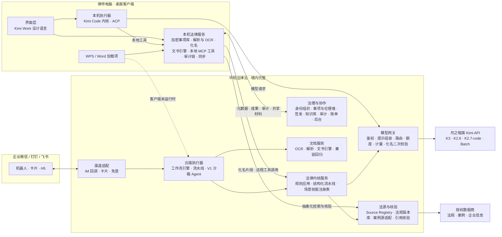

# Kimi Work 法律行业发行版：最终整合方案

日期：2026-09-28｜版本：v3.0（整合 astra 09-22/23 方案、opus 09-23 完整产品方案、Claude 09-23 独立审计、09-28 合规与数据资产复核，以及本轮 5 路联网核验）｜用途：立项、研发排期、商务谈判与对律所交付｜说明：价格、指标、人力与收入均为待试点校准的假设；标「待确认」的事项在第 0 阶段关闭；证据等级与来源见附录 B。

---

## 0. 结论先行

**一句话定义**：「Kimi Work 法律行业发行版」是中软国际与月之暗面联合推出、面向中国律所律师的法律 Agent 工作台。律师在自己电脑上安装客户端，像用 Kimi Work 一样交代任务，拿到按本所标准完成、每条依据都能点回原文、下载即可交付的 Word/Excel 文书；在 WPS/Word 里就地审合同，在企业微信/钉钉/飞书里转材料、收结果、做签发；团队负责人在云端分派、复核、签发并管理用量。中软负责产品、法律云、内容与服务，按席位收费；月之暗面提供模型（token 由中软采购，计入成本）与品牌背书。

**三份前序方案怎么用**：opus 方案是产品、商业与组织的主干；astra 方案的状态机、核验、安全与恢复语义是技术验收标准；独立审计的核心架构已被否决，但它对 astra 的诊断、「发行版五个增量」、效率证明、LTS 等设计仍然采用（第一部分）。

**本版相对 09-23 opus 方案的八处关键修改**

| # | 修改 | 依据 |
|---|---|---|
| 1 | **本机管材料与文书，云端管规则与模型**：Playbook 与规则库不下发客户端，由网关在服务端组装提示 | 方法资产保护；跨律所共享基础 Playbook 前缀提升缓存命中 |
| 2 | **MVP 生产档从 6 个收敛为 4 个**（合同审查含回稿比对、案卷整理、要素式文书、脱敏）；研究报告与问答以法源授权签署为升档条件 | 法源授权与月之暗面数据条款都在关键路径上 |
| 3 | **Kimi Code 锁定 2.1.1 并 fork**：补回被上游回滚的工作区安全加固，关闭默认开启的遥测与远程控制；内核进程做操作系统级隔离；月之暗面托管智能体不承载客户数据 | 09-28 源码核验 |
| 4 | **Windows 上 Word 以 COM 加载项为主**，Office.js 只给有 M365 租户的律所与 Mac；文书引擎改用 Docxodus | Office.js 的正式分发要求 M365 租户；Docxodus 同时支持条款级原生修订写入与整稿比对 |
| 5 | **个人微信只接收律师主动导出的文件**（拖拽、系统文件选择、小程序会话选文件），不扫描微信数据目录 | 《微信软件许可及服务协议》禁止第三方工具读取微信运行数据 |
| 6 | **专业版 ¥4,800 → ¥3,600**；团队版 ¥9,800 保留并配销售对比表与价格验证 | Kimi 企业版官方价 ¥4,200/座/年且已直销进入律所；WorkBuddy、QoderWork 企业版已自带 SSO 与额度池 |
| 7 | **盈亏重算**：基准情景 2029 年末 ARR 约 ¥8,200 万、当年仍亏约 ¥940 万，累计投入约 ¥6,500 万，约 11,200 个付费席位才平衡；编制纪律是第一杠杆，按精简编制 2029 年可基本打平 | opus 测算未计编制增长与法源固定费 |
| 8 | **合规口径更新**：《律师法》09-01 起施行第四次修正（保密改为第四十一条，无 AI 条款）；客户端逐条满足 TC260《智能体部署使用安全指引》以化解「独立设备安装」条款；应用登记改为默认准备；隐式标识按 TC260 实践指南开发；私有化若仍调云模型不能称「不出域」；等保三级是建设目标、依法定级；DPA 须排除 API 协议第 6.3 条 | 09-28 合规复核与底座核验 |

**十四个关键决策**

| # | 决策 | 要点 |
|---|---|---|
| 1 | 定位 | 中软自建托管 SaaS 形态的联合品牌行业发行版；中软拥有产品、客户关系、内容资产；月之暗面是模型供应商与品牌伙伴 |
| 2 | 形态 | 四端一云：桌面客户端为主工作台，WPS/Word 与 IM 为入口，管理后台 + 中软法律云；不做独立手机 App |
| 3 | 执行职责 | 本机：材料、解析、化名、文书引擎、审阅、开放式 Agent 编排；云端：模型网关、规则应用、法源与核验、治理协作、IM/批量/定时任务；云端开放式 Agent 于 V1 沙箱验收后上线 |
| 4 | Agent 内核 | Kimi Code 2.1.1（中软 fork + 补丁集）经 ACP 接入，opencode 备份；确定性流程走结构化流水线、不经过 Agent；内核进程操作系统级隔离 |
| 5 | 首发范围 | MVP 生产档 S1/S1b、S2、S3、S6，Beta 档 S4、S5；场景目录按交付件重建，业务线分组保留 |
| 6 | Office | Word：客户端直出修订稿（兜底）+ COM 加载项（Windows 主路径）+ Office.js（M365 与 Mac）；WPS：JS 加载项静默注册；Docxodus 文书引擎 |
| 7 | IM | MVP 一家（企业微信或钉钉，按设计合作律所定），V1 三家 + 微信小程序 |
| 8 | 可信 | 引用四个独立状态、拦截可见、信任账本、化名在工具层 + 网关二次校验、标识按第九条申请、三档决策权限 |
| 9 | 法源 | 核心法规用官方原文（人工批量下载）自建版本库；检索覆盖靠数据商按次调用（法律之星条款已允许 SaaS 嵌入，但禁止缓存与训练）；案例源签企业合同，人民法院案例库经法信洽谈；Source Registry 逐条管许可；首年预算 ¥30–120 万；禁止自动化采集与驱动个人账号 |
| 10 | 内容资产 | 法律工程团队生产 Playbook（24→40→60）、模板与规则库；评测 200→1,000→2,000；方法资产留在云端；与月之暗面共建中文法律 Agent 任务环境 |
| 11 | 商业 | 专业版 ¥3,600、团队版 ¥9,800（首要）、律所版 ¥8,800 + 平台费 ¥20 万、私有化首年 ¥150–300 万；点数额度，不做不限次 |
| 12 | 盈亏 | 基准情景累计投入约 ¥6,500 万（至 2029 年）；三个杠杆：编制纪律、私有化与 FDE、模型成本；远期选项为在中软云自部署 K3 |
| 13 | 合规 | P0：与月之暗面签 DPA + 零数据保留并排除协议第 6.3 条；默认准备属地登记并公示模型备案号；按三级控制目标建设、依法定级；TC260 部署指引、标识实践指南、律协指引、智能体实施意见逐条落到功能；高敏材料首发关闭云处理 |
| 14 | 组织与节奏 | 首期 34 人（含 5 名法律工程师与 1 名法律质量负责人），商用期 58 人；2026-10-08 启动，2027-01 试点，2027-02-22 起收费 |

**需要领导层拍板的七件事**：① 架构与内核（第 14–15 节）；② 与月之暗面的谈判清单，尤其数据条款、并发配额与渠道规则（第 29 节）；③ 版本与价格（第 26 节）；④ 投入：第 0–1 阶段约 34 人、4 个月、约 ¥645 万，基准情景至 2029 年累计资金需求约 ¥6,500 万（第 28 节）；⑤ 三家设计合作律所（第 30.2 节）；⑥ IM 首发平台与 Word COM 优先（第 9 节）；⑦ 法源首年预算 ¥30–120 万（第 21 节）。

---

# 第一部分　评审：astra、opus 与独立审计

## 1. 已确定的前提与评审方法

### 1.1 已确定的前提

| 前提 | 来源 | 对方案的含义 |
|---|---|---|
| 面向中国大陆律所律师；场景按诉讼仲裁、非诉、企业法务三条业务线组织 | 用户 09-14 拍板 | 首页与场景目录按业务线分组；央国企法务只是企业法务线下的客户类型 |
| 本质是中软自建托管 SaaS，交付形态为本机安装的 exe（类似 Kimi Work 桌面版） | 用户 09-23 拍板 | 自有客户端 + 中软法律云；不依赖上游客户端开放接口 |
| 已获授权使用「Kimi Work 法律行业发行版」标识，可借用 Kimi Work 的设计、布局、配色、版式及部分能力 | 用户 | 视觉与交互沿用 Kimi Work 实测规格；品牌层做成可替换的主题包 |
| Demo 后端接入 Kimi Code（开源）的部分能力，有更优选择也可 | 用户 09-28 | 第 15 节说明用哪些能力、为什么仍选它、备份是谁 |
| 按席位收费，底层 token 由中软从 Kimi 采购，作为成本 | 用户 09-23 | 单位经济按「席位收入 − token − 数据授权 − 云资源 − 服务」计算 |
| 产品形态含客户端、WPS/Word 加载项、企业微信/钉钉/飞书入口；按角色定义价值；逐场景写交付件规格与验收标准；规划内容与数据资产 | 用户 | 第二、四部分 |

### 1.2 评审对象与方法

| 材料 | 作者 / 日期 | 性质 | 在本方案中的角色 |
|---|---|---|---|
| 《产品与技术整合方案》+ 运行时 / 法律产品 / 安全三份附录 | GPT-6 astra，09-22（09-23 修订） | 工程可信性方案：托管执行、状态机、核验、安全、验收 | 技术与可信设计的「验收标准」来源 |
| 《完整产品整合方案》+ 调研证据 + 合规专项 + 测算脚本 | Claude Opus 5.5，09-23 | 在 astra 与审计之上的整合稿：四端一云、场景规格、内容资产、商业闭环 | 产品、商业与组织的主干 |
| 《独立审计与整合方案》+ 调研证据 | Claude，09-23 | 对 astra 的独立审计；核心架构（插件 + Companion、Token 分成作收入）已被用户否决 | 借鉴其诊断与若干设计，不沿用其架构 |
| 《子报告-合规与数据资产》 | 09-28 上午 | 对上述三份的合规、法源与数据资产复核 | 合规口径纠错 |
| 本轮 5 路联网核验（附录 B） | 09-28 | Kimi 底座与运行时、入口与文书技术、竞品与渠道、法源授权与模板、律师法与合规增量 | 事实更新 |

评审用同一把尺子：①是否符合用户已拍板的前提（自建托管 SaaS + 本机 exe、席位收费、token 为成本、四类触点、按业务线组织）；②律师为什么天天用、合伙人为什么付钱；③技术是否建立在已核实的底座事实上，复杂度是否与阶段匹配；④合规结论是否可举证；⑤商业与组织是否算得过账。

## 2. 逐维度对比与裁决

| 维度 | astra | opus | 裁决（本方案采用） |
|---|---|---|---|
| 定位与前提 | 「以 Kimi Work 为工作入口」的机构级平台；主路假设存在已授权的 Work 服务端 Runtime/SDK | 中软自建客户端 + 法律云的联合品牌行业发行版；Kimi 是模型供应商与品牌伙伴 | **opus**。astra 的主路没有任何公开依据（审计已查证），且与用户 09-23 拍板的形态不一致 |
| 触点 | Web 工作台为主；Word/WPS「后续再接」；无 IM | 桌面客户端、WPS/Word 加载项、企业微信/钉钉/飞书、管理后台 + 法律云；另有个人微信文件导入与小程序 | **opus**，但按阶段收敛（第 9、35 节）：MVP 只做 Windows 客户端、WPS + Word COM 加载项、1 家 IM、后台基础版 |
| Agent 内核 | Work Runtime 主路，Kimi Code ACP 备选，`AgentRuntimeAdapter` 契约 | Kimi Code 为本机与云端统一内核，ACP 解耦，opencode 备份，ZCode 只借模块 | **opus 的选型 + astra 的契约与加固清单**。补充：确定性流程不经过 Agent（第 15 节） |
| 执行位置 | 全部在服务端隔离 worker | 本机执行交互任务，云端执行 IM、批量、定时 | **一个内核、两处执行**保留，但云端 MVP 只跑结构化流水线，开放式 Agent 上云推迟到沙箱验收通过后（V1） |
| 主对象与状态 | 事项为边界、成果为交付单位；执行状态与成果状态两条线；编辑或替换来源使核验与签发失效 | 沿用 | **astra**，全文沿用 |
| 首发场景 | 3 条闭环（合同审查、民商事案卷、法律研究）+ 脱敏辅助 | 6 个生产场景 + V1 8 个 + 36 入口三档 | **opus 的规格卡 + astra 的克制**：MVP 生产档 4 个（S1 合同审查含回稿比对、S2 案卷整理、S3 要素式文书、S6 脱敏）；S4 研究报告与 S5 问答以法源授权到位为升档条件（第 11 节） |
| 交付件与验收 | 真实 OOXML 修订、下一稿回流、受众分版；验收维度表 | 14 张规格卡、交付件通用规格、量化门槛 | **合并**，并为每条门槛补「验收方法」（样本、标注、判定规则），这是两份都缺的 |
| 可信 | 引用四级核验、检索计划冻结与履行检查、生成 Agent 无权写「已核验」、审批绑定对象 | 拦截可见、信任账本（hash 链）、可逆化名放工具层、标识第九条流程、三档决策权限 | **合并**；按 09-28 复核拆成「原文存在 / 版本已核 / 命题有支持 / 律师签发」四个独立状态 |
| 技术深度 | 源码级：profile override、`[tools] enabled` 语义、Hook fail-open、技能自动发现、ACP 用量语义、KAP「接受但不生效」、租约与 fencing、幂等、两类检查点 | 客户端组件、加密事项库、文书引擎、网关、Temporal；深度不及 astra | **astra 作为验收标准，opus 作为实现结构**；用成熟工作流引擎实现 astra 的语义 |
| 法源与数据 | 授权法源 + 官方核验；未发现官方站 robots 禁止 | 授权为底、官方为证、加工层自建；明确禁止清单 | **opus + 09-28 复核**：核心法规用官方原文自建（数据商条款禁止缓存镜像）；增加 Source Registry（许可到期、允许动作、历史交付保存权） |
| 内容资产 | 几乎空白 | A–G 资产地图、Playbook 24→40→60、评测 200→1,000→2,000、任务环境与联合后训练 | **opus**，补方法资产保护（第 22.5 节，两份都没有） |
| 商业 | 只列成本构成，不定价 | 四个版本、点数、单位经济脚本、收入与盈亏、谈判清单 | **opus**，但修正专业版价格与盈亏测算（第 26–28 节） |
| 合规 | 审慎，处处「需判定」，没有结构性决定 | 按版本给出手续、合同链、指引映射、标识流程 | **opus 的结构 + 09-28 的纠错**：等保三级是建设目标不是既定义务；上海居村指引是地方试行参考；私有化若仍调云模型不能称「不出域」 |
| 组织与节奏 | 6–8 人、14 周（严重低估） | 首期 33 人、商用 55 人；2026-10 启动、2027-01 试点、2027-02 收费 | **opus 编制**，补质量与合规负责人、法源商务；节奏不变，MVP 范围收敛以保质量 |

## 3. astra 方案：应当保留的与应当修正的

**保留（全部进入本方案的验收标准或设计约束）**

1. 四种责任：平台管身份与资源；法律业务层管材料、事实、法源、流程与交付；Agent 在授权内分析与调用工具；律师负责判断与签发。
2. 事项是权限与知识边界，成果是交付单位；执行状态与成果状态分两条线；「生成成功、引文存在、律师签发」三件事不混用。
3. 底稿与正式交付分离；内部版、客户版、对方版由同一批准版本按受众生成，导出前检查隐藏批注、修订痕迹、作者与属性。
4. 下一稿回流：导入对方回稿、选比较基线，只让受影响的结论失效；条款重排无法对齐时由人工指定。
5. 引用核验由独立服务执行；检索计划冻结与履行检查，承诺覆盖约定计划而不承诺穷尽；数据源不可用时只能「部分完成」。
6. 法源查询默认只提交抽象争点与必要事实要素，不把客户名称发给数据商。
7. 权限过滤在召回之前，缓存键含授权范围；PostgreSQL 行级安全作第二道防线。
8. 工具网关失败即拒绝；Hook 失败放行，只能作观测；审批绑定主体、事项、参数 hash、目标、版本、有效期与一次性 nonce；不提供「本会话始终允许」。
9. Kimi Code 法律化的具体配置：签名 profile（`name: agent`、`override: true`）、全局 `[tools] enabled` 白名单与 profile 策略取交集、禁用 Bash/Agent/AgentSwarm、隔离 HOME 与 `KIMI_CODE_HOME`、禁止案卷目录被发现为规则、恢复时重新鉴权并重新注入 MCP、`usage_update` 不当费用。
10. 持久化语义：任务、运行、尝试、会话 ID 分离；事件先落库再发布；幂等键；至少一次投递 + 租约与 fencing；外部副作用账本（PREPARED / DISPATCHED / CONFIRMED / UNKNOWN），结果不明不盲重试。
11. 文档管线锚点字段（文档版本、页、印刷页、段落/表格锚点、坐标、解析器版本）；DOCX 优先段落与书签锚点，不依赖页码。
12. 上线验收维度与评测纪律：零越权、服务端拒绝禁用工具、签发版零伪造引用、红色风险召回 ≥ 95% 并报告精确率、Word/WPS 往返无损、取消 P95 ≤ 10 秒、盲测与调优分离、双律师标注、按错误类型报告、任何版本变更触发回归。
13. 状态诚实：不显示模型自报置信度和虚假进度，只显示「已处理 18/24 份、2 份需重扫」这类可核验事实。

**修正**

1. 主路「已授权 Work Runtime」查无依据，删除；Kimi Code 从「备选」变为「内核」。
2. 缺失的产品、商业、内容、渠道、组织全部由 opus 与本方案补齐。
3. 复杂度前置：租约、fencing、outbox、两类检查点作为验收标准保留，但用 Temporal 或 PostgreSQL 任务表实现，不自研分布式协议。
4. 人力 6–8 人、14 周改为首期 34 人、4 个月到试点。

## 4. opus 方案：应当保留的与应当修正的

**保留**：四端一云与阶段划分；各宿主的实现分层（WPS publish 模式、Office.js 版本线、COM 兜底、客户端直接生成修订稿）；IM 五条路径与平台能力边界；Kimi Code 统一内核 + ACP + opencode 备份 + ZCode 只借模块；数据驻留四种模式；七条付费理由；角色—价值矩阵与价值量化；场景规格卡与交付件通用规格；拦截可见、信任账本、化名放工具层、标识第九条流程、三档决策权限；A–G 资产地图、Playbook 结构与产能、确定性规则库、评测与任务环境；四个版本与点数设计；与月之暗面的 P0 谈判项；按版本的合规动作；33→55 人编制与四阶段路线。

**修正（按影响排序）**

| # | 问题 | 为什么要改 | 本方案处理 |
|---|---|---|---|
| 1 | MVP 过载：11 周内 6 个生产场景 + 四类触点 + 云端 Agent | S4、S5 的生产质量取决于法源授权，而授权谈判与月之暗面数据条款都在关键路径上，未必在 2027-01 前落地 | MVP 生产档收敛为 4 个；S4/S5 以「法源授权签署 + 评测达标」为升档条件，先以 Beta 交付；云端 MVP 只跑结构化流水线 |
| 2 | 盈亏测算偏乐观 | 编制按 55 人不变、未计法源固定费与云底座；按编制随规模增长重算，基准情景累计投入约 ¥6,500 万，约 1.12 万付费席位才平衡（第 28 节） | 给出三情景与资金需求；把「编制纪律」「私有化与 FDE 收入」列为盈亏的两个主杠杆 |
| 3 | 专业版 ¥4,800 高于个人工具心理上限 | 个人法律工具公认上限约 ¥3,600/年；律师自搭 Kimi 会员约 ¥1,200–2,400/年 | 专业版改为 ¥3,600/年（按人 200 点/月），团队版维持 ¥9,800 并在试点做价格测试 |
| 4 | 本机执行把方法资产发到每台电脑 | Playbook、技能包、规则库是中软最核心的资产，放在客户端即可被复制 | 新增方法资产保护：云端下发、按任务解密进内存、关键规则检查在云端流水线执行、离线租约（第 14.1、22.5 节） |
| 5 | 客户端过重 | Electron + Node + .NET 运行时 + Kimi Code + Python OCR 同装在律师笔记本上，安装包、内存与杀软误报都有风险 | 定客户端资源预算与组件取舍（第 9.2、16 节）：OCR 走 ONNX 运行时，文书引擎 .NET 单文件发布，Kimi Code 用官方原生签名二进制 |
| 6 | 隐私表述易被误读 | 「原件默认不出本机」属实，但发给云端模型的化名片段仍属个人信息与保密材料；私有化若仍调用云模型也不能称数据不出域 | 对外只按数据驻留模式如实说明去向；刑事卷宗等高敏材料首发关闭云处理（第 32 节） |
| 7 | 合规口径过硬 | 等保三级是按定级确定的，不是法律 SaaS 的既定义务；上海居村指引是地方、试行（试行期已届满）、非强制规范 | 等保改为「按三级控制目标建设，依法定级测评」；律协指引作为最佳实践与卖点，不写成全国硬法 |
| 8 | 要素式样式版本 | 法〔2024〕46 号试行文件已被法〔2025〕82 号废止，原 11 类修订后并入 67 类，「银行信用卡纠纷」改名「信用卡纠纷」；82 号文明确「尊重选择」、不得强制 | 模板以新版为准；话术不说「法院强制使用」；官方已上线要素智能回填，S3 差异点改为与案卷联动与金额测算（第 12.3 节） |
| 9 | 场景目录与竞品同构 | Demo 的 36 个入口是按智合 AI 首页预设改写的（审计 P8），对外演示易被视为模仿 | 目录按自有交付件重建，业务线分组保留（第 11 节） |
| 10 | 两处执行从第一天起并行 | 本机与云端两套执行环境使测试面翻倍 | 共享同一内核与同一流水线代码；云端开放式 Agent 推迟到 V1 |
| 11 | 组织缺两类角色 | 法律质量与执业风险需要专人负责；法源授权需要商务 BD | 新增法律质量负责人（执业律师）与法源商务 1 人 |

## 5. 独立审计：可以借鉴的部分

用户已否决审计的核心架构（Kimi Work 插件 + Legal Companion、L1/L2/L3 授权分层、Token 分成作收入、托管 Agent 推迟到 V2）。以下部分仍然成立，本方案吸收：

| 审计内容 | 为什么仍成立 | 本方案位置 |
|---|---|---|
| 对 astra 的 P2–P8 诊断（无商业闭环、用户价值缺位、内容资产空白、复杂度错配、合规无结构性决定、人力低估、场景目录同构） | 与用户前提无关，都是事实判断 | 第 3、4 节 |
| 「发行版的五个增量」：法律能力包、机构治理、可信服务、服务、生命周期 | 这是向律所解释「为什么不直接用 Kimi Work 标准版」、向月之暗面解释「中软做了什么」的最清楚框架 | 第 7.2 节 |
| 效率证明：按事项统计处理量、修订轮次与用时，供合伙人向客户解释收费 | 合伙人付费的直接理由之一；国内同类普遍缺失 | 第 8、9.5、12.5 节 |
| LTS 通道：上游一周多次发版，律所需要锁定版本 | Kimi Code 2.0 刚发布、变化频繁 | 第 15、33 节 |
| 律所管理系统（iCourt、法蝉等）没有公开 API | 核心流程必须独立跑通，对接走商务 | 第 9.5、17.5 节 |
| 检索基线：Qwen3-Embedding + Reranker，BGE-M3 备选；法律领域没有权威榜单，用自建评测集决定 | 合理且可执行 | 第 17.3 节 |
| 远程 MCP 按最新规范实现并强制 OAuth；数据商连接器统一挂在我方工具网关后 | 规范中授权仍为可选 | 第 17.3 节 |
| Aspose.Words 作文书引擎的商业兜底 | 开源修订生成的边角问题多 | 第 17.4 节 |
| 部署拓扑四种（SaaS 多租户、专属云、私有化、离线事项） | 与 opus 的驻留模式一致 | 第 14.3 节 |
| 「登月计划」非排他，要快，并与月之暗面约定行业分工与直营客户规则 | 仍然成立 | 第 29 节 |

**不再沿用**：Kimi Work 插件包 + 独立 Companion 进程（客户端是自有的）；L1/L2/L3 授权分层与 OEM 依赖；网关作「分成账本」；托管 Agent 推迟到 V2（IM 与批量离不开云端执行）；自建法规库采集官方站点（robots 与用户协议禁止）；「Word 插件、私有化已是入场券」（与核实事实矛盾）。

## 6. 本轮（09-28）新核实、改变了方案的事实

证据等级：一手＝官方原文、源码、价格页、公告；交叉＝多源一致；单一＝单一来源；推测。完整来源见附录 B 所列子报告。

| 领域 | 事实 | 等级 | 对方案的影响 |
|---|---|---|---|
| Kimi Code 版本 | 09-19 后发布 2.1.0（09-23）与 2.1.1（09-24）；ACP 服务端自 2.0.2 起零改动；node-sdk 仍未发布到 npm；官方 Web UI 源码已迁到私有仓库，09-21 发布闭源的 Kimi Code Desktop 1.0 | 一手 | 锁定 2.1.1，走 ACP 这条公开路径 |
| Kimi Code 安全 | 2.1.0 加入的工作区加固（符号链接逃逸拦截、屏蔽仓库 git 配置执行命令、项目配置信任后生效）在 2.1.1 被整体回滚；Hook 仍失败放行；项目级 skills 自动发现没有开关；没有操作系统级沙箱 | 一手 | fork 并补回加固；内核进程操作系统级隔离（第 15 节） |
| ACP 边界 | ACP 只把文本文件读写交给客户端，二进制读写、列目录、删除仍直接操作磁盘 | 一手 | ACP 不能当审计与防泄漏边界；材料只经本机法律服务 MCP 读取 |
| 遥测 | Kimi Code 遥测默认开启，未登录也按 mainland-cn 上报；远程控制中继无开关 | 一手 | 构建时写死关闭并移除相关外连 |
| 托管智能体 | 月之暗面推出 Kimi 托管智能体（Beta）：云沙箱 ¥0.072/小时；只有「全部放行」权限、无人工审批；会话与沙箱数据存在月之暗面，零数据保留不覆盖 | 一手 | 不承载客户数据；云端沙箱自建 |
| 数据条款 | 企业可申请零数据保留（ZDR）；帮助中心称 API 数据不用于训练；但 API 服务协议第 6.3 条仍授权「输入输出用于模型服务优化」；ZDR 不覆盖直接上传的图片视频、托管智能体与第三方插件 | 一手 | DPA 须明确排除第 6.3 条；图片在我方 OCR 后只发文本 |
| 开放平台 | 价格不变；K2.8 仍无 API；Batch 仍不支持 K3；企业认证组织最多 50 个项目、100 个 API Key、20 条 IP 白名单；K2.5 已于 08-31 下线 | 一手 | 租户计量自建、出口 IP 固定、模型别名映射；配额列入谈判 |
| Kimi 企业版 | 官方公示 ¥4,200/座/年，含 Kimi Work 与 Kimi Code，无 SSO、审计、策略下发；官方称「多家红圈律所」已在用 | 一手 | 专业版降到 ¥3,600；渠道规则列 P0 |
| 法律数据插件 | Kimi 自带的元典数据插件须 Kimi 账号登录并消耗会员额度 | 一手 | SaaS 用不了，须直接与数据商签约 |
| 行业方案模板 | 月之暗面 09-17 发布金融方案：数据源 + 9 个技能 + 与券商共建的风险评估网关 + 托管智能体 | 一手 | 法律可能被复制，行业分工列入谈判 |
| 私有化 | 月之暗面自身不做私有化、交给伙伴；K3 许可 07-27 以来未改；vLLM 最低 8 张 GB300 或 MI355X；昇腾 A3 4 节点（128K）或 8 节点（1M） | 一手 / 单一 | 私有化与远期自部署 K3 是中软的机会（第 28.4 节） |
| Word | Office.js 正式分发要求 M365 租户；Office 2021 LTSC 2026-10-13 结束支持；COM 加载项在 Word Win32 仍受支持；WordApi 仍最高 1.9 | 一手 | Windows 上 COM 为主路径 |
| WPS | 安装器写入 `jsaddons` 并合并 `publish.xml` 可无管理员权限注册（社区实践，新版本有失败报告）；Mac 版无官方承诺；WPS 365 应用市场可作 ISV 渠道；灵犀未对外部厂商开放；金山有自营 AI 法律助手 | 一手 / 单一 | 静默注册列为探针；Mac 律师以 Word 为主 |
| 文书引擎 | Docxodus（MIT，09-27 发布 v12.6.3）支持结构化比对输出原生修订、编辑会话直接写 `w:ins/w:del`、浏览器内编辑器；Python-Redlines 1.0 已改用它；单人维护 | 一手 | 主引擎，锁版本并准备自维护 |
| 开源许可 | MinerU 改为 Apache-2.0 加附加条款（关联方合并口径月收入超 2,000 万美元须另购商业许可）；Marker/Surya 权重对大企业不免费；HanLP 中文模型仅限研究与教学；LTP 企业须付费；PaddleOCR、DeepSeek-OCR、Docling、Qwen 小模型可商用 | 一手 | OCR 与化名组件重新选型（第 16 节） |
| 桌面壳与签名 | Kimi 桌面 3.2.14 为 Electron；EV 证书已不再直接跳过 SmartScreen；electron-builder 的 MSI 不支持自动更新 | 一手 | Electron；OV 签名；NSIS + MSI 双包 |
| IM | 企业微信群里仍只收 @ 文本、文件只在单聊收；主动推送另有每小时 1,000 条上限；三家 IM 都已开放接入外部 Agent；微信 ClawBot 只能绑定个人号、腾讯保留准入权 | 一手 / 交叉 | 机器人形态足够；ClawBot 不作入口 |
| 竞品 | 桌面法律 Agent 已有法大大睿契、iCourt AlphaClaw、北大法宝 × WorkBuddy「律爱多」、QoderWork 法律套件、钉钉「悟空」；智合在 Windows 上只有安卓包，律协白标 11 个租户，重庆律协 07-07 起全员开通 | 一手 / 交叉 | 差异收敛为法律特有的治理与交付可追溯（第 31 节） |
| 《律师法》 | 2026-08-28 通过修改决定、09-01 起施行（第四次修正）；条文重新编号：保密为第四十一条（原第三十八条）、利益冲突第四十二条、律所利益冲突审查与档案管理制度第二十六条、罚则第五十二至五十四条（第五十四条第八项处罚律所「对本所律师疏于管理，造成严重后果」）；十项修改**没有任何涉及 AI、信息安全或电子数据的内容** | 一手 | 全部材料改用新条号；不得宣称「新律师法规定了 AI」；利冲检索、档案与审计可表述为「辅助落实第二十六条制度要求」 |
| 智能体部署 | TC260《智能体部署使用安全指引》（TC260-PG-20266A）2026-08-24 正式发布：本地部署「应选择独立设备安装」，但商业智能体经核对满足后续要求的无需重复采取；要求非管理员运行、授权工作目录、服务仅本机可访问、全量日志、高风险操作清单与二次确认、一键急停、可回溯文件系统、不强制回传运行数据；附录 B 要求组织建立智能体资产登记表并发现未审批智能体 | 一手 | 客户端逐条满足并出具对照表，化解「独立设备」条款；后台导出资产登记表与出站白名单（第 18、9.5 节） |
| 智能体开发 | TC260《智能体系统开发安全指南（征求意见稿）》09-18 发布、**10-02 截止反馈**：风险登记册与高风险操作清单、工具调用前授权校验并完整记录参数与结果、知识库与索引完整性保护、长期记忆删除后清理索引与缓存、默认限制文件与网络访问、日志防篡改、间接提示注入红队、更换模型重新评估 | 一手 | 作为研发门禁；建议中软提交意见 |
| 标识实现 | TC260-PG-20258A：OOXML 在 `docProps/custom.xml` 写名为 `AIGC` 的属性（7 个字段的 JSON），PDF 写 Info 字典 `/AIGC`，OFD、UOF 有对应位置；ContentProducer 为 27 位编码，以统一社会信用代码为主体标识（TC260-PG-20252A）；.wps 私有格式无方案 | 一手 | 隐式标识可直接开发；须先定 ContentProducer 用中软还是律所的信用代码 |
| 应用登记 | 截至 08-31 累计 731 款应用登记；公示名单已有法律类应用（如上海「法律分析」、北京「解决-AI法律助手」）与 B2B 工具完成登记；已上线应用须公示模型名称与备案号或上线编号；官方办事指南查不到 | 一手 | 从「按需准备」改为「默认准备登记」；产品页公示模型名称与备案号 |
| 律协规范 | 上海 2025 居村指引试行期已届满、未见续期；上海 2026 企业法律顾问指引写明「未经依法授权或安全评估，不应向公共 AI 平台上传」敏感文件；司法部、全国律协与其他省份未见 2026 年律师 AI 指引 | 一手 / 查不到 | 以 2026 企业顾问指引为准；为律所准备「安全评估材料包」 |
| 要素式文书 | 法〔2025〕82 号（最高法、司法部、全国律协 2025-05-28 印发）自 07-14 推广 67 类（原 11 类修订 + 新增 56 类），法〔2024〕46 号试行文件废止；「银行信用卡纠纷」改名「信用卡纠纷」；文件写明「积极引导、尊重选择」、防止以强制使用为由有案不立；人民法院在线服务已把 67 类要素结构化并上线「要素识别智能回填」；人社部无全国统一的要素式仲裁申请书 | 一手 / 交叉 | 模板用新版；不说「强制」；S3 差异点改为与案卷联动、金额测算、离线批量 |
| 法源授权 | 法律之星 MCP 公开价约 ¥0.008–0.01/积分，服务协议允许集成进面向终端用户的商业产品，但禁止用结果训练模型、禁止系统性缓存或镜像；元典 ¥599 换 24,000 积分/年（约 ¥0.125/次关键词检索），50 QPM 上限，企业版定制报价；法意年度版未标价；公开采购记录都是单机构订阅，每库每年约 ¥0.85–13.7 万 | 一手 | 法规按量开通；案例签企业合同；**法规版本库不能靠缓存数据商数据建** |
| 官方数据 | 国家法律法规数据库无开放或合作渠道，2025-08-20 改版新增人工批量下载功能；法律法规文本依著作权法第五条不受著作权保护；人民法院案例库由人民法院出版社建设运维，法信设有「人民法院案例库案例」专区并有购买入口 | 一手 | 核心法规原文人工批量下载自建校验库（先书面咨询）；案例库经法信洽谈 |
| 评测数据许可 | LegalAgentBench、J1-Bench、JEC-QA、CAIL2019–2021 仓库没有许可证，应视为未授权；LexEval（MIT）、CAIL2018（MIT）、DISC-Law-SFT（Apache-2.0）许可层面可商用；LawBench 代码 Apache-2.0、数据须逐子任务核对；Harvey LAB 为 MIT 但以美国法为主（抽样 984 个任务中特拉华州 411 次、中国 11 次） | 一手 | 评测资产以自建为主；外部基准只借结构 |
| 市场 | LexisNexis 中国内地 2026 调研：专业法律 AI 使用率 54%，65% 担心保密，77% 表示引导式工作流会提高使用意愿；Harvey 2026 上半年毛利一度约 −50% | 交叉 / 单一 | 支持「交付件工作流」与「不做不限次」 |

---

# 第二部分　产品

## 7. 产品定义与边界

### 7.1 一句话定义

「Kimi Work 法律行业发行版」是中软国际与月之暗面联合推出、面向中国律所律师的法律 Agent 工作台。律师在自己电脑上安装客户端，像用 Kimi Work 一样交代任务，得到按本所标准完成、每条依据都能点回原文、下载即可交付的 Word/Excel 文书；在 WPS/Word 里就地审合同，在企业微信/钉钉/飞书里转材料、收结果、做签发；团队负责人在云端分派、复核、签发并管理用量。中软负责产品、法律云、内容与服务，按席位收费；月之暗面提供模型（token 由中软采购，计入成本）与品牌背书。

### 7.2 发行版相对 Kimi Work 标准版的五个增量

| 增量 | 内容 | 律所自己搭不出来的原因 |
|---|---|---|
| 法律能力包 | 按交付件组织的场景技能包、Playbook 与本所覆盖层、交付件模板、确定性规则库、法律连接器 | 需要法律工程团队持续生产与回归 |
| 可信服务 | 法规版本库与引用核验、真修订文书引擎、可逆化名、签发与 AI 标识、信任账本 | 需要授权法源、文书工程与兼容回归农场 |
| 机构治理 | 身份与 SSO、事项与伦理墙、团队协作与签发流、知识库、策略下发、审计、用量账单、管理后台 | Kimi Work 至今没有团队、SSO、审计、集中策略 |
| 入口 | WPS/Word 加载项、企业微信/钉钉/飞书、个人微信文件导入 | 标准版没有 |
| 服务与生命周期 | 本所规则上线（FDE）、培训、支持 SLA、LTS 版本通道、合规文件（DPA、影响评估、登记材料） | 单个律所负担不起 |

### 7.3 与 Kimi Work 标准版的关系

| 类别 | 内容 |
|---|---|
| **沿用** | 视觉与版式（实测：侧栏 #fbfaf9、主区 #fff、正文 #0e1219、次级 #888、Kimi 蓝 #167ffb、黑色主按钮 #191919、输入框圆角 16px、侧栏约 260px）；执行态三栏（侧栏 / 对话与步骤 / 成果预览约 45%）；输入框 `/` 唤起技能、`@` 引用材料、`+` 上传；任务化会话管理；Skills 与 MCP 扩展机制；Office 文件直出；看板（改为事项看板与团队看板） |
| **增强** | 「项目」升级为「事项」（客户、相对方、立场、法域、关键日期、成员、保密级别、驻留模式）；技能升级为带版本、评测与发布审批的场景技能包与 Playbook；预览区增加修订卡、证据矩阵、引用面板、信任账本；定时任务改在云端执行，电脑关机也不漏跑 |
| **收敛** | 默认关闭 Shell 与任意代码执行；WebBridge 与内置浏览器默认关闭，管理员可开白名单站点，禁止驱动律师个人付费数据库账号；插件只允许中软签名的法律连接器；不开放通用编程模式；Agent Swarm 改为编排器控制的有界并行 |
| **新增** | 第 7.2 节五个增量 |

左侧导航：**新建任务 · 事项 · 待我处理 · 交付中心 · 技能与 Playbook · 知识库 · 连接 · 定时任务 · 对话**。品牌元素集中在一个主题包里，授权范围变化时整体替换。

### 7.4 律师为什么要为发行版付费

律师最现实的替代品是：自己买 Kimi 会员（¥99–199/月，含 Kimi Work 与 K3）再装元典插件，或者用 ¥598–698/年的智合 AI。发行版必须在下面七点上给出他们自己搭不出来的东西：

| # | 发行版给的 | 自己搭能否得到 |
|---|---|---|
| 1 | 交付件级成品：原生修订稿、审查意见书、要素式起诉状、符合第八条要素的类案检索报告，下载即可交付 | 通用 Agent 只能出「差不多」的文件，修订痕迹、格式与法定要素靠律师返工 |
| 2 | 按本所标准干活：Playbook 与本所覆盖层，每条建议都说明触发了哪条规则 | 没有 |
| 3 | 可信：引用核验与拦截可见、法规版本随基准时点、信任账本、签发与标识 | 没有，出错责任与举证全在律师 |
| 4 | 数据与合规：原件默认留在本机、发往模型前可逆化名、敏感信息拦截、不训练的企业数据条款、属地登记 | 个人会员走公开协议，默认可用于服务优化 |
| 5 | 团队：事项共享、分派、复核签发、伦理墙、用量与效率看板 | Kimi Work「项目」官方明确不是知识库、不能共享 |
| 6 | 入口：WPS/Word 里就地审，企业微信/钉钉/飞书里转材料和签发 | 没有 |
| 7 | 服务：本所规则上线、培训、支持 SLA、LTS | 没有 |

### 7.5 不是什么

不是法律数据库（数据商是供应商与伙伴）；不是律所管理系统（不做收费、财务、利冲系统，可对接）；不是自动出具法律意见的机器（律师签发）；不是通用编程或电脑操控 Agent；不向律师个人开放任意插件市场；不做判决结果预测与法官画像。

### 7.6 设计原则

1. **事项为中心**：材料、任务、成果、权限、成本都挂在事项上。
2. **交付件为单位**：每个场景用「下载即可交付」的文件定义完成。
3. **本机优先，云端补位**：原件默认留在律师电脑；需要共享、手机发起、批量或定时的任务才上云。
4. **如实说明数据去向**：按驻留模式说清哪些内容发给了谁、保存多久，不用「本地处理」概括云端模型调用。
5. **每个论断可回溯，每个动作有记录。**
6. **律师签发**：AI 起草，律师定稿；生成、核验、签发三态分明。
7. **本所标准由 AI 执行**：Playbook 是人和 AI 之间的契约。
8. **状态诚实**：只显示可核验的事实，不显示模型自报的置信度和虚假进度。
9. **经济性内建**：路由、流水线、额度与计量是架构要求，不是事后优化。

## 8. 按角色定义价值

### 8.1 角色—价值矩阵

| 角色 | 要完成的工作 | 关键时刻 | 发行版给什么 | 看什么指标 | 主要触点 | 付费逻辑 |
|---|---|---|---|---|---|---|
| **执业律师 / 授薪律师**（主力用户） | 审合同、写文书、做研究、整理案卷、回复客户 | 晚上十点收到对方回稿；开庭前三天整理证据；客户在微信上追问 | 下载即可交付的文书；每条依据点回原文；修订卡键盘流；回稿只重审改动 | 单件用时、返工次数、被合伙人退回次数 | 客户端、WPS/Word、IM | 用户不是买方；价值体现为少加班、少返工 |
| **律师助理 / 实习律师** | 材料整理、证据目录、初稿、检索 | 几百页扫描件要在一天内编目 | 案卷自动入库、编号与质量报告；Playbook 解释「为什么这样改」 | 整理用时、初稿通过率 | 客户端、IM（转材料） | 同上；是团队版席位的主要来源 |
| **团队负责人 / 合伙人**（买方、签发人） | 接案、分派、复核、签发、维护客户 | 手机上签发一份意见书；向客户解释收费 | 团队按本所标准产出；签发流与信任账本；用量与效率看板；效率证明（按事项统计处理量、轮次与用时） | 团队产能、交付周期、差错率、客户满意 | 客户端、IM（签发）、后台看板 | **首要钱包**：钱出自团队分成，决策以天计 |
| **律所管理层**（主任、管委会） | 品牌、风控、规模化 | 客户问「你们用 AI 安全吗」；监管或律协检查 | 统一合规口径、伦理墙、审计、集中采购与额度、私有化选项 | 采用率、风险事件、IT 支出 | 后台 | 律所版与私有化的决策人 |
| **知识管理 / 法律科技负责人** | 沉淀范本与规则 | 新的审查标准要推到全团队 | 本所 Playbook 覆盖层、范本库、发布审批与版本、拒绝原因回流 | 规则覆盖率、采纳率 | 后台、客户端 | 律所版的内部推动者 |
| **IT / 信息安全 / 行政** | 部署、账号、合规材料 | 装机、离职回收、供应商安全问卷 | 静默安装包、SSO、策略下发、远程吊销、审计导出、DPA 与数据去向说明 | 部署时长、工单量、材料齐全 | 后台 | 一票否决者 |
| **律所的客户（企业法务）**（交付对象，常是推荐人） | 收交付件、提意见、控制外聘成本 | 收到意见书时想知道依据与工作量 | 审查意见书与出处附件；进展报告（V1）；协作空间（V2） | 交付周期、质量、费用透明 | 交付件、协作空间 | 可能要求外聘律所使用统一工具，是获客杠杆 |
| **律协 / 司法局**（渠道，待验证） | 会员服务、行业规范 | 年度培训与规范宣贯 | 合规使用培训 + 会员试用额度 | 覆盖律师数 | — | 不计首年收入 |

### 8.2 价值量化（待试点实测的假设）

| 交付件 | 人工基线 | 使用发行版（含律师复核） | 节省 |
|---|---|---|---|
| 30 页合同审查（修订稿 + 意见书） | 3–5 小时 | 1–1.5 小时 | 约 2.5 小时 |
| 对方回稿比对与重审 | 1–2 小时 | 15–20 分钟 | 约 1 小时 |
| 300 页案卷整理（证据目录 + 时间线 + 争点矩阵） | 1–2 天 | 3–4 小时 | 约 10 小时 |
| 要素式起诉状（已有整理好的案卷） | 1–2 小时 | 20–30 分钟 | 约 1.2 小时 |
| 类案检索报告（3 个争点） | 1 天 | 2–3 小时 | 约 5 小时 |
| 常年顾问答复函 | 30–60 分钟 | 10–15 分钟 | 约 0.6 小时 |
| 50 页文件脱敏 | 1–2 小时 | 10 分钟 | 约 1.3 小时 |

按一名诉讼与非诉兼做的律师每月 6 份合同、3 次回稿、1 个案卷、2 份起诉状、1 份研究、20 次答复估算，每月节省约 47 小时。按授薪律师综合成本 ¥200/小时的保守口径，价值约 ¥9,400/月；团队版席位 ¥9,800/年，折合 ¥817/月。即使实际节省只有估算的四分之一，投入产出比仍在 2.5 倍以上。

**测量方法**（试点第 1–4 周执行，第 4 周冻结写入销售材料）：每家设计合作律所选 10 名律师，每人各取 5 件同类工作，一半用传统方式、一半用发行版，记录「开始到可交付」的总时长（含律师复核与修改时间）；交付件由另一名未参与的律师盲评是否可交付；按场景报告中位数与四分位距，不报告平均值。

### 8.3 买方与用户的分裂

合伙人买的是「团队按本所标准产出、风险可控」，律师用的是「少加班、不返工」。海外的教训是「助理律师讨厌、合伙人觉得神奇」。对策：试点同时测两组指标；首个交付件用时 ≤ 30 分钟作为激活标准；Playbook 由团队负责人确认后生效，让律师感到是「按我们团队的做法」而不是「按 AI 的做法」；拒绝原因一键回流且律师能看到被采纳；修订以审阅律师本人名义落笔（作者字段为律师），AI 退到幕后。

## 9. 产品形态与触点

### 9.1 四端一云与阶段

| 组成 | 主要用户 | 做什么 | 阶段 |
|---|---|---|---|
| 桌面客户端（Windows 10/11 优先，macOS Apple Silicon 次之） | 律师、助理 | 主工作台：建事项、挂载本机案卷、交代任务、看执行过程、审阅成果、导出交付件 | MVP（Windows）；V1（macOS） |
| WPS/Word 加载项 | 律师 | 在文档里审合同、写入原生修订与批注、逐条接受拒绝、核验一份文书里的全部引用、回稿比对、脱敏导出 | MVP：WPS（Windows）+ Word COM（Windows）；V1：Word Office.js（M365 与 Mac） |
| 企业微信 / 钉钉 / 飞书入口 | 律师、助理、团队负责人 | 把客户材料转进事项、问答、任务完成通知、查看结果、签发或退回、扫码登录 | MVP：一家（按设计合作律所选）；V1：三家 |
| 管理后台（Web） | 管理员、知识管理、团队负责人 | 席位与成员、事项与伦理墙、策略、Playbook 发布、知识库、审计、用量与账单、效率看板 | MVP 基础版；V1 完整版 |
| 法律云（中软境内托管） | 以上各端 | 身份与组织、事项与协作、模型网关、法律内核服务、法源与核验、云端执行、文档服务、同步 | MVP |
| 客户协作空间 | 律所的企业客户 | 共享事项、交付与反馈 | V2 |

不做独立手机 App。手机端需求（转材料、看结果、签发）由 IM 入口满足。Kimi Work 3.2.14（09-24）已支持手机远程控制与上传附件，律师本人「手机转材料」的需求被底座部分覆盖，所以 IM 入口的价值集中在**客户材料收集与团队签发**。

### 9.2 桌面客户端

**安装与更新**：面向个人的按用户安装包（NSIS，无需管理员权限，支持自动更新）与面向律所 IT 的 MSI 静默安装包（electron-builder 的 MSI 不支持 electron-updater，MSI 版改由我方更新服务推送）；Windows 代码签名用国内 CA 的 OV 证书（私钥放 HSM 或云签名）——EV 证书已不再能直接跳过 SmartScreen，信誉靠签名一致与下载量积累；境内 CDN 增量更新、分批灰度、可回滚；LTS 通道（季度，锁定内核、技能与模型版本）与快速通道。首发前向 360、火绒、腾讯电脑管家报备白名单。

**外壳**：Electron（Kimi 桌面 3.2.14 为 Electron 43.7.3，Kimi Code 桌面与 ZCode 也都是 Electron），与 Kimi Work 同栈，设计令牌与交互最容易对齐。

**资源预算**（验收项）：安装包 ≤ 350 MB；空闲内存 ≤ 600 MB，执行中 ≤ 1.5 GB；最低配置 8 GB 内存、无独显的 i5 笔记本可流畅运行；冷启动 ≤ 5 秒。

**验收**：Windows 10/11 安装成功率 ≥ 99%（含主流杀软环境）；会话无崩溃率 ≥ 99.5%；断网时本机事项、材料、已生成成果可读；更新失败自动回滚。

### 9.3 WPS/Word 加载项

**功能**：侧边栏「按 Playbook 审查本文」→ 风险清单与修订卡 → 接受后写入原生修订与批注；选中条款问「这条对我方有什么风险」「给个更有利的写法」；「核验本文引用」逐条检查法条版本与案号；「与上一稿比对」找出静默改动；「脱敏导出」。

**宿主与实现分层**（09-28 一手核验）：

| 宿主 | 第 0 层（所有环境兜底） | 第 1 层（主路径） | 第 2 层（增强） | 阶段 |
|---|---|---|---|---|
| Word（Windows，2016–2024 与 M365） | 客户端文书引擎直接生成修订稿，律师直接打开 | **.NET COM 加载项**：功能区 + WebView2 任务窗格，调用 Word 对象模型的 TrackRevisions、Range、Comments | Office.js（只给有 M365 租户的律所；用「等效加载项」机制避免与 COM 版同时出现） | 第 0、1 层 MVP；第 2 层 V1 |
| Word（Mac） | 同上 | Office.js（16.76 起支持 WordApi 1.6） | — | V1 |
| WPS（Windows 个人版、专业版、企业版） | 同上 | WPS JS 加载项：安装器写入 `jsaddons` 目录并合并 `publish.xml`，失败时退回 publish.html 引导安装 | 企业版可用 jsplugins.xml + oem.ini 二次打包；WPS 365 用户可走应用市场 ISV 渠道 | MVP |
| WPS（Linux 信创） | 同上 | jsplugins.xml + oem.ini | — | V2，按客户需求 |
| WPS（Mac） | 同上 | 不承诺（官方文档未覆盖 Mac） | 视探针结果 | — |
| 客户端内预览与轻量编辑 | Docxodus 的浏览器内编辑器（WASM）：本机预览、接受或拒绝修订、批注 | — | 金山 WebOffice（文件会经过金山云，须单独取得律所同意，默认不用） | MVP |

为什么 Windows 上以 COM 为主：Office.js 在生产环境的正式分发要求 M365 租户（网络共享目录「不支持生产」，世纪互联版只能集中部署），大量使用零售或批量授权 Office 的律所用不上；而 COM 加载项在 Word 2016 到 M365 的 Win32 版本上都受支持。Office 2021 LTSC 于 2026-10-13 结束支持，Office 2016/2019 已于 2025-10 结束支持，但律所存量仍大，第 0 层兜底必须始终可用。

加载项界面是一套 Web 代码，通过适配层接 Word 对象模型、Office.js 与 WPS API（适配层以异步签名为标准，WPS 同步接口包 Promise）；业务逻辑在客户端的本机服务里（本机回环接口 + 一次性令牌 + 来源校验），客户端未运行时直连法律云。条款定位用段落与书签锚点，不依赖页码。

**验收**：200 份真实结构合同上，加载项写入的修订在 Word 与 WPS 中都能逐条接受/拒绝、保存再打开无损；侧边栏首屏 ≤ 2 秒；定位错误率 0（无法安全定位时退为批注并提示）；WPS 自动升级后加载项仍在。

### 9.4 企业微信 / 钉钉 / 飞书入口

**律师的真实材料流**：客户多数用个人微信发材料；律所内部可能用企业微信、钉钉、飞书，也可能都不用。入口设计覆盖多条路径，不押一个平台。

| 路径 | 做法 | 能力边界（一手核验） | 阶段 |
|---|---|---|---|
| ① 企业微信智能机器人 + 代开发 H5 | 律师在单聊里把文件、图片、语音转给「法律助手」，选定事项后归档；机器人推送完成通知与「签发 / 退回」卡片；工作台 H5 免登查看；桌面客户端扫码登录 | 文件、图片、视频、语音只能在单聊收（文件 ≤ 100 MB，语音只给转写文字）；群里只收 @机器人 的文本；下载链接 5 分钟有效且加密；收不到合并转发的聊天记录；长连接可用；主动推送须用户先发过消息，每会话每分钟 30 条、每小时 1,000 条；流式消息 10 分钟内结束 | MVP 候选 |
| ② 钉钉应用机器人 / 直通模式 AI 助理 + 微应用 | 同上；可用「直通模式 AI 助理」把消息直通到我方服务 | 单聊与群 @ 可收附件（downloadCode 换下载链接）；互动卡片与 AI 流式卡片；钉钉是唯一已有律所标杆（德恒杭州、泽大）的 IM | MVP 候选 |
| ③ 飞书机器人 + 网页应用 | 同上；可解析合并转发的聊天记录，逐条归档为证据 | 单聊与群 @ 可收文件，< 100 MB 直接下载；卡片回调 3 秒内响应；收群内全部消息需敏感权限 | V1 |
| ④ 个人微信 → 客户端 | 律师用「文件传输助手」把文件转到电脑后拖入客户端，或用系统文件选择框导入；**不扫描微信数据目录** | 《微信软件许可及服务协议》禁止用第三方工具读取微信运行数据 | MVP |
| ⑤ 个人微信小程序 | 律师在小程序里从会话中选取客户发来的文件上传到事项（`wx.chooseMessageFile`，单次 ≤ 100 个，手机与 Windows/Mac 微信均支持，并返回文件在会话中的发送时间，可记为收件时间）；订阅消息通知；查看成果 | 只由律师本人选择文件，不读聊天内容；需以运营主体注册小程序并备案 | V1（第 0 阶段做原型） |

**不做**：企业微信「会话内容存档」自动抓取客户聊天（需客户同意，原文不能带出企业微信数据专区，每人每年 ¥900–1,800）；机器人直接收群里客户发的文件（平台不支持）；微信 ClawBot（只能绑定个人号，腾讯保留决定可接入第三方 AI 的权利，仍在灰度）；做成各平台的原生「智能伙伴」（机器人形态已足够，且平台自有 Agent 同时是竞争者）。

**平台优先级**：企业微信（唯一能与客户个人微信互通）与钉钉（律所已有标杆）并列候选，飞书其次；MVP 只做一家，**按三家设计合作律所实际使用的平台定**——这是需要拍板的事项之一。

**接入模式与费用**：多律所 SaaS 在企业微信走「代开发应用」，逐所授权，接口调用许可 ¥1–5/账号/年、安装后 90 天免费；飞书走商店应用；钉钉走应用市场（服务商口径佣金 15%）。

**数据处理**：机器人收到文件后立即下载进事项并加密存储，不在 IM 平台留存成果文件；对外结果默认以 H5 链接呈现（鉴权、可撤回），不把成果文件直接发进聊天；离线模式事项禁用 IM 入口。

**验收**：从转发到归档进事项 P50 ≤ 30 秒；100 MB 文件在 5 分钟链接有效期内拉取并解密成功率 ≥ 99.5%；长任务完成通知送达率 ≥ 99%；卡片签发与客户端签发写入同一条签发记录；IM 发起的任务与客户端任务在同一事项里可见、状态一致。

### 9.5 管理后台

| 模块 | MVP | V1 |
|---|---|---|
| 组织与席位 | 成员邀请、角色、席位分配、IM 账号绑定、设备绑定（每席最多 2 台） | AD/LDAP、批量同步、离职一键回收并远程吊销本机事项库密钥 |
| 事项与伦理墙 | 事项成员、保密级别、驻留模式、当事人告知与同意记录 | 伦理墙（被隔离成员检索不到、不知道存在）；利益冲突线索提示（只提示，不替代律所流程） |
| 策略 | 场景白名单、本机/云端处理策略、敏感信息规则 | 工具与目录白名单下发、出站白名单、导出与标识策略 |
| Playbook 与知识 | 基础 Playbook 浏览、本所覆盖层编辑与发布审批 | 回归评测报告、变更影响分析、范本库 |
| 审计 | 按事项、人员、动作查询；导出 | 信任账本检索、异常告警 |
| 用量与账单 | 按人、按事项的用量；额度余量；发票 | 效率看板（交付件数、采纳率、节省时长）、效率证明导出、同业基准 |
| 合规与采购材料 | 一键导出智能体资产登记表（TC260 部署指引附录 B 的字段：名称用途、部署位置、责任人、模型名称版本与接入方式、技能插件清单、可访问系统与数据、权限、审查记录）；出站域名与 IP 白名单；模型名称与备案号 | SBOM 与 AI 组件清单、红队报告摘要、发布版本记录、TC260 逐条对照表、安全评估材料包 |

律所管理系统（iCourt、法蝉等）没有公开 API，产品不依赖它们；核心流程独立跑通，对接走商务合作。

### 9.6 一个事项在四端之间的流转

周一上午，客户在个人微信上把对方发来的股权转让协议发给经办律师。律师在企业微信里把文件转给「法律助手」，选择事项「甲公司受让乙公司股权」，云端按受让方立场做首轮审查，15 分钟后推送风险摘要卡片。律师回到办公室，在客户端打开任务，逐条处理修订卡，拒绝两条并选了原因；再在 WPS 里打开修订稿微调措辞。合伙人在手机上收到签发请求，看过审查意见书摘要后签发。客户端生成客户版修订稿、审查意见书和出处附件。周四对方回稿，律师拖进事项，系统只重审被改动的 6 个条款，并标出一处未开修订的静默改动。

## 10. 信息架构与关键交互

### 10.1 客户端页面

| 页面 | 内容 |
|---|---|
| 首页 | 大输入框（`/` 技能、`@` 材料、`+` 上传）；本团队常用交付件卡（只露生产档）；继续上次的事项与任务；待我复核 / 签发 |
| 事项 | 列表与详情：客户、相对方、立场、法域、关键日期、成员、保密级别、驻留模式（头部常显）；材料（本机挂载目录 + 共享材料）；任务；成果；时间线；客户告知与同意记录 |
| 执行视图 | 三栏：左侧栏 / 中间计划、步骤流、提问与审批 / 右侧成果预览（文档、修订卡、证据矩阵、引用面板、信任账本多标签） |
| 审阅视图 | 原文与建议对照；修订卡键盘操作（J/K 切换、A 接受、R 拒绝、E 就地编辑）；拒绝原因可选标签（本案不适用 / 立场已谈定 / 表述不准确 / 其他）；引用点击后原文滚动高亮；修订模式与批注模式开关放在最显眼处 |
| 待我处理 | 待复核、待签发、待补材料、待回答的 Agent 提问，按截止时间排序 |
| 交付中心 | 按事项列出成果版本、状态、受众版本、导出与发送记录、信任账本附件 |
| 技能与 Playbook | 交付件目录（生产 / Beta / 模板）、Playbook 浏览、本所覆盖层（知识管理员维护） |
| 知识库 | 本所范本、常用条款、法规收藏；只收经批准的内容 |
| 连接 | 已授权数据源与工具的业务状态（「案例库授权 2027-06 到期」）；技术配置在后台 |
| 定时任务 | 期限提醒、法规变更追踪、事项周报（云端执行） |

### 10.2 关键交互规则

1. **计划先行**：长任务先给可编辑的步骤计划，律师确认后执行；执行中可离开，完成后客户端与 IM 双通知。
2. **失败说人话**：「第 37–41 页扫描不清，请重扫」，不是「Error 500」；失败不阻塞其他文件，可单项重试。
3. **进度只说事实**：已完成 / 进行中 / 排队 / 失败四类计数；剩余时间给区间；不显示百分比进度条与模型置信度。
4. **双向联动**：点引用 → 原文滚动并高亮；点原文高亮段 → 右侧建议反向定位；不做滚动条联动。
5. **表格范式**：同构多文件（尽调、批量合同）用「行 = 文件、列 = 问题、格 = 带句级引用的答案」；单元格可锁定，防止重跑覆盖人工修正。
6. **导出前受众检查**：选择受众 → 自动检查 → 预览确切文件 → 签发。
7. **弃答用信息卡**：无可靠依据时说明原因并给出路（扩大检索范围 / 换个说法 / 手动查看），不用红色错误框。

### 10.3 设计规格

沿用 Kimi Work 实测令牌，补法律场景规格：阅读区 16px/1.75、表格区 13px/1.6 双密度；案号与法条号用等宽字体、表格数字等宽；字重只用 400/500/600；风险分级用红橙黄，法规效力状态（现行有效 / 已修改 / 已废止）用独立标签样式；高亮层级：引用黄、风险红、修订蓝，同段最多两层；深色模式下文档纸面保持浅色；侧栏与主区用背景色阶区分，不只靠 1px 分割线。

## 11. 场景目录：按交付件重建

### 11.1 为什么重建

Demo 的 36 个入口（3 条业务线 × 若干领域）是按智合 AI 首页预设改写的，对外演示容易被看成模仿，也把研发注意力摊薄到 36 处。重建原则：**目录的单位是交付件，不是提示词入口**；业务线分组保留（诉讼仲裁 / 非诉 / 企业法务与常年顾问 / 横切）；每个交付件有成熟度档位，首页只露生产档。

### 11.2 成熟度档位

| 档位 | 定义 | 上线门槛 | 对用户的呈现 |
|---|---|---|---|
| 生产 | 有交付件规格、评测集、验收报告，纳入 SLA | 通过第 12 节对应门槛 | 首页场景卡；计入效率看板 |
| Beta | 有交付件规格，评测集 ≥ 30 个任务 | 设计合作律所 2 名律师确认可用；已知局限写在入口 | 场景库可见，使用前提示局限 |
| 模板 | 只有底稿结构与材料清单，不宣称分析能力 | 法律工程师审定 | 场景库「底稿模板」分组 |

### 11.3 交付件目录与阶段

| 业务线 | 生产（MVP，2027-01 试点） | Beta（MVP 同期，达标后升档） | 生产（V1，2027-05 前） | 之后 |
|---|---|---|---|---|
| 诉讼仲裁 | **S2** 证据目录 + 事实时间线 + 争点—证据矩阵 + 补证清单；**S3** 要素式起诉状/答辩状（首批 11 类，新版样式）+ 金额测算表 | **S4** 类案检索报告（法源授权签署后升档） | S4 升档；**S9** 质证意见；**S12** 期限表与提醒；**S13** 事项进展报告 | 代理词与庭审提纲、执行线索报告；刑事三项（阅卷笔录、辩点与量刑、辩护意见）只在私有化或离线事项、经专项评审后开放 |
| 非诉 | **S1** 合同修订稿 + 审查意见书 + 谈判要点表；**S1b** 回稿比对报告与重审 | — | **S7** 尽调矩阵与尽调报告；**S8** 合同初稿与起草说明 | 交易文件清单与签署清单、投资条款对比表、上市公告核查、经营者集中判断 |
| 企业法务 / 常年顾问 | S1 同一引擎：制度与合同审查意见 | **S5** 法律问答与答复函（法规源授权签署后升档） | S5 升档；**S10** 批量合同审查与合同台账；**S11** 律师函 / 催告函 | 监管函复、合规自查清单、员工处理方案 |
| 横切 | **S6** 脱敏件 + 脱敏报告 | 法律研究备忘录（随 S4） | **S14** 会见 / 会议纪要 | 法律翻译（术语库） |

MVP 生产档 4 个（S1 含 S1b、S2、S3、S6）不依赖外部案例数据授权，只依赖本所材料、Playbook、官方样式与确定性规则，能在 2027-01 前做深做稳。S4、S5 与它们同期开发，以 Beta 交付；**升档条件是法源授权签署（许可覆盖多租户终端展示与送入模型，缓存与索引以许可为准）且评测达标**。Demo 现有 36 个入口中未进入上表的，保留为「底稿模板」或删除，不再以智合的分类方式呈现。

## 12. 交付件规格与验收标准

### 12.1 交付件通用规格

1. **格式**：交出去的一律是 Office 原生文件（.docx / .xlsx），PDF 只用于固定版式归档，不交付 Markdown。
2. **署名与标识**：作者字段为审阅律师；默认显式 AI 标识（位置与文字按 GB 45438-2025 与机构策略）并写入隐式元数据标识；无显式标识版本按第 13.5 节申请。
3. **出处**：每个事实性陈述、法律依据、案例都能回到来源（材料页码与段落、法规条文与版本、案号与段落）；交付件内以脚注或引用列呈现，客户端内可点击跳转。
4. **状态**：草稿 → 待核验 → 待复核 → 已签发；未签发的文件导出时带「草稿」水印，不能进入对外发送。
5. **受众分版**：内部版、客户版、对方版、法院版由同一批准版本按规则生成；风险分析、谈判底线、内部备注与可外发批注使用不同字段与权限；导出前自动检查隐藏批注、修订痕迹、作者与文档属性、嵌入对象与外链；律师预览将要交付的确切文件后签发。
6. **信任账本附件**：每份签发交付件可附「出处与复核记录」（输入材料 hash、Playbook/模板/技能/模型版本、核验结果、人工修改与拒绝原因、签发人与时间）。
7. **可编辑**：Word 修订可逐条接受/拒绝；Excel 保留公式与筛选；字体、字号、行距、编号按本所模板。

### 12.2 验收方法（适用于全部规格卡）

| 项 | 规则 |
|---|---|
| 评测集 | 每个生产场景的评测集按合同类型或案由、文件质量（原生 / 扫描 / 拍照）、复杂度分层；调优样本与验收盲测样本分开保管，盲测集不给研发看 |
| 标注 | 两名执业 3 年以上律师独立标注；分歧由第三名资深律师仲裁；标注规范随评测集版本化 |
| 判定 | 比例类门槛同时报告点估计与 95% 置信区间，**置信区间下限**达到门槛的 97% 以上才算通过（例如召回门槛 95%，下限须 ≥ 92%）；「= 0」类门槛在全量盲测集上零发生 |
| 环境 | Word 2016/2019/2021/2024/M365 与 WPS 个人版、企业版的真实安装；Windows 10/11 主流杀软环境 |
| 冻结 | 以下数值为初值，设计合作律所试点第 4 周按实测基线冻结；冻结后任何模型、技能、解析器、模板变更都跑回归 |
| 「直接可用」 | 盲评律师判断无需结构性修改即可交付（措辞润色不算结构性修改） |

### 12.3 MVP 生产场景规格卡

#### S1 合同审查与修订 / S1b 回稿比对与重审

| 项 | 规格 |
|---|---|
| 业务线 / 角色 | 非诉、企业法务、常年顾问；经办律师执行，合伙人复核签发 |
| 入口 | 桌面客户端（主）；WPS/Word 加载项（在文档里审）；IM 转发合同（云端流水线执行，卡片返回摘要与链接） |
| 输入 | 合同 .docx（首选）/ .pdf / 扫描件（降级并标出）；我方身份与立场（甲/乙；强势/均衡/弱势）；审查尺度（严格/标准/宽松）；交易背景（可选）；交付对象；Playbook（按合同类型推荐，律师确认）。单份上限 200 页 |
| 处理 | ① 解析条款树、定义术语、交叉引用、金额/日期/主体 ② 合同分类并匹配 Playbook 与本所覆盖层 ③ 逐条规则检查：不利条款、缺失条款、表述歧义、合规问题 ④ 确定性一致性校验：定义术语、金额大小写、日期、主体名称、交叉引用、条款编号 ⑤ 生成风险项（原文—问题—影响—建议文本—触发规则—依据）并核验引用 ⑥ 律师在修订卡上接受/修改/拒绝（拒绝原因回流 Playbook） ⑦ 生成交付件 ⑧ **S1b**：对方回稿导入后选比较基线，确定性比对找出全部改动（含未开修订的静默改动），区分「我方修订被接受 / 被改写 / 被拒绝」与新增变更，只重审受影响条款；无法可靠对齐的由律师指定 |
| 交付件 | **修订稿**（.docx，原生修订 + 批注，作者为审阅律师）；**清洁稿**（.docx）；**审查意见书**（.docx，给客户：审查范围与假设、总体结论「可签 / 修改后可签 / 不建议签」、红橙黄分级风险清单、原文—建议—理由—依据对照表、待客户确认事项、限制声明、律师署名）；**谈判要点表**（.xlsx，内部：条款、首选立场、可退让至、底线、优先级）；**对方版**（.docx，可选，只含有意提供的修订与外部批注）；**比对报告**（.docx，S1b：新增/删除/修改清单、我方修订处理情况、静默改动、新增风险） |
| 验收门槛 | 红色风险项召回 ≥ 95%，同时报告精确率（初值 ≥ 80%）；金额、主体、日期、编号误改 = 0；风险项定位到原条款 100%；签发版所引法条的存在性与版本经确定性核验 100%；修订稿在 Word 2016+ 与 WPS 2019+ 打开、逐条接受/拒绝、保存再打开，回归集零损坏；S1b 静默改动检出率 100%；对方版与客户版无内部批注与底线信息泄露 = 0；直接可用率 ≥ 70% |
| 验收方法 | 评测集 60 份（12 类高频合同 × 立场，原生 45 份、扫描 15 份），双律师标注风险项与修改；兼容回归集 200 份真实结构合同（含复杂编号、表格、页眉页脚、脚注）；回稿集 30 对（含人工植入的静默改动） |
| 时效与成本 | 30 页合同首轮结果 P50 ≤ 8 分钟；模型成本 P50 ≤ ¥6；S1b P50 ≤ 3 分钟、≤ ¥1.5 |
| 边界与降级 | 不替律师决定是否签约；复杂嵌套表格、图片中的条款降级为批注并提示；无法安全定位时只出批注，禁止错位替换 |

#### S2 案卷整理（证据目录、时间线、争点—证据矩阵）

| 项 | 规格 |
|---|---|
| 业务线 / 角色 | 诉讼仲裁；助理/实习律师执行，经办律师确认 |
| 入口 | 桌面客户端（挂载本机案卷目录）；IM 转发材料进事项 |
| 输入 | 起诉状/答辩状、合同、发票、转账凭证、微信聊天截图、邮件、笔录、裁判文书等；我方地位、案由、程序阶段。单事项上限 1,000 页，更大分批 |
| 处理 | ① 入库：去重、分类、OCR，文件页/印刷页/卷内编号分别记录，聊天截图识别为结构化消息（发送人、时间、内容） ② 事实抽取：日期、主体、行为、金额 + 原页锚点；类型标签「材料记载 / 当事人陈述 / 推断 / 有争议」 ③ 时间线按发生日排序，同时保留文件形成日 ④ 证据目录 ⑤ 争点—证据矩阵 ⑥ 补证清单 ⑦ 律师确认 |
| 交付件 | **证据目录**（.docx + .xlsx：序号、证据名称、来源、页码、原件/复印件、证明目的、对应待证事实）；**事实时间线**（.xlsx + .docx 叙述版：日期、事件、主体、金额、来源文件与页码、类型标签、争议标记）；**争点—证据矩阵**（.xlsx：争议焦点 × 支持/反对证据 × 证明力说明（律师填写）× 缺口）；**补证清单**（.docx：缺口、取证建议、优先级）；**材料质量报告**（低质量页、缺页、无法识别的文件） |
| 验收门槛 | 每条事实可回链原页 100%；清晰件的日期/金额/主体抽取准确率 ≥ 98%；低质量页标记 100%；不擅自认定证明力（抽检零违例）；证据目录字段完整 100%；聊天截图发送人与时间识别准确率 ≥ 97%；直接可用率 ≥ 70% |
| 验收方法 | 评测集 40 个事项（买卖、借贷、劳动、建工、侵权等案由；扫描件占比 ≥ 50%；含手机拍照件与聊天截图）；事实、日期、金额、页码金标 |
| 时效与成本 | 300 页扫描件 P50 ≤ 30 分钟；成本 P50 ≤ ¥15（含云端 OCR；本机 OCR 时更低） |
| 边界与降级 | 原件永不修改；OCR 纠正生成新解析版本；证明力判断只由律师填写 |

#### S3 要素式起诉状 / 答辩状（含金额测算）

| 项 | 规格 |
|---|---|
| 业务线 / 角色 | 诉讼仲裁；经办律师 |
| 入口 | 桌面客户端（通常接在 S2 之后）；IM 发起（云端，基于已有事项） |
| 输入 | S2 成果或事实摘要；案由；诉讼请求意向。首批 11 类使用法〔2025〕82 号 67 类新版中的对应样式：民间借贷纠纷、离婚纠纷、买卖合同纠纷、物业服务合同纠纷、机动车交通事故责任纠纷、劳动争议纠纷（以上民事），金融借款合同纠纷、信用卡纠纷（原「银行信用卡纠纷」）、融资租赁合同纠纷、保证保险合同纠纷、证券虚假陈述责任纠纷（以上商事），试点前逐份核对；劳动人事争议仲裁申请书无全国统一要素式样式，按设计合作律所所在地人社部门模板适配 |
| 处理 | 按官方样式逐栏抽取要素并标来源；缺失要素显式留空并列入待补清单；本金、利息、逾期利息、违约金、LPR 分段用确定性计算器计算，公式与参数可见；管辖与时效列为待律师核实项 |
| 交付件 | **要素式起诉状 / 答辩状**（.docx，严格对齐官方样式表格）；**诉讼请求金额测算表**（.xlsx，含公式、分段与所用 LPR 版本）；**立案材料清单**（.docx） |
| 验收门槛 | 样式栏目一致 100%（逐栏比对官方样式）；要素填写正确率 ≥ 95%；金额与确定性计算器一致 100%；无来源要素自动填写 = 0；律师修改用时 P50 ≤ 15 分钟 |
| 验收方法 | 每类 3 个事项、共 33 个；逐栏金标；计算器单元测试覆盖全部分段规则 |
| 时效与成本 | 基于已整理事项 P50 ≤ 3 分钟；成本 P50 ≤ ¥2 |
| 定位 | 人民法院在线服务已上线「要素识别智能回填」（把传统诉状转成要素式），我们的差异在于：与 S2 案卷整理联动（每个要素带材料出处）、确定性金额测算、律师端离线与批量生成、签发与信任账本 |
| 边界与降级 | 不自动提交法院；示范文本是「积极引导、尊重选择」而非强制，产品话术不说「法院强制使用」；地方法院样式差异以提示呈现 |

#### S6 文件脱敏

| 项 | 规格 |
|---|---|
| 入口 | 桌面客户端（本机执行，不调用云端模型）；WPS/Word 加载项 |
| 输入 | .docx / .pdf / 图片；脱敏档位（仅标识符 / 加自然人 / 加机构）与例外名单 |
| 交付件 | **脱敏件**（同格式）；**脱敏报告**（覆盖范围、替换统计、未能处理的对象）；**映射表**（只在本机加密保存，用于还原） |
| 验收门槛 | 直接标识符（身份证号、手机号、银行卡号、统一社会信用代码、车牌、邮箱、详细地址）漏脱 = 0；自然人姓名召回 ≥ 99%；覆盖正文、批注、修订、页眉页脚、文档属性、嵌入图片文字；输出文件可正常打开 100% |
| 验收方法 | 10 个文档包、2,000 个以上实体金标；含扫描件与图片内文字 |
| 边界 | 对外交付的脱敏（不可还原）与发往模型前的化名（可还原）是两件事，分别实现、分别验收 |

### 12.4 Beta 场景规格卡（MVP 同期开发，达标后升档）

#### S4 法律研究备忘录与类案检索报告

| 项 | 规格 |
|---|---|
| 业务线 / 角色 | 诉讼仲裁、非诉通用；经办律师执行，合伙人复核 |
| 输入 | 争点、事实摘要（默认化名）、法域、法律适用基准时点（事实发生日 / 合同签订日）、立场、检索范围与平台 |
| 处理 | ① 生成「争点 × 规范类型 × 法域 × 时间」检索计划，律师确认后冻结 ② 按基准时点从法规版本库取适用版本（含司法解释、地方规定） ③ 案例检索：授权案例源，按权威层级排序（指导性案例 → 最高法典型与参考案例 → 本省高院参考案例 → 上级法院与本院生效裁判），近三年优先，支持与相反类案都列；区分「应当参照」与「可以参考」 ④ 类案比对：基本事实、争议焦点、法律适用三个维度分别说明异同 ⑤ 确定性核验：案号格式与法院代字、存在性、摘录一致、法条版本与效力 ⑥ 履约检查：检索计划每一格是否执行、结果如何 |
| 交付件 | **研究备忘录**（.docx：问题、简要结论、分析、相反观点、风险、未决问题、检索记录附录）；**类案检索报告**（.docx：参照《关于统一法律适用加强类案检索的指导意见（试行）》第八条要素——检索主体、时间、平台、方法、结果、类案裁判要点、待决案件争议焦点、参照或参考的说明）；**引用清单**（.xlsx：来源、版本、效力、核验状态、官方链接） |
| 验收门槛 | 签发版伪造引用 = 0；法条与版本匹配 100%（确定性核验）；适用基准时点判断正确率 ≥ 98%；第八条要素齐全 100%；检索计划覆盖情况可见；数据源不可用时标「部分完成」100%；支持性误用率按类型报告 |
| 验收方法 | 评测集 40 个研究任务（含新旧法衔接、地方规定、相反判例、数据库不可用的故障注入） |
| 时效与成本 | 3 个争点 P50 ≤ 15 分钟；成本 P50 ≤ ¥25（含数据调用，按数据商报价校准） |
| 升档条件 | 一家案例源与一家法规源的商业授权签署；评测达标；两家设计合作律所确认 |

#### S5 法律问答与答复函

| 项 | 规格 |
|---|---|
| 业务线 / 角色 | 企业法务、常年顾问；所有律师 |
| 入口 | IM（主）；桌面客户端；WPS/Word 侧边栏 |
| 处理 | 检索法规版本库与本所知识库 → 回答并逐条挂依据 → 核验 → 可一键转为答复函 |
| 交付件 | 即时答复（结论、依据（可点开条文原文与版本）、注意事项、建议下一步）；**法律咨询答复函**（.docx，可选，走签发） |
| 验收门槛 | 实质性结论带可点开依据 ≥ 95%；无可靠依据时明确说「无法确认」；敏感个人信息硬拦截 100%；首字 P50 ≤ 5 秒、完整回答 P50 ≤ 30 秒；成本 P50 ≤ ¥0.3 |
| 升档条件 | 法规源商业授权签署；20 个问答任务评测达标 |

### 12.5 V1 场景规格（要点）

| 场景 | 交付件 | 核心验收 |
|---|---|---|
| S7 尽调矩阵与尽调报告 | 尽调矩阵 .xlsx（行=文件，列=问题，格=答案 + 句级引用）；尽调报告 .docx（主体、股权、资产、债务、诉讼、合规、劳动等章节）；资料请求清单 | 单元格引用可回链 100%；预设字段抽取准确率 ≥ 95%；「未提供」不写成「不存在」；50 份文件 P50 ≤ 30 分钟（云端并行） |
| S8 合同起草 | 合同初稿 .docx；起草说明（关键条款选择理由）；缺失信息清单 | 优先使用本所范本条款；Playbook 必备条款齐全 100%；定义术语与交叉引用一致性错误 = 0 |
| S9 质证意见 | 质证意见表 .docx（逐项：真实性、合法性、关联性、证明力、证明目的） | 每条意见关联对方证据页码 100%；律师采纳率持续跟踪 |
| S10 批量合同审查与台账 | 合同台账 .xlsx（主体、金额、期限、关键条款、风险等级、到期提醒）；每份审查摘要 | 台账字段准确率 ≥ 97%；100 份 P50 ≤ 60 分钟（夜间走 Batch） |
| S11 律师函 / 催告函 | 函件 .docx；金额测算附表 | 事实要素 100% 来自材料或律师输入；金额与计算器一致 100%；签发后才可外发 |
| S12 期限计算与提醒 | 期限表 .xlsx；IM 与日历提醒 | 计算与规则一致 100%（测试集，含法定节假日版本）；律师确认后才生效；提醒送达可追踪；不把提醒解释为已完成送达或立案 |
| S13 事项进展报告 | 进展报告 .docx（本期进展、下步安排、风险与需客户配合事项）；效率证明附件（处理量、轮次、用时） | 事实均来自事项记录；签发后才可外发 |
| S14 会见 / 会议纪要 | 纪要 .docx（要点、待办、争议事实）；逐字稿 | 发言人区分；关键事实回链时间戳；音频默认只在本机转写 |

## 13. 可信设计

### 13.1 状态分开，失效可传播

执行状态（排队、执行、待输入、待审批、成功、部分完成、失败、取消）与成果状态（草稿、待核验、待复核、已签发、已替代、已撤回）分两条线。每条引用另有四个独立状态：

| 状态 | 谁能写入 | 通过条件 | 不通过时 |
|---|---|---|---|
| 原文存在 | 来源服务（代码） | 原文或依法留存的快照可取，标识一致 | 标「未找到 / 不可访问」，不合成假链接 |
| 版本与元数据已核 | 规则服务 + 必要人工 | 条号、法域、适用日、效力、裁判状态一致 | 列出冲突项，不能当有效依据 |
| 命题有支持 | 独立核验器建议 + 律师 | 引文支持本句命题，无断章取义或立场倒置 | 降级为待研究，要求删除、改写或补证 |
| 律师复核 / 签发 | 有权限的律师 | 针对具体成果版本确认 | 只能导出草稿，签发通道阻断 |

生成 Agent 不能给自己盖章，多个模型一致也不能替代权威来源。材料、法源、Playbook 或模板更新后，依赖关系使受影响结论失效，原签发版本归档，不改写历史交付。界面只显示可核验的事实，例如「基于 3 份材料中的 5 处明确表述」「已处理 18/24 份，2 份需要重扫」。

### 13.2 引用核验与「拦截可见」

| 层级 | 做法 | 谁执行 |
|---|---|---|
| 1 存在性 | 法规名称与条号在官方文本版本库或授权法规源中存在，案号在授权案例源中存在；案号格式、法院代字、序号异常模式（如 12345、1111）确定性检查 | 核验服务（代码） |
| 2 一致性与时效 | 摘录与原文一致；法条版本与法律适用基准时点匹配；效力状态（现行、已修改、已废止） | 核验服务（代码） |
| 3 支持性 | 来源是否支持该论断、是否断章取义、有无相反内容 | 模型辅助 + 律师 |
| 4 律师复核 | 关键事实、适用差异、风险取舍 | 律师 |

核验未通过的引用不能进入签发版；界面明示「本次拦截 2 条无法核实的案号」，不静默删除。每条引用旁放官方链接，方便律师到国家法律法规数据库或人民法院案例库人工复核。引用 chip 带效力层级与时效状态（如「《民法典》第 585 条〔现行有效〕」「《合同法》第 114 条〔已废止 2021-01-01〕」），法条原文与裁判观点用不同样式。

### 13.3 信任账本

每份交付件记录：输入材料版本与 hash、检索计划与实际执行记录、法源版本、Playbook/模板/技能/模型版本、核验结果、人工修改与拒绝原因、复核与签发人及时间。追加写入并做 hash 链，可导出为「出处与复核记录」附件。它对应《智能体规范应用与创新发展实施意见》第 7 条（重要场景行为可验证、可追溯）、TC260 智能体安全文件对全量日志与防篡改的要求，以及律协指引「记录输入、生成结果与审查修改过程」的方法，也是律所在纠纷中证明已尽注意义务、落实《律师法》第二十六条档案管理制度的证据。账本保存动作、对象 hash 与决策摘要，不保存模型私有推理，也不把完整案卷复制一份进日志。

### 13.4 可逆化名与敏感信息拦截

- **做法**：发往模型之前，把证件号、电话、账号、地址、自然人姓名、可选的企业名称替换为事项内一致的化名（「甲公司」「自然人 A（原告）」），模型返回后在本机还原。映射表只存本机，按事项隔离。四档策略：关闭 / 仅标识符 / 加自然人 / 加机构。
- **位置**：化名在本机法律服务向执行器返回材料时完成（Kimi Code 的 Hook 只能放行或拦截、不能改写模型输入，且失败时放行，不能依赖）；模型网关做二次校验，发现未替换的直接标识符即拦截并记录。
- **敏感信息**：生物识别、宗教信仰、医疗健康、金融账户、行踪轨迹、未满十四周岁未成年人信息识别后，默认不发往云端模型，只能本机规则处理或在不出域的私有化环境处理；律所管理员可按事项放开并留痕。
- **如实表述**：化名不是匿名，化名后的片段仍按个人信息与保密材料治理（DPA、不训练条款、留存期限）。
- **质量约束**：化名与明文对照测试，高风险项召回下降超过 2 个百分点的场景，默认只做标识符级化名。

### 13.5 签发与 AI 标识

1. 默认导出带显式标识，并写入隐式元数据标识（《人工智能生成合成内容标识办法》第四条、GB 45438-2025）。
2. 无显式标识版本是单独能力：租户管理员启用、律所用户协议明确律师的标识义务与使用责任、律师按事项主动申请；签发完成是产品附加的前置条件，不是法定要件；系统留存申请人、事项、文件版本等日志不少于六个月（第九条）。
3. 隐式标识不提供删除功能，不提供批量清除标识的工具（第十条）。清理作者、隐藏批注等业务元数据时不得误删标识。
4. 证据类材料（图片、音视频、聊天记录）的任何 AI 处理结果一律作为派生件并保留标识，不覆盖原件、不冒充原始证据（法发〔2026〕10 号第十九条把删改标识取得虚假证据列为虚假诉讼手段）。
5. 标识办法对内部应用是否适用有解释空间，产品按最严口径默认，律所合规负责人确认后可在允许范围内调整。
6. **实现规格**（TC260-PG-20258A / PG-20252A）：DOCX、XLSX 在 `docProps/custom.xml` 写入名为 `AIGC` 的自定义属性，值为含 Label、ContentProducer、ProduceID、ReservedCode1、ContentPropagator、PropagateID、ReservedCode2 七个字段的 JSON；PDF 写入 Info 字典的 `/AIGC`；ContentProducer 为 27 位编码（格式码 + 以统一社会信用代码为主体标识 + 服务扩展码），**用中软还是律所的信用代码由法务确定**；Label 取值以 GB 45438 附录 E 原文为准。元数据清理把 `AIGC` 属性列入保留白名单；回归集检查 Word 与 WPS 打开、编辑、另存后属性是否保留，.wps 私有格式导出时转为 .docx。

### 13.6 人机决策权限

按《智能体规范应用与创新发展实施意见》第 6 条（用户对自主决策享有知情权与最终决策权，执行不得超出授权）划三档：

| 档位 | 动作 | 规则 |
|---|---|---|
| 仅律师决策 | 签发；对外发送；向法院或客户提交；删除原件；无显式标识导出 | 有权限的律师本人操作；审批绑定对象版本、接收方与有效期 |
| 律师授权后执行 | 覆盖写入正式成果；批量任务；超预算的付费检索；扩大材料访问范围；实名企业查询 | 一次授权只对本次对象有效，不跨事项复用 |
| Agent 自主 | 读取本事项材料、检索授权法源、起草、格式化、确定性校验 | 在事项与工具白名单内自动执行，全程记录 |

首发不做：自动向法院提交、自动向客户或对方发送、自动签署、自动立案。

---

# 第三部分　技术

## 14. 总体架构

### 14.1 本机管材料与文书，云端管规则与模型

opus 方案把同一个法律内核放在本机与云端两处执行。本方案保留「两处执行」，但重新划分职责：

- **本机（律师电脑）**：材料入库、解析与轻量 OCR、可逆化名、文书引擎（修订稿、清洁稿、比对）、加密事项库、审阅界面、开放式 Agent 的编排（Kimi Code）。
- **云端（中软法律云）**：模型网关、**规则应用**（Playbook 与本所覆盖层在云端组装进提示，按化名后的条款执行检查）、引用核验与法源数据、治理与协作、IM 与批量任务的执行。

这样划分有四个好处：①Playbook、规则库与模板这些核心方法资产不下发到客户端，只把「触发了哪条规则、为什么」的解释随结果返回；②网关统一组装提示，基础 Playbook 作为跨律所共享的稳定前缀，缓存命中率更高、token 成本更低；③规则版本在服务端锁定到每个任务，回归与审计更简单；④隐私边界不变——发往云端的本来就只有化名后的必要片段，原件仍留在本机。

共享的只有一套：场景技能包与 Playbook（云端注册表）、法律 MCP 工具定义、模型网关、事项与审计后端、文书引擎（.NET，本机与云端同一实现）、前端组件库（客户端、加载项、IM H5、后台共用）。

### 14.2 执行位置

| 触发来源 | 默认执行 | 理由 |
|---|---|---|
| 桌面客户端里的交互任务（本机材料） | 本机编排；模型调用与规则应用在云端 | 原件留在本机；响应快 |
| IM 转发材料或提问 | 云端流水线（团队共享模式的事项） | 手机端没有本机环境；成果要在事项里共享 |
| WPS/Word 加载项 | 客户端在运行 → 本机；否则 → 云端 | 与客户端共享同一事项库 |
| 批量（超过 20 份文件）与夜间任务 | 云端，抽取类走 K2.6 Batch | 并行快；Batch 为标准价 60% |
| 定时任务（期限提醒、法规追踪、事项周报） | 云端 | 电脑关机也不漏跑 |
| 开放式 Agent 会话 | MVP 只在本机；V1 起云端沙箱 | 云端沙箱须先通过隔离与红队验收 |
| 离线事项 | 只在本机，不调用云端模型 | 高敏事项 |

### 14.3 数据驻留模式（对外如实说明）

| 模式 | 原件在哪里 | 离开律师电脑的内容 | 适用 |
|---|---|---|---|
| 本机模式（专业版默认） | 律师电脑的加密事项库 | 按化名策略处理后的必要片段（发给模型网关与规则服务）；去标识的检索请求（发给法源服务） | 个人与小团队 |
| 团队共享模式（团队版默认） | 本机 + 律所租户的加密对象存储 | 同上，另有律师选择共享的材料与成果 | 团队协作、IM、批量 |
| 离线模式 | 只在本机 | 不调用云端模型；只用本机确定性工具（化名、解析、比对、计算器、文书引擎） | 高敏事项 |
| 私有化 | 律所机房 | 若仍经律所网关调用 Kimi API，化名片段会离开律所——**不能称数据不出域**；只有同时本地部署模型时才可称全链路不出域 | 头部所、高敏业务多的律所 |

驻留模式在建事项时选定，受管理员策略约束，在事项头部常显。Demo 里「文件不外传」「仅本浏览器处理」之类文案一律替换为按模式如实说明。

## 15. Agent 运行时：用 Kimi Code 的哪些能力

### 15.1 结论

**Kimi Code 做本机与云端沙箱的统一内核，ACP 做边界，opencode 做备份；确定性流程不经过 Agent；月之暗面新推出的托管智能体不承载客户数据。**

候选比较（09-28 复核）：

| 候选 | 现状 | 结论 |
|---|---|---|
| Kimi Code | 2.1.1（09-24），MIT；Windows x64/arm64 原生签名二进制；ACP、实验性 REST/WS、非交互三种入口；与 Kimi Work 同源；ACP 服务端自 2.0.2 起零改动 | **首选**，fork 并打补丁（第 15.3 节） |
| opencode | 1.18.33（09-28），MIT；支持 ACP；本地服务默认无鉴权（设密码才启用 Basic Auth） | **备份**：保留 ACP 适配层与 SKILL.md 格式，内核可替换 |
| Kimi 托管智能体（Beta） | 月之暗面云沙箱 ¥0.072/小时；权限只有「全部放行」、没有人工审批；会话与沙箱状态存在月之暗面，零数据保留不覆盖；工具体系与 Kimi Code 不同；插件目录没有法律插件 | **不承载客户数据**：不满足「同一内核、审批绑定对象、数据留在中软云」。可用于不含客户数据的负载（公开法规更新摘要、营销材料） |
| OpenAI Agents SDK | MIT 库；接 K3 需自写 `reasoning_content` 回放 | 只适合云端定制编排，不作内核 |
| ZCode | Apache-2.0；依赖 z.ai 服务、核心 HTTP 无鉴权、无沙箱 | 不作内核，只参考其打包配置与 NOTICE 写法 |
| 自研工作流 | — | 用于结构化流水线（第 17.2 节） |

### 15.2 用 Kimi Code 的哪些能力，不用哪些

| 用 | 不用 |
|---|---|
| ACP 服务端（stdio JSON-RPC：会话新建、恢复、取消、事件流、`request_permission` 审批回调） | TUI 与交互终端 |
| Agent 循环：规划、工具调用、上下文管理与压缩、K3 推理内容回放 | Bash、内置文件读写工具、Agent/AgentSwarm 委派（全局 `[tools] enabled` 只放 `mcp__legal__*`） |
| MCP 客户端：连接本机法律服务（stdio）与云端法律工具（HTTP，经我方网关鉴权） | 插件市场、Kimi Datasource（需 Kimi 账号登录并消耗会员额度，SaaS 用不了） |
| Skills 加载（只从中软签发目录加载，SKILL.md 格式与 opencode 通用） | 项目级 skills 与 `AGENTS.md` 自动发现 |
| 自定义 provider：`base_url` 指向我方模型网关（OpenAI 或 Anthropic 兼容） | 官方登录、OAuth、远程控制中继、自动更新、遥测、满意度问卷 |
| `[identity]` 白标（替换系统提示里的自称与 User-Agent） | 实验性 REST/WS 服务端（KAP）作生产接口；非交互模式作律师交互通道 |

我方在 ACP 之上实现 astra 定义的 `AgentRuntimeAdapter`（capabilities / createSession / execute / respondInteraction / cancel / restore / close），业务层只依赖这个契约。

### 15.3 fork 与补丁（锁定 2.1.1 `f67e6398` + 中软补丁集）

| 优先级 | 补丁 | 原因 |
|---|---|---|
| P0 | 把 2.1.0 的工作区加固 cherry-pick 回来（commit `6451f1e`：realpath 拦截符号链接逃逸、后台 git 屏蔽仓库自带的 fsmonitor/hooksPath/filter 等、项目 `local.toml` 信任后才生效），并补上被撤回的 Origin null 修复 | 2.1.1 已整体回滚这些加固；律师案卷里常有对方提供的不可信压缩包与文件 |
| P0 | 构建时写死关闭全部外连：`telemetry=false`、`KIMI_DISABLE_TELEMETRY=1`、`KIMI_CODE_NO_AUTO_UPDATE=1`、关闭问卷；移除远程控制中继、插件市场 CDN、WebBridge 与 Computer Use 二进制下载 | 遥测默认开启，未登录也按 mainland-cn 上报；远程控制没有配置项可关 |
| P0 | 项目级 skills 自动发现可关闭（改 `skillRoots.ts`），只加载签发目录 | 上游总会扫描 `.kimi-code/skills`、`.agents/skills`，没有开关 |
| P1 | Hook 可配置为失败即拒绝（至少 PreToolUse、UserPromptSubmit） | 上游 Hook 出错时放行；我方仍以工具网关为强制点，Hook 只作第二道 |
| P1 | Windows 修复：stdio MCP 裸命令 `spawn ENOENT`（改绝对路径）、Hook 弹控制台窗口（`windowsHide`）、文件监听扫描 C 盘根目录 | 上游 open issue |
| P1 | ACP 修复：定时/后台轮次不推送到客户端（#4027）、审批卡不显示参数（#3973） | 影响定时任务与审批绑定对象 |
| P2 | 模型别名映射（K3 / K2.6 / K2.7-code 可替换） | 模型生命周期不到一年（K2.5 已于 08-31 下线） |

**版本治理**：每两周评估一次上游，自动化回归（ACP 契约、Windows、MCP、十项探针中的安全项）通过才合入；上游只支持最新版，高危问题 7 天内评估并灰度；安全修复可能次日被上游回滚，所以以我方补丁集为准。向月之暗面争取锁定版本的漏洞预通知与补丁回移（第 29 节）。

### 15.4 ACP 不是审计与数据防泄漏的边界

ACP 只把**文本文件**读写交给客户端执行；二进制读写、列目录、删除、技能加载与持久化仍由内核直接操作本地磁盘，而 docx、pdf 都是二进制。所以：

1. 内核的内置文件与 Shell 工具全部禁用，材料只能经本机法律服务的 MCP 工具读取（按事项授权、返回化名文本、记审计）。
2. 内核进程在操作系统层隔离：Windows 上以独立低权限身份或 AppContainer + Job Object 运行，文件系统访问只放行事项工作目录与签发技能目录，网络只放行本机法律服务与模型网关；macOS 用 App Sandbox。
3. 审计与化名只在本机法律服务与模型网关两处做，不依赖 ACP 事件或 Hook。

### 15.5 确定性流程不经过 Agent

S1–S3、S6、S7、S10 的主干是代码编排的结构化流水线（第 17.2 节），直接调用网关与本地/云端工具；Kimi Code 只负责开放式任务、对话式追问与「新建任务」里的自由指令。这样做有三个理由：成本（流水线比通用 Agent 循环便宜一半以上）、稳定性（内核升级或故障不影响生产档场景）、可验收（每一步有明确输入输出与评测）。

### 15.6 Kimi Code 法律化配置（沿用 astra 的源码结论）

1. 签名的 `agents/agent.md`（`name: agent`、`override: true`）、明确工具列表，正文不引用默认编程提示；profile 缺失、校验失败或工具集合不符时拒绝启动，不回落到编程助手。
2. 全局 `[tools] enabled = ["mcp__legal__*"]` 与 profile 取交集；注意全局 `enabled = []` 表示不约束，profile 里 `tools: []` 表示全部禁用，两者不能共用一套表单。
3. 隔离 `KIMI_CODE_HOME` 与进程 HOME；案卷目录不作为工作区根。
4. ACP `request_permission` 映射到第 13.6 节的业务审批，只提供「本次批准」。
5. 恢复会话时绑定内核版本、profile hash、策略版本与材料清单，重新鉴权并重新注入 MCP 配置；不能向新进程重放旧审批。
6. ACP `usage_update` 是上下文占用，不是累计用量；费用以网关账本为准。

## 16. 客户端与本机法律服务

| 组件 | 实现 | 要点 |
|---|---|---|
| 外壳与界面 | Electron + TypeScript + React；设计令牌取自 Kimi Work 实测值 | Demo 的信息架构与交互保留，页面迁移到 TypeScript；前端组件库与加载项、IM H5、后台共用 |
| 本机执行器 | Kimi Code（中软 fork）原生二进制，ACP over stdio，操作系统层隔离 | 见第 15 节 |
| 本机法律服务 | 常驻子进程（Node）：本地 MCP 工具、流水线编排、同步、审计链 | 暴露 `matter.*`、`materials.list / read_excerpt / get_page`、`findings.propose`、`docx.apply_revisions / compare / render`、`redact.*`；远程工具（`review.*`、`law.*`、`citations.check`）经它转发到云端并附化名 |
| 文书引擎 | .NET 单文件发布（AOT 或自包含）；**Docxodus**（MIT）为主：编辑会话把修改直接写成 `w:ins / w:del`、DocxDiff 做整稿比对并输出原生修订、锚点化文本投影供定位；Open XML SDK 处理特殊结构；Codeuctivity WmlComparer 作备份比对；DevExpress 或 Aspose（OEM 授权）只在探针显示保真度不足时采购 | Docxodus 基本由一人维护：锁版本、内部镜像、准备自维护；本机与云端同一实现 |
| 加密事项库 | SQLCipher + 加密文件库；密钥放 Windows 凭据管理器 / macOS 钥匙串，由租户密钥包裹 | 席位回收后远程吊销；离线宽限 7 天 |
| 解析与 OCR | PDF 文本层与 DOCX 解析在本机；本机 OCR 用 PaddleOCR（PP-OCR 系列，Apache-2.0）的 ONNX 运行时，不装 Python；大批量扫描件在律师同意后交云端（PaddleOCR-VL 或 DeepSeek-OCR，Apache-2.0 / MIT） | **不用** MinerU（附加条款对中软这类规模企业要求另购商业许可）、Marker/Surya（权重对大企业不免费）；低质量页可见、可重扫、可人工纠正 |
| 化名引擎 | 第一遍规则（证件号、手机号、银行卡、统一社会信用代码、案号、金额、地址）+ 事项当事人词典；第二遍自训练中文 NER（在 rbt3 / chinese-roberta-wwm-ext 上用自有标注训练，Apache-2.0，导出 ONNX）；可选第三遍小模型复核（Qwen3 系列 0.6–2B，Apache-2.0） | **不用** HanLP 预训练模型（仅限研究与教学）与 LTP（企业须付费）；Presidio 只当框架；每页 < 200 ms |
| 审计链 | 追加写入 + hash 链，按策略同步到云端 | 本机篡改可检出 |
| 本机接口 | 只监听 127.0.0.1 随机端口；一次性令牌握手；校验来源 | 防范「任意网页经 CORS 调用本地服务」类漏洞 |
| 同步 | 元数据、成果、审计增量同步；原件只在「共享到团队」时上传 | 冲突不覆盖，保留两个版本由律师选择 |
| 技能租约 | 签名加密的技能包按许可租约在内存中解密 | 第 22.5 节 |

## 17. 法律云

### 17.1 模型网关（成本与合规的中枢）

| 能力 | 设计 |
|---|---|
| 接口 | 同时提供 OpenAI 兼容与 Anthropic 兼容端点；本机与云端执行器、流水线都只连网关，月之暗面主密钥只存在于网关 |
| 身份 | 每个请求带短期令牌，绑定租户、席位、事项、任务、尝试 ID；拒绝模型或客户端自报身份 |
| 提示组装 | 流水线步骤由服务端按「系统提示 → 基础 Playbook → 本所覆盖层 → 材料片段 → 任务」组装，稳定前缀在前以命中自动前缀缓存；规则文本不下发客户端 |
| 路由 | 按步骤类型选模型（第 27.1 节），只在经评测等价的模型间故障切换，不为可用率静默降级 |
| 额度与预算 | 团队共享额度、个人软上限、单任务预算；请求前预留、执行中计量、超限先保存部分结果再暂停，请律师选择续做或加量 |
| 计量 | 输入、缓存命中、输出 token，工具调用，费用；按租户 / 人 / 事项 / 任务归集，驱动账单与毛利看板 |
| 化名二次校验 | 发现未替换的直接标识符即拦截或补替换，并记录 |
| 并发池 | 统一调度月之暗面企业配额，按租户公平分配，批量任务让路交互任务 |
| 日志 | 默认只记元数据与 hash；正文按租户策略加密留存、限定人员查看、到期删除 |

实现上以成熟的开源网关做流量层，计量、额度、提示组装、路由与化名校验自研，因为这几项是商业闭环本身。

### 17.2 法律内核服务与云端执行器

- **结构化流水线**：S1–S3、S7、S10 等确定场景的主干由代码编排（TypeScript，本机法律服务与云端共用同一份），逐步调用网关与本地 / 云端工具。流水线不依赖 Kimi Code，内核替换或故障不影响这些场景。
- **规则应用**：`review.check_clauses`、`review.compare_drafts` 等作为云端远程工具，接收化名后的条款与 Playbook ID，返回风险项与规则解释。
- **编排**：Temporal（MVP 规模小也可先用 PostgreSQL 任务表），承担多阶段流程、长时间等待、重试与补偿。astra 的语义（租约与 fencing、幂等键、事件先落库再发布、取消的完整进程树回收、外部副作用账本、审批绑定对象）作为验收标准。
- **沙箱 Agent（V1）**：开放式任务在每次运行独占的沙箱里跑 Kimi Code（ACP）；先用轻量虚拟机或 gVisor，进入多租户共享集群后用 Kata 等强隔离运行时；沙箱只能访问模型网关与法律工具网关，没有数据库凭据和长期密钥。
- **批量**：抽取类批量任务提交月之暗面 Batch API（K2.6，标准价 60%），结果回写事项。

### 17.3 法源与核验服务

- **法规版本库**：以人工批量下载的官方原文为底（数据商内容按协议不入库），归一为 `LegalSourceVersion`（机关、文号、效力层级、公布 / 施行 / 修改 / 失效日期、条文、官方链接、来源与许可策略 ID）；法律工程团队按日跟踪修改与废止；「现行有效」与「某时点适用」分开建模。数据商检索结果只在单次任务内使用，并与版本库交叉核对。
- **案例源适配**：数据商的 API / MCP 统一挂在我方工具网关后面；远程 MCP 按最新规范实现并强制 OAuth；对外默认只发抽象争点与必要事实要素；按 Source Registry 控制缓存、展示与导出。
- **检索**：事项材料、本所知识、外部法源三层分开索引，权限过滤在召回之前；向量召回（Qwen3-Embedding + Reranker 为基线，BGE-M3 备选）与关键词、结构过滤（案号、条号、日期、金额）组合；最终引用必须回到原文。模型选择以自建评测集为准。
- **引用核验**：第 13.2 节的确定性规则 + 模型辅助支持性检查；核验服务独立于生成 Agent，生成方没有写「已核验」的权限。

### 17.4 文档服务与文书引擎

- **OCR**：云端自部署 PaddleOCR-VL（Apache-2.0）或 DeepSeek-OCR（MIT）；不用 MinerU、Marker/Surya（许可见第 6 节）；不默认调用公有云 OCR，也不把图片直接上传给模型厂商。印章、手写、表格需专项语料与人工复核。
- **文书引擎**：与客户端同一实现（第 16 节）——Docxodus 为主：条款级建议经编辑会话直接写入 `w:ins / w:del` 与批注，作者为审阅律师；整体改写或回稿用 DocxDiff 比对并输出原生修订；Open XML SDK 处理特殊结构，Codeuctivity WmlComparer 作备份比对，DevExpress 或 Aspose（OEM 授权）作付费兜底。无法安全定位时退为批注，禁止错位替换。
- **兼容回归农场**：Word 2016 / 2019 / 2021 / 2024 / M365 与 WPS 个人版、企业版的虚拟机，自动执行「打开 → 逐条接受 / 拒绝 → 保存 → 再打开 → 比对」，每次引擎或模板变更都跑全量回归。

### 17.5 治理与协作

事项与成员、伦理墙（检索前过滤，被隔离者看不到、搜不到、不知其存在；缓存键含授权范围）、复核与签发流、评论与分派、场景技能与 Playbook 注册表（草稿 → 回归评测 → 知识管理员批准 → 发布 → 灰度 → 撤回）、审计、用量与账单、管理后台。身份、流程引擎、集成总线可评估复用中软 AllMeta，第 0 阶段按适配度决定。律所管理系统（iCourt、法蝉等）没有公开 API，核心流程独立跑通，对接走商务合作。

### 17.6 数据模型

沿用 astra 的核心对象（Matter、DocumentVersion、EvidenceAnchor、LegalSourceVersion、Claim、CitationEdge、Finding/Revision、ArtifactVersion、Run/Approval/AuditEvent）与审计补充的对象（PlaybookVersion、PseudonymMap、Deliverable、SignOff、UsageRecord），再加：

| 对象 | 作用 |
|---|---|
| Seat / Entitlement / Quota | 席位、版本权益、团队共享额度与个人软上限 |
| ResidencyMode | 事项的数据驻留模式与策略版本 |
| ClientConsent | 当事人告知与同意记录（范围、时间、方式） |
| SourceLicense | Source Registry 中的许可、允许动作与到期日 |
| ChannelBinding | IM 账号与平台用户、事项的绑定 |
| DevicePolicy / SkillLease | 下发到客户端的签名策略；技能包许可租约 |

授权元组至少为 `tenant + matter + principal + action + resource_version + policy_version`；平台管理员不是天然的案件读者，紧急访问限时、留痕并通知律所。

## 18. 安全

**端侧（律师电脑）**

1. 默认不开放 Shell 与任意代码执行；金额、期限、诉讼费等计算做成确定性工具，不让 Agent 写脚本算。
2. 文件访问只限事项库与律师挂载的目录，原件只读，输出写入独立目录；不扫描全盘。
3. 出站只允许模型网关与法律云；内置浏览器与 WebBridge 默认关闭，开启后只允许白名单站点，禁止驱动律师个人的北大法宝、威科、企查查账号。
4. 技能、连接器、Playbook 覆盖层都要签名；不接受公共技能市场的内容（OpenClaw 生态出现过大规模恶意技能投毒）。
5. 案卷内容一律作为数据：工具返回带来源标记，材料中的指令性文字不能改变权限或工具集；案卷目录里的 `AGENTS.md`、`.agents`、hooks、skills 不得被发现为规则。
6. 本机接口只监听 127.0.0.1 随机端口，一次性令牌握手并校验来源（防范「任意网页经 CORS 调用本地服务」类漏洞）；事项库加密，席位回收后远程吊销密钥。
7. 遥测只采集不含内容的产品事件，租户可关闭；出站以网络实测验收，不只看开关。

**对照 TC260《智能体部署使用安全指引》的端侧能力**（08-24 正式发布；律所 IT 很可能拿它作采购核对表。指引要求本地部署的智能体「应选择独立设备安装」，但注明商业智能体经核对满足后续要求的无需重复采取——所以下表每一项都是销售门槛，并逐条出具对照表）：

| 指引要求 | 客户端实现 |
|---|---|
| 不以管理员权限运行；限制可访问目录，不默认开放主目录与系统目录 | 按用户安装、非管理员运行；内核进程低权限隔离；只放行事项工作目录白名单 |
| 服务仅本机可访问，不自动开放公网接口 | 本机接口只监听 127.0.0.1 随机端口，一次性令牌握手 |
| 全量日志：文件操作、指令执行、网络活动、技能调用 | 本机审计链记录主体、时间、参数摘要与结果，hash 链防篡改，按策略同步云端；只记元数据与摘要，不存完整案卷 |
| 高风险操作清单，二次确认或阻断 | 覆盖原件、批量删除、对外发送或分享、调用外部连接器、无显式标识导出、扩大材料范围：二次确认或阻断（第 13.6 节） |
| 执行状态可见、一键急停 | 执行视图常显状态；急停按钮终止内核进程树并拒绝新工具请求 |
| 可回溯文件系统 | Agent 写入前对目标文件快照，支持一键回滚；原件始终只读 |
| 不强制回传运行数据 | 遥测默认最小化、可关闭；内核上游遥测在构建时移除 |
| 技能来源可靠；黑白名单 | 只加载签名技能与连接器；管理员可配工具与站点黑白名单 |
| 长期记忆可查看、可删除 | 事项记忆按事项隔离，写入经授权；删除时同步清理索引、向量与缓存 |
| 停用时无残留、撤销授权 | 官方卸载程序清除本机事项库与缓存（可选先导出）；撤销设备令牌与密钥 |

研发门禁同时对照《智能体系统开发安全指南（征求意见稿）》：风险登记册与高风险操作清单作为设计、测试、发布的输入；工具调用前授权校验并完整记录；知识库与索引完整性保护；间接提示注入（藏在案卷里的指令）红队；更换模型或调整工具权限时重新做安全评估并灰度发布。

**云侧**：astra 的三道边界全部保留——资源（每次运行独立受限环境，原件只读，无宿主目录、云凭据与容器套接字，默认拒绝外联）、工具（只开放受控工具网关与模型出口，运行时只拿短期、限定事项的能力凭证）、业务（每次读取、检索、导出、签发重新检查权限；撤权后终止旧上下文）。PostgreSQL 行级安全作第二道防线；运维查看案卷须经律所授权的限时访问并留痕。文档解析 worker 本身是攻击面，放在无外网、低权限的隔离环境。

**供应链**：固定版本与镜像 digest，保留 SBOM 与许可证清单；Kimi Code、Electron、OCR 模型、文书引擎的安全补丁有明确窗口（高危 7 天内评估并灰度）；Apache-2.0 与 MIT 的声明义务在发布流程里检查。

**红队与发布门槛**：提示注入导致跨事项读取、非白名单出站、标识符泄露（参照 EchoLeak 类零点击外泄案例）作为每次发布的必测项；任一失败即阻断发布。对标《智能体规范应用与创新发展实施意见》、TC260《智能体部署使用安全指引》与《智能体系统开发安全指南（征求意见稿）》。

## 19. Demo 后端接入方案（6 周）

**目标**：2026-11 中旬前，把现有 HTML 交互演示变成可安装、能在真实材料上跑通核心场景的 Windows 桌面 demo，用于设计合作律所签约与月之暗面联合立项。

**范围**：S1 合同审查（DOCX 进、原生修订稿出）与 S1b 回稿比对；S2 案卷整理（≤ 100 页）；S6 脱敏；S4 研究备忘录（限定数据商试用接口）；开放式任务对话（Kimi Code）；WPS 加载项与 Word COM 加载项原型；一个 IM 入口原型（转文件 → 云端流水线审查 → 卡片返回）。

| Demo 现有模块 | 接入的真实能力 |
|---|---|
| `legal-launcher.js`（事项 → 材料 → 指令 → 能力） | 生成结构化任务单：确定场景走流水线；自由指令经 Electron 主进程调用 Kimi Code ACP（`session/new` + `session/prompt`），事件流回显到任务区 |
| `legal-materials.js` | 本机法律服务入库：hash、解析、页锚点、ONNX OCR |
| `legal-skills.js` | 45 个配置中挑 4 个改写为签发的 SKILL.md 技能包；Playbook 放云端注册表 |
| `legal-connections-plus.js` | 改为只读展示已授权连接；真实 MCP 由后台注册 |
| `legal-workpapers.js` | 成果来自文书引擎（修订稿、清洁稿、意见书、比对报告），预览区用 Docxodus 浏览器内编辑器 |
| `legal-workspace.js` | 事项与任务改存本机 SQLite；localStorage 里的「已核对」「模拟就绪」不迁移为有效状态 |
| `legal-scenarios.js` | 36 个入口按第 11 节交付件目录重排，未入目录的转为「底稿模板」 |
| （新增）模型网关 v0 | 云端轻量代理：密钥托管、提示组装、按人与任务计量、K3 / K2.6 路由 |
| （新增）法律内核服务 v0 | `review.check_clauses`（Playbook 在云端组装）、`review.compare_drafts` |
| （新增）法律 MCP v0 | `materials.*`、`law.search / get_article`（数据商试用接口经我方代理）、`citations.check`（确定性规则）、`findings.propose`、`docx.apply_revisions / compare`、`redact.*` |

**标准演示用例**：一份引用「《律师法》第三十八条」的保密条款审查——核验服务识别出该法已于 2026-09-01 修正、原第三十八条现为第四十一条，拦截并提示改引，现场展示「版本随基准时点」与「拦截可见」。

**节奏**：第 1–2 周，外壳、Kimi Code fork 与 ACP 接入、网关 v0、第一个工具打通；第 3–4 周，文书引擎与 S1/S1b 端到端、引用核验、S6；第 5–6 周，S2/S4、WPS 与 Word COM 加载项原型、IM 原型、十项探针。人员 6–8 名工程师、2 名法律工程师、1 名产品兼设计。

**十项探针**（全部通过才进入第 1 阶段）：

1. **内核**：fork 版 Kimi Code 的 ACP 新建、提示、取消、恢复正常；法律 profile 在新建、恢复、重启后都生效；缺 profile 时失败关闭。
2. **工具与隔离**：禁用工具在模型可见层与执行层都被拒绝；内核进程在低权限身份 / AppContainer 下无法读取事项目录以外的文件、无法访问网关以外的网络；遥测、自动更新、远程控制零外连（抓包验收）。
3. **注入**：案卷里放 `AGENTS.md`、伪工具指令、隐藏 skills 目录、符号链接、路径穿越压缩包、恶意 git 配置，无法改变策略或越权读取。
4. **文书保真**：200 份真实结构中文合同（多级编号、表格、页眉页脚、原有批注）经 Docxodus 生成的修订稿，在 Word 2016 与 WPS 中打开、逐条接受/拒绝、保存再打开零损坏；同批样本对照 DevExpress 与 Aspose 试用版。
5. **Office 宿主**：WPS 个人版 12.1.0.28488（x64/x86）、专业版、企业版以安装器静默注册加载项，无管理员权限、WPS 升级后仍在；Word 2016/2019/2021/2024/M365 上 COM 加载项写修订；Word 的 COM 加载项能否在 WPS 加载。
6. **化名**：规则 + 自训练 NER 直接标识符漏替换为 0、姓名召回 ≥ 99%、每页 < 200 ms；化名前后高风险项召回下降 ≤ 2 个百分点。
7. **成本与时延**：S1/S2/S4 的 P50/P95 token、费用、耗时实测；网关提示组装后的缓存命中率；校准第 27 节。
8. **并发**：模拟 100 名律师同时执行，观察月之暗面限流与网关排队；组织项目数与 API Key 上限对多租户计量的影响。
9. **分发**：OV 签名的 NSIS 与 MSI 在 Windows 10/11、Defender、360、火绒、腾讯电脑管家环境下安装与运行不被拦截；8 GB 内存无独显笔记本上资源预算达标。
10. **IM**：从选定平台转发 100 MB PDF 与聊天截图进入事项，5 分钟链接有效期内拉取解密，云端处理后卡片回传。

---

# 第四部分　内容与数据资产

一句话分工：**中软拥有方法，律所拥有知识，数据商拥有数据，月之暗面拥有权重。** 发行版的长期壁垒不在模型，也不在数据规模（数据商是供应商，竞品同样能买到），而在中软自己生产、持续维护的方法资产、模板资产与评测资产，以及由此形成的「按本所标准干活」的能力。Harvey Tenet 说明了同一件事：它基于 K3 后训练，真正的资产是约 1,750 个由律师标注的法律任务环境。

## 20. 资产地图与归属

| 类别 | 内容 | 归属 | 来源 | 目标（MVP → V1 → V2） |
|---|---|---|---|---|
| A 法源数据 | 法律法规与历史版本、司法解释、案例、企业信息 | 官方文本不受著作权保护，自建版本链与加工层归中软；数据商内容按许可只在任务内使用 | 官方原文人工批量下载 + 授权按量调用 + 官方链接人工核验 | 自建 300 部版本链 + 1 法规检索源 → + 1 案例源 → 2 + 2 |
| B 方法资产 | Playbook、场景技能包、检查清单、确定性规则库 | 中软 | 法律工程团队 + 外部专家 + 设计合作律所反馈 | Playbook 24 → 40 → 60+；技能包 6 → 14 → 20+ |
| C 模板资产 | 交付件模板、要素式文书样式、合同范本 | 中软（官方样式本身不受著作权保护，结构化改编成果归中软） | 官方样式与示范文本 + 自建 | 要素式 11 → 67 类；交付件模板 12 → 25 |
| D 评测资产 | 金标评测集、红队集、Word/WPS 兼容回归集、化名测试集 | 中软 | 授权脱敏材料、公开裁判文书、合成数据 | 评测任务 200 → 1,000 → 2,000 |
| E 训练资产 | 中文法律 Agent 任务环境、律师标注数据 | 中软（与月之暗面按协议共享使用） | 公开数据 + 合成 + 律师标注 | 2027-06 300 个 → 2027-12 1,000 个 |
| F 客户知识资产 | 本所覆盖层、范本库、历史成果、知识库 | 律所 | 律所自有 | 每家律所版客户至少 1 套覆盖层 |
| G 使用反馈 | 修订卡的接受、拒绝、修改与拒绝原因 | 律所；中软经合同授权获得去标识的聚合统计 | 产品使用 | 全量记录，聚合使用 |

**权利边界**（09-28 复核）：「可查询」与「可做产品资产」是两回事。律所上传不代表拥有客户秘密与第三方版权的再利用权；当前案件材料默认只用于本事项，转入知识库须独立审批与权利清理；自研 Playbook 可作平台资产，但不得冒用律协或法院的官方认证；模型输出不作著作权归属的绝对保证。

## 21. 法源数据

### 21.1 策略：官方原文自建为底，授权检索补覆盖，官方链接供人工核验

| 数据 | 获取方式 | 注意 |
|---|---|---|
| 核心法律法规原文（自建版本库） | 由人工使用国家法律法规数据库的官方批量下载功能获取原文（2025-08 改版新增），自建 300 部高频法律法规的版本链作为「官方文本校验基准」；法律法规文本依著作权法第五条不受著作权保护；上线前书面咨询数据库主办方对这一用法的意见 | 不做任何自动化抓取（robots 全站禁止并明示禁止自动化采集）；只存官方文本与我方加工层 |
| 法规检索与覆盖面（地方性法规、部门规章等） | 法律之星 MCP 按量调用（约 ¥0.07/次，公开协议允许集成进面向终端用户的商业产品）；再谈企业量价 | 协议**禁止系统性缓存或镜像、禁止用结果训练模型**：只在单次任务内使用，不入库、不进训练与评测集 |
| 案例 | 元典企业版或法意年度版签企业合同（写明多租户嵌入、QPM、缓存、送入模型、训练与历史交付保存权）；人民法院案例库内容经人民法院出版社（法信）洽谈；北大法宝多租户授权列 V1 | 人民法院案例库用户协议禁止复制、汇编、建库，未签约前只作点开核验的权威链接；裁判文书网 robots 对通用爬虫全站禁止 |
| 企业信息 | 天眼查或企查查企业 API，按调用计费，计入席位额度成本 | 不爬取；实名查询走单独授权的工具并留痕 |
| 官方样式与范本 | 最高法诉讼文书样式、要素式文书新版样式、市场监管总局合同示范文本库（约 500 种，免费下载） | 可用于自建模板；记录版本来源与获取日期 |
| 加工层（中软自建） | 法条版本链（公布、施行、修改、失效）、「某时点适用版本」查询、条文与 Playbook 规则的引用关系、效力状态标签 | 以官方文本为底，不受数据商许可约束；数据商内容不进入加工层 |

**明确禁止**：采集国家法律法规数据库、裁判文书网、人民法院案例库；用浏览器自动化驱动律师个人的北大法宝、威科、企查查账号检索或建库；把数据商数据汇编后对外分发；使用来源不明的企业数据；绕过验证码或风控。

**检索去标识**：向数据商只发送抽象争点与必要事实要素，不发送客户名称、证人身份或整份事实摘要。

### 21.2 Source Registry（来源登记簿）

每条来源及其文档登记：来源主体与 URL、官方或商业类型、取得渠道、许可合同与到期日、允许动作集合（检索 / 全文展示 / 摘引 / 缓存 / 向量化 / 送入模型 / 导出 / 训练）、地域与租户与并发限制、引用展示要求、删除义务、下载时间、原文 hash、文档版本、可靠性状态、撤回或下架原因。

运行时每次检索与导出按 `source_license_id + allowed_use + tenant_entitlement + valid_until` 校验。**权限不足时停止相应检索或导出，不能让模型补全未获授权的全文。** 采购时谈清三件事：合同终止后需要删除的缓存与向量；依法依约可以保留的既有签发成果与必要证据；不能继续提供的在线检索。

### 21.3 MVP 最小权威数据集

1. 300 部高频法律法规的官方原文版本链（自建）+ 一家法规检索源的商用授权（S5 升档条件）；
2. 一家授权案例源的企业合同（S4 升档条件）；
3. 最高法诉讼文书样式与首批 11 类要素式文书新版样式（自建）；
4. 市场监管总局合同示范文本改编的结构化范本（自建）；
5. 一家企业信息 API。

北大法宝多租户授权、法信「人民法院案例库案例」授权、全国律协业务操作指引的版权授权，列为 V1 合作清单，不进入 MVP 关键路径。

### 21.4 采购清单与预算

| 优先级 | 来源 | 用途 | 方式 | 依据 |
|---|---|---|---|---|
| P0 | 法律之星 MCP | 法规检索、法条原文、引用校验 | 按公开价开通，再谈企业量价 | 公开协议允许 SaaS 嵌入 |
| P0 | 元典企业版或法意年度版 | 案例检索（兼顾企业涉诉） | 企业合同 | 公开价只到会员档（元典 50 QPM 上限），嵌入条款须谈 |
| P0 | 天眼查或企查查企业 API | 企业信息 | 按调用计费 | 公开价 |
| P1 | 法信（人民法院出版社） | 人民法院案例库权威案例 | 商务洽谈 | 案例库工作规程第 26 条；法信专区 |
| P1 | 国家法律法规数据库人工批量下载 | 官方文本校验基准 | 人工操作，不做自动化 | 著作权法第五条；改版功能说明 |

**预算（推测，按公开单价推算）**：法源按量成本约每席每年 ¥200–800（已计入第 27 节席位可变成本）；试点期 50 席以内约 ¥2–10 万；首年（约 500–1,000 席）按量费用加案例源企业保底，建议 **¥30–120 万**；第 28 节固定费按 2027/28/29 年 ¥80 / 150 / 250 万计。opus 方案「首年 ¥150–400 万」按一次性全库授权估算，本方案改为分阶段按量采购、到规模再谈包年。

## 22. 方法与模板资产

### 22.1 Playbook

**结构**：合同类型 × 我方立场 × 审查尺度 → 条款规则集。每条规则含编号、适用条件、首选立场、可接受范围、可退让至、不可接受情形、标准修改文本、法律依据（链接法规版本库的具体版本）、风险等级、对客户的解释、谈判说明、测试样本、复核与更新责任人。

**覆盖计划**：MVP 24 套（12 类高频合同 × 甲乙两方立场：买卖、采购、服务、技术开发、软件许可、股权转让、增资与投资、借款、担保、房屋租赁、劳动合同、保密协议）；V1 40 套（加建设工程、融资租赁、特许经营、数据处理、委托代理等）；V2 60 套以上。

**质量线**：每套至少 20 份真实结构合同、2 名律师回测；红色风险项召回 ≥ 95%；每次修改跑回归，回归不通过不发布。

**法规变更联动**：规则引用的是法规版本库中的具体版本。法规修改或废止时，系统自动列出受影响规则，法律工程师 5 个工作日内复核。

**三级内容域**：平台基础规则 → 本所覆盖层 → 事项指令。覆盖有优先级，但不能覆盖法律硬限制、租户权限与安全出口。本所覆盖层由 FDE 与法律工程师在上线期写成，合伙人签发生效；历史任务固定引用当时版本。

### 22.2 场景技能包

每个生产场景是一个技能包：方法说明（SKILL.md）+ 确定性工具 + 交付件模板 + 评测集 + 版本号与变更说明。发布走「草稿 → 回归评测 → 知识管理员批准 → 发布 → 灰度 → 撤回」。运行时只加载相关技能，不把全部技能塞进上下文。MVP 6 个（含 2 个 Beta），V1 14 个。

### 22.3 确定性规则库（被低估的资产）

| 规则 | 用途 |
|---|---|
| 案号格式、全国法院代字表、序号异常模式 | 拦截编造案号（通州法院指出 AI 编造案号有 12345、1111 之类规律） |
| 法条引用格式与存在性 | 核验「某法第某条」是否存在、是否为适用版本 |
| 金额大小写、日期、主体名称、定义术语、交叉引用 | 合同一致性校验 |
| LPR 历史表、民间借贷利率上限、逾期利息与违约金计算 | 要素式文书与律师函的金额测算 |
| 《诉讼费用交纳办法》计算规则 | 诉讼费测算 |
| 期间计算、诉讼时效、上诉与举证期限（含法定节假日版本） | 期限计算与提醒 |

规则库单元测试覆盖 100%，每条规则有来源依据与生效日期。

### 22.4 模板库

- **要素式文书**：MVP 首批 11 类，V1 扩到 67 类，一律以法〔2025〕82 号新版为准（原 11 类试行文本已废止，「银行信用卡纠纷」改名「信用卡纠纷」）；从人民法院在线服务与各地法院逐类采集核对，每季度巡检地方差异；劳动仲裁申请书按各地人社部门模板适配。
- **交付件模板**：审查意见书、谈判要点表、比对报告、证据目录、事实时间线、争点—证据矩阵、补证清单、研究备忘录、类案检索报告、答复函、脱敏报告、出处与复核记录；V1 加质证意见、尽调报告、律师函、进展报告等。
- **合同范本**：以市场监管总局合同示范文本为底，按 Playbook 改编成可审、可起草的结构化范本。

### 22.5 方法资产保护

1. Playbook、规则库与本所覆盖层存放在云端注册表，由模型网关在服务端组装进提示；客户端只收到「触发了哪条规则、为什么」的解释。
2. 场景技能包（开放式 Agent 用的方法说明）以签名、加密形式下发，按许可租约在内存中解密，不落明文；离线模式使用缓存租约（默认 7 天）。
3. 私有化版按合同授权部署规则库，附使用范围、审计与返还条款。
4. 对规则与模板的异常批量访问限流并告警；服务协议禁止逆向与提取。

### 22.6 版权边界

官方规范性文件（法律法规、司法解释、文书样式、示范文本）可以使用；全国律协《律师业务操作指引》是出版物，有著作权，未经授权不入库、不摘录进产品；律协指引与专业文章只提炼方法并注明出处；商业数据商内容严格按许可使用。

## 23. 评测与训练资产

### 23.1 评测集

| 场景 | MVP 任务数 | 标注方式 |
|---|---|---|
| S1 / S1b 合同审查与回稿 | 60 + 30 对 | 双律师标注风险项与修改；分歧仲裁；回稿集植入静默改动 |
| S2 案卷整理 | 40 | 事实、日期、金额、页码金标 |
| S3 要素式文书 | 33 | 逐栏金标 |
| S4 研究与类案报告 | 40 | 引用真实性、版本适用、支持性 |
| S5 问答 | 20 | 依据正确性 |
| S6 脱敏 | 10 个文档包（2,000+ 实体） | 实体金标 |

V1 扩到 1,000 个，V2 到 2,000 个。另建三类专项集：红队集（提示注入、越权、外泄、标识删除请求、敏感信息，300 例起）、Word/WPS 兼容回归集（500 份文档）、化名测试集。材料来源：设计合作律所授权的脱敏材料（只用于该所租户与本项目评测，另签书面授权才可进入通用评测集）；去标识的公开裁判文书；合成合同与案卷；官方示范文本。化名的真实案卷仍不是匿名数据，按受保护数据管理。

### 23.2 借用外部基准

| 数据集 | 许可（09-28 核验） | 可用方式 |
|---|---|---|
| LegalAgentBench、J1-Bench、JEC-QA、CAIL2019–2021 | 仓库无许可证文件，视为未授权 | 只借鉴任务设计，内部参考，不复制数据 |
| LexEval、CAIL2018 | MIT | 许可层面可用于评测与训练（仍去标识） |
| DISC-Law-SFT | Apache-2.0 | 同上 |
| LawBench | 代码 Apache-2.0，数据按子任务来源 | 逐子任务核对后使用 |
| Harvey LAB | MIT，以美国法为主（抽样 984 个任务中特拉华州 411 次、中国 11 次） | 借用「任务 + 评分细则 + 执行沙箱」方法与评分框架 |

从商业法源调来的结果不能进入训练集（法律之星协议明确禁止），评测集引用法源时只保存来源标识与必要摘录。

### 23.3 中文法律 Agent 任务环境与联合后训练

- **任务环境**：任务说明 + 材料 + 模拟工具 + 律师评分细则。2027-06 建成 300 个，2027-12 达到 1,000 个以上，覆盖三条业务线的首发场景。
- **数据依据**：公开裁判文书等已合法公开的信息用于训练，法发〔2026〕10 号第六条提供了依据（个人明确拒绝的除外），但仍做去标识；不使用任何客户材料，除非另签书面授权；不违反网站协议采集。
- **与月之暗面的安排**：月之暗面在 K 系列上做法律后训练，中软提供任务环境与标注。条款要点：环境与标注归中软；权重归月之暗面；发行版享有优先或一定期限的独占使用；推理价格优惠；效果评测双方共享。这也回答了「律所为什么不自己买 K3 自训」：环境、标注、评测、治理与交付，单个律所负担不起。

## 24. 客户知识资产与反馈飞轮

- **本所覆盖层**：从律所历史审查意见、范本与内部指引提炼规则，回归后由合伙人签发生效。
- **范本库**：律所上传范本 → 条款拆解与标注 → 起草时优先引用。
- **历史成果**：律所选择把已签发成果（经脱敏审批）纳入知识库；知识晋升由经办律师提出、业务合伙人审定、知识管理员确认权利与脱敏。
- **反馈**：修订卡的接受、拒绝、修改与拒绝原因，在律所层面生成覆盖层改进建议；在平台层面，只在合同约定下使用去标识的聚合统计（例如某条基础规则的拒绝率）改进基础 Playbook，不用于模型训练。

飞轮：律师使用 → 拒绝原因与修改沉淀 → 覆盖层与基础 Playbook 改进 → 采纳率与直接可用率上升 → 更多团队采用。事项记忆默认只在本案有效，本所知识库只收经批准的内容，不从所有案件自动学习。

## 25. 法律工程组织、质量线与预算

| 项 | 安排 |
|---|---|
| 法律工程团队 | 首期 5 人（负责人 1 + 法律工程师 4，执业 3 年以上），商用期 10 人；按业务线分工 |
| 法律质量负责人 | 执业律师，独立于研发，负责评测标准、签发规范与质量事故复盘 |
| 外部专家网络 | 30–50 名执业律师按件计酬，承担 Playbook 审校与评测标注；设计合作律所可借调 |
| 产能 | 1 名法律工程师约 2 周完成 1 套 Playbook（起草 + 20 份合同回测）；双标评测任务约 1.5 小时/个 |
| 维护 | 法规数据 T+1 更新；受法规变更影响的规则 5 个工作日内复核；要素式样式地方差异每季度巡检 |
| 首年预算（假设） | 法源 ¥30–120 万（第 21.4 节）；外部专家与标注 ¥150–250 万；法律工程团队人力计入编制 |

---

# 第五部分　商业闭环

## 26. 版本与定价

### 26.1 价格锚点（09-28 核验）

| 锚点 | 价格 | 等级 | 对我们的含义 |
|---|---|---|---|
| Kimi 企业版（Kimi Business） | ¥4,200/座/年，2 座起，含 Kimi Work 与 Kimi Code；无 SSO、审计、策略下发；官方称「多家红圈律所」已在用 | 一手 | 最直接的替代品与价格上限参照；专业版必须低于它，团队版必须解释溢价 |
| Kimi 个人会员 | ¥49 / ¥99 / ¥199 / ¥699 每月（K3 从 ¥99 档起） | 一手 | 律师自搭方案约 ¥1,200–2,400/年，再接免费元典 MCP |
| 腾讯 WorkBuddy 企业版 | ¥198 / ¥316 每席每月（约 ¥2,376 / ¥3,792 每年），含 SSO、用量管理、共享额度、私有化；已与北大法宝共建法律应用「律爱多」 | 一手 | 「补上 SSO 与审计」不再是差异点 |
| 阿里 QoderWork | 企业版 ¥99 / ¥149 / ¥199 每席每月；个人 Pro+ ¥169/月解锁法律套件 | 一手 | 通用桌面 Agent 已自带法律套件 |
| WPS 365 商业旗舰版 | ¥599/人/年（含全套 AI）；金山另有自营 AI 法律助手 | 一手 | 通用办公 AI 的心理价位 |
| 智合 AI | 个人 ¥598–698/年；团队与律协价不公开；重庆律协 07-07 起全员开通 | 交叉 | 个人低价锚；律协渠道已被占位 |
| 法大大 iTerms | ¥6,980/年（5 人、500 份）、¥78,000/年（不限人、1,000 份） | 一手 | 企业合同审查按份卖：折合约 ¥14–78/份 |
| 通义法睿 | 合同审查 ¥1 万–80 万/年（折合 ¥33–120/份）；按量 ¥4/页 | 一手 | 我们的单份模型成本约 ¥5 |
| 数据库机构采购 | 某高校 2026 年：威科先行 ¥74,970/年、北大法宝 ¥30,000/年 | 一手 | 机构级数据授权量级 |
| Harvey / Spellbook | 约 $1,000–2,800/席/月（单一）；Spellbook 约 $350–500/人/月 | 单一 | 海外锚点，不直接可比 |

### 26.2 版本

| 版本 | 目标客户 | 席位价（假设） | 起订 | 包含 | 额度 | 部署 |
|---|---|---|---|---|---|---|
| 专业版 | 个人律师、合伙人自购、1–4 人小团队 | **¥3,600/席/年**（月付 ¥360） | 1 席 | 桌面客户端、WPS/Word 加载项、全部生产档与 Beta 场景、基础 Playbook、法规库、本机模式 | 按人 200 点/月（约 20 份 30 页合同审查） | SaaS |
| **团队版**（首要） | 5–49 人业务团队，团队负责人付费 | ¥9,800/席/年 | 5 席，年付 | 专业版 + 团队事项与共享材料、分派与复核签发、IM 入口、1 套本所覆盖层（含 5 人天上线服务）、团队后台与效率看板、效率证明 | 每席 500 点/月，团队共享 | SaaS |
| 律所版 | 50 人以上规模所 | ¥8,800/席/年 + 平台费 ¥20 万/年起 | 50 席 | 团队版 + 专属租户、AD/SSO、伦理墙、3 套覆盖层、完整后台与审计导出、专属客户成功、LTS、可用性 99.9% | 同团队版 | 专属租户 / 专属云 |
| 私有化版 | 头部所、高敏业务多的律所 | 首年 ¥150–300 万（含实施、培训、首年运维），此后年服务费 18% | — | 律所版能力 + 治理、法律内核、网关在律所机房 | 模型另计：经律所网关化名调用 Kimi API；或本地部署模型（另报价，见第 28.4 节） | 律所机房 |

**点数**：1 点 ≈ ¥0.5 模型成本当量。参考消耗：30 页合同审查约 10 点，回稿比对约 2 点，300 页案卷整理约 15 点，一次研究约 15 点加数据调用，一次问答约 0.3 点，开放式 Agent 会话 10–30 点。界面同时显示「约可审 N 份合同」，让律师按份理解额度。

**加购**：加量包（¥2,000 = 2,000 点）；数据源包（北大法宝等按成本加 20%）；本所覆盖层与定制（FDE ¥4,000/人天）；现场培训；「Kimi 企业版权益」捆绑（视与月之暗面的伙伴价谈判结果）。

**试用**：团队 14 天、最多 5 席、每席 100 点。设计合作律所前 6 个月免费，转付费首年 7 折。

### 26.3 定价纪律

1. **不做「不限次」**。Harvey 在 2026 年上半年因席位不限量、Agent 用量暴涨，毛利一度跌到约 −50%，靠基于 K3 的自有模型与路由才转正（交叉 / 单一）。席位含额度、团队共享、超额买加量包；问答类限速不计点。
2. **公开专业版与团队版价格**。国内同类几乎都不公开；透明价格缩短团队负责人的决策周期。
3. **团队负责人是钱包**。提成制律所的所级预算有限，按所卖 ¥3–5 万/年是死亡地带；团队版卖给团队负责人，钱出自团队分成，决策以天计。海外调查也显示律所普遍「先团队试点、后全所部署」。
4. **私有化要贵**。它同时是价格区分工具和高敏需求的出口。
5. **防共享**：每席最多绑定 2 台设备，同一时间一个活跃会话，异常登录告警。

### 26.4 团队版为什么值 Kimi 企业版的 2.3 倍（销售对比表）

| 能力 | 发行版团队版 | Kimi 企业版 | WorkBuddy / QoderWork 企业版 | 智合 AI |
|---|---|---|---|---|
| 席位价 | ¥9,800/年 | ¥4,200/年 | ¥1,200–3,800/年 | 个人 ¥698/年；团队不公开 |
| 交付件级成品（原生修订稿、审查意见书、要素式文书、第八条要素类案报告） | ✓（生产档有验收） | 通用生成 | 通用生成 + 法律套件 | 审查意见书、修订版 |
| 本所 Playbook 与覆盖层（含上线服务） | ✓ | — | — | 有限 |
| 引用确定性核验、拦截可见、信任账本 | ✓ | — | — | 「幻觉防火墙」 |
| 回稿比对与静默改动检出 | ✓ | — | — | — |
| 事项、伦理墙、复核签发、AI 标识流程 | ✓ | 仅成员管理 | SSO、额度，无法律治理 | 多租户后台 |
| 原件留本机、化名后调用模型、企业数据条款 | ✓ | 默认不训练 | 视版本 | 云端 |
| WPS/Word 加载项（含批量许可旧版 Word） | ✓ | — | — | — |
| IM 入口 | ✓ | 手机远程控制 | ✓ | ✓ |
| 效率证明与效率看板 | ✓ | — | 用量管理 | 用量统计 |

### 26.5 价格验证

试点期间（2027-01 至 03）：对 30 名以上团队负责人做价格敏感度访谈；在 10 个以上试用团队上观察转付费率与加量包购买；若团队版转付费率 < 30% 或价格是主要流失原因，启用备选档（团队标准版 ¥6,800/席/年、每席 300 点、不含覆盖层上线服务）。第 2 阶段开始前冻结价格。

## 27. 单位经济

测算脚本：`research/2026-09-28-整合交付/单位经济与盈亏测算.py`（价格为 09-28 复核未变的一手价格；token 量、用户画像、席位数、人力成本为假设，试点第 4 周用实测替换）。

### 27.1 模型路由

| 步骤类型 | 模型 | 理由 |
|---|---|---|
| 法律判断：风险分析、起草、研究综合、复核 | K3 | 质量决定交付件是否可用 |
| 抽取、分类、摘要、候选筛选、支持性初筛 | K2.6（实时）/ K2.6 Batch（夜间批量，标准价 60%） | 价格约为 K3 的三分之一 |
| 核验、计算、格式、比对 | 代码 | 不能有幻觉的环节不用生成模型 |

路由在评测集上验证后才生效；K2.8 开放 API 后重新评测；模型切换触发回归；模型别名映射应对模型下线。

### 27.2 单任务模型成本（结构化流水线）

| 任务 | 成本 |
|---|---|
| S1 合同审查（30 页） | ¥5.2（通用 Agent 循环对照约 ¥9.6，缓存变差时更高） |
| S1b 回稿比对重审（改动 6 条） | ¥0.9 |
| S2 案卷整理（300 页） | ¥4.5，含一半云端 OCR 约 ¥7.5 |
| S3 要素式起诉状 | ¥1.3 |
| S4 研究与类案报告（3 争点） | ¥7.5，另加法源调用约 ¥10（20 次法规 + 30 次案例，按公开单价） |
| S5 问答（路由后） | ¥0.14 |
| S6 脱敏 | 本机执行，不调用云端模型 |
| S7 尽调矩阵（50 份） | ¥9.6 |
| S10 批量合同台账（100 份，Batch） | ¥8.3 |
| 开放式 Agent 会话 | ¥5–15（假设中值 ¥10） |

### 27.3 席位毛利（稳态，不含固定成本分摊）

| 版本 | 额度 | 预期模型 + 数据成本 | 非 token 可变成本 | 毛利率（预期 / token 量 +50% / token 降价 30%） |
|---|---|---|---|---|
| 专业版 ¥3,600 | 按人 200 点/月；超额一半转加量包 | ¥1,392 | ¥450 | 58% / 55% / 61% |
| 团队版 ¥9,800 | 每席 500 点/月、团队共享 | ¥2,720 | ¥700 | 65% / 59% / 73% |
| 律所版 ¥8,800（不含平台费） | 同上 | ¥2,258 | ¥600 | 68% / 56% / 74% |

画像（每月）：轻度（2 份合同、1 次回稿、15 次问答、2 次开放会话）年模型成本约 ¥400；中度（6 份合同、3 次回稿、1 个案卷、2 份起诉状、1 次研究、40 次问答、8 次开放会话）约 ¥1,670；重度约 ¥7,400。**开放式 Agent 会话是重度用户成本的大头，必须计点。** 上下文工程与网关提示组装是最大的毛利杠杆：稳定前缀（系统提示、基础 Playbook、本所覆盖层、合同原文）放在最前以命中缓存，命中价是未命中的十分之一。

## 28. 收入模型、盈亏与资金需求

### 28.1 三情景（年末席位 / 律所版客户 / 私有化累计客户）

| 情景 | 2027 | 2028 | 2029 |
|---|---|---|---|
| 保守 | 500 / 2 / 1 | 2,000 / 6 / 3 | 4,500 / 12 / 6 |
| 基准 | 1,000 / 3 / 2 | 4,000 / 12 / 6 | 9,000 / 25 / 12 |
| 进取 | 1,800 / 5 / 3 | 7,000 / 20 / 9 | 15,000 / 40 / 18 |

假设：席位结构专业版 25%、团队版 60%、律所版 15%（加权席位价 ¥8,100）；私有化首年合同 ¥200 万（实施成本 45%），此后 18% 年服务费；法源按量费用计入席位可变成本，固定费（企业保底、法信、企业信息）2027/28/29 年 ¥80 / 150 / 250 万；云底座与等保运维 ¥120 / 200 / 300 万；编制 55 / 75 / 95 人，人均全口径 ¥45 万；市场、渠道、办公等 ¥600 / 900 / 1,200 万；2026 年第四季度投入约 ¥645 万。

### 28.2 结果（基准情景）

| 年份 | 年末 ARR | 确认收入 | 毛利率 | 运营费用 | 经营利润 | 累计 |
|---|---|---|---|---|---|---|
| 2027 | ¥942 万 | ¥888 万 | 40% | ¥3,075 万 | −¥2,718 万 | −¥3,363 万 |
| 2028 | ¥3,696 万 | ¥3,632 万 | 56% | ¥4,275 万 | −¥2,230 万 | −¥5,593 万 |
| 2029 | ¥8,222 万 | ¥7,598 万 | 60% | ¥5,475 万 | −¥940 万 | −¥6,533 万 |

累计列从 2026 年第四季度投入起算。保守情景 2029 年仍亏约 ¥3,500 万、累计约 −¥1.06 亿；进取情景 2029 年盈利约 ¥2,300 万、累计谷底约 −¥3,600 万（2028 年）。**按 2029 年费用规模，盈亏平衡约需 11,200 个付费席位（席位 ARR 约 ¥9,100 万，未计私有化与平台费）**。opus 方案「经常性收入约 ¥6,000 万、2028 年底到 2029 年盈亏平衡」的判断建立在编制不增长、未计法源固定费的前提上，本方案不采用。

### 28.3 三个盈亏杠杆

1. **编制纪律**：2027/28/29 年编制控制在 50 / 62 / 72 人，基准情景经营利润分别改善 ¥225 / 585 / 1,035 万，2029 年基本打平。新增编制与付费席位挂钩（第 34 节）。
2. **私有化与 FDE 收入**：每多 1 家私有化客户，首年贡献毛利约 ¥110 万；FDE 人天按 ¥4,000 计价。中软的交付能力在这里变现。
3. **模型成本**：token 降价 30% 使席位毛利提升约 8 个百分点；网关提示组装提升缓存命中；07-20 协议的 Token 分成若覆盖法律消耗，直接降低净成本。

### 28.4 远期选项：在中软云自部署 K3

月之暗面自身不做私有化，而是交给合作伙伴（中软在伙伴计划中的定位包含「数据不出域、系统私有化、算力国产化」）。K3 开放权重许可把「模型能力嵌入特定终端产品」排除在 MaaS 之外，法律 SaaS 自部署不触发单独签约。硬件门槛：至少 8 张 GB300 或 MI355X；昇腾 Atlas 800 A3 需 4 节点（128K 上下文）或 8 节点（1M），64 卡以上商用集群约 ¥1,400–1,900 万（单一来源）。**触发条件**：年 token 支出超过 ¥1,000 万，或企业数据条款谈判不理想，或私有化客户要求全链路不出域。届时评估在中软云自部署 K3 作为「法律专属模型云」，同时向月之暗面争取认证推理伙伴资格。第 0–2 阶段不投入。

## 29. 与月之暗面的合作条款（谈判清单）

| 优先级 | 条款 | 我们要什么 | 为什么 |
|---|---|---|---|
| P0 | 数据处理 | 书面 DPA + 开通零数据保留（ZDR）；**明确排除 API 服务协议第 6.3 条「输入输出用于模型服务优化」的使用权**，与帮助中心「API 数据不用于训练」的表述对齐；确认 ZDR 覆盖文件抽取接口；境内处理；次级受托人清单；删除证明；安全事件通知时限 | 协议原文与帮助中心表述冲突；ZDR 不覆盖直接上传的图片视频、托管智能体与第三方插件；这是律所采购与个保法第二十一条委托链的前提 |
| P0 | 并发与配额 | 专属企业配额（首期并发 ≥ 500、TPM ≥ 5,000 万，随席位扩容）；放宽组织上限（企业认证组织最多 50 个项目、100 个 API Key、20 条 IP 白名单）；可用性与故障通报 | 公开最高档只有并发 100、TPM 500 万；多租户计量与出口 IP 需要 |
| P0 | token 价格 | 年度承诺量阶梯折扣；缓存与 Batch 价格适用；K3 纳入 Batch；K2.8 开放 API 时间表 | 直接决定毛利 |
| P0 | 品牌授权细则 | 名称与标识使用规范、Kimi Work 设计资产（含字体与图标）的使用范围、联合宣传、期限与退出过渡期 | 客户端直接沿用 Kimi Work 设计 |
| P0 | 渠道规则与价格防火墙 | Kimi 企业版在法律行业的直销分工：报备、撞单处理、伙伴价；或约定发行版席位可捆绑 Kimi 企业版权益 | 企业版 ¥4,200 已直销进入红圈律所，与专业版、团队版直接竞争 |
| P1 | 法律数据 | Kimi 自带的元典数据插件对 API/伙伴渠道可用，或由月之暗面牵线三方授权 | 该插件要求 Kimi 账号登录并消耗会员额度，SaaS 用不了 |
| P1 | Kimi Code 上游协作 | 允许 fork 分发并标注「Powered by Kimi」；锁定版本的漏洞预通知与补丁回移；Windows 与 ACP 问题优先修复 | 上游只支持最新版，安全加固曾被次日回滚 |
| P1 | K3 许可书面确认 | 中软法律 SaaS 属「嵌入终端产品」、不构成 MaaS；私有化交付时的认证推理伙伴资格 | 第 28.4 节的前提 |
| P1 | 模型生命周期 | 版本锁定、下线提前 6 个月通知、新模型提前评测通道 | 法律交付件需要可复现；K2.5 上线不到一年即下线 |
| P1 | Token 分成 | 07-20 协议的分成是否覆盖法律发行版消耗 | 降低净成本 |
| P1 | 行业分工 | 月之暗面若推出法律行业方案（参照 09-17 金融方案模板），与发行版的关系：联合品牌、优先权或排他期 | 登月计划非排他 |
| P2 | 私有化与国产算力 | K3 在昇腾上的部署支持与精度认可 | 私有化版的本地模型选项 |
| P2 | 联合后训练 | 中文法律模型的数据、标注、权重归属与独占期 | 第 23.3 节 |
| P2 | 托管智能体（若采用） | 数据驻留与保留期限、删除 SLA、增加人工审批模式与 ZDR 选项 | 目前不承载客户数据 |
| P2 | 联合市场 | 官方渠道推荐、联合发布、Harvey Tenet 案例的联合传播 | 获客 |

## 30. 市场进入与渠道

### 30.1 目标客户与顺序

| 顺序 | 客户 | 为什么 | 周期 | 首单形态 |
|---|---|---|---|---|
| 1 | 百人以上规模所中的业务团队（北上广深杭优先） | 团队负责人有预算与决策权；交付压力明确 | 1–3 个月 | 团队版试用转付费 |
| 2 | 律所联盟与一体化平台（瀛和类） | 已有先例：数字瀛和把睿契开放给联盟律所；一次覆盖多家中小所 | 3–6 个月 | 联盟集中采购团队版 |
| 3 | 中软央国企与金融客户的外聘律所 | 客户法务牵引外部律师使用统一工具与标准；中软独有的关系杠杆（未查到公开先例，需验证） | 6–12 个月 | 团队版 |
| 4 | 头部所与高敏业务律所 | 客单价高，要私有化 | 6–18 个月 | 私有化版 |
| 5 | 律协、区律工委、司法局 | 重庆律协已全员开通智合（首个 AI 工具全员开通案例），江苏、杭州律协有智合白标；律协价格低、已有占位 | 6–12 个月 | 基础层（法规问答、合规使用培训）带动团队版升级；不计入基准情景收入 |
| — | 月之暗面直营的头部所 | 与月之暗面联合拜访，只卖治理、本所规则与交付件层 | 视约定 | 律所版增量 |

另与北大法宝、元典谈「发行版内置 + 联合品牌」：数据商正以 MCP 向所有 Agent 平台分发数据（法宝已成为 WorkBuddy 法律领域首批共建伙伴），尽早锁定合作，避免被单一平台生态独占。

### 30.2 设计合作律所（第 0 阶段签 3 家）

组合：1 家非诉为主（合同审查、尽调）+ 1 家诉讼为主（案卷、要素式文书）+ 1 家已有内部科技团队的区域规模所；避开月之暗面直营与 iCourt 深度绑定的所；**IM 平台与 Office 版本结构（批量许可比例、WPS 版本）是遴选时必须摸清的两项**。我们给：6 个月免费、联合品牌、优先定制。对方给：每所不少于 10 名律师持续使用、脱敏样本、每周反馈、评测标注投入、价格访谈。

### 30.3 叙事

- **给合伙人**：全球估值最高的法律 AI 公司选用的模型底座；按本所标准干活；每份交付件都有出处与复核记录；效率证明能向客户解释工作量。
- **给律师**：在自己电脑上处理案卷，结果直接是能交出去的 Word，每一条都能点回原文；对方回稿只看改了什么。
- **给管理层与 IT**：原件留本机、化名后调用模型、企业数据条款、伦理墙、全程留痕、律师签发、合规标识；按律协 AI 指引与智能体实施意见逐条设计。

## 31. 竞争定位

### 31.1 竞品矩阵（09-28 核验）

| 对手 | 已核实形态 | 价格 | 我们不比 | 我们赢在 |
|---|---|---|---|---|
| 智合 AI 3.0 | Web、App、小程序；微信/飞书/钉钉入口；律所与律协白标（11 个租户）；Windows 上只有安卓包；未见 Word 插件与私有化 | 个人 ¥698/年起 | 个人低价、律协覆盖 | 原生桌面与 WPS/Word、交付件验收、本所 Playbook、本机处理与化名、签发与信任账本 |
| iCourt Alpha / AlphaClaw | 桌面端、Word 插件、律所管理后台（利冲、财务、审批）；AlphaClaw 数字员工 | 不公开 | 律所管理系统 | 与管理系统互补；可信核验与签发；K3 与品牌 |
| 法大大睿契 | Windows/macOS 桌面 Agent、200+ Skill、文件留本机、接三家 IM；未见团队后台 | 不公开 | Skill 数量 | 团队治理、签发与信任账本、回稿比对、Word/WPS 深度 |
| 北大法宝（法宝灵境、律爱多 on WorkBuddy） | 智能工作空间（可本地化部署）；MCP 分发到多个平台 | 不公开 | 数据 | 数据商是供应商与伙伴；我们做交付件与治理 |
| 腾讯 WorkBuddy / 阿里 QoderWork / Kimi 企业版 | 通用桌面 Agent；企业版有 SSO、用量与额度、私有化；法律靠数据商 MCP 或法律套件 | ¥1,200–4,200/席/年 | 价格、通用能力 | 法律特有的治理与交付可追溯 |
| 钉钉「悟空」+ A1 法律版 | 云端工作平台 + 硬件；律所标杆 | 不详 | 硬件与 IM 生态 | 交付件与 Word/WPS |
| 通义法睿 | 云端服务，按份或按页 | 见第 26.1 节 | 云价格体系 | 律师工作流内的交付件、治理与本机处理 |

### 31.2 什么不再是差异

「桌面 Agent + IM 入口 + Skill」（睿契、AlphaClaw 已有）和「补上 SSO 与审计」（WorkBuddy、Qoder 以每席每年约 ¥1–4 千提供）都不再构成差异；数据也不是护城河（数据商以 MCP 向所有平台分发）。

### 31.3 差异收敛为四点

1. **法律特有的治理与交付可追溯**：事项与伦理墙、签发与 AI 标识、信任账本、引用确定性核验与拦截可见、真修订与回稿比对。
2. **本所标准**：Playbook 与本所覆盖层 + 上线服务，按本所的做法干活。
3. **K3 法律能力与联合品牌**：Harvey Tenet 基于 K3 后训练的背书；与月之暗面的联合后训练。
4. **中软的交付与私有化能力**：FDE、私有化、国产算力、央国企与金融客户关系。

海外信号：2026 年 Claude Cowork 法律插件、Claude for Legal、Gemini Enterprise for Legal 相继出现，「通用桌面 Agent + 法律插件 + 数据商连接器」已被证明有威胁力，也说明插件本身不是壁垒。

---

# 第六部分　合规、交付与组织

## 32. 合规设计

总原则（09-28 复核）：**按真实数据流判断合规，不按 exe、B2B、付费、私有化等标签判断。** 桌面安装加云端模型仍发生外部处理；化名后的片段仍是个人信息与保密材料；只有 OCR、模型、检索、日志、备份、诊断全部不出端或不出律所，才能称该模式全链路本地处理。

### 32.1 三方角色与合同链（SaaS 与专属云）

| 主体 | 角色 | 合同与文件 |
|---|---|---|
| 律所 | 案件信息的处理者（决定处理目的与方式） | 与中软签服务协议、数据处理协议（DPA）；用户协议写明律师的标识义务与复核责任；向当事人告知并取得同意（产品内置模板与记录） |
| 中软 | 受托人；对账号、计费、反滥用等可能是独立处理者，须与案件处理分开列清单 | DPA 列明处理目的、期限、数据种类、地点、安全措施、次级受托人清单与变更同意机制、运维访问、事故通知、返还与删除、退出迁移；个保法第五十五条影响评估模板随交付 |
| 月之暗面 | 再受托人（个保法第二十一条：转委托须经律所同意） | 中软与月之暗面的企业协议覆盖第 29 节 P0 数据条款；若月之暗面为自有目的使用数据，会成为独立处理者，必须在协议中排除 |
| 数据商 | 默认只接收去标识的检索请求；涉及实名企业查询时同样列为次级受托人 | 数据授权合同 |
| IM 平台 | 律所自有的企业微信/钉钉/飞书组织下的平台服务 | 律所与平台之间的既有协议；我方只在授权范围内处理消息与文件 |

对律师与当事人的告知写成一份「数据去向与权限说明」：各端各功能会把什么数据发到哪里、保存多久、谁能看到。委托人授权不能自动代表对方当事人、证人、员工与未成年人；办案必要也不等于训练必要。云模型的安全监测留存若不能免除，如实说明内容、期限与访问者，不宣传绝对零留存。

### 32.2 监管手续（按版本）

| 事项 | SaaS 多租户 | 专属云 | 私有化 |
|---|---|---|---|
| 生成式 AI 应用登记 | **默认准备登记，上线前取得属地网信部门书面意见**：多家律所共用已超出单一法人内部使用，不主张「内部应用」豁免；2026-09-14 公告明确调用已备案模型的应用由地方网信部门登记并公示模型或登记信息；产品法务先形成一页适用性说明（主体、分发渠道、开放方式、模型能力、是否训练、内容传播功能） | 是否需独立登记个案咨询 | 只有实际未向境内公众提供时才讨论《暂行办法》第二条不适用；网安、个保、保密、行业规则仍全部适用 |
| 深度合成算法备案 | 针对具舆论属性或社会动员能力的服务；B2B 法律工具是否落入存疑，待确认 | 同 | 不涉及 |
| 等级保护 | **按三级控制目标建设，依法定级、备案、测评**；桌面客户端随整体系统定级；未取得测评结论前不对外宣称「已等保三级」 | 同 | 律所自身系统定级；我们提供部署安全基线 |
| 电信业务 | ICP 备案必需；ICP 经营许可证与 APP/小程序备案按实际服务与分发渠道向属地通信管理部门核定 | 同 | 不涉及 |
| 生成内容标识 | 默认显式 + 隐式标识；无显式标识导出按第九条走独立申请分支（第 13.5 节） | 同 | 律所确认后在允许范围内配置 |
| 个人信息 | 服务协议显式列明转委托月之暗面并由律所勾选同意；DPA；影响评估；按《个人信息保护合规审计管理办法》定期审计 | 同 | 律所自主；我们作为运维受托方仅限时授权访问 |
| 跨境 | 首发按「境内签约主体 + 境内存储、模型、OCR、检索、日志、备份、运维访问」构造服务边界；境外访问境内数据也可能构成出境（判断看访问发生地，不看上市地或人员国籍），香港团队运维与香港业务作为单独范围评审 | 同 | 同 |
| 智能体规范 | 按第 32.4 节落地；跟踪分类分级治理是否把法律列入敏感领域 | 同 | 同 |

**2026 年的规则变化**（09-28 核验）：

- **《律师法》第四次修正**：2026-08-28 通过、09-01 施行。保密条款改为第四十一条（内容未变），利益冲突第四十二条，律所须建立利益冲突审查与档案管理等制度为第二十六条，罚则第五十二至五十四条（第五十四条第八项处罚律所「对本所律师疏于管理，造成严重后果」）。十项修改集中在党建、执业条件与权利保障、离职人员、涉外法律服务、刑辩全覆盖、公益法律服务与港澳律师大湾区执业，**没有任何 AI、信息安全或电子数据条款**；全面修订仍在推进。产品文案、DPA、告知模板与演示数据一律改用新条号；利冲检索、事项档案与审计可表述为「辅助律所落实第二十六条制度要求」，不承诺「免除第五十四条管理责任」。
- **应用登记**：从「按需准备」改为**默认准备登记**。09-14 公告把登记与「具有舆论属性或者社会动员能力」连在一起表述，适用性仍须属地网信部门书面确认；但公示名单里已有法律类应用与 B2B 工具完成登记。已上线应用须在显著位置公示模型名称与备案号或上线编号——产品详情页与「关于」页公示 Kimi 模型名称与备案号，登记后加本产品上线编号。
- **TC260 智能体文件**：《智能体部署使用安全指引》（TC260-PG-20266A，08-24 正式发布）按第 18 节逐条落地并出具对照表；《智能体系统开发安全指南（征求意见稿）》（10-02 截止反馈）作为研发门禁，建议中软以行业应用开发者身份提交意见。
- **标识实现**：按 TC260-PG-20258A 与 PG-20252A 开发（第 13.5 节）。

### 32.3 律协指引 → 产品功能（作为最佳实践与卖点，不写成全国硬法）

上海律协《律师提供居（村）法律顾问服务 AI 工具使用指引（2025）》试行期已届满、未见续期，只作历史参考；《律师企业法律顾问服务 AI 应用操作指引（2026）》（2026-07-07 通过，试行一年，自称非强制性规定）是现行的行业实践，其中写明「未经依法授权或安全评估，不应向公共 AI 平台上传」涉密、商密、隐私或敏感文件。我们把发行版定位为「律所的企业租户，而非公共 AI 平台」，但不宣称豁免，而是提供**安全评估材料包**（DPA、数据流图、次级受托人清单、等保与渗透测试证据、模型备案信息、TC260 对照表），让律所能按「经安全评估」的路径留下书面记录。司法部、全国律协与其他省份未见 2026 年律师 AI 指引。两份指引的方法可借鉴：

| 指引要求 | 产品功能 |
|---|---|
| 鼓励本地化部署加强保密 | 本机模式与加密事项库；离线模式；私有化版 |
| 使用云端 AI 前告知并征得当事人同意；敏感个人信息（生物识别、宗教、医疗、金融账户、行踪轨迹、未成年人等）不宜提供给云端 | 建事项时记录当事人告知与同意；敏感信息识别后默认拦截发往云端 |
| 使用前对客户身份、交易信息、商业秘密、个人信息、争议事实、核心证据做必要脱敏（2026 企业顾问指引） | 可逆化名四档策略；按事项配置 |
| 交叉验证法条与案例的真实性、有效性、时效性 | 引用四个独立状态；拦截可见；官方链接人工复核入口 |
| 记录输入、生成结果与审查修改过程 | 信任账本 |
| 未脱敏材料不提供给非本地化部署的 AI 工具 | 可逆化名；敏感材料只走本机或全链路不出域的环境 |
| 律师承担最终判断责任 | 签发门禁与签发声明 |

### 32.4 《智能体规范应用与创新发展实施意见》→ 产品功能

| 条款（一手） | 产品功能 |
|---|---|
| 第 6 条：用户对智能体自主决策享有知情权和最终决策权，执行不得超出授权 | 第 13.6 节三档决策权限；审批绑定对象 |
| 第 7 条：规则内嵌、行为围栏；重要场景行为可验证、可追溯 | 工具白名单与策略下发；信任账本 hash 链 |
| 第 9 条：模型接入、接口调用、扩展工具的供应链安全 | 签名技能与连接器、SBOM、MCP 白名单、禁用公共技能市场、Kimi Code fork 补丁集 |
| 第 10 条：人机协同审核、拦截阻断 | 引用核验与拦截可见；红队门槛 |
| 第 11 条：敏感领域与重点行业可能实行备案、检测、召回 | 合规负责人跟踪；产品保留召回与远程停用能力 |
| 第 12 条：第三方评测与认证 | 商用后申请第三方智能体评测认证 |
| 第 30 条：探索案件材料梳理、证据审查、辅助法律文书生成等智能体 | 政策叙事：首发场景与之一致 |

### 32.5 判例与司法政策对产品的要求

- **杭州互联网法院 AI 幻觉案（2026-01）**：服务商已尽合理注意义务（显著提示可能不准确、采用检索增强等技术）而无过错。对应：场景化的风险提示贴在具体结论旁，确定性核验，全程留痕。
- **北京通州法院 AI 虚假案例案（2025-12 入选人民法院案例库）**：提交未经核实的 AI 虚假案例应承担后果。对应：核验未通过的引用不得进入签发版；签发时律师确认已复核；信任账本证明律师尽到核实义务。
- **最高法《关于依法审理涉人工智能纠纷案件的意见》（法发〔2026〕10 号）**：按自主化程度、透明度与所采措施认定责任；产品须充分说明应用场景、局限与风险；第十九条把删改 AI 标识取得虚假证据列为虚假诉讼手段。对应：一句「仅供参考」不足以免责，需要场景化、可举证的风险披露与可留痕的确认；证据类派生件保留标识。

### 32.6 高敏材料

刑事卷宗只能用于本案辩护与代理（高检发办字〔2025〕314 号），能否交第三方工具处理没有明确规定。**首发关闭刑事卷宗的云端处理**；V2 提供专项安全模式，前提是全链路不出域（私有化 + 本地模型，或离线事项只用本机确定性工具），并经合规专项评审。国家秘密不得进入本产品任何模式（涉密系统须满足保密法专门要求）；未成年人、医疗、核心交易秘密等设加强准入。自动分类不能保证发现所有涉密内容，业务分类、客户承诺、材料扫描与人工例外审查共同控制。

### 32.7 数据生命周期、保存与删除

| 数据类 | 建议默认（须经供应商能力与律所合同确认） | 删除与保全 |
|---|---|---|
| 运行临时文件与沙箱 | 结束后 24 小时内清理；故障诊断最长 7 天且须审批 | 不进入训练或分析 |
| 原始案卷与签发成果 | 按律所事项档案策略存续，不默认永久 | 服务终止支持打包迁出；不因欠费直接销毁未迁出档案 |
| 上传缓存、Office/IM 附件副本 | 任务必要期后删除 | 端侧、宿主缓存与 IM 侧不可控留存如实说明 |
| 网络安全日志 | 依法保存不少于六个月，只含必要标识与事件 | 日志不是提示词仓库 |
| 委托处理记录与影响评估 | 保存不少于三年 | 只留合同、处理概要、接收者、措施与时间 |
| 无显式标识导出记录 | 不少于六个月 | 保留对象、版本、申请与责任确认 |
| 备份 | 例如 35 天滚动，对客户明示真实周期 | 删除请求即时标记；恢复备份时先重放删除与撤权账本再服务 |
| 法律保全 | 仅基于具体依据、范围、责任人与复核日 | 冻结相关版本，不影响无关数据删除 |

删除流水线覆盖原件 → OCR → 切片 → 向量 → 全文索引 → 上下文缓存 → 会话摘要 → 导出与分享 → 临时副本 → 供应商副本 → 备份。

### 32.8 上线门禁

| 门禁 | 负责人 | 通过证据 | 未通过时 |
|---|---|---|---|
| 监管路径 | 合规负责人 | 属地沟通记录、适用性意见、手续完成证据、公示内容 | 仅受控内部测试，不对外宣称手续完备 |
| DPA 与模型条款 | 采购 + 法务 + 安全 | 企业 API 合同（地域、留存、不训练、分包清单）、律所再委托同意 | 只用合成或脱敏材料，不接真实客户案卷 |
| 来源权利 | 内容负责人 + 法源商务 | Source Registry 逐项许可、导出与历史保存条款 | 关闭无授权来源；保留官方人工核验入口 |
| 数据流证明 | 安全负责人 | 全链路出站观测（OCR、模型、遥测、Office、IM、客服、备份） | 禁用无法说明接收者与地点的连接器 |
| 租户与伦理墙 | 技术 + 安全 | 零越权用例；撤权后链接、缓存、检索失效 | 不上线真实多租户材料 |
| 内容与引用质量 | 法律质量负责人 | 第 12 节门槛与律师盲评 | 待核引用只在草稿；无签发出口 |
| 导出与标识 | 文书工程 + 法务 | Word/WPS/PDF 矩阵、修订往返、隐藏数据清理、标识策略 | 不销售未验证格式的正式交付 |
| 删除与恢复 | SRE + 隐私负责人 | 完整删除与备份恢复演练、供应商删除回执 | 不承诺即时全量物理删除或零留存 |
| 等保与运行 | 安全 + 运维 | 定级、备案、测评、漏洞与应急流程 | 限制试点范围，不宣称已获三级 |
| 法律责任与运营 | 产品 + 法务 + 客户成功 | 专业责任边界、投诉与侵权通知处理、错误文书召回、培训 | 不宣称替代律师、零错误或百分百核验 |

### 32.9 客户端分发

Windows OV 代码签名（私钥放 HSM 或云签名）；macOS 公证；首发前向 360、火绒、腾讯电脑管家报备；自动更新包签名校验；软件著作权登记。信创（统信、麒麟）目前不是律所采购的普遍要求，WPS 加载项已支持 Linux，按客户需求在 V2 评估。

## 33. 交付与客户成功

### 33.1 服务目录（与软件一起卖的东西）

| 服务 | 内容 | 包含于 | 单独报价 |
|---|---|---|---|
| 开通与部署 | 租户开通、SSO/IM 绑定、静默安装包、策略模板、驻留模式设定 | 团队版及以上 | — |
| 本所规则上线 | FDE 与法律工程师把律所历史审查意见、范本与内部指引写成本所覆盖层，回归后合伙人签发 | 团队版含 1 套（5 人天）；律所版含 3 套 | ¥4,000/人天 |
| 培训 | 按业务线 2 小时实操课 + 「合规地用 AI」课（对应律协指引与执业责任）；每团队设一名「AI 联络律师」 | 全部版本（线上）；团队版及以上含 1 次现场 | 现场加场按次 |
| 客户成功 | 季度业务回顾：交付件数、采纳率、直接可用率、节省时长、Playbook 变更、用量与毛利 | 团队版及以上 | — |
| 合规材料包 | 服务协议、DPA、次级受托人清单、数据去向与权限说明、影响评估模板、当事人告知与同意模板、用户协议（含标识义务）、安全白皮书、模型名称与备案号及应用登记公示信息、TC260 部署指引逐条对照表、智能体资产登记表、SBOM 与 AI 组件清单、安全评估材料包 | 全部版本 | 律所专项合规咨询另计 |
| 定制 | 专属场景技能、专属模板、与律所内部系统对接 | 律所版、私有化 | 按人天 |

### 33.2 上线三步

沙盒（2–4 周，1–2 个团队、10–20 名律师、20–30 个真实事项）→ 本所规则上线（4–8 周）→ 铺开与运营。一组 FDE + 法律工程师 + 客户成功经理覆盖 3–5 家律所。

### 33.3 支持与事故响应

- **支持时间**：工作日 9–21 点在线；律所版 P1 全天候。
- **分级**：P1（服务不可用、疑似数据泄露、错误内容进入已签发交付件）30 分钟响应、4 小时恢复或给出绕行方案；P2 4 小时响应；P3 1 个工作日。
- **质量事故**：错误引用或错误修订进入已签发交付件时，24 小时内通知受影响律所，按信任账本回溯受影响的事项与成果版本，给出根因与修复，补充回归用例并更新评测集；必要时撤回共享链接、停止相关技能版本。
- **安全事件**：按 DPA 约定时限通知律所；配合律所履行对当事人与监管的通知义务。
- **发布通道**：LTS（季度，锁定客户端、Kimi Code 内核、技能与模型版本，回归通过才推送）与快速通道；律所可锁定通道与版本。

## 34. 组织与编制

| 职能 | 首期（2026-10 至 2027-01） | 商用期（2027-02 起） | 说明 |
|---|---|---|---|
| 产品与设计 | 3 | 4 | 含 1 名有律所背景的产品负责人 |
| 法律工程 | 5 | 10 | 执业 3 年以上；Playbook、模板、评测、覆盖层上线 |
| 法律质量与合规 | 1 | 2 | **新增**。执业律师担任法律质量负责人：评测标准、质量事故、签发规范；合规负责人：登记、DPA、标识、律协沟通 |
| 桌面客户端与本机服务 | 5 | 6 | 外壳与界面、Kimi Code 集成、文书引擎（.NET）、化名与解析 |
| Office 加载项 | 2 | 3 | WPS JS 加载项；Word Office.js 与 COM |
| IM 入口 | 1 | 2 | 从设计合作律所选定的平台起步 |
| 法律云 | 5 | 8 | 治理与协作、网关、法律内核服务、执行器、同步 |
| 法源与核验 | 2 | 3 | Source Registry、法规版本库、数据商适配、引用核验 |
| 评测与模型 | 2 | 3 | 评测平台、路由、联合后训练对接 |
| 安全与运维 | 2 | 4 | 等保、红队、SRE |
| 测试 | 2 | 3 | 含 Word/WPS 兼容回归农场 |
| FDE 与解决方案 | 2 | 4 | |
| 销售、客户成功与法源商务 | 2 | 6 | **新增**法源商务 1 人：数据授权谈判与续约 |
| **合计** | **34** | **58** | |

可复用中软 AllMeta 的身份、流程、集成模块与既有 Windows/Office 开发力量；兼容性回归与外部标注可外包。法律工程师是最稀缺岗位，占比约 15–20%（Harvey 约 20% 员工是律师），可与设计合作律所约定借调或兼职顾问；外部专家网络 30–50 名执业律师按件计酬。

**编制纪律**：第 28 节测算显示，编制是盈亏的第一杠杆。商用期后新增编制与付费席位挂钩（每新增 1,000 个付费席位，新增不超过 6 人，其中客户成功与 FDE 不少于一半）。

## 35. 路线图与阶段门

| 阶段 | 时间 | 交付 | 退出条件 |
|---|---|---|---|
| 0 合作与验证 | 2026-10-08 至 11-20（约 6 周） | Demo 后端接入与十项探针（第 19 节）；与月之暗面谈 P0 条款；签 3 家设计合作律所；法源询价与试用；法律工程师到岗；DPA、影响评估、用户协议、当事人告知模板；登记、等保定级、电信许可路径的法务意见；AllMeta 复用评估 | 十项探针通过；数据条款与并发配额至少书面意向；三家律所签约；预算批准 |
| 1 设计合作试点（MVP） | 2026-11-23 至 2027-01-29（约 10 周，春节前收尾） | Windows 客户端 v1；法律云 MVP（网关、法律内核服务、治理基础、云端流水线）；生产档 S1/S1b、S2、S3、S6，Beta 档 S4、S5；WPS 加载项（Windows）与 Word COM 加载项；1 家 IM；管理后台基础版；24 套 Playbook；11 类要素式样式（新版）；200 个评测任务 | 第 12 节门槛全部达标；律师盲测「开始到可交付」中位节省 ≥ 30%；4 周留存 ≥ 60%；≥ 2 家同意转付费 |
| 2 商用 V1 | 2027-02-22（春节后）至 2027-06-30 | 专业版、团队版、律所版收费；macOS 客户端；Word Office.js 加载项（M365 与 Mac）；另两家 IM 与微信小程序；S4/S5 升档与 V1 八个场景；云端沙箱 Agent；67 类要素式；40 套 Playbook；1,000 个评测任务；等保测评；属地登记；LTS 通道 | 付费团队 ≥ 30、付费席位 ≥ 400；稳态席位毛利 ≥ 55%；P1 质量事故为 0；续费意向 ≥ 80% |
| 3 V2 扩展 | 2027-07 至 2027-12 | 私有化版；刑事阅卷专项（私有化 + 本地模型或离线事项，经专项合规评审）；客户协作空间；法律翻译；效率与质量分析台（同业基准）；联合法律模型 alpha；任务环境 1,000 个 | 私有化客户 ≥ 2 家；年末 ARR 达第 28 节基准情景 |

**关键路径（第 0 阶段同时启动）**：① 月之暗面数据条款与并发配额（不签，真实客户材料不能进模型）；② 法律工程师招聘与 Playbook 生产；③ 法源授权（决定 S4/S5 何时升档）；④ 文书引擎与 Office 兼容；⑤ Windows 分发（OV 签名与杀软报备）。

## 36. 指标体系

**质量门槛（发布前必须达标）**：跨租户与跨事项零越权；禁用工具在服务端被拒绝；签发版零伪造引用；关键命题律师复核；红色风险项召回 ≥ 95% 并报告精确率；DOCX 在 Word 与 WPS 往返零损坏；不丢不重；取消 P95 ≤ 10 秒；可用性 99.5%（律所版 99.9%）；RPO ≤ 15 分钟、RTO ≤ 4 小时；化名后直接标识符漏替换为 0、高风险项召回下降 ≤ 2 个百分点；直接可用率 ≥ 70%；红队测试零跨事项读取、零非白名单出站；主流杀软环境零拦截。

**产品指标**：新用户首个交付件用时 ≤ 30 分钟；周活跃律师 / 付费席位 ≥ 60%；每席每周交付件数；建议采纳率（按风险等级与 Playbook）；直接可用率；4 周与 12 周留存。

**商业指标**：试点转付费率；年末 ARR；净收入留存 ≥ 110%；稳态席位毛利 ≥ 60%；每席模型成本 P50 / P90；获客回收期 ≤ 12 个月；加量包渗透率；每千席编制。

**资产指标**：Playbook 套数与规则数；规则覆盖率（风险项中由规则触发的比例）；采纳率；评测任务数；回归通过率；法规更新时效（T+1）；受法规变更影响的规则 5 个工作日内复核率。

## 37. 风险与对策

| # | 风险 | 可能性 / 影响 | 对策 |
|---|---|---|---|
| 1 | 月之暗面数据条款或并发配额不到位 | 中 / 高 | P0 谈判；签署前试点只用合成与脱敏材料；网关排队，交互任务优先 |
| 2 | Kimi Code 上游变更频繁或不稳定 | 高 / 中 | 锁定版本；fork 只放必要补丁；ACP 抽象与 opencode 备份；确定性流程不经过 Agent |
| 3 | 重度用户与开放式会话吃掉毛利 | 中 / 高 | 点数与额度池；流水线化；网关提示组装提升缓存命中；按团队的毛利预警 |
| 4 | Office 兼容：批量许可版 Word、WPS 个人版加载项限制 | 高 / 中 | 客户端直出修订稿、COM、Office.js 三层；WPS 静默注册与 COM 兼容列为第 0 阶段探针 |
| 5 | 法源授权贵、慢或条款受限 | 中 / 高 | MVP 生产档不依赖案例授权；S4/S5 以授权为升档条件；研究场景按数据成本计点 |
| 6 | 质量事故（错误引用进入交付件） | 中 / 高 | 确定性核验；签发门禁；拦截可见；事故响应；职业与产品责任保险 |
| 7 | 端侧安全（提示注入外泄）与杀软误报 | 中 / 高 | 默认无 Shell；出站白名单；签名技能；红队门槛；杀软报备 |
| 8 | 方法资产被复制 | 中 / 中 | 规则在云端组装；离线租约；许可条款与异常访问审计 |
| 9 | 品牌授权范围或期限变化；月之暗面推出企业版或法律版 | 中 / 高 | 书面授权细则与退出过渡期；主题包可替换；约定行业分工与直营客户规则 |
| 10 | 竞品降价或跟进；通用 Agent 厂商直接做法律版 | 高 / 中 | 不比价格与场景数；以交付件、Playbook、可信与治理、本土入口、服务形成组合壁垒 |
| 11 | 法律工程师招不到 | 高 / 高 | 外部专家网络；设计合作律所借调；有竞争力的薪酬与署名 |
| 12 | 监管收紧（智能体分级治理、标识口径、应用登记） | 中 / 中 | 最严口径默认；合规负责人跟踪；第三方评测认证 |
| 13 | 律所 IT 按 TC260 部署指引字面要求「独立设备」安装智能体 | 中 / 高 | 逐条满足指引并出具对照表，适用「商业智能体无需重复采取」；资产登记表与出站白名单一键导出 |
| 14 | 盈亏晚于预期、资金需求超预算 | 中 / 高 | 编制与席位挂钩；私有化与 FDE 收入；每季度按实测单位经济重估 |

## 38. 待决策事项与 30 天行动

### 38.1 需要领导层拍板

| # | 决策 | 建议 |
|---|---|---|
| 1 | 架构与内核 | 自有客户端 + 中软法律云；本机管材料与文书、云端管规则与模型；Kimi Code 2.1.1 中软 fork 为统一内核，ACP 解耦，opencode 备份；确定性流程不经过 Agent |
| 2 | 与月之暗面的谈判清单 | 第 29 节；P0 五项：数据条款（DPA + ZDR、排除第 6.3 条）、并发与组织配额、token 价格、品牌授权细则、渠道规则与价格防火墙 |
| 3 | 版本与价格 | 专业版 ¥3,600、团队版 ¥9,800、律所版 ¥8,800 + 平台费 ¥20 万、私有化首年 ¥150–300 万；试点期做价格验证，第 2 阶段前冻结 |
| 4 | 投入 | 第 0–1 阶段约 34 人、4 个月、约 ¥645 万；基准情景至 2029 年累计资金需求约 ¥6,500 万；编制与付费席位挂钩 |
| 5 | 设计合作律所 | 3 家组合，避开月之暗面直营与 iCourt 深度绑定的所；遴选时摸清 IM 平台与 Office 版本结构 |
| 6 | 入口优先级 | IM 首发一家（企业微信或钉钉，按设计合作律所定）；Windows 上 Word 以 COM 加载项为主 |
| 7 | 法源首年预算 | ¥30–120 万（试点期 50 席以内约 ¥2–10 万）；法律之星按量开通，元典或法意签企业合同，法信洽谈人民法院案例库；S4/S5 升档前完成一家法规源与一家案例源的商业授权 |

### 38.2 技术负责人可直接决定（报备即可）

MinerU、Marker/Surya、HanLP/LTP 预训练模型不进入产品；金山 WebOffice 默认不用（文件经金山云）；代码签名用 OV 证书；Electron 外壳；Docxodus 为文书引擎主选、DevExpress/Aspose 为付费兜底；Kimi 托管智能体不承载客户数据。

**法务负责人决定**：隐式标识的 ContentProducer 用中软还是律所的统一社会信用代码；「企业租户而非公共 AI 平台」的对外表述口径。

### 38.3 本周（10-02 前）

就 TC260《智能体系统开发安全指南（征求意见稿）》提交意见（10-02 截止），以法律行业应用开发者身份提出本机智能体与案卷间接注入的场景建议；全部对外材料中的《律师法》条号改为 2026 修正本。

### 38.4 30 天行动（2026-10-08 起，国庆假期后）

1. **第 1 周**：成立项目组（产品、法律工程、架构、合规、商务各一名负责人，法律质量负责人到岗）；向月之暗面提交 P0 条款清单并约定谈判节奏；启动法律工程师招聘；建立 Kimi Code 2.1.1 fork 并打 P0 补丁；预约属地网信办与通信管理局咨询。
2. **第 1–2 周**：接触 5–6 家候选律所，摸清 IM 平台、Office 版本（批量许可比例、WPS 版本）、首发场景意愿与价格敏感度，签 3 家；法律之星按公开价开通并谈企业量价；元典、法意、北大法宝询企业版（多租户嵌入、QPM、缓存、送入模型、训练、历史交付保存权）；与法信洽谈人民法院案例库授权；书面咨询国家法律法规数据库对人工批量下载原文自建校验库的意见；与法宝、元典探讨「发行版内置 + 联合品牌」。
3. **第 1–4 周**：Demo 后端接入第 1–4 周工作（第 19 节）；完成探针 1–5（内核、隔离、注入、文书保真、Office 宿主）。
4. **第 2–4 周**：DPA、影响评估、用户协议（含标识义务）、当事人告知与同意模板、数据去向与权限说明、安全评估材料包；TC260 部署指引逐条对照表初稿；向属地网信办就应用登记取得书面意见；等保定级与测评机构沟通；ICP/电信许可路径意见；AllMeta 复用评估。
5. **第 4 周**：第 0 阶段中期评审：根据探针结果确认内核补丁集、Office 方案与 IM 首发平台；根据询价结果确认法源预算；根据月之暗面谈判进展确认真实材料进入模型的时间点。

---

## 附录 A　三份前序方案逐项处置

### A.1 astra（09-22，09-23 修订）

| 章节 | 处置 | 在本方案中的位置 |
|---|---|---|
| 1 核心决策 | 四种责任、三闭环、底稿与交付分离保留；「以 Kimi Work 为入口、Work Runtime 主路」删除 | 第 3、7、13 节 |
| 2 调研事实 | kimi-cli 停止维护、Kimi Code 为继任、Work/Code/API 分层保留并更新到 09-28 | 第 6、15 节 |
| 3 Demo 保留与重建 | 迁移映射保留，落到 Demo 接入表 | 第 19 节 |
| 4 产品闭环与首期边界 | 保留并扩展为交付件目录与规格卡；首期不做的高风险动作清单保留 | 第 11–13 节 |
| 5 总体架构与运行时适配 | 模块化单体、信任边界分 worker、`AgentRuntimeAdapter`、ACP 优先于 KAP、Kimi Code 法律化配置全部保留；Work 主路删除 | 第 14–15、17 节 |
| 6 执行、事件与恢复 | 语义全部保留为云端执行器验收标准，用 Temporal 或任务表实现 | 第 17.2 节 |
| 7 知识与文档 | 文档管线与锚点、引用数据关系、四级核验、检索计划冻结、法源去标识、Word/WPS 真修订、下一稿回流、受众分版全部保留；法源改为授权为底 | 第 12–13、17、21 节 |
| 8 Skills、MCP、多 Agent | 技能制品化、受控工具、MCP 网关、有界并行保留；补 Playbook 内容工程与方法资产保护 | 第 15、22 节 |
| 9 安全与合规 | 三道边界、提示注入、Hook 不作强制点、数据生命周期保留；合规改为按版本的结构性决定 | 第 18、32 节 |
| 10 成本与运营 | 成本构成与标准任务基准保留；定价与单位经济重写 | 第 26–28 节 |
| 11 上线验收 | 全部维度保留；补验收方法与化名、直接可用率、红队、杀软 | 第 12.2、36 节 |
| 12 路线与人员 | 重写（6–8 人 → 34 → 58 人） | 第 34–35 节 |
| 13 决策清单 | 重写 | 第 38 节 |

### A.2 opus（09-23 完整产品整合方案）

| 章节 | 处置 | 在本方案中的位置 |
|---|---|---|
| 0 结论与十二个决策 | 保留主干；调整 MVP 范围、专业版价格、盈亏测算、执行职责划分 | 第 0 节 |
| 1–4 前提、纠偏、保留、新事实 | 保留并用 09-28 核验更新 | 第 1–6 节 |
| 5 产品定义与边界 | 保留；补五个增量与「如实说明数据去向」原则 | 第 7 节 |
| 6 按角色定义价值 | 保留并扩展为 JTBD、关键时刻、付费逻辑；补价值测量方法 | 第 8 节 |
| 7 产品形态与触点 | 保留；按 09-28 入口核验更新 | 第 9 节 |
| 8 场景与交付件规格 | 规格卡保留；目录按交付件重建；MVP 生产档收敛为 4 个；补验收方法 | 第 11–12 节 |
| 9 可信设计 | 保留；引用状态拆为四个；标识流程按 09-28 复核修正措辞 | 第 13 节 |
| 10 总体架构 | 保留「一个内核两处执行」；改为「本机管材料与文书、云端管规则与模型」 | 第 14 节 |
| 11 运行时选型 | 保留结论；按 09-28 核验更新版本与备份 | 第 15 节 |
| 12 客户端与本机服务 | 保留；加资源预算与组件精简 | 第 16 节 |
| 13 法律云 | 保留；网关加提示组装，新增法律内核服务与 Source Registry | 第 17 节 |
| 14 安全 | 保留 | 第 18 节 |
| 15 Demo 后端接入 | 保留；按 09-28 核验更新探针 | 第 19 节 |
| 16–21 内容与数据资产 | 保留；补权利边界、Source Registry、方法资产保护、三级内容域 | 第 20–25 节 |
| 22 版本与定价 | 专业版 ¥4,800 → ¥3,600；其余保留并加价格测试 | 第 26 节 |
| 23 单位经济 | 保留方法；按人 / 共享额度分别计算 | 第 27 节 |
| 24 收入与盈亏 | 重算：编制随规模增长、计入法源固定费与云底座、三情景与资金需求 | 第 28 节 |
| 25 月之暗面谈判清单 | 保留；补竞合边界条款 | 第 29 节 |
| 26 市场进入 | 保留；按 09-28 竞品与渠道核验更新 | 第 30–31 节 |
| 27 合规设计 | 保留结构；采纳 09-28 复核的纠错 | 第 32 节 |
| 28 交付与客户成功 | 保留并扩展为服务目录 | 第 33 节 |
| 29 组织 | 33 → 34 / 55 → 58，新增法律质量与合规、法源商务 | 第 34 节 |
| 30–33 路线、指标、风险、决策 | 保留主干并更新 | 第 35–38 节 |

### A.3 独立审计（09-23）

| 内容 | 处置 |
|---|---|
| P1 定位漂移、L1/L2/L3 授权分层、Legal Companion、Token 分成作收入、网关作分成账本、托管 Agent 推迟到 V2 | 不沿用（用户已否决） |
| P2–P8 对 astra 的诊断 | 采纳（第 3 节） |
| 五个增量 | 采纳（第 7.2 节） |
| 效率证明 | 采纳（第 8、12.5 节 S13） |
| LTS 通道 | 采纳（第 15、33 节） |
| 自建法规库采集官方站 | 不沿用（robots 与用户协议禁止） |
| 案例源与禁止清单、刑事材料只走本地或私有化 | 禁止清单采纳；刑事材料按 09-28 复核改为「全链路不出域才开放」 |
| 检索基线、MCP 强制 OAuth、Aspose 兜底、部署拓扑 | 采纳（第 14.3、17 节） |
| 首期 25 人 | 改为 34 人 |
| 律协版 ¥50–300 万 | 不计首年收入，先做培训与试用合作 |

### A.4 09-28《子报告-合规与数据资产》

全部纠错采纳：合规按真实数据流判断；化名不是匿名；私有化若调用云模型不能称不出域；上海居村指引是地方试行参考；等保是建设目标与依法定级；无显式标识导出是依法申请的独立分支；67 类新版替代 11 类试行版；法源「可查询」不等于「可做资产」；Source Registry；删除、保全、备份恢复与退出；上线门禁与负责人。

## 附录 B　证据索引

本轮（09-28）子报告，均在 `research/2026-09-28-整合交付/`：

| 文件 | 内容 |
|---|---|
| `子报告-合规与数据资产.md` | 合规按数据流判断、委托链、跨境、律师保密、法源权利矩阵、Source Registry、交付件证据设计、保存删除与上线门禁；24 条一手来源台账 |
| `子报告-Kimi底座与运行时.md` | Kimi Code 2.1.0/2.1.1 与回滚、ACP 边界、遥测、Kimi Work 3.2.14、Kimi 企业版价格、托管智能体、ZDR 与协议第 6.3 条、组织配额、K3 许可与私有化硬件、补丁清单与谈判项 |
| `子报告-入口与文书技术.md` | WPS 静默注册与 Mac、WPS 365 开放平台与 WebOffice、Word 要求集与分发限制、COM 加载项、Docxodus 等文书引擎、IM 能力边界、OCR 与 NER 许可、Electron 与签名、十项入口探针 |
| `子报告-竞品定价与渠道.md` | 竞品矩阵（智合、iCourt、睿契、法宝、元典、WorkBuddy、QoderWork、钉钉悟空等）、价格锚点、Harvey 与 Legora 计费变化、律协与联盟渠道、LexisNexis 中国调研 |
| `子报告-法源授权与模板资产.md` | 要素式文书新版样式、法源授权价格证据、官方数据获取路径、评测与训练数据许可 |
| `子报告-律师法与合规增量.md` | 《律师法》修改、2026 年律师使用 AI 规范、TC260 与国标、应用登记新口径、律所数据安全要求 |
| `单位经济与盈亏测算.py` | 单任务成本、用户画像、各版本席位毛利、三情景收入与盈亏、盈亏平衡与编制敏感性 |

前序材料（`research/`）：

| 文件 | 内容 |
|---|---|
| `2026-09-22-Kimi法律发行版-产品与技术整合方案.md` 及 `kimi-integration-runtime.md`、`kimi-integration-legal-product.md`、`kimi-integration-security.md` | astra 方案与三份附录（运行时源码、法律产品与合规、安全与可靠性） |
| `2026-09-23-Kimi法律发行版-完整产品整合方案.md`、`2026-09-23-完整产品整合方案-调研证据.md`、`2026-09-23-法律合规专项调研.md`、`2026-09-23-单位经济测算.py` | opus 方案与证据 |
| `2026-09-23-Kimi法律发行版-独立审计与整合方案.md`、`2026-09-23-整合方案-调研证据.md` | 独立审计与证据 |
| `00-关键判断-running.md` | 09-14 立项调研：海外竞品、交互范式、中国政策抓手、市场与付费能力、国内竞品全景 |

外部页面会变化，引用前复核；所有价格、指标与人力为待试点校准的假设。
