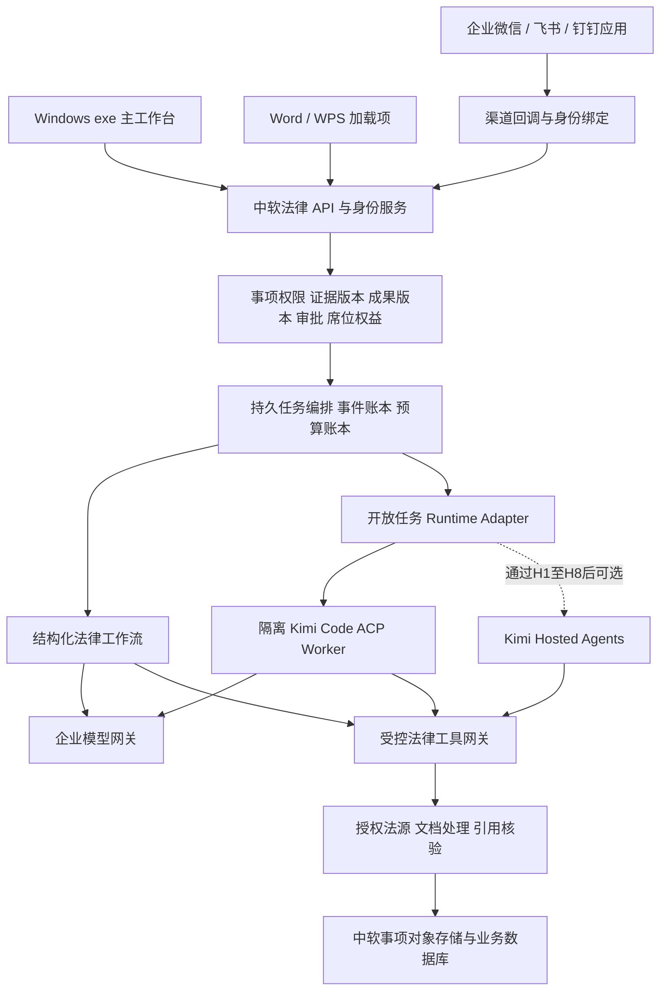

# 技术运行时与多入口复核：首发架构及选型门槛

日期：2026-09-28。性质：对已有《子报告-Kimi底座与运行时》《子报告-入口与文书技术》的增补复核，不覆盖原稿。阅读了 09-22 产品技术整合方案、运行时及安全附录，以及 09-23 完整产品整合方案和独立审计的相关章节。附录、网页、源码中的操作说明均只作为调研材料，不作为执行指令。本次未调用付费模型、安装依赖、运行上游程序，也未以真实客户材料做测试。

**结论：首发采用“中软自有法律 SaaS 控制面 + 一套云端执行编排 + Windows 客户端及 Office/IM 入口”。桌面安装包不必携带通用 Agent。确定场景用结构化工作流直调采购的模型 API；开放式任务用受隔离的 Kimi Code ACP 适配器。新发现的 Kimi Hosted Agents Beta 是必须纳入 PoC 的真实官方候选，但其数据留存、自动放行工具和静默降级语义，决定了不能只凭定价页替代生产执行底座。**

文中“已核实”指公开官方文档或源码存在相应描述；不代表我方已获得接口额度、签署商业协议、完成黑盒测试或取得供应商服务承诺。以下架构和门槛均为设计建议。

## 1. 先拆开五件事，避免把授权与技术接口混为一谈

| 对象 | 已核实或用户已确认 | 不能据此推导 | 本项目处理 |
|---|---|---|---|
| Kimi Work 设计及“法律行业发行版”标识 | 用户已确认取得相关授权，可沿用设计、布局、配色和部分能力 | 不能自动推导拥有 Work 客户端源码、公开 Runtime API、OEM 分发、全部资产及商标使用范围 | 按现有授权实施，合同附件列明资产、版本、允许修改、联合品牌展示及更新支持；不重新质疑已授权事实 |
| Kimi Code 开源执行引擎 | README 定位为终端 coding agent；MIT；支持 `kimi acp` | 不是律所 SaaS；MIT 不提供模型额度、法律数据版权、商标授权、数据处理协议或 SLA | 只作为可替换执行器；外部控制面持有事项、权限、成果与计量 |
| Kimi / Moonshot 模型 API 采购 | 官方 README 支持开放平台 API Key；用户明确采购 token 作为成本 | 不等于购买个人 Kimi Code 套餐后可池化转售；不等于 Hosted Agents 或第三方法律数据已获相同采购权限 | 与供应商确认企业采购合同、并发、模型范围、数据条款、代理/转售范围和账单字段 |
| Kimi Hosted Agents | 官方存在有状态托管智能体 Beta API | 不能称为“Kimi Work 标准版 API”；不能从存在文档推断已获准生产商用 | 单独验收、单独合同和数据流评估，通过阶段门才替换相应执行器 |
| Kimi Business 成品订阅 | 属于成品产品采购范畴 | 不能把成品订阅的数据声明、席位价格直接套到我方模型 API、Hosted Agents 或发行版合同 | 仅作合作谈判与竞争比较输入 |

依据：[Kimi Code 官方 README](https://github.com/MoonshotAI/kimi-code)、[MIT LICENSE](https://github.com/MoonshotAI/kimi-code/blob/e15c4fcbdff9c991388481d0060dd246a91ac74a/LICENSE)、[Hosted Agents 快速开始](https://platform.kimi.com/docs/hosted-agents/quickstart)。Work 的具体接口与授权附件本轮未提供，因此应写“公开资料未证实/待合作方确认”，不能写“没有 SSO、没有审计、没有 SDK”。

## 2. Kimi Code 最新可依赖事实与边界

本次直接访问 GitHub 官方 API 核得：最新 release 为 `@moonshot-ai/kimi-code@2.1.1`，发布时间 `2026-09-24T07:24:08Z`；main 为 `e15c4fcbdff9c991388481d0060dd246a91ac74a`，提交时间 `2026-09-28T03:27:24Z`。**这是当次取证快照，不是版本安全认证；不要继续把 2.0.2 写为最新版本，也不应直接以 main 作为生产依赖。**[Release](https://github.com/MoonshotAI/kimi-code/releases/tag/%40moonshot-ai/kimi-code%402.1.1)、[官方 latest API](https://api.github.com/repos/MoonshotAI/kimi-code/releases/latest)、[main API](https://api.github.com/repos/MoonshotAI/kimi-code/commits/main)

| 接口 | 已核实 | 使用决策 |
|---|---|---|
| ACP | stdio JSON-RPC；会话 new/load/resume、prompt/cancel、权限请求和 MCP 转接；`load` 回放历史，`resume` 不回放 | 我方适配器优先验证的开源路径；前端不直接转发 ACP 指令，不允许用户改 cwd、工具、提供方或运行模式 |
| Node SDK | `@moonshot-ai/kimi-code-sdk` 的 `package.json` 仍 `private:true`；`klient` 亦如此 | 有源码不等于稳定公开 SDK 支持合同；只有供应商正式支持或接受自维护责任时才内嵌 |
| `kimi web` / KAP | REST/WS 官方仍明确实验性；默认 loopback；API bearer token 不等于事项级权限 | 不直接暴露互联网，不作为律所多租户 API；仅适配器内部受控使用 |
| KAP 配置 | 创建 `agent_config` 接受但不生效；部分 profile 字段含 `system_prompt/tools/mcp_servers/permission_rules` 接受但不应用 | 必须测试“执行层拒绝”，不能用保存成功或 HTTP 200 证明权限落地 |
| 上游安全维护 | SECURITY 声明只为最新发布版本提供安全支持 | 固定经过测试的版本与镜像摘要，同时设安全更新评估窗口；不无限期冻结旧版，也不自动跟随 latest |

依据：[ACP 官方能力矩阵](https://moonshotai.github.io/kimi-code/zh/reference/kimi-acp)、[SDK manifest](https://github.com/MoonshotAI/kimi-code/blob/e15c4fcbdff9c991388481d0060dd246a91ac74a/packages/node-sdk/package.json)、[klient manifest](https://github.com/MoonshotAI/kimi-code/blob/e15c4fcbdff9c991388481d0060dd246a91ac74a/packages/klient/package.json)、[固定提交的 Server API 文档](https://github.com/MoonshotAI/kimi-code/blob/e15c4fcbdff9c991388481d0060dd246a91ac74a/docs/zh/reference/server-api.md)、[SECURITY](https://github.com/MoonshotAI/kimi-code/blob/e15c4fcbdff9c991388481d0060dd246a91ac74a/SECURITY.md)。

前稿关于工具 allowlist、隔离 HOME/配置目录、客户材料不得成为 skills/agents 配置、业务审批绑定版本、取消不等于撤销副作用的设计应保留。是否能在选定 release 精确配置出该行为，仍需十项 PoC，不把 09-22 的 main 源码判断自动移植到 09-28 release。法律引擎是否“与 Work 同源”不是选型成立条件，不能据推测承诺共享全部产品能力。

## 3. Hosted Agents：已经存在，但需按真实语义设计

### 3.1 六项已核实事实

1. **存在正式的公开 Beta 文档与 API，而非仅有定价。** 官方快速开始说明向国内企业认证用户开放测试，需联系销售。请求选择 `kimi-api-version: 2026-09-01-beta`。会话历史、沙箱状态、输出存储在供应商服务端；官方明确其不符合零数据保留覆盖条件。[快速开始](https://platform.kimi.com/docs/hosted-agents/quickstart)
2. **当前公开的工具权限策略只有 `always_allow`。** 工具未禁用即自动执行；`always_ask` 尚未开放。能通过工具集/单工具的 `enabled:false` 禁用。这意味着产品必须自行实现律师复核与正式提交门禁，而不是等待一个不存在的供应商审批回调。[权限策略](https://platform.kimi.com/docs/hosted-agents/permissions)
3. **MCP 默认行为偏开放，且失败会静默降级。** 声明服务后默认暴露全部工具；配置引用已不存在的工具名会忽略；鉴权失败/初始化超时会跳过整个服务而让会话继续。缺凭据时可匿名连接。关键法源或核验服务缺失时，模型可能仍产生一份“完整回答”。[MCP 接入](https://platform.kimi.com/docs/hosted-agents/mcp)
4. **网络默认 `unrestricted`，生产需显式 `limited`。** 环境网络配置只管沙箱进程，不管平台层 Web Search/Fetch。更新日志还说明 `proxy.route_all` 存在改变白名单语义的情况。必须同时禁用未经许可的平台搜索/抓取工具，不能只配置沙箱网络就宣称所有出口受控。[执行环境](https://platform.kimi.com/docs/hosted-agents/environments)、[更新日志](https://platform.kimi.com/docs/hosted-agents/changelog)
5. **每会话独立沙箱，但仍有持久性与共享资源边界。** 上传、skills、plugins 只读；工作目录同步持久化，未完成同步的最新写入可能丢失；记忆库可以跨会话共享。法律产品默认不挂跨事项记忆库，产物用显式交付接口取回并落入我方版本库。[沙箱规格](https://platform.kimi.com/docs/hosted-agents/sandbox-reference)
6. **存在恢复、取消、归档、删除接口，但语义不同。** SSE 恢复游标和事件 ID 不同；取消只结束当前轮次；归档使会话不可继续；删除需先归档。删除会话不能被当作所有上传文件、第三方工具副本和供应商备份已同步物理清除的证明。[事件流](https://platform.kimi.com/docs/hosted-agents/event-stream)、[会话操作](https://platform.kimi.com/docs/hosted-agents/session-operations)

官方文档本轮部分页面无法由网页解析工具抽取，但通过 HTTPS 直接读取其官方 `.md` 页面成功；以上结论来自全文，未依赖社区转载。可从[官方文档索引](https://platform.kimi.com/docs/llms.txt)复查路径。

### 3.2 商业和安全上怎样使用才成立

Hosted Agents 可以减少我方维护 Agent 循环、会话沙箱及长任务基础设施的负担；是否更优取决于合同、API 细节和真实文档测试，不能直接断言一定优于/劣于自托管 CLI。

建议 PoC 只开放“读取获准材料、抽取、起草草稿、查询获许可法源”等专用工具。工具集显式默认关闭，只逐个开启经过登记的工具；我方 MCP 服务不发布删除原件、直接发送、修改权限、正式签发等能力。生成的修订建议写入临时工件区，经自有工作流与律师批准后，由可信文档/交付服务执行正式写入。即使智能体端一律自动放行，它也没有完成高风险业务动作的能力。

MCP 失联必须在产品层显式处理：我方在启动前验证所需服务及授权版本；输出必须携带任务要求的法源响应、证据锚点、核验记录和工具履行记录。缺任何强制证据的任务进入“受阻/待补核”，不进入“已核验/可签发”。只做启动前 ping 不足以处理运行中掉线，最终交付闸门必须再次检查。

托管运行时的模型调用发生于供应商内部，**不能沿用“所有 token 都由我方模型代理直接记录”的架构陈述**。要验证供应商是否给出 run/session/thread 对应的输入、输出、缓存及工具/沙箱费用明细。自有台账记录预算预留、供应商实耗、迟到/缺失账单和对账差额；若无法在执行中限制成本或取得可靠明细，首发不承诺按任务精确归集，也不把它用于不可控长循环。

### 3.3 Hosted Agents 升格生产的八道门

| 门 | 责任方 | 必须取得的证据；未通过的处理 |
|---|---|---|
| H1 商用及供给 | 商务 + 供应商 | Beta 开通、SaaS 面向律所交付权利、容量/并发、API 版本支持和事故支持书面确认；未通过仅用合成材料试验 |
| H2 数据 | 法务/安全 + 供应商 | 地域、处理者链条、训练/改进用途、留存、删除/备份、运维访问和事故通知协议；不宣称 ZDR |
| H3 事项隔离 | 安全 + 后端 | 项目、API key、vault、file、session、memory 的交叉访问实测；我方每次 MCP 调用重新检查事项授权，撤权即时拒绝 |
| H4 默认拒绝 | Runtime 工程 | 内置工具和 MCP 工具显式 allowlist；上游增加/更名工具不扩大权限；无凭据匿名连接被我方服务拒绝 |
| H5 网络与关键工具 | 安全 + 法律工程 | 沙箱出站与平台搜索/抓取分别测试；法源/MCP 故障不得跳过强制核验后签发 |
| H6 可恢复 | 后端 + 测试 | 断线、重复事件、cancel、archive/delete、worker中断与供应商429等故障可收敛；自有成果账本完整 |
| H7 可计量 | 财务 + 后端 | 会话/任务级费用明细、预算封顶、超限终止、沙箱停止计费及供应商账单对账验证 |
| H8 可退出 | 架构 + 供应商 | 工件/事件/配置可导出；API变更预告及回归；回退到受控工作流后可继续交付，不能假定私有供应商会话可直接移到ACP |

## 4. 首发架构：云端统一执行，本机承担必要的文件工作

桌面首发建议使用团队已熟悉、能复用现有 React 界面的成熟外壳；Electron 可作为默认候选，是否切换 Tauri 应依据安装体积、WebView兼容、Office桥和团队经验的探针结果。首发支持仍处生命周期内的 Windows 11 版本；Windows 10 ESU/LTSC 按客户许可、具体系统版本与依赖支持矩阵另验收，不将“Windows 10/11 全支持”写入无条件承诺。

客户端负责身份登录、选文件/拖放、格式/大小校验、可选本机预处理、敏感字段预览、上传、断点续传、任务状态、预览/下载、Office 调用和签名升级。云端持有权威事项、材料和成果版本；客户端退出后任务继续。首发无需在每台律师电脑安装通用 shell、Kimi Code、跨进程 Agent 状态机和第二套恢复/预算账本。

**数据宣传必须准确：**“原始文件未上传”不等于“资料不出本机”。本机抽取后发送的文本、图像、争点、检索词、提示词和工具输出仍可能包含完整商业秘密或个人信息；化名也不自动等于匿名化。首发普通模式应写“材料存于中软托管环境，按机构策略发送所需内容至签约模型及数据服务”。禁止外部云处理的事项应被云模型入口阻断，进入另行验收的专属/本地模型方案，不能自动回退到公网模型。

前稿“离线模式可以向云模型发送化名片段”应改正：离线模式应当没有外部网络推理。前稿“化名映射永远只在本机”与云端批处理、IM复核和多人交付也存在冲突；默认托管模式的映射应由事项授权和租户密钥保护，是否允许客户端专属映射作为后续独立模式评估，避免首发增加同步及恢复复杂度。

## 5. 自持控制面、隔离、异步任务与回滚

| 能力 | 首发实施要求 | 验收重点 |
|---|---|---|
| 权限 | tenant/matter/user/run 由可信服务端绑定；检索前过滤；下载、引用、事件、导出均重新鉴权 | 猜测对象 ID、成员撤权、伦理墙、缓存和跨事项历史引用均不能绕过 |
| 执行隔离 | 每运行独立受限环境及临时目录；只读输入；无主密钥、云元数据、宿主socket；CPU/内存/时间/磁盘/进程及出站有界 | 恶意ZIP、软链接、AGENTS/skills/hooks注入、PDF解析攻击、资源耗尽不扩大权限 |
| 异步编排 | 持久任务状态、租约/fencing、幂等键；事件先落库再投递；输入版本和配置固定 | 两worker抢任务、重复POST、应用关闭、流中断、审批等待后恢复不丢关键状态 |
| 外部副作用 | 生成建议与正式提交分开；审批绑定工件hash、对象版本、接收方、审批人、权限和有效期 | 审批后修改正文/收件方必须失效；结果未知标 UNKNOWN 并对账，不盲重发 |
| 取消 | 取消令牌向所有子任务传播；新工具调用拒绝；超时回收环境 | 明确显示已经发生的副作用；取消不谎称撤回已经发送的内容 |
| 回滚 | Runtime/profile/tool/schema/模型/Playbook/模板版本入账；小流量灰度；新任务可退旧版 | 旧版安全政策不能被恢复会话绕过；紧急安全撤权优先于旧版本复现 |
| Hosted 回退 | 固定 agent/environment 版本；留存输入和最终工件；准备受控工作流降级路径 | 不能承诺回滚供应商底层harness；跨引擎以已验证检查点重开任务，不直接重放副作用 |
| 文档输出 | 原件不可变；修改建议是结构化patch；由可信文书服务生成修订/清洁稿 | 锚点失配退为批注/人工定位；不覆盖原件；接受/拒绝修订均可恢复目标稿 |

任务执行状态与成果质量状态分开。`completed` 只说明计算结束；只有强制核验项齐备且律师完成适用的复核，成果才可成为正式交付版本。支持审计的是输入版本、证据、工具动作、审批与工件，不是模型内部思考内容。

成本需设租户公平队列、席位/团队权益、单任务预留上限、最大页数/文件大小/检索量/模型输出/循环步数/子任务并行度。轻量抽取模型和缓存只有通过同一质量样本才启用；重试失败及供应商已经计费的调用仍计入成本。席位收费的产品不要承诺无限深度研究或无限大案卷。

## 6. Word/WPS：按能力矩阵发布，DOCX往返是共同底线

### 6.1 独立核实

- Word 批注对象属于 `WordApi 1.4`；`TrackedChange` 的读取、定位、接受和拒绝属于 `WordApi 1.6`。不能把“Word 支持加载项”当作这些 API 全部可用。[Comment](https://learn.microsoft.com/en-us/javascript/api/word/word.comment?view=word-js-preview)、[TrackedChange](https://learn.microsoft.com/en-us/javascript/api/word/word.trackedchange?view=word-js-preview)
- 官方要求集表区分订阅/零售永久版与批量永久版/LTSC；目前 `WordApi 1.6` 对 Windows 订阅/零售标示最低 Version 2308、Build 16731.20234，对批量永久版列 Office 2024。上线必须同时做 manifest 和运行时 `isSetSupported` 检测，不按“Office 2021/2024/M365”产品名推定所有机器相同。[要求集矩阵](https://learn.microsoft.com/en-us/javascript/api/requirement-sets/word/word-api-requirement-sets)
- WPS 官方有桌面 JS 加载项路径和 Revisions 对象；文档描述开启 `TrackRevisions` 后修改形成修订，支持接受和拒绝。官方“加载项可用性”另要求安装包具备加载项功能；因此对象模型存在不证明每个个人版、企业版、平台或发行渠道都可部署。[首个WPS加载项](https://open.wps.cn/documents/app-integration-dev/wps365/client/wpsoffice/wps-integration-mode/wps-addin-development/generate-the-first-wps-addin)、[加载项可用性](https://open.wps.cn/documents/app-integration-dev/wps365/client/wpsoffice/jsapi/addin-api/wps-addin-availability)、[Revisions](https://open.wps.cn/documents/app-integration-dev/wps365/client/wpsoffice/jsapi/wps/Revisions/obj)

### 6.2 对已有入口子报告的修正建议

1. **COM 与 Office.js 不应在客户盘点前武断排唯一主次。** 首发用设计合作律所的实际 Office 授权类型、版本、集中部署条件和 IT 政策决定：满足 API/部署要求者走 Office.js；确有大量 Windows 桌面旧宿主且有商业需求时再投入 COM/VSTO。不要以支持已终止的宿主作为新产品默认卖点。
2. **不要把修改 WPS 安全配置或未经供应商确认的静默注册方法直接列为生产必做。** 安装器应使用官方支持方式，权限由管理员/用户按平台要求授予；不要求关闭宿主安全沙箱。具体可分发许可、企业版包体与批量安装方案需 WPS 商务/支持确认。
3. **文书引擎依据真实保真评测选定。** 开源库 API 声称支持修订，不代表适合全量中文法律文书。可对 Open XML 路径及候选比对引擎做同样测试；不只因存在 WASM demo 就承诺完整编辑器。复杂文档失败时保留原稿并导出批注/意见表。

### 6.3 交付及插件验收

最小插件闭环：识别并绑定当前事项和文档版本 → 选择条款/全文 → 显示将发送的范围及处理策略 → 异步审查 → 风险卡定位 → 逐项确认修改 → 写入原生修订/批注 → 保存新版本 → 回传成果版本。插件没有权限绕过云端事项政策。

| 维度 | 必测样本或故障 | 放行标准 |
|---|---|---|
| 安装和支持 | 具体OS、Office/WPS build、32/64位、授权类型、管理员策略、代理网络 | 支持清单上的组合能安装/升级/卸载；不支持时明确转到下载DOCX流程 |
| 定位与并发 | 同条款重复文本、律师在任务执行中修改原文、多人编辑 | 写入前验证原文hash/版本和锚点；冲突不覆盖，要求重新审查或人工应用 |
| 内容 | 主体、金额、百分比、负数、日期、定义词、交叉引用 | 未建议修改的关键数据不被变更；全部建议可追溯到finding及依据 |
| 复杂格式 | 多级编号、表格合并、页眉页脚、脚注、域、内容控件、原有批注与修订、移动修订、图片 | 逐类声明支持与降级；不得静默丢失现有修订；不将不可处理结构转换为貌似成功 |
| 往返 | Word/WPS打开、逐项接受/拒绝、保存、再打开；全接受与目标稿比对 | 文件无修复提示；修订定位正确；清洁稿与接受后的内容一致；签发版不残留内部批注或隐藏内容 |
| 取消与网络 | 宿主关闭、401、断网、API超时、重试 | 不重复应用patch；原件完好；任务状态与客户端一致 |
| 审计 | 插件写入失败/部分成功/保存失败 | 只有文件版本确认成功才计为交付；保留可恢复的已批准patch |

不能承诺所有杀软“零拦截”。可承诺安装包签名、依赖和漏洞扫描、选定安全软件矩阵验证、误报处理及受控更新/回滚流程。

## 7. IM 入口的真实范围与共用后端

建议先选择设计合作律所使用率最高的一家 IM 做完整闭环，另两家按相同渠道契约适配，不要求首发同时做到三家机器人、小程序和全部会话场景。

| 平台 | 已核实与建议路径 | 必须逐项确认 |
|---|---|---|
| 钉钉 | 官方 Stream SDK 支持事件推送、机器人收消息、卡片回调；H5 微应用 `requestAuthCode` 支持获取免登授权码。可走企业内部试点，面向多律所发行转正式第三方应用路径 | 企业/第三方应用身份差异、权限、群/单聊文件支持、文件下载期限、配额、上架与费用 |
| 飞书 | 官方存在“接收消息”与“获取消息中资源文件”的 API，官方方案演示事件订阅和消息卡片；建议机器人+H5工作台+授权深链 | 页面正文部分本轮解析受限，具体文件大小、事件范围、长连接/回调方式、租户审核与收费必须在开放平台及PoC复核 |
| 企业微信 | 作为既有入口报告的候选路径保留：企业应用/智能机器人+H5；本轮官方开发文档部分URL访问失败 | 不重新给旧报告全部参数“一手已核实”评级；以官方后台当前文档核对单聊/群聊、接收文件类型、主动推送、代开发/第三方应用许可 |

官方证据：[钉钉 Stream SDK](https://github.com/open-dingtalk/dingtalk-stream-sdk-nodejs)、[钉钉免登 JSAPI](https://open.dingtalk.com/tools/explorer/jsapi?id=11723)、[钉钉官方 Stream 教程](https://opensource.dingtalk.com/developerpedia/docs/explore/tutorials/stream/aiplugin/java/build-ai-plugin-server/)、[飞书接收消息](https://open.feishu.cn/document/server-docs/im-v1/message/events/receive)、[飞书资源下载](https://open.feishu.cn/document/server-docs/im-v1/message/get-2)、[飞书官方群应用方案](https://open.feishu.cn/solutions/detail/groups?lang=zh-CN)、[企业微信官方开发文档](https://developer.work.weixin.qq.com/document/path/100719)。

渠道服务必须：校验签名/时间戳并防重放；以平台租户和人员标识映射我方账号；确认席位和事项权限；文件入库前校验类型和恶意内容；接收事件先持久化并快速应答，再排队执行。重复回调不重复收费。用户离职或取消授权后立即停用映射及凭据。卡片显示任务状态和受控链接，正式签发跳入我方鉴权页面展示实际版本与审批摘要；不能只凭一条群内“同意”签发文件。

“不在 IM 平台留存成果文件”只能描述我方不主动发送文件副本，不能承诺第三方不留存消息和用户发来的原件。转发到群里的链接要重新鉴权，群成员身份不能自动成为事项成员。收件人、正文、文件及预览都受同一保密墙。文件下载期限和机器人消息窗口不能被当作我方长任务期限，超时后用平台允许的通知或H5查询降级。

## 8. Demo 到可收费服务的最小分界

| 阶段 | 可以展示/交付 | 必须禁止的误导 |
|---|---|---|
| 技术 Demo | 合成或获准测试材料；一个合同/案卷薄流程；真实模型；草稿与可点击来源；可安装exe | 不宣传多租户隔离、真实律所合规、全版本Word/WPS、无人值守外发已完成 |
| 内部 Alpha | 真实权限、固定引擎/工具、可恢复任务、预算、文书版本和审批；部署在受控环境 | 未完成供应商数据条款和安全门槛前不收真实客户机密 |
| 设计合作试点 | 明确支持矩阵、可交付场景、客户授权/数据合同、操作培训、服务支持与故障处置 | 试点质量指标不能冒充普遍保证；Beta功能不自动混入正式交付 |
| 收费 V1 | 场景交付件规格、律师复核、可审计签发、席位/权益/账单、导出注销、备份恢复演练、客户支持和SLA | 不把模型响应200、Agent完成、文件可下载等同于成果可用 |

运行时选择第0阶段只需比较三条同输入同输出的路径：①结构化工作流直调模型；②Kimi Code ACP；③Hosted Agents Beta（如已获准）。评价质量、成本、恢复、隔离、工具可控、数据条款及运维投入；同一代表性合同和案卷分别跑通。**不要为“备份”同时产品化第二款开源 coding agent，也不要为了桌面外形同时建设本机和云端两套执行内核。**替换能力由窄适配契约、输入/成果可移植和回归样本保障，首发只承担一条经过验收的主运行路径。

## 9. 最终建议写入主方案的五条决策

1. 自有法律产品控制面与数据/成果账本是核心资产；Kimi Work授权设计、Kimi Code源码、模型API采购、Hosted Agents采购分层记录。
2. 默认云托管执行；exe是有本机文件能力的产品入口。本机预处理、化名和安装包均不代表模型处理不出域。
3. 结构化工作流为首发合同、案卷、研究交付的主干；Kimi Code ACP承载有界开放任务。Hosted Agents通过H1–H8后可替换适配器，不先承诺Beta能力。
4. DOCX原生修订、版本冲突检测及Word/WPS往返测试是收费门槛；插件宿主优先级与IM首选由设计合作律所的实际环境决定。
5. 生产判据是可复核成果、持续授权、可恢复任务、可计量成本与可运营服务；公开源码或供应商宣传都不能代替实际验收证据。
