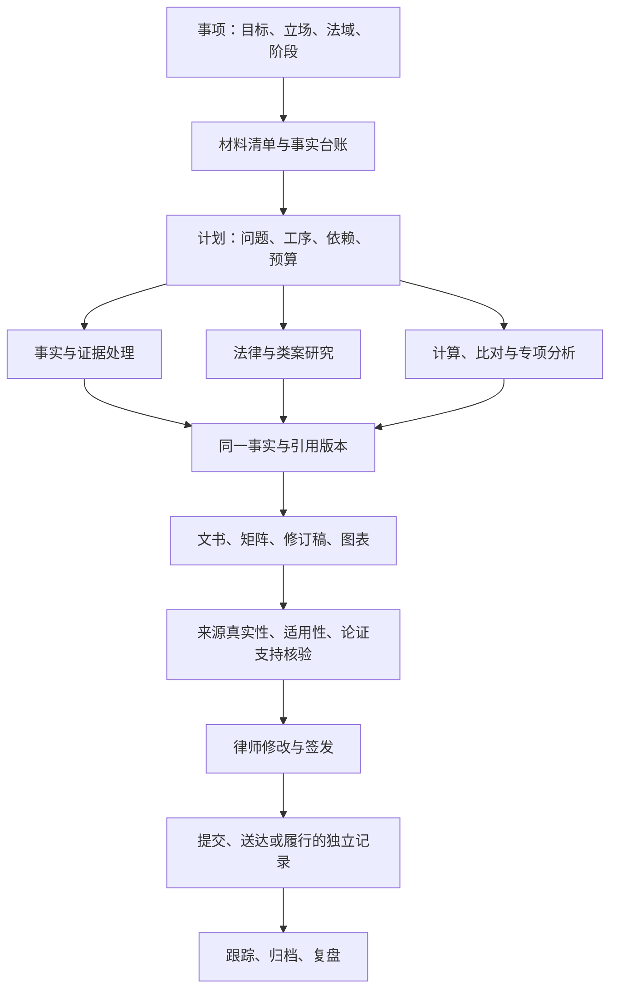

# 产品全景、法律业务层级与独立重构方案

## 1. 最重要的判断

智合值得借鉴的重点，是把“法律人正在做的一件事”变成可点击的工作入口，再连接专业方法、材料、外部工具和文件成果。单纯照搬卡片数量，或者把很长的预设塞进输入框，难以获得相同的业务价值。

本次实际看到两个并存的产品入口：主站 Agent 3.0 按三类业务、九个领域组织36个预设；Skill工作台按9类身份场景加通用组组织59个场景，另有专家、技能、连接器、项目与持续工作机制。公开仓库又将方法拆成70个Skill与34个专家工作流。**36、59、70、34是四种不同对象的数量，不能相加为199种独立能力。**它们应通过映射关联，避免同一检索或计算方法维护多个相互矛盾的副本。

推荐的重构主线是：**事项目标 → 材料与口径 → 工作计划 → 专业工序 → 三类核验 → 可编辑成果 → 律师审阅与后续动作。**场景负责降低发起成本，Skill负责稳定执行方法，MCP负责接入能力；项目负责事实、文件、规则、状态与协作的持续性。

## 2. 本轮覆盖边界及证据口径

| 对象 | 本轮完成的范围 | 不能据此声称 |
|---|---|---|
| 主站首页 | 36个预设逐项点击、读取可见提示及分类交互 | 已运行36个任务、全部结论正确 |
| Skill工作台 | 9类身份场景加通用组、59张卡逐项点击；长指令通过全屏编辑器阅读 | 所有卡都有独立Skill；提示词即后台完整系统指令 |
| 官方开源Skill | 70个源目录逐项分析，完整原文备份、哈希与固定版本；提出70条专门改进指令 | 下载即可使用法律数据库、脚本已通过运行或生产测试 |
| 官方专家工作流 | 34个EXPERT.md逐项分析、真实Skill映射与优化入口指令 | 专家名称代表执业资质或结论保证 |
| 技能广场 | 本轮页面显示总数313及分类、榜单、官方/社区/基础筛选，查看官方开源范围 | 已审计或复制全市场313项社区作品；所有社区作品均MIT |
| MCP | 新增表单、外部接入与对外数字员工令牌方向均现场可见 | 已实测联通、OAuth刷新、数据隔离及外部调用 |
| 其他模块 | 根据现场入口与2026-10-19版官方手册建立模块清单 | 已操作付费、团队共享、定时执行、真实文件上传与正式提交 |
| 同类产品 | 子代理联网查官方资料，比较工作流、矩阵、引用核验与组织标准 | 竞品公开宣传已经过本次账户实测 |

市场313项的页面分类为诉讼仲裁82、交易与非诉63、企业法务与合规25、法律研究与检索18、律所经营与个人执业13、通用办公29、娱乐减压7、未分类76。该口径混合官方、社区与基础条目；本报告对全部官方70项形成完整方法分析，社区部分仅作为生态功能观察，不冒充全量逐件审计。隐藏系统提示词、受保护资源、用户私有配置不在可取得原文的范围内。

## 3. 当前产品模块地图

“现场”表示本轮页面已读；“手册”表示官方v1.3使用手册描述，尚未逐流程运行。手册版本为2026-10-19，页面地址为[用户使用手册](https://skill.zhiexa.com/user-guide)。

| 模块 | 当前可见或官方说明的行为 | 法律业务意义 | 建议重构与验收点 |
|---|---|---|---|
| 新建任务/会话 | 主站与工作台均有统一输入；历史任务/会话 | 避免用户先挑工具再描述需求 | 自动建议场景，允许直接开始；新事项不得暗带上案事实 |
| 业务预设 | 主站36卡、工作台59卡；点击填入指令 | 用具体工作和交付物替代空白输入 | 示例事实独立于真实参数；切换时保护用户已编辑草稿 |
| 长指令编辑 | 全屏编辑、分段、收起后回到输入框 | 能审阅复杂范围和输出要求 | 主体/金额/立场修改有差异提示；不在收起时误发送 |
| 问题润色 | 主站可见入口 | 帮用户补结构、指出缺口 | 只改表达与结构，不擅加事实、控诉、诉请或权限 |
| 材料添加 | 文档/图片/表格、拖入、粘贴截图入口现场可见 | 接入扫描案卷、聊天截图、合同和流水 | 显示上传、解析、OCR、可用范围四种状态，不能混同 |
| 文件与成果 | 手册列本对话文件、全账号文件、未归档、回收站、下载为Word | 输入和交付件可管理与追溯 | 原件、解析件、底稿、签发件分版本；下载实物与预览一致 |
| 项目 | 工作区项目入口、自动匹配项目；手册说明归档、持续上下文 | 一案多任务、一客户多事项 | 项目建议可确认，利益冲突相关资料不跨项目自动拼接 |
| 个人记忆 | 手册列查看、管理及使用偏好 | 沉淀风格与稳定偏好 | 偏好与案件事实分仓，禁止把一次性假设变成永久事实 |
| 技能选择 | 按需使用、按任务匹配官方技能；手册说可临时调用未安装官方技能 | 减少安装负担 | 明示实际调用、版本与任务范围，自动匹配不扩大权限 |
| 我的技能/技能广场 | 搜索、来源/分类/标签、榜单、学会、下载等 | 个人与组织方法资产 | 安装前看来源、许可、依赖；热度不能代替法律质量 |
| 技能导入 | 工作台有SKILL.md、ClawHub、skills.sh入口 | 接入机构或个人方法 | 包内路径、脚本、依赖静态检查；导入不默认授予执行权限 |
| 官方开源 | 当前70技能、34专家，MIT；开放脚本/模板/评估 | 可审视工作方法、合法改编 | 锁提交、保留署名，修正后建立独立版本和回归样本 |
| 专家/数字员工 | 我的专家、专家广场；@入口与手册流程 | 多Skill围绕业务组合 | 专家是工作流与资源配置，不仅角色人设；配置可解释 |
| 模型与思考 | 独立于技能选择；手册说明自动模型默认关闭 | 按整理/研究/论证匹配资源 | 输出记录实际配置；模型强弱不代替法源、证据和复核 |
| 执行设置 | 直接执行/先做计划与额度暂停/持续工作分别选择，已现场查看 | 长任务可控，复杂事项可先审计划 | 计划批准的范围、后续变更与预算独立；持续工作不绕过权限 |
| 执行过程 | 案例回放可见工具卡、文件与过程；手册说明停止/继续 | 发现材料、计算与生成错误 | 显示结构化处理记录和实际成果，不要求展示模型内在思维 |
| 外接MCP | 名称、URL、传输、鉴权、headers、工具白名单、测试 | 法律数据库、企业数据、机构系统 | 白名单留空不宜默认放行全部；按实际工具和事项绑定权限 |
| 推荐连接器 | 现场有天眼查推荐，标需密钥 | 主体和公开风险调查 | 推荐不等于已授权，也不替代原始记录核查 |
| 对外MCP | 数字员工绑定接入令牌，供其他AI应用派活 | 法律工作流可服务外部宿主 | 令牌限定员工、事项、预算、工具与有效期；保留撤销与审计 |
| 旧主站法律入口 | 案例法规库、企业查询（启信宝）、智拾网 | 法源、主体、专业知识入口 | 区分法律效力、案例、实务文章；不统一当权威依据 |
| 定时任务 | 工作台入口及手册章节 | 新规追踪、期限提醒、服务回访 | 日期经确认后建任务，监测失败显式提示；法定期限不由模型独自改写 |
| 团队协作 | 手册区分工作区、普通会话与团队项目范围 | 律师/助理/客户分工 | 内容访问权、编辑、签发和对外共享分别控制 |
| 桌面客户端 | 页面宣传Windows/macOS、本地文件夹直连和独立长任务窗口 | 减少反复上传下载 | 客户端存在不证明本地推理或数据不出机；按每工具说明执行与传输域 |
| 云浏览器/本机浏览器 | 手册说明网页云浏览器和电脑已登录浏览器独立 | 研究与办事系统可分流 | 浏览器权限和网站会话不混用；不能声称知道本机未授权页面 |
| 多媒体与办公 | 主站公开索引和手册列图像、语音、视频、图表、文档 | 转写、可视化、汇报与培训 | 是公共工具层；内容正确性与格式正确性分别验收 |
| 积分/账单/额度 | 现场有体验版、购买、领取；手册说明账单与有效期 | 成本透明 | 免费入口不自动领取/购买，批量任务先展示预算及中止规则 |
| 企业服务季 | 现场标目标10/26启动，以实际开放为准；辅助技能13项 | 从客户研究到顾问服务的持续链 | 活动时间与功能开放分开，不能称2026-10-21已全面开放 |
| 找律师/认证 | 现场入口，手册说明名录与认证 | 专业服务承接 | 平台认证与具体服务范围分开，不能暗示平台代为签发法律意见 |
| 设置/公告/反馈 | 账号与设置、系统公告、使用手册等 | 可持续使用和支持 | 变更影响可见，保留问题复现与产品版本 |

## 4. 按法律业务重排，而非按技术名词堆入口

推荐六条业务主线，并以事项阶段作为第二维度；“诉讼仲裁/非诉/企业法务”可作为首页熟悉的快捷分组，后台不必据此复制能力。

| 业务主线 | 阶段 | 核心交付 | 可复用公共工序 |
|---|---|---|---|
| 客户与事项受理 | 咨询、利益冲突、范围、报价、委托 | 事实/缺口、冲突核查待办、服务范围与费用方案 | 主体识别、访谈、资料清单 |
| 争议解决 | 诉前、保全、起诉/仲裁、证据、庭审、救济、执行、结案 | 请求权矩阵、文书、证据/争点表、期限表、执行与结案包 | OCR、检索核验、计算、时间轴、排版 |
| 合同与交易 | 结构、尽调、条款、谈判、签约、交割、履约 | 尽调矩阵、修订稿、谈判清单、交割条件、台账 | 多文件提取、版本比较、条款库 |
| 公司与常年法务 | 治理、用工、日常咨询、制度、培训、服务复盘 | 决议/制度、管理层一页纸、顾问服务报告 | 法规研究、审批矩阵、事项台账 |
| 行业与专项合规 | 新业务、金融、数据、反垄断、监管、刑事、跨境、知产 | 义务矩阵、风险评估、影响评估、整改和应急包 | 规则/业务映射、期限、主体/关系核查 |
| 知识与专业经营 | 案例研究、范本/Playbook、客户维护、专业定位、质量管理 | 检索报告、方法资产、服务提案、评测样本 | 来源账本、版本、脱敏、复盘 |

一件事可跨多条线：并购同时涉及劳动安置、数据、反垄断与税务；股东纠纷可能由公司治理转为争议；判决后仍需执行和客户回访。主业务决定成果与责任人，专项任务带着同一事项事实与明确范围并行。

## 5. 把七种对象分开管理

| 对象 | 定义 | 示例 | 版本与关系 |
|---|---|---|---|
| 场景卡 | 某身份下常见工作的发起入口 | 代表用人单位准备应诉 | 指向方法组合；多个入口可复用同一流程 |
| 本次任务提示词 | 本次的目标、立场、材料、约束和交付 | 代理被申请人，处理解除/加班四项请求 | 创建后保留用户修改与快照 |
| Skill | 可复用的程序知识、步骤、资源、质量标准 | 证据清单与举证责任 | 声明输入输出、依赖、降级、评测与版本 |
| 专家工作流 | 为一类事项组织多个Skill及顺序 | 劳动争议专家 | 分阶段任务、交接与总体验收；角色只是表达层 |
| MCP/工具 | 外部数据或执行能力的接入 | 法规检索、文档写入 | 真实工具Schema、鉴权、范围、费用与结果状态 |
| Playbook/规范 | 某机构或客户的偏好和审查标准 | 采购验收最低保护及可退让项 | 区分法律强制、客户底线与可批准例外 |
| 项目/事项空间 | 持续上下文、材料与交付的容器 | 某并购或某劳动案 | 事实、权限、依赖、版本、任务和确认记录 |

Skill并非只是一段提示词：至少还要定义触发条件、关键输入、每步方法、输出结构、质量门槛和失败处理；可附模板与脚本。MCP也并非一个数据库或一个Skill。截至本次核验，MCP稳定版为2026-07-28，可选扩展允许通过MCP提供Skill；是否支持需分别核验客户端和服务端，不改变二者在业务设计中的职责。[MCP正式发布](https://blog.modelcontextprotocol.io/posts/2026-07-28/)、[Skills扩展规范](https://github.com/modelcontextprotocol/ext-skills/blob/main/specification/stable/skills.mdx)、[Agent Skills格式规范](https://agentskills.io/specification)

## 6. 材料与证据需要更精细的状态

上传图片是输入动作，OCR是处理步骤，证据意见是专业结论，三者不能共用“已处理”状态。

| 材料 | 必须保留 | 核查重点 | 不能自动推导 |
|---|---|---|---|
| 扫描PDF/照片 | 原图、页码、区域、OCR文本/置信与修订 | 金额、日期、印章、签名、缺页、旋转 | 印章真伪、真实签名、文件已生效 |
| Word合同 | 原文件/哈希、段落/条款、附件、修订与批注 | 表格、字段、页眉页脚、隐藏修改和版本 | 只读正文等于检查完整合同 |
| Excel/流水 | 工作簿/表/单元格、币种、日期、公式/缓存 | 去重、正负、抵扣、单位、期间和数据缺口 | 截图金额等于真实银行入账 |
| 聊天截图/导出 | 身份线索、时间、上下文、原始载体、顺序 | 截断、撤回、转发、时区与账号对应 | 昵称等于当事人，截图当然真实或当然无效 |
| 录音/视频 | 原始文件、转写时间戳、说话人识别状态 | 听不清、重叠、剪辑、取得方式与上下文 | ASR标签等于本人身份、转写等于事实查明 |
| 网页/公告/法规 | URL、抓取时间、发布机关、版本、定位 | 官网原文、附件、修订/更正、适用时间 | 搜索摘要等于全文，未检出等于不存在 |

建议材料状态为：已选 → 上传完成 → 解析中 → 部分可读/完整可读 → 人工校正 → 允许用于分析。任务结果记录实际读到的范围。OCR低置信页可继续处理其他材料，涉及关键金额/期限的结论先保留待核，不能让模型猜字后作为确定参数。

事实台账中每条至少包含：事实编号、陈述内容、来源类型、材料位置、支持/反对材料、争议状态、日期精度、确认人和确认时间。诸如“2024年1月催款”必须保留月精度，不能变成1月1日；冲突事实并列，而非用更顺畅的叙述悄悄消解。

## 7. 工作流的共享底稿与变化传播

诉讼七交付物这类组合任务，最好先生成并确认共同底稿，再派生文件。可以包含：案件摘要、研究/策略、证据与补证、时间线、金额测算、文书、管理层汇报；这是建议组成，不声称案例回放已验证七份均完成。

共同底稿应包括事实版本、争点编号、请求/抗辩、金额参数与流水、规则/案例来源、确认日期和未决事项。报告、Excel、诉状、时间线与PPT从同一底稿取数；每项衍生成果保留底稿版本。

例如律师确认一笔3万元转账不计入借款，系统先重算相关本金与还款冲抵，再更新策略中的金额、诉请和汇报，显示受到影响的文件。不能只从总数减去3万元及其名义利息，而不重跑依赖流水。若两个计算器给不同结果，应查起算、抵扣、利率、年日数和四舍五入口径；“前一个是专家给的”不构成选择结果的依据。

推荐成果状态：工作结构 → 部分完成 → 待律师审阅 → 修改中 → 已复核 → 已签发。提交、送达、已履行是后续独立事件；签发后有事实变更应生成新版本，不静默改旧稿。

## 8. 提示词质量的判定标准

一段提示词写得专业，需同时通过以下检查：

1. **任务可完成：**目标明确，所需材料和工具存在，完成信号明确；“全面、深入、权威”不能替代步骤。
2. **前提可审查：**立场、法域、事实日与研究日分开；会改变结论的缺项被发现。
3. **方法确实匹配：**证据先拆待证事实；尽调先设风险问题；合规先映射业务动作；文书先闭合诉请与事实；统计先定义样本。
4. **事实与推断分层：**没有把示例、客户陈述、模型推理、工具命中写成已查明事实。
5. **结论能回到来源：**引用存在性、规则适用性、论证支持范围三项都检查；找到条号不是核验完成。
6. **失败仍然有用：**材料不齐可交缺口和结构，检索失败可交检索记录与待核项；不会假装全面成功。
7. **可交付与可继续：**输出结构符合工作目的，文件可打开，用户修改可回流到后续任务。

原预设中“统计当地支持率”应改成有明确样本边界的裁判研究，“量刑预期”改为基于规则和已证情节的条件情景，“直接提交”改为要素完整并待签发的草稿，“按最短期限/最低金额”改成真实规则、分支假设与独立提前提醒。保守预警不能被包装成法律结论。

## 9. 必须先修的具体问题

| 问题 | 独立核查与处理 | 对产品的要求 |
|---|---|---|
| 听证统一写3日 | 《行政处罚法》第64条为告知后五日，第85条明确相关日数指工作日；应与陈述申辩等权利分别核查。[官方全文](https://www.samr.gov.cn/zw/zfxxgk/fdzdgknr/tzsbs/art/2023/art_3712fbfaaed942b3b6b66f14d5288723.html) | 以权利类型+规则版本+送达凭证计算，不写固定一律三日 |
| 违约金30%作合同总价上限 | 合同编通则解释第65条针对违约金与造成损失的比较并综合其他因素，是一般认定标准。[最高法全文](https://www.court.gov.cn/fabu/xiangqing/419382.html) | 约定计算、可主张数额与调整风险分开，不硬套统一上限 |
| 年数×365 | 公历周年、对应日、起算与末日例外需分别处理；不能拿利息基数算法替代法定期间 | 日期引擎确定性计算，留输入/规则/过程与边界样本 |
| 缺年份或只有月份仍出精确期限 | 年份、送达/催告具体日及日期性质不清时，不能得到唯一截止日 | 保留精度，先给区间或追问；内部提前提醒单独记录 |
| 同当事人改判即一审整体不可引 | 必须关联原审案号、案件链、争点与改判范围 | 候选命中与核验完成分开，不能靠结果码代替全文 |
| 申请执行过两年即不能申请 | 申请受理与时效抗辩后果不同，不能写成逾期一律拒收；详见业务全景法源核验 | 期限届满提示说明程序与实体后果，不绝对断言 |
| 行政起诉模板只沿旧规则 | 2026-05-01起施行的起诉期限解释需纳入。[最高法解释](https://www.court.gov.cn/zixun/xiangqing/498801.html) | 行为/知悉/送达及告知分别记录，规则更新触发重核 |
| 仲裁套旧模板 | 2025修订仲裁法于2026-03-01施行，事项和规则版本需核验 | 仲裁机构、规则、适用时间与程序分支进入输入 |
| 页面“符合SKILL.md”即跨宿主可用 | 上游中文name、平台引用ID、资源和工具依赖需适配，真实格式要求见官方规范 | 显示宿主兼容性与依赖，导入通过不称运行通过 |

以上为本次抽查/静态审阅发现的具体问题，不是对全部上游法律规则或算法的全面正确性认证。70项中每条的专项改进与降级方式见后续章节。

## 10. 需要补齐的业务缺口

官方70项有很好的通用底座，但具体预设覆盖面大于其专项方法深度。银行授信、保险条款、资管适当性、基金设立备案、税务、经营者集中、IP赔偿、家事涉外继承等，不能仅凭通用“合同审查/合规评估”就视为专业实现完成。

建议新增的专项方法至少包括：担保设立与顺位核查、保险产品/渠道合规、资管产品类型与适当性、私募管理人与基金分轨、上市公告版本链、反垄断营业额与控制权、税种/期间/通知核查、IP权利状态与赔偿、家事权属/形式/冲突法。每项需专业模板、工具、法源和评测样本；可在完成前作为清单/研究辅助开放，不应宣传为已验证全流程专家。

受理、利益冲突核查、委托范围、费用与授权、客户沟通、结案交付、知识回收也需要进入主业务。不能把法律工作止于“生成一份起诉状”，忽略正确承接、及时签发与实际执行。

## 11. 建议的落地顺序与具体门槛

这是本研究提出的实施优先级，不是已有功能的开发状态。

| 阶段 | 交付范围 | 进入下一阶段的门槛 |
|---|---|---|
| P0 方法与来源整理 | 70/34固定上游、95入口映射、许可、关键纠偏、统一任务对象 | 数量可复核；修改块与上游冲突被消除；所有引用可定位 |
| P1 三条高频闭环 | 合同审查修订；案卷/证据与文书；限定资料研究与顾问答复 | 实际材料解析范围明确；结果有定位；文件可编辑并能导出；关键金额/日期可复算 |
| P2 扩展与运营 | 专项能力、批量矩阵、模板/Playbook、管理汇报、常法台账 | 专业样本评审；批量失败/缺项状态准确；律师锁定值重跑不被覆盖 |
| P3 持续协作与连接 | 真实数据库/MCP、团队、监测、桌面、对外数字员工 | 真实鉴权与隔离测试、费用上限、版本回滚、失败恢复、外发/签发独立记录 |

质量评测应使用固定虚构或依法可用样本，覆盖正确答案与应该拒绝确定结论的情况：缺一页、截图模糊、两份陈述冲突、同名公司、过期法条、二审部分改判、付款中途变动、跨闰年、OCR把0读成8、未取得全文、工具超时。评估事实定位、引用支持、计算一致、缺口识别、文件格式与专业采纳；不只计算文字相似度。

初始验收建议：关键事实与高影响结论的来源或待核标记覆盖完整；金额与日期在约定测试中全部可复算；不确定状态不被抹平；任何未授权跨案读取与外传均阻断；Word/表格实物与预览可核对。这些是拟定门槛，尚未执行实测，后续必须由真实运行和专业人员评审证明。

## 12. 复制、改编与交付包关系

完整上游在 `上游来源/legal-agent-skills/`，锁定commit为 `83df6b13a60b2dfeaf30001c7894bcb45a59fcc4`，原始70份指令另汇为《70项技能原文合辑.md》。MIT版权为 `Copyright (c) 2026 John He (Decikingship)`，许可随原文与改编说明保留。这个许可允许学习和改编代码/方法，不赋予数据库数据、用户材料或付费接口访问权。

本次交付是**研究文档、优化提示词与方法规范**。没有把优化稿宣称为已安装、已连通或已经过法律质量测试的产品，也没有改变现有项目代码。要用于生产，应基于这份盘点建立独立修订包，解决依赖和冲突，再按上节的真实样本验证。
