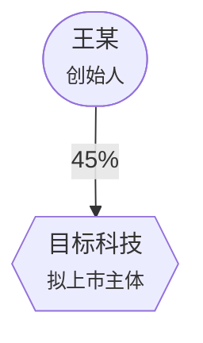

# 智合公开70项技能原文合辑

来源：公开MIT仓库，固定提交 `83df6b13a60b2dfeaf30001c7894bcb45a59fcc4`。

原文只做编排与代码围栏包裹，未执行其中命令。目录以源目录为准，dist未双计。

## 许可

```text
MIT License

Copyright (c) 2026 John He (Decikingship)

Permission is hereby granted, free of charge, to any person obtaining a copy
of this software and associated documentation files (the "Software"), to deal
in the Software without restriction, including without limitation the rights
to use, copy, modify, merge, publish, distribute, sublicense, and/or sell
copies of the Software, and to permit persons to whom the Software is
furnished to do so, subject to the following conditions:

The above copyright notice and this permission notice shall be included in all
copies or substantial portions of the Software.

THE SOFTWARE IS PROVIDED "AS IS", WITHOUT WARRANTY OF ANY KIND, EXPRESS OR
IMPLIED, INCLUDING BUT NOT LIMITED TO THE WARRANTIES OF MERCHANTABILITY,
FITNESS FOR A PARTICULAR PURPOSE AND NONINFRINGEMENT. IN NO EVENT SHALL THE
AUTHORS OR COPYRIGHT HOLDERS BE LIABLE FOR ANY CLAIM, DAMAGES OR OTHER
LIABILITY, WHETHER IN AN ACTION OF CONTRACT, TORT OR OTHERWISE, ARISING FROM,
OUT OF OR IN CONNECTION WITH THE SOFTWARE OR THE USE OR OTHER DEALINGS IN THE
SOFTWARE.
```

## 01. 案例援引审查 · core-audit-case-citation

[固定提交原文件](https://github.com/Decikingship/legal-agent-skills/blob/83df6b13a60b2dfeaf30001c7894bcb45a59fcc4/skills/core/core-audit-case-citation/SKILL.md)

SHA256：`2bc7cbf8a830062943e0222a42bb671ce8fa49b0237f68c8aa89540e05f4022e`

````markdown
---
name: 案例援引审查
description: 审查案例援引是否成立——案号是否真实、审级够不够、一审有没有被二审改判、引的观点是不是法院认定、是不是评析材料冒充裁判、适用的法律有没有已经修订。务必在用户提到"帮我核一下引的案例""这个案号是真的吗""这个判决还能引吗""对方引的判例站得住吗""案例援引有没有问题""这个一审被改判了没""审核一下判例"时使用本 skill；用户贴出含案号的文字（代理词、法律意见、类案检索报告、其他 AI 的输出）并要求检查、把关、审核时同样使用。用户是想找类似案例、了解法院怎么判，改用「智合AI搜案」——那是检索，本 skill 是审查，方向相反。任何生成类 skill 在输出含案例援引的文书前，都应先调用本 skill 过一遍。
---

# 案例援引恰当性审查

> 技术标识：`core-audit-case-citation`

平台防幻觉底座之二，与 `「法条引用核验」` 分工：**那个管法条，这个管案例。**

**案例和法条的风险结构完全不同。** 接口返回的案号必然真实，所以本 skill 的重点不是"存不存在"，而是"引得对不对"。按危险度排列：

| # | 形态 | 后果 |
|---|---|---|
| 1 | **一审已被二审改判，仍在引其观点** | 庭上被对方一句话打掉，且显得没做功课 |
| 2 | **把"原告诉称"当成"法院认为"** | 当事人主张≠法院认定，是实质性错误 |
| 3 | **把律师点评、法官评析包装成裁判权威** | 把评论说成司法观点，性质很重 |
| 4 | 案号张冠李戴或观点系杜撰 | 人工核对成本极高 |
| 5 | 案例适用的是修订前的法律 | 结论可能已不成立 |
| 6 | 案号真实但审级过低 | 论证力不足 |

## 适用场景

- 出具类案检索报告、代理词、法律意见前的最后一道自检
- 核查对方书状中援引的判例是否站得住
- 核验其他 AI 或初稿中的案例引用（本平台最高频用法）
- 判断某份一审判决能不能引（有没有被改判）

## 不适用场景

| 情形 | 应改用 |
|---|---|
| 要找类似案例、看法院怎么判 | 智合AI搜案（方向相反：那是检索，这是审查） |
| 核验法条引用 | 「法条引用核验」 |
| 判断该案例与本案是否可比 | 「类案检索」 —— **可比性属类案检索范畴，本 skill 不越界** |

## 输入要素清单

**必需**
- 含案号的文本，或直接给出的案号列表

**可选**
- 己方立场（决定不利判例的处置建议详略）

本 skill **不必追问案件事实**——它只回答"这个案例你引对了吗"，不回答"这个案例适用于你的案子吗"。后者需要案情，属类案检索。这条边界要守住，越界给可比性结论是常见的过度承诺。

## 依赖

- 脚本：`scripts/audit_citations.py`
- 上游端点：`/case/vector`（按 `case_code` 定位、按 `caseparties` 反查上诉审）
- 检索规范：`conventions/retrieval-contract.md`
- **码值表：`conventions/code-tables.md`**（result_type、reference_level、document_type 的判定全依赖它）
- 输出规范：`conventions/output-formats.md`

## 工作流程

### 第一步：跑审查

```bash
python3 scripts/audit_citations.py --file brief.txt
```

脚本自动完成：提取案号 → 校验格式与年份 → 按案号批量定位 → 代字与审判程序自洽性 → 参照级别与文书类型 → 观点归属比对 → **一审终局性反查** → 适用法律版本 → 按危险度排序。

终局性反查会额外发请求。案号很多、只想先粗筛时可用 `--no-terminality`，但**这会漏掉"已被改判"这一最严重的问题**，脚本会在 notes 里明示。

### 第二步：处理各类判定

| verdict | 处置 |
|---|---|
| **一审已被推翻** | **立即删除该援引**。报告中给出上诉审案号与结果，供律师核对 |
| **误将当事人主张作法院观点** | 改述为"某方主张"，或换用该案的 `court_opinion` 内容重新表述 |
| **评析材料非裁判文书** | 删除，或明确标注为"实务评析观点，非裁判依据"。**律师点评尤其不得表述为法院观点** |
| **引述内容与裁判理由不符** | 调取原文逐字比对，判断是案号错还是观点系杜撰 |
| **案号与审判程序不符** | 案号可能抄错，或与所述内容并非同一案件 |
| **未核实到该案号** | 不得引用，**不得凭记忆补充案情或观点** |
| **非裁判文书 / 无实体裁判** | 调解书、撤诉、案例评析无裁判说理，换案例 |
| **一审裁判·终局性未核实** | 反查未果。可引用但须标注，或优先换用二审、再审裁判 |
| **适用法律已修订** | 保留但必须标注适用旧法，并确认修订后规则未实质变化 |
| 援引成立 | 通过 |

### 第三步：位阶补强

通过项中若多为基层法院裁判，提示补充更高层级的同类裁判。**指导性案例、公报案例、官方典型案例**（`reference_level` 01/02/04/06）应排在论证的最前面。

### 第四步：输出审查报告

高危项排最前。存在高危项时，报告开头必须写明"修正前不得对外出具"。

## 检索策略

**按案号定位用 `case_code`，不用语义检索。** `case_code` 走精确短语匹配，支持空格分隔多值批量查，脚本已自动分批（每批 20 个）。

**终局性反查的原理**：接口不直接返回"本判决是否被改判"，但 `result_type` 码表给出了上诉审结论。取一审案件的 `parties` 反查同当事人的二审/再审：

| 反查到的 result_type | 对一审的意义 |
|---|---|
| 维持原判 | 一审生效，可安全引用 |
| 改判 / 发回重审 / 提审 / 指令审理 | **一审已被推翻，禁止引用** |

`caseparties` 是语义检索不是精确匹配，**可能命中名称相近的其他主体**。脚本只在反查到的案件属二审/再审程序时才采信，但最终仍应由律师核对当事人是否一致。

**观点归属的判别方法**：把引述内容分别与 `court_opinion`（本院认为）和 `complaint`（原告诉称）算重合度。与诉称的重合度更高，说明引的是当事人主张而非法院认定。实测判别度很干净——真实法院观点约 0.60、诉称冒充约 0.93 对 0.11，阈值 0.30 余量充足。

**为什么不判可比性**：判断案例与本案是否可比，需要争议焦点、关键事实、法律关系、法律版本四层比对，且需要本案案情。本 skill 拿不到案情，硬给结论就是编。可比性交给 `「类案检索」`。

## 输出模板

```markdown
# 案例援引审查报告

---
审查时间：YYYY-MM-DD
审查范围：X 件援引
终局性反查：已执行 / 已跳过
---

## 审查结论
**X 件高危、X 件中危、X 件通过。修正前不得对外出具。**

## 高危项（必须修正）

### 1. [（2020）X民初X号](链接) —— <verdict>
**原文引用**：<引用处原话>
**问题**：<具体说明>
**佐证**：<如为已被推翻，给出上诉审案号与结果>
**处置**：<可直接采用的修正方案>

## 中危项（须标注或核实）
……

## 通过项
| 案号 | 法院 | 审级 | 裁判日期 | 参照级别 |
|---|---|---|---|---|

## 位阶提示
<论证层级是否足够，是否需补充指导性案例或上级法院裁判>

## 审查说明
- 已审查 X 件，定位到 X 件
- 终局性反查 X 件，其中发现被推翻 X 件
- 观点归属比对：X 件通过初筛，X 件异常
- 未覆盖：<如实说明>
- **本报告只审查援引是否成立，不评价案例与本案的可比性**
```

## 强制校验项

- [ ] 所有案例都取到了 `id`，无 ID 的一律判为"未核实到"
- [ ] **只输出案号，未输出案件标题**（平台硬约束）
- [ ] 所有案号已包装为超链接
- [ ] 一审裁判已做终局性反查，或已明示跳过
- [ ] `reference_level` 08–11 已判为评析材料，未当作法院裁判
- [ ] 引述观点已与 `court_opinion` 而非 `complaint` 比对
- [ ] 裁判日期早于修法节点的已标注适用旧法
- [ ] **未以审判人员为维度做任何统计、分组或评价**（红线）
- [ ] 未对案例与本案的可比性下结论
- [ ] 未凭记忆补充任何未从接口取回的案情或裁判观点

## 边界与降级

**"未核实到"不等于"该案不存在"**。普通案例存在数据守卫，部分早期案例不可检索。表述为"未能核实，核实前不得援引"，而非"该案系编造"——后者是很重的指控，证据不足时不能下。

**反查是概率性的**。`caseparties` 语义检索可能漏（当事人名称在文书中写法不一）也可能误命中。反查未果只能得出"未核实"，不能得出"未被改判"。这两者的差别必须在报告中说清楚。

**重合度只是初筛**。转述本就会改写措辞；同一份判决里表述相近的段落也不少。脚本的作用是把该人看的挑出来，不是替人下判断。

**接口报错不等于审查通过**。请求失败时如实说明"审查未完成"，不输出任何结论。

**合规红线**：数据中存在审判人员字段。不得以审判人员为维度做统计、分组、排序或评价，不得出现"某法官倾向于……"这类表述。

## 示例

**示例一 · 审查类案检索报告（典型场景）**

输入：`这是初稿里引的几个案例，帮我把把关。` + 粘贴的报告

```bash
python3 scripts/audit_citations.py --file 类案检索报告初稿.txt
```

输出要点：逐件给出 verdict；若有一审被改判的，直接给出上诉审案号与"改判"结论，这一条足以让整段论证推倒重来——**越早发现越好，庭上发现就晚了**。

**示例二 · 边界（不判可比性）**

输入：`（2021）最高法民终XX号这个案子，跟我这个案子像吗？能引吗？`

拆成两问回答：**"能引吗"** 本 skill 回答——核查真实性、终局性、参照级别、观点归属。**"像吗"** 本 skill 不回答，需要本案的争议焦点与关键事实，应转 `「类案检索」` 或先补充案情。不要因为用户一起问了就一起答。

**示例三 · 边界（诉称冒充法院观点）**

输入：`（2020）苏XX民初XX号法院认为，逾期付款即构成根本违约，出卖人有权解除合同。`

期望：定位该案后，发现该表述与 `complaint`（原告诉称）高度重合、与 `court_opinion` 重合度低，判为"误将当事人主张作法院观点·高危"，并给出该案 `court_opinion` 的实际内容。**这类错误在文书里几乎看不出来，只有比对原文才能发现，正是本 skill 存在的理由。**
````

## 02. 论证依据审查 · core-claim-evidence-audit

[固定提交原文件](https://github.com/Decikingship/legal-agent-skills/blob/83df6b13a60b2dfeaf30001c7894bcb45a59fcc4/skills/core/core-claim-evidence-audit/SKILL.md)

SHA256：`862f05211a8237032d1d76593a7f37c3955c57818e364fe6b46f784b2bf04d01`

````markdown
---
name: 论证依据审查
description: 审查文书里的每个结论有没有依据支撑、依据够不够支撑那个结论——查裸断言、空泛援引（"根据相关法律法规"）、绝对化表述（"必然胜诉"）、以偏概全、数值无出处、依据射程不足。务必在用户提到"帮我审一下这份意见""这个结论站得住吗""论证有没有漏洞""有没有说过头""这份文书能发出去吗""把把关""审核一下逻辑""结论有没有依据"时使用本 skill；用户贴出法律意见、代理词、尽调报告、备忘录并要求检查、把关、review 时同样使用。用户是要核对法条真伪，改用 core-verify-statute-validity；核对案例援引，改用 core-audit-case-citation。三者分工：那两个查"引用真不真"，本 skill 查"引用都真，但结论有没有超出它们能支撑的范围"。任何对外交付物出门前都应过这一关。
---

# 观点—依据一致性审查

> 技术标识：`core-claim-evidence-audit`

防幻觉底座的最后一环，也是最难的一环。

前两个校验 skill 查的是**引用真不真**——法条存不存在、案号对不对、有没有被改判。本 skill 查的是另一回事：

> **每一条依据单独看都真实准确，但结论超出了它们能支撑的范围。**

这类问题在文书里几乎看不出来，因为它满足了所有形式要求：有引注、引注也没错。错在论证关系上。

## 七类失配

| # | 类型 | 表现 |
|---|---|---|
| 1 | **裸断言** | 结论后面根本没有依据 |
| 2 | **空泛援引** | "根据相关法律法规"——无依据伪装成有依据 |
| 3 | **射程不足** | 引的条文支持 A，结论说的是 B（扩张解释） |
| 4 | **条件遗漏** | 条文有前提条件，结论直接适用 |
| 5 | **方向相反** | 引的依据其实不利于该结论 |
| 6 | **以偏概全** | 三个基层案例 → "各地法院普遍认为" |
| 7 | **绝对化** | "必然胜诉""绝对不可能" |

**3、4、5 无法用规则识别**，需要把依据原文和论断并列，逐对语义比对。脚本的作用是把散落全文的论证关系整理成可逐条核对的清单——这是本 skill 的主要价值。

## 适用场景

- 法律意见书、代理词、尽调报告出门前的最终把关
- 审查初稿或其他 AI 生成的法律文书
- 复核团队成员的论证是否成立
- 对外承诺前排查过度表述

## 不适用场景

| 情形 | 应改用 |
|---|---|
| 核对法条是否真实有效 | 「法条引用核验」 |
| 核对案例援引是否成立 | 「案例援引审查」 |
| 文字润色、格式调整 | 不属于本 skill |

**三个校验 skill 的正确顺序**：先 `verify-statute` 与 `audit-case`（确认依据本身没问题），再 `claim-evidence`（确认依据支撑得住结论）。顺序反了没有意义——依据本身是假的，谈射程无从谈起。

## 输入要素清单

**必需**
- 待审查的文书全文或章节

**可选**
- 交付对象（对外正式文书建议开 `--strict`，额外检查确定性标注）
- 己方立场

## 依赖

- 脚本：`scripts/audit_claims.py`
- 前置：「法条引用核验」、「案例援引审查」
- 取依据原文：智合AI搜法 / 智合AI搜案（做射程比对时需要）
- 输出规范：`conventions/output-formats.md`（确定性三档、风险三级）

## 工作流程

### 第一步：跑结构性检查

```bash
python3 scripts/audit_claims.py --file opinion.md --strict
```

脚本切分论断、绑定作用域内的依据、标记可确定性识别的问题（裸断言、空泛援引、绝对化、以偏概全、数值无出处、确定性标注缺失），按危险度排序。

`--window` 控制依据作用域（论断句前后各 N 句，默认 2）。论证密集的文书可调小，叙述性强的可调大。

### 第二步：逐对做射程比对（**本 skill 的核心，不可跳过**）

对每个标记为"需语义核对"的条目，调取依据原文，与论断并列比对，逐项问：

1. **这条依据是否直接支持这个结论？** 还是只支持一个相近但更弱的命题？
2. **条文有没有前提条件？** 结论是否满足了那些条件，还是跳过了？
3. **方向对不对？** 引的条文/案例是否其实指向相反结论？
4. **案例的争议焦点是否相同？** 相同案由不等于相同争点
5. **案例的适用法律版本是否已变？**

发现失配时，具体指出**依据支持到哪一步、结论走到了哪一步、中间缺了什么**。只说"论证不足"没有价值。

### 第三步：处理各类标记

| 标记 | 处置 |
|---|---|
| **裸断言** | 补依据，或改写为附条件表述，或删除。三选一，不能放着 |
| **空泛援引** | 落实到具体条款。"根据相关法律法规"是**最典型的无依据伪装成有依据** |
| **绝对化表述** | 改为概率表述（"较大可能""倾向于"）。绝对化一旦落空，责任在己方 |
| **以偏概全** | 核对样本量与地域，改为"检索到的 X 件案例中多数……" |
| **数值无出处** | 补计算依据或数据来源。金额、比例、期限最容易被对方直接击穿 |
| **未标注确定性** | 按【明确】【通说】【争议】三档标注 |
| **射程不足 / 条件遗漏 / 方向相反** | 换依据，或把结论收回到依据能支撑的范围 |

### 第四步：输出审查报告

高危项在前，每项给出**可直接采用的修改建议**，不只指出问题。

## 检索策略

**做射程比对时需要依据原文**：法条用搜法 `--law-id` + `--rawnumber` 精确取条；案例用搜案 `--case-code` 定位后读 `court_opinion` 或 `cpyz`。不要凭对法条的印象判断射程——那等于用一个记忆去校验另一个记忆。

**确定性三档的判断**：某个问题是【明确】还是【争议】，需要看检索结果的分歧程度。裁判观点不一致的必须标【争议】并呈现各方观点。**把争议问题写成明确问题，是律师最怕的那类错误**——当事人据此决策，出了事回头看，责任在出具意见的人。

## 输出模板

```markdown
# 论证审查报告

---
审查范围：X 段，X 处结论性论断
结论引注覆盖率：X%
模式：标准 / 严格
---

## 审查结论
**X 处高危、X 处中危。其中裸断言 X 处、射程不足 X 处。修正前不得对外出具。**

## 高危项

### 1. 第X段 · <问题类型>
**原文**：<论断原句>
**援引依据**：[《XX法》](链接)第X条 / [（20XX）X民终X号](链接)
**依据实际内容**：
> <条文或裁判理由原文>

**失配点**：依据支持的是「……」，而论断主张的是「……」。差在<扩张解释/条件遗漏/方向相反>：<具体说明>
**修改建议**：<可直接替换的表述>

### 2. ……

## 中危项
……

## 通过项
| 段落 | 论断摘要 | 依据 | 射程核对 |
|---|---|---|---|

## 全文性问题
- 确定性标注：X 处争议问题未标注
- 引注格式：<是否均带超链接>
- <其他>

## 审查说明
- 已逐对核对射程 X 处
- 未覆盖：<如实说明，如依据原文未能取回的部分>
- **本报告审查论证结构与射程，不审查法条与案例本身的真伪——那已由前置 skill 完成**
```

## 强制校验项

- [ ] 已先跑过 verify-statute 与 audit-case（依据本身没问题）
- [ ] 每个"需语义核对"条目**都已调取依据原文逐对比对**，未凭印象判断
- [ ] 裸断言已全部处置（补依据 / 改写 / 删除），无遗留
- [ ] 空泛援引已全部落实到具体条款
- [ ] 绝对化表述已全部改为概率表述
- [ ] 争议问题已标【争议】并呈现各方观点
- [ ] 每处问题都给了可直接采用的修改建议，未停留在"论证不足"
- [ ] 未因为脚本没标记就认定该处论证成立

## 边界与降级

**未被标记 ≠ 论证成立。** 脚本只做结构性检查，只能说明"这里有引注"。射程是否够、条件是否满足，规则识别不了。**不要把脚本的"无标记"当成通过。**

**这是审查不是重写。** 指出问题、给出建议，但改不改、怎么改由律师决定。发现结论站不住时，不要自行把结论改成相反的——那超出了审查范围，也可能与律师的诉讼策略冲突。

**依据原文取不到时如实说明**。检索失败就写"该处依据未能取回，射程未核对"，不要凭对法条的印象下判断。本 skill 的存在就是为了拦这种事，自己犯就荒谬了。

**警惕过度标记。** 法律文书中的过渡句、事实陈述句不承载法律判断，不必要求引注。若脚本标记明显过多，调整 `--window` 或在报告中说明哪些是误报——**假阳性太多会让律师直接放弃使用这个工具**，比漏检更伤。

## 示例

**示例一 · 典型场景**

输入：`这份法律意见明天要发给客户，帮我最后把把关。` + 意见书全文

先确认已跑过法条与案例核验，然后：
```bash
python3 scripts/audit_claims.py --file 意见书.md --strict
```
对每个"需语义核对"条目取依据原文做射程比对。重点关注"根据相关法律法规"和"必然/绝对"这类表述——**对外发出的文书里出现这些，客户看不出问题，出事时看得出。**

**示例二 · 射程不足（本 skill 的典型价值）**

原文：`依据《民法典》第五百八十五条第二款，本案违约金必然会被调减至实际损失的130%。`

审查结果：法条真实、条号正确、内容也确实是违约金调减——**前两个 skill 全部通过**。但：
- 该条只规定"可以请求适当减少"，是赋予请求权，**不是必然调减**
- "130%"这个具体比例并非法律规定，而是司法实践中的常见参考，条文中没有
- 绝对化表述"必然"

修改建议：`依据[《民法典》](链接)第五百八十五条第二款，违约方可请求人民法院适当减少违约金。【通说】司法实践中常以实际损失的130%作为衡量参考，但**具体调减幅度由法院裁量**，需结合本地区同类案件的实际尺度判断（建议补充类案检索）。`

**示例三 · 边界（不越界改结论）**

输入：`审一下这段，我认为我方不构成违约。`

若审查发现所引依据其实指向相反结论，**明确指出失配并说明依据实际支持什么**，但不自行把结论改写为"我方构成违约"。改不改、如何调整诉讼主张，是律师的决定——审查者的职责是让他知道这里站不住，而不是替他换立场。
````

## 03. 法条引用核验 · core-verify-statute-validity

[固定提交原文件](https://github.com/Decikingship/legal-agent-skills/blob/83df6b13a60b2dfeaf30001c7894bcb45a59fcc4/skills/core/core-verify-statute-validity/SKILL.md)

SHA256：`6c20f8e22fe0486344ac9cc0cd776867c478761b55c2946235dbb96aa43023be`

````markdown
---
name: 法条引用核验
description: 核验法条引用是否属实——法规是否存在、是否现行有效、条文号是否正确、转述内容是否与原文相符、行为时是否应适用旧版。务必在用户提到"帮我核对一下这些法条""这条法律还有效吗""引的法条对不对""对方书状里引的法条""这是不是编的""核实法律依据""查证法条""法条核验""看看有没有引错法"时使用本 skill；用户贴出一段含法条引用的文字（代理词、法律意见、合同条款、他人书状、其他 AI 的输出）并要求检查、审核、把关时，同样使用。用户是想知道某个法律问题怎么规定、要找适用条文，改用「智合AI搜法」——那是检索，本 skill 是核验，方向相反：搜法是"给我条文"，本 skill 是"这条你引对了吗"。任何生成类 skill 在输出含法条引用的文书前，都应先调用本 skill 过一遍。
---

# 法源效力校验

> 技术标识：`core-verify-statute-validity`

平台防幻觉底座。**任何对外交付物中的法条引用，出门前都要过这一关。**

法条引用出错有五种形态，越往后越隐蔽，本 skill 逐层拦截：

| # | 形态 | 谁能发现 |
|---|---|---|
| 1 | 法规名写错 | 检索落空，容易发现 |
| 2 | **引用已废止的法**（合同法、物权法、婚姻法…） | 看起来像模像样，最常见 |
| 3 | **法规有效但条文号不对** | 需逐条查证 |
| 4 | **法规和条号都对，转述内容却不是那一条** | **人工核对成本极高，模型幻觉的典型形态** |
| 5 | **条文现在有效，但行为发生时是旧版** | 专业律师也会栽 |

## 适用场景

- 出具法律意见、代理词、尽调报告前的最后一道自检
- 核对对方当事人书状中援引的法律依据是否成立
- 核验其他 AI 或初稿中的法条引用（本平台最高频的用法）
- 判断某部法规、某个条文当前是否仍然有效
- 判断历史行为应当适用哪一版法律

## 不适用场景

| 情形 | 应改用 |
|---|---|
| 要找某个问题的适用条文 | 智合AI搜法（方向相反：那是检索，这是核验） |
| 核验案例援引是否恰当 | 「案例援引审查」 |
| 审查结论与依据是否匹配 | 「论证依据审查」 |
| 要理解条文的立法本意 | 智合AI搜法 `--recall-mode exact` 取释义 |

## 输入要素清单

**必需（三选一）**
- 含法条引用的文本段落（最常见）
- 文本文件路径
- 直接指定的法规名 + 条号

**可选但强烈建议追问**
- **所涉行为的发生日期** —— 不给这个，第 5 类错误（行为时法）**根本无法发现**。这是本 skill 唯一必须追问的要素

**追问话术**（仅在可交互环境中使用；**在专家内部运行时无法提问**，此时按下方「要素缺失时」处理）
> 核验前需确认一点：这些法条对应的行为、合同签订或事实发生在什么时间？涉及法律修订前后的，适用的是行为时的版本而非现行版本，不确认时间可能核验结果是"有效"、实际适用却是错的。

**要素缺失时**（专家内部运行的默认情形）
- 标注为「待确认」，**不要用一个听起来合理的假设填上去然后往下推**
- 按最保守的假设处理：期限按最短算、立场按对我方最不利算、金额按最低可主张额算
- 在输出开头列出未确认事项，让使用者一眼看到结论建立在什么基础上
- 缺失项影响根本结论的（如立场、阶段），**先说明「须确认 X 后才能给出可用结论」，再给各假设下的分支判断**


## 依赖

- 脚本：`scripts/verify_citations.py`
- 上游端点：`/law/verify`（批量存在性与时效性，带主库+兜底双源）、`/law/vector`（取条文原文）
- 检索规范：`conventions/retrieval-contract.md`
- 输出规范：`conventions/output-formats.md`
- 旧法替代与双轨说明：`references/time-effect.md`

## 工作流程

### 第一步：确认行为时间

不知道行为时间就核验，只能查出前四类错误。**先问，再跑。** 用户说"先跑跑看"时可以推进，但输出中必须标注"未核验时间效力"。

### 第二步：跑批量核验

```bash
python3 scripts/verify_citations.py --file brief.txt --behavior-date 20190315
```

脚本自动完成：提取引用 → 简称还原 → 批量存在性核查 → 逐条取条文原文 → 转述内容比对 → 按危险度排序。

引用未用书名号、或提取有遗漏时，用 `--citation` 单条兜底：
```bash
python3 scripts/verify_citations.py --citation "中华人民共和国民法典" "第五百八十五条"
```

### 第三步：处理各类判定

| verdict | 处置 |
|---|---|
| **已废止·被民法典取代** | 剔除该引用，用条文**内容**重新语义检索定位民法典对应条款。⚠️ **禁止凭记忆换算条号** |
| **未核实到** | 不得引用，**不得凭记忆补充其内容**。先排查名称写法与简称还原，再考虑确不存在 |
| **效力异常** | 非现行有效，不得作为现行依据。若行为在其有效期内，转入时间效力双轨处理 |
| **条文号不存在** | 法规真实但条号错。用引用处描述的内容语义检索该法规，定位正确条号 |
| **内容与原文不符** | **最危险的一类**。逐字比对原文，判断是条号错还是内容系杜撰 |
| **时间效力·需双轨** | 按 `references/time-effect.md` 输出新旧法对照 |
| 有效且条文匹配 | 通过 |

### 第四步：存疑时交叉验证

单一数据源存疑时，`--source primary` 与 `--source fallback` 各跑一次。两源结果不一致的，一律按"需人工复核"处理，不自行裁断。

### 第五步：输出核验报告

高危项排在最前。**只要存在高危项，报告开头就必须明确写"修正前不得对外出具"。**

## 检索策略

**批量优先**：`/law/verify` 单次可核 50 部法规，不做 embedding、直查主表，比逐条语义检索快且准。脚本已自动分批。

**内容比对的阈值**：默认字符二元组重合度 0.35。低于此值判为不符。这是**初筛不是判决**——转述本就会改写措辞，重合度低只说明"值得人工看一眼"。可用 `--sim-threshold` 调整，但不建议调到 0.2 以下，会漏掉真正的杜撰。

**为什么不做条号换算**：旧法与新法的条文序号**不存在简单对应关系**，民法典整合九部法律时条文被拆分、合并、改写。凭记忆换算条号（如"合同法114条=民法典585条"）看似便捷，实则是本领域最危险的操作之一——错了完全看不出来。正确做法是拿条文**内容**去语义检索。

## 输出模板

```markdown
# 法条引用核验报告

---
核验时间：YYYY-MM-DD
核验范围：X 条引用
行为发生日期：YYYY-MM-DD（未提供时写"未提供，时间效力未核验"）
数据源：主库优先 / 交叉验证
---

## 核验结论
**X 条高危、X 条中危、X 条通过。修正前不得对外出具。**
（无高危项时：全部通过，可以使用。）

## 高危项（必须修正）

### 1. 《XX法》第X条 —— <verdict>
**原文引用**：<引用处原话>
**问题**：<具体说明>
**正确做法**：<可直接采用的修正方案>
[《正确法规》](链接)第X条【现行有效，YYYY-MM-DD 施行】
> 条文原文

### 2. ……

## 中危项（建议核实）
……

## 通过项
| 引用 | 法规 | 效力状态 | 施行日期 |
|---|---|---|---|
| 《X》第X条 | [链接] | 现行有效 | YYYY-MM-DD |

## 核验说明
- 已核验 X 条，其中取到条文原文 X 条
- 转述内容比对：X 条通过初筛，X 条重合度偏低（已列入高危）
- 未覆盖：<如实说明>
- 提示：核验基于检索时点数据，法规可能更新
```

## 强制校验项

- [ ] 已追问或已标注行为发生日期
- [ ] 所有引用都取到了 `lawId`，无 ID 的一律判为"未核实到"
- [ ] 所有判定"有效"的法规都带 `timeliness` 与施行日期
- [ ] 涉及九部被民法典取代的法律，**未做任何条号换算**
- [ ] 内容不符项已取出条文原文供逐字比对，未仅凭相似度下结论
- [ ] 上游返回体 `code` 已检查（非 200 是服务端错误，**不得当作"该法规不存在"**）
- [ ] 存在高危项时，报告开头已写明"不得对外出具"
- [ ] 未凭记忆补充任何未从接口取回的条文内容

## 边界与降级

**"未核实到"不等于"不存在"**。可能是名称写法问题、简称未还原、或该法规确未收录。必须列出已尝试的名称写法，再交由律师判断。**任何情况下都不得凭记忆补充该法规的内容**——这正是本 skill 要拦截的行为。

**接口报错不等于核验通过，也不等于该条不存在**。脚本对 `code != 200` 以退出码 3 抛错。遇到这种情况如实说明"核验未完成"，不得输出任何结论。

**相似度只是初筛**。重合度低的可能是合理转述，重合度高的也可能张冠李戴（同一部法里表述相近的条文不少）。最终以条文原文逐字比对为准，脚本的作用是把需要人看的挑出来，不是替人下判断。

**司法解释与地方规定**：名称长、易写错，`/law/verify` 要求标题归一化后完全一致。核验失败时先用「智合AI搜法」按主题语义检索确认全称，再回来核验。

**本 skill 不判断适用是否恰当**。它只回答"这条法你引对了没有"，不回答"这条法适用于本案吗"。后者属于法律适用判断，需要案件事实，超出核验范围——不要越界给结论。

## 示例

**示例一 · 核验他人书状（典型场景）**

输入：`对方代理词里引了这些法条，帮我看看有没有问题。合同2019年3月签的。` + 粘贴的代理词

```bash
python3 scripts/verify_citations.py --file 对方代理词.txt --behavior-date 20190315
```

输出要点：合同法条款因行为发生于民法典施行前，判为"时间效力·需双轨"而非"已废止"——**这个区分很关键**，对方引合同法在 2019 年的行为上恰恰是对的，若笼统斥为"引用已废止法律"，庭上会很被动。

**示例二 · 要素缺失**

输入：`《民法典》第585条还有效吗？`

先核验（这条不依赖行为时间），返回有效并附条文原文。同时提示：若所涉行为发生在 2021 年 1 月 1 日前，适用的是当时的合同法而非民法典，需补充行为时间才能给出可用结论。

**示例三 · 边界（内容杜撰）**

输入：`《中华人民共和国公司法》第二十三条规定，股东未按期出资的，公司可以直接解除其股东资格。`

期望：取回公司法第二十三条原文（法人人格否认相关），与引用表述重合度极低，判为"内容与原文不符·高危"，并输出原文供逐字比对。**不自行断言"股东除名"规则在哪一条**——那是检索任务，应转「智合AI搜法」，本 skill 只负责指出这条引错了。
````

## 04. 法律计算器 · util-legal-calculator

[固定提交原文件](https://github.com/Decikingship/legal-agent-skills/blob/83df6b13a60b2dfeaf30001c7894bcb45a59fcc4/skills/core/util-legal-calculator/SKILL.md)

SHA256：`62f23f3632c4bd0e6382dba89bf76b82c8acdf16aa3b88ad757e899762798fe3`

````markdown
---
name: 法律计算器
description: 法律实务中的确定性计算——分段计息、经济补偿金与违法解除赔偿金、诉讼费与保全费、迟延履行期间加倍部分债务利息、诉讼期间起算与顺延。务必在用户提到"算一下利息""欠款利息怎么算""经济补偿金多少""N+1 怎么算""2N 赔多少""诉讼费多少钱""保全费""立案要交多少""迟延履行金""加倍利息""上诉期到哪天""举证期限""期间怎么算""赔偿金额测算"时使用本 skill；用户给出金额、日期、工资、工作年限并要求算钱或算日子时同样使用。用户问的是"该不该赔""赔偿标准是什么规定"，那是法律判断与检索，改用「智合AI搜法」；本 skill 只负责在规则确定后把数算对。
---

# 法律计算器

> 技术标识：`util-legal-calculator`

**只做算术，不做法律判断。** 这条边界是本 skill 的全部设计前提——把"该按 N 还是 2N"这类判断交给工具，是把法律责任转嫁给了计算器。

## 适用场景

- 逾期付款利息、资金占用费的分段计算
- 经济补偿金、违法解除赔偿金、未签合同二倍工资
- 立案前测算诉讼费与保全费
- 执行阶段的迟延履行期间加倍部分债务利息
- 上诉期、举证期限、答辩期的起算与届满（含节假日顺延）

## 不适用场景

| 情形 | 应改用 |
|---|---|
| 赔偿标准是什么规定、有没有上限 | 智合AI搜法 |
| 法院实际会支持多少（如违约金调减幅度） | 智合AI搜案 —— 那是裁判尺度统计，不是算术 |
| 解除是否违法、该不该赔 | 法律判断，须律师认定后再来算 |
| 人身损害赔偿项目 | 需要当地统计数据与伤残鉴定结论，本工具暂未覆盖 |

## 输入要素清单

按子命令不同，但有两类**缺了就不能算**的：

| 子命令 | 必需 | 缺了会怎样 |
|---|---|---|
| `interest` | 本金、起止日、**利率** | 工具直接报错拒绝计算 |
| `severance` | 入职日、解除日、月工资 | 无法计算 |
| `severance` | **N / N+1 / 2N 的选择** | 默认按 N，可能严重低算 |
| `courtfee` | 诉讼标的额 | 无法计算 |
| `delay` | 本金、履行期届满次日 | 无法计算 |
| `period` | 起算基准日、期间长度 | 无法计算 |

**追问话术**（仅在可交互环境中使用；**在专家内部运行时无法提问**，此时按下方「要素缺失时」处理）
> 计算前需确认两点：一是利率的依据与来源（约定利率还是 LPR，具体数值），二是起算日如何确定（催告日 / 起诉日 / 判决确定之日）。这两项直接决定结果，且属于法律判断，我不替您选定。

**要素缺失时**（专家内部运行的默认情形）
- 标注为「待确认」，**不要用一个听起来合理的假设填上去然后往下推**
- 按最保守的假设处理：期限按最短算、立场按对我方最不利算、金额按最低可主张额算
- 在输出开头列出未确认事项，让使用者一眼看到结论建立在什么基础上
- 缺失项影响根本结论的（如立场、阶段），**先说明「须确认 X 后才能给出可用结论」，再给各假设下的分支判断**


## 依赖

- 脚本：`scripts/legal_calc.py`
- 规则核验：调用「智合AI搜法」确认所依据的规定现行有效
- 裁判尺度：涉及"法院实际支持多少"的，转「智合AI搜案」

## 工作流程

### 第一步：确定规则，再算数

**顺序不能颠倒。** 先用搜法确认适用哪条规定、标准是多少，再用本工具计算。直接开算是把规则的正确性建立在记忆上。

### 第二步：选子命令并跑

```bash
# 分段计息（必须给利率）
legal_calc.py interest --principal 1000000 --start 20230101 --end 20250801 \
  --rate 0.0345 --rate-source "一年期LPR，2023年8月公布"

# 利率有变动时用分段表
legal_calc.py interest --principal 1000000 --start 20220101 --end 20250801 \
  --rate-table rates.json
# rates.json: [{"from":"20220120","rate":0.037,"source":"1年期LPR"}, ...]

# 经济补偿（2N 须律师判断违法解除后指定）
legal_calc.py severance --start 20180301 --end 20240301 \
  --monthly-wage 20000 --avg-wage 12000 --multiple 2n

# 诉讼费 + 保全费
legal_calc.py courtfee --amount 1000000 --preserve 1000000 --simplified

# 迟延履行金
legal_calc.py delay --principal 1000000 --start 20240101 --end 20250101

# 上诉期（判决送达日起算，遇节假日顺延）
legal_calc.py period --start 20260130 --length 15 --holidays holidays2026.json
```

### 第三步：呈现计算过程，不只给数

律师需要能逐段复核。**输出必须包含分段明细**——诉讼费是分段累进不是总额乘费率，经济补偿的年限有"满六个月按一年"的规则，这些中间步骤是律师核对的抓手。只给一个总数，对方一质疑就没法应对。

### 第四步：把工具的提示逐条落到输出里

脚本返回的 `提示` 数组不是免责声明，是**实质性的实务要点**（如"加倍部分与一般债务利息并列而非替代"）。逐条判断是否与本案相关，相关的写进交付物。

## 计算规则说明

### 为什么不内置利率

LPR 逐月发布、会变。把利率硬编进计算器，一旦过期，**算错了完全看不出来**——数字看着合理，只是错的。所以 `interest` 在没给 `--rate` 或 `--rate-table` 时直接报错拒绝计算。

内置的只有**写在法规里、不随时间漂移**的规则：诉讼费分段累进（《诉讼费用交纳办法》13条）、保全费与 5000 元上限（14条）、迟延履行金日万分之一点七五、经济补偿的年限折算规则。即便这些，也应在重要案件中用搜法核验一次现行有效性。

### 三个最容易算错的点

**诉讼费是分段累进。** 100 万标的的一审受理费是 13800 元，不是 100 万乘某个费率。按总额乘单一费率会得出完全不同的数。

**经济补偿的年限折算。** 满一年一个月；六个月以上不满一年按一年；不满六个月半个月。5 年 5 个月是 5.5 个月工资，5 年 6 个月直接跳到 6 个月工资——差一天差半个月工资。

**加倍部分债务利息是"并列"不是"替代"。** 它与生效法律文书确定的一般债务利息各算各的，不是二选一。算成替代会少算一大块。

### 期间计算

期间开始的时和日不计入，自次日起算；届满日是法定休假日的，顺延至假日后第一日。

⚠️ **不给 `--holidays` 只按周末顺延**。春节、国庆长假会显著改变届满日，涉及上诉期这类不可逆期限时，**必须补充当年法定节假日安排**。算错上诉期的后果是不可回复的。

## 输出模板

```markdown
## 计算结果
**<项目>：X 元**（或届满日 YYYY-MM-DD）

## 计算依据
[《XX办法》](链接)第X条【现行有效】
> 相关规定原文

## 计算过程
| 区间 / 分段 | 金额 / 天数 | 费率 / 系数 | 小计 |
|---|---|---|---|
| … | | | |
| **合计** | | | **X** |

## 参数说明
- 利率：X%，来源：<必须写明>
- 起算日：YYYY-MM-DD，依据：<约定 / 法定 / 判决确定>
- <其他关键参数及其确定依据>

## 实务提示
- <脚本返回的相关提示逐条落地>

## 需律师确认
- <属法律判断、本工具未认定的事项>
```

## 强制校验项

- [ ] 计算所依据的规定已用搜法核验现行有效
- [ ] 利率已注明来源，未使用工具内置或凭记忆的数值
- [ ] 起算日的确定依据已写明（约定 / 法定 / 判决确定）
- [ ] 输出包含分段明细，不只给总数
- [ ] `severance` 的 N / N+1 / 2N 由律师判断后指定，**未由工具替代认定**
- [ ] 涉及期间的，已补充当年法定节假日或已明示仅按周末顺延
- [ ] 脚本返回的实务提示已逐条评估并落地
- [ ] 未对"法院会支持多少"下结论（那属裁判尺度，转搜案）

## 边界与降级

**计算正确 ≠ 主张成立。** 算出来的是"按这套规则应得多少"，不是"法院会判多少"。违约金能否全额支持、经济补偿基数是否含奖金、利率是否超司法保护上限，都是另外的问题。交付时必须把这层区分说清楚，否则当事人会把测算结果当成预期。

**参数不全时不猜。** 缺利率就报错，缺当地社平工资就明示"未做三倍封顶判断，月工资较高时结果可能偏高"。宁可给不完整的结果并标明缺口，也不填默认值——填了看不出来。

**规则可能已变。** 本工具内置的分段与系数取自法规，但法规会修订。金额较大或时间跨度长的，务必先核验现行标准。

**不覆盖的领域**：人身损害赔偿（需当地人均可支配收入与伤残等级）、工伤保险待遇（需统筹地区标准）、离婚财产分割。这些依赖地区数据或需要实质判断，需要时如实说明未覆盖，不要用通用公式糊弄。

## 示例

**示例一 · 典型场景**

输入：`欠款100万，2023年1月1日起算逾期利息，到今天。诉讼费要交多少？`

先追问利率依据（合同有无约定？无约定按 LPR 还是全国银行间同业拆借中心公布的哪一期？），拿到后：
```bash
legal_calc.py interest --principal 1000000 --start 20230101 --end 20260802 --rate-table lpr.json
legal_calc.py courtfee --amount 1000000
```
输出中同时给出：利息分段明细、诉讼费分段明细、以及"诉讼请求金额包含利息，受理费应按本息合计计算"这一实务要点。

**示例二 · 要素缺失**

输入：`我在公司干了5年6个月，月薪2万，被辞退了，能拿多少？`

不直接给 2N。先说明：N（6 个月工资，12 万）适用于合法解除的经济补偿；2N（24 万）适用于违法解除的赔偿金；N+1 中的"+1"仅在《劳动合同法》40 条情形且单位未提前三十日通知时产生。**"被辞退"是否构成违法解除属法律判断**，需要解除理由、程序、依据的条款，请补充后确定按哪个算。同时提示：5 年 6 个月已满六个月，按 6 年计，差一天就是 5.5 年。

**示例三 · 边界（不答裁判尺度）**

输入：`合同约定违约金30%，标的500万，我能拿多少违约金？`

算出约定值 150 万，但明确说明：这是**按约定计算的数额**，不是法院会支持的数额。违约金是否过分高于损失、调减到什么幅度，属裁判尺度问题，需用「智合AI搜案」检索本地区同类案件的实际调减比例。**不要把算出的 150 万说成"能拿到的钱"。**
````

## 05. 智合AI搜案 · zhihe-case-search

[固定提交原文件](https://github.com/Decikingship/legal-agent-skills/blob/83df6b13a60b2dfeaf30001c7894bcb45a59fcc4/skills/core/zhihe-case-search/SKILL.md)

SHA256：`03ea280cfc4c01d09554afb08b002c91be21134071a5323ed34762b4cbdeeb52`

````markdown
---
name: 智合AI搜案
description: 检索中国司法案例与裁判文书，做类案检索、裁判规则提炼、裁判尺度统计、刑事量刑校准。务必在用户提到"有没有类似判决""法院一般怎么判""这种案子判多少""胜诉率高吗""裁判尺度""同案不同判""类案检索""判例""查一下案例""搜案""这个案号是什么案子""某某公司被起诉过吗""量刑一般判几年"时使用本技能；用户提供案号、当事人名称、或描述一段案情并想知道法院态度时同样使用。用户问的是法律条文怎么规定、某法规是否有效时，改用「智合AI搜法」；两者通常配合使用——先搜法定位条文，再用本技能检索援引该条文的裁判。
category: 内置基础技能
---

# 智合AI搜案

> 技术标识：`zhihe-case-search`

平台两大数据底座之一，约 1.3 亿条公开案例，含「入库案例」（结构化精选）与「普通案例」（全量文书）两个库。**所有案例引用的唯一合法来源**——任何案号、裁判观点都必须来自本技能的返回结果，不得凭记忆输出。

> **核心难点不是召回，是筛选。** 1.3 亿条里找到 100 条"相关"案例毫无难度，难在筛出 5 条真正有参考价值的。本技能的多数规则都是为了对抗噪音。

## 适用场景

- 类案检索：找争议焦点相同的案例，提炼裁判规则
- 裁判尺度统计：某类问题在某地区、某审级的裁判分布
- 按案号或当事人查特定案件
- 不利判例排查：主动找出对己方不利的裁判并预设区分论证
- 刑事量刑校准：同罪名、同金额区间的实际量刑分布

## 不适用场景

| 情形 | 应改用 |
|---|---|
| 查法条原文、法规效力 | 智合AI搜法 |
| 审查案例援引是否恰当 | 「案例援引审查」（其内部调用本技能） |
| 生成完整的类案检索报告 | 「类案检索」（本技能是其检索层） |

## 输入要素清单

**必需**
- 案情要素：主体、法律关系、关键事实、**争议焦点**（最重要）
- 或：案号 / 当事人名称

**强烈建议追问**
- **管辖法院所在地** —— 地域裁判差异在中国实务中非常显著
- **己方立场**（原告/被告、控方/辩方）—— 决定是否需要重点排查不利判例
- **行为发生时间** —— 决定检索起始日期与适用法律版本

**追问话术**（仅在可交互环境中使用；**在专家内部运行时无法提问**，此时按下方「要素缺失时」处理）
> 为提高类案匹配度，需要确认三点：管辖法院在哪个省市、您代理的是哪一方、争议行为发生在什么时间。特别是争议焦点，如果能说清双方各自的主张分歧点，检索精度会明显提升。

**要素缺失时**（专家内部运行的默认情形）
- 标注为「待确认」，**不要用一个听起来合理的假设填上去然后往下推**
- 按最保守的假设处理：期限按最短算、立场按对我方最不利算、金额按最低可主张额算
- 在输出开头列出未确认事项，让使用者一眼看到结论建立在什么基础上
- 缺失项影响根本结论的（如立场、阶段），**先说明「须确认 X 后才能给出可用结论」，再给各假设下的分支判断**


## 依赖

- 脚本：`scripts/zhihe_case_search.py`
- 检索规范：`conventions/retrieval-contract.md`
- **码值表与陷阱：`conventions/code-tables.md`（必读，其中每条陷阱都会静默出错）**
- 输出规范：`conventions/output-formats.md`

## 工作流程

### 第一步：选择检索模式

| 用户给的是 | 用什么 |
|---|---|
| 案号 | `--case-code` |
| 当事人 | `--caseparties`（语义检索，须核对结果） |
| 案情描述 | **`--focus` + `--discovery` + `--claim` 分维度**（推荐） |
| 特定表述、特定条款援引 | `--keywords` 关键词模式 |
| 刑事量刑问题 | `--crime` + `--amount-*` + `--penalty-codes` |

**重要问题应当向量与关键词两种模式都跑一遍**：向量会漏掉字面精确匹配，关键词会漏掉同义表达。

### 第二步：撰写检索文本（决定成败）

硬性要求：**每段 ≥100 字，陈述句，禁含「案例」「问题」「分析」等元词汇**（会污染语义向量）。

写成**案情叙述**而非提问。组装公式：主体 + 法律关系 + 关键事实 + 争议焦点 + 双方主张。

❌ `违约金过高的案例分析`

✅ `在买卖合同履行过程中，买受人逾期支付货款构成违约，双方在合同中约定违约金为合同总价款的百分之三十，出卖人依据该条款主张违约金，买受人抗辩认为违约金过分高于实际损失并请求人民法院予以调减，双方对实际损失的计算方式和调减幅度存在争议`

**分维度撰写才是正确姿势**——三段分别写，而不是揉成一段：

```bash
python3 scripts/zhihe_case_search.py \
  --focus "<争议焦点：双方分歧究竟在哪一点>" \
  --discovery "<关键事实：法院需要查明什么>" \
  --claim "<诉讼请求：一方要求什么>" \
  --focus-weight 0.6 --discovery-weight 0.25 --claim-weight 0.15 \
  --court-area "江苏省" --date-start 20210101 \
  --limit 20 --instruct-limit 5
```

**权重逻辑**（类案相似性的核心在争议焦点，不在案由）：

| 目的 | focus | discovery | claim |
|---|---|---|---|
| **类案检索（默认）** | 0.60 | 0.25 | 0.15 |
| 事实比对、赔偿数额参考 | 0.25 | 0.60 | 0.15 |
| 研究诉请提法与支持率 | 0.15 | 0.25 | 0.60 |

用 v1 单一 `--cvector` 时，`--weight` 是三个数值，顺序为**诉称 查明 焦点**：`--weight 0.15 0.25 0.60`。

**多维度拆解**：一个案子提炼 3–5 个争议焦点，每个焦点单独调用一次，汇总去重。争议焦点不同的案例互不参考——同为买卖合同纠纷，争"质量异议期"和争"违约金过高"的案例毫无交叉价值。

**法条反查**：用已确定适用的法条内容写成检索文本，找援引该条的裁判，这是命中率最高的路径。

### 第三步：设定四道闸门

**位阶**：同时开 `--instruct-limit` 与 `--limit`。`reference_level` 提供精确位阶：`01/02` 指导性案例 > `04` 公报案例 > `06` 官方典型案例 > `03/0301/0302` 入库案例 > `05` 参考案例。脚本已按此排序。

⚠️ **`08–11` 不是裁判文书**：`08` 裁判观点汇编、`09` 法官精析评案、`10` **律师点评案例**、`11` 经典案例，属评析与编选材料。其中观点**不得表述为「法院认为」**，不得作为裁判依据。`document_type` 为 `案例评析` 的同理。

⚠️ **专门法院是独立审级（code 9），不在 1–4 序列内**。检索知识产权、金融证券、海事海商、网络电商、铁路运输领域时，若限定 `--court-level "中级法院"`，会把知识产权法院、金融法院、海事法院、互联网法院**整体排除**。这些领域须一并传入「专门法院」，或不限审级后按 `court_name` 判断。

**时间**：`--date-start` 默认 20200101，涉及已修法领域必须上调：

| 领域 | 起点 |
|---|---|
| 公司法 | 20240701 |
| 民法典变动条款 | 20210101 |
| 个人信息保护 | 20211101 |

修订前的裁判**不得与现行法裁判混排**，要么排除，要么单列标注"适用旧法"。脚本会在检测到修法领域而起始日期偏早时给出警告。

**审级**：优先二审、再审生效裁判。`result_type` 为调解、撤诉、终止/中止审理的**无裁判说理，不得用于提炼规则**。

**地域**：`--court-area` 优先管辖地。跨域案例仅在本地无果或做尺度比较时使用，须标注地域差异风险。

### 第四步：正反双向检索

**必须主动检索不利判例。** 把己方主张反过来写成争议焦点再检索一遍。庭上被对方拿出不利判例打个措手不及，比报告里多两页有利案例的损失大得多。

### 第五步：读警告、取材、组织输出

脚本 `warnings` 逐条处理。取材规则见下。

## 检索策略

**取材铁律**：分析必须基于 `court_opinion`（本院认为）。**`complaint` 是原告诉称，是当事人主张，绝不能当作法院观点**——这是最容易犯也最丢人的错误。入库案例优先取 `cpyz` 裁判要旨。

**相似性判断顺序**（不看关键词重合度）：
1. 争议焦点是否相同（最重要）
2. 关键事实要素是否相似
3. 法律关系性质是否一致
4. 适用法律是否同一版本

任一项有实质差异即标注「可区分」并说明区别点。**给律师一个可区分的案例并说明区别，比给一个"很像但其实不同"的案例更有价值。**

**入库案例必须二次筛选**：服务端的地域、审级、日期过滤器**对入库案例不生效**。脚本已在客户端补筛并在 warnings 中说明，但如果直接读原始返回（`--raw`），务必自行核对。

**刑事检索的字段语义**（用错检出的是完全不同的案例）：

| 组合 | 实际匹配 |
|---|---|
| 仅 `--crime` | 文书案由 |
| `--crime` + 金额 | **指控**罪名 + 金额区间 |
| `--crime` + 量刑编码 | **审定**罪名 + 量刑 |

"指控盗窃、审定诈骗"这类改变定性的案例，字段选错就检不到。`--crime` 多个罪名为 OR，命中任一被告人的任一罪名即算该案命中。

⚠️ **罪名映射失败会静默返回空结果**：`--crime` 经案由树映射，映射不到即抛 EmptyResult 返回空列表，**接口不报错**。写「合同诈骗」漏「罪」字、写「醉驾」而非「危险驾驶罪」、写「非法集资」而非「非法吸收公众存款罪」，都会得到空结果。**必须用标准罪名全称**；返回空时第一反应是怀疑写法，去掉 `--crime` 仅用语义检索复核，而不是断言无此类案例。定性存疑时把可能的罪名一并传入（如「诈骗罪 合同诈骗罪 集资诈骗罪」）。

⚠️ **`penalty_codes` 字典未确认**，只知大类 1–5 主刑、6–9 附加刑。**不要凭刑法条文顺序推测码值后直接使用**。量刑统计改用 `convictions` 的结构化字段，更精确。

**`convictions` 是结构化的量刑对照**，含 `defendant`、`charged_crime`（指控）、`involved_amount`、`convicted_crime`（审定）、`sentence`、`penalty_type`、`prison_term_months`、`fine_amount`、`is_final_sentence`。

`prison_term_months` 是**数值刑期**、`fine_amount` 是数值罚金——量刑分布直接聚合即可，不必解析文书正文。

`is_final_sentence` 区分单罪宣告刑与数罪并罚「决定执行的刑」，**统计时必须按它分组**。混在一起会把刑期分布整体拉高，得出偏重的结论——为当事人做量刑预期时，这是有实际损害的错误。

**裁判尺度统计**：维度**只能是**法院层级、地域、年份、案件类型、案由。样本 <20 条时标注"样本有限"。呈现分布区间而非单一数值。

**支持率口径**：`(1 全部支持 + 2 部分支持) / (1 + 2 + 3 驳回全部诉请)`。
⚠️ `4 驳回起诉`、`5 不予受理` 是程序性裁定，**不进入实体支持率分母**——混进去会把支持率算低，是最常见的统计错误。刑事无罪率同理：`26 / (25 + 26 + 27)`，且无罪判决极少，小样本比率无意义，必须标注样本量。

## 输出模板

```markdown
## 结论
第一句直接回答用户的问题（≤300字）。

## 裁判规则
#### 一、<争议焦点>
**规则**：<从案例中提炼的裁判规则>
**支持案例**：X 件（最高院 X、高院 X、中院 X）

参见[（2021）最高法民终XX号](链接)，法院认为……
参见[（2022）苏民终XX号](链接)【一审裁判，终局性未核实】，法院认为……

**区别情形**：<何种情形下法院会得出不同结论>

#### 二、<争议焦点>
……

## 不利判例与区分
[（2022）沪民终XX号](链接)持相反观点，理由是……
本案可从以下角度区分：……

## 裁判尺度分布（如做了统计）
| 维度 | 分布 | 样本数 |
|---|---|---|

## 核查说明
- 检索维度 X 组，模式（向量/关键词），命中 X 条，精读 X 条
- 入库案例 X 件，普通案例 X 件
- 一审裁判 X 件（终局性未核实，已标注）
- 未检索到：<如实说明>
```

## 强制校验项

- [ ] 所有案例都有 `id` 并已包装为超链接
- [ ] **只输出案号，未输出案件标题**
- [ ] 分析取自 `court_opinion` 或 `cpyz`，未用 `complaint` 冒充法院观点
- [ ] 检索文本 ≥100 字、为陈述句、无「案例/问题/分析」
- [ ] 类案检索设置了偏重 focus 的权重
- [ ] `--date-start` 已按修法节点上调
- [ ] 入库案例已做地域/审级/日期二次筛选
- [ ] 一审裁判已标注"终局性未核实"
- [ ] 按 `reference_level` 位阶排序，未用基层判决充数
- [ ] 未把 `08–11` 评析材料或 `案例评析` 文书当成法院裁判
- [ ] 知产/金融/海事/互联网领域已把「专门法院」纳入 court_level
- [ ] 支持率统计已把 `4 驳回起诉`、`5 不予受理` 排除出分母
- [ ] 量刑统计已按 `is_final_sentence` 分组，未误用未确认的 penalty_codes
- [ ] `--crime` 用标准罪名全称，空结果时已复核写法
- [ ] 已主动检索不利判例
- [ ] **未以审判人员为维度做任何统计、分组或排序**（红线）

## 边界与降级

**终局性核查（可执行）**：接口虽不直接返回"本判决是否被改判"，但 `result_type` 码表给出了上诉审结果，可反查：

```bash
# 对要引用的一审裁判，取其当事人反查上诉审
zhihe_case_search.py --caseparties "<一审当事人>" --result-type 6 7 8 9 --limit 10
```

| result_type | 对一审的意义 |
|---|---|
| 6 维持原判 | **一审生效，可安全引用** |
| 7 改判 / 8 发回重审 / 9 提审 | **一审已被推翻，禁止引用其观点** |

反查无果的，保留「终局性未核实」标注，把判断权交还律师。

**检索无果**：普通案例存在数据守卫，部分早期案例不可检索。**不得据此断言"不存在此类案例"**，应说明已尝试的检索路径与可能原因。

**当事人检索的误命中**：`--caseparties` 是语义检索不是精确匹配，容错好但可能返回名称相近的其他主体，引用前必须核对返回的当事人信息。

**合规红线**：数据中存在审判人员字段，脚本已在输出层剥离。即便通过其他途径获得，也不得做法官个人画像、裁判倾向分析或胜率统计——这既有职业伦理风险，也有司法数据商用的合规风险。

**v2/v3 端点未确认**：使用分维度检索、裁判结果类型或刑事参数时走 v2/v3 路径，若报 HTTP 错误，用 `--endpoint` 指定后端实际路径。

## 示例

**示例一 · 类案检索**

输入：`客户下周开庭，买卖合同纠纷，对方主张违约金按合同总价30%计算，我方认为过高。江苏地区，我方是被告。`

```bash
# 主维度：违约金调减
python3 scripts/zhihe_case_search.py \
  --focus "买受人以约定违约金过分高于出卖人实际损失为由请求人民法院予以调减双方就实际损失的计算基础和调减比例存在分歧" \
  --discovery "双方签订买卖合同约定违约金为合同总价款百分之三十买受人逾期支付货款出卖人依约主张违约金并提交证据证明其资金占用成本与可得利益损失" \
  --focus-weight 0.6 --discovery-weight 0.25 \
  --court-area "江苏省" --date-start 20210101 --limit 20 --instruct-limit 5

# 反向：检索支持全额违约金的不利判例
python3 scripts/zhihe_case_search.py \
  --focus "人民法院认定当事人约定的违约金未超过实际损失合理范围驳回违约方关于调减违约金的抗辩主张按约定全额支持违约金" \
  --court-area "江苏省" --date-start 20210101 --limit 15
```

输出要点：江苏地区调减尺度区间、法院衡量因素、支持全额的情形，以及本案可用的区分论证。

**示例二 · 要素缺失**

输入：`帮我查查劳动争议的案例`

不直接检索。1.3 亿条里"劳动争议"能返回海量无效结果。先追问：具体争议什么（解除赔偿？加班费？竞业限制？）、管辖地、代理哪一方。**争议焦点不明的检索没有意义。**

**示例三 · 刑事量刑**

输入：`当事人涉嫌诈骗，涉案80万，之前有自首，一般判几年？浙江。`

```bash
python3 scripts/zhihe_case_search.py \
  --focus "被告人以非法占有为目的虚构事实隐瞒真相骗取他人财物数额巨大到案后如实供述自己的罪行构成自首依法可以从轻处罚人民法院综合考量犯罪数额情节及退赔情况确定刑期" \
  --crime "诈骗罪 合同诈骗罪" --amount-min 700000 --amount-max 900000 \
  --result-type 25 28 \
  --court-area "浙江省" --date-start 20200101 --limit 30
```

注意：**不用 `--penalty-codes`**（字典未确认），改从返回的 `convictions[].prison_term_months` 聚合。统计时按 `is_final_sentence` 分组，只取单罪宣告刑做该罪的量刑分布。

输出要点：该金额区间的刑期分布区间（非单一数值）、自首的实际从轻幅度、退赔对量刑的影响、样本量。**标注这是同类案件的统计分布，不是对本案的量刑预测。**
````

## 06. 智合AI搜法 · zhihe-law-search

[固定提交原文件](https://github.com/Decikingship/legal-agent-skills/blob/83df6b13a60b2dfeaf30001c7894bcb45a59fcc4/skills/core/zhihe-law-search/SKILL.md)

SHA256：`38b4ac3ade4540205fdaaed2cdcc77c70c942bb65b21c8a3dedfac8aabcec949`

````markdown
---
name: 智合AI搜法
description: 检索中国法律法规、司法解释、行政法规、部门规章、地方性法规的条文原文与效力状态，并可取该条文的释义评注。务必在用户提到"查一下法律怎么规定""有没有明文规定""这条法条现在还有效吗""XX法第几条""司法解释怎么说""地方有没有特别规定""新出的规定是什么""法条释义""立法本意""搜法""法规检索""查法条"时使用本技能；用户输入法规名称或简称（如"九民纪要""个保法"）、条文编号（如"第120条"）、文号（如"法释〔2018〕10号"）、或描述某个法律主题（如"关于工伤认定的规定"）时同样使用。用户要找的是法院怎么判、有没有类似判决时，改用「智合AI搜案」；两者通常需要配合使用——先用本技能定位条文，再用搜案检索援引该条文的裁判。
category: 内置基础技能
---

# 智合AI搜法

> 技术标识：`zhihe-law-search`

平台两大数据底座之一，约 500 万条中国法律法规规章。**所有法条引用的唯一合法来源**——任何法条内容都必须来自本技能的返回结果，不得凭记忆输出。

## 适用场景

- 定位某个法律问题的适用条文（最常见）
- 核实某部法规、某个条文当前是否仍然有效
- 取指定法规的指定条文原文
- 检索某地区的地方性规定
- 追踪某时间窗内新发布或新施行的规定
- 取某法条的释义评注，理解立法本意
- **批量核查法规引用是否属实**（校验对方文书、模型输出中的法条引用）

## 不适用场景

| 情形 | 应改用 |
|---|---|
| 找裁判观点、判例、法院怎么判 | 智合AI搜案 |
| 判断条文效力状态并输出新旧对照 | 「法条引用核验」（其内部调用本技能） |
| 计算利息、赔偿、期间 | 「法律计算器」 |

## 输入要素清单

**必需（二选一）**
- 法律问题的主题描述 —— 用于语义检索
- 法规名称 / 条文号 / 文号 —— 用于精确定位

**可选但强烈建议追问**
- **地域**：劳动、房地产、建设工程、行政处罚等领域，地方规则的实际影响常大于上位法。不知道地域就检索，很可能给出不适用的答案
- **行为发生时间**：涉及历史行为时，适用的是行为时法而非现行法
- **主体性质**：国企/外资/上市公司等，可能触发特别规定

**追问话术**（仅在可交互环境中使用；**在专家内部运行时无法提问**，此时按下方「要素缺失时」处理）
> 为确保检索准确，需要确认两点：一是本事项涉及哪个省市（地方规则可能与上位法不同），二是相关行为发生在什么时间（涉及法律修订前后的适用差异）。

**要素缺失时**（专家内部运行的默认情形）
- 标注为「待确认」，**不要用一个听起来合理的假设填上去然后往下推**
- 按最保守的假设处理：期限按最短算、立场按对我方最不利算、金额按最低可主张额算
- 在输出开头列出未确认事项，让使用者一眼看到结论建立在什么基础上
- 缺失项影响根本结论的（如立场、阶段），**先说明「须确认 X 后才能给出可用结论」，再给各假设下的分支判断**


## 依赖

- 脚本：`scripts/zhihe_law_search.py`
- 检索规范：`conventions/retrieval-contract.md`
- 输出规范：`conventions/output-formats.md`

## 工作流程

### 第一步：判断检索姿势

| 用户给的是 | 用什么 |
|---|---|
| 法规全称或简称 | `--law-name-exact`（先还原简称为全称） |
| 法规名 + 条号 | 先 `--law-name-exact` 拿 lawId，再 `--law-id` + `--rawnumber` |
| 文号 | `--filenum` |
| 主题描述 | `--vector`（默认切片模式） |
| 需要条文释义 | `--recall-mode exact --rawnumber` |
| 核实一批法规名是否真实存在 | `--verify` 批量核查 |

**简称必须还原为全称**，精确定位不做模糊匹配，简称必然落空：

| 简称 | 全称 |
|---|---|
| 九民纪要 | 全国法院民商事审判工作会议纪要 |
| 个保法 | 中华人民共和国个人信息保护法 |
| **合同法 / 物权法 / 婚姻法 / 担保法** | **中华人民共和国民法典**（原法已废止） |

### 第二步：构造检索词

`--vector` 是语义检索，难点在**法言法语与当事人话语的落差**。用户说"我被公司开除了"，法条写的是"用人单位单方解除劳动合同"。

- ≥15 字，**禁止包含法规名称和条文编号**（否则语义向量被名称主导，检不到内容相关的条文）
- 先做术语转换，再检索
- 同一问题用 2–3 组不同表述分别调用。法条用词不统一，"不可抗力""情势变更""重大误解"必须分别试
- 把问题拆成构成要件逐个检索，胜过笼统提问

### 第三步：设定过滤器

```bash
python3 scripts/zhihe_law_search.py \
  --vector "用人单位以劳动者严重违反规章制度为由解除劳动合同的条件与举证责任" \
  --xls "001 002 011" \
  --area "全国 上海" \
  --current-only \
  --rows 10
```

**`--xls` 必须包含 002 司法解释。** 中国实务中司法解释权重极高，只查 001 法律的检索是不合格的。效力级别是路径数组，传父码即覆盖全部子级。

| 码 | 级别 |
|---|---|
| 001 | 法律 |
| 002 | 司法解释 |
| 003 | 行政法规 |
| 005 | 部门规章 |
| 011 | 地方性法规 |

**`--area` 建议写"全国 XX"**，同时召回全国与地方，不要只给地方。

**`--current-only`** 等价 `--timeliness 1`，日常检索默认加上。查历史版本时才去掉。

### 第四步：按上下位补全

找到一条规定后：向上查上位法依据，向下查配套细则与司法解释。单独一条法条往往不足以支撑结论。

### 第五步：处理时间效力

返回项的 `hisgroup` 字段表示该法规存在历史版本。涉及历史行为时必须双轨输出：

```
【行为时法】《XX法》（2018 修正）第 X 条：……
【现行法】《XX法》（2023 修订）第 X 条：……
【衔接规则】依据《XX法时间效力规定》第 X 条，本案适用……
```

刑事、行政处罚领域的从旧兼从轻规则须一并检索。

### 第六步：读警告、组织输出

脚本返回的 `warnings` 数组不是装饰，逐条处理后再写结论。

## 检索策略

**批量核查 `--verify`**：走 `internal/search/law/verify`，不做向量检索、直查法规主表，且带兜底源（主库无结果时回落）。一次可核查 1–50 个法规名。

```bash
python3 scripts/zhihe_law_search.py --verify "中华人民共和国合同法" "九民纪要" "中华人民共和国民法典"
```

返回每个查询词的 `verdict`（存在 / 未核实到）与命中详情。**「未核实到」不等于「不存在」**，也可能是名称有误或简称未还原——但无论如何，不得凭记忆补充该法规的内容。

`--verify-source`：`auto`（默认，主库优先、无结果兜底）/ `primary`（仅主库）/ `fallback`（仅兜底源）。核查存疑时用 `primary` 与 `fallback` 各跑一次交叉验证。

时效性码值：**`1` = 现行有效，`4` = 已修改**。兜底源查 `1` 时会同时包含 `4`。

**书籍库（法条释义）**：`--recall-mode exact --rawnumber "第五百八十五条"` 取该条的释义评注，返回条文主旨 `article_gist`、条文理解 `article_interpretation`、**审判实践中应注意的问题** `judicial_practice_notes`，以及书名与主编。法条字面 + 释义 + 裁判三者结合，才是完整的法律论证。

⚠️ **`--recall-mode` 必须配 `--return-mode`**，否则服务端取空字段列表，书籍结果会变成没有正文的空壳。脚本已默认补 `full`。

⚠️ 可选字段名以 API 字段名为准（`lawName`/`content`/`article_gist`…），**不是数据库列名**（服务端模型的 example 写的是列名，属笔误，传了会被判非法）。脚本已内置白名单校验。

书籍库属第三方出版物，**引用须转述，不得整段照搬，且不得作为裁判依据**。

**新规追踪**：`--implement-date-start 20250101 --current-only`，配合 `--topics` 行业分类，可扫出某行业某时间窗内的新规。

**防霸屏**：`--max-per-law 3` 限制单部法规返回条数，避免民法典占满全部结果。

**召回不足时**：`--rows` 上限 1000（旧文档写的 50 是错的）。但仍建议拆成多个 `--vector` 分别调用——单次大 rows 会拉低平均相关度，多路召回后去重的质量更高。

## 输出模板

```markdown
## 结论
第一句直接回答问题（≤200字）。

## 适用条文
#### 一、<问题维度>
[《法规全称》](链接)第X条【现行有效，2021-01-01 施行】
> 条文原文

**要点**：这一条解决了什么、留下了什么空白

#### 二、<问题维度>
……

## 释义参考（如调用了书籍库）
转述立法本意与理解适用要点，注明来源为出版物释义，非裁判依据。

## 时间效力提示（如涉及）
【行为时法】…… 【现行法】…… 【衔接规则】……

## 核查说明
- 检索词 X 组，效力级别 X，地域 X
- 已标注效力状态 X 条，需人工复核 X 条
- 未检索到：<如实说明及已尝试的路径>
```

## 强制校验项

- [ ] 所有引用的法规都有 `lawId` 并已包装为超链接
- [ ] `--xls` 包含 002 司法解释
- [ ] 简称已还原为全称
- [ ] 涉及地方事项的，已检索地方层级
- [ ] 每条法条标注了 `timeliness` 与施行日期
- [ ] `_flags` 中标记"疑似草案"的条目已剔除或明确标注不可作为依据
- [ ] 有 `hisgroup` 且涉及历史行为的，已做双轨输出
- [ ] 未凭记忆补充任何未出现在返回结果中的条文
- [ ] 上游返回体的 `code` 已检查（非 200 是服务端错误，**不得当作「未检索到」**）

## 边界与降级

**检索无果**：如实写"未检索到相关规定"，列出已尝试的检索词与过滤条件。这可能意味着该领域确无明文规定，属于争议空间——这本身是有价值的信息。**不得用通用法律知识填补。**

**标题模式的草案风险**：服务端仅在切片模式过滤草案与征求意见稿，用 `--vector-target title` 检索时结果可能混入草案。脚本已按标题特征标记到 `_flags`，须逐条核对后再引用。

**冲突处理**：上位法优于下位法 → 特别法优于一般法 → 新法优于旧法。同位阶且无法判断的，如实呈现冲突并标注为【争议】。

**v2 端点未确认**：使用日期过滤或书籍库时走 v2 路径，若报 HTTP 错误，用 `--endpoint` 指定后端实际路径。

## 示例

**示例一 · 主题检索**

输入：`员工在朋友圈发布公司负面言论，能不能直接开除？我们公司在深圳。`

```bash
python3 scripts/zhihe_law_search.py \
  --vector "劳动者严重违反用人单位规章制度用人单位单方解除劳动合同的法定条件" \
  --xls "001 002 011" --area "全国 广东 深圳" --current-only --rows 10
```
再补一路：`--vector "用人单位规章制度的制定程序与对劳动者的效力"`

输出要点：劳动合同法第三十九条 + 相关司法解释 + 深圳地方规定；指出规章制度的民主程序与公示是前提；标注实际认定需结合裁判观点，建议转搜案。

**示例二 · 条文 + 释义**

输入：`民法典585条违约金调减，法条原文和立法本意`

```bash
python3 scripts/zhihe_law_search.py --law-name-exact "中华人民共和国民法典"
python3 scripts/zhihe_law_search.py --law-id "<lawId>" --rawnumber "第五百八十五条"
python3 scripts/zhihe_law_search.py --vector "违约金过分高于造成的损失请求予以适当减少" \
  --rawnumber "第五百八十五条" --recall-mode exact --top-k 5
```

**示例三 · 要素缺失**

输入：`工伤怎么赔？`

不直接检索。先追问：伤情等级、发生地、是否已认定工伤、用人单位是否参保。这四项决定适用条文与计算基数完全不同，缺一项结论就不可用。
````

## 07. 行政救济路径 · lit-administrative-remedy

[固定提交原文件](https://github.com/Decikingship/legal-agent-skills/blob/83df6b13a60b2dfeaf30001c7894bcb45a59fcc4/skills/litigation/lit-administrative-remedy/SKILL.md)

SHA256：`3bde165e3c80707db5bb5ff34e9af0ccdf13ca049c1bffb05284a0dab65e8107`

````markdown
---
name: 行政救济路径
description: 确定行政争议的救济路径与期限——复议前置判断、起诉期限计算、未告知诉权时的期限延长、复议与诉讼的选择。务必在用户提到"行政处罚不服""怎么告政府""行政复议""行政诉讼""被罚了要申诉""起诉期限""复议前置""行政强制""征收补偿不服"时使用本 skill；用户收到行政决定书要决定如何救济时同样使用。**行政案件被驳回起诉，多数是期限过了或路径走错。**
---

# 行政救济路径

> 技术标识：`lit-administrative-remedy`

**行政案件被驳回起诉，多数不是实体没理，而是期限过了或路径走错。**

## 三个关口

**① 复议前置。** 纳税争议、自然资源权属确认等法定复议前置事项，**未经复议直接起诉必然被驳回起诉**。

**② 起诉期限。** 行政诉讼的期限种类多、起算点各异：

| 路径 | 期限 | 起算 |
|---|---|---|
| 直接起诉 | **六个月** | 知道或应当知道作出行政行为之日 |
| 申请复议 | **六十日** | 知道该行政行为之日 |
| 对复议决定不服起诉 | **十五日** | 收到复议决定书之日 |
| 复议逾期未决后起诉 | 十五日 | 复议期满之日 |

**十五日是行政诉讼中最短的期限之一，极易错过。**

**③ 告知瑕疵的期限延长（最重要的救济空间）。**

行政机关**未告知诉权或起诉期限的**，起诉期限从知道或应当知道**诉权或起诉期限**之日起计算，但最长不超过法定上限（不动产二十年 / 其他五年）。

实测场景：直接起诉期限已过 766 天，但因未告知诉权，救济空间还有 879 天。**当事人错过期限后，第一件事就是核实决定书是否载明诉权告知。**

## 适用场景 / 不适用场景

| 情形 | 处置 |
|---|---|
| 确定救济路径与期限 | 本 skill |
| 处罚幅度是否畸重 | 「行政处罚裁量基准比对」 |
| 同类行政案件的裁判倾向 | 「类案检索」 |
| 判断行政行为是否合法 | **本 skill 不判断**，需实体分析 |

## 输入要素清单

**必需**
- 行政行为类型、作出日期

**强烈建议**
- **送达日期**（起算点）
- **决定书是否载明诉权与起诉期限告知**（决定期限起算，最关键的一项）
- 是否已申请复议、复议决定日期
- 是否涉及不动产（影响最长期限）

## 依赖

- 脚本：`scripts/admin_remedy.py`
- 配合：「行政处罚裁量基准比对」「类案检索」「智合AI搜法」

## 工作流程

### 第一步：查复议前置

法定复议前置的，路径只有一条：先复议。**跳过必被驳回起诉。**

脚本按类型识别常见情形，但**领域规定繁多，须核对具体规章**。

### 第二步：算所有可选路径的期限

```bash
python3 scripts/admin_remedy.py --action-type 行政处罚 \
  --action-date 20260301 --served-date 20260305 --informed-rights
```

### 第三步：核实诉权告知（**期限已过时最先做这一件**）

调取行政决定书原件，看是否载明"如不服本决定，可在收到本决定书之日起六十日内申请行政复议，或在六个月内提起行政诉讼"。

**没有这段话，起诉期限的起算点就不一样。**

### 第四步：选复议还是诉讼

不是复议前置的，两条路都能走，按四点比较：

| 维度 | 复议 | 诉讼 |
|---|---|---|
| 费用 | 不收费 | 收费 |
| 周期 | 短 | 长 |
| **审查范围** | **合法性 + 合理性** | 原则上只审合法性 |
| 结果 | 可变更 | 撤销、确认违法、判决履行 |

**觉得处罚过重但程序合法的，复议往往比诉讼更有用**——法院原则上不审合理性。

### 第五步：提示执行问题

**起诉不停止执行为原则。** 需要停止执行的应单独申请。这一点必须告知客户，避免以为起诉了就不用履行。

## 输出模板

```markdown
## 行政救济方案

### 一、复议前置判断
**结论**：本案<属 / 不属>法定复议前置事项
<属的：路径唯一，须先复议>

### 二、救济路径与期限
| 路径 | 期限 | 起算 | 届满 | 剩余 | 状态 |
|---|---|---|---|---|---|

**最长起诉期限（硬顶）**：X 年，届满 YYYY-MM-DD

### 三、诉权告知核实
**决定书是否载明诉权与起诉期限**：是 / 否 / 待核实
<否的：起诉期限从知道诉权之日起算，但不超过硬顶>

### 四、路径选择建议
| 维度 | 复议 | 诉讼 |
|---|---|---|
**建议**：……，理由：……

### 五、其他提示
- 起诉不停止执行，需要的话应单独申请
- 行政赔偿可一并或单独提出，期限规则不同
```

## 强制校验项

- [ ] 已查复议前置，属前置的未建议直接起诉
- [ ] 各路径期限已分别计算
- [ ] **已核实决定书是否载明诉权告知**
- [ ] 期限已过的，已检查告知瑕疵的救济空间
- [ ] 最长起诉期限（不动产二十年 / 其他五年）已核对
- [ ] 已说明复议可审合理性、诉讼原则上只审合法性
- [ ] 已提示起诉不停止执行

## 边界与降级

**不判断行政行为是否合法。** 本 skill 处理路径与期限，实体合法性需另行分析。

**不预测撤销可能。** 行政案件的胜诉率整体不高，且受地域影响大。

**复议前置的规定散见于各领域法规**，脚本识别常见情形，重要案件须核对具体规章。

## 示例

**示例一 · 期限已过但有救济空间**
输入：`2024 年初收到的处罚决定，现在才想告，还来得及吗？`
→ 直接起诉期限已过。但**先核实决定书有无诉权告知**——没有的话，期限从知道诉权之日起算，最长五年内仍可起诉。

**示例二 · 路径选择**
输入：`处罚程序上没毛病，就是罚得太重了。`
→ 建议走**复议**。复议机关可一并审查合理性，法院原则上只审合法性——程序合法但处罚畸重的，诉讼很难赢，复议是更有效的路径。
````

## 08. 请求权基础分析 · lit-analyze-claim-basis

[固定提交原文件](https://github.com/Decikingship/legal-agent-skills/blob/83df6b13a60b2dfeaf30001c7894bcb45a59fcc4/skills/litigation/lit-analyze-claim-basis/SKILL.md)

SHA256：`22ad723addbd15c915c9ae04047eeea1afa84a6173d8465a8cca07f820034e68`

````markdown
---
name: 请求权基础分析
description: 确定案由与请求权基础——梳理法律关系、定位可主张的请求权、拆解构成要件、比较竞合请求权的优劣。务必在用户提到"这个案子按什么案由立案""该主张什么""请求权基础""能告什么""按合同还是按侵权告""构成要件""这个诉请站得住吗""案由怎么定"时使用本 skill；用户描述一段事实并问能不能起诉、告什么时同样使用。案由与请求权基础错了，后面所有工作都白做——这是诉讼分析的第一步。
---

# 请求权基础分析

> 技术标识：`lit-analyze-claim-basis`

诉讼分析的第一步，也是错了代价最大的一步。**案由与请求权基础定错，举证方向、诉讼请求、管辖、时效全部跟着错。**

## 适用场景 / 不适用场景

| 情形 | 处置 |
|---|---|
| 接手新案，确定告什么、按什么案由 | 本 skill |
| 请求权竞合的选择（违约 vs 侵权） | 本 skill |
| 拆解构成要件、倒推举证方向 | 本 skill |
| 找同类案件怎么判 | 「类案检索」 |
| 已定案由，要算时效 | 「诉讼时效分析」 |

## 输入要素清单

**必需**
- 案件事实（谁、对谁、做了什么、造成什么后果）

**强烈建议**
- 我方立场与目标（要钱、要东西、要确认、要解除）
- 双方之间是否存在合同关系
- 已有证据大致情况

**追问话术**（仅在可交互环境中使用；**在专家内部运行时无法提问**，此时按下方「要素缺失时」处理）
> 定请求权基础需要三件事：一是事实经过（谁对谁做了什么、什么后果）；二是双方之间有没有合同关系；三是您真正想要的结果（要赔偿、要履行、要解除还是要确认）。第三项决定了在多个可能的请求权中选哪个。

**要素缺失时**（专家内部运行的默认情形）
- 标注为「待确认」，**不要用一个听起来合理的假设填上去然后往下推**
- 按最保守的假设处理：期限按最短算、立场按对我方最不利算、金额按最低可主张额算
- 在输出开头列出未确认事项，让使用者一眼看到结论建立在什么基础上
- 缺失项影响根本结论的（如立场、阶段），**先说明「须确认 X 后才能给出可用结论」，再给各假设下的分支判断**


## 依赖

- 上游：「智合AI搜法」（定位条文）、「智合AI搜案」（看同类案件的定性）
- 下游：「管辖权分析」「诉讼时效分析」「证据清单与举证责任」
- 校验：「法条引用核验」

## 工作流程

### 第一步：梳理法律关系

先画清楚：**主体是谁、之间是什么关系、争议标的是什么**。

多方关系尤其要理清——挂靠、代理、转包、债权转让，弄错主体资格会被直接驳回。

### 第二步：穷举可能的请求权

**不要一上来就锁定一个。** 同一事实常有多个请求权可选：

| 事实 | 可能的请求权 |
|---|---|
| 对方收钱不发货 | 继续履行 / 解除并返还 / 违约损害赔偿 / 定金罚则 |
| 产品有缺陷致人受伤 | 违约责任（合同相对方）/ 产品责任（生产者、销售者） |
| 对方占着我的东西不还 | 返还原物 / 不当得利 / 侵权损害赔偿 |

用「智合AI搜法」定位每个请求权的条文依据。

### 第三步：拆构成要件（**本 skill 的核心产出**）

每个请求权拆成要件，**每个要件对应一项待证事实**——这直接成为「证据清单与举证责任」的输入。

例：违约损害赔偿
1. 合同有效成立
2. 对方存在违约行为
3. 我方受有损失
4. 违约行为与损失之间有因果关系
5. 损失在可预见范围内

### 第四步：比较竞合请求权

竞合时按四个维度比较，**不能只看能主张多少钱**：

| 维度 | 影响 |
|---|---|
| **举证难度** | 违约责任无需证明过错，侵权一般需要 |
| **赔偿范围** | 违约受可预见规则限制；侵权可主张精神损害 |
| **诉讼时效** | 起算点可能不同 |
| **管辖** | 合同可协议管辖，侵权有侵权行为地 |

用「类案检索」看同类事实下法院倾向于按哪个定性——**法院的定性倾向比理论上的优劣更重要**。

### 第五步：定案由

案由须与请求权基础匹配。案由定错，法院可能释明变更，也可能直接影响管辖与举证。

### 第六步：反向检验

对每个要件问：**这个要件我能证明吗？** 有要件证明不了的，要么补证据，要么换请求权。

## 输出模板

```markdown
## 请求权基础分析

### 一、法律关系
**主体**：……｜**关系性质**：……｜**争议标的**：……

### 二、可主张的请求权
| 请求权 | 条文依据 | 主张内容 | 初步评价 |
|---|---|---|---|
| 违约损害赔偿 | [《民法典》](链接)第X条 | 赔偿损失 X 元 | 举证较易 |
| 侵权损害赔偿 | [《民法典》](链接)第X条 | 赔偿损失 + 精神损害 | 需证明过错 |

### 三、构成要件拆解（推荐请求权）
| 序号 | 要件 | 待证事实 | 我方举证难度 | 已有证据 |
|---|---|---|---|---|

### 四、竞合请求权比较
| 维度 | 违约责任 | 侵权责任 |
|---|---|---|
| 举证难度 | | |
| 赔偿范围 | | |
| 诉讼时效 | | |
| 管辖 | | |

**建议**：<选哪个及理由>
**类案倾向**：<法院在同类事实下的定性倾向>

### 五、案由建议
**建议案由**：……｜**理由**：……

### 六、要件缺口
| 要件 | 缺什么 | 应对 |
|---|---|---|
```

## 强制校验项

- [ ] 已穷举可能的请求权，**未一上来锁定一个**
- [ ] 每个请求权都有条文依据并已核验现行有效
- [ ] 构成要件已拆到可对应待证事实的粒度
- [ ] 竞合时已按四个维度比较，未只看赔偿金额
- [ ] 已用类案检索确认法院的定性倾向
- [ ] 每个要件都做了"能否证明"的反向检验
- [ ] 案由与请求权基础匹配

## 边界与降级

**不预测胜诉。** 请求权基础成立不等于会赢——还取决于证据、对方抗辩、法院裁量。

**竞合选择有策略性，不是唯一正解。** 本 skill 给的是比较维度与倾向参考，最终选择由律师结合案件全貌决定。

**事实不清时不硬定。** 事实存在多种可能的，应列出不同事实认定下的不同请求权路径，而不是选一个往下推。

## 示例

**示例一 · 竞合**
输入：`我们买的设备有质量问题，用的时候伤到了工人。能告谁、按什么告？`
→ 列出：对卖方的违约责任、对生产者/销售者的产品责任、工人对用人单位的工伤保险待遇。三条路径的主体、举证、赔偿范围都不同，逐一拆要件后比较。

**示例二 · 要件缺口**
输入：`对方违约，我们要索赔可得利益损失 300 万。`
→ 拆出"损失在可预见范围内"这一要件，指出可得利益损失的举证难度与可预见性限制，建议同时准备违约金主张作为备选路径。
````

## 09. 裁判尺度分析 · lit-analyze-judgment-divergence

[固定提交原文件](https://github.com/Decikingship/legal-agent-skills/blob/83df6b13a60b2dfeaf30001c7894bcb45a59fcc4/skills/litigation/lit-analyze-judgment-divergence/SKILL.md)

SHA256：`2167e524e3dbc03d0cfb1d7c180d861e0cb116412943a18d46743a31fffd9fa8`

````markdown
---
name: 裁判尺度分析
description: 分析同类争点下的裁判尺度差异——按法院层级、地域、年份分组统计结果分布，抽取判决中的数值尺度（调减比例、利率、期限）并按性质分类，标出上诉审改判情况。务必在用户提到"同案不同判""各地法院尺度一样吗""这个比例一般判多少""裁判尺度""调减幅度是多少""不同法院差异大吗""历年变化""有没有被改判的"时使用本 skill。本 skill 吃 lit-search-similar-cases 的输出，不自己检索。**不提供以法官为维度的统计**——那是合规红线。
---

# 裁判尺度分歧分析

> 技术标识：`lit-analyze-judgment-divergence`

回答两个律师最关心的问题：**同样的争点，不同法院判得一样吗？具体数值落在什么区间？**

## 适用场景 / 不适用场景

| 情形 | 处置 |
|---|---|
| 已有类案结果，要看尺度差异与数值区间 | 本 skill |
| 要归纳法院的说理口径 | 「裁判规则提炼」 |
| 要预测本案能拿多少 | **不适用**——类案揭示倾向，不预测个案 |
| 想统计某个法官的倾向 | **拒绝**，合规红线 |

## 输入要素清单

**必需**：`「类案检索」` 的输出 JSON
**可选**：`--extract-numbers` 指定抽数值时的上下文关键词（默认 违约金/调减/损失）、`--min-sample` 样本量阈值（默认 20）

## 依赖

- 脚本：`scripts/analyze_divergence.py`
- 上游：「类案检索」
- 规范：`conventions/code-tables.md`（result_type 口径）

## 工作流程

### 第一步：跑分析

```bash
python3 scripts/analyze_divergence.py --input search_out.json \
  --extract-numbers 违约金 调减 损失
```

### 第二步：读三类信号

**① 上诉审改判** —— 最硬的分歧信号。有改判说明下级法院在该争点上的处理曾被上级纠正。**论证时引用改判理由本身，不得把被推翻的下级观点当作规则。**

**② 分组结果分布** —— 按审级、年份、法院分组。注意二审的「维持原判/改判」不是实体支持或驳回，脚本单列，不要误读为"无数据"。

**③ 数值尺度** —— 脚本按性质分类：约定违约金比例 / 调减标准（司法解释）/ 日利率 / 年利率LPR。**分类后才有意义。**

### 第三步：写结论时守住三条口径

## 三条口径红线

**① 不出"支持率"。** 语义检索样本不是随机样本——按某一方立场检索，命中的自然偏向该方。实测中这个比率会跑到 97%–100%。

正确表述：「本次检索到的 34 件中，33 件支持或部分支持」
**禁止**：支持率、胜诉率、获赔概率、"法院普遍支持"

**② 不给混合中位数。** 约定违约金比例、司法解释 30% 标准、日利率、年利率上限是四种东西，混在一起算出的"中位数 5.65%"没有任何含义。必须先按性质分类，同类内且样本充足时才谈集中趋势。

**③ 样本 <20 不做统计表述。** 只作个案参考。

## 合规红线

**分组维度绝不包含审判人员。** 数据里有 `judges` 字段，但以法官为维度做裁判倾向统计，既违职业伦理，也有司法数据商用的合规风险。脚本不提供该能力，被问到时明确拒绝并提供法院层级/地域/年份维度作为替代。

## 输出模板

```markdown
## 裁判尺度分析

### 一、上诉审情况
改判/发回 X 件，维持原判 X 件。
[（20XX）X民终X号](链接) 改判，理由：<改判理由>
> ⚠️ 被改判的下级观点不得作为规则援引

### 二、分组结果分布
| 审级 | 件数 | 实体支持 | 实体驳回 | 上诉审维持/改判 |
|---|---|---|---|---|

| 年份 | 件数 | 结果构成 |
|---|---|---|

### 三、数值尺度（按性质分类）
| 类别 | 件数 | 区间 | 取值 |
|---|---|---|---|
| 约定违约金比例 | 12 | 2%–30% | … |
| 调减标准（司法解释） | 1 | 30% | … |
| 年利率/LPR | 5 | 3.85%–24% | … |

> ⚠️ 各类性质不同，**不做混合中位数**。数值由正文抽取、分类为粗判，采用前须逐条核对上下文

### 四、结论
<本次样本呈现的倾向>
> 本样本由语义检索得出，非随机样本，**不得视为该类案件的支持率或裁判尺度全貌**
```

## 强制校验项

- [ ] 未表述为支持率/胜诉率/获赔概率
- [ ] 数值已按性质分类，**未给混合中位数**
- [ ] 数值已逐条核对上下文，剔除与本争点无关的比例
- [ ] 样本 <20 时已声明统计无意义
- [ ] 二审「维持原判」未被误读为实体支持或无数据
- [ ] 改判案例已单独呈现，未把被推翻的下级观点当作规则
- [ ] **未以审判人员为维度做任何统计、分组或评价**

## 边界与降级

**分组样本不足时不给分歧结论。** 每组少于 3 件的，极差没有意义，脚本会返回"样本不足"。

**数值抽取是正则匹配，会有噪音。** 分类为粗判，采用前必须逐条核对上下文。宁可少列几个数，不要给错的区间。

**分歧不等于错判。** 不同法院结论不同，可能是事实差异导致的正当区分，不必然是尺度不统一。呈现分歧时应说明可能的解释，不要直接断言"同案不同判"。

## 示例

**示例一 · 典型场景**
输入：类案结果 + `江苏这边违约金一般调到什么程度？`
输出：约定比例集中在 20%–30%，调减后的基准落在 LPR 3.85%–24% 区间，日利率 0.5% 的约定被认定过高。说明这是本次检索到的这批案例呈现的情况。

**示例二 · 边界**
输入：`统计下哪个法官更容易支持调减。`
回答：拒绝。说明职业伦理与司法数据合规风险，改为提供法院层级、地域、年份维度的分布。
````

## 10. 管辖权分析 · lit-analyze-jurisdiction

[固定提交原文件](https://github.com/Decikingship/legal-agent-skills/blob/83df6b13a60b2dfeaf30001c7894bcb45a59fcc4/skills/litigation/lit-analyze-jurisdiction/SKILL.md)

SHA256：`a0bb32f5070c0dc13463a5b757ea0ce0ce91bdbaee51e6bc9bf7fba398b2d2fd`

````markdown
---
name: 管辖权分析
description: 分析案件应由哪个法院管辖——专属管辖识别、协议管辖效力审查、特殊与一般地域管辖的可选连接点、级别管辖判断路径。务必在用户提到"该去哪个法院起诉""管辖法院""能不能在我们这边告""对方提管辖异议怎么办""协议管辖有效吗""约定的管辖条款算数吗""要不要提管辖异议""立案在哪"时使用本 skill；用户准备起诉或收到起诉状要判断管辖时同样使用。
---

# 管辖权分析

> 技术标识：`lit-analyze-jurisdiction`

立案前第一个卡点。**管辖错了，轻则移送耽误几个月，重则被驳回起诉——再起诉时可能已过时效。**

## 适用场景 / 不适用场景

| 情形 | 处置 |
|---|---|
| 立案前确定管辖法院 | 本 skill |
| 判断是否提管辖权异议 | 本 skill |
| 审查合同中的管辖条款 | 本 skill（或「合同审查」的 R11 规则） |
| 时效是否届满 | 「诉讼时效分析」 |

## 输入要素清单

**必需**：案由或纠纷类型

**强烈建议**（缺了只能输出规则，给不出可选法院范围）
- 各方住所地、合同履行地/签订地、不动产或标的物所在地、侵权行为地
- 协议管辖条款原文
- 诉讼标的额

## 依赖

- 脚本：`scripts/jurisdiction.py`
- 配合：「智合AI搜法」核对管辖规定、「类案检索」按地域对比裁判尺度

## 工作流程

### 第一步：先查专属管辖（**优先级最高**）

不动产、港口作业、继承、公司组织类诉讼、破产属专属管辖。**一旦落入专属管辖，协议管辖条款无效，一般地域管辖也被排除。**

很多管辖争议的根源是把协议管辖当成了万能条款——它管不住专属管辖。

### 第二步：审查协议管辖效力

三项审查：
1. **是否违反专属管辖** → 违反即无效
2. **连接点是否合法** → 须为被告住所地、合同履行地、合同签订地、原告住所地、标的物所在地之一，且与争议有实际联系
3. **是否违反级别管辖** → 即便连接点合法，约定基层法院管辖而标的额属中院范围的，同样无效

常见无效情形：**或裁或审**（既可仲裁又可诉讼，仲裁协议一般无效）、**连接点不确定**（"任何一方所在地""守约方所在地"）。

格式条款中的管辖约定，未合理提示的，对方可主张不成为合同内容。

### 第三步：确定可选连接点

特殊地域管辖与一般地域管辖并存时，**原告可以选择**——这是原告的策略空间。

### 第四步：核对级别管辖与专门法院

**级别管辖标准各高院辖区不同且会调整**，必须核对受诉法院所在地的现行规定，不能套用其他地区经验。

⚠️ **专门法院（知产、金融、海事、互联网、铁路运输）是独立审级**，不在基层/中级/高级序列内。检索类案时若限定审级，会把它们整体排除。

### 第五步：从策略角度选法院

合法只是底线。还应考虑：审理周期、执行便利、本地保护倾向、**类案裁判尺度**——最后一项可用「类案检索」按地域对比。

## 输出模板

```markdown
## 管辖分析

### 一、管辖顺序
<专属管辖优先 / 协议管辖优先 / 按法定地域管辖>

### 二、专属管辖审查
<是否落入专属管辖及依据>

### 三、协议管辖审查
**约定原文**：……
**效力**：有效 / 存疑 / 无效
**问题**：<或裁或审、连接点不确定、违反专属或级别管辖>

### 四、可选管辖法院
| 依据 | 连接点 | 对应法院 | 策略考量 |
|---|---|---|---|

### 五、级别管辖
标的额 X 元。**须核对 XX 省高院现行级别管辖标准**（各辖区不同且会调整）

### 六、建议
**首选**：XX法院，理由：……
**备选**：……
**风险**：<对方可能提出的管辖异议及应对>
```

## 强制校验项

- [ ] 已先查专属管辖，未直接适用协议管辖
- [ ] 协议管辖已做三项审查（专属/连接点/级别）
- [ ] 级别管辖已提示须核对受诉法院所在地现行标准
- [ ] 涉及专门法院的已标出
- [ ] 劳动争议已提示**仲裁前置**
- [ ] 涉外案件已提示级别与地域管辖另有规定
- [ ] 未直接断言"某某法院有管辖权"——连接点对应哪个法院需事实认定

## 边界与降级

**本 skill 给的是判断路径与可选连接点，不是具体某个法院。** 连接点对应哪个法院，须结合当事人住所地、合同履行地的**事实认定**确定，而事实认定常有争议——「合同履行地」在买卖合同中的认定规则本身就是常见争点。

**级别管辖标准会调整**，且各高院辖区不同。给出具体数额门槛前必须核对现行规定。

**不预测管辖异议的结果。** 对方是否会提、法院是否支持，取决于个案。

## 示例

**示例一 · 协议管辖被专属管辖排除**
输入：`房屋买卖合同纠纷，合同约定由甲方所在地法院管辖，房子在上海。`
→ 识别为不动产专属管辖 → **协议管辖条款无效** → 由不动产所在地法院管辖。

**示例二 · 或裁或审**
输入：`合同写的是"可以向被告所在地法院起诉，也可以申请仲裁"，我们该走哪条路？`
→ 判为效力存疑：约定既可仲裁又可诉讼的，**仲裁协议一般无效**，实践中通常按诉讼处理，但对方可能据此拖延，建议起诉前评估。

**示例三 · 要素缺失**
输入：`买卖合同纠纷，该去哪告？`
→ 追问：各方住所地、合同履行地与签订地、有无管辖约定、标的额。缺了这些只能给规则，给不出可选法院。
````

## 11. 法律适用冲突分析 · lit-analyze-law-conflict

[固定提交原文件](https://github.com/Decikingship/legal-agent-skills/blob/83df6b13a60b2dfeaf30001c7894bcb45a59fcc4/skills/litigation/lit-analyze-law-conflict/SKILL.md)

SHA256：`2f57b824389c1c1b96931dbc1eb806b59b58fff2d6becdf9584ab0d159e0b212`

````markdown
---
name: 法律适用冲突分析
description: 分析涉案法条之间的适用冲突——新旧法、上下位法、特别法与一般法，并排出位阶时序表。务必在用户提到"该适用哪个法""新旧法怎么衔接""这两条规定打架""上位法下位法冲突""行为发生时是旧法""哪个规定优先""司法解释能不能突破法律""法律适用问题"时使用本 skill；用户给出多个法条并问适用顺序时同样使用。用户只是要查某条法规的效力状态，用 core-verify-statute-validity；本 skill 处理的是**多条规范之间的关系**。
---

# 法律适用冲突分析

> 技术标识：`lit-analyze-law-conflict`

把散落的法条整理成位阶—时序表，标出需要人工判断的冲突信号。

**冲突的最终认定是法律判断，本 skill 不下结论**，只做两件确定性的事：结构化整理，以及标出"值得看一眼"的地方。

## 适用场景 / 不适用场景

| 情形 | 处置 |
|---|---|
| 多条规范并存，要定适用顺序 | 本 skill |
| 单条法规的效力状态 | 「法条引用核验」 |
| 找适用条文 | 智合AI搜法 |
| 案例中援引的法条是否已变更 | 本 skill `--from-search` |

## 输入要素清单

**必需（二选一）**
- 法条清单：`--laws "法规全称:第X条" ...`
- 类案检索结果：`--from-search`（自动抽取判决援引的高频法条）

**强烈建议**
- **行为发生日期** `--behavior-date` —— 不给则无法判断时间效力冲突，而那是最容易出错的一类

## 依赖

- 脚本：`scripts/check_law_conflict.py`
- 上游端点：`/law/verify`、`/law/vector`
- 配合：「法条引用核验」（单条深度核验）、`references/time-effect.md`

## 工作流程

### 第一步：跑分析

```bash
# 手工指定
python3 scripts/check_law_conflict.py \
  --laws "中华人民共和国民法典:第五百八十五条" \
         "最高人民法院关于适用《中华人民共和国民法典》合同编通则若干问题的解释:第六十五条" \
  --behavior-date 20190315

# 从类案结果自动抽（判决实际援引的法条最有参考价值）
python3 scripts/check_law_conflict.py --from-search search_out.json --behavior-date 20190315
```

### 第二步：按五类信号处置

| 信号 | 处置 |
|---|---|
| **引述型文件** | 公布/汇编/工作文件类，其中条文是**引述其他法律**（可能已废止）。不得当作条文出处，须回溯原法规 |
| **命中草案** | 草案不是生效法律。库中草案可能标为"现行有效"，指文件存在而非内容有效 |
| **行为早于现行版施行** | 实体法适用行为时版本。须检索时间效力规定确认有无有利溯及等例外 |
| **程序法·从新适用** | 程序法按**审理时**的法律，**不做新旧法双轨**。低级提示，不必展开 |
| **跨位阶并存** | 上位法优于下位法。内容一致的，引用以上位法为主、下位法为辅 |

### 第三步：确定适用顺序

上位法优于下位法 → 特别法优于一般法 → 新法优于旧法。
同位阶且无法判断的，**如实呈现冲突并标注【争议】，不自行裁断**。

## 检索策略

**实体法与程序法的时间效力规则不同**，这是最容易搞混的一处：

| 类型 | 规则 | 例 |
|---|---|---|
| 实体法 | 行为时法（除非有利溯及） | 民法典、公司法、劳动合同法 |
| 程序法 | **程序从新**，按审理时的法律 | 民事诉讼法、刑事诉讼法、行政诉讼法 |

把民诉法也按行为时法判，会误导律师在程序问题上引旧法——脚本已内置区分。

**时间效力衔接规定豁免**：《XX法时间效力规定》本身就是解决新旧法适用的，不受行为时法规则约束。

## 输出模板

```markdown
## 法律适用分析

### 一、位阶时序表
| 位阶 | 法规 | 条号 | 时效 | 施行日 |
|---|---|---|---|---|
| 法律 | [《民法典》](链接) | 第五百八十五条 | 现行有效 | 2021-01-01 |
| 司法解释 | [《…通则解释》](链接) | 第六十五条 | 现行有效 | 2023-12-05 |

### 二、冲突与衔接
**【时间效力】** 行为发生于 YYYY-MM-DD，早于《XX法》施行日……
- 【行为时法】[链接]第X条：<原文>
- 【现行法】[链接]第X条：<原文>
- 【衔接规则】依据[《时间效力规定》](链接)第X条，应适用……
- 【差异影响】两版在<构成要件/法律效果/举证责任>上的区别及对本案的影响

**【位阶关系】** 法律确立请求权基础，司法解释明确适用标准，援引顺序不宜颠倒

### 三、适用结论
【明确/通说/争议】……
```

## 强制校验项

- [ ] 已提供或已追问行为发生日期
- [ ] 实体法与程序法已区分，程序法未做无谓的新旧法双轨
- [ ] 引述型文件未被当作条文出处
- [ ] 草案未被当作生效法律
- [ ] 跨节点的已援引对应的时间效力衔接规定
- [ ] **未做任何旧法与新法之间的条号换算**
- [ ] 双轨输出包含「差异影响」，不只罗列新旧条文
- [ ] 未核实到的法规未被引用，未凭记忆补内容
- [ ] 同位阶冲突已标【争议】，未自行裁断

## 边界与降级

**不做条号换算。** 民法典整合九部法律时条文经过拆分合并改写，旧法与新法条号不存在稳定对应。凭记忆换算错了完全看不出来，必须拿条文内容重新语义检索定位。

**「差异影响」不能省。** 只罗列新旧条文而不说明差异对本案意味着什么，等于把活留给了律师。

**冲突认定是法律判断。** 脚本标出信号，是否真构成冲突、如何取舍，由律师认定。同位阶无法判断的如实呈现。

## 示例

**示例一 · 典型场景**
输入：`2019年签的合同，现在起诉，法条该引哪个版本？`
输出：民法典第577条标为高危（行为早于施行日，须双轨）；民事诉讼法标为低级提示（程序从新，无需双轨）；同时援引《民法典时间效力规定》说明衔接。

**示例二 · 边界**
输入：`合同法114条对应民法典哪一条？直接告诉我。`
回答：不做条号换算。用该条内容语义检索民法典定位实质对应条款，并核对构成要件是否一致——即便实质对应，要件与法律效果也可能已被修改。
````

## 12. 诉讼时效分析 · lit-analyze-limitation

[固定提交原文件](https://github.com/Decikingship/legal-agent-skills/blob/83df6b13a60b2dfeaf30001c7894bcb45a59fcc4/skills/litigation/lit-analyze-limitation/SKILL.md)

SHA256：`5e90bba429a682b355e7bfa00d9c4181b4e5bf06731e29f20e6c5f7f6a14b94e`

````markdown
---
name: 诉讼时效分析
description: 计算诉讼时效是否届满——起算日认定、中断事由逐次重算、中止事由扣减、二十年最长保护期校验、剩余天数与紧急度。务必在用户提到"过没过时效""诉讼时效""还能不能告""时效什么时候到""催告能不能中断时效""对方说超过诉讼时效了""三年时效""时效抗辩"时使用本 skill；用户接手陈年旧案、或被告方评估时效抗辩时同样使用。
---

# 诉讼时效分析

> 技术标识：`lit-analyze-limitation`

**时效错了没有补救。** 过了时效，实体权利还在但胜诉权没了——对方一提抗辩就败诉。

## 三个最容易出错的地方

**① 中断是重新起算，不是暂停。** 每次中断后期间从零重新计算。算成暂停会把时效算短，**误判为已过期而放弃有效债权**。

**② 二十年最长保护期是硬顶。** 自权利受到损害之日起超过二十年的，法院不予保护，中断事由再多也无法突破。典型场景：损害早已发生、权利人多年后才知道——按三年算还在期内，但二十年顶早已过。

**③ 时效抗辩不主动适用。** 法院不得主动援引诉讼时效，须由义务人提出。这决定了双方的策略：**原告不主动提及，被告必须在一审中主动抗辩**（二审才提的一般不予支持）。

## 适用场景 / 不适用场景

| 情形 | 处置 |
|---|---|
| 判断是否过时效、还剩多久 | 本 skill |
| 评估时效抗辩能否成立 | 本 skill |
| 上诉期、举证期限等程序期间 | 「法律计算器」的 period 子命令 |
| 除斥期间（撤销权、解除权） | **不适用**，除斥期间不中断不中止 |

## 输入要素清单

**必需**
- **知道或应当知道权利受到损害以及义务人之日**（起算日）

**强烈建议**
- 权利受到损害之日（用于二十年校验，与起算日不同时尤其重要）
- 中断事由：日期 + 类型（催告、起诉、承诺履行、对账确认、申请支付令、报案）
- 中止事由：起止日期
- 案由（判断是否适用特别时效期间）

## 依赖

- 脚本：`scripts/limitation.py`
- 配合：「案件事实时间轴」（从时间轴自动识别中断节点）、「智合AI搜法」核对特别时效规定

## 工作流程

### 第一步：确定起算日（**争议最多的一步**）

「知道或应当知道」是主观标准，实践中常有争议：
- 分期履行的债务，**自最后一期履行期限届满之日起算**
- 未约定履行期限的，自债权人要求履行的宽限期届满之日起算
- 侵权的，自知道损害与侵权人之日起算

起算日往前推一天，时效就多一天——这是原告方可以争取的空间。

### 第二步：跑计算

```bash
python3 scripts/limitation.py \
  --know-date 20200315 --damage-date 20200315 \
  --interrupt 20220601:催告 20240301:对账确认 \
  --suspend 20260401:20260601
```

### 第三步：核对中断事由的**证据**

中断能否成立，取决于能否证明。脚本按你给的事由计算，但：
- 催告须有**送达凭证**（EMS 回执、签收记录）
- 对账单须有对方**签章**
- 微信催收须有**完整聊天记录与身份对应**

**没有证据的中断事由等于不存在。** 这是时效抗辩攻防的主战场。

### 第四步：按状态采取行动

| 状态 | 行动 |
|---|---|
| 紧急（<3 个月） | **立即起诉或采取中断措施并固定证据** |
| 临近（<6 个月） | 排期起诉，同时发催告函并保留送达凭证 |
| 已过时效 | 核对方向见下 |

### 第五步：判为已过时效时，先别放弃

核对这四项：
1. 是否有未记录的中断事由（对账、部分还款、承诺履行）
2. 是否存在中止情形
3. 起算日认定能否争取推后
4. 义务人是否已自愿履行或同意履行（**同意履行后不得再以时效抗辩**）

## 输出模板

```markdown
## 诉讼时效分析

### 一、结论
**状态**：时效内 / 临近 / 紧急 / 已过时效
**实际届满日**：YYYY-MM-DD｜**剩余 X 天**

### 二、计算过程
| 日期 | 事件 | 此后届满日 |
|---|---|---|
| 2020-03-15 | 时效起算 | 2023-03-15 |
| 2022-06-01 | 中断（催告） | 2025-05-31 |

> 中断为**重新起算**，非暂停

### 三、二十年最长保护期
损害发生日 X + 20 年 = X。**实际届满日取二者较早者**

### 四、中断事由的证据核查
| 事由 | 日期 | 证据 | 是否充分 |
|---|---|---|---|

### 五、风险与建议
<对原告：如何固定中断证据 / 对被告：抗辩能否成立及如何举证>
```

## 强制校验项

- [ ] 起算日的认定依据已说明
- [ ] 中断按**重新起算**计算，未算成暂停
- [ ] 已做二十年最长保护期校验
- [ ] 每个中断事由都核对了**证据**是否充分
- [ ] 中止仅在最后六个月内的障碍才计入
- [ ] 已提示时效抗辩**不主动适用**及双方对应策略
- [ ] 判为已过时效的，已给出核对方向而非直接放弃

## 边界与降级

**不代替起算日的法律判断。** 「知道或应当知道」的认定需要结合证据，本工具按给定日期计算。

**特别时效期间须核对。** 国际货物买卖、海商、保险等有特别规定，脚本内置常见情形，重要案件应用「智合AI搜法」核对现行条文。

**除斥期间不适用本 skill。** 撤销权、解除权的行使期间是除斥期间，**不中断不中止**，逾期权利消灭。

## 示例

**示例一 · 中断链**
输入：`2020年3月知道对方违约，2022年6月发过催告函，2024年3月签了对账单，现在还能告吗？`
→ 起算 2020-03-15 → 催告中断重新起算至 2025-05-31 → 对账中断重新起算至 2027-03-01 → **时效内，剩余 209 天**。同时提示核对催告函送达凭证与对账单签章。

**示例二 · 二十年硬顶**
输入：`损害是2000年发生的，我们2023年才发现，按三年算应该还在期内吧？`
→ **不在**。二十年最长保护期从损害发生之日起算，2020 年即已届满，早于按三年计算的 2026 年。**这类案子最容易漏。**
````

## 13. 争议焦点与胜败评估 · lit-assess-case-risk

[固定提交原文件](https://github.com/Decikingship/legal-agent-skills/blob/83df6b13a60b2dfeaf30001c7894bcb45a59fcc4/skills/litigation/lit-assess-case-risk/SKILL.md)

SHA256：`2a6c8373adde15012fbbe7f12448db9631ff905faeace5fec2692b52a297a9d0`

````markdown
---
name: 争议焦点与胜败评估
description: 梳理案件争议焦点并评估胜败因素——列明双方分歧点、逐项评估我方优劣势、识别案件的胜负手与致命弱点、给出可执行的补强方案。务必在用户提到"这个案子能赢吗""胜算多大""争议焦点是什么""风险评估""要不要接这个案子""要不要和解""案件分析""我们的弱点在哪"时使用本 skill；用户接案评估、向客户汇报案件前景、或考虑和解方案时同样使用。**不给胜诉率数字**——见边界。
---

# 争议焦点与胜败评估

> 技术标识：`lit-assess-case-risk`

**评估的价值在于找出弱点，不在于给客户信心。** 一份只说优势的评估，等于把风险留到了庭审。

## 适用场景 / 不适用场景

| 情形 | 处置 |
|---|---|
| 接案评估、向客户汇报前景 | 本 skill |
| 和解方案的谈判底线判断 | 本 skill |
| 争议焦点梳理（用于类案检索） | 本 skill，产出直接对接「类案检索」 |
| 要一个胜诉率百分比 | **不给**，见边界 |

## 输入要素清单

**必需**
- 案件事实、我方立场、双方各自的主张

**强烈建议**
- 已有证据情况
- 对方已提出或可能提出的抗辩
- 客户的真实目标（拿到钱 / 拖时间 / 争一口气 / 保住关系）

最后一项常被忽略，但它决定了什么叫"赢"。**客户要的是三个月内拿到 60%，你打赢一个两年后拿 100% 的官司，那不是成功。**

## 依赖

- 上游：「请求权基础分析」（要件即争点来源）、「案件事实时间轴」、「证据清单与举证责任」
- 核心：「类案检索」（争议焦点是类案检索的组织维度）、「裁判尺度分析」
- 配合：「诉讼时效分析」「管辖权分析」（程序性风险）

## 工作流程

### 第一步：从构成要件推导争议焦点

争议焦点不是凭感觉列的。**它来自：我方主张的要件中，对方否认或抗辩的那些。**

| 要件 | 我方主张 | 对方立场 | 是否争点 |
|---|---|---|---|
| 合同有效成立 | 有效 | 认可 | 否 |
| 存在违约行为 | 逾期交货 | 主张不可抗力 | **是** |

不争的要件不必花力气，争点才是战场。

### 第二步：逐项评估

每个争点评估五项：**法律依据的强弱、证据支撑、举证责任在谁、类案倾向、对方的最佳论点**。

第五项最容易跳过，也最重要——**站在对方角度想一遍**，想不出对方的最佳论点，说明还没准备好。

### 第三步：找胜负手与致命弱点

**胜负手**：赢了这一点就基本赢了的争点。
**致命弱点**：输了这一点就基本输了的争点。

多数案件只有一到两个真正的胜负手，其余争点是配角。**把力气平均分配到所有争点上，是准备不足的表现。**

### 第四步：程序性风险单独过一遍

实体再有理，程序出问题一样输：
- [ ] 时效是否届满（「诉讼时效分析」）
- [ ] 管辖是否会被异议（「管辖权分析」）
- [ ] 主体是否适格
- [ ] 前置程序是否履行（劳动仲裁、行政复议）
- [ ] 举证期限、鉴定申请期限

### 第五步：给补强方案

评估的产出不是结论，是**动作**。每个弱点对应一个可执行的补强动作与期限。

### 第六步：和解建议

结合客户真实目标，给出和解与诉讼的比较——时间成本、执行难度、关系维护。

## 输出模板

```markdown
## 案件评估

### 一、争议焦点
| 序号 | 争点 | 我方主张 | 对方主张 | 举证责任 |
|---|---|---|---|---|

**不争事实**：<列明，可省去准备>

### 二、逐项评估
#### 争点一：<焦点>
| 维度 | 评估 |
|---|---|
| 法律依据 | 【明确/通说/争议】…… |
| 证据支撑 | 强 / 中 / 弱 |
| 举证责任 | 我方 / 对方 |
| 类案倾向 | 检索到的 X 件中，多数…… |
| **对方最佳论点** | …… |
| **我方应对** | …… |

### 三、胜负手与致命弱点
**胜负手**：<争点X>——赢了这一点基本定局，应集中资源
**致命弱点**：<争点Y>——须优先补强

### 四、程序性风险
| 事项 | 状态 | 处理 |
|---|---|---|
| 诉讼时效 | 剩余 X 天 | 立即起诉 |
| 管辖 | 对方可能异议 | 预备答辩意见 |

### 五、补强方案
| 弱点 | 补强动作 | 负责 | 期限 |
|---|---|---|---|

### 六、总体判断与建议
**优势**：……
**风险**：……
**建议**：<继续诉讼 / 争取和解 / 调整诉请>
**和解参考**：结合客户目标（X），和解方案 Y 与诉讼预期 Z 的比较

> 本评估基于现有材料与类案倾向，**不构成胜诉承诺**。证据变化、对方抗辩、法院裁量均会影响结果。
```

## 强制校验项

- [ ] 争点从构成要件推导，非凭感觉罗列
- [ ] 每个争点都写了**对方的最佳论点**
- [ ] 已识别胜负手，未把力气平均分配
- [ ] 程序性风险已单独过一遍
- [ ] 每个弱点都有可执行的补强动作与期限
- [ ] **未给胜诉率数字**
- [ ] 类案倾向的表述未变成"支持率"
- [ ] 已结合客户真实目标给和解建议

## 边界与降级

**不给胜诉率百分比。** 这是本 skill 最重要的边界。

「胜算 70%」这个数字没有任何可靠来源——类案统计是语义检索的有偏样本，个案的证据、法官、庭审表现都无法量化。给出数字，客户会当成承诺；输了官司，那个数字会被拿出来质问。

**正确表述**：「主要风险在争点二，若无法补强 X 证据，该争点胜算不大；同类案件中法院在此问题上多数支持……」

**不替客户做诉讼决策。** 打不打、和不和，是客户的商业决定。律师提供的是风险与选项。

**评估随材料变化。** 新证据、对方新抗辩都会改变结论，应说明本评估的信息基础与时点。

## 示例

**示例一 · 找弱点而非给信心**
输入：`帮我评估一下这个案子，客户想知道能不能赢。`
→ 输出以争点和弱点为主，明确指出致命弱点与补强动作；不给百分比；结合客户目标给和解比较。

**示例二 · 边界**
输入：`就给个大概数，七成把握有没有？`
→ **不给**。说明这个数字没有可靠来源，且会被当成承诺；改为说明各争点的强弱、主要风险点、以及在什么条件下胜算会显著提高。
````

## 14. 破产与债务重组 · lit-bankruptcy

[固定提交原文件](https://github.com/Decikingship/legal-agent-skills/blob/83df6b13a60b2dfeaf30001c7894bcb45a59fcc4/skills/litigation/lit-bankruptcy/SKILL.md)

SHA256：`7adf0b44d10ea19123229c8e2d4361f78ea8ee6262aed590e8e373e2c1fa9cb3`

````markdown
---
name: 破产与债务重组
description: 破产程序中的债权人与债务人策略——申请条件与管辖、债权申报、重整清算和解的路径选择、别除权与取回权、撤销权与无效行为。务必在用户提到"破产""重整""清算""债权申报""对方破产了""申请破产""预重整""债务重组""管理人""破产撤销权"时使用本 skill；用户作为债权人应对债务人破产、或作为债务人评估破产路径时同样使用。
---

# 破产与债务重组

> 技术标识：`lit-bankruptcy`

**债权人在破产程序中最常犯的错误：错过债权申报期限，或者申报了但没主张担保权。**

## 债权人的四个关键动作

**① 按期申报债权。** 逾期申报的，在破产财产最后分配前可补充申报，但**此前已进行的分配不再补充分配**，且为审查该债权产生的费用由申报人承担。

**② 主张担保权（别除权）。** 有财产担保的债权人**就担保物享有优先受偿权**。申报时必须明确主张，否则可能被当作普通债权处理——这是最实在的损失。

**③ 核对是否有可撤销行为。** 破产申请受理前一定期间内的个别清偿、无偿转让、明显不合理价格交易、放弃债权等，管理人可请求撤销。**债权人发现线索应及时向管理人提出。**

**④ 判断能否取回。** 不属于债务人的财产（所有权保留买卖中未付清价款的标的物、代管财产等）可取回，**优先于所有债权**。

## 三条路径的选择

| 路径 | 适用 | 特点 |
|---|---|---|
| **重整** | 有挽救价值与可能 | 保留经营、债权受偿率通常高于清算，但周期长、债权人需让步 |
| **和解** | 债务人与债权人会议达成协议 | 程序简便，仅对普通债权有约束力 |
| **清算** | 无挽救价值 | 变价分配，清偿率通常最低 |

**预重整**在正式程序前完成主要谈判，可显著缩短周期——有条件的应优先考虑。

## 清偿顺序（债权人必须清楚自己的位置）

担保债权（就担保物优先）→ 破产费用与共益债务 → 职工债权 → 社保与税款 → 普通债权

**普通债权人的实际清偿率往往很低。** 立案前就该判断自己在哪一档，决定投入多少资源。

## 适用场景 / 不适用场景

| 情形 | 处置 |
|---|---|
| 债权申报、破产程序中的策略 | 本 skill |
| 债务人评估破产路径 | 本 skill |
| 执行阶段发现债务人资不抵债 | 「执行方案与财产线索」+ 本 skill |
| 破产衍生诉讼（撤销权、追收出资） | 本 skill + 「诉讼策略专家」 |

## 输入要素清单

**必需**：立场（债权人/债务人/管理人）、债权或债务情况、程序阶段
**强烈建议**：有无担保、**债权申报期限**、债务人的资产负债概况、是否存在可撤销行为线索

## 依赖

- 检索：「智合AI搜法」（企业破产法及司法解释）、「类案检索」
- 计算：「法律计算器」（债权金额、利息截止至受理日）
- 配合：「执行方案与财产线索」（执行转破产）

## 工作流程

### 第一步：确认程序阶段与期限（**最先做**）

债权申报期限是**从法院发布受理公告之日起计算**，由法院确定，最短三十日最长三个月。**错过的后果见上文。**

### 第二步：核算债权金额

⚠️ **附利息的债权自破产申请受理时起停止计息。** 很多债权人按实际清偿日算利息，多报的部分不会被确认。

### 第三步：明确债权性质

有担保 / 职工 / 税款 / 普通 / 劣后。**申报时必须明确主张担保权。**

### 第四步：排查可撤销与无效行为

受理前一年内：无偿转让、以明显不合理价格交易、对未到期债务提前清偿、放弃债权、对没有财产担保的债务提供财产担保。
受理前六个月内：个别清偿（使个别债权人受益的除外）。

**发现线索及时向管理人提出——追回的财产会增加分配总额。**

### 第五步：参与债权人会议

表决重整计划、和解协议时，**算清楚不同方案下自己的实际受偿差异**再投票。

## 输出模板

```markdown
## 破产程序方案

**立场**：债权人｜**程序阶段**：……｜**受理日**：……

### 一、期限清单
| 事项 | 期限 | 状态 |
|---|---|---|
| 债权申报 | YYYY-MM-DD | 剩余 X 天 |

### 二、债权核算
| 项目 | 金额 | 说明 |
|---|---|---|
| 本金 | | |
| 利息 | | **计至受理日 YYYY-MM-DD 止** |
| 合计 | | |

### 三、债权性质与清偿顺位
**性质**：有财产担保债权
**担保物**：……｜**优先受偿范围**：……
**预计清偿率**：……

### 四、可撤销行为线索
| 行为 | 时间 | 是否在可撤销期间 | 建议 |
|---|---|---|---|

### 五、路径选择建议（债务人立场）
| 路径 | 可行性 | 优劣 |
|---|---|---|

### 六、行动清单
```

## 强制校验项

- [ ] **债权申报期限已确认并倒排**
- [ ] 利息已**计至受理日止**，未按实际清偿日计算
- [ ] 债权性质已明确，**有担保的已明确主张别除权**
- [ ] 已排查可撤销与无效行为线索
- [ ] 已判断有无取回权财产
- [ ] 清偿顺位与预计清偿率已测算
- [ ] 表决前已算清不同方案的受偿差异

## 边界与降级

**不预测清偿率。** 取决于资产变价结果与债权总额，管理人的初步测算也常有偏差。

**不替债权人决定表决。** 接受重整计划还是坚持清算，是商业判断。

**破产程序周期长、变数多。** 应向客户说明时间预期，避免误以为申报后很快能拿到钱。

## 示例

**示例一 · 别除权**
输入：`我们对债务人有抵押，破产了怎么办？`
→ 申报时**必须明确主张就抵押物优先受偿**。担保债权在担保物变价范围内优先于破产费用之外的几乎所有债权——不主张可能被当作普通债权，清偿率天差地别。

**示例二 · 利息截止**
输入：`债权申报的利息算到什么时候？`
→ **计至破产申请受理之日止**，之后停止计息。按实际清偿日算的部分不会被确认。
````

## 15. 证据清单与举证责任 · lit-build-evidence-list

[固定提交原文件](https://github.com/Decikingship/legal-agent-skills/blob/83df6b13a60b2dfeaf30001c7894bcb45a59fcc4/skills/litigation/lit-build-evidence-list/SKILL.md)

SHA256：`cad60f032afc11b37c3913b2532450e07c4649d767f50a59d1298369ec99822a`

````markdown
---
name: 证据清单与举证责任
description: 分配举证责任并编制证据清单——按谁主张谁举证及法定倒置规则确定责任方、按待证事实倒推所需证据、逐份标注三性风险与形式要件缺口。务必在用户提到"证据清单""举证责任""该谁举证""证据够不够""要准备什么证据""举证期限""这个证据能用吗""复印件行不行""电子证据怎么固定"时使用本 skill；用户准备开庭材料或评估证据充分性时同样使用。
---

# 证据清单与举证责任

> 技术标识：`lit-build-evidence-list`

诉讼准备中最容易出事的一环：**不是证据不够，是不知道该由谁证明什么。**

举证责任分错，把本该对方证明的事实揽过来，等于自己给自己加难度；反过来以为对方该证明而自己不准备，开庭时无法回应。

## 适用场景 / 不适用场景

| 情形 | 处置 |
|---|---|
| 编制证据清单、分配举证责任 | 本 skill |
| 对对方证据发表质证意见 | 「质证意见」 |
| 梳理事实与证据的对应关系 | 「案件事实时间轴」 |
| 判断证明力大小、能否采信 | **不适用**——那是法官判断 |

## 输入要素清单

**必需**
- 案由、**立场**（原告/被告/第三人）、待证事实清单

**建议**
- 已有证据名称（用于形式风险标注与缺口识别）

## 依赖

- 脚本：`scripts/evidence_list.py`
- 规则库：`assets/burden-rules.json`（15 条法定倒置与特殊分配情形）
- 配合：「案件事实时间轴」（找出无证据支撑的事实）、「法律适用冲突分析」

## 工作流程

### 第一步：拆待证事实

从请求权基础倒推：**要赢这个诉请，必须证明哪些要件事实？** 每个要件对应一项待证事实。

粒度参考：「用人单位违法解除劳动合同」是一项；「解除通知的送达时间」是它下面的细节，不单列。

### 第二步：跑责任分配

```bash
python3 scripts/evidence_list.py --case-type 劳动合同纠纷 --stance 原告 \
  --facts "用人单位违法解除劳动合同" "劳动者存在加班事实" \
  --evidence "劳动合同原件" "考勤记录微信截图"
```

### 第三步：**先看"对方承担"那一栏**

这栏往往被忽略，但价值很高——**确认哪些事实不需要我方举证，可以省下大量准备工作**。

劳动争议是典型：因用人单位作出的开除、辞退、解除、减少劳动报酬、计算工作年限等决定发生争议的，**由用人单位负举证责任**。劳动者一方常常自己去证明"解除违法"，实际上责任在对方。

### 第四步：处理"待判断"项

「主张已履行」这类规则，责任方取决于**本案谁在主张**。脚本会标为待判断，须人工确认。

原则：**债权人证明债权存在，债务人证明已清偿**——这一条最常被搞反。

### 第五步：核对形式要件

脚本按证据名称标注形式风险。四类高风险：

| 类型 | 风险与应对 |
|---|---|
| **复印件** | 对方否认时真实性难认定。**开庭须携原件** |
| **电子数据** | 须证明来源真实、内容完整、未经篡改。**建议公证或可信时间戳**，保留原始载体备当庭演示 |
| **域外证据** | 须公证认证，**办理周期长，须提前安排** |
| 单方鉴定 | 对方常不认可，必要时申请法院委托 |

### 第六步：盯举证期限

**申请证人出庭、申请鉴定、申请调查取证均有期限要求**，逾期可能丧失权利。这些是程序性的，错过就补不回来。

## 输出模板

```markdown
## 证据清单与举证责任

### 一、举证责任分配
#### 我方承担
| 待证事实 | 依据 | 已有证据 | 缺口 |
|---|---|---|---|

#### 对方承担（**不必自己揽**）
| 待证事实 | 责任方 | 依据 | 我方应准备的反驳 |
|---|---|---|---|

#### 待判断（取决于本案谁主张）
| 待证事实 | 说明 |
|---|---|

### 二、证据清单
| 序号 | 证据名称 | 种类 | 证明对象 | 页码 | 原件在手 | 形式风险 |
|---|---|---|---|---|---|---|

### 三、高风险证据的处理
| 证据 | 风险 | 处理措施 | 完成期限 |
|---|---|---|---|

### 四、证据缺口与补强方案
| 待证事实 | 缺什么 | 取得途径（自行取证/申请调取/证据保全/申请鉴定） | 期限 |
|---|---|---|---|

### 五、程序性事项
- [ ] 举证期限：YYYY-MM-DD
- [ ] 申请证人出庭：期限 YYYY-MM-DD
- [ ] 申请鉴定：期限 YYYY-MM-DD
- [ ] 申请法院调取证据：期限 YYYY-MM-DD
```

## 强制校验项

- [ ] 立场已确认，**换立场须重跑**（责任分配是反的）
- [ ] 已核对"对方承担"栏，未把对方的举证责任揽过来
- [ ] "待判断"项已人工确认归属
- [ ] 每份高风险证据都有处理措施与完成期限
- [ ] 每项我方承担的待证事实都对应到具体证据，无对应的已列入缺口
- [ ] 举证期限、申请证人出庭、申请鉴定的期限已列明
- [ ] **未对证明力大小、能否采信下结论**

## 边界与降级

**证明力是法官判断。** 本 skill 只做责任分配与形式要件提示。写「该证据证明力较强」是越界。

**规则库覆盖常见情形。** 15 条法定倒置与特殊分配之外，特殊领域另有规则，重要案件应用「智合AI搜法」核对，并用「类案检索」看同类案件中法院如何分配。

**证据缺口不等于必败。** 可通过调查取证、申请法院调取、证据保全、举证责任转换等途径解决。

## 示例

**示例一 · 别把对方的责任揽过来**
输入：`劳动争议，我方是劳动者，要证明公司违法解除、我有加班、工资标准。`
→ 「违法解除」**由用人单位举证**（法定倒置），不必自己证明；「加班事实」由劳动者初步举证，但**用人单位掌握考勤记录而不提供的承担不利后果**——应先申请法院责令其提供。

**示例二 · 形式要件**
输入：`我们有微信聊天记录和一份境外公证的持股证明。`
→ 微信记录判为**电子数据**（非书证），须证明来源真实、内容完整、未经篡改，建议公证并保留原始载体；境外证据须办理公证认证，**周期长须提前安排**。
````

## 16. 案件事实时间轴 · lit-build-timeline

[固定提交原文件](https://github.com/Decikingship/legal-agent-skills/blob/83df6b13a60b2dfeaf30001c7894bcb45a59fcc4/skills/litigation/lit-build-timeline/SKILL.md)

SHA256：`9894aa75f3dd53b7b1056506e0f846b62b0e5149fbe32c7b5f95469b6f4a67fc`

````markdown
---
name: 案件事实时间轴
description: 把案件事实按时间排列并暴露问题——找出无证据支撑的关键节点、不同证据间的时间冲突、可疑的时间空白、触发时效起算与中断的法律节点。务必在用户提到"梳理一下时间线""事实经过""时间轴""案件脉络""事情是怎么发展的""把事实理一理""证据和事实对不上"时使用本 skill；用户接手新案件做事实梳理、或准备开庭陈述时同样使用。
---

# 案件事实时间轴

> 技术标识：`lit-build-timeline`

**时间轴不是把事情按顺序排一遍就完了。** 排完之后要能回答：哪个关键节点没有证据、哪两处时间对不上、哪段空白可疑。

## 四类自动检查

| 检查 | 为什么重要 |
|---|---|
| **无证据支撑的事实** | 仅凭我方陈述支撑的关键节点，对方否认时无法证明 |
| **时间冲突** | 同一事实在不同证据中日期不一致——**对方一定会打这里** |
| **时间空白** | 长时间无动作常对应时效风险，也常被用作"权利人怠于行使权利"的论据 |
| **法律节点** | 自动标出触发时效起算、中断、期间计算的事件 |

## 适用场景 / 不适用场景

| 情形 | 处置 |
|---|---|
| 新案件事实梳理、开庭陈述准备 | 本 skill |
| 时效计算 | 「诉讼时效分析」（本 skill 的法律节点直接对接） |
| 举证责任与证据缺口 | 「证据清单与举证责任」 |

## 输入要素清单

**必需**：事件列表（日期 + 事实描述 + 对应证据）

证据留空的会被标为"无证据支撑"——**这正是要暴露的东西，不要为了好看而虚填**。

## 依赖

- 脚本：`scripts/timeline.py`
- 下游：「诉讼时效分析」（用法律节点作为中断事由输入）、「证据清单与举证责任」

## 工作流程

### 第一步：录入事件

```bash
python3 scripts/timeline.py \
  --event "20200315|双方签订买卖合同|买卖合同原件" \
  --event "20200601|甲方交付第一批货物|送货单" \
  --event "20210310|乙方逾期未付款，甲方知道权利受损" \
  --event "20220601|甲方发函催告|EMS回执及催款函"
```

日期支持 YYYYMMDD / YYYYMM / YYYY 三种精度——**记不清具体日期时用月或年，不要编一个精确日期**。

### 第二步：处理时间冲突（**优先级最高**）

同一事实对应多个日期，说明证据之间打架。这是对方最容易攻击的点。

处理方式：确认哪个是真实日期、另一份证据为何不同（补录、事后确认、笔误）、**开庭前统一口径**。解释不了的，考虑是否还要用那份证据。

### 第三步：处理无证据支撑的节点

三选一：
1. 属不争事实（对方也认可）→ 可保留，但庭前确认对方是否真的不争
2. 可补证据 → 列入取证计划
3. 补不了也不是不争事实 → **考虑从主张中删除**，留着是漏洞

### 第四步：法律节点交叉核对

脚本标出的催告、对账、还款等节点，直接作为「诉讼时效分析」的中断事由输入。

但要注意：**中断能否成立取决于证据**。催告须有送达凭证，对账须有对方签章。时间轴上标出的节点，还要回到证据清单确认凭证是否在手。

### 第五步：看时间空白

长空白不必然有问题，但要能解释。对方会问："既然对方违约，为什么两年不主张权利？"——预先想好答案。

## 输出模板

```markdown
## 案件事实时间轴

**时间跨度**：YYYY-MM-DD 至 YYYY-MM-DD｜**事件 X 项**

### 一、时间轴
| 日期 | 事实 | 证据 | 法律意义 |
|---|---|---|---|
| 2020-03-15 | 双方签订买卖合同 | 合同原件 | 合同成立 |
| 2022-06-01 | 甲方发函催告 | EMS回执 | **时效中断** |

### 二、⚠️ 时间冲突（优先处理）
| 事实 | 冲突日期 | 对应证据 | 处理方案 |
|---|---|---|---|

### 三、⚠️ 无证据支撑的事实
| 日期 | 事实 | 处理：不争事实 / 补证 / 删除 |
|---|---|---|

### 四、时间空白
| 起止 | 天数 | 可能的解释 | 对方可能的攻击 |
|---|---|---|---|

### 五、法律节点汇总
| 日期 | 事件 | 法律意义 | 凭证是否在手 |
|---|---|---|---|
```

## 强制校验项

- [ ] 时间冲突已逐项给出处理方案
- [ ] 无证据支撑的事实已三选一处置，**未放着不管**
- [ ] 法律节点已与「诉讼时效分析」交叉核对
- [ ] 每个中断节点都确认了**凭证是否在手**
- [ ] 长空白已准备解释
- [ ] 记不清的日期用了模糊精度，**未编造精确日期**

## 边界与降级

**不判断事实真伪。** 时间轴呈现的是当事人陈述与证据显示的时间，冲突之处如实标出，由律师核实。

**不代替证据核对。** 脚本按录入的证据名称判断有无支撑，不核实证据内容是否真的能证明该事实——那需要看证据原文。

**空白不必然是问题。** 长期协商、等待对方履行、疫情影响都可能造成空白，重点是能否解释。

## 示例

**示例一 · 典型场景**
输入：一批事实与证据。
→ 实测检出：送货单与微信记录记载的交付日期差 9 天（时间冲突）、时效起算点仅有我方陈述（无证据支撑）、三段超半年空白、催告与对账两个中断节点。

**示例二 · 边界**
输入：`第二次交货大概是2020年下半年，具体哪天记不清了。`
→ 用 `202007` 这样的月精度录入，标注为估计时间。**不要编一个精确日期**——庭上被问到具体日期而答不上来，比一开始就说不确定更被动。
````

## 17. 结案交付与回访 · lit-case-closing

[固定提交原文件](https://github.com/Decikingship/legal-agent-skills/blob/83df6b13a60b2dfeaf30001c7894bcb45a59fcc4/skills/litigation/lit-case-closing/SKILL.md)

SHA256：`15e320b2e5456b929c29f7f99ebb491164e8d337665d7f3fc78b6b9623d9c3d9`

````markdown
---
name: 结案交付与回访
description: 案件结束时的收尾工作——给客户的结果说明、后续风险提示与时限提醒、执行或履行建议、卷宗归档清单、复盘与转介绍铺垫。务必在用户提到"结案""案子结束了""判决下来了怎么跟客户说""归档""结案报告""客户回访""案件复盘""判后答疑"时使用本 skill；用户案件了结需要收尾时同样使用。
---

# 结案交付与回访

> 技术标识：`lit-case-closing`

**多数律师草草结案，这是最被浪费的一个环节。**

案子办完了，客户对你的印象定型就在这一刻。做得好带来复购与转介绍，做得糙则是"钱花了、事完了、人走了"。

## 结案时最容易漏的四件事

**① 上诉期没跟客户说清。** 判决书送达后 15 日，客户不懂这个期限，等他想明白已经过了。**这是结案时最要命的一条。**

**② 判后的时限提醒缺失。** 履行期限、申请执行时效（二年）、申请再审期限（六个月）——这些都是过期不候的。

**③ 后续风险没提示。** 判决生效不等于事情结束：对方可能上诉、可能申请再审、可能不履行、可能有关联诉讼。

**④ 没做复盘。** 赢了为什么赢、输了哪里可以更好、哪些材料早点给会更顺——**复盘既是专业积累，也是下次谈案时的素材**。

## 结案的三种情形

| 情形 | 重点 |
|---|---|
| **胜诉** | 别只报喜。说清对方的上诉期、执行的现实难度、拿到钱的时间预期 |
| **败诉或部分败诉** | 说清败在哪、还有什么救济、上诉的成本与胜算。**不推卸也不硬撑** |
| **调解或撤诉** | 说清调解书的执行力、对方不履行时怎么办、有无未了结的关联事项 |

## 适用场景 / 不适用场景

| 情形 | 处置 |
|---|---|
| 案件了结的收尾交付 | 本 skill |
| 判决生效后的执行 | 「执行方案与财产线索」 |
| 判决不服要上诉 | 「上诉与再审申请」 |
| 给客户的通俗版说明 | 本 skill +「法律意见通俗化」 |

## 输入要素清单

**必需**：结案方式（判决/调解/撤诉/和解）、结果、**文书送达日期**
**建议**：客户的原始目标（对照实现程度）、案件中的经验教训

## 依赖

- 期限：「法律计算器」period 子命令（上诉期、申请执行时效）
- 表达：「法律意见通俗化」（客户版说明）
- 下游：「执行方案与财产线索」（需执行时）
- 归档：「卷宗解析与编目」

## 工作流程

### 第一步：算清所有时限（**先做这个**）

| 时限 | 长度 | 起算 |
|---|---|---|
| 上诉期 | 判决 15 日 / 裁定 10 日 | **送达次日** |
| 履行期 | 判决主文确定 | 判决生效后 |
| 申请执行 | **二年** | 履行期届满次日 |
| 申请再审 | 六个月 | 裁判生效后 |

**各方送达日期不同的，上诉期分别计算。**

### 第二步：对照客户的原始目标

接案时客户要什么？拿到钱、解除关系、争一口气？**用他的目标来衡量结果，而不是用判项。**

拿到 60% 但客户只想快速了结，那是成功；判了 100% 但两年没执行到，那不是。

### 第三步：写客户版说明

转「法律意见通俗化」。三段：**结果是什么、接下来会怎样、你要做什么**。

### 第四步：列后续风险与提醒

日历式提醒，不是笼统的"注意时效"：

```
2026-08-20  对方上诉期届满，此前可能收到上诉状
2026-09-05  判决确定的履行期届满
2028-09-06  申请执行时效届满 ← 最容易忘的一条
```

### 第五步：归档

用「卷宗解析与编目」整理，确认：正本文书、送达回证、庭审笔录、证据原件的去向（**原件返还要有签收**）。

### 第六步：复盘与铺垫

内部复盘（不给客户）：哪里做得好、哪里可以更快、客户配合中的问题。

对客户：**自然地提一句后续可能需要注意的法律事项**——不是推销，是提醒。做得对的话，转介绍会自己来。

## 输出模板

```markdown
# 结案报告

**案件**：｜**结案方式**：判决｜**结案日期**：

---

## 给客户的说明（可直接发送）

### 结果
<一句话说清>

### 对照您最初的目标
| 您想要的 | 实际结果 | 说明 |
|---|---|---|

### 接下来会发生什么
1. 对方有 15 天上诉期，到 YYYY-MM-DD 止。这期间可能收到上诉状
2. 如果对方不上诉，判决在 YYYY-MM-DD 生效
3. 生效后对方应在 X 日内履行；不履行的我们可以申请强制执行

### ⚠️ 请您记住这几个日子
| 日期 | 事项 | 如果错过 |
|---|---|---|
| YYYY-MM-DD | 对方上诉期届满 | —— |
| YYYY-MM-DD | 履行期届满 | 可申请执行 |
| **YYYY-MM-DD** | **申请执行时效届满** | **过期将无法申请强制执行** |

### 您需要做的
1. <具体动作>

---

## 内部记录（不发送客户）

### 归档清单
- [ ] 判决书正本 / 送达回证 / 庭审笔录
- [ ] 证据原件已返还并签收
- [ ] 电子卷宗已归档

### 复盘
**做得好的**：
**可以更好的**：
**客户配合中的问题**：
**可沉淀的**：<类案、条款范本、检索成果>
```

## 强制校验项

- [ ] **上诉期已算准并明确告知客户**
- [ ] 申请执行时效（二年）已列入提醒
- [ ] 时限以**具体日期**呈现，非"X 日内"
- [ ] 已对照客户的原始目标评价结果
- [ ] 败诉或部分败诉的已说清原因与救济，**未推卸也未硬撑**
- [ ] 证据原件返还已安排签收
- [ ] 客户版说明已通俗化，无未解释的术语
- [ ] 内部复盘已完成

## 边界与降级

**不夸大结果。** 胜诉也要说清执行难度——判决书不等于钱。

**不承诺后续。** "肯定能执行到"这类话不能说。

**败诉时不推卸。** 说清原因（证据不足、法律适用有争议、对方举证充分），该反思的反思。**客户能接受输，接受不了糊弄。**

**回访不是推销。** 提醒法律风险是专业服务的延伸；变成产品推介会损害信任。

## 示例

**示例一 · 最容易漏的那条**
输入：`判决下来了，我们赢了，跟客户说一声就行了吧？`
→ 不够。必须说清：**对方的上诉期到哪天**、判决何时生效、**申请执行时效是二年**。客户不懂这些期限，等他想起来可能已经过了——**这是结案时最要命的疏漏**。

**示例二 · 用客户目标衡量**
输入：`判了 80 万，客户诉请 100 万，算输还是赢？`
→ 看客户最初要什么。若他的目标是"尽快拿到钱结束纠纷"，80 万且对方有履行能力，那是成功；若目标是"全额追回不让步"，则要说清未支持部分的原因与上诉可能。
````

## 18. 接案研判 · lit-case-intake

[固定提交原文件](https://github.com/Decikingship/legal-agent-skills/blob/83df6b13a60b2dfeaf30001c7894bcb45a59fcc4/skills/litigation/lit-case-intake/SKILL.md)

SHA256：`27fbd4abbc2b417a779769d8f5523ff06aab350f04e171d5f2f4f049ad6d8ad8`

````markdown
---
name: 接案研判
description: 客户咨询现场的快速研判——红线核查（利益冲突、时效、刑民交叉、不当目的）、30分钟必问清单、初判框架与谈案表达要点。务必在用户提到"客户来咨询""要不要接这个案子""谈案""初步判断""客户说了个情况""见客户前准备""接案""这个案子能接吗"时使用本 skill；律师面谈潜在客户或评估是否承接时同样使用。**这不是案件分析**——目标是在信息极少时判断能不能接、方向是什么、怎么报价。
---

# 接案研判

> 技术标识：`lit-case-intake`

**这跟平时办案的逻辑不同。** 平时是材料齐了做分析；谈案是**材料没有也得给出反应**，而且客户就在对面等着。

所以本 skill 不做深度分析，只做三件事：红线核查、必问清单、初判框架。

## 最重要的一条纪律

**区分「已知」「待查」「不确定」三档，不把待查当已知。**

谈案时给一个听起来笃定但没依据的判断，签约后发现推翻不了，比当场说"这一点需要核实"糟糕得多——后者显得专业，前者是给自己挖坑。

## 红线核查（先于一切）

| 红线 | 处置 |
|---|---|
| **利益冲突** | **所有案子都要查，且应有书面记录。这一项没有例外** |
| 时效可能已过 | 先粗算。已过期的别急着拒绝，先查有无中断事由 |
| 刑民交叉 | 判断先刑后民还是刑民并行；刑事追赃可能影响民事受偿 |
| 已有代理人 | 确认前手委托是否解除，避免冲突与费用纠纷 |
| **明显不当目的** | **涉嫌虚假诉讼、帮助逃债的一律不接**——不只是执业风险，可能构成犯罪 |
| 超出执业范围 | 境外法律、需特定资质的，评估本所能力或安排合作 |

## 适用场景 / 不适用场景

| 情形 | 处置 |
|---|---|
| 客户咨询现场的快速判断 | 本 skill |
| 已接案后的深度分析 | 「诉讼策略专家」 |
| 对方的履行能力调查 | 「对手背景调查」 |
| 报价与工作方案 | 「工作方案与报价」 |

## 输入要素清单

**必需**：案件类型、客户的口头描述
**建议**：客户已明确告知的信息（脚本会标出哪些还没问）

## 依赖

- 脚本：`scripts/intake.py`（覆盖买卖合同、劳动争议、民间借贷、房屋买卖、婚姻家事、股东纠纷、刑事七类的专用问项）
- 下游：「诉讼时效分析」（粗算时效）、「对手背景调查」、「工作方案与报价」

## 工作流程

### 第一步：跑红线核查

```bash
python3 scripts/intake.py --type 劳动争议 \
  --brief "2019年被辞退，拖了好久没管，最近想告" --known "有劳动合同"
```

命中「明显不当目的」的**直接拒接**，不要试图变通。

### 第二步：按必问清单提问

**时效相关的两问最关键**：
- 「你什么时候知道自己权益受损的？」
- 「这期间有没有找过对方、发过函、对过账？」

第二问能救回看似已过期的案子——**很多客户不知道催告构成时效中断**。

### 第三步：粗算时效

拿到时间点后立刻用「诉讼时效分析」粗算。**这是谈案阶段唯一必须当场算的东西**，其他判断错了还能修正，时效过了没有补救。

### 第四步：给初判，标清三档

```
【已知】客户与对方存在买卖合同关系，有书面合同与送货单
【待查】对方是否已提出质量异议、有无对账记录
【不确定】违约金能否全额支持——需检索本地裁判尺度
```

### 第五步：报价

转「工作方案与报价」。**费用与周期一次说清**——含糊报价换来的签约，会在收费时变成纠纷。

## 谈案表达要点

- **不当场给胜诉承诺。** 材料没看全就说"稳赢"，被打脸的成本极高，也可能构成违规承诺
- **先讲风险再讲方案。** 客户记住的往往是最后说的话
- **把"不确定"说清楚。** "这一点要看对方能否举证，我们现在判断不了"比含糊其辞更让人信任
- **问清客户真正要什么。** 他说要打官司，可能真正要的是尽快拿到钱——那和解也许更好。**搞错目标，赢了官司也是失败**

## 输出模板

```markdown
## 接案研判

**咨询时间**：｜**案件类型**：｜**客户**：

### 一、红线核查
| 项 | 结果 | 处置 |
|---|---|---|
| 利益冲突 | 待查 | **签约前必须完成并留痕** |
| 时效 | ⚠️ 可能已过 | 已粗算：起算 X，届满 X，剩余 X 天 |

### 二、初步判断
【已知】<客户明确告知且有初步材料的>
【待查】<需客户补充或需检索核实的>
【不确定】<即便补齐材料仍有争议的>

> 以上均基于**客户称**的情况，未经核实

### 三、还需客户提供
| 材料 | 用途 | 期限 |
|---|---|---|

### 四、初步方案与报价
<方向、阶段、费用区间>

### 五、承接建议
建议承接 / 补充材料后再定 / 不建议承接
理由：……
```

## 强制校验项

- [ ] **利益冲突已列为必查项**
- [ ] 时效已粗算，已问"何时知道权益受损"与"有无主张过权利"
- [ ] 三档区分清楚，**未把待查当已知**
- [ ] 表述为"客户称"而非"事实是"
- [ ] 未给胜诉承诺
- [ ] 已问清客户的**真实目标**
- [ ] 费用与周期已说清
- [ ] 命中"明显不当目的"的已拒接

## 边界与降级

**研判不是分析。** 目标是判断能不能接、方向大致是什么，不是给出结论。深度分析留到接案之后。

**客户描述与事实常有出入。** 记录的是「客户称」，报告表述要体现这个区别——这既是专业习惯，也是自我保护。

**不替客户决定是否起诉。** 提供的是判断与选项。

## 示例

**示例一 · 救回看似过期的案子**
输入：`2019 年被辞退，拖到现在才想告。`
→ 脚本命中"时效可能已过"。但**先问「这期间有没有找过公司、发过函」**——很多客户不知道催告构成中断。问清后再算，可能还在期内。

**示例二 · 拒接**
输入：`想做个假的买卖合同把房子转出去，避免被债权人执行。`
→ **直接拒接**。涉嫌虚假诉讼与帮助逃避债务，不只是执业风险，可能构成犯罪。
````

## 19. 不利判例应对 · lit-counter-adverse-precedent

[固定提交原文件](https://github.com/Decikingship/legal-agent-skills/blob/83df6b13a60b2dfeaf30001c7894bcb45a59fcc4/skills/litigation/lit-counter-adverse-precedent/SKILL.md)

SHA256：`85443cca4c13f7f8eee0a11aa323ae06c5ef88c86776f1971534f81abfec63c1`

````markdown
---
name: 不利判例应对
description: 针对不利判例做区分论证——先攻击判例本身（是否被改判、是否评析材料、是否调解结案），再攻击法律版本，最后做争议焦点/关键事实/法律关系/适用法律四层比对。务必在用户提到"对方会拿什么判例""这个判例对我不利怎么办""怎么区分这个案子""对方引的判例怎么反驳""不利判例应对""区分论证"时使用本 skill；用户拿到对方书状中的判例并要求应对时同样使用。用户是要核验对方援引是否成立，用 core-audit-case-citation；本 skill 处理的是**援引成立情况下如何区分**。
---

# 不利判例应对

> 技术标识：`lit-counter-adverse-precedent`

**庭上被对方拿出不利判例打个措手不及，损失远大于报告里多两页有利案例。** 这个 skill 就是为了不让那一幕发生。

## 区分论证的正确顺序（成本从低到高）

| 顺序 | 打法 | 为什么排这个位置 |
|---|---|---|
| ① | **攻击判例本身** —— 一审是否被改判、是否评析材料、是否调解结案 | 反驳成立则对方援引直接失效，**成本最低，不必再谈区分** |
| ② | **攻击法律版本** —— 适用旧法的判例规则可能已被取代 | 干净利落，不涉事实纠缠 |
| ③ | **四层实质区分** —— 争议焦点/关键事实/法律关系/适用法律 | 最耗时，也最容易被对方回击 |

多数人直接从 ③ 开始，那是把最难的路先走。

## 适用场景 / 不适用场景

| 情形 | 处置 |
|---|---|
| 已知不利判例，要准备区分论证 | 本 skill |
| 还不知道对方会引什么 | 先跑「类案检索」的反向检索 |
| 核验对方援引是否成立 | 「案例援引审查」 |

## 输入要素清单

**必需（二选一）**
- 不利判例案号 `--case-code`
- 类案检索结果 `--from-search`（取其中的「不利判例」桶）

**强烈建议**
- **本案要素** `--our-case`（争议焦点/关键事实/法律关系/适用法律版本四项）—— 不给则只能列出该判例自身的可攻击点，**做不了四层比对**

## 依赖

- 脚本：`scripts/counter_adverse.py`
- 配合：「案例援引审查」（终局性反查，是打法①的关键）
- 规范：`conventions/code-tables.md`

## 工作流程

### 第一步：整理本案要素

```json
{
  "争议焦点": "…（写清双方分歧点）",
  "关键事实": "…",
  "法律关系": "…",
  "适用法律版本": "行为发生于2022年，适用民法典"
}
```

### 第二步：跑比对

```bash
python3 scripts/counter_adverse.py --from-search search_out.json --our-case our.json --top 5
```

### 第三步：优先走打法①

脚本列出的「可攻击点」若含**一审裁判**，立刻转 `「案例援引审查」` 反查是否被改判。**查到被改判，对方援引当场失效**，这是最省力的一击。

### 第四步：四层比对，找实质差异

重合度低只说明"值得从该维度展开"，**不等于构成实质区分**。要判断的是：这个差异是否影响法律评价？

## 红线

**区分要找实质差异，不要硬挑毛病。**

「当事人名称不同」「金额不同」「一个是公司一个是个人」这类，在庭上会被一句「这不影响法律适用」打回，**反而显得己方理屈、没有实质抗辩**。

**若确实无法区分，如实告知律师。硬编区分点比承认不利更危险**——律师据此上庭，被当场戳穿，损失的是他的专业信誉。

**哪些差异构成实质区分是法律判断。** 脚本只做结构化比对与差异定位，不下结论。

## 输出模板

```markdown
## 不利判例应对

### 判例一：[（20XX）X民终X号](链接)
**法院/审级**：X | **裁判日期**：X | **结果**：X | **参照级别**：X

#### 一、该判例本身的可攻击点
- <一审裁判，已反查：已被（20XX）X民终X号改判 → **对方援引失效，无需再谈区分**>
- <基层法院普通裁判，参照效力有限>

#### 二、法律版本
<裁判日期早于XX法修订，适用旧法，规则已被取代>

#### 三、四层区分
| 维度 | 本案 | 该判例 | 是否构成实质区分 |
|---|---|---|---|
| 争议焦点 | … | … | ✅ 焦点不同，该判例不构成类案 |
| 关键事实 | … | … | ⚠️ 有差异但不影响法律评价 |
| 法律关系 | … | … | ❌ 一致 |
| 适用法律 | … | … | ✅ 版本不同 |

#### 四、建议抗辩表述
> <可直接用于代理词的一段话>

### 判例二：……

## 无法区分的判例
<如实列出，说明理由，并给出正面回应的思路>
```

## 强制校验项

- [ ] 已按 ①攻击判例 → ②法律版本 → ③实质区分 的顺序展开
- [ ] 一审判例已转「案例援引审查」反查终局性
- [ ] 区分点是实质差异，**未堆砌"名称不同""金额不同"这类无效差异**
- [ ] 每个区分点都说明了为何影响法律评价
- [ ] 无法区分的判例已如实列出，**未硬编区分点**
- [ ] 抗辩表述可直接用于代理词，非空泛描述
- [ ] 所有案例只输出案号并包装为超链接

## 边界与降级

**未核实到的案号 ≠ 系编造。** 案例库存在数据守卫，部分早期案例不可检索。可要求对方提供文书原件，但不宜直接指控其编造——证据不足时下重指控，反噬更大。

**不给"必胜"结论。** 区分论证成不成立，最终由法官判断。写"该判例与本案存在实质区别，不应参照"是主张，写"对方援引必然被驳回"是过度承诺。

**未提供本案要素时**，明确说明只能给出该判例自身的可攻击点，四层比对做不了，不要用检索到的信息倒推本案情况。

## 示例

**示例一 · 典型场景**
输入：`对方在答辩状里引了三个判例支持全额违约金，帮我准备区分。` + 本案要素
输出：其中两件为基层一审，先反查终局性；一件适用民法典施行前的合同法，直接从法律版本区分；剩余一件四层比对后发现争议焦点实为"违约金约定是否成立"而非"是否过高"，焦点不同即不构成类案。

**示例二 · 边界（无法区分）**
输入：某不利判例与本案高度相似，各维度重合度均高。
回答：**如实告知无法从四层区分**，转而建议：① 检索更高层级的相反判例对冲；② 从该判例的说理漏洞正面回应；③ 提示该风险，让律师在庭审策略上有准备。**不硬编区分点。**
````

## 20. 刑事辩护阶段与要点 · lit-criminal-defense

[固定提交原文件](https://github.com/Decikingship/legal-agent-skills/blob/83df6b13a60b2dfeaf30001c7894bcb45a59fcc4/skills/litigation/lit-criminal-defense/SKILL.md)

SHA256：`dc25ded5b499da9cef71d006af6ad4935355c8bfe52ea5588c0f54a4ab35b4a0`

````markdown
---
name: 刑事辩护阶段与要点
description: 判断刑事案件当前阶段能做什么——期限倒排（含刑拘37天窗口）、本阶段可做的动作与优先级、辩护方向的取舍、取保候审与认罪认罚的决策。务必在用户提到"人被抓了""刑拘""批捕""取保候审""认罪认罚""会见""审查起诉""刑事辩护""能不能取保""判几年""缓刑"时使用本 skill；家属咨询或律师介入刑事案件时同样使用。
---

# 刑事辩护阶段与要点

> 技术标识：`lit-criminal-defense`

**刑事案件里，阶段决定一切。**

家属来咨询时最常问「能不能判缓刑」。但如果人还在刑拘的 37 天内，**这时候最该做的是争取不批捕和取保候审，而不是讨论量刑**——错过这个窗口，后面几个月的羁押基本无法逆转。

## 刑拘 37 天是黄金窗口

```
拘留 → 3日内提请批捕（可延长1-4日，特殊情形30日）→ 最长37天
```

这 37 天里能做的事，批捕之后大多做不了或效果大打折扣：
- 提交**不予批准逮捕**的书面意见
- 申请取保候审
- 固定非法取证的线索（**时间越久回忆越模糊，体表伤痕也会消失**）

## 各阶段能做什么

| 阶段 | 最优先动作 |
|---|---|
| **侦查** | 会见 · **申请取保** · **不批捕意见** |
| **审查起诉** | **阅卷**（第一次能看到全部案卷）· 不起诉意见 · 认罪认罚谈判 |
| **一审** | 质证与发问 · 辩护词 · 量刑辩护 |
| **二审** | 阅卷会见 · 上诉理由 · 申请开庭 |

**越早介入能做的越多。** 侦查阶段不能阅卷，但能会见、能提不批捕意见——这些到审查起诉阶段再做，效果差很多。

## 四条辩护方向的取舍

| 方向 | 取舍 |
|---|---|
| **无罪辩护** | 风险最高、收益最大。**一旦选定通常难以兼顾量刑辩护**——既说无罪又说请从轻，会削弱两者说服力 |
| **罪轻（此罪彼罪）** | **改变定性的价值通常大于同罪名内争取从轻** |
| 程序辩护 | 单靠程序很少能赢，但能形成压力、争取退侦或不起诉，也是争取取保的抓手 |
| 量刑辩护 | 最务实。**证据确凿时，把力气花在量刑上比硬做无罪更负责** |

方向选择须与当事人充分沟通并**尊重其意愿**。

## 适用场景 / 不适用场景

| 情形 | 处置 |
|---|---|
| 判断当前阶段该做什么 | 本 skill |
| 同类案件判多少 | 「刑事量刑校准」 |
| 定性争议（此罪彼罪） | 「类案检索」 |
| 民事案件 | 不适用 |

## 输入要素清单

**必需**：**当前阶段**（最关键——阶段不同能做的事完全不同）
**强烈建议**：刑事拘留之日（算 37 天窗口）、是否已批捕、涉嫌罪名、是否已签具结书

## 依赖

- 脚本：`scripts/criminal_defense.py`
- 配合：「刑事量刑校准」（认罪认罚前评估量刑建议）、「类案检索」（定性争议）、「证据清单与举证责任」

## 工作流程

### 第一步：确认阶段与羁押状态

```bash
python3 scripts/criminal_defense.py --stage 侦查 --crime 诈骗罪 \
  --detained --detention-date 20260720
```

### 第二步：处理紧急事项

37 天窗口内的，**立即会见 + 提交不批捕意见 + 申请取保**，其他都往后放。

### 第三步：认罪认罚前必须先阅卷

⚠️ **签具结书前必须完成阅卷与量刑评估。** 用「刑事量刑校准」看同类案件的实际刑期，判断检方的量刑建议是否合理。

**签了再谈的空间很小**——反悔的代价是检察院可撤回从宽建议、法院也可能不再适用从宽。

### 第四步：定辩护方向

与当事人充分沟通。**这不是律师单方能决定的事。**

### 第五步：非法证据线索从第一次会见就问

刑讯逼供、诱供、疲劳审讯的线索，**时间越久越难固定**。

## 输出模板

```markdown
## 刑事辩护方案

**阶段**：侦查｜**罪名**：｜**羁押状态**：刑事拘留中

### 一、⚠️ 紧急事项
| 等级 | 事项 | 说明 |
|---|---|---|
| 🔴 最高 | **刑拘37天窗口，剩余22天** | 争取不批捕的黄金窗口 |

### 二、期限时间轴
| 节点 | 届满 | 剩余 |
|---|---|---|

### 三、本阶段行动清单
| 优先级 | 动作 | 要点 | 完成时点 |
|---|---|---|---|

### 四、辩护方向
**建议方向**：｜**理由**：｜**与当事人沟通情况**：

### 五、取保候审
**符合的法定情形**：｜**申请时点**：
```

## 强制校验项

- [ ] 阶段已确认，行动清单与阶段匹配
- [ ] 刑拘的已算 **37 天窗口**并置于最前
- [ ] 认罪认罚前**已完成阅卷与量刑评估**
- [ ] 辩护方向已与当事人沟通并尊重其意愿
- [ ] 非法证据线索已在首次会见时询问
- [ ] 未同时做无罪辩护与量刑辩护而不加说明
- [ ] 未向家属承诺具体刑期或取保结果

## 边界与降级

**不承诺取保、不承诺刑期。** 取保由办案机关决定，量刑由法院裁量。家属最想听的就是这两个承诺，**恰恰不能给**。

**不预测能否不起诉。** 争取是律师的工作，结果不是。

**辩护方向由当事人决定。** 律师提供分析与建议，当事人有权选择——尤其是无罪辩护与认罪认罚之间的选择。

**阶段判断依赖准确信息。** 家属对阶段的描述常不准确（"抓进去了"可能是拘传、行拘、刑拘），须核实法律文书。

## 示例

**示例一 · 阶段决定重点**
输入：`我弟弟前几天被抓了，说是诈骗，能判缓刑吗？`
→ **先问哪天被拘留的**。若在 37 天内，重点不是缓刑而是**争取不批捕与取保**——这个窗口错过，后面几个月的羁押基本无法逆转。缓刑的事到审判阶段再谈。

**示例二 · 认罪认罚**
输入：`检察官说认罪认罚可以判轻点，签吧？`
→ **签之前必须阅卷**。用「刑事量刑校准」看同类案件实际刑期，判断建议是否合理。签了之后反悔，检察院可撤回从宽建议——**这是不可逆的决定**。
````

## 21. 刑事量刑校准 · lit-criminal-sentencing-calibration

[固定提交原文件](https://github.com/Decikingship/legal-agent-skills/blob/83df6b13a60b2dfeaf30001c7894bcb45a59fcc4/skills/litigation/lit-criminal-sentencing-calibration/SKILL.md)

SHA256：`eebba6980519a5c61efc43b679847af40c2fa2cd4dcf9d0c5bf443237e968d78`

````markdown
---
name: 刑事量刑校准
description: 输入罪名、涉案金额与情节，输出同类案件的实际量刑分布——刑期区间与中位数、罚金幅度、按自首坦白退赃谅解等情节分组、指控罪名与审定罪名的变化。务必在用户提到"这个案子一般判几年""量刑""刑期大概多少""判多重""自首能减多少""退赃有用吗""涉案金额XX万判多少""量刑参考""同类案件判多少"时使用本 skill；刑辩律师做量刑辩护准备、评估认罪认罚方案时同样使用。**这是同类案件的统计分布，不是对本案的量刑预测。**
---

# 刑事量刑校准

> 技术标识：`lit-criminal-sentencing-calibration`

通用大模型完全做不了的能力——它依赖 `search3` 提供的结构化字段：`prison_term_months`（**数值刑期**）、`fine_amount`、`involved_amount`、`charged_crime`（指控罪名）、`convicted_crime`（审定罪名）、`is_final_sentence`。

**不必解析裁判文书正文**，直接对数值字段聚合。

## 适用场景 / 不适用场景

| 情形 | 处置 |
|---|---|
| 量刑辩护准备、认罪认罚方案评估 | 本 skill |
| 定性争议（此罪彼罪） | 「类案检索」 |
| 罪与非罪 | 「类案检索」 |
| 向当事人承诺刑期 | **不适用**，见边界 |

## 输入要素清单

**必需**
- **罪名**：必须用案由树标准全称并带「罪」字
- **案情描述**：≥100 字陈述句

**强烈建议**
- 涉案金额区间 —— 量刑的首要因素
- 地域 —— 地区差异显著
- 情节（自首、坦白、认罪认罚、退赃退赔、谅解、立功、从犯、累犯）

**追问话术**（仅在可交互环境中使用；**在专家内部运行时无法提问**，此时按下方「要素缺失时」处理）
> 量刑校准需要三项：一是准确罪名（法定罪名全称，如「诈骗罪」不是「诈骗」）；二是涉案金额的大致区间；三是有无自首、坦白、认罪认罚、退赃退赔、取得谅解等情节。金额和情节直接决定量刑档位，缺了结果参考价值有限。

**要素缺失时**（专家内部运行的默认情形）
- 标注为「待确认」，**不要用一个听起来合理的假设填上去然后往下推**
- 按最保守的假设处理：期限按最短算、立场按对我方最不利算、金额按最低可主张额算
- 在输出开头列出未确认事项，让使用者一眼看到结论建立在什么基础上
- 缺失项影响根本结论的（如立场、阶段），**先说明「须确认 X 后才能给出可用结论」，再给各假设下的分支判断**


## 依赖

- 脚本：`scripts/sentencing_calibration.py`
- 上游端点：`/case/vector3`（刑事专用）
- 规范：`conventions/code-tables.md`

## 工作流程

### 第一步：确认罪名写法（**零结果的首要原因**）

罪名经案由树映射，**映射失败时服务端静默返回空列表，不报错**。

| 口语 | 标准罪名 |
|---|---|
| 醉驾 / 酒驾 | 危险驾驶罪 |
| 非法集资 | 非法吸收公众存款罪 / 集资诈骗罪（**二者定性不同，须先判断**） |
| 帮信 | 帮助信息网络犯罪活动罪 |
| 掩隐 | 掩饰、隐瞒犯罪所得、犯罪所得收益罪 |
| 合同诈骗 | 合同诈骗**罪** |

**零结果时第一反应是怀疑罪名写法**，而不是断言"无此类案例"。定性存疑时把可能的罪名一并传入取 OR。

### 第二步：跑校准

```bash
python3 scripts/sentencing_calibration.py \
  --crime "诈骗罪" \
  --scene "<≥100字案情，含行为方式、数额、到案经过、退赔情况>" \
  --amount-min 500000 --amount-max 1000000 \
  --area 浙江省 --date-start 20200101
```

### 第三步：只看「本罪可比样本」（**最容易读错的地方**）

| 分组 | 能否用于本罪量刑参考 |
|---|---|
| **单罪案件宣告刑** | ✅ 可比 |
| **数罪并罚·分罪宣告刑** | ✅ 可比 |
| 数罪并罚·决定执行刑 | ❌ **不可比**，受其他罪名牵连，会把分布整体拉高 |

拿「决定执行刑」给当事人做量刑预期，是有实际损害的错误。

⚠️ 分组依据是**该被告被判了几个罪**，不是 `is_final_sentence` 单个字段——单罪案件的宣告刑本身也是最终执行刑。

### 第四步：注意二审样本

实测二审案件的 `convicted_crime`、`prison_term_months` **全为 None**。脚本已排除并在痕迹中说明，但要意识到**有效样本会因此少于命中数**。量刑统计以一审判决为主。

### 第五步：读情节分组与罪名变化

**情节分组**：看自首、退赔、谅解各自对应的刑期区间。每组 <5 件时无参考价值，脚本会标注。

**指控罪名 ≠ 审定罪名的案例**：揭示的是**定性可争取的空间**。对辩护而言，改变定性的价值通常大于在同一罪名内争取从轻——这类案例值得重点阅读。

## 输出模板

```markdown
# XX 罪量刑校准

---
**罪名** | **金额区间** | **地域** | **裁判日期起**
---

## 一、样本构成
| 分组 | 件数 |
|---|---|
| 单罪案件宣告刑 | X |
| 数罪并罚·分罪宣告刑 | X |
| 数罪并罚·决定执行刑（**不可比**） | X |

## 二、本罪可比样本的刑期分布
**样本 X 件｜区间 X – X｜中位数 X｜四分位 X – X**

| 涉案金额 | 罚金 |
|---|---|
| X – X 元，中位 X | X – X 元，中位 X |

## 三、按情节分组
| 情节 | 件数 | 刑期区间 | 中位数 |
|---|---|---|---|
| 取得谅解 | 13 | 3年 – 10年 | 5年 |
| 认罪认罚 | 17 | 3年 – 10年2个月 | 7年6个月 |

> 每组 <5 件的仅供个案参考

## 四、定性可争取空间
指控与审定罪名不一致的案例 X 件：
[（20XX）X刑初X号](链接) 指控XX罪 → 审定XX罪

## 五、辩护要点建议
<从分布与情节分组得出的可操作建议>

## 六、⚠️ 使用说明
本报告是**同类案件的统计分布，不是对本案的量刑预测**。量刑取决于全部情节、证据情况、被告人表现与法院裁量。样本来自语义检索，非随机抽样。
```

## 强制校验项

- [ ] 罪名用标准全称，零结果时已复核写法
- [ ] 只用「本罪可比样本」，**未把决定执行刑当作本罪刑期**
- [ ] 已说明二审样本无刑期数值、有效样本少于命中数
- [ ] 情节分组样本 <5 件的已标注仅供个案参考
- [ ] 可比样本 <20 件时已声明区间与中位数无统计意义
- [ ] **未表述为量刑预测或承诺刑期**
- [ ] **未以审判人员为维度做任何统计或倾向分析**（红线）
- [ ] 案例只输出案号并包装为超链接

## 边界与降级

**不预测本案刑期。** 这是本 skill 最重要的边界。把区间中位数说成「大概判几年」是过度承诺——量刑取决于全部情节、证据、被告人表现与法院裁量，统计分布回答不了个案。

对当事人的正确表述：「同类案件的刑期集中在 X 至 X 之间，取得谅解的案例中位数明显更低」，而不是「你大概判 X 年」。

**金额认定本身可能有争议。** 金额区间检索假定金额已确定。若金额存在争议，应先做金额认定的类案检索——**认定少 10 万可能就跨一个量刑档**。

**样本非随机。** 语义检索有选择偏差。

**不做法官画像。** 统计维度仅限法院层级、地域、年份、情节。

## 示例

**示例一 · 典型场景**
输入：`当事人涉嫌诈骗，涉案 80 万，有自首和退赔，浙江，一般判几年？`
→ 实测（50–106 万区间）：可比样本 28 件，刑期 3 年 – 11 年、中位 7 年；取得谅解 13 件中位 5 年，认罪认罚 17 件中位 7 年 6 个月。**表述为「同类案件集中在这个区间」，不说「你判几年」。**

**示例二 · 罪名写错**
输入：`合同诈骗，涉案 100 万，判多少？`
→ 检索零结果时**先怀疑罪名写法**（应为「合同诈骗罪」），而非断言无此类案例。

**示例三 · 边界**
输入：`所以我当事人大概判七年是吧？我跟他说一下。`
→ **不确认**。说明这是同类案件的统计分布，不是本案预测；本案的证据、情节认定、庭审表现都会影响结果；建议表述为区间与影响因素，不给具体数字承诺。
````

## 22. 质证意见 · lit-cross-examination

[固定提交原文件](https://github.com/Decikingship/legal-agent-skills/blob/83df6b13a60b2dfeaf30001c7894bcb45a59fcc4/skills/litigation/lit-cross-examination/SKILL.md)

SHA256：`27cbe41497337fa83f3e75434b865cc9d6f6604d76157387fb4c301a6c164caf`

````markdown
---
name: 质证意见
description: 对对方证据发表质证意见——逐份从真实性、合法性、关联性三性展开，指出形式瑕疵与证明力缺陷，并给出可直接宣读的质证表述。务必在用户提到"质证意见""对方的证据怎么质证""三性""证据有什么问题""怎么反驳对方证据""要不要认可这份证据""证据交换"时使用本 skill；用户收到对方证据清单准备开庭时同样使用。
---

# 质证意见

> 技术标识：`lit-cross-examination`

**质证不是全盘否认。** 对明显真实的证据死不认账，会损害己方在法庭上的可信度，法官对后面真正有问题的质证也会打折扣。

有效的质证是**有选择地打**：对关键证据集中攻击，对无关紧要的坦然认可。

## 三性的正确用法

| 性 | 打什么 | 常见理由 |
|---|---|---|
| **真实性** | 证据本身是不是真的 | 复印件无原件核对、电子数据未公证、签章存疑、证人与当事人有利害关系 |
| **合法性** | 取得方式与形式是否合法 | 侵害他人合法权益取得、违反禁止性规定、域外证据未办认证、外文无译本、超举证期限 |
| **关联性** | 与本案待证事实有没有关系 | 与争议焦点无关、不能证明其主张的事实、时间范围不符 |

**最有杀伤力的往往是关联性。** 认可真实性但指出"该证据证明的是 A，而对方要证明的是 B"，比空泛否认真实性有力得多。

## 适用场景 / 不适用场景

| 情形 | 处置 |
|---|---|
| 对对方证据发表质证意见 | 本 skill |
| 编制我方证据清单 | 「证据清单与举证责任」 |
| 庭审发问设计 | 「庭审提纲」 |

## 输入要素清单

**必需**
- 对方证据清单（名称、证明对象）
- 我方立场与争议焦点

**强烈建议**
- 该证据是否见过原件
- 我方掌握的反证

## 依赖

- 上游：「证据清单与举证责任」（形式要件风险规则可复用）、「案件事实时间轴」（找时间冲突）
- 配合：「类案检索」（同类证据在裁判中如何被处理）

## 工作流程

### 第一步：分类——哪些该打，哪些该放

按证据对争议焦点的影响分三档：
1. **关键证据**（直接支撑对方核心主张）→ 集中火力，三性逐一审查
2. **辅助证据** → 挑明显瑕疵，不纠缠
3. **无关紧要** → 认可，换取可信度

### 第二步：逐份走三性

**真实性**：有无原件？电子数据有无公证？签章是否核对？证人有无利害关系？
**合法性**：取得方式是否合法？形式要件是否齐备？是否超举证期限？
**关联性**：证明对象与争议焦点是否相关？能否推出对方主张的结论？

### 第三步：找时间冲突

对方证据之间、对方证据与我方证据之间的时间矛盾，是质证的富矿。用「案件事实时间轴」交叉核对。

### 第四步：区分"不认可"与"有异议"

- **不认可**：明确否认，须有理由
- **有异议**：认可形式，但对证明力或证明对象有不同意见
- **认可**：坦然承认

**滥用"不认可"是最常见的错误。** 每一次无理由的不认可，都在消耗法官对你的信任。

### 第五步：写成可直接宣读的表述

质证意见要在庭上口头发表，**必须是能直接念出来的完整句子**，不是要点罗列。

## 输出模板

```markdown
## 质证意见

### 证据一：<对方证据名称>
**对方证明对象**：……

**质证意见**：
> 对该证据的真实性<认可 / 不认可，理由是……>；合法性<……>；关联性<……>。
> 该证据<不能 / 仅能部分>证明对方主张的<事实>，理由是……

**核心攻击点**：<真实性 / 合法性 / 关联性>
**理由**：……
**我方反证**：<如有>

### 证据二：……

### 综合质证意见
> 综上，对方提交的证据无法证明<其主张的核心事实>，理由是：……

### 内部备注（不宣读）
| 证据 | 处理策略 | 理由 |
|---|---|---|
| 证据一 | 集中攻击关联性 | 关键证据，真实性难否认但证明对象错位 |
| 证据三 | 认可 | 无关紧要，认可换取可信度 |
```

## 强制校验项

- [ ] 已按重要性分档，**未对所有证据一律不认可**
- [ ] 每一处"不认可"都有具体理由
- [ ] 已检查关联性——不只盯真实性
- [ ] 已交叉核对时间冲突
- [ ] 质证表述可直接宣读，非要点罗列
- [ ] 内部备注说明了取舍策略
- [ ] 未对证明力大小下结论式判断（那是法官的事，我们提出的是意见）

## 边界与降级

**不建议无理由的全盘否认。** 除损害可信度外，还可能导致法院认为己方缺乏诚信，在自由裁量时不利。

**没见过原件的，如实说明。** 表述为"因未核对原件，暂对真实性不予认可，保留核对原件后发表意见的权利"，而不是断言其为假。

**质证意见是意见，不是认定。** 表述用"我方认为"，不用"该证据不具有证明力"这种判断句。

## 示例

**示例一 · 关联性打法**
对方提交一份微信聊天记录证明"我方承认欠款"。
→ 真实性可以认可（有原始载体），但**关联性有异议**：该聊天记录讨论的是另一笔业务，时间在本案合同签订之前，不能证明对本案债务的承认。

**示例二 · 有选择地打**
对方提交 12 份证据，其中 8 份是无争议的往来函件。
→ 对这 8 份认可，集中攻击 4 份关键证据。**认可换取可信度**，让法官相信我方对关键证据的质疑是认真的。
````

## 23. 上诉与再审申请 · lit-draft-appeal

[固定提交原文件](https://github.com/Decikingship/legal-agent-skills/blob/83df6b13a60b2dfeaf30001c7894bcb45a59fcc4/skills/litigation/lit-draft-appeal/SKILL.md)

SHA256：`a0894969989b1139ff4d90ca41ddaafa56f55dd9ce4ef240120245661b151eae`

````markdown
---
name: 上诉与再审申请
description: 起草上诉状或再审申请书——按法定事由组织理由、区分事实认定错误与法律适用错误、核对上诉期与再审期限。务必在用户提到"上诉状""要上诉""一审判了不服""再审申请""申请再审""抗诉""上诉期""判决书收到了不服"时使用本 skill；用户收到判决要决定是否上诉时同样使用。**上诉期不可逆**——见工作流程第一步。
---

# 上诉与再审申请

> 技术标识：`lit-draft-appeal`

## 第一件事：算期限

**上诉期是不可逆的。过了就只剩再审这条难得多的路。**

| 文书 | 期限 | 起算 |
|---|---|---|
| 民事判决上诉 | **15 日** | 判决书**送达之日**次日 |
| 民事裁定上诉 | **10 日** | 裁定书送达之日次日 |
| 申请再审 | **6 个月** | 判决、裁定发生法律效力后 |

⚠️ **各方当事人送达日期不同的，各自的上诉期分别计算。**
⚠️ 用「法律计算器」的 period 子命令算，**必须补当年法定节假日**——只按周末顺延会算错。

## 上诉与再审的根本区别

| | 上诉 | 再审 |
|---|---|---|
| 门槛 | 不服即可 | **须符合法定再审事由** |
| 审查 | 全面审查 | 只审查是否符合法定事由 |
| 难度 | 常规程序 | **显著更难** |

再审不是"再打一次官司"。**理由写成"一审认定事实错误"这种笼统表述，几乎必然被驳回**——必须对应到具体的法定事由。

## 上诉理由的组织

按三类分别组织，**不要混在一起写**：

**① 认定事实错误**
指出：哪项事实、一审如何认定、证据如何显示、结论应当是什么。
**必须指向具体证据**。空泛主张"事实不清"没有意义。

**② 适用法律错误**
指出：应适用而未适用 / 适用了不应适用的条文 / 条文理解有误。
配「法律适用冲突分析」——**特别注意新旧法适用**：行为发生在法律修订前的，一审若适用了现行法，这是很实在的上诉理由。

**③ 违反法定程序**
管辖错误、未通知参加诉讼、剥夺辩论权、审判组织组成不合法、应当回避未回避。
程序违法可能导致发回重审，**成本低于实体对抗**。

## 适用场景 / 不适用场景

| 情形 | 处置 |
|---|---|
| 起草上诉状、再审申请书 | 本 skill |
| 判断上诉有无胜算 | 「争议焦点与胜败评估」+「类案检索」 |
| 一审阶段文书 | 「起诉状与仲裁申请」「答辩状与反诉」 |

## 输入要素清单

**必需**
- 一审判决书全文、**判决书送达日期**、不服的具体部分

**强烈建议**
- 一审的举证与庭审情况
- 新证据（如有）——但注意二审对新证据的限制

## 依赖

- 期限：「法律计算器」period 子命令
- 上游：「法律适用冲突分析」「类案检索」「争议焦点与胜败评估」
- 出门前：「法条引用核验」「案例援引审查」「论证依据审查」

## 工作流程

### 第一步：算期限（**先于一切**）

```bash
legal_calc.py period --start <送达日> --length 15 --holidays holidays.json
```

### 第二步：判断上诉价值

不是不服就上诉。评估：
- 上诉理由是否落在三类之内且有具体支撑
- 二审改判的现实可能（用「类案检索」看同类问题的改判情况）
- 成本：二审受理费按**上诉请求金额**另算、时间、执行延后

### 第三步：确定上诉请求

**上诉请求决定二审审理范围。** 部分上诉的，未上诉部分一审判决生效。

写法与起诉状同：具体、明确、可执行。

### 第四步：按三类组织理由

每类下逐项写，每项指向具体的判决页码/段落与证据。

### 第五步：再审须对应法定事由

申请再审的，**必须逐条对应法定再审事由**，写清本案落入哪一项、依据是什么。笼统表述会被直接驳回。

## 输出模板

```markdown
# 民事上诉状

上诉人：<信息>
被上诉人：<信息>

上诉人因与被上诉人<案由>一案，不服 XX 人民法院（20XX）X 民初 X 号民事判决，现提起上诉。

## 上诉请求
一、请求撤销（20XX）X民初X号民事判决第X项，改判……；
二、请求判令被上诉人承担一审、二审全部诉讼费用。

## 事实与理由

### 一、一审判决认定事实错误
（一）关于<事实点>
一审判决第X页认定……。但根据证据X（一审证据第X号）显示……，
该认定与证据明显不符。

### 二、一审判决适用法律错误
（一）本案行为发生于 YYYY 年，应适用[《XX法》](链接)（20XX 修正）第X条，
一审判决适用现行法第X条属适用法律错误。

### 三、一审判决违反法定程序
……

综上，一审判决<认定事实错误/适用法律错误/程序违法>，请求二审法院依法<改判/发回重审>。

此致
XX 市中级人民法院

上诉人：
YYYY 年 M 月 D 日
```

## 强制校验项

- [ ] **上诉期已算准并核对法定节假日**
- [ ] 上诉请求具体明确，已明确是全部上诉还是部分上诉
- [ ] 理由按三类分别组织，未混杂
- [ ] 每项事实认定错误都**指向具体证据与判决页码**
- [ ] 适用法律错误已核对**新旧法适用**问题
- [ ] 再审申请已**逐条对应法定再审事由**，未用笼统表述
- [ ] 二审受理费按上诉请求金额另算（「法律计算器」）
- [ ] 所有法条与案例已核验

## 边界与降级

**不承诺改判。** 二审改判率整体不高，本 skill 不预测结果。

**上诉不停止执行的除外情形要提示。** 部分判项可能先予执行，应提示客户。

**新证据在二审有限制。** 一审能提供而未提供的，二审可能不予采纳。有新证据的须说明为何一审未能提供。

**再审门槛远高于上诉。** 若上诉期尚未届满，**优先走上诉**，不要因为觉得再审也行而放弃上诉期。

## 示例

**示例一 · 期限优先**
输入：`一审判决下来了，我们不服，帮我写上诉状。`
→ **先问送达日期**并算上诉期。判决作出日与送达日不同，上诉期从送达次日起算。

**示例二 · 新旧法适用**
输入：`2019 年签的合同，一审判决引的是民法典。`
→ 这是很实在的适用法律错误上诉理由。用「法律适用冲突分析」确认行为时法与衔接规定，作为独立上诉理由展开。
````

## 24. 代理词与辩护词 · lit-draft-argument

[固定提交原文件](https://github.com/Decikingship/legal-agent-skills/blob/83df6b13a60b2dfeaf30001c7894bcb45a59fcc4/skills/litigation/lit-draft-argument/SKILL.md)

SHA256：`0ccb8bc9a001e862c35c29b841532981cad242cc37979c4ab49fc6d5efc5d35c`

````markdown
---
name: 代理词与辩护词
description: 起草代理词或辩护词——围绕争议焦点组织论证、证据与事实的对应、法律依据与类案支撑、对方观点的预先回应。务必在用户提到"写代理词""辩护词""代理意见""庭后意见""法庭辩论""代理词怎么写""结案陈词"时使用本 skill；用户庭审前后需要提交书面意见时同样使用。
---

# 代理词与辩护词

> 技术标识：`lit-draft-argument`

**代理词不是把起诉状再说一遍。** 它的作用是：庭审已经把争点打出来了，代理词要在争点上给法官一个可以直接采纳的论证。

法官写判决时会参考代理词的结构与说理——**写得让他好用，被采纳的概率就高**。

## 与起诉状的区别

| | 起诉状 | 代理词 |
|---|---|---|
| 时点 | 庭前 | 庭审后（或辩论阶段） |
| 组织 | 按事实时间顺序 | **按争议焦点** |
| 目标 | 说清主张 | 说服采纳 |
| 对方观点 | 不涉及 | **必须回应** |

## 适用场景 / 不适用场景

| 情形 | 处置 |
|---|---|
| 庭审后提交代理词/辩护词 | 本 skill |
| 起诉、答辩阶段 | 「起诉状与仲裁申请」「答辩状与反诉」 |
| 上诉、再审 | 「上诉与再审申请」 |
| 庭审前的发问与应对准备 | 「庭审提纲」 |

## 输入要素清单

**必需**
- 争议焦点（法庭归纳的，或「争议焦点与胜败评估」的产出）
- 庭审情况：对方主张、质证结果、法官关注点

**强烈建议**
- 类案支撑（「类案检索」产出）
- 法官在庭上明确追问过的问题——**那是判决书要写的东西**

## 依赖

- 上游：「争议焦点与胜败评估」「类案检索」「裁判规则提炼」「证据清单与举证责任」
- 出门前：「法条引用核验」「案例援引审查」「论证依据审查」

## 工作流程

### 第一步：以法庭归纳的争议焦点为纲

**不要用自己的分类。** 法庭归纳了争点的，就按法庭的表述组织——判决书会按这个结构写，代理词对齐了才好用。

### 第二步：每个争点按四步论证

1. **结论前置**：本争点我方观点是什么
2. **法律依据**：条文 + 司法解释
3. **事实与证据**：哪些已查明的事实支撑该结论
4. **类案佐证**：同类问题法院如何处理

第 4 步是差异化所在——用「类案检索」的产出，但注意**位阶与终局性**，一审被改判的案例不能引。

### 第三步：正面回应对方观点

**不能回避。** 对方在庭上提的核心观点，代理词必须回应，否则法官会认为我方无法反驳。

回应方式：指出其法律依据不成立 / 事实前提不存在 / 举证不足 / 案例可区分。

不利判例的区分论证用「不利判例应对」的产出。

### 第四步：回应法官关注点

庭上法官反复追问的问题，**一定要在代理词里给出清晰答案**——那是他心里的疑问，也是判决书要写的部分。

### 第五步：出门前三道校验

- 「法条引用核验」——条文真实、现行有效、内容相符
- 「案例援引审查」——案号真实、终局性、观点归属
- 「论证依据审查」——结论不超出依据射程

## 输出模板

```markdown
# 代理词

尊敬的审判长、审判员：

<律所>依法接受<当事人>的委托，指派本律师担任其<诉讼地位>的代理人。经过庭审调查，现发表如下代理意见：

## 一、关于<法庭归纳的争议焦点一>

**代理人认为：<结论>。**

（一）法律依据
依据[《XX法》](链接)第X条【现行有效】规定，……

（二）事实与证据
本案已查明的事实表明……（证据X、Y）

（三）类案佐证
参见[（20XX）X民终X号](链接)，法院认为……。该案与本案在<争议焦点、关键事实>上一致。

（四）对被告方观点的回应
被告主张……。该主张不能成立，理由是……

## 二、关于<争议焦点二>
……

## 三、综合意见
综上，代理人认为……，请求法庭依法支持<当事人>的<诉讼请求 / 答辩意见>。

代理人：××律师事务所 ××律师
YYYY 年 M 月 D 日
```

## 强制校验项

- [ ] 按**法庭归纳的争议焦点**组织，未自创分类
- [ ] 每个争点结论前置
- [ ] 所有法条已核验现行有效并带出处
- [ ] 所有案例已核验终局性，**未引用被改判的一审裁判**
- [ ] 案例观点取自「本院认为」，**未用原告诉称冒充法院观点**
- [ ] 已正面回应对方核心观点，未回避
- [ ] 已回应法官庭上追问的问题
- [ ] 结论未超出依据射程（「论证依据审查」）
- [ ] 未使用「必然」「一定」等绝对化表述

## 边界与降级

**不承诺结果。** 代理词是主张，不是预测。

**类案是佐证不是决定。** 中国不是判例法国家，类案供参考。表述用"可资参照"，不用"应当依照"。

**不攻击对方当事人或代理人。** 就事论事，人身攻击性表述会损害己方形象。

**回应不了的观点如实处理。** 对方某个观点确实有力时，与其强行辩解，不如从其他角度论证或调整主张——**硬撑会被法官看穿**。

## 示例

**示例一 · 按法庭的争点组织**
输入：`法庭归纳了两个争议焦点，但我觉得还有第三个问题很重要。`
→ 按法庭归纳的两个为主体章节；第三个问题若确有必要，作为独立一节但不打乱主体结构，并说明其与法庭争点的关联。

**示例二 · 边界**
输入：`把对方代理人明显在撒谎这点写进去。`
→ 不写人身评价。改为客观指出：对方陈述与其提交的证据X记载的时间不一致，与证人证言相矛盾——**用事实说话比用形容词有力**。
````

## 25. 起诉状与仲裁申请 · lit-draft-complaint

[固定提交原文件](https://github.com/Decikingship/legal-agent-skills/blob/83df6b13a60b2dfeaf30001c7894bcb45a59fcc4/skills/litigation/lit-draft-complaint/SKILL.md)

SHA256：`82204141d142dad79d455ed91e89f5e5406c66ef027a155c36dba068ce6bed7f`

````markdown
---
name: 起诉状与仲裁申请
description: 起草民事起诉状或仲裁申请书——诉讼请求的具体化与可执行性校验、事实与理由的证据对应、法律依据的准确援引。务必在用户提到"写起诉状""起草诉状""仲裁申请书""立案材料""诉讼请求怎么写""要告他""准备起诉"时使用本 skill；用户要提起诉讼或仲裁并需要文书时同样使用。
---

# 起诉状与仲裁申请

> 技术标识：`lit-draft-complaint`

**诉讼请求是整份文书的核心，也是最容易写废的地方。**

写得不具体，法院会要求明确；写得不可执行，赢了也拿不到钱；漏了利息或费用，事后无法补。

## 诉讼请求的四条铁律

**① 具体、明确、可执行。**
❌「判令被告承担违约责任」——法院无法据此制作判项
✅「判令被告支付货款人民币 500,000 元」

**② 金额分项列明，计算方式写清。**
利息类请求必须写明：**基数、起算日、截止表述、计算标准、暂计金额**。
✅「以 500,000 元为基数，自 2024 年 3 月 1 日起至实际清偿之日止，按全国银行间同业拆借中心公布的一年期贷款市场报价利率计算」

**③ 该主张的一次主张完。** 诉讼费、保全费、保全担保费、律师费（有约定或法定依据时）、公证费、鉴定费——**漏了事后一般无法另案主张**。

**④ 请求之间不得矛盾。** 常见错误：同时主张继续履行与解除合同、同时主张违约金与定金罚则。

## 适用场景 / 不适用场景

| 情形 | 处置 |
|---|---|
| 起草起诉状、仲裁申请书 | 本 skill |
| 答辩、反诉 | 「答辩状与反诉」 |
| 上诉、再审 | 「上诉与再审申请」 |
| 已有初稿要校验 | 本 skill + 「法律文书校验」相关 skill |

## 输入要素清单

**必需**
- 双方当事人完整信息（名称、住所、法定代表人/身份信息、联系方式）
- 请求权基础与诉讼请求
- 事实经过与对应证据
- 受诉法院

**强烈建议**
- 已完成的「请求权基础分析」「管辖权分析」「诉讼时效分析」「证据清单」产出

## 依赖

- 模板：`assets/complaint-template.md`
- 上游：「请求权基础分析」「管辖权分析」「诉讼时效分析」「证据清单与举证责任」
- 计算：「法律计算器」（利息、诉讼费）
- 出门前：「法条引用核验」「论证依据审查」

## 工作流程

### 第一步：核对前置事项

- [ ] 管辖法院已确定（「管辖权分析」）
- [ ] 时效未届满（「诉讼时效分析」）
- [ ] 主体适格（原告有诉的利益、被告适格）
- [ ] 前置程序已完成（劳动仲裁、行政复议等）

**这四项任一不过，写得再好也白写。**

### 第二步：写诉讼请求

按四条铁律。利息与费用用「法律计算器」算准，**暂计金额必须与计算方式自洽**。

### 第三步：写事实与理由

原则：**每段事实对应一组证据**。写到某个事实时，心里要清楚用哪份证据证明。

无证据支撑的事实——用「案件事实时间轴」找出来的那些——要么补证据，要么删掉。**写进起诉状却证明不了，等于给对方送把柄。**

### 第四步：援引法律依据

放在理由部分末尾集中列明。所有条文必须经「法条引用核验」，确认现行有效、条号正确、内容相符。

⚠️ **行为发生在民法典施行前的，注意适用行为时法**——2021 年前的合同纠纷引民法典可能是错的。

### 第五步：核对格式与附件

副本份数、证据清单、主体资格证明、授权委托书、送达地址确认书。

## 输出模板

见 `assets/complaint-template.md`。

## 强制校验项

- [ ] 管辖、时效、主体、前置程序四项已核对
- [ ] 每项诉请具体、明确、**可直接制作判项**
- [ ] 利息类请求写明基数、起算日、计算标准、暂计金额
- [ ] 诉讼费等费用已一并主张
- [ ] 诉请之间无矛盾（继续履行 vs 解除、违约金 vs 定金）
- [ ] 每段事实对应到具体证据，**无证据支撑的已删除**
- [ ] 法律依据已核验现行有效，**已考虑行为时法**
- [ ] 附件清单完整

## 边界与降级

**不替客户决定诉请金额。** 主张多少是商业与策略判断（涉及诉讼费成本、和解空间、执行可能）。

**不承诺立案必成。** 立案审查、管辖异议、主体资格都可能出问题。

**信息不全时不编。** 当事人身份信息、送达地址缺失的，标注`<待补>`，**不要编造**——起诉状是要提交法院的正式文书。

## 示例

**示例一 · 诉请不具体**
输入：`诉请写"判令被告承担违约责任并赔偿损失"。`
→ 指出法院无法据此制作判项，要求拆成具体金额的分项请求，并补全利息的计算要素。

**示例二 · 诉请矛盾**
输入：`我们要求对方继续履行合同，同时赔偿因合同解除造成的损失。`
→ 指出继续履行与合同解除互斥，须先确定主张路径；如需备选，应以主位、备位请求的形式提出。
````

## 26. 答辩状与反诉 · lit-draft-defense

[固定提交原文件](https://github.com/Decikingship/legal-agent-skills/blob/83df6b13a60b2dfeaf30001c7894bcb45a59fcc4/skills/litigation/lit-draft-defense/SKILL.md)

SHA256：`8f1676b8623622e38b2ae8b7c5965d9e6d36f8ed1cfb9aafe33c524b0225020c`

````markdown
---
name: 答辩状与反诉
description: 起草民事答辩状与反诉状——按程序抗辩、事实否认、法律抗辩三层组织答辩意见，评估反诉的可行性与策略价值。务必在用户提到"写答辩状""怎么答辩""收到起诉状了""要不要反诉""反诉状""被起诉了""应诉""管辖异议"时使用本 skill；用户作为被告方准备应诉材料时同样使用。
---

# 答辩状与反诉

> 技术标识：`lit-draft-defense`

答辩的关键不是逐句反驳，而是**按顺序打**——程序问题优先，因为程序抗辩成立可以直接终结诉讼，成本远低于实体对抗。

## 三层抗辩顺序

**① 程序抗辩（最先，且有期限）**

| 抗辩 | 期限 | 后果 |
|---|---|---|
| **管辖权异议** | **提交答辩状期间**（15 日内） | **逾期视为放弃，不可补** |
| 主体不适格 | 答辩时 | 驳回起诉 |
| 未经前置程序 | 答辩时 | 驳回起诉 |
| 重复起诉、一事不再理 | 答辩时 | 驳回起诉 |

⚠️ **管辖权异议必须在答辩期内提出，逾期丧失。** 这是被告方最容易错过的期限。

**② 实体抗辩**
- **事实否认**：否认原告主张的要件事实（举证责任仍在原告）
- **法律抗辩**：承认事实但主张法律上不成立（不可抗力、情势变更、免责条款）
- **权利抗辩**：**诉讼时效已过**（必须主动提出，法院不主动适用）、同时履行抗辩、先履行抗辩、不安抗辩

⚠️ **时效抗辩必须在一审提出**，二审才提的一般不予支持。

**③ 反诉**

## 反诉的四项评估

不是能反就反。反诉要花钱（诉讼费）、要举证、可能拖长审理。评估四项：

1. **是否符合反诉条件**：与本诉有牵连关系、同一法院管辖、同一程序审理
2. **胜算**：走一遍「请求权基础分析」与「证据清单」
3. **策略价值**：能否抵销、能否增加和解筹码、能否分散对方注意力
4. **成本**：诉讼费、举证负担、审理周期延长

**只有策略价值而无实体依据的反诉，容易被反噬**——法院会看出意图，且反诉败诉方要承担相应诉讼费。

## 适用场景 / 不适用场景

| 情形 | 处置 |
|---|---|
| 起草答辩状、反诉状 | 本 skill |
| 起诉方文书 | 「起诉状与仲裁申请」 |
| 对方证据的质证 | 「质证意见」 |
| 判断管辖异议是否成立 | 「管辖权分析」 |

## 输入要素清单

**必需**
- 起诉状全文、我方掌握的事实与证据、**收到起诉状副本的日期**（用于计算答辩期）

**建议**
- 我方对原告是否另有债权（评估反诉）

## 依赖

- 上游：「管辖权分析」「诉讼时效分析」「请求权基础分析」「证据清单与举证责任」
- 期间计算：「法律计算器」的 period 子命令
- 出门前：「法条引用核验」「论证依据审查」

## 工作流程

### 第一步：算答辩期与管辖异议期（**最先做**）

用「法律计算器」的 period 子命令，从收到起诉状副本之日起算。

**管辖权异议必须在答辩期内提出。** 这个期限过了就没有了，比任何实体准备都紧急。

### 第二步：逐项拆解原告的诉请与要件

对原告主张的每个要件，明确我方立场：认可 / 否认 / 部分认可。

**认可不争的事实。** 全盘否认会损害可信度，也会让法官难以聚焦。

### 第三步：按三层顺序组织抗辩

程序 → 实体 → 反诉。每层写清依据。

### 第四步：评估反诉

按四项评估。决定不反诉的，在内部备注中说明理由——客户可能会问。

### 第五步：核对期限清单

- [ ] 答辩期
- [ ] 管辖权异议期（**与答辩期同**）
- [ ] 举证期限
- [ ] 反诉提出期限（法庭辩论终结前，但越早越好）
- [ ] 申请证人出庭、鉴定的期限

## 输出模板

```markdown
# 民事答辩状

答辩人：<信息>
被答辩人：<原告信息>

因<案由>一案，答辩人现提出答辩如下：

## 一、程序方面
<管辖权异议 / 主体不适格 / 未经前置程序，如有>

## 二、事实方面
答辩人对被答辩人陈述的以下事实无异议：……
但对以下事实不予认可：……
理由：……（证据X）

## 三、法律方面
<法律抗辩、权利抗辩>
（一）本案已过诉讼时效
……
（二）答辩人享有同时履行抗辩权
……

## 四、结论
综上，被答辩人的诉讼请求缺乏事实与法律依据，请求依法驳回其全部诉讼请求。

此致
XX 人民法院
答辩人：
YYYY 年 M 月 D 日

---

## 内部备注（不提交）
| 事项 | 判断 | 理由 |
|---|---|---|
| 管辖异议 | 提 / 不提 | …… |
| 反诉 | 提 / 不提 | 四项评估结论 |
| 期限清单 | | |
```

## 强制校验项

- [ ] **答辩期与管辖权异议期已算准**，且异议在期内提出
- [ ] 已按程序 → 实体 → 反诉的顺序组织
- [ ] **时效抗辩已在一审提出**（如适用）
- [ ] 不争事实已明确认可，未全盘否认
- [ ] 反诉已做四项评估，决定不反诉的已说明理由
- [ ] 法律依据已核验现行有效
- [ ] 期限清单完整

## 边界与降级

**不承诺抗辩必然成立。** 管辖异议、时效抗辩能否成立由法院判断。

**反诉是策略决定。** 涉及成本与商业考量，本 skill 给评估维度，决定权在客户与律师。

**期限计算须核对节假日。** 「法律计算器」不给节假日表时仅按周末顺延，**答辩期与管辖异议期不可逆，务必补充当年节假日安排**。

## 示例

**示例一 · 期限优先**
输入：`昨天收到起诉状，帮我写答辩状。`
→ **先算答辩期与管辖异议期**，确认管辖是否有异议空间；再进入实体准备。管辖异议逾期不可补，比实体答辩更紧急。

**示例二 · 反诉评估**
输入：`对方告我们欠货款，我们觉得他的货有质量问题，要不要反诉？`
→ 四项评估：质量问题可作为**抗辩**（主张减价或拒付）也可作为**反诉**（主张赔偿）。若仅为抵销，抗辩成本更低；若损失超过货款，反诉才有意义。
````

## 27. 裁判规则提炼 · lit-extract-judicial-rules

[固定提交原文件](https://github.com/Decikingship/legal-agent-skills/blob/83df6b13a60b2dfeaf30001c7894bcb45a59fcc4/skills/litigation/lit-extract-judicial-rules/SKILL.md)

SHA256：`9dcdb5b8faf9925ab155858023fa7e2e230d94bfa3a3334472247e1a2fc9b393`

````markdown
---
name: 裁判规则提炼
description: 从一批判决的「本院认为」中提炼可援引的裁判规则，按表述聚类、统计每条规则的支持案例数与位阶构成、标出孤例。务必在用户提到"提炼裁判规则""这些案子法院的口径是什么""归纳一下裁判观点""法院普遍怎么说理""裁判要旨总结""从这批案例看出什么规则"时使用本 skill；用户拿到一批类案后想知道法院的共同立场时同样使用。本 skill 吃 lit-search-similar-cases 的输出，**不自己检索**——要先有检索结果才能提炼。
---

# 裁判规则提炼

> 技术标识：`lit-extract-judicial-rules`

吃 `「类案检索」` 的输出，把散在几十份判决里的「本院认为」收敛成若干条候选规则。

**规则归纳是语义工作，由你完成。** 脚本做三件确定性的事：只从裁判要旨/本院认为/裁判理由取材（**绝不碰 complaint**）、剔除不可作依据的条目、按表述相似度聚类。

## 适用场景 / 不适用场景

| 情形 | 处置 |
|---|---|
| 已有类案检索结果，要归纳法院口径 | 本 skill |
| 还没检索 | 先跑「类案检索」 |
| 要分析同案不同判 | 「裁判尺度分析」 |
| 要核验某条规则的援引是否成立 | 「案例援引审查」 |

## 输入要素清单

**必需**：`「类案检索」` 的输出 JSON

**可选**：`--keywords` 手工指定焦点关键词（自动抽取不准时用）、`--threshold` 聚类阈值

## 依赖

- 脚本：`scripts/extract_opinions.py`
- 上游：「类案检索」
- 规范：`conventions/code-tables.md`（参照级别）、`conventions/output-formats.md`（确定性三档）

## 工作流程

### 第一步：跑聚类

```bash
python3 scripts/extract_opinions.py --input search_out.json
```

聚类质量不理想时（组数接近观点数，等于没聚），用 `--keywords "违约金 损失 调减"` 手工指定焦点词，或 `--threshold 0.20` 放宽。

### 第二步：逐组阅读，提炼规则

**聚类只是把表述相近的观点归拢，不等于裁判规则相同。** 每组必须逐条读过，核对：
- 适用条件是否一致（同样说"以实际损失为基础"，前提可能不同）
- 事实前提是否可比
- 法律效果是否相同

组内出现实质差异的，**拆成两条规则**，不要为了组数好看硬合并。

### 第三步：标注确定性

按 `conventions/output-formats.md` 三档：

| 档位 | 何时用 |
|---|---|
| 【明确】 | 有明确法条 + 各组观点一致 |
| 【通说】 | 无明文或规定模糊，但主流观点一致，须注明支持案例数与位阶 |
| 【争议】 | 各组观点分歧，须呈现各方立场 |

**标记为「孤例」的组不得表述为通行规则**——支持案例过少，只能作参考观点。

### 第四步：不利判例观点单列

脚本把不利判例的观点单独输出。**必须在报告中呈现**，不能只报有利的。

## 检索策略

**取材铁律**：`complaint` 是原告诉称，是当事人主张。脚本已把它排除在语料之外，写作时同样不得引作法院观点——这是最容易犯也最丢人的错误。

**聚类种子按位阶排序**：指导性案例先成种子，其表述成为该组代表，而不是被一堆基层判决的表述淹没。

**为什么只取焦点相关句子聚类**：判决书的「本院认为」几乎都以「系双方真实意思表示，合法有效，应按约履行」开头，这段占前三分之一，会把真正的争点论述稀释掉。脚本先用焦点关键词定位句子再聚类。

## 输出模板

```markdown
## 裁判规则

### 规则一：<一句话规则>
【明确 / 通说 / 争议】**支持案例 X 件**（最高院 X、高院 X、中院 X、基层 X）

**代表案例**：[（20XX）X民终X号](链接)（裁判要旨）
> 法院说理原文

**适用条件**：<该规则在什么前提下成立>
**其余支持案例**：[链接]、[链接]……

### 规则二：……

### 参考观点（孤例，不构成通行规则）
- <观点>——仅 [（20XX）X民初X号](链接) 一件支持，**不得表述为普遍立场**

## 相反观点
<不利判例中的观点，必须呈现>
```

## 强制校验项

- [ ] 取材仅限裁判要旨/本院认为/裁判理由，**未用 complaint**
- [ ] 每组已逐条阅读，未仅凭聚类结果直接成文
- [ ] 组内适用条件不一致的已拆分为独立规则
- [ ] 每条规则已标注确定性三档
- [ ] 孤例已标注，未表述为通行规则
- [ ] **不利判例观点已在报告中呈现**
- [ ] 所有案例只输出案号并包装为超链接
- [ ] 未以审判人员为维度做任何归纳

## 边界与降级

**聚类不理想是常态。** 语义检索返回的案例本身异质，孤例比例高反映的是真实情况，不是脚本失灵。**孤例明确标记、不表述为通行规则，比强行合并出好看的组数更诚实。**

**不得为了凑规则数量而拔高。** 一件案例支持的观点就是一件案例支持的观点，写成"法院普遍认为"是以偏概全。

**规则的适用条件比规则本身重要。** 只写"以实际损失为基础调减"没有价值，要写清在什么前提下、如何认定实际损失、举证责任如何分配。

## 示例

**示例一 · 典型场景**
输入：类案检索结果 + `帮我归纳一下法院的口径`
输出：F2 焦点下最大组 4 件均援引司法解释以实际损失为基础，标【通说】；另有 14 组孤例，单列为参考观点并注明不构成通行规则。

**示例二 · 边界**
输入：`这一组只有1件，也算一条规则吧？`
回答：不算通行规则。可作为参考观点呈现，但必须注明仅一件支持。**把孤例写成"法院认为"，对方检索到相反案例时整段论证会崩。**
````

## 28. 劳动争议处理 · lit-labor-dispute

[固定提交原文件](https://github.com/Decikingship/legal-agent-skills/blob/83df6b13a60b2dfeaf30001c7894bcb45a59fcc4/skills/litigation/lit-labor-dispute/SKILL.md)

SHA256：`9ef47ab0bb5c851f59fa3387f0ac7065999a389a109a3a8b4ffdf1fbfaa94be9`

````markdown
---
name: 劳动争议处理
description: 劳动争议的请求项梳理与时效核查——按案件要素倒推应主张的全部请求项、标出可能漏掉的、分类计算仲裁时效（含劳动报酬的特殊规则）、一裁两审的路径衔接。务必在用户提到"劳动争议""被辞退了""违法解除""要仲裁""劳动仲裁""赔偿金怎么算""2N""加班费""未签合同二倍工资""年休假工资""竞业限制"时使用本 skill；用户作为劳动者或用人单位处理劳动纠纷时同样使用。
---

# 劳动争议处理

> 技术标识：`lit-labor-dispute`

劳动争议最常见的两类失误，本 skill 各拦一类。

## ① 请求项漏项

劳动者一次仲裁往往只提"违法解除赔偿金"，漏掉未休年休假工资、未签合同二倍工资、加班费、经济补偿差额。

**仲裁裁决后再就漏掉的项目另行申请，常因超过时效或被认为重复处理而受阻。一次要提全。**

## ② 仲裁时效算错

一般时效**一年**，但有一条关键例外：

> **劳动关系存续期间因拖欠劳动报酬发生争议的，不受一年限制**，自劳动关系终止之日起一年内提出即可。

不知道这条，会把还能主张的工资和加班费算成过期而放弃。

## 适用场景 / 不适用场景

| 情形 | 处置 |
|---|---|
| 劳动争议的请求项与时效梳理 | 本 skill |
| 用人单位的规章制度、用工模式合规 | 「劳动人事合规」 |
| 经济补偿金的精确计算 | 「法律计算器」severance 子命令 |
| 同类案件的裁判尺度 | 「类案检索」（劳动争议地域差异极大） |

## 输入要素清单

**必需**
- 用工之日、劳动关系终止日（或存续中）
- **立场**（劳动者 / 用人单位）
- 争议类型

**强烈建议**
- 解除前十二个月平均工资、当地上年度职工月平均工资（三倍封顶判断）
- 书面劳动合同订立日（二倍工资核算）
- 是否涉及加班、年休假、社保、竞业限制

## 依赖

- 脚本：`scripts/labor_claims.py`
- 计算：「法律计算器」severance 子命令
- 举证：「证据清单与举证责任」（劳动争议有法定举证倒置）
- 尺度：「类案检索」「裁判尺度分析」

## 工作流程

### 第一步：跑请求项与时效

```bash
python3 scripts/labor_claims.py --relation-start 20180301 --relation-end 20240301 \
  --monthly-wage 20000 --avg-wage 12000 --dispute-type 违法解除 \
  --written-contract-from 20180901 --unpaid-wage --overtime --annual-leave-days 15
```

### 第二步：逐项确认"可能遗漏"清单

脚本按十类常见请求项做遗漏检查。**不涉及的排除，涉及而未主张的必须补入。**

### 第三步：分类核对时效

一般争议与劳动报酬的起算点不同，**必须分开算**。已过期的核对有无中断事由（主张权利、对方同意履行、向有关部门请求救济）。

### 第四步：用足举证倒置

**因用人单位作出的开除、除名、辞退、解除劳动合同、减少劳动报酬、计算工作年限等决定发生争议的，由用人单位举证。**

劳动者一方常常自己去证明"解除违法"，实际责任在对方——这是劳动争议中对劳动者最有利的一条规则。

加班费：劳动者初步举证，但**用人单位掌握考勤记录而不提供的承担不利后果**，应先申请仲裁委责令其提供。

### 第五步：核对地方口径

未休年休假工资的性质、二倍工资的起算、社保争议的受案范围，**各地口径不一**。用「类案检索」按地域对比。

### 第六步：路径衔接

⚠️ **仲裁前置**。未经仲裁直接起诉将被驳回起诉。

一裁两审的衔接：对仲裁裁决不服的，十五日内起诉；**部分裁决为终局裁决**（小额、标准明确的），用人单位只能申请撤销，劳动者仍可起诉——这个不对称常被忽略。

## 输出模板

```markdown
## 劳动争议处理方案

### 一、请求项清单
| 序号 | 请求项 | 计算方式 | 金额 | 依据与要件 |
|---|---|---|---|---|
| 1 | 违法解除赔偿金（2N） | 基数×年限×2 | 240,000 | 举证责任在用人单位 |

**合计**：X 元（不含备选项）
**备选项**：<2N 与 N 择一，说明选择理由>

### 二、遗漏核查
| 常见请求项 | 本案是否涉及 | 处置 |
|---|---|---|

### 三、仲裁时效
| 类别 | 起算 | 届满 | 剩余 | 状态 |
|---|---|---|---|---|
| 一般争议 | | | | |
| 劳动报酬（**特殊规则**） | | | | |

### 四、举证责任
| 待证事实 | 责任方 | 依据 |
|---|---|---|

### 五、程序路径
仲裁 → （不服）十五日内起诉 → 二审
**终局裁决提示**：<如适用>

### 六、风险与建议
```

## 强制校验项

- [ ] 请求项已逐一核对遗漏清单，**一次提全**
- [ ] 时效已分类计算，劳动报酬适用特殊规则
- [ ] 已用足举证倒置规则
- [ ] 加班费已考虑申请责令用人单位提供考勤记录
- [ ] 已核对地方口径（年休假性质、二倍工资起算、社保受案范围）
- [ ] 已提示**仲裁前置**
- [ ] 2N 与 N 未并列主张
- [ ] 经济补偿基数已考虑三倍封顶与十二年限制

## 边界与降级

**不预测仲裁结果。** 解除是否违法取决于用人单位的证据与程序。

**社保争议要分路径。** 补缴通常不属劳动争议受案范围，应向社保征收机构投诉；因未缴导致的**损失赔偿**才属受案范围。

**地方差异大。** 本 skill 的通用规则须结合当地口径，重要案件必须做地域类案检索。

## 示例

**示例一 · 漏项**
输入：`员工被违法辞退，帮我算赔偿金。`
→ 除 2N 外，检查未签合同二倍工资、拖欠工资、加班费、未休年休假、代通知金是否涉及。**一次提全**，事后补提可能受阻。

**示例二 · 时效特殊规则**
输入：`他 2023 年就离职了，现在才来找我们，工资还能要吗？`
→ 分类算：解除类请求按知道之日起一年；**拖欠工资按劳动关系终止之日起一年**——存续期间的拖欠不受一年限制。两者起算点可能不同。
````

## 29. 对手背景调查 · lit-opponent-background

[固定提交原文件](https://github.com/Decikingship/legal-agent-skills/blob/83df6b13a60b2dfeaf30001c7894bcb45a59fcc4/skills/litigation/lit-opponent-background/SKILL.md)

SHA256：`53059c3af0dbd8a5540ca6969deaaca6e2944bad820e82960d99ab712263eeef`

````markdown
---
name: 对手背景调查
description: 起诉前调查对方的涉诉画像与履行能力——历史案件数量与案由分布、原告被告角色比例、执行案件与终本记录、失信与破产信号、诉讼偏好判断。务必在用户提到"对方什么背景""这家公司靠谱吗""对方有没有被起诉过""赢了能拿到钱吗""履行能力""要不要起诉他""被执行人""对方好不好打"时使用本 skill；用户立案前评估诉讼价值或谈判前了解对手时同样使用。
---

# 对手背景调查

> 技术标识：`lit-opponent-background`

回答起诉前最该问但多数人不问的一个问题：**赢了能不能拿到钱。**

打一场官司要投入一到两年。**最坏的结果不是败诉，是胜诉后发现对方没有可供执行的财产。**

## 三类产出

**① 涉诉画像** —— 案件数量、案由分布、审级、时间趋势

**② 履行能力信号（最有价值）**

| 信号 | 等级 | 含义 |
|---|---|---|
| 破产/清算记录 | 🔴 | 债权实现存在根本风险 |
| **终结本次执行** | 🔴 | **法院已认定其无财产可供执行**——最硬的负面信号 |
| 失信/限高记载 | 🟡 | 有被强制执行且未履行的历史 |
| 有执行案件未见终本 | 🟡 | 曾被强制执行，但未见无财产认定 |
| 未检出执行与破产 | 🔵 | 相对正面，但**不等于有履行能力** |

**③ 诉讼偏好** —— 主动起诉多于被诉的，说明对手好讼，谈判中可能以诉讼施压且应诉经验丰富；被诉远多于起诉且事由集中的，往往指向其**经营模式本身的问题**。

## ⚠️ 数据来源的根本局限（必须在报告中披露）

**裁判文书库不等于全部涉诉记录。**

不在库中的：未起诉的纠纷、调解结案未上网的、依法不公开的（涉隐私、商业秘密、未成年人）、案件较新尚未上网。

**查不到不等于没有。** 本 skill 不能替代公开渠道核查——被执行人、失信名单、限制消费令应通过中国执行信息公开网核实；行政处罚、经营异常应通过信用中国与国家企业信用信息公示系统核实。

## 适用场景 / 不适用场景

| 情形 | 处置 |
|---|---|
| 立案前评估诉讼价值 | 本 skill |
| 谈判前了解对手风格 | 本 skill |
| 交易前的相对方背景 | 本 skill +「尽职调查清单」 |
| 执行阶段找财产线索 | 「执行方案与财产线索」 |
| 案件本身怎么判 | 「类案检索」 |

## 输入要素清单

**必需**：对手名称（公司用全称，个人用姓名）
**强烈建议**：**别称、简称、曾用名**——改过名的主体不补上会漏查一大半

## 依赖

- 脚本：`scripts/opponent_bg.py`
- 上游：智合AI搜案（v2 关键词模式）
- 下游：「执行方案与财产线索」（发现财产线索后）

## 工作流程

### 第一步：确认准确名称

**先核对工商登记的全称。** 「某某科技」和「某某科技有限公司」检索结果可能差很多。曾用名必须一并查——**改名常常就是为了甩掉不良记录**。

```bash
python3 scripts/opponent_bg.py --name "某某科技有限公司" \
  --alias "某某科技" --alias "某某网络科技有限公司" --limit 60
```

### 第二步：先看履行能力信号

**这是最该先看的一栏。** 检出终本或破产的，先跟客户说清楚——可能不值得打。

### 第三步：看诉讼偏好

对手好讼的，要预期到程序上的拉锯（管辖异议、鉴定申请、上诉）；被诉集中的，看看是不是同类问题——**同类纠纷反复出现，我方的案子可能不是孤例，能找到大量类案**。

### 第四步：核对同名风险

⚠️ 关键词检索可能命中同名主体。**引用具体案件前必须核对当事人的完整信息**（住所地、统一社会信用代码）。

### 第五步：排查关联主体

`--related` 会提示排查方向：法定代表人及其控制的其他企业、股东与实际控制人、同一住所地的关联公司、曾用名。

**转移财产往往发生在关联主体之间。**

### 第六步：交叉核验

本 skill 的结果必须与公开渠道交叉核验，不能单独作为决策依据。

## 输出模板

```markdown
## 对手背景调查

**对手**：某某科技有限公司｜**别称**：……｜**调查时间**：

### 一、⚠️ 履行能力信号（先看这栏）
| 信号 | 数量 | 等级 |
|---|---|---|
| 终结本次执行 | 1 | 🔴 |

**结论**：<能否拿到钱的初步判断>
**依据**：[（2022）X执X号](链接) 终结本次执行程序，YYYY-MM-DD

### 二、涉诉画像
| 维度 | 情况 |
|---|---|
| 案件总数 | X 件 |
| 类型分布 | 一审 X、二审 X、执行 X |
| 诉讼角色 | 原告 X 次、被告 X 次 |
| 时间趋势 | 近三年…… |

**诉讼偏好**：<好讼 / 常被诉 / 数据不足>

### 三、案件清单（近期）
| 案号 | 法院 | 程序 | 结果 | 日期 |
|---|---|---|---|---|

### 四、⚠️ 覆盖边界
- 裁判文书库不等于全部涉诉记录，**查不到不等于没有**
- 同名风险：引用具体案件前须核对当事人完整信息
- **须交叉核验**：中国执行信息公开网、信用中国、国家企业信用信息公示系统

### 五、对诉讼决策的建议
<是否值得起诉 / 是否需要先保全 / 谈判策略提示>
```

## 强制校验项

- [ ] 名称已核对工商登记全称，**曾用名与别称已一并检索**
- [ ] 履行能力信号已置于报告最前
- [ ] **数据来源局限已披露**，未让客户以为是完整记录
- [ ] 同名风险已提示，引用具体案件已核对当事人信息
- [ ] 已建议交叉核验公开渠道
- [ ] 未把"查不到"表述为"没有涉诉"
- [ ] 履行能力信号表述为**概率性判断**，非结论

## 边界与降级

**未检出执行案件 ≠ 有偿付能力。** 可能是未被起诉、已履行完毕、或案件未上网。

**检出终本 ≠ 完全无财产。** 终本后发现新财产可恢复执行，且终本时点之后情况可能已变化。

**不做资信评级。** 本 skill 提供的是司法记录视角的信号，不是财务与信用评估。

**同名主体是真实风险。** 尤其个人名称，重名率高。

## 示例

**示例一 · 最有价值的一次调查**
输入：`要起诉这家公司追 200 万货款，帮我看看对方什么情况。`
→ 检出 1 件**终结本次执行**——法院已认定其无财产可供执行。这一条结论可能直接改变客户的决策：**与其打两年官司，不如现在谈个折扣拿现金**。

**示例二 · 诉讼偏好的价值**
实测某公司 60 件案子中 53 件是主动起诉。
→ 判断：对手好讼、应诉经验丰富，谈判中可能以诉讼施压。我方应预期程序上的拉锯，并提前准备管辖异议与鉴定申请的应对。

**示例三 · 边界**
输入：`查不到记录，说明这家公司很干净吧？`
→ **不能这么说**。裁判文书库不等于全部涉诉记录，未起诉的纠纷、调解结案的、不公开的都查不到。应通过中国执行信息公开网、信用中国交叉核验。
````

## 30. 执行方案与财产线索 · lit-plan-enforcement

[固定提交原文件](https://github.com/Decikingship/legal-agent-skills/blob/83df6b13a60b2dfeaf30001c7894bcb45a59fcc4/skills/litigation/lit-plan-enforcement/SKILL.md)

SHA256：`f2d6c35af40994280ae690e7ce82dce108326b3b3f64c1d8d460c30ff0f17cd9`

````markdown
---
name: 执行方案与财产线索
description: 制定强制执行方案——财产线索的排查方向、执行措施的选择与顺序、执行异议与复议的应对、迟延履行金测算。务必在用户提到"执行""申请强制执行""对方不履行判决""财产线索""查封冻结""被执行人没财产""执行异议""失信名单""限高""终本"时使用本 skill；用户拿到生效判决准备执行、或执行遇阻时同样使用。
---

# 执行方案与财产线索

> 技术标识：`lit-plan-enforcement`

**赢了官司拿不到钱，等于没赢。** 很多案件的实际胜负在执行阶段才决出。

## 一个必须前置的判断

**执行的前提是有财产可供执行。** 立案前就该评估：被执行人有没有财产、在哪、有没有被别人先查封。

评估结果直接影响策略：
- 有明确财产 → 立即申请执行并同步申请查控
- 财产不明 → 先申请法院查控系统，同时自行排查
- **明显无财产** → 考虑是否值得投入，或转向追加被执行人、撤销权诉讼等路径

## 财产线索的排查方向

| 方向 | 途径 |
|---|---|
| 银行存款 | 法院总对总查控系统 |
| 不动产 | 不动产登记查询 |
| 车辆 | 车管所 |
| 股权 | 工商登记、股权冻结 |
| 应收账款 | **对第三人的到期债权，可申请代位执行** |
| 网络资金 | 支付平台账户 |
| 收入 | 工资、租金等持续性收入 |
| 对外投资 | 关联企业股权、分红 |

**申请执行时一并提交财产线索，比等法院查控快得多。**

## 执行措施的选择顺序

按对被执行人的压力递增，同时考虑成本：

1. **查询与冻结**（成本最低，先做）
2. **划拨、扣留、提取**
3. **查封、扣押、拍卖变卖**
4. **纳入失信名单、限制高消费**（压力大，常促成主动履行）
5. **搜查、拘留、追究拒执罪**（最后手段）

第 4 项常被低估——**限高对企业实际控制人的生活影响很直接**，往往比查封更能推动履行。

## 适用场景 / 不适用场景

| 情形 | 处置 |
|---|---|
| 制定执行方案、排查财产 | 本 skill |
| 执行异议、复议的应对 | 本 skill |
| 判决前的财产保全 | 保全与执行不同，但线索排查方向相同 |
| 迟延履行金计算 | 「法律计算器」的 delay 子命令 |
| 执行程序中的类案检索 | 「类案检索」 |

## 输入要素清单

**必需**
- 生效法律文书、被执行人基本信息、**履行期限届满日**

**强烈建议**
- 已知财产线索
- 诉讼阶段是否已保全（**已保全的执行效率高得多**）
- 被执行人的经营状况

## 依赖

- 计算：「法律计算器」delay 子命令（迟延履行期间加倍部分债务利息）
- 配合：「类案检索」（执行异议之诉的裁判倾向）、「案例援引审查」

## 工作流程

### 第一步：核对申请执行的前提

- [ ] 法律文书已生效
- [ ] **履行期限已届满**
- [ ] 在申请执行时效内（**二年**，适用中止中断规定）
- [ ] 向有管辖权的法院申请

### 第二步：算清执行标的

用「法律计算器」：
- 判决确定的本金与一般债务利息
- **迟延履行期间加倍部分债务利息**（日万分之一点七五）

⚠️ **加倍部分与一般债务利息是并列关系，不是替代。** 算成替代会少算一大块。

### 第三步：整理财产线索

按上表方向逐项排查，**申请执行时一并提交**。

特别注意**对第三人的到期债权**——被执行人的应收账款可申请代位执行，这条线索常被忽略但很有效。

### 第四步：设计措施组合与节奏

不是把所有措施用一遍。**先用成本低、见效快的**（查控 + 限高），观察反应，再决定是否升级。

### 第五步：预判执行异议

案外人异议、被执行人异议、执行行为异议都可能出现。常见情形：

| 异议 | 应对 |
|---|---|
| 案外人主张查封财产归其所有 | 审查其权利是否足以排除执行（占有、付款、登记状况） |
| 主张已履行 | 要求其举证（**主张已履行方承担举证责任**） |
| 对评估拍卖价格异议 | 核对评估程序是否合法 |

### 第六步：财产不足时的其他路径

- **追加被执行人**：股东未实缴出资、抽逃出资、一人公司财产混同
- **撤销权诉讼**：被执行人无偿转让或低价转让财产
- **执行监督、终本后恢复执行**：发现新财产随时可恢复

⚠️ **「终结本次执行」不等于执行不能。** 发现新财产可申请恢复，不受申请执行时效限制。这一点要向客户说清楚，避免误解为案件结束。

## 输出模板

```markdown
## 执行方案

### 一、前提核对
| 事项 | 状态 |
|---|---|
| 文书生效 | ✅ |
| 履行期届满 | YYYY-MM-DD |
| 申请执行时效 | 剩余 X 天 |

### 二、执行标的
| 项目 | 金额 | 计算依据 |
|---|---|---|
| 判决本金 | | 判决主文第X项 |
| 一般债务利息 | | 判决确定的计算方式 |
| **迟延履行加倍部分** | | 日万分之一点七五 × X 天（与一般利息**并列**） |
| 执行费 | | |
| **合计** | | |

### 三、财产线索
| 方向 | 已知线索 | 排查途径 | 优先级 |
|---|---|---|---|

### 四、措施组合与节奏
| 阶段 | 措施 | 时点 | 预期效果 |
|---|---|---|---|
| 第一步 | 申请查控 + 限高 | 立案后立即 | 施压促主动履行 |
| 第二步 | 查封变价 | 查控有果后 | |

### 五、异议预案
| 可能的异议 | 应对 |
|---|---|

### 六、财产不足时的替代路径
<追加被执行人 / 撤销权诉讼 / 终本后监控>

### 七、向客户说明
- 执行周期与不确定性
- **终本不等于结束**，发现新财产可恢复
```

## 强制校验项

- [ ] 申请执行时效（**二年**）已核对
- [ ] 履行期限届满日已确认
- [ ] **加倍部分债务利息按并列计算**，未算成替代
- [ ] 财产线索已按八个方向逐项排查
- [ ] 对第三人的到期债权已考虑
- [ ] 措施按成本与压力排了顺序，未一次性用尽
- [ ] 异议预案已准备
- [ ] 已向客户说明**终本不等于执行不能**

## 边界与降级

**不承诺执行到位。** 执行结果取决于被执行人的实际财产状况。

**财产线索排查有边界。** 律师调查取证有法定范围，**不得采取非法手段获取财产信息**——通过非法渠道获取的信息不仅不能用，还可能构成违法。

**不替客户决定是否继续投入。** 财产明显不足时，是否继续执行、是否另行起诉追加被执行人，涉及成本收益判断，由客户决定。

**加倍利息的起算点要看文书。** 生效法律文书确定履行期间的，自期间届满次日起算；未确定的，自文书生效之日起算。

## 示例

**示例一 · 加倍利息算成替代**
输入：`判决判了本金 100 万加利息，执行时利息怎么算？`
→ 强调两块**并列**：判决确定的一般债务利息照算，**另加**迟延履行期间加倍部分（日万分之一点七五）。算成替代会少算一大块。

**示例二 · 终本的误解**
输入：`法院说终本了，是不是就拿不到钱了？`
→ **不是**。终本只是本次执行程序终结，发现新财产可申请恢复执行，且不受申请执行时效限制。建议持续监控被执行人财产状况与经营变化。
````

## 31. 庭审提纲 · lit-prepare-hearing

[固定提交原文件](https://github.com/Decikingship/legal-agent-skills/blob/83df6b13a60b2dfeaf30001c7894bcb45a59fcc4/skills/litigation/lit-prepare-hearing/SKILL.md)

SHA256：`c6b6a5cb7e96c6680d024473dbf00981189b780fbcd32f4ebf6b2ecbd18cd220`

````markdown
---
name: 庭审提纲
description: 准备庭审提纲与发问提纲——庭审各阶段的要点清单、对当事人与证人的发问设计、对方观点的预判与应对预案。务必在用户提到"庭审提纲""开庭准备""怎么发问""发问提纲""庭审要点""对方会问什么""开庭要注意什么""质证怎么说"时使用本 skill；用户临近开庭做准备时同样使用。
---

# 庭审提纲

> 技术标识：`lit-prepare-hearing`

**庭审准备的核心不是背材料，是预判。** 我方要说什么早就想好了；真正决定胜负的是对方会说什么、法官会问什么、以及那时候怎么答。

## 适用场景 / 不适用场景

| 情形 | 处置 |
|---|---|
| 开庭前准备提纲与发问 | 本 skill |
| 庭后提交书面意见 | 「代理词与辩护词」 |
| 对方证据的质证意见 | 「质证意见」 |
| 案件整体评估 | 「争议焦点与胜败评估」 |

## 输入要素清单

**必需**
- 案件基本情况、争议焦点、双方证据清单

**强烈建议**
- 「争议焦点与胜败评估」的产出（尤其"对方最佳论点"部分）
- 「类案检索」中的不利判例
- 我方证人情况

## 依赖

- 上游：「争议焦点与胜败评估」「质证意见」「证据清单与举证责任」「不利判例应对」
- 配合：「案件事实时间轴」（庭上陈述事实的顺序）

## 工作流程

### 第一步：按庭审阶段列要点

| 阶段 | 准备什么 |
|---|---|
| 法庭调查·陈述 | 诉请与事实的口头陈述（**控制在 3 分钟内**，法官不会听长篇） |
| 法庭调查·举证质证 | 我方举证的证明目的表述、对方证据的质证意见 |
| 法庭调查·发问 | 发问提纲（见第二步） |
| 法庭辩论 | 围绕争点的辩论要点 |
| 最后陈述 | 简短、有力、不重复 |

### 第二步：设计发问（**最见功力的部分**）

**发问的目的是获得对己方有利的确认，不是让对方难堪。**

三条原则：
1. **只问已知答案的问题。** 不知道答案的问题不要在庭上问——你可能得到毁灭性的回答
2. **封闭式为主。** 「是不是」「有没有」，不给发挥空间。开放式问题是给对方送话筒
3. **一问一事。** 复合问题会被对方拆开只答有利的部分

发问设计表：

| 序号 | 问题 | 预期答案 | 想确认的事实 | 若答案相反怎么办 |
|---|---|---|---|---|

最后一栏是关键。**每个问题都要想好对方反着答时怎么办**，想不出的问题就别问。

### 第三步：预判对方

从三处来：
- 「争议焦点与胜败评估」里的"对方最佳论点"
- 对方的答辩状/起诉状
- 「不利判例应对」里的判例

对每一项准备**一句话的回应**——庭上没有时间展开长篇。

### 第四步：预判法官会问什么

法官通常追问：事实的矛盾处、证据的薄弱处、诉请的计算依据、双方都没说清楚的地方。

用「案件事实时间轴」找出的时间冲突与无证据支撑节点，**大概率就是法官要问的**。

### 第五步：准备突发情况

- 对方当庭提交新证据 → 申请质证期限
- 对方变更诉请 → 申请答辩期限
- 证人临时不出庭 → 是否申请延期
- 法官提出调解 → 我方底线是什么（**提前和客户确认**）

## 输出模板

```markdown
## 庭审提纲

**案件**：……｜**开庭时间**：……｜**审判组织**：……

### 一、法庭调查
#### （一）陈述要点（≤3 分钟）
1. ……
2. ……

#### （二）我方举证
| 证据 | 证明目的（口头表述） |
|---|---|

#### （三）对方证据质证要点
| 对方证据 | 质证结论 | 核心理由（一句话） |
|---|---|---|

#### （四）发问提纲
**对被告/证人 X**
| 序号 | 问题 | 预期答案 | 确认的事实 | 反向应对 |
|---|---|---|---|---|

### 二、法庭辩论
#### 争点一：<焦点>
**我方要点**：……
**对方可能主张**：……
**我方回应（一句话）**：……

### 三、法官可能追问
| 问题 | 我方答案 |
|---|---|
| 时间轴上交付日期为何有两个版本 | …… |

### 四、突发情况预案
| 情况 | 应对 |
|---|---|
| 对方当庭提交新证据 | 申请质证期限，不当庭发表意见 |
| 法官提出调解 | 底线：…… |

### 五、最后陈述（≤1 分钟）
……
```

## 强制校验项

- [ ] 陈述要点控制在 3 分钟内
- [ ] 每个发问都**只问已知答案的问题**
- [ ] 每个发问都准备了**反向应对**
- [ ] 发问以封闭式为主，一问一事
- [ ] 对方核心观点都有一句话回应
- [ ] 已用时间轴找出法官可能追问的矛盾点
- [ ] 调解底线已**提前与客户确认**
- [ ] 突发情况有预案

## 边界与降级

**不预测庭审结果。**

**发问设计有风险。** 即便准备充分，证人也可能给出意外回答。宁可少问几个，不要问没把握的。

**调解底线必须客户确认。** 律师不能替客户决定接受什么条件。庭上被问到时，若未事先确认，应申请休庭沟通。

**不教唆虚假陈述。** 发问设计是为了有效呈现真实事实，不是诱导编造。

## 示例

**示例一 · 发问设计**
想确认对方收到过催告函。
❌ 开放式：「你们收到过我们的函吗？」——对方可以答"没印象了"
✅ 封闭式 + 已知答案：「2022 年 6 月 1 日，你公司注册地址签收了一份 EMS，签收人是张某，对吗？」——有回执支撑，难以否认

**示例二 · 边界**
输入：`帮我设计几个问题把对方问倒。`
→ 说明发问目的是**获得有利确认**而非让对方难堪；把对方问急了可能激发其防御性回答，反而不利。改为设计能锁定关键事实的封闭式问题。
````

## 32. 类案检索 · lit-search-similar-cases

[固定提交原文件](https://github.com/Decikingship/legal-agent-skills/blob/83df6b13a60b2dfeaf30001c7894bcb45a59fcc4/skills/litigation/lit-search-similar-cases/SKILL.md)

SHA256：`8363f5353c1021df1a5eec73475a5852a0a35fd305a4a5ebf080cdb65429020b`

````markdown
---
name: 类案检索
description: 出具符合《类案检索指导意见》格式的类案检索报告——把案件拆成争议焦点，每个焦点正反双向检索，按参照级别组织案例，统计裁判尺度，主动排查不利判例。务必在用户提到"做个类案检索""查一下类案""同类案件法院怎么判""这种案子一般判多少""裁判尺度""同案不同判""类案检索报告""要附卷的判例""开庭前查查判例""对方会拿什么判例"时使用本 skill；用户描述一段案情并想知道法院在同类问题上的态度、要为诉讼准备判例支撑时同样使用。用户只是想找几个案例看看，用「智合AI搜案」即可；本 skill 是完整的报告级交付，成本更高。用户要核验已有案例援引对不对，改用 core-audit-case-citation。
---

# 类案检索

> 技术标识：`lit-search-similar-cases`

平台的招牌交付物。对齐《最高人民法院关于统一法律适用加强类案检索的指导意见（试行）》。

**与「智合AI搜案」的区别不是"再检索一次"**，而是编排：一个案子拆成 3–5 个争议焦点，每个焦点正反双向各检索一次，合并去重、按位阶重排、算尺度分布、逐条打质量标记。五个焦点就是十次调用——脚本批量完成，模型不必逐次发起。

## 适用场景

- 开庭前准备判例支撑
- 出具可附卷提交的类案检索报告
- 判断某类主张在本地法院的实际处理倾向
- 预判对方可能援引的判例并预设区分论证

## 不适用场景

| 情形 | 应改用 |
|---|---|
| 只想找几个案例看看 | 智合AI搜案（本 skill 是报告级交付，成本高得多） |
| 核验已有案例援引对不对 | 「案例援引审查」 |
| 找法条而非判例 | 智合AI搜法 |
| 刑事量刑幅度测算 | 「刑事量刑校准」（P2） |

## 输入要素清单

**必需（缺了检索没有意义）**
- **争议焦点** —— 双方分歧究竟在哪一点。1.3 亿条库里，"劳动争议的案例"这种检索返回的全是噪音
- 案件基本事实
- **管辖法院所在地** —— 地域裁判差异在中国实务中非常显著

**强烈建议**
- **己方立场**（原告/被告）—— 决定反向检索怎么写
- 行为发生时间 —— 决定检索起始日期与适用法律版本

**追问话术**（仅在可交互环境中使用；**在专家内部运行时无法提问**，此时按下方「要素缺失时」处理）
> 类案检索前需要三件事：一是本案的争议焦点，也就是双方各自主张什么、分歧点在哪；二是管辖法院在哪个省市；三是您代理哪一方。争议焦点最关键——同为买卖合同纠纷，争"质量异议期"和争"违约金过高"的案例互不参考，焦点不明的检索在 1.3 亿条库里等于没检索。

**要素缺失时**（专家内部运行的默认情形）
- 标注为「待确认」，**不要用一个听起来合理的假设填上去然后往下推**
- 按最保守的假设处理：期限按最短算、立场按对我方最不利算、金额按最低可主张额算
- 在输出开头列出未确认事项，让使用者一眼看到结论建立在什么基础上
- 缺失项影响根本结论的（如立场、阶段），**先说明「须确认 X 后才能给出可用结论」，再给各假设下的分支判断**


## 依赖

- 脚本：`scripts/search_similar_cases.py`
- 上游：`/case/vector2`（v2 分维度）
- 下游校验：**「案例援引审查」**（终局性反查）、「论证依据审查」
- 规范：`conventions/retrieval-contract.md`、`conventions/code-tables.md`、`conventions/output-formats.md`
- 方案格式：`references/plan-schema.md`

## 工作流程

### 第一步：拆争议焦点（**决定成败**）

把案件拆成 3–5 个**独立可检索**的焦点。判断标准：每个焦点应能单独成为一个法律问题，且法院会分别回应。

反例：「违约金纠纷」——太粗，不是焦点。
正例：「约定违约金是否过分高于实际损失」「实际损失的举证责任如何分配」「调减幅度以何为基准」——三个焦点，法院分别论述。

### 第二步：为每个焦点撰写检索文本

每个焦点写四段，**每段 ≥100 字、陈述句、禁含「案例/问题/分析」等元词汇**：

| 字段 | 写什么 | 权重 |
|---|---|---|
| `focus` | 争议焦点：双方分歧点、法院需要判断什么 | 0.6 |
| `discovery` | 关键事实：法院需要查明什么 | 0.25 |
| `claim` | 诉讼请求：一方要求什么 | 0.15 |
| `adverse_focus` | **反向**：支持对方立场的裁判表述 | 单独一路 |

`adverse_focus` 是最容易被跳过的一段，**也是最不该跳过的**。把己方主张反过来写成法院支持对方的表述——庭上被对方拿出不利判例，损失远大于报告里多两页有利案例的收益。

### 第三步：跑编排

```bash
python3 scripts/search_similar_cases.py --plan plan.json
```

方案格式见 `references/plan-schema.md`。脚本完成：分维度检索 → 正反双向 → 入库案例二次筛选 → 按参照级别与审级重排 → 尺度统计 → 逐条打标。

### 第四步：处理质量标记

| 标记 | 处置 |
|---|---|
| **评析/编选材料**（律师点评、法官评析） | **不得表述为「法院认为」**，剔除或另列 |
| **非裁判文书**（调解书、案例评析） | 剔除 |
| **无实体裁判**（调解、撤诉结案） | 剔除，无裁判说理 |
| **一审终局性未核实** | 交 `「案例援引审查」` 反查是否被改判 |
| **适用修订前法律** | 保留但必须标注，并确认修订后规则未实质变化 |
| **基层法院** | 参考效力有限，不作主要论据 |

**引用前必须过「案例援引审查」。** 一审被改判还在引，是最伤的错误。

### 第五步：提炼裁判规则

从 `court_opinion`（本院认为）与 `cpyz`（裁判要旨）提炼。

**取材铁律**：`complaint` 是原告诉称，是当事人主张，**绝不能当作法院观点**。脚本已把该字段标注为「当事人主张勿作法院观点」。

### 第六步：出报告

## 检索策略

### 统计口径（**最容易出事的地方**）

脚本输出的是「本次样本结果构成」，**不叫支持率，这是刻意的**。

语义检索得到的**不是随机样本**。按"支持调减"的语义去找，命中的自然多是支持调减的。实测中这个比率会跑到 97%–100%——**把它说成"该类案件支持率97%"是严重误导**，律师据此告诉当事人"能赢"，出了事责任在出具意见的人。

正确表述：「本次检索到的 34 件中，33 件支持或部分支持」。
**禁止表述**：支持率、胜诉率、获赔概率、"法院普遍支持"。

样本 <20 件时，任何比率都无统计意义，只能作个案参考。

### 位阶组织

按 `reference_level` 排序：指导性案例 → 公报案例 → 官方典型案例 → 入库案例 → 参考案例 → 普通裁判（再按审级）。**不得把基层判决与指导性案例并列呈现。**

### 专门法院陷阱

知识产权、金融证券、海事海商、网络电商领域，若限定 `court_level` 为"中级法院"，会把知识产权法院、金融法院、海事法院、互联网法院**整体排除**——它们是独立审级（code 9）。脚本会在检测到相关领域时警告。

### 入库案例的两个限制

服务端的地域、审级、日期过滤器对入库案例不生效（G-6），且入库案例**不返回裁判日期**（G-14）。脚本按法院名做了二次筛选，但**日期维度补不了**——报告中必须说明"入库案例未受日期范围限制"。

## 输出模板

对齐《类案检索指导意见》：

```markdown
# 类案检索报告

---
检索时间：YYYY-MM-DD
检索平台：智合案例库
检索范围：<地域>，<裁判日期起>至今
争议焦点：X 个
---

## 一、检索概况
**案件情况**：<一段话>
**检索目的**：<为何检索>
**检索方式**：分维度语义检索（争议焦点 0.6 / 查明事实 0.25 / 诉讼请求 0.15），每个焦点正反双向各一路
**检索结果**：命中 X 条，去重后 X 条，剔除非裁判文书 X 条，精读 X 条

## 二、争议焦点一：<焦点>

### （一）裁判规则
**规则**：<提炼的规则>
**支持案例**：X 件（最高院 X、高院 X、中院 X、基层 X）

### （二）类案（按参照级别）

#### 1. [（20XX）X民终X号](链接)
**法院/审级**：X | **裁判日期**：X | **参照级别**：X
**基本案情**：<精简到与本案可比的要素>
**裁判要旨**：<法院说理，非结果复述>
**与本案相似点**：
**与本案区别点**：

### （三）不利判例与区分
[（20XX）X民终X号](链接)持相反观点，理由是……
本案可从以下角度区分：……

### （四）本次样本结果构成
| 结果类型 | 件数 |
|---|---|
> ⚠️ 本样本由语义检索得出，非随机样本，仅描述本次检索到的这批案例，**不得视为该类案件的支持率**

## 三、争议焦点二：……

## 四、综合结论与建议

## 五、核查说明
- 检索维度 X 组，正向 X 路、反向 X 路
- 一审裁判 X 件（终局性已/未核实）
- 适用修订前法律 X 件（已标注）
- 入库案例 X 件**未受日期范围限制**
- 未覆盖：<如实说明>
```

## 强制校验项

- [ ] 争议焦点已拆分，非笼统检索
- [ ] 每个焦点都做了**反向检索**（不利判例）
- [ ] 检索文本 ≥100 字、陈述句、无元词汇
- [ ] 按 `reference_level` 位阶排序，未把基层判决与指导性案例并列
- [ ] 评析/编选材料（律师点评、法官评析）未被当作法院裁判
- [ ] 分析取自 `court_opinion`/`cpyz`，**未用 `complaint` 冒充法院观点**
- [ ] 一审裁判已交「案例援引审查」反查终局性
- [ ] 统计**未表述为支持率/胜诉率**，已加选择偏差说明
- [ ] 入库案例未受日期限制这一点已在报告中说明
- [ ] 所有案例只输出案号并包装为超链接，未输出案件标题
- [ ] **未以审判人员为维度做任何统计或评价**（红线）

## 边界与降级

**检索无果不等于无此类案例**。可能是焦点表述偏离裁判用语、过滤条件过严、或数据守卫（G-8）。应调整表述重试，仍无果则如实说明并列出已尝试的路径。

**样本量不足时不给比率**。<20 件只作个案参考，不做任何统计表述。

**不预测结果**。类案揭示的是法院在同类问题上的处理倾向，不是本案的胜负预期。个案差异、证据情况、庭审表现都不在类案能回答的范围内。**把类案结论说成"我们会赢"是过度承诺。**

**不判断法官倾向**。统计维度仅限法院层级、地域、年份、案由。

## 示例

**示例一 · 典型场景**

输入：`客户下周开庭，买卖合同纠纷，对方主张违约金按合同总价30%计算，我方是被告认为过高。江苏，帮我做个类案检索。`

拆焦点：①违约金是否过分高于实际损失 ②实际损失的举证责任分配 ③调减幅度以何为基准。每个焦点写正向 + 反向四段文本，跑编排。

实测该案例：F1 命中 39 条（正向 25 + 反向 25 去重），中级法院 5 件、基层 34 件，含 1 件入库案例。报告中呈现调减比例的分布区间，**不给"97%支持率"**。

**示例二 · 要素缺失**

输入：`帮我查查劳动争议的类案。`

不检索。追问：具体争什么（违法解除？加班费？竞业限制？）、管辖地、代理哪一方。说明焦点不明的检索在 1.3 亿条库里返回的全是噪音。

**示例三 · 边界（不预测结果）**

输入：`检索结果看，我这个案子能赢吗？`

回答类案揭示的处理倾向（如"江苏地区中级法院在同类争议中多数支持部分调减，调减后区间集中在……"），但明确说明：**这是同类案件的处理倾向，不是本案的胜负预期**。本案的证据情况、事实细节、对方举证都会影响结果，类案回答不了这些。
````

## 33. 股东权利救济路径 · lit-shareholder-dispute

[固定提交原文件](https://github.com/Decikingship/legal-agent-skills/blob/83df6b13a60b2dfeaf30001c7894bcb45a59fcc4/skills/litigation/lit-shareholder-dispute/SKILL.md)

SHA256：`f875f5a4e1ccd98c34015c1dfa803b68a4f38712e885b7de702fcc7a01280083`

````markdown
---
name: 股东权利救济路径
description: 把股东诉求翻译成具体诉请并核查前置程序——知情权、盈余分配、解散公司、股权回购、损害赔偿、股东代表诉讼六类路径的主体资格、前置程序、举证要点。务必在用户提到"股东纠纷""要查账""不给我分红""想退股""散伙""公司被掏空""告我合伙人""股东知情权""解散公司""代表诉讼"时使用本 skill；用户作为股东主张权利或公司方应对时同样使用。
---

# 股东权利救济路径

> 技术标识：`lit-shareholder-dispute`

**股东纠纷最容易输在前置程序上**——诉请选对了、证据也够，但因为没先书面请求、没先向监事会提出，被直接驳回起诉。

而且**不同诉请是完全不同的案子**。客户说「我想告我那个合伙人」，律师要先把这句话翻译成一个具体的诉请。

## 六类诉请的关键差异

| 诉请 | 主体资格门槛 | ⚠️ 前置程序 |
|---|---|---|
| **知情权** | 现股东（曾股东有条件） | **必须先书面请求并说明目的**，拒绝或15日未答复方可诉 |
| **盈余分配** | 现股东 | **原则上须有分配决议**（滥用权利情形除外） |
| **解散公司** | **持表决权 10% 以上** | 须证明通过其他途径不能解决 |
| **股权回购** | **投反对票的股东** | 须在股东会**投反对票**并有记录 |
| **损害赔偿** | 受直接损害的股东 | 须区分损害的是**公司利益还是股东个人权益** |
| **股东代表诉讼** | 有限公司股东；股份公司连续180日持股1%以上 | **必须先书面请求监事会/董事会起诉** |

## 三个最容易搞错的地方

**① 损害公司利益 vs 损害股东个人权益。**

掏空公司、关联交易输送——损害的是**公司利益**，股东不能直接起诉要求赔给自己，**必须走股东代表诉讼，赔偿归公司**。

只有直接损害股东个人权益的（剥夺表决权、伪造签名转让股权），才能直接索赔。

**这是最容易搞错的分岔口。**

**② 「经营管理严重困难」指的是治理僵局，不是亏损。**

公司持续盈利但股东会、董事会长期无法形成有效决议的，可能构成；反之只是亏损而治理正常的，一般不支持解散。

**③ 股东代表诉讼的胜诉利益归公司，不归提起诉讼的股东。**

必须提前跟客户说清——**很多股东以为赔偿会打给自己**。

## 适用场景 / 不适用场景

| 情形 | 处置 |
|---|---|
| 股东主张权利、确定诉请路径 | 本 skill |
| 公司治理文件与股权架构设计 | 「公司治理与股权架构」 |
| 股权转让交易 | 「交易文件与条款」 |
| 公司破产 | 「破产与债务重组」 |

## 输入要素清单

**必需**：客户想达到什么（口语描述即可，脚本会翻译成诉请）
**强烈建议**：持股比例、公司类型、已做过哪些书面动作

## 依赖

- 脚本：`scripts/shareholder.py`
- 配合：「公司治理与股权架构」、「类案检索」（本地裁判尺度）、「证据清单与举证责任」
- 检索：「智合AI搜法」

⚠️ **公司法 2024-07-01 修订施行**，注册资本认缴期限、股东失权、董事责任、异议股东回购等有重大变化。**检索类案时须注意裁判日期，修订前案例参考价值有限。**

## 工作流程

### 第一步：把诉求翻译成诉请

```bash
python3 scripts/shareholder.py --goal 查账 --shareholding 5
```

「查账」「分红」「退股」「散伙」「被坑了」——脚本能识别口语，输出对应的诉请类型。

### 第二步：核主体资格的硬门槛

解散公司要 10%、股份公司代表诉讼要连续 180 日持股 1%——**不满足的直接驳回起诉**，先解决资格问题（如联合其他股东）。

### 第三步：补前置程序（**最常见的败因**）

没做的先做，且**必须留下送达凭证**：EMS 回执、签收记录、公证送达。**口头请求等于没请求。**

### 第四步：设计诉讼顺序

多个诉请可能同时可用，但**策略上通常先易后难**——知情权诉讼拿到账册后，往往能为后续的损害赔偿或回购提供证据。

### 第五步：核对本地裁判尺度

用「类案检索」看当地法院对「经营管理严重困难」「不正当目的」的认定标准，**注意排除公司法修订前的案例**。

## 输出模板

```markdown
## 股东权利救济方案

**客户诉求**：<口语描述>｜**识别的诉请**：知情权

### 一、主体资格核查
| 项 | 要求 | 本案 | 结论 |
|---|---|---|---|
| 持股比例 | 10% 以上 | 5% | ❌ **不满足，须联合其他股东** |

### 二、⚠️ 前置程序
**要求**：……
**已完成**：否
**补做方案**：书面请求 + EMS 送达 + 保留回执，等待 15 日

### 三、举证清单
| 待证事实 | 证据 | 是否在手 |
|---|---|---|

### 四、对方可能的抗辩与应对

### 五、诉讼顺序建议
先诉知情权取得账册 → 据此评估损害赔偿或回购

### 六、风险提示
- 判决支持后公司仍不配合的执行难度
- **公司法 2024-07-01 修订的影响**
```

## 强制校验项

- [ ] 口语诉求已翻译为具体诉请
- [ ] **主体资格硬门槛已核查**
- [ ] **前置程序已确认或已给补做方案**
- [ ] 书面请求已安排**送达凭证**
- [ ] 已区分损害公司利益与损害股东个人权益
- [ ] 代表诉讼的**胜诉利益归公司**已告知客户
- [ ] 已适用 2024 修订后的公司法
- [ ] 类案检索已排除修订前的案例

## 边界与降级

**不预测能否胜诉。** 「经营管理严重困难」「不正当目的」的认定弹性大，地域差异也大。

**知情权判决的执行难度高。** 判了支持但公司仍不配合的，需申请强制执行，实践中效果有限——**这一点要提前告知客户**。

**不替客户决定诉讼策略。** 是先谈判还是直接起诉、要不要退出公司，涉及商业与人际判断。

## 示例

**示例一 · 前置程序**
输入：`股东想查公司账，直接起诉吧。`
→ **不行**。必须先向公司提出**书面请求并说明目的**，公司拒绝或 15 日内未答复方可起诉。没有书面请求的记录，**起诉会被驳回**——这是知情权案件最常见的败因。

**示例二 · 分岔口**
输入：`大股东把公司的钱转走了，我要告他赔我损失。`
→ 先厘清：转走公司的钱损害的是**公司利益**，须走**股东代表诉讼**，且**赔偿归公司不归你**。且必须先书面请求监事会起诉，等 30 日。直接以个人名义起诉要求赔给自己，会被驳回。
````

## 34. 行政处罚裁量基准比对 · nonlit-admin-penalty-benchmark

[固定提交原文件](https://github.com/Decikingship/legal-agent-skills/blob/83df6b13a60b2dfeaf30001c7894bcb45a59fcc4/skills/nonlitigation/nonlit-admin-penalty-benchmark/SKILL.md)

SHA256：`7bbb98b834f1a546141a654e37c84ae3d27b9ac043c0e2fb99059144c854bda0`

````markdown
---
name: 行政处罚裁量基准比对
description: 比对行政处罚是否符合裁量基准——处罚种类与幅度的合法性、从轻减轻不予处罚情节的适用、同案同罚的横向比较、程序合法性核查。务必在用户提到"罚得太重了""处罚畸重""裁量基准""同案不同罚""能不能减轻处罚""不予处罚""首违不罚""处罚程序有问题吗""听证"时使用本 skill；用户收到行政处罚决定要评估是否申辩或救济时同样使用。
---

# 行政处罚裁量基准比对

> 技术标识：`nonlit-admin-penalty-benchmark`

**处罚畸重是行政争议中最常见的诉求，也是最难赢的一类**——法院原则上只审合法性，不审合理性。

所以这个 skill 的重点不是喊"太重了"，而是**把合理性问题转化为合法性问题**：裁量基准是否被正确适用、从轻情节是否被遗漏、程序是否合法。

## 四条攻击路径（按有效性排序）

**① 程序违法（最有效）**
未告知陈述申辩权、未听取陈述申辩、达到听证标准未告知听证、调查取证程序违法、超越法定期限、未告知诉权。
**程序违法可直接导致撤销，不需要证明处罚不合理。**

**② 法定情节未适用**
从轻、减轻、不予处罚的法定情节：主动消除或减轻危害后果、受他人胁迫或诱骗、主动供述未掌握的违法行为、配合查处有立功表现、初次违法且危害后果轻微并及时改正、当事人有证据足以证明没有主观过错。
**法定情节存在而未适用，属适用法律错误——这是合法性问题。**

**③ 裁量基准未遵守**
多数领域有裁量基准（分为轻微、一般、严重、特别严重档次）。处罚机关的裁量基准是其自我约束，**未按基准执行且无正当理由，构成滥用职权或明显不当**。

**④ 同案不同罚**
同一机关对同类违法行为的处罚显著不同的，可主张违反平等原则。用「监管处罚画像」找同类案件的处罚幅度。

## 适用场景 / 不适用场景

| 情形 | 处置 |
|---|---|
| 评估处罚是否畸重、准备申辩或救济 | 本 skill |
| 确定救济路径与期限 | 「行政救济路径」 |
| 同类违规的处罚幅度分布 | 「监管处罚画像」 |
| 应当履行哪些义务 | 「合规义务矩阵」 |

## 输入要素清单

**必需**
- 处罚决定书内容：认定的违法事实、适用条款、处罚种类与幅度

**强烈建议**
- 处罚程序情况（有无告知陈述申辩、有无听证）
- 我方存在的从轻减轻情节及证据
- 行业与地域（裁量基准是分领域、分地区制定的）

## 依赖

- 上游：「智合AI搜法」（找裁量基准与上位法）、「监管处罚画像」（同类处罚幅度）
- 配合：「行政救济路径」（期限与路径）、「类案检索」

## 工作流程

### 第一步：核对处罚的法定幅度

用「智合AI搜法」找上位法条文，确认：处罚种类是否法定、幅度是否在法定区间内。**超出法定幅度的直接违法。**

### 第二步：找裁量基准

裁量基准多为部门规范性文件或地方规定，用「智合AI搜法」按"XX领域行政处罚裁量基准"检索。

⚠️ 注意：裁量基准属规范性文件，**不是裁判依据**，但**处罚机关不遵守自己的基准且无正当理由的，可作为滥用职权或明显不当的论据**。

### 第三步：逐项核对法定情节

对照从轻、减轻、不予处罚的法定情节，逐项确认本案是否存在、是否有证据、决定书是否已考虑。

**存在而未适用的，是最扎实的攻击点。**

### 第四步：核对程序

- [ ] 立案与调查程序
- [ ] 告知陈述申辩权
- [ ] 是否听取陈述申辩并记录
- [ ] 达到听证标准的是否告知听证权
- [ ] 集体讨论（重大处罚）
- [ ] 决定书是否载明事实、理由、依据、诉权
- [ ] 送达程序

### 第五步：横向比较

用「监管处罚画像」找同类违法行为的处罚幅度分布。

⚠️ 该数据来自裁判文书库，**只覆盖被诉的处罚，不是处罚全貌**，作为参考而非结论。

### 第六步：定策略

程序问题走撤销；情节问题走变更或申辩；纯幅度问题**优先走复议**（复议可审合理性）。

## 输出模板

```markdown
## 行政处罚裁量比对

### 一、处罚合法性核对
| 项目 | 决定书内容 | 法定要求 | 结论 |
|---|---|---|---|
| 处罚种类 | 罚款 X 元 | 法定：X–X 元 | 在幅度内 |

### 二、裁量基准比对
**适用基准**：[《XX裁量基准》](链接)
**本案应属**：<档次>｜**实际处罚**：<档次>
**偏离说明**：<有无正当理由>

### 三、法定情节核查
| 情节 | 本案是否存在 | 证据 | 决定书是否考虑 |
|---|---|---|---|
| 初次违法且危害轻微并及时改正 | 是 | | **未体现** ⚠️ |

### 四、程序合法性
| 环节 | 是否合法 | 问题 |
|---|---|---|

### 五、同类处罚横向比较
| 案例 | 违法情形 | 处罚幅度 |
|---|---|---|
> ⚠️ 数据仅覆盖被诉处罚，非处罚全貌

### 六、策略建议
**最有力的攻击点**：<程序 / 法定情节 / 裁量基准 / 同案不同罚>
**建议路径**：复议 / 诉讼 / 陈述申辩
**理由**：……
```

## 强制校验项

- [ ] 处罚种类与幅度已对照上位法核对
- [ ] 已检索并比对裁量基准
- [ ] 法定从轻减轻不予处罚情节已**逐项核对**
- [ ] 程序合法性已逐项核查
- [ ] 横向比较已披露数据来源局限
- [ ] 已按"程序 > 法定情节 > 裁量基准 > 同案不同罚"的有效性排序给建议
- [ ] 纯合理性问题已建议优先走复议

## 边界与降级

**合理性在诉讼中很难赢。** 法院原则上只审合法性（滥用职权、明显不当除外）。把合理性问题包装成合法性问题，是这个 skill 的核心方法，但**不保证成功**。

**裁量基准不是裁判依据。** 它是机关的自我约束，可作为论据，不能直接作为撤销依据援引。

**不预测撤销可能。** 行政案件的撤销率整体不高。

## 示例

**示例一 · 转化为合法性问题**
输入：`罚了 50 万，太重了，能不能告？`
→ 不直接主张"太重"。先查：法定幅度是多少、裁量基准本案应属哪一档、有无未被考虑的法定从轻情节、程序有无瑕疵。**把"重"转化为"适用法律错误"或"程序违法"。**

**示例二 · 优先复议**
输入：`程序上他们都做了，就是罚得比同行重。`
→ 建议**复议**。复议机关可一并审查合理性，法院原则上不审——程序合法但幅度畸重的，诉讼很难赢。
````

## 35. 来华数据合规 · nonlit-assess-china-data

[固定提交原文件](https://github.com/Decikingship/legal-agent-skills/blob/83df6b13a60b2dfeaf30001c7894bcb45a59fcc4/skills/nonlitigation/nonlit-assess-china-data/SKILL.md)

SHA256：`6ea6eb6205116d55252f7ac056f289f540797c60da02d78e1eb4f354f94ca46e`

````markdown
---
name: 来华数据合规
description: 为律师评估外国企业在中国开展业务及向境外总部提供数据的合规路径，覆盖CRM、招聘与HR、云系统、客服和总部远程访问，输出数据流盘点、角色与分类分级、影响评估底稿、出境路径和证据任务。务必在用户提到“总部要看中国员工数据”“招聘资料能传回国外吗”“中国CRM部署境外云”“外国公司来华收集客户信息”“参展线索发回总部”“远程访问算不算出境”“员工豁免”“China data”“PIPIA”“cross-border data”时使用本技能。纯境内一般APP合规改用「数据合规评估」，已发生处罚改用「行政救济路径」，技术渗透测试或认证执行交相应机构。
---

# 来华数据合规

> 技术标识：`nonlit-assess-china-data`

## 适用场景

- 外国企业中国实体将客户线索、CRM或客服资料同步境外总部、云服务商或集团成员。
- 在华招聘、员工薪酬、绩效和派驻数据进入全球HR平台，需分别评估应聘者、员工与家属信息。
- 境外总部远程检索中国系统、运维人员访问日志或通过API取得在中国形成的数据。
- 来华企业引入供应商、外包和云系统，需要厘清处理者、受托人、接收方、权限及合同责任。
- 律师为进博会现场线索采集、后续营销及中外团队数据协作制定材料与审查流程。

## 不适用场景

| 情形 | 应改用或交接 |
|---|---|
| 无涉外或跨境数据事实的一般境内APP合规 | 「数据合规评估」`nonlit-data-compliance` |
| 仅需追踪一项新规则 | 「新规追踪」`nonlit-new-rule-tracking` |
| 已收到处罚或执法文书 | 「行政救济路径」；本技能交接数据流与证据 |
| 雇佣模式、外籍工作许可或劳动制度本身 | 来华用工专项或「劳动人事合规」；员工数据部分使用本技能 |
| 漏洞扫描、系统测试、完成认证或代报材料 | 企业技术团队、获授权申报人员或对应专业机构执行；本技能整理问题与底稿 |

## 输入要素清单

**必需**：
- 主体与实际角色：中国/境外主体、谁决定目的和方式、谁按指令处理、谁可访问；不能以合同称呼或集团关系直接定角色。
- 处理场景与真实目的：CRM、HR/招聘、客服、云托管、总部远程访问等分别说明使用目的及必要性。
- 数据与人员：字段、来源、数据主体类别、敏感性、未成年人或家属、重要数据线索；员工与应聘者分列。
- 数据流与接收方：收集地、存储地、访问地、境外接收方及后续转移、下载/API/运维访问方式和权限。
- 规模及时间：按届时现行规则要求的统计口径提供规模、计数区间、去重方法、历史与计划行为日期；不得编造数字。
- 既有措施和义务状态：告知、同意/其他处理依据、合同、评估、备案或认证、权限日志、个人权利响应和删除证据。

**可选**：行业属性及关键信息基础设施身份材料、主管机关重要数据通知/目录、系统图、供应商和集团协议、处理记录、事件记录、自贸区负面清单或试点依据、现有影响评估报告。

**追问话术**：请按系统分别列出谁处理哪些字段、用于什么目的、涉及员工还是应聘者等哪些人员、存在哪里以及境外谁能查看。再提供统计口径与规模、行为日期及已做的告知、协议、评估或手续；无法确认的项目请标为待核，不需要上传未经脱敏的个人记录。

无法追问时只建立缺失项和条件分支；不假设非重要数据、非敏感信息、已获得同意或低于现行阈值。

## 依赖

- 首次加载按宿主展示的完整 `skill_name` 调用，保留内联专家前缀；目录只有名称/描述时只传 `skill_name`。仅用户选中或安装/激活回执提供精确 ID 时同时传 `skill_id`，没有 ID 不猜目录 slug 或其他标识。
- 调用入口：技术标识只作源码定位。先在当前可用技能目录按中文 `name` 定位，使用 `use_skill(skill_name=宿主展示的完整名称)` 调用；目录 slug 不是调用 ID。缺少所需技能时报告名称与影响并降级，不虚构 ID、后台数据扫描、出境申报、认证或定时审查工具。
- 数据层：「智合AI搜法」`zhihe-law-search`；确需裁判观点时补「智合AI搜案」`zhihe-case-search`。
- 检索、引注与时间效力：`conventions/retrieval-contract.md`、`conventions/output-formats.md`、`conventions/time-effect.md`。
- 强制下游：「法条引用核验」`core-verify-statute-validity`、「论证依据审查」`core-claim-evidence-audit`；引用案例加「案例援引审查」`core-audit-case-citation`。
- 运行前读取 `references/sources.md` 的官方入口和年度问答核验要求；使用 `assets/china-data-assessment.md` 的盘点、影响评估、路径、行动和复核模板。

## 工作流程

### 第一步：盘点场景、字段和访问事实

为每个CRM、招聘/HR、客服、云托管和总部访问场景赋数据流ID。核对实际字段、真实目的、来源、传输/访问方式、存储地、接收方、人员类别和处理时间；把系统图与权限/日志/合同证据对应。把计划处理与已发生处理分开，员工、应聘者和家属分开，输出事实盘点与缺口表；只有系统名称不能推出数据处理事实。

### 第二步：界定角色、范围及分类分级

按谁决定目的与方式、谁按指令处理、实际后续使用分别记录个人信息处理者、受托处理方和接收方，必要时列联合处理或独立处理待判事项。分开个人信息、敏感个人信息、非个人数据及重要数据识别；记录行业规则、目录/通知和关键信息基础设施身份的证据状态，不能把“境外集团内部使用”视为义务豁免，也不能把不知道是否重要写成不重要。输出角色图与分类依据表。

### 第三步：检索现行与行为时规则，形成出境决策树

先依实际跨境传输和境外可访问事实判断是否触发出境研究，再核对本次业务、地域、行业、主体、数据类型和规模。按届时有效规则分别研究安全评估、标准合同、认证、特定豁免或其他适用安排，并记录每条路径的要件与证据；不要求所有场景机械地在三种手续中选一。对认证办法的发布与施行时间分开核验；对历史或持续处理分段列行为时规则、现行规则、衔接与差异。形成“候选路径—条件—事实—依据—缺口”中间表；不固定人数、金额、比例或期限。

### 第四步：审查基础义务并生成影响评估底稿

将出境手续路径与合法处理、告知/同意、最小必要、安全措施、影响评估及记录保存等义务分别研究，逐项核验是否适用，不能因某一手续豁免直接删除其他义务。按处理目的及方式的合法、正当、必要性，对个人权益影响、保护措施、境外接收方安排和风险缓解起草个人信息保护影响评估（PIPIA），标出尚未访谈或未取得的技术证据。输出告知文本、同意或其他适用处理依据清单、委托/共享/跨境协议要点；法律要求与合同承诺分列。

### 第五步：形成可验证的实施与个人权利任务

将义务落到具体证据：数据字段删除/限制、权限审批、日志、加密和访问管理、保存删除策略、境外转移约束、事件响应、权利请求身份核验与办理记录。给每项任务指定企业业务/HR、技术、接收方、供应商或律师负责人和完成证据。申报/备案/认证材料按适用路径整理，不自动宣称完成；不把拟稿、政策发布或供应商自述视为执行证据。产出行动计划和下游交接摘要。

### 第六步：核验法律引用并交付分层结论

调用强制核验技能，逐项核对来源性质、现行状态、行为时版本、事实前提及引用。输出“事实—规则—分析—待核事项—下一步”，标风险理由、确定性及覆盖局限；事实不足的路径只给条件分支。产物使用“研究草案 / 待律师复核 / 已复核 / 已替代”，仅有人工复核记录才能标已复核；系统、人员类别、规模、目的、接收方或规则变化时创建新版本并复评。

## 检索策略

- **按场景拆检索词**：把“总部看中国HR系统”拆成境外远程访问、跨境人力资源管理、应聘者/员工/家属、敏感字段、委托与独立处理、评估/手续、权利响应等实际相关组，每组用 2–3 种主体和业务动作表达。`lvector` 仅写问题实质，已知法规名另走精确定位；不以“全集团全球合规”替代中国具体事实。
- **必查层级**：法律、行政法规、部门规章及适用司法解释；网信部门现行出境制度、认证配套和评估/备案操作指南；行业专门规则与实际所在地规则、自贸区安排。2024规则之后还须检索2025发布/2026施行认证文件及2026最新相关问答，核验替代、修改和具体日期，不能只复述早期政策。
- **过滤与版本**：使用 `lawstatexlsFacet="1"` 并核对正式标题、效力类型、发布日期和施行日；`xls` 包括全国法、行政法规、部门规章、司法解释与相关地方层级，地域为“全国 + 实际城市”。不用失效的 `topicsFacet` 收敛行业，以业务动作多路查询并补核金融、医疗、汽车等实际行业目录。历史处理使用 `hisgroup`，草案和已替代文件不当作现行义务。
- **召回与精读**：每个触发场景初筛 15–25 条，精读 4–8 条适用核心规则及配套；出境路径、豁免和特殊行业额外精读其条件文件。记录查询、命中、筛选、去重和引用数量；召回为空时换同义表达、精确名称及上下位查询，不断言无义务。
- **反证与噪音**：主动检索“豁免不适用”“应聘者”“人力资源必要性”“境外查询访问”“重要数据识别”等相反或限制条件。把员工场景与招聘库单独测试，不能自动类推。按检索契约分离个案复函、政策解读、问答、公告、办事指南、罚则和义务条款；问答只作官方解释参考，追溯正式义务依据。
- **引用与证据核验**：官方来源入台账后经「智合AI搜法」取得真实 `lawId`，法规名使用平台超链接并标时间效力；官方问答/操作指南以官方URL、机构、日期和性质列为参考。未取得 `lawId` 的法条仅保留待核来源任务，不凭记忆输出法律结论；无真实 `id` 不引案例。制度文本、合同、权限和日志属于执行证据，与法源分开。

## 输出模板

完整底稿使用 `assets/china-data-assessment.md`；至少包含下列结构：

```markdown
# 来华数据合规工作底稿
项目/版本：<编号> | 状态：研究草案/待律师复核/已复核/已替代
检索时间：<日期> | 适用地域/行业：<填入> | 行为日期：<填入>
检索范围与覆盖局限：<填入>
首要结论：<按场景给有条件的路径；缺失事实列首>
## 1. 数据流与角色
| 流ID/系统 | 实际目的 | 主体/角色 | 人员和字段 | 分类/证据 | 存储/境外访问/接收方 | 规模/口径/时间 | 缺口 |
|---|---|---|---|---|---|---|---|
## 2. 出境路径与豁免边界
| 流ID | 候选路径 | 条件及已核依据 | 事实/证据 | 缺口 | 不被豁免的其他义务 | 待确认结论 |
|---|---|---|---|---|---|---|
## 3. PIPIA与基础义务
| 项目 | 分析/依据 | 证据 | 权益影响/风险 | 缓解措施 | 待律师/技术核验 |
|---|---|---|---|---|---|
## 4. 事实—规则—分析—行动
| 问题 | 事实 | 真实lawId链接/来源ID | 分析 | 待核事项 | 下一步/负责人/完成证据 | 确定性/风险理由 |
|---|---|---|---|---|---|---|
## 5. 来源台账、下游摘要与复核
<法律依据、官方解释、执行证据分列；版本与人工复核记录>
## 核查说明
<检索痕迹、时间效力、引用核验、无法覆盖及无案例时的说明>
```

## 强制校验项

- [ ] 实际目的、字段、收集/存储/访问地、接收方、权限与时间逐场景记录；远程访问未因无下载而忽略。
- [ ] 实际角色已核对，受托与独立处理区分；员工、应聘者及家属信息分别评估。
- [ ] 敏感信息、未成年人和重要数据识别有事实及依据；未知身份/数据分类未默认为否。
- [ ] 路径依据本次现行规则和真实规模/口径；未固化阈值，认证文件发布日与施行日已区分，2026规则/问答已纳入查询。
- [ ] 对豁免逐项列条件和证据，未把手续豁免推广为所有义务豁免，未把员工场景自动推广到应聘者。
- [ ] 影响评估、告知/处理依据、协议、安全、个人权利、记录保存等逐项核验，草案未冒充已实施。
- [ ] 法规有真实 `lawId` 平台链接和时间效力，问答/指南与法定义务分开；每项结论对应事实、依据和待核缺口。
- [ ] 已完成 `core-verify-statute-validity` 和 `core-claim-evidence-audit`；引案例则另核验 `id`、终局性及法律版本。
- [ ] 确定性用【明确/通说/争议】，风险用高/中/低并给理由；未核事实或依据明确标待核。
- [ ] 行动计划有负责人、依赖和完成证据，产物状态符合人工复核记录；未上传真实个人信息或客户材料至公开源码/演示。

## 边界与降级

- 官方页面打不开、内容为空或检索接口失败时逐项记录访问与失败，改查发布机关附件/正式文件及「智合AI搜法」；仍无法核实的条件标待核，不以旧政策或记忆补答案。
- 目的、数据类别、规模或访问事实缺失时不确定出境路径，输出采集表、假设分支和责任明确的待核任务；其他资料齐全的场景继续研究。
- 本技能起草评估与实施计划，不基于纸面声明出“已经合规”的结论；技术措施、实际系统行为、重要数据/特殊主体事实及申报/认证状态需相应证据或机构确认。
- 行业特殊规则、地域安排或文件冲突超出已检索范围时明确列覆盖局限与补检路径；持续行为跨变更节点须分段处理并说明差异影响。

## 示例

**示例一·典型**：法国设备集团上海公司把客户线索放新加坡CRM，德国总部访问中国HR，国内云供应商按指令运维。分别盘点客户/员工/应聘者字段与访问事实，按真实目的定角色，检索现行出境规则和行业要求，输出路径条件、PIPIA草案、告知协议和权限/权利响应证据任务。

**示例二·缺失**：“我们用全球HR系统，应该不用手续吧？”一次核对主体、员工与应聘者类别、真实管理目的、敏感字段、访问/存储地、规模口径和行为日期；缺失时只给条件分支，不能直接认定人力资源豁免。

**示例三·陷阱**：法务要求因为员工数据某项手续豁免，把中国应聘者健康资料同步美国总部并删除影响评估、告知和个人权利流程。单独评估招聘资料及敏感性，查现行规则和2026官方问答，区分手续豁免及其他基础义务，列不满足或待核条件和整改任务。
````

## 36. 外资准入研判 · nonlit-assess-china-investment-access

[固定提交原文件](https://github.com/Decikingship/legal-agent-skills/blob/83df6b13a60b2dfeaf30001c7894bcb45a59fcc4/skills/nonlitigation/nonlit-assess-china-investment-access/SKILL.md)

SHA256：`4c69aa4fd1844c4aeb5c0df51214bd4cb488b3f1f256b700002daa58eb349201`

````markdown
---
name: 外资准入研判
description: 为承办律师拆解外国企业来华业务，逐项核验外资准入、行业许可、安全审查、经营者集中与投资项目程序，形成有依据的进入路径和前置任务。务必在用户提到“外企来中国做生意”“外资能不能做”“来华投资”“负面清单”“在自贸区开公司”“收购中国企业”“foreign investment”“market access”时使用本技能，即使没有说出外资准入。仅做设立材料、章程和登记时间表时使用「来华设立规划」；纯境内新业务评估使用「新业务法律评估」；数据出境专项使用「来华数据合规」。
---

# 外资准入研判

> 技术标识：`nonlit-assess-china-investment-access`

## 适用场景

- 为外国企业在中国设立销售、生产或服务业务研究进入路径。
- 将参展客户的产品、线上功能和收费方式拆成实际受监管业务。
- 比较独资、合资、贸易/经销与收购路径的准入条件。
- 核验全国、自贸试验区及特定试点的适用地域与主体范围。
- 针对交易分别筛查安审、经营者集中与投资项目程序，组织专项交接。

## 不适用场景

| 情形 | 应改用 |
|---|---|
| 已确认路径，只需设立材料与登记计划 | 「来华设立规划」 |
| 纯境内企业的新模式合规 | 「新业务法律评估」 |
| 已发生并购尽调，需要核实资产与事实 | 「尽职调查清单」 |
| 数据跨境流动专项 | 「来华数据合规」 |
| 最终交易结构批准、正式申报、对外法律意见 | 承办律师及相应专项团队审定，本技能交付研究底稿 |

## 输入要素清单

**必需**：投资者国别、直接投资者与最终控制链；每项实际产品/服务、经营方式与收费路径；拟落地省市及具体区位；直接设立/合资/收购/经销等备选路径；拟交易和经营日期。这些事实决定主体、地域、行业及时间适用性，不能从“咨询公司”“科技公司”等名称推定。

**可选**：投资者与目标集团业务/营业额资料、持股与控制权安排、交易金额、设备/技术/土地、敏感设施位置、既有许可、是否涉及内容/通信/金融/医疗/教育/数据、参展与后续成交安排。

**追问话术**：请一次补充投资者及控制链、计划销售或提供的具体产品/服务、收入如何取得、落地城市/区域、进入方式和预计日期。若涉及收购，再补目标公司、交易后控制权及相关集团业务资料；暂缺项目将列入待核表。

可交互时一次性询问；专家内部运行不能追问时读取 `assets/access-facts.md`，将缺项标为“待确认”，保留分支，不替客户选择行业或控制关系。关键缺项阻断的结论不得输出为已确定。

## 依赖

- 首次加载按宿主展示的完整 `skill_name` 调用，保留内联专家前缀；目录只有名称/描述时只传 `skill_name`。仅用户选中或安装/激活回执提供精确 ID 时同时传 `skill_id`，没有 ID 不猜目录 slug 或其他标识。
- 本文技术标识仅用于源码定位，不作为调用名称或宿主技能 ID。先在当前可用技能目录按中文 `name` 定位，使用 `use_skill(skill_name=宿主展示的完整名称)`；缺少所需技能时报告缺项并按降级规则交接，不虚构名称、ID 或调用结果。
- 检索调用「智合AI搜法」；争议需要裁判资料时调用「智合AI搜案」。不虚构监管查询或申报工具。
- 强制下游调用「法条引用核验」「论证依据审查」；使用案例时增加「案例援引审查」。
- 研发规范：`conventions/retrieval-contract.md`、`conventions/output-formats.md`、`conventions/time-effect.md`；独立部署时读取构建注入的同名 `references/` 文件。
- 起始官方线索与适用性注意事项见 `references/sources.md`；填报 `assets/access-facts.md`，用 `assets/access-matrix.md` 形成交接包。
- 下游可调用「来华设立规划」「尽职调查清单」「合规义务矩阵」；仅交接已经确认的事实并携带待核项。

## 工作流程

### 第一步：建立事实与证据表

登记 matter ID、事实版本、资料出处、承办人、拟行为日期。将直接股东、最终控制人及控制方式分别记录；把宣传名称改写成销售、生产、进口、信息服务等具体业务动作。输出事实表和一次性补问清单。

### 第二步：拆业务并建立路径分支

按“产品/服务—客户—收入—主体—地域”分行，分别评估直接投资、合资、收购和经销路径。区分外商投资与跨境贸易/服务关系；经销商安排不能被默认认定能规避准入。输出业务分解表和拟核验规则目录。

### 第三步：检索准入与地域规则

核验拟行为日期适用的全国负面清单、自贸试验区规则、一般市场准入要求与行业专门规则。确认具体地址在适用区域内、试点是否覆盖该主体/业务/期限；不得把“清单外”写成“无需许可”。输出逐业务准入矩阵。

### 第四步：分轨筛查额外程序

独立列出行业许可、外商投资安全审查、经营者集中、投资项目核准/备案等轨道。按各轨道要件列触发事实、当前规则、资料缺口及负责团队；经营者集中须检查控制权与相关集团事实，阈值按运行时现行文件核验。未检索到触发规则不等于已排除程序。

### 第五步：编排前置任务与交接

按依赖列出工作清单：谁补事实、谁核查许可、哪些事项影响签约/交割/营业、何时需要当地主管部门书面澄清。分别标“未启动/进行中/待核验/已完成”，已完成必须有可核实凭证；不承诺批复、审批耗时或开业日期。

### 第六步：引用核验与律师复核

将拟引用法规和结论交给强制校验技能，移除无 `lawId` 的法条引注与无法支持的判断。输出“事实→规则→分析→待核事项→行动”；交付状态默认为“研究草案”或“待律师复核”。“已复核”必须记录真实审阅人、范围、日期及版本；旧版本标“已替代”。

## 检索策略

- **术语与多路召回**：将“外企销售智能设备”拆为设备销售/进口、设备制造、配套远程监测信息服务及技术许可。对每项实际动作分别构造 2–3 组语义词，如“外国投资者从事经营性互联网信息服务的股权条件与行政许可要求”“外国投资者取得境内企业实际控制权对国家安全审查的触发因素”；语义词不含法规名或条号。已知文件全称走精确定位，再凭返回 `lawId` 取条文。
- **必查层级**：上位外商投资规则、全国负面清单、自贸试验区适用清单、一般市场准入、行业法律/行政法规/部门规章、地方实施细则与具体试点文件；另行独立检索安审、经营者集中和投资项目程序。主管部门问答与办事指南仅解释流程，不代替义务来源。
- **过滤器**：拟未来经营按现行有效先查，并核对已经发布且将在拟行为日前生效的规则；历史收购或已开展经营按 `hisgroup`、施行日期与衔接规则双轨输出。按“全国 + 目标省市”检索并检查细化区位。`topicsFacet` 实测不可用，采用业务语义多路召回并补查行业主管部门目录，写明覆盖局限。
- **召回量**：每业务维度初筛 20–30 条，去重后精读 5–10 条；每额外程序轨道初筛 10–20 条、精读 3–5 条，不足时记录实际数量与已尝试路径，扩展同义词与上下位法后再判断。不得凑足数量或将空结果理解为免手续。
- **去噪与更新**：剔除草案、过期清单、宣传摘要、历史审批口径与行业不符结果；个案复函、政策问答单列，不自动扩展为普遍义务。对试点核验有效期、开放对象、区域边界和前置条件。官方种子链接只用于定位，须检查修订/替代文件；缺少平台 `lawId` 的资料记为“未核实检索线索”，不写成法条依据。
- **案例按需**：争议结构才检索，每个焦点使用不少于 100 字的主体/交易/控制事实陈述，同时开入库和普通案例并正反检索。入库案例过滤不生效，应用层核对地域/审级；缺日期时明示“入库案例未受日期范围限制”，无法核实关键时间或终局性则不用作确定依据。

## 输出模板

读取 `assets/access-matrix.md` 交付完整工作包，正文至少保留：

```markdown
---
交付物：外资准入研判底稿
项目编号 / 事实版本 / 检索时间 / 适用地域 / 拟行为日期：<填写>
检索范围：<实际使用来源及限制>
提示：法律法规及司法实践可能更新，本文结论截至检索时间有效
复核状态：研究草案 / 待律师复核 / 已复核 / 已替代
审阅人 / 复核范围 / 日期 / 替代版本：<无记录则留待填写>
---
结论与阻断事项：<≤200字，标明确/通说/争议；事实待确认单列>
| 实际业务 | 路径/地域 | 已确认事实 | 准入规则与平台引注 | 分析 | 待核项 | 风险及理由 |
|---|---|---|---|---|---|---|
| 程序轨道 | 触发事实/缺口 | 已核规则 | 签约/交割/营业影响 | 负责团队 | 下一步 |
|---|---|---|---|---|---|
| 工作项 | 上游依赖 | 负责人 | 目标日期 | 状态 | 完成凭证 |
|---|---|---|---|---|---|
核查说明：检索词/命中/精读/引用数量；法条效力；案例终局性或未使用；未覆盖范围；律师待确认项。
交接：<下游技能、事实摘要、禁止推定的缺项、依据 source_id/lawId、版本>
```

法规引注遵守输出规范：只有取得 `lawId` 后才使用 `[《法规全称》](https://www.zhiexa.com/fuxi/legislation/detail?id={lawId})第X条`；官方 URL 记入来源台账，不替代平台引注。风险分高/中/低并给理由。数值、比例、期限一律关联当前有效依据，不固化到模板。

## 强制校验项

- [ ] 实际业务、投资者/控制链、路径、地域与拟行为日期已确认或明确标缺失，未从工商名称推断业务。
- [ ] 全国、自贸试验区、地方试点适用范围已逐项核对，未把清单外写成无需许可。
- [ ] 行业许可、安审、经营者集中、项目程序独立筛查，未合并成一个“外资审批”。
- [ ] 收购控制权及相关集团事实已处理，未凭固定营业额阈值或交易金额排除申报。
- [ ] 官方来源台账记录发布/生效日期、状态、范围、访问时间、原文定位、替代关系与冲突；未把种子来源写成已经核验。
- [ ] 法规全文及法条已由「法条引用核验」核验；只有 `lawId` 可输出为法规引注，未引用草案、政策摘要或记忆内容。
- [ ] 每项结论完成「论证依据审查」，可回溯到事实与具体依据；按明确/通说/争议标注，待核事实单列。
- [ ] 使用案例时已执行引用核验、终局性和法律版本核验；未写案件标题或法官画像。
- [ ] 工作项含负责人、依赖、状态和凭证，未承诺审批或自动申报；律师审定记录与版本状态真实。

## 边界与降级

- 检索无结果：记录渠道、词组、日期及警告，产出待核问题和官方线索；不得据此宣告允许准入或无需申报。
- 地域/业务/控制链缺失：输出分支研究和补事实清单，阻断对应结论；不为完成报告猜测行业分类或股东身份。
- 数据库未收录最新文件或官方来源冲突：记录原文证据与“未核实检索线索”，交给律师核实；遵守平台引注规则，暂不将其输出为已核法规依据。
- 主管部门解释、国家安全、并购申报及行业资质等专项：列明专业团队交接、主管部门澄清问题和依赖；本技能整理研究、材料与项目任务，由承办律师审定对外意见和申报文件。
- 当前环境没有可调用检索/校验技能：提供事实模板、检索计划和缺口，不伪造调用、命中、批准或已复核状态。

## 示例

**典型**：德国工业设备企业拟在上海设全资销售公司，另提供联网远程监测并可能收购维修企业。先拆销售/进口、信息服务与收购业务，再分别核验准入、许可、安审、集中与项目程序，交接设立规划；不凭“工业设备”名称统括所有业务。

**缺失**：“外国客户想在自贸区做咨询，帮我判断能不能做。”列国别/控制链、咨询内容、实际地点、收费和日期缺口，返回地域及业务分支，暂不出肯定结论。

**陷阱**：“2020 年网页说先办商务部备案，清单外就能经营，营业额很低就不用管安审。”识别旧口径，按本次行为日期重检各轨规则；一般登记与信息报告不替代行业许可，安审不以经营者集中营业额判断替代。
````

## 37. 条款范本与修改建议 · nonlit-clause-benchmark

[固定提交原文件](https://github.com/Decikingship/legal-agent-skills/blob/83df6b13a60b2dfeaf30001c7894bcb45a59fcc4/skills/nonlitigation/nonlit-clause-benchmark/SKILL.md)

SHA256：`01d2670c581d8e7daa15e00731d6a1085cd10b12777df4edd811c4011c85ae90`

````markdown
---
name: 条款范本与修改建议
description: 为合同风险点提供可直接替换的替代条款——按立场给出甲方版/乙方版/平衡版三套文本，并附避坑要点与谈判进退空间。务必在用户提到"这条该怎么改""有没有标准条款""改成什么合适""给个范本""替代条款""条款怎么写更稳""对方能接受什么样的写法""缺的条款怎么补"时使用本 skill；用户看完审查意见问"那怎么改"时同样使用。用户是要审查合同找问题，用 nonlit-review-contract；本 skill 提供的是**改法**，通常紧接审查之后使用。
---

# 条款范本与替代方案

> 技术标识：`nonlit-clause-benchmark`

审查意见里最实在的一环：**"改成什么"**。只说"建议修改"没有价值——律师要的是能直接贴进合同的文本。

## 三路来源

| 来源 | 用途 |
|---|---|
| **内置条款库**（`assets/clause-bank.json`） | 16 类风险点 × 三个立场版本 + 避坑要点 + 5 类常见缺失条款 |
| **官方示范文本**（走搜法） | 住建部、市场监管总局等发布的合同示范文本，权威性高 |
| **经司法检验的表述**（走搜案） | 「这么写会不会被支持」——看该表述在裁判中的实际处理 |

## 适用场景 / 不适用场景

| 情形 | 处置 |
|---|---|
| 审查发现风险，要给改法 | 本 skill |
| 找问题 | 「合同审查」 |
| 比对两个版本 | 「合同版本比对」 |
| 从零起草整份合同 | nonlit-draft-contract |

## 输入要素清单

**必需（三选一）**
- `--from-review`：审查输出，自动匹配命中的风险规则（**最常用**）
- `--rules R05 R14`：直接指定规则 ID
- `--missing 不可抗力 通知与送达`：按缺失条款取范本

**必需**
- **立场** —— 同一风险点，甲方版与乙方版的替代条款方向相反

## 依赖

- 脚本：`scripts/clause_benchmark.py`
- 条款库：`assets/clause-bank.json`
- 上游：「合同审查」
- 配合：智合AI搜法（官方示范文本）、智合AI搜案（表述的司法检验）

## 工作流程

### 第一步：从审查结果自动取

```bash
python3 scripts/clause_benchmark.py --from-review review_out.json
```

立场从审查输出中自动读取，无需重复指定。

### 第二步：按交易背景改写（**不可跳过**）

**范本是起点不是终点。** 库里的期限、比例、责任上限都是通用值，必须按以下因素调整：

| 因素 | 影响 |
|---|---|
| 标的性质 | 精密设备的验收期显然长于标准件 |
| 双方地位 | 强势方能拿到的条款，弱势方谈不下来 |
| 交易金额 | 责任上限的合理区间随金额变化 |
| 是否长期合作 | 长期合作宜用平衡版，一次性交易可更进取 |
| 行业惯例 | 建设工程、金融、医疗各有惯例 |

**直接照搬范本而不改写，是懒惰且危险的。**

### 第三步：用另外两个版本判断谈判空间

脚本同时给出其他立场的版本。**知道对方会怎么改，比只知道自己想怎么改更有用**——可以据此预判对方的还价区间，一次性给出能落地的方案，而不是来回三轮。

### 第四步：涉及效力争议的，去查「这么写会不会被认定无效」这类问题，范本给不了答案。用搜案检索该表述在裁判中的处理，用搜法确认所依据的规定。

## 内置库的覆盖与边界

**覆盖 16 类风险点**：单方免责、无条件排除抗辩、违约金畸高、责任上限、异议期过短、单方变更解除、付款前置条件、背靠背付款、知识产权归属、无限期保密竞业、管辖约定、或裁或审、生效条件、单方决定验收、自动续期、定金违约金并用。

**5 类常见缺失条款**：不可抗力、通知与送达、合同解除后处理、反商业贿赂、个人信息保护。

**不覆盖**：特殊行业与强监管领域（金融、医疗、数据出境、建设工程、跨境交易）的专业条款。这些须另行检索官方示范文本与监管要求，**不要用通用范本硬套**。

## 输出模板

```markdown
## 条款修改建议

### 第三条 质量与验收 🔴
**【问题】** 异议期3日过短，且拟制验收合格排除抗辩权

**【建议替换为】**（乙方立场）
> 乙方应在收到货物后六十日内提出质量异议。对需拆封、安装或调试后方能发现的瑕疵，乙方应自发现或应当发现之日起三十日内提出，但不超过质量保证期。

**【依据】** [《民法典》](链接)第X条【现行有效】

**【避坑】** 无论多长的异议期，都应区分外观瑕疵与隐蔽瑕疵。只写单一期限的条款，在隐蔽瑕疵场景下必然产生争议。

**【谈判空间】**
- 对方（甲方）可能坚持：「十五日内完成验收，逾期视为外观质量验收合格，但不影响隐蔽瑕疵主张」
- **平衡落点**：三十日 + 区分隐蔽瑕疵 + 第三方复检机制

### 第四条 …… 🟡

## 缺失条款补充
| 条款 | 重要性 | 建议文本 |
|---|---|---|
```

## 强制校验项

- [ ] 已按交易背景改写范本，**未直接照搬**
- [ ] 立场与审查报告一致
- [ ] 涉及效力争议的已检索裁判观点，未仅凭范本下结论
- [ ] 引用的法条已核验现行有效并带超链接
- [ ] 已给出谈判空间判断，不只给己方理想版本
- [ ] 特殊行业条款未用通用范本硬套
- [ ] 建议文本可直接贴进合同，语句完整、编号与原合同体例一致

## 边界与降级

**范本不保证有效。** 库中条款是通行写法，不是效力保证。具体交易中是否有效，取决于双方地位、是否为格式条款、行业监管等因素。涉及重大交易时应检索类案确认。

**不给"一定能谈下来"的承诺。** 谈判结果取决于商业地位，不是条款写得好就能拿到。

**库中无范本时如实说明**，建议检索官方示范文本或参考同类合同，**不要现编一段看起来像范本的文字**。

## 示例

**示例一 · 典型场景**
输入：审查报告 + `那这些条款该怎么改？`
→ 从审查输出自动取立场与命中规则 → 按标的性质调整期限比例 → 每条给替换文本 + 避坑要点 + 对方可能的还价版本。

**示例二 · 边界**
输入：`帮我写个数据出境的标准合同条款。`
→ 说明内置库不覆盖该领域。数据出境涉及个保法、标准合同办法及监管备案要求，应检索现行监管规定与官方标准合同文本，**不用通用范本硬套**。
````

## 38. 合规义务矩阵 · nonlit-compliance-obligation-matrix

[固定提交原文件](https://github.com/Decikingship/legal-agent-skills/blob/83df6b13a60b2dfeaf30001c7894bcb45a59fcc4/skills/nonlitigation/nonlit-compliance-obligation-matrix/SKILL.md)

SHA256：`86179ebb1473c8b5a2eebdaa5fad928bf6b9d461fda1cc3d9c218fecda4b287a`

````markdown
---
name: 合规义务矩阵
description: 输入行业与业务动作，输出可落地的合规义务矩阵——义务事项、法律依据、监管机关、履行要求、违反后果、优先级，按业务动作而非法条顺序组织。务必在用户提到"我们这个业务要合规做什么""合规义务清单""要办哪些证""监管要求有哪些""上线前要准备什么""合规体检""这个业务违规吗""要承担什么义务""合规梳理"时使用本 skill；用户描述一项业务并问需要遵守什么、要准备什么时同样使用。用户只是想查某条具体法规，用「智合AI搜法」；本 skill 产出的是按业务动作组织的清单，成本高得多。
---

# 合规义务矩阵

> 技术标识：`nonlit-compliance-obligation-matrix`

500 万法规库最有价值的用法。

**与「查一下有什么规定」的区别在组织方式。** 法条是按立法逻辑排列的，合规义务是按**业务动作**发生的。企业要的不是「食品安全法有哪些条」，而是：

> 我要上线一个外卖平台，在**准入审查、信息公示、违法处置、记录留存**四个动作上，分别要做什么、依据是什么、谁来管、不做会怎样。

## 适用场景 / 不适用场景

| 情形 | 处置 |
|---|---|
| 新业务上线前的合规梳理 | 本 skill |
| 现有业务的合规体检 | 本 skill |
| 查某条具体法规 | 智合AI搜法 |
| 数据、个人信息专项 | 「数据合规评估」 |
| 看同行被罚过什么 | 「监管处罚画像」 |
| 新规出台后的影响评估 | 「新规追踪」 |

## 输入要素清单

**必需**
- **主体身份**（用法规里的称谓，不是口语）
- **业务动作**（3–6 个，这是全部价值所在）

**强烈建议**
- 经营地域 —— 地方性法规差异显著

**追问话术**（仅在可交互环境中使用；**在专家内部运行时无法提问**，此时按下方「要素缺失时」处理）
> 梳理前需要两件事：一是您在法规中的主体身份（比如做外卖平台，法规里的称谓是"网络食品交易第三方平台提供者"），二是要梳理哪几个业务环节。第二项最关键——合规义务是按业务动作发生的，「食品行业有哪些要求」这种粒度产出的是法条汇编，落不到岗位上。

**要素缺失时**（专家内部运行的默认情形）
- 标注为「待确认」，**不要用一个听起来合理的假设填上去然后往下推**
- 按最保守的假设处理：期限按最短算、立场按对我方最不利算、金额按最低可主张额算
- 在输出开头列出未确认事项，让使用者一眼看到结论建立在什么基础上
- 缺失项影响根本结论的（如立场、阶段），**先说明「须确认 X 后才能给出可用结论」，再给各假设下的分支判断**


## 依赖

- 脚本：`scripts/obligation_matrix.py`
- 上游：智合AI搜法
- 方案格式：`references/plan-schema.md`
- 出门前：「法条引用核验」

## 工作流程

### 第一步：把主体转成法规用语「外卖平台」检不出东西，「网络食品交易第三方平台提供者」才行——**法条里不会出现口语称谓**。不确定时先用搜法查该行业的规范表述。

同理：「网约车公司」→「网络预约出租汽车经营者」；「直播带货的」→「网络直播营销平台经营者」；「做小贷的」→「小额贷款公司」。

### 第二步：拆业务动作（**决定成败**）

判断标准：**每个动作应能落到具体的岗位与操作上。**

| 粒度 | 例 | 评价 |
|---|---|---|
| 太粗 | 「食品安全管理」 | 产出法条汇编 |
| **合适** | 「入网食品经营者的实名登记与许可证审查」 | 能交给运营岗执行 |
| 太细 | 「审查营业执照的有效期」 | 义务重复且零散 |

3–6 个为宜。超过 8 个，义务大量重复且检索显著变慢。

### 第三步：跑矩阵

```bash
python3 scripts/obligation_matrix.py --plan plan.json
```

脚本完成：按动作多路检索 → 剔除噪音 → 位阶归类 → 同名法规新旧版本去重 → 义务性质分级 → 罚则归集。

### 第四步：核对罚则的对应关系（**不可跳过**）

脚本的罚则是**按法规名检索**所得，**没有逐条核对哪条义务对应哪条罚则**。直接填进矩阵会张冠李戴。

必须人工确认：这条义务违反后，适用的是哪一条罚则、处罚幅度多少。

### 第五步：定优先级

按三个维度排：**违反后果严重程度**（刑责 > 吊证 > 罚款 > 责令改正）、**位阶**（法律 > 规章）、**监管活跃度**（配合 `「监管处罚画像」` 看同行被罚情况）。

## 脚本内置的四层筛除

理解这些才能判断输出是否可信，也才能在脚本判错时纠正。

**① 个案答复与政策文件**：复函、批复、请示答复、指导意见、公告、解读。
《XX部办公厅关于XX问题的复函》**不是普遍适用的义务来源**——那是对特定请示的答复。把它写进合规清单是硬伤。
⚠️ 但实务中监管部门可能据此执法，重大事项仍建议单独查阅并与主管部门确认。

**② 授权性与倡导性条文**：「可以」「鼓励」「支持」「逐步」。这些不是必办义务，混进清单会让企业做无用功。

**③ 法律责任条款**：「第X条 违反本法规定，……由县级以上人民政府……责令改正」。语法上含「应当」，但它规定的是**违反义务的后果**，不是义务本身。混进义务列会出现「应当被罚款」这种荒谬条目。已自动移入「对应罚则」。

**④ 同名法规新旧版本**：库中并存《XX办法》与《XX办法（2025修订）》。按施行日期保留最新版。

## ⚠️ 行业维度的重大局限

**行业分类过滤实测不可用**——`topicsFacet` 传任何值均返回 0 条。

这意味着行业维度只能由**业务动作的语义表述**承载，后果是：**行业特殊监管可能漏检**。

强监管行业（金融、医疗、教育、危化品、特种设备、数据出境）**必须另行核对**：
- 主管部门的规章与规范性文件目录
- 地方实施细则
- 行业协会自律规范
- **直接与主管部门确认**

报告中必须写明这一局限，不能让客户以为清单是完备的。

## 输出模板

```markdown
# XX 合规义务矩阵

---
**主体**：网络食品交易第三方平台提供者
**行业**：网络餐饮
**地域**：全国 + 上海
**梳理时间**：YYYY-MM-DD
**覆盖业务动作**：4 个
---

## 一、义务总览
| 优先级 | 业务动作 | 义务事项 | 依据位阶 | 违反后果 |
|---|---|---|---|---|
| P0 | 准入审查 | 对入网经营者实名登记并审查许可证 | 法律 | 责令改正、罚款、停业 |

## 二、业务动作一：入网食品经营者的实名登记与许可证审查

### 义务 1：实名登记与许可证审查
| 项 | 内容 |
|---|---|
| **义务性质** | 义务性（应当） |
| **依据** | [《中华人民共和国食品安全法》](链接)第六十二条【现行有效，2025-12-01】 |
| **位阶** | 法律 |
| **监管机关** | 县级以上人民政府食品安全监督管理部门 |
| **履行要求** | 登记内容包括：名称、统一社会信用代码、实际经营地址、法定代表人；依法应取得许可证的还须审查许可证 |
| **违反后果** | [《食品安全法》](链接)第一百三十一条：责令改正、没收违法所得、罚款…… |
| **落地建议** | 系统需支持营业执照与食品经营许可证的 OCR 校验与有效期预警 |

### 义务 2：……

## 三、业务动作二：……

## 四、优先级建议
**P0（立即整改）**：<违反后果最重、监管最活跃的>
**P1（限期完成）**：
**P2（持续关注）**：

## 五、覆盖边界与核查说明
- 共梳理 X 条义务：法律 X、行政法规 X、部门规章 X、地方性法规 X
- 已剔除：个案答复 X 条、授权性条文 X 条、旧版本 X 条
- **⚠️ 行业分类维度不可用，行业特殊监管可能漏检**，建议另行核对主管部门规章目录并与监管部门确认
- 罚则对应关系已人工核对 / 未核对（如实写）
- 未覆盖：<如未指定地域则说明仅覆盖全国性规定>
```

## 强制校验项

- [ ] 主体已转为法规用语，未用口语称谓
- [ ] 业务动作能落到具体岗位与操作，未停留在行业层面
- [ ] 所有法规已核验现行有效并带超链接
- [ ] **罚则与义务的对应关系已人工核对**，未直接照搬脚本输出
- [ ] 个案答复、授权性条文未混入必办义务
- [ ] 同名法规仅保留现行版本
- [ ] 涉及地方事项的已指定地域
- [ ] **报告中已写明行业维度的覆盖局限**
- [ ] 优先级已给出，未只列清单不排序

## 边界与降级

**清单不等于完备。** 行业分类不可用、地方细则浩繁、监管口径会变——必须在报告中说明覆盖边界，不能让客户以为照做就万无一失。

**不做合规结论。** 「贵司当前业务合规」这类判断需要现场核查、内控文件审阅、实际执行情况，不是检索能得出的。本 skill 产出的是「应当做什么」，不是「你做到了没有」。

**强监管行业务必另行核对。** 金融、医疗、教育、危化品、数据出境的监管密度远超通用检索能覆盖的范围。

**罚则不逐条对应就别填。** 宁可留空写「待核对」，不要填一个可能对不上的条款——客户会拿它去估算风险敞口。

## 示例

**示例一 · 典型场景**
输入：`我们要上线一个外卖平台，帮我梳理平台方的合规义务。上海。`
→ 主体转为「网络食品交易第三方平台提供者」→ 拆 4 个动作 → 实测产出 35 条义务（法律 4、行政法规 3、部门规章 17、地方性法规 4、地方规范性文件 7），自动剔除复函 5 条、罚则条款 7 条移入对应罚则。

**示例二 · 粒度太粗**
输入：`食品行业有哪些合规要求？`
→ 不直接跑。说明该粒度产出的是法条汇编，落不到岗位上；追问业务模式与关键环节，帮客户拆出动作。

**示例三 · 边界**
输入：`这个清单能覆盖我们全部监管要求吗？`
→ **明确否定**。说明行业分类维度不可用，行业特殊监管可能漏检；强监管行业须另行核对主管部门规章目录、地方细则，并与监管部门确认。**给一个"完备"的错觉，比漏几条更危险。**
````

## 39. 公司治理与股权架构 · nonlit-corporate-governance

[固定提交原文件](https://github.com/Decikingship/legal-agent-skills/blob/83df6b13a60b2dfeaf30001c7894bcb45a59fcc4/skills/nonlitigation/nonlit-corporate-governance/SKILL.md)

SHA256：`5d43991fad1c33cb609abeadf949443aecb0c6de76b3f802fec258a02d7db4a5`

````markdown
---
name: 公司治理与股权架构
description: 公司治理文件与股权架构设计——章程个性化条款、三会议事规则、控制权安排、股权激励平台、股东协议要点。务必在用户提到"公司章程""股东协议""三会""股东会决议""控制权""同股不同权""股权架构""持股平台""股权激励""创始人控制权""董事会怎么设"时使用本 skill；用户设立公司、调整股权结构或做治理文件时同样使用。
---

# 公司治理与股权架构

> 技术标识：`nonlit-corporate-governance`

**章程是公司的宪法，但多数公司用的是工商局的范本。** 范本只保证能注册，不解决控制权、僵局、退出这些真问题。

## 章程可个性化的关键条款

公司法给了大量"公司章程另有规定的除外"的空间，用不用是天壤之别：

| 事项 | 默认规则 | 可个性化 |
|---|---|---|
| **表决权** | 按出资比例 | **章程可另行约定**（同股不同权的主要实现路径） |
| **分红** | 按实缴出资比例 | 章程可另行约定 |
| **新增资本认购** | 按实缴出资比例优先认购 | 章程可另行约定 |
| 股权转让 | 其他股东过半数同意 + 优先购买权 | 章程可另行规定 |
| 股东资格继承 | 自然继承 | **章程可限制** |
| 议事方式与表决程序 | 法定 | 章程可提高表决比例 |

**创始人控制权的核心不在持股比例，在章程与协议的设计。**

## 控制权的四条路径

1. **持股比例** —— 最直接但成本最高
2. **章程表决权安排** —— 同股不同权
3. **一致行动协议** —— 联合其他股东
4. **董事会控制 + 经理层任免权** —— 日常经营控制

四条常需组合。只盯持股比例，融资几轮后必然失去控制。

## 公司僵局的预防

50:50 与三方均分是僵局高发结构。**设立时就要设计出口**：

- 提高或降低特定事项的表决比例
- 引入独立董事或第三方决胜机制
- 约定僵局时的股权回购/拍卖机制（俄罗斯轮盘、德州枪战）
- 明确解散清算的触发条件

**僵局发生后再谈规则，成本极高且往往谈不成。**

## 适用场景 / 不适用场景

| 情形 | 处置 |
|---|---|
| 章程、股东协议、三会文件 | 本 skill |
| 股权激励平台设计 | 本 skill |
| 投融资交易文件（TS/SPA/SHA） | 「交易文件与条款」 |
| 股东纠纷已发生 | 「诉讼策略专家」 |
| IPO 前的股权清晰问题 | 「IPO法律审核」 |

## 输入要素清单

**必需**：公司类型、股东构成与持股比例、核心诉求（控制权/激励/退出/防僵局）
**强烈建议**：融资计划、是否有 IPO 预期、创始团队情况

## 依赖

- 检索：「智合AI搜法」（公司法及司法解释）、「类案检索」（章程条款的效力争议）
- 校验：「法条引用核验」

⚠️ **公司法 2024-07-01 修订施行**，注册资本认缴期限、股东失权、董事责任等有重大变化。检索类案时须注意裁判日期，修订前的案例参考价值有限。

## 工作流程

1. 明确核心诉求——控制权、激励、退出、防僵局，优先级不同则设计不同
2. 设计股权架构（含持股平台）
3. 起草章程个性化条款，**不用工商范本直接了事**
4. 起草股东协议（章程之外的安排）
5. 配套三会议事规则与决议模板
6. 用「类案检索」核对个性化条款的效力争议
7. 「法条引用核验」

## 输出模板

```markdown
## 公司治理方案

### 一、核心诉求与优先级
### 二、股权架构
| 主体 | 持股 | 表决权 | 说明 |
|---|---|---|---|
（含持股平台结构图说明）

### 三、章程个性化条款
| 事项 | 默认规则 | 建议约定 | 依据与效力提示 |
|---|---|---|---|
| 表决权 | 按出资比例 | 创始人1股10票 | [《公司法》](链接)第X条允许章程另行约定 |

### 四、股东协议要点
（不宜写入章程的：一致行动、竞业、随售拖售、回购）

### 五、三会与决议
### 六、僵局预防机制
### 七、风险提示
- 新公司法修订对本方案的影响
- 个性化条款的效力争议提示
```

## 强制校验项

- [ ] 核心诉求已明确并排序
- [ ] 章程个性化条款已用足公司法留出的空间
- [ ] **已适用 2024-07-01 修订后的公司法**，未沿用旧规
- [ ] 控制权设计不只依赖持股比例
- [ ] 僵局预防机制已包含
- [ ] 个性化条款的效力争议已提示并做类案核对
- [ ] 章程与股东协议的内容划分清楚（**章程对外公示，敏感安排放协议**）

## 边界与降级

**不替客户做股权分配决定。** 谁占多少是商业与人际判断。

**章程条款的效力有争议空间。** 部分个性化条款在裁判中存在分歧，须提示而非承诺有效。

**税务安排需专业配合。** 持股平台的税负差异显著，法律架构确定后应由税务顾问核算。

## 示例

**示例一 · 控制权不只看比例**
输入：`创始人融资后只剩 30%，还能控制公司吗？`
→ 组合方案：章程表决权安排 + 一致行动协议 + 董事会席位 + 经理层任免权。**只盯持股比例，融资几轮后必然失去控制。**

**示例二 · 僵局**
输入：`我们两个股东 50:50，挺好的吧？`
→ 提示这是僵局高发结构。设立时就应设计出口机制——**僵局发生后再谈规则，成本极高且往往谈不成**。
````

## 40. 数据合规评估 · nonlit-data-compliance

[固定提交原文件](https://github.com/Decikingship/legal-agent-skills/blob/83df6b13a60b2dfeaf30001c7894bcb45a59fcc4/skills/nonlitigation/nonlit-data-compliance/SKILL.md)

SHA256：`598e2158ff2f9f0ba7ecc46cab5116d180b003236d5542872ad6a7dfc0e93c98`

````markdown
---
name: 数据合规评估
description: 数据与个人信息合规专项——按收集告知同意、存储安全、共享委托、数据出境、自动化决策、个人权利响应、合规审计七类场景展开义务与检查项。务必在用户提到"个人信息合规""数据合规""隐私政策""个保法要求""数据出境""要不要做安全评估""标准合同备案""算法推荐合规""用户数据能不能给第三方""敏感个人信息""未成年人信息"时使用本 skill；用户问 APP、小程序、SaaS 的数据处理是否合规时同样使用。通用行业合规用 nonlit-compliance-obligation-matrix；本 skill 是数据领域的专项版本，内置场景模板。
---

# 数据合规专项

> 技术标识：`nonlit-data-compliance`

**数据合规的义务高度场景化。** 同样是收集手机号，用于账号登录和用于精准营销，合规要求完全不同——前者可能属必要信息，后者需要单独同意且要提供拒绝方式。

所以本 skill 不做「个保法有哪些条」，而是按场景展开：**选场景 → 展开业务动作 → 检索义务 → 附加该场景的专属检查项**。

## 七类场景

| 场景 | 覆盖 |
|---|---|
| 收集与告知同意 | 告知内容、最小必要、敏感信息单独同意、未成年人监护人同意 |
| 存储与安全 | 分类分级、加密去标识化、权限与日志、保存期限、应急预案 |
| 共享与委托处理 | 对外提供的单独同意、委托协议要件、转委托、SDK 梳理 |
| **数据出境** | 三条路径（安全评估/标准合同/保护认证）、影响评估、单独同意 |
| 自动化决策与算法 | 透明度、关闭选项、差别定价、重大影响决策的拒绝权、算法备案 |
| 个人权利响应 | 查阅复制更正删除、可携带、身份核验、响应时限 |
| 合规审计与备案 | 合规审计、个保负责人、境外主体的境内代表 |

## 适用场景 / 不适用场景

| 情形 | 处置 |
|---|---|
| 数据、个人信息专项合规 | 本 skill |
| 通用行业合规 | 「合规义务矩阵」 |
| 数据领域新规追踪 | 「新规追踪」 |
| 数据违规被罚的情况 | 「监管处罚画像」 |

## 输入要素清单

**必需**
- **真实的处理目的**（不是功能名称）
- 场景（一个或多个）

**强烈建议**
- 主体身份的法规称谓
- 是否涉及出境、敏感信息、未成年人

**追问话术**（仅在可交互环境中使用；**在专家内部运行时无法提问**，此时按下方「要素缺失时」处理）
> 数据合规的义务取决于**处理目的**而非功能。同样是收集手机号，用于账号登录和用于精准营销，要求完全不同。请说明：实际处理哪些个人信息、用于什么目的、是否涉及敏感信息或未成年人、是否有数据出境。

**要素缺失时**（专家内部运行的默认情形）
- 标注为「待确认」，**不要用一个听起来合理的假设填上去然后往下推**
- 按最保守的假设处理：期限按最短算、立场按对我方最不利算、金额按最低可主张额算
- 在输出开头列出未确认事项，让使用者一眼看到结论建立在什么基础上
- 缺失项影响根本结论的（如立场、阶段），**先说明「须确认 X 后才能给出可用结论」，再给各假设下的分支判断**


## 依赖

- 脚本：`scripts/data_compliance.py`（复用合规义务矩阵引擎，检索逻辑单一来源）
- 场景模板：`assets/scenario-templates.json`
- 配合：「新规追踪」（出境规则变动频繁）

## 工作流程

### 第一步：把主体转成法规用语

| 口语 | 法规用语 |
|---|---|
| APP/小程序运营方 | 个人信息处理者、网络运营者 |
| 平台方 | 个人信息处理者、网络平台服务提供者 |
| SaaS 服务商 | **受托处理个人信息的一方（受托人）** |
| 跨国企业中国主体 | 个人信息处理者、数据出境的数据处理者 |

**受托人与处理者的区分很关键**——义务体系不同，SaaS 服务商按处理者做合规是错配。

### 第二步：选场景并跑

```bash
python3 scripts/data_compliance.py --scenes 数据出境 收集与告知同意 --subject 个人信息处理者
python3 scripts/data_compliance.py --list   # 看可用场景
```

### 第三步：用检查项验证落地

义务矩阵回答「法律要求什么」，**检查项回答「怎么验证做到了」**。这是数据合规最容易流于纸面的一环——隐私政策写了不代表做到了。

### 第四步：出境场景单独确认路径

三条路径必须明确选定其一：**安全评估申报 / 标准合同备案 / 保护认证**。

⚠️ **出境规则调整频繁**——免申报情形、申报门槛、标准合同范本都在变。**必须核对最新规定**，不能依赖本次检索结果的时点。这是本 skill 最容易过期的部分。

## 输出模板

```markdown
# 数据合规评估

---
**主体**：个人信息处理者 | **场景**：数据出境、收集与告知同意
**评估时间** | **处理目的**：<真实目的>
---

## 一、场景一：数据出境

### 法定义务
| 义务 | 依据 | 位阶 | 履行要求 |
|---|---|---|---|
| 出境符合三条件之一 | [《个人信息保护法》](链接)第三十八条 | 法律 | 安全评估/标准合同/认证 |

### 出境路径判定
**当前路径**：标准合同备案
**判定依据**：非关键信息基础设施运营者、未达安全评估数量门槛、不涉及重要数据
> ⚠️ 门槛与免申报情形调整频繁，**须核对最新规定**

### 落地检查项
- [ ] 出境路径已确定并完成对应手续
- [ ] 个人信息保护影响评估已开展并留存记录
- [ ] 已向个人告知境外接收方名称、联系方式、处理目的并取得单独同意
- [ ] 境外接收方所在地保护水平评估已完成

## 二、场景二：……

## 三、整改优先级
**P0**：<未做且直接对应罚则的>
**P1**：<已做但不完整的>

## 四、覆盖说明
- **⚠️ 行业分类过滤不可用**，金融、医疗、汽车、征信等有专门数据规定，须另行核对
- 出境规则时效性提示
- 未覆盖：<如未涉及的场景>
```

## 强制校验项

- [ ] 已确认**真实处理目的**，非按功能罗列
- [ ] 主体身份用法规称谓，**受托人与处理者已区分**
- [ ] 敏感个人信息、未成年人信息已单独识别
- [ ] 出境场景已明确三条路径中的哪一条
- [ ] **已提示出境规则时效性**，未把本次检索结果当作长期有效
- [ ] 检查项已落到可验证的动作，非复述法条
- [ ] 已说明行业专门规定需另行核对
- [ ] 引用法条已核验现行有效并带超链接

## 边界与降级

**不出「合规」结论。** 「贵司数据处理合规」需要现场核查、系统验证、实际执行情况审阅。本 skill 产出的是「应当做什么」与「怎么验证」，不是「你做到了没有」。

**出境部分时效性最短。** 规则调整频繁，重大事项应直接与监管部门或专业机构确认。

**行业专门规定须另行核对。** 金融（征信、支付）、医疗（健康医疗数据）、汽车（智能网联汽车数据）、教育各有专门规定，通用检索覆盖不到。

## 示例

**示例一 · 典型场景**
输入：`我们 APP 要把用户数据同步到新加坡的服务器，需要做什么？`
→ 确认真实处理目的与数据类型 → 跑「数据出境 + 收集与告知同意」→ 实测命中个保法第 38、36、39、23、29、31 条等 → 判定出境路径 → 给检查项 → **提示出境规则时效性**。

**示例二 · 边界**
输入：`我们是 SaaS 服务商，客户的数据在我们系统里，我们要按个保法做什么？`
→ 先厘清身份：多数情形下是**受托处理**而非独立处理者，义务体系不同（按委托协议约定处理、不得超范围、协助响应个人权利），按处理者做合规是错配。确认后再展开。
````

## 41. 尽调发现与法律意见 · nonlit-dd-opinion

[固定提交原文件](https://github.com/Decikingship/legal-agent-skills/blob/83df6b13a60b2dfeaf30001c7894bcb45a59fcc4/skills/nonlitigation/nonlit-dd-opinion/SKILL.md)

SHA256：`ec95eac9712bf5372181c4abe8a968ecd4be0347c26ff2c849bc3880c40bf821`

````markdown
---
name: 尽调发现与法律意见
description: 把尽职调查的发现整理成法律意见书——问题分级、法律后果与量化影响、可行的解决方案、交易文件中的应对安排、核查受限事项的披露。务必在用户提到"尽调报告""法律意见书""尽调发现怎么写""这些问题严重吗""要不要继续交易""尽调结论""问题清单"时使用本 skill；用户完成尽调要出具书面意见时同样使用。
---

# 尽调发现与法律意见

> 技术标识：`nonlit-dd-opinion`

**尽调报告的价值不在于罗列问题，在于回答三个问题：这事有多严重、能不能解决、解决不了怎么办。**

只列问题不给方案的报告，等于把活推回给了客户。

## 问题分级（三档）

| 等级 | 含义 | 处置 |
|---|---|---|
| 🔴 **交易障碍** | 不解决则交易无法进行或存在根本风险 | 交割前必须解决，或作为交割先决条件 |
| 🟡 **重大问题** | 影响估值或需要特别安排 | 价格调整、特别赔偿、股权代持还原等 |
| 🔵 **一般问题** | 需要关注但不影响交易 | 陈述保证 + 交割后整改承诺 |

**分级要给理由，并尽量量化。** 「社保未足额缴纳」写成 🟡 没有意义，要写「按现有人数与基数差额测算，补缴风险敞口约 XXX 万元，另有滞纳金风险」。

## 每个问题四要素

1. **事实**：查到了什么（附来源文件）
2. **法律后果**：可能承担什么责任、面临什么风险
3. **量化影响**：金额敞口、时间成本、对交易的影响
4. **解决方案**：交割前解决 / 交易文件安排 / 无法解决时的替代

第 4 项是报告的落点。方案要具体到**在哪份文件的哪个条款怎么写**。

## 适用场景 / 不适用场景

| 情形 | 处置 |
|---|---|
| 整理尽调发现、出法律意见书 | 本 skill |
| 生成尽调清单 | 「尽职调查清单」 |
| 交易文件的条款起草 | 「交易文件与条款」 |
| IPO 相关的问题梳理 | 「IPO法律审核」 |

## 输入要素清单

**必需**：尽调发现的事实、交易类型与结构
**强烈建议**：客户的核心关切与风险偏好、交易时间表、**未获取到的资料清单**

## 依赖

- 上游：「尽职调查清单」
- 检索：「智合AI搜法」（法律后果）、「类案检索」（同类问题的司法处理）
- 计算：「法律计算器」（量化敞口）
- 下游：「交易文件与条款」（把解决方案落到条款）
- 出门前：「法条引用核验」「论证依据审查」

## 工作流程

### 第一步：分级

按三档分。分级理由要写清，**不要为了报告好看而降级**。

### 第二步：量化

能算的都算：社保补缴敞口、税务风险、未决诉讼的最大损失、或有担保金额。

**量化是让客户能决策的关键。** 「有社保风险」和「补缴敞口约 800 万，占交易对价 8%」是两种东西。

### 第三步：给方案

| 时点 | 方案类型 |
|---|---|
| 交割前 | 先决条件（代持还原、担保解除、许可续期） |
| 交易文件 | 陈述保证、特别赔偿、价格调整、对价分期与托管 |
| 交割后 | 整改承诺、过渡期安排 |

**解决不了的，明确说不能解决**，让客户决定是否接受或调整对价。

### 第四步：披露核查受限事项（**不可省略**）

对方未提供的资料、无法核实的事项，必须单列。

**这一项在并购纠纷中往往比已查明的问题更重要**——买方事后主张卖方隐瞒，报告里有没有这段话，责任分配完全不同。

### 第五步：出门前校验

「法条引用核验」「论证依据审查」——法律意见书的每条结论都要有依据。

## 输出模板

```markdown
# 法律尽职调查报告

---
**标的**：……｜**交易类型**：……｜**核查基准日**：……
**核查期间**：……｜**资料来源**：……
---

## 一、重要提示与核查限制
1. 本报告基于截至基准日对方提供的资料及公开渠道信息
2. **以下资料未获提供，相关事项未能核查**：……
3. 本报告不构成对标的商业价值的判断

## 二、问题汇总
| 序号 | 问题 | 等级 | 量化影响 | 建议方案 |
|---|---|---|---|---|
| 1 | 股权代持未还原 | 🔴 | 影响股权清晰 | 交割先决条件 |
| 2 | 社保未足额缴纳 | 🟡 | 敞口约 800 万 | 价格调整 + 特别赔偿 |

## 三、逐项分析

### 问题一：股权代持未还原 🔴
**事实**：……（来源：工商档案、代持协议）
**法律后果**：……[《公司法》](链接)第X条
**量化影响**：……
**解决方案**：
- 交割前：完成代持还原并办理工商变更（**建议列为交割先决条件**）
- 交易文件：SPA 第X条增加卖方就股权清晰的陈述保证与特别赔偿

### 问题二：……

## 四、核查受限事项
| 事项 | 未能核查的原因 | 潜在风险 |
|---|---|---|

## 五、总体结论
<不构成交易障碍 / 需解决 X 项后方可推进 / 建议重新评估>

## 六、依据清单
```

## 强制校验项

- [ ] 每个问题都有四要素（事实/法律后果/量化影响/解决方案）
- [ ] 分级有理由，**未为报告好看而降级**
- [ ] 能量化的已量化
- [ ] 解决方案具体到**哪份文件哪个条款**
- [ ] 解决不了的已明确说明
- [ ] **核查受限事项已单独披露**
- [ ] 所有法条已核验现行有效
- [ ] 未对标的商业价值下判断

## 边界与降级

**不替客户做交易决策。** 报告给的是风险与方案，买不买是商业判断。

**核查受限必须披露。** 省略这一段是对客户不负责，也是对律所的风险敞口。

**不预测监管或诉讼结果。** 未决诉讼给出的是最大敞口与可能情形，不是判决预测。

## 示例

**示例一 · 量化的价值**
输入：`标的社保没足额缴，写进报告吧。`
→ 不止写"存在社保风险"。测算：涉及人数、基数差额、补缴年限、滞纳金，得出敞口区间，并给出方案（价格调整 or 特别赔偿 or 卖方承担）。**客户要的是能拿去谈判的数字。**

**示例二 · 核查受限**
输入：`对方一直没给关联交易的明细，报告里就先不写了。`
→ **必须写**，且单列为核查受限事项。事后若发现关联方资金占用，报告里有没有这段话，责任分配完全不同。
````

## 42. 来华合同审查 · nonlit-draft-china-contracts

[固定提交原文件](https://github.com/Decikingship/legal-agent-skills/blob/83df6b13a60b2dfeaf30001c7894bcb45a59fcc4/skills/nonlitigation/nonlit-draft-china-contracts/SKILL.md)

SHA256：`b71927a94134449d4ce794dcfa6ec58ed50f077aa5fbfcf16526ba500623727e`

````markdown
---
name: 来华合同审查
description: 为律师起草或审查外国企业在中国开展业务的中英文经销、采购、保密与技术许可合同，输出立场明确的条款修改、语言一致性检查、签署权核查及争议安排。务必在用户提到“来华经销合同”“外国公司在中国签约”“中英合同谁优先”“进口采购合同”“中国代理商协议”“NDA”“China distribution agreement”“license agreement”时使用本 skill，即使未说来华合同审查。纯国内一般合同改用「合同审查」，仅比较版本改用「合同版本比对」；知识产权布局与来华数据出境分别交「中国知产布局」「来华数据合规」。
---

# 来华合同审查

> 技术标识：`nonlit-draft-china-contracts`

## 适用场景

- 外国制造商参展后拟任命中国经销商，需审查独家、渠道、品牌使用、竞业或转售价格条款。
- 中国买方采购境外货物，需对齐交付、进口主体、验收、付款、质量保证、税费与单证责任。
- 跨国企业与中国合作伙伴交换技术、样品或客户信息，需起草 NDA 并明确商业秘密和数据处理边界。
- 外国权利人拟向中国主体许可商标、专利或技术，需区分许可标的、改进成果、权属证明与审批研究事项。
- 同一合同中英文存在冲突，需确认优先语言、翻译术语、准据法和法院或仲裁安排的一致性。

## 不适用场景

| 情形 | 应改用或交接 |
|---|---|
| 无跨境因素的一般既有合同审查 | 「合同审查」`nonlit-review-contract` |
| 只比对两个版本 | 「合同版本比对」`util-contract-diff` |
| 商标申请、专利检索或商业秘密制度建设 | 「中国知产布局」`nonlit-plan-china-ip` |
| 来华数据流分类、出境路径与申报材料 | 「来华数据合规」`nonlit-assess-china-data`；纯境内一般任务用「数据合规评估」`nonlit-data-compliance` |
| 已进入诉讼或仲裁，需代理策略 | 「争议焦点与胜败评估」`lit-assess-case-risk`、按实际阶段调用诉讼技能 |

## 输入要素清单

**必需**：项目 ID、受托立场或明确的中立审查要求；合同类型与业务动作；签约主体注册地及实际履行地；完整合同/附件或起草指令；拟签署与履行日期；使用语言、拟定优先语言及已约定的准据法/争议条款。首次起草时允许优先语言与争议条款为待决定，但不得擅自填成已同意。

**可选**：产品和受监管属性、货流/款流/数据流、定价与渠道方案、许可权利清单、签署授权文件、主协议/订单、交易习惯、谈判底线及已签版本。

**追问话术**：请一次确认您代表哪方、交易类型、双方注册地及中国履行地点、签约时间、全部附件，以及两种语言中哪一种优先。起草时请再给谈判底线和希望的争议处理地点。未决定的项目将列为待决定，不按惯例替您确认。

## 依赖

- 首次加载按宿主展示的完整 `skill_name` 调用，保留内联专家前缀；目录只有名称/描述时只传 `skill_name`。仅用户选中或安装/激活回执提供精确 ID 时同时传 `skill_id`，没有 ID 不猜目录 slug 或其他标识。
- 下文技术标识只作源码定位。先在当前可用技能目录按中文 `name` 定位，再用 `use_skill(skill_name=宿主展示的完整名称)`；不得把目录 slug 当调用名称或宿主 ID。依赖不可用时明确报告缺失并保留受阻任务，不虚构技能或工具。
- 检索与校验：通过平台现有 `use_skill` 加载「智合AI搜法」`zhihe-law-search`、需要裁判支持时加载「智合AI搜案」`zhihe-case-search`；出稿前调用「法条引用核验」`core-verify-statute-validity`、「论证依据审查」`core-claim-evidence-audit`，引用案例时加「案例援引审查」`core-audit-case-citation`。
- 规范：`conventions/retrieval-contract.md`、`conventions/output-formats.md`、`conventions/time-effect.md`、`conventions/code-tables.md`；独立部署时由构建注入到本技能 `references/`，以实际可用接口为准。
- 工作文件：受理时读取 `assets/intake-and-handoff.md`，出稿时读取 `assets/delivery-template.md`；开始检索前读取 `references/sources.md`。官网候选入口用于核验原文，不能冒充已经完成的法律检索。
- 配合：「法律翻译与术语一致」`util-legal-translation`、「中国知产布局」`nonlit-plan-china-ip`、「来华数据合规」`nonlit-assess-china-data`、「公司治理与股权架构」`nonlit-corporate-governance`；纯境内一般数据任务再用「数据合规评估」`nonlit-data-compliance`。

## 工作流程

### 第一步：锁定事实、立场与工作清单

建立六步 checklist，记录每步状态、证据位置、产物和缺口。填受理表，逐项区分已确认事实、客户陈述、假设和待决定事项。缺立场或关键文本时完成材料编目与追问清单，停止方向性修改；不得将未知项默认为有利事实。中间产物：合同版本索引、交易事实表、未决事项表。

### 第二步：拆解交易与签署路径

画清主体、交付、付款、单证、进口、权利许可和数据访问关系。核对主体法定名称、实际签约人、授权链及对应授权范围；主体母子公司关系不能替代签署权限证据。逐一检查正文、订单、附件、网站条款的纳入和优先顺序。中间产物：交易要素矩阵、签署核查表；未获得登记/授权材料只列待核事项。

### 第三步：完成分专题实质检索

分别检索合同效力/格式条款、经销竞争安排、采购交付与风险转移、保密与许可、涉外准据法/争议管辖。对成立、履行和争议日期分段判断时间效力；争议解决约定同时查适用规则、可选机构现行规则与执行目的地。将官方原文、平台条文和合同具体风险逐项连接，形成「事实→规则→分析→待核→行动」表，不以通用模板替代研究。中间产物：来源台账、法律问题备忘录与正反裁判对照。

### 第四步：起草或逐条修订双语文本

对经销检查授权地域/渠道、独家与例外、售后、库存及终止；对采购检查规格/验收、交付与运输规则版本、付款触发、单证、税费和召回；对 NDA 检查信息定义、接收人、目的限制、例外、返还/留存和展品披露；对许可检查权属链、标的/地域/期限、再许可、质量控制与改进成果。每项中高风险给中文可替换条款及对应英文工作译文；核对义务强度、定义、数值、否定词和例外，不称译文已审定。中间产物：带立场的条款修改表、术语表与商业决策表。

### 第五步：交接专项并检查争议安排

把竞争限制作为独立研究事项交承办律师；知识产权检索、FTO 与权属调查交「中国知产布局」，客户线索/HR/云访问的数据事实交「来华数据合规」，不得仅靠合同条款宣布合法。核对优先语言与两种文本的争议条款：准据法、机构完整名称、仲裁地/司法管辖地点、规则、程序语言、送达与执行条件；区分实体准据法与程序法。输出待客户选择的完整方案，不拼接互斥机制。中间产物：专项交接包、双语冲突表和争议条款完整性表。

### 第六步：校验并形成律师交付包

完成法条、案例和论证校验；回查每条高/中风险的替代文本是否解决问题并在另一语言落实。打包审查报告、双语草案、修改清单、签署条件和待办责任人。采用 `研究草案 / 待律师复核 / 已复核 / 已替代` 状态；只有真实律师审定记录才能标已复核。仅记录实际检索和工具结果；未完成步骤不得勾选。对外合同、法律意见及签署决定由承办律师审定。

## 检索策略

- **多路语义**：将“代理商不能降价”拆为转售价格限制、纵向协议与适用例外研究；“英文说了算”拆为语言优先、格式提示、合同解释与证据翻译；“国外签字就有效”拆为主体资格、代理权、签署形式、履行许可。每题至少两组同义检索，`lvector` 不含法规名/条号；已知法名另用标题定位并排除草案。
- **法源层级**：合同与涉外法律适用规则、相关司法解释、竞争规则、行业产品许可规则、地方履行要求；技术许可再核权利和技术进出口的具体分类规则。官网办事指南、个案答复、示范合同、机构规则分栏，不当作普遍法定义务。
- **过滤与召回**：现行义务使用 `lawstatexlsFacet="1"`，`xls` 覆盖法律、行政法规、相关部门规章与司法解释；涉及既有合同用 `hisgroup` 找行为时版本和衔接规定。每专题初筛 20–40 条、精读 5–10 条，记实际命中数；不用已知失效的行业过滤器，行业由业务动作和主管机关目录补查。
- **裁判核对**：效力/解释/执行有争议时开入库与普通两库，按完整事实写 ≥100 字 `cvector`，逐争点正反查；每题初筛 30 条、精读 6–10 条。关键词或其他新接口只在已暴露时使用；不得假定 CLI 提供服务层全部参数。
- **后筛与去噪**：入库结果不受日期/地域过滤约束，按可得法院字段人工筛；缺日期标“入库案例未受日期范围限制”。知产/涉外专门法院不要因通用审级过滤排除。区分法院观点与诉称；按可用接口反查后续审理，无法确认即标“终局性未核实”，不虚称生效。
- **引用闭环**：记录官方 URL、发布/施行/访问日期、版本、条文位置及 `lawId`；正式规范结论按输出规范给平台超链接及可核查官网来源。缺 `lawId`/案例 `id` 不生成规范/案例引用，写入检索未覆盖与补核任务；不用猜出的 ID。

## 输出模板

完整模板见 `assets/delivery-template.md`；最小交付骨架：

```markdown
# 来华合同审查与双语条款底稿
交付物：合同工作底稿 | 项目 ID：<ID> | 状态：<研究草案等>
检索时间：<YYYY-MM-DD> | 适用地域与日期：<范围> | 立场：<已确认>
提示：结论截至检索时间；签约和履行前更新规则核验
## 事实与待决定
<文本版本、优先语言、授权证据、未取得附件>
## 风险与修改
| 条款/语言 | 事实 | 官方原文与平台依据/日期 | 分析/确定性 | 风险理由 | 中文替换文本/英文工作译文 | 待核与下一步 |
|---|---|---|---|---|---|---|
## 语言与争议安排
<定义、优先顺序、准据法、机构/地点、程序语言、执行和送达>
## 交接与签署清单
| 事项 | 责任人 | 依赖 | 产物 | 状态 | 复核记录 |
|---|---|---|---|---|---|
## 核查说明
<实际检索词/命中/精读/引用数量、版本核验、案例终局性、未覆盖、需律师确认>
```

## 强制校验项

- [ ] 立场、合同全文和附件覆盖已确认；未决事实未写成确定事实。
- [ ] 双语定义、优先语言、金额/单位、权利义务、责任限制和争议条款逐项一致；未决定的优先语言保留选项。
- [ ] 签约主体、签字人与授权链有材料位置；尚无材料时未称已核验签署权。
- [ ] 经销/采购/NDA/许可的对应清单已完成；价格控制、渠道限制未因合同约定而直接认定合法。
- [ ] IP、竞争、数据交接有事实、问题、负责人和依赖；不把保密条款当成完成数据合规。
- [ ] 每项中高风险有可替换文本、理由、【明确/通说/争议】标注及可回溯依据；商业选择单列。
- [ ] 法条版本和时间效力已逐条校验，跨修订节点有差异影响；所有引用有真实 `lawId`/`id`、超链接、官方原文及日期记录。
- [ ] 案例按号引用、法院观点与当事人主张分开；后续状态未查清已标终局性未核实。
- [ ] checklist、检索痕迹、交付状态和律师复核记录真实，未将草案标成最终签署文本。

## 边界与降级

- 缺立场、正文或关键附件时，只做材料索引、一次性追问、分支问题清单；不默认我方或编造条款。
- 无可用检索权限、官网打不开或版本冲突时，交付合同事实与研究计划，标明受影响结论和待核来源；不以记忆补成法律意见。
- 专项或境外法超出检索覆盖时，向相应法域律师/知识产权/竞争/数据负责人交接事实和具体问题；不作审批、执行或胜诉承诺。
- 限定任务为研究、草拟、核查与项目交接。签约、送达、提交、客户通知须依用户授权和实际工具能力，不能假称已完成。

## 示例

**典型**：德国设备公司拟在上海参展后任命独家经销商，我方代表制造商，附件和中英合同齐全。输出经销条款研究、授权证据表、双语修改、转售价格独立待核项和客户选择的争议方案。

**缺失**：“审一下这份中国合同，英文优先吧。”仅一段英文且未知立场。先列缺失的立场、全本附件和语言决定依据，不直接认定英文优先或出定向修改。

**陷阱**：旧 NDA 用旧版反不正当竞争规则，起草人要求将所有展会公开样品一律写成永久商业秘密。核查行为时间与现行版本，区分已公开内容和可保护秘密，交接展前披露和权属问题；不承诺 NDA 能恢复失去的秘密性。
````

## 43. 尽职调查清单 · nonlit-due-diligence

[固定提交原文件](https://github.com/Decikingship/legal-agent-skills/blob/83df6b13a60b2dfeaf30001c7894bcb45a59fcc4/skills/nonlitigation/nonlit-due-diligence/SKILL.md)

SHA256：`55501e1b968fd836f62c44ac0973d84e41133f3b6e74ff0702d560f12697c9f9`

````markdown
---
name: 尽职调查清单
description: 按交易类型生成尽职调查清单——核查事项与红旗问题、行业特殊模块提示、资料清单与访谈提纲。务必在用户提到"尽调""尽职调查""DD""要收购一家公司""投资前要查什么""尽调清单""资料清单""法律核查"时使用本 skill；用户准备开展或配合尽职调查时同样使用。尽调发现的整理与法律意见书改用「尽调发现与法律意见」。
---

# 尽职调查清单

> 技术标识：`nonlit-due-diligence`

**清单是起点不是终点。** 尽调质量的差异不在清单长短，在于**对红旗问题的追查深度**——发现"存在代持"只是开始，要查到代持的原因、还原的可行性、有无税务风险才算做完。

## 支持的交易类型

股权收购 · 资产收购 · 投资入股 · IPO前 · 融资担保

不同交易类型的模块不同。IPO 前会自动切到同业竞争、独立性、规范运行、社保公积金等审核重点。

## 适用场景 / 不适用场景

| 情形 | 处置 |
|---|---|
| 生成尽调清单与资料清单 | 本 skill |
| 整理尽调发现、出法律意见书 | 「尽调发现与法律意见」 |
| 交易文件起草 | 「交易文件与条款」 |
| 行业合规义务梳理 | 「合规义务矩阵」 |

## 输入要素清单

**必需**：交易类型
**强烈建议**：标的行业（决定特殊模块）、交易规模与时间窗、买方的核心关切

## 依赖

- 脚本：`scripts/dd_checklist.py`
- 数据：`assets/dd-checklist.json`（25 个模块）
- 配合：「合规义务矩阵」（行业特殊监管）、「监管处罚画像」（标的历史处罚）、「智合AI搜案」（标的涉诉）

## 工作流程

### 第一步：生成清单

```bash
python3 scripts/dd_checklist.py --type 股权收购 --industry 互联网
```

### 第二步：**红旗问题优先**

时间与资源永远不够。先把红旗查透，再补常规项。

高频红旗（跨行业）：
- **存在代持但未披露**
- **对外担保未经股东会决议**
- **重大合同含控制权变更即可解除的条款**
- **核心知识产权登记在创始人个人名下**
- **社保公积金未足额缴纳**
- **历史股权转让未缴个税**
- **实际经营超出许可范围**

### 第三步：核查事项落到具体文件

不是「核查股权结构」，而是「调取工商档案、章程、历次股东会决议、股权转让协议及付款凭证」。

**资料清单要具体到能直接发给对方。**

### 第四步：补行业特殊模块

⚠️ **本清单不覆盖行业特殊监管。** 互联网的数据合规与增值电信许可、医疗的注册与生产许可、金融的牌照与反洗钱——须按行业另行检索。

用「合规义务矩阵」按标的的业务动作展开，作为行业模块的补充。

### 第五步：外部检索

- 「智合AI搜案」：标的、实际控制人、董监高的涉诉情况
- 「监管处罚画像」：标的所在行业的处罚高发点
- 公开渠道：工商、裁判文书、失信被执行人、信用中国

### 第六步：设计访谈提纲

书面资料查不出来的东西靠访谈：历史沿革的真实原因、关键人员的稳定性、未入账的或有负债、与主要客户的实际关系。

## 输出模板

```markdown
## 尽职调查清单

**交易类型**：股权收购｜**标的行业**：互联网｜**时间窗**：X 周

### 一、🚩 红旗问题（优先核查）
| 序号 | 模块 | 红旗问题 | 核查方式 | 负责人 |
|---|---|---|---|---|

### 二、分模块核查清单
#### 模块一：主体与历史沿革
| 核查事项 | 需要的文件 | 状态 |
|---|---|---|
| 历次股权转让的对价支付 | 股权转让协议、付款凭证、完税证明 | ☐ |

### 三、行业特殊模块
| 事项 | 依据 | 核查方式 |
|---|---|---|

### 四、资料清单（可直接发送对方）
1. 营业执照、章程及历次修订
2. ……

### 五、访谈提纲
| 对象 | 问题 | 想确认什么 |
|---|---|---|

### 六、外部检索计划
| 渠道 | 检索对象 | 目的 |
|---|---|---|
```

## 强制校验项

- [ ] 红旗问题已单独列出并置于最前
- [ ] 核查事项已落到**具体文件**，非抽象表述
- [ ] 已按行业补充特殊模块，或明确说明须另行确认
- [ ] 资料清单可直接发送对方
- [ ] 已安排外部检索（涉诉、处罚、失信）
- [ ] 访谈提纲针对书面资料查不出的问题
- [ ] 已说明本清单不覆盖行业特殊监管

## 边界与降级

**清单完成 ≠ 尽调完成。** 清单只保证不漏项，不保证查得深。

**不替客户判断是否交易。** 尽调产出的是发现与风险，交易决策是商业判断。

**信息依赖对方提供。** 对方不提供或提供不实的，应在报告中列为**核查受限事项**——这一项在并购中往往比已查明的问题更重要。

## 示例

**示例一 · 红旗优先**
输入：`要收购一家互联网公司，帮我列个尽调清单。`
→ 生成 11 个模块 30 个红旗；建议先查代持、对外担保、控制权变更条款、核心知识产权归属四项，再补常规；并提示补充数据合规与增值电信许可模块。

**示例二 · 边界**
输入：`按这个清单查完是不是就没风险了？`
→ **不是**。清单保证不漏项，不保证查得深；且对方未提供的资料要单列为核查受限事项，那部分风险并未消除。
````

## 44. IPO法律审核 · nonlit-ipo-review

[固定提交原文件](https://github.com/Decikingship/legal-agent-skills/blob/83df6b13a60b2dfeaf30001c7894bcb45a59fcc4/skills/nonlitigation/nonlit-ipo-review/SKILL.md)

SHA256：`83434a224394493e4162ab3385a814aa1cb0037d7b1670a73f3fc3a9fc1e1e51`

````markdown
---
name: IPO法律审核
description: IPO 前的法律问题梳理与问询回复——主体资格、股权清晰、同业竞争与关联交易、独立性、规范运行、历史沿革瑕疵的整改路径与问询回复思路。务必在用户提到"IPO""上市""发行上市""问询回复""股权清晰""同业竞争""关联交易""独立性""三会规范""上市前整改""申报材料"时使用本 skill；用户筹备上市或回复交易所问询时同样使用。
---

# IPO法律审核

> 技术标识：`nonlit-ipo-review`

**IPO 法律审核与并购尽调的关注点不同。** 并购看的是买了会不会踩雷，IPO 看的是**能不能过审**——很多在并购中可接受的瑕疵，在 IPO 中必须整改。

## 六大审核重点

| 重点 | 核心问题 |
|---|---|
| **主体资格** | 存续年限、注册资本实缴、有限责任公司整体变更为股份公司的合规性 |
| **股权清晰** | 代持还原、股权争议、质押冻结、员工持股平台合规、**历次股权转让的对价与个税** |
| **同业竞争** | 控股股东、实际控制人及其控制的其他企业是否从事相同或相似业务 |
| **关联交易** | 必要性、定价公允性、决策程序、占比与依赖度、**减少关联交易的措施** |
| **独立性** | 业务、资产、人员、财务、机构五独立 |
| **规范运行** | 三会运作、内控、资金管理、**历史违法违规与行政处罚** |

## 三个最容易卡住的问题

**① 社保公积金未足额缴纳。** 几乎是每个 IPO 项目都会被问的问题。要点：测算补缴敞口、说明未足额的原因、整改情况、**主管部门出具的合规证明或不予处罚说明**。

**② 历史股权转让未缴个税。** 追溯补缴 + 说明。这一项常牵出历史沿革的其他问题。

**③ 实际控制人认定。** 无实际控制人、共同控制、控制权稳定性都是问询高频点。控制权在报告期内发生变化的，影响发行条件。

## 问询回复的三条原则

**① 正面回答，不绕。** 交易所问什么答什么。绕圈子会被追问，且给审核人员留下不坦诚的印象。

**② 有数据、有依据、有结论。** 不能只说"符合规定"，要列出测算过程、法律依据、以及为什么符合。

**③ 承认问题 + 说清整改。** 存在的瑕疵坦承，重点说整改措施、完成情况、以及为什么不构成发行障碍。**掩饰比问题本身更致命。**

## 适用场景 / 不适用场景

| 情形 | 处置 |
|---|---|
| IPO 前法律问题梳理、问询回复 | 本 skill |
| IPO 前尽调清单 | 「尽职调查清单」（type=IPO前） |
| 并购交易 | 「尽调发现与法律意见」「交易文件与条款」 |
| 公司治理文件 | 「公司治理与股权架构」 |

## 输入要素清单

**必需**：拟上市主体基本情况、报告期、已发现的问题
**强烈建议**：股权沿革、关联方清单、历史违法违规情况、拟申报板块

## 依赖

- 上游：「尽职调查清单」（IPO前模块）、「尽调发现与法律意见」
- 检索：「智合AI搜法」（发行上市规则）、「监管处罚画像」（历史处罚的影响）
- 治理：「公司治理与股权架构」
- 出门前：「法条引用核验」「论证依据审查」

## 工作流程

1. 按六大重点逐项梳理
2. 每个问题判断：**是否构成发行障碍 / 需要整改 / 需要充分披露**
3. 给整改路径与时间表（**整改需要时间，倒排申报节点**）
4. 对不能整改的，设计披露与说明方案
5. 问询回复按三条原则组织

## 输出模板

```markdown
## IPO 法律问题梳理

**主体**：……｜**报告期**：……｜**拟申报板块**：……

### 一、问题汇总
| 序号 | 类别 | 问题 | 是否构成障碍 | 整改路径 | 完成时点 |
|---|---|---|---|---|---|
| 1 | 股权清晰 | 存在代持 | **是** | 还原 + 工商变更 | 申报前 |
| 2 | 规范运行 | 社保未足额 | 否，需说明 | 补缴 + 主管部门证明 | 申报前 |

### 二、逐项分析
#### 问题一：股权代持
**事实**：……
**规则依据**：[《XX办法》](链接)第X条
**是否构成发行障碍**：……
**整改路径**：……
**披露要点**：……

### 三、整改时间表
| 事项 | 责任方 | 完成时点 | 前置依赖 |
|---|---|---|---|

### 四、问询回复要点（如已收到问询）
**问题**：……
**回复思路**：
1. 事实与数据：……
2. 规则依据：……
3. 结论：……
4. 整改与承诺：……
```

## 强制校验项

- [ ] 六大重点已逐项梳理
- [ ] 每个问题已判断是否构成发行障碍
- [ ] 社保公积金敞口已测算
- [ ] 历史股权转让的个税已核查
- [ ] 实际控制人认定与控制权稳定性已分析
- [ ] 整改时间表已倒排至申报节点
- [ ] 问询回复正面作答，有数据有依据有结论
- [ ] 存在的问题已坦承，未掩饰

## 边界与降级

**不预测审核结果。** 是否过会取决于监管尺度、行业政策、市场环境，不是法律分析能回答的。

**审核尺度会变。** 发行上市规则与审核问答持续更新，同一问题不同时期的处理可能不同。**必须核对现行规则与最新审核动态。**

**不替客户决定是否申报。** 涉及商业时机与成本判断。

**中介机构分工。** 财务、税务问题需会计师配合，本 skill 处理法律问题。

## 示例

**示例一 · 社保**
输入：`我们社保是按最低基数缴的，IPO 会不会有问题？`
→ 测算补缴敞口、说明原因、给整改路径（补缴 + 争取主管部门出具合规证明或不予处罚说明）。**这是几乎每个项目都会被问的问题，早整改早主动。**

**示例二 · 问询回复**
输入：`交易所问我们关联交易占比高的原因，怎么回？`
→ 按三原则：正面说明业务必要性与形成原因、列出报告期占比数据与定价公允性依据、说明决策程序合规、给出**减少关联交易的具体措施与时间表**。不绕，不掩饰。
````

## 45. 劳动人事合规 · nonlit-labor-compliance

[固定提交原文件](https://github.com/Decikingship/legal-agent-skills/blob/83df6b13a60b2dfeaf30001c7894bcb45a59fcc4/skills/nonlitigation/nonlit-labor-compliance/SKILL.md)

SHA256：`9fee848e4c16cfee6ea4f5b9de3accec5f5002306f545c05ed561b95910d63bc`

````markdown
---
name: 劳动人事合规
description: 用人单位的劳动用工合规——规章制度与员工手册的效力要件、用工模式选择、招聘到离职全流程的合规义务、常见高发风险点。务必在用户提到"员工手册""规章制度""用工合规""劳务派遣""外包""能不能开除""调岗降薪""竞业限制协议""试用期""不定时工时""劳动合规体检"时使用本 skill；用户作为用人单位方做制度建设或风险排查时同样使用。争议已发生的改用「劳动争议处理」。
---

# 劳动人事合规

> 技术标识：`nonlit-labor-compliance`

**用人单位在劳动争议中败诉，多数不是因为决定错了，是因为程序没走对、制度不生效、证据没留。**

## 规章制度的三个效力要件（缺一不可）

| 要件 | 内容 | 常见失误 |
|---|---|---|
| **内容合法** | 不违反法律法规 | 约定"迟到三次即解除"等超出合理限度的条款 |
| **民主程序** | 经职工代表大会或全体职工讨论，与工会或职工代表平等协商确定 | **只有 HR 制定、直接下发** |
| **公示告知** | 向劳动者公示或告知 | 挂在内网无人签收，**无法证明已告知** |

**三者缺一，制度在仲裁中就不能作为处理依据。** 很多单位的员工手册写得很细，但因为没走民主程序，一份都用不上。

公示告知的证据形式：员工签收确认、入职培训签到、劳动合同中列明并签字确认——**电子公示要能证明员工确已阅读**。

## 用工模式的风险排序

| 模式 | 风险 | 要点 |
|---|---|---|
| 标准劳动关系 | 低 | 义务最全但最稳 |
| 劳务派遣 | **中高** | 限于临时性、辅助性、替代性岗位，有比例限制；**超范围使用可能被认定为直接用工** |
| 业务外包 | **高** | 与派遣的界限在于**是否对人员进行直接管理**。名为外包实为派遣的，按派遣处理 |
| 非全日制 | 中 | 有工时上限，超时可能被认定为全日制 |
| 平台/灵活用工 | **高** | 是否构成劳动关系看**从属性**，不看合同名称 |

**合同怎么写不决定关系性质，实际用工管理方式才决定。**

## 全流程高发风险点

**招聘**：就业歧视、背调的个人信息合规、录用条件未书面明确（**试用期不符合录用条件解除的前提**）
**入职**：一个月内订立书面合同（**超期触发二倍工资**）、录用条件与岗位职责书面化
**在职**：调岗降薪的协商一致原则、加班审批与考勤留痕、绩效考核的客观依据
**离职**：解除理由与程序、通知工会、经济补偿计算、竞业限制的补偿支付
**竞业限制**：**未按月支付补偿满三个月的，劳动者可解除竞业限制**；期限最长二年

## 适用场景 / 不适用场景

| 情形 | 处置 |
|---|---|
| 制度建设、用工模式选择、合规体检 | 本 skill |
| 已发生争议 | 「劳动争议处理」 |
| 通用行业合规 | 「合规义务矩阵」 |
| 员工个人信息处理 | 「数据合规评估」 |

## 输入要素清单

**必需**：企业性质与规模、用工模式、要排查的环节

**建议**：现有制度文件、所在地（地方差异大）

## 依赖

- 上游：「合规义务矩阵」（引擎复用）、「智合AI搜法」
- 配合：「类案检索」（劳动争议地域差异极大）、「监管处罚画像」
- 计算：「法律计算器」

## 工作流程

1. 先查**规章制度三要件**——这是所有管理动作的基础，制度不生效则后续全部落空
2. 核对用工模式的实际管理方式，判断是否与合同名义一致
3. 按招聘→入职→在职→离职逐环节排查
4. 用「类案检索」看本地仲裁委与法院的实际口径（**劳动争议地域差异极大**）
5. 给整改清单与优先级

## 输出模板

```markdown
## 劳动用工合规评估

### 一、规章制度效力
| 要件 | 现状 | 结论 | 整改 |
|---|---|---|---|
| 内容合法 | | | |
| 民主程序 | **未见职代会讨论记录** | ❌ 不生效 | 补充程序并留痕 |
| 公示告知 | | | |

> ⚠️ 三要件缺一，制度不能作为处理依据

### 二、用工模式
**名义模式** vs **实际管理方式**：……
**风险**：……

### 三、全流程排查
| 环节 | 风险点 | 现状 | 等级 | 整改 |
|---|---|---|---|---|

### 四、整改优先级
**P0**：<制度效力、二倍工资等直接产生金钱责任的>
**P1**：<程序性瑕疵>
**P2**：<优化项>

### 五、地方口径提示
```

## 强制校验项

- [ ] 规章制度三要件已逐项核查，**民主程序与公示告知有证据**
- [ ] 用工模式已核对**实际管理方式**而非合同名义
- [ ] 书面合同订立期限已核查（超期触发二倍工资）
- [ ] 录用条件是否书面明确（试用期解除的前提）
- [ ] 竞业限制的补偿支付情况已核查
- [ ] 已核对地方口径
- [ ] 整改清单有优先级与责任人

## 边界与降级

**不出"合规"结论。** 需现场核查制度执行情况、访谈、查阅台账。

**不替企业做用工决策。** 是否解除某员工是管理决定，本 skill 提供的是风险与程序要求。

**地方差异极大。** 劳动领域的地方细则与仲裁口径差异在所有领域中最显著，通用规则必须结合当地实践。

## 示例

**示例一 · 制度不生效**
输入：`员工严重违反公司制度，我们可以直接开除吧？`
→ 先查制度三要件。**只有 HR 制定、直接下发的制度，在仲裁中不能作为解除依据**——即便员工行为确实不当，程序也会被认定违法解除。

**示例二 · 名为外包实为派遣**
输入：`我们跟外包公司签的，人员管理都是我们自己做。`
→ 外包与派遣的界限在于**是否对人员直接管理**。实际由用工单位管理的，可能被认定为劳务派遣甚至直接用工关系，需重新评估比例限制与岗位性质。
````

## 46. 应诉应急响应 · nonlit-litigation-response

[固定提交原文件](https://github.com/Decikingship/legal-agent-skills/blob/83df6b13a60b2dfeaf30001c7894bcb45a59fcc4/skills/nonlitigation/nonlit-litigation-response/SKILL.md)

SHA256：`9ad88a5f014803fccd93c2ddd6d61ae0f3651f37ce05403a69901fc322158de8`

````markdown
---
name: 应诉应急响应
description: 企业收到起诉状、律师函、仲裁通知、行政处罚告知书后的头三天动作——法定时限倒排、证据冻结、口径统一、披露义务评估。务必在用户提到"被起诉了""收到起诉状""收到律师函""劳动仲裁通知""被告了""要应诉""处罚告知书""怎么办"时使用本 skill；企业法务收到法律文书需要立即响应时同样使用。
---

# 应诉应急响应

> 技术标识：`nonlit-litigation-response`

**收到文书的头三天决定后面三个月。**

律师视角关心「怎么打」，法务视角还要多管三件事——**时限、证据、口径**。后两项律师往往不管，但**证据被删、员工乱说、该披露没披露**造成的损失，常常大于案件本身。

## 三件事必须同时启动，不能等律师到位

**① 时限**

| 文书 | 最要紧的期限 |
|---|---|
| 起诉状 | 答辩 15 日；**管辖异议 15 日，逾期不可补** |
| 劳动仲裁 | 答辩 10 日 |
| **行政处罚告知书** | **陈述申辩、申请听证仅 3 日**——法务还在走审批就过期了 |
| 律师函 | 无法定期限，**但不宜急回** |

**② 证据冻结（第一位）**

立即暂停一切可能涉案的数据删除、系统清理、邮件归档策略。邮件、聊天记录、系统日志、监控录像、纸质文件全部纳入。

**诉讼中删除证据的后果远重于证据本身不利。**

**③ 口径统一**

确定谁接触过涉案事项、谁可能被问询，明确对外发言人，**其余人员不得对外表态**——员工的一句话可能成为对方的证据。

## 适用场景 / 不适用场景

| 情形 | 处置 |
|---|---|
| 企业收到法律文书的首次响应 | 本 skill |
| 答辩状、反诉的起草 | 「答辩状与反诉」 |
| 管辖是否有异议空间 | 「管辖权分析」 |
| 处罚已作出要救济 | 「行政救济路径」 |
| 监管检查、约谈阶段 | 「监管检查与约谈应对」 |

## 输入要素清单

**必需**：文书类型、**签收日期**（决定所有期限起算）
**建议**：涉案金额、是否上市或有披露义务、是否有责任险

## 依赖

- 脚本：`scripts/litigation_response.py`
- 下游：「管辖权分析」「答辩状与反诉」「证据清单与举证责任」「对手背景调查」

## 工作流程

### 第一步：核实送达（**所有期限的起点**）

确认签收人、签收日期、签收方式。**签收人非授权人员的，须评估送达是否有效**——这可能是一个程序抗辩点。

### 第二步：跑时限与动作清单

```bash
python3 scripts/litigation_response.py --type 起诉状 --received 20260801 \
  --amount 5000000 --listed --insured
```

### 第三步：立即执行三个 🔴 动作

证据冻结、口径统一、核对文书真伪与送达。**这三件事不需要等律师。**

### 第四步：评估披露与通知义务

上市公司、发债主体、有对赌或融资协议的，可能触发信息披露或通知义务。

⚠️ **漏披露的后果独立于案件本身**——案子可能赢，但漏披露照样被处罚。

责任险的**报案有期限**，晚报可能影响理赔。

### 第五步：内部访谈要注意

与经办人访谈并留痕，但**内部调查记录可能成为证据**。涉及法律意见的部分应通过律师进行，以争取相应的保护。

## 输出模板

```markdown
## 应诉应急响应

**文书**：民事起诉状｜**签收日**：YYYY-MM-DD｜**涉案金额**：

### 一、⚠️ 时限（倒排）
| 事项 | 届满 | 剩余 | 状态 |
|---|---|---|---|
| 提交答辩状 | | | |
| **管辖权异议** | | | **逾期不可补** |

### 二、立即执行（🔴 今日内）
- [ ] 证据冻结：暂停 X 系统的删除策略，通知 IT
- [ ] 口径统一：指定 X 为对外唯一发言人
- [ ] 核实送达：签收人 X，是否授权

### 三、三日内
- [ ] 调取合同与往来记录
- [ ] 评估披露义务
- [ ] 通知保险人 / 担保方 / 投资人

### 四、一周内
- [ ] 内部访谈与事实还原
- [ ] 业务影响评估

### 五、需外部律师介入的事项
```

## 强制校验项

- [ ] **签收日期已核实**，期限起算无误
- [ ] 管辖异议期已单独标出（**与答辩期同，逾期不可补**）
- [ ] **证据冻结已通知到 IT 与相关部门**
- [ ] 对外发言人已指定
- [ ] 披露义务已评估（上市/发债/融资协议）
- [ ] 责任险已在期限内报案
- [ ] 内部调查的记录方式已考虑证据风险

## 边界与降级

**不替代律师的实体应对。** 本 skill 处理的是头三天的应急动作，实体答辩、抗辩策略仍需律师。

**期限以最短的算。** 部分领域的期限更长，但**按最短的准备，不要赌自己适用更长的期限**。

**律师函不必立刻回。** 先判断对方真实意图（施压 / 固定证据 / 为诉讼做准备 / 试探态度）。**急于回复可能暴露己方判断或做出不利自认。**

## 示例

**示例一 · 最容易过期的**
输入：`昨天收到行政处罚告知书，先内部讨论一下再说。`
→ **不行**。陈述申辩与申请听证只有 **3 日**，内部审批流程走不完就过期了。**逾期视为放弃**，之后只能走复议诉讼，而那时撤销难度高得多。

**示例二 · 证据冻结**
输入：`被起诉了，我们先把相关邮件整理一下。`
→ 整理可以，**但绝不能删除**。立即通知 IT 暂停自动归档与清理策略。**诉讼中删除证据的后果远重于证据本身不利。**
````

## 47. 新业务法律评估 · nonlit-new-business-review

[固定提交原文件](https://github.com/Decikingship/legal-agent-skills/blob/83df6b13a60b2dfeaf30001c7894bcb45a59fcc4/skills/nonlitigation/nonlit-new-business-review/SKILL.md)

SHA256：`cac01e13e08ee78dc76568a540f47973382014e36c5a5c286dc3ec07b73618e5`

````markdown
---
name: 新业务法律评估
description: 把业务模式翻译成法律问题——按业务要素映射法律触点与红线、四层评估框架（能不能做/怎么合规/谁担责/怎么证明）、准入资质核查。务必在用户提到"新业务能不能做""新产品上线""这个模式合规吗""要办什么资质""业务评估""新项目法律风险""能不能这么做"时使用本 skill；企业法务评估业务部门提出的新模式时同样使用。
---

# 新业务法律评估

> 技术标识：`nonlit-new-business-review`

法务最高频的日常：业务部门拿来一个新模式，问「这个能不能做」。

**难点不在法律，在把业务语言翻译成法律问题。**

业务说「我们要做一个会员制的内容社区，用户可以打赏创作者，我们抽成」——法务要从这句话里看出：增值电信业务许可、内容审核义务、资金结算合规、个人所得税代扣代缴、未成年人打赏退款、个人信息处理、算法推荐备案……

## 四层评估框架（顺序不能乱）

| 层 | 问题 |
|---|---|
| **① 能不能做** | 准入与资质：负面清单、许可、备案。**这一层不过，后面都不用谈** |
| ② 怎么做才合规 | 运营中的持续义务：审核、留存、告知、报告 |
| ③ 出了事谁担责 | 责任划分：用户协议、合作协议、平台责任边界 |
| **④ 怎么证明我做了** | **留痕与可验证性**——合规做了但证明不了，等于没做 |

第 ④ 层最常被忽略。**告知同意要有记录、审核要有日志、培训要有签到**——监管检查时拿不出证据，等于没做。

## 用业务语言提问

问「你们是否处理敏感个人信息」得不到有效回答；问「注册要不要人脸识别、要不要填身份证」才问得下去。

脚本的业务要素都是业务方能回答的：收款 · 分成结算 · UGC内容 · 直播 · 个人信息 · 数据出境 · 未成年人 · 算法推荐 · 广告营销 · 跨境 · 金融相关 · 用户协议 · 线下门店

## 适用场景 / 不适用场景

| 情形 | 处置 |
|---|---|
| 新业务、新产品的法律评估 | 本 skill |
| 展开完整的合规义务清单 | 「合规义务矩阵」 |
| 数据与个人信息专项 | 「数据合规评估」 |
| 合同与用户协议起草 | 「合同审查」「条款范本与修改建议」 |
| 同行被罚过什么 | 「监管处罚画像」 |

## 输入要素清单

**必需**：业务模式的描述（**业务语言即可**，脚本会自动识别要素）
**建议**：目标用户、收费方式、是否涉及内容/数据/跨境、上线时间表

## 依赖

- 脚本：`scripts/new_business.py`
- 下游：「合规义务矩阵」（展开具体义务）、「数据合规评估」、「合同审查」
- 检索：「智合AI搜法」（许可与资质要求）、「监管处罚画像」（同行风险点）

## 工作流程

1. 让业务方用自己的话描述模式，**不要一开始就要法律要素**
2. 跑脚本自动识别业务要素与法律触点
3. **先答第 ① 层**——准入与资质。缺许可的，先解决这个，其他都是后话
4. 用「合规义务矩阵」按业务动作展开具体义务
5. 用「监管处罚画像」看同类业务的处罚高发点，**据此定优先级**
6. 出风险清单与前提条件，**不出「可以做」的结论**

## 输出模板

```markdown
## 新业务法律评估

**业务模式**：<一句话>｜**评估时间**：

### 一、① 能不能做（准入）
| 事项 | 要求 | 现状 | 结论 |
|---|---|---|---|
| 增值电信业务许可 | 经营性信息服务需 ICP | 无 | ❌ **须先取得** |

**结论**：可以做 / **须先取得 X 后方可上线** / 属限制类需评估

### 二、② 合规义务（按业务要素）
| 业务要素 | 法律触点 | 红线 | 责任部门 |
|---|---|---|---|

### 三、③ 责任划分
<用户协议、创作者协议、合作协议中需要明确的>

### 四、④ 留痕要求
| 义务 | 怎么证明做了 | 系统需求 |
|---|---|---|
| 告知同意 | 弹窗记录 + 时间戳 + 版本 | 需产品支持 |

### 五、上线前必须完成
- [ ] <前提条件，按优先级>

### 六、覆盖说明
⚠️ 本评估不覆盖行业特殊监管，<行业>须另行核对主管部门规章
```

## 强制校验项

- [ ] 已先答「能不能做」，未跳过准入直接谈合规
- [ ] 业务要素用业务语言确认过，非法务单方推定
- [ ] **第 ④ 层「怎么证明」已落到系统需求或流程要求**
- [ ] 红线已单独标出
- [ ] 强监管领域已提示须另行核对
- [ ] **未出「可以做」的结论**，产出的是风险清单与前提条件

## 边界与降级

**不出「可以做」的结论。** 法务的产出是风险清单与前提条件；**业务决策由业务方在知悉风险后作出**。这个区分要写进报告。

**不覆盖行业特殊监管。** ⚠️ 行业分类过滤实测不可用（见检索契约 G-16），金融、医疗、教育、危化品等强监管领域**必须另行核对主管部门规章与地方细则**。

**监管口径会变。** 新业态尤其如此，评估结论有时效性。

## 示例

**示例一 · 一句话拆出五个要素**
输入：`会员制内容社区，用户可以打赏创作者，平台抽成，有个性化推荐。`
→ 自动识别：分成结算、UGC内容、直播、个人信息、算法推荐。其中「打赏」带出**未成年人退款风险**——这是业务方完全想不到的。

**示例二 · 准入优先**
输入：`我们想先上线跑数据，资质后面再补。`
→ **不行**。没有相应许可就开展经营性业务，是最直接的行政处罚风险，且可能影响后续融资与上市。第 ① 层不过，后面都不用谈。
````

## 48. 新规追踪 · nonlit-new-rule-tracking

[固定提交原文件](https://github.com/Decikingship/legal-agent-skills/blob/83df6b13a60b2dfeaf30001c7894bcb45a59fcc4/skills/nonlitigation/nonlit-new-rule-tracking/SKILL.md)

SHA256：`1eaf3c062fd1ac6ac117b47612b284afc5bf3aca0fb7964d3654525f67020eb8`

````markdown
---
name: 新规追踪
description: 追踪指定业务领域的新出台法规，并回答变了什么、影响哪些业务、要改哪份文件，标出已发布未施行的整改窗口期。务必在用户提到"最近有什么新规""新法规出来了吗""这个领域的监管变化""新规影响""要不要改制度""合规更新""政策变化""即将实施的规定"时使用本 skill；用户做定期合规更新或问某领域近期立法动态时同样使用。用户是要查现行有效的某条规定，用「智合AI搜法」；本 skill 关注的是**变化**。
---

# 新规追踪与影响评估

> 技术标识：`nonlit-new-rule-tracking`

**产出必须回答三问：变了什么 / 影响哪些业务 / 要改哪份文件。**

只列出「近期出台了哪些法规」是资讯，不是法律服务。律师和法务要的是后两问。

## 两种模式

| 模式 | 参数 | 用途 |
|---|---|---|
| **前瞻**（价值最高） | `--implement-from <今天>` | 找**已发布未施行**的规定——留出的正是整改窗口期 |
| 回顾 | `--implement-from <过去某日>` | 复盘已生效的变化，用于定期合规更新 |

日期范围**必须指定**，否则返回的是全量法规而非新规，脚本会直接拒绝。

## 适用场景 / 不适用场景

| 情形 | 处置 |
|---|---|
| 定期合规更新、监管动态盯防 | 本 skill |
| 查某条现行规定 | 智合AI搜法 |
| 新规出台后梳理完整义务 | 「合规义务矩阵」 |
| 数据领域的新规 | 本 skill + 「数据合规评估」 |

## 输入要素清单

**必需**
- 业务主题（用法规用语，非口语）
- **日期范围**

**建议**
- 地域

## 依赖

- 脚本：`scripts/new_rule_tracking.py`
- 上游端点：`/law/vector2`（日期范围过滤）
- 下游：「合规义务矩阵」（新规义务展开）

## 工作流程

### 第一步：跑追踪

```bash
# 前瞻：看未来三个月要生效什么
python3 scripts/new_rule_tracking.py \
  --topics "网络交易平台经营者的主体责任与合规监管要求" \
  --implement-from 20260804 --area "全国 上海"
```

脚本按法规聚合（**不按条文罗列**——切片检索会把同一部规章返回 6 次），并标注状态与距施行天数。

### 第二步：区分「新增」与「修订」标注 `⚠️修订提示` 的，说明该法规有历史版本。

**修订的必须做新旧条文对比**——只看新版看不出「变了什么」，而客户要知道的恰恰是哪里变了。用「智合AI搜法」按 `hisgroup` 取历史版本逐条比对。

这是本 skill 最容易偷懒的地方：把新版条文抄一遍交差，看着完整，但没回答第一问。

### 第三步：落到业务与文件

对每部有实质影响的法规，回答：

| 问 | 要求 |
|---|---|
| **变了什么** | 新增/删除/修改了哪些义务，与旧版的具体差异 |
| **影响哪些业务** | 落到具体业务线与岗位，不能停留在「影响公司合规」 |
| **要改哪份文件** | 隐私政策、用户协议、内部制度、系统功能、合同模板——**指名道姓** |

答不出第三问，说明影响评估没做完。

### 第四步：排期

按「距施行天数」排优先级。已发布未施行的排在最前——那是确定的 deadline。

## 输出模板

```markdown
# XX 领域新规追踪（YYYY-MM-DD）

## 一、需立即排期（已发布未施行）

### 1. [《XX办法》](链接) —— **距施行 X 天**
| 项 | 内容 |
|---|---|
| 位阶 / 发文机关 | 部门规章 / 国家市场监督管理总局 |
| 发布 / 施行 | YYYY-MM-DD / YYYY-MM-DD |
| 性质 | 新增 / **修订**（须新旧对比） |

**变了什么**
| 条款 | 旧版 | 新版 | 差异 |
|---|---|---|---|

**影响哪些业务**
- <业务线>：<具体影响>

**要改哪份文件**
- [ ] 隐私政策第X条
- [ ] 商家入驻协议第X条
- [ ] 内部《XX管理制度》
- [ ] 系统功能：<具体>

**建议完成时间**：施行日前 X 周

## 二、已施行（复盘）
……

## 三、覆盖说明
- 追踪主题 X 个，涉及法规 X 部
- **按主题语义检索，表述差异大的新规可能漏检**；重要业务线建议同时订阅主管部门官网与政府公报
- 未指定地域时仅覆盖全国性规定
```

## 强制校验项

- [ ] 日期范围已指定
- [ ] 已按法规聚合，未按条文罗列
- [ ] 标注「修订」的已做**新旧条文对比**，未只抄新版
- [ ] 每部法规都回答了三问，**「要改哪份文件」已指名道姓**
- [ ] 已发布未施行的已标出整改窗口与建议完成时间
- [ ] 草案、征求意见稿、解读问答已剔除
- [ ] 已说明语义检索可能漏检

## 边界与降级

**可能漏检。** 按主题语义检索，新出台但表述与主题差异大的规定检不到。重要业务线必须同时订阅主管部门官网与政府公报——**本 skill 是补充，不是替代**。

**不预测立法动向。** 「下一步会不会出台XX规定」不是检索能回答的。

**征求意见稿已剔除**，但它对提前准备有价值。需要时应单独检索并明确标注其非生效状态。

## 示例

**示例一 · 前瞻**
输入：`我们做电商平台，接下来有什么新规要生效？`
→ `--implement-from` 设为今天 → 输出已发布未施行的规定与距施行天数 → 逐部回答三问 → 给出施行日倒推的整改排期。

**示例二 · 边界**
输入：`这个清单能保证我们不漏掉任何新规吗？`
→ **否定**。语义检索有覆盖边界，建议同时订阅官方渠道。给「完备」的错觉比漏几条更危险。
````

## 49. 来华业务统筹 · nonlit-orchestrate-china-business

[固定提交原文件](https://github.com/Decikingship/legal-agent-skills/blob/83df6b13a60b2dfeaf30001c7894bcb45a59fcc4/skills/nonlitigation/nonlit-orchestrate-china-business/SKILL.md)

SHA256：`1bc29997a96ca2ceb726a4656699312f5415cd7dd4d656651498862ae9d3c404`

````markdown
---
name: 来华业务统筹
description: 把律师协助外国企业来中国经营的事项组织为有事实台账、依赖关系、负责人、核验记录和交付节点的项目。务必在用户提到“外国公司来中国”“外商来华落地”“来华开公司”“进博会后落地”“从参展到成交”“China market entry”“end-to-end China business”或要求统筹准入、设立、合同、知产、用工、税关汇、数据时使用本 skill；单项合同、数据或劳动任务改用对应专项技能，企业服务季整体活动运营改用其流程技能。
---

# 来华业务统筹

> 技术标识：`nonlit-orchestrate-china-business`

## 适用场景

- 境外制造商希望从进博会参展、寻找经销商推进到境内销售实体和首单履约。
- 律师协调外资企业设立、招聘、进口、总部系统接入等多个专项，需一份共同事实底稿。
- 已有中国公司改变产品、地域、持股结构或数据流，需重开对应事项而非重做全部工作。
- 项目参与企业服务季，需把专题服务成果接入后续客户交付和持续义务管理。

## 不适用场景

| 情形 | 应改用 |
|---|---|
| 只审一份经销或采购合同 | 「来华合同审查」 |
| 只判断数据流或出境路径 | 「来华数据合规」 |
| 组织企业服务季的活动报名、培训、回访 | 企业服务季对应流程技能 |
| 已发生诉讼、仲裁或监管调查 | 对应诉讼、应诉或监管技能，并保留本项目事实台账 |

## 输入要素清单

**必需**：
- 委托方、承办律师和委托范围：区分外国企业、境内拟设主体、关联方的角色。
- 拟开展的实际产品或服务、交易模式、行业和目标城市：不能用“贸易公司”替代真实经营动作。
- 投资者及控制链、已有中国业务、计划日期：决定新设、扩张、收购与既有安排的路径。
- 人员、货物、款项、知识产权及数据的跨境流向：识别需要并行处理的专项。

**可选**：展会届次、预算、拟交易对方、已签协议、既有许可、资料可访问范围、交付语言、团队分工。

**追问话术**：“请一次说明委托方与律师角色、具体产品/服务和交易方式、目标城市、投资/控制结构及计划日期，并补充哪些人员、货物、款项、技术或数据会跨境。已明确的内容直接沿用，缺项先记入待确认表。”

## 依赖

- 首次加载按宿主展示的完整 `skill_name` 调用，保留内联专家前缀；目录只有名称/描述时只传 `skill_name`。仅用户选中或安装/激活回执提供精确 ID 时同时传 `skill_id`，没有 ID 不猜目录 slug 或其他标识。
- 技术标识只作源码定位。先在当前可用技能目录按中文 name 定位，使用 `use_skill(skill_name=宿主展示的完整名称)`；不得把目录 slug 当成平台 ID，缺失技能须列明未执行工作。
- 通过平台既有 `use_skill` 加载本套件的七个非诉专项；有参展宣讲任务时加载「进博法律宣讲」。记录每次已加载技能及其输入版本，不臆造后台执行工具。
- 数据与校验：按平台可用性调用「智合AI搜法」「法条引用核验」「论证依据审查」；使用案例时调用「智合AI搜案」「案例援引审查」。
- 检索、输出和时间效力规范：`conventions/retrieval-contract.md`、`conventions/output-formats.md`、`conventions/time-effect.md`。
- 项目模板：`assets/china-business-matter.md`；阶段工作清单与状态语义：`references/matter-protocol.md`；官方来源台账：`references/sources.md`。先读状态语义，再建台账。

## 工作流程

### 第一步：固定共同事实版本
建立项目编号和事实版本；把客户陈述、文件证实、待核事实分开。沿用律所自己的委托、利益冲突与访问规则。把真实客户原件保存在获准范围内，公开演示只用虚构或经核准脱敏材料。

### 第二步：生成路线分支和依赖清单
使用模板将贸易/经销、新设、合资、收购、既有公司扩张列为候选分支；调用「外资准入研判」先识别需要律师判断的进入条件。将“可开展研究”“待许可判断”“待客户商业决定”分开，不能把工作任务完成写成审批完成。

### 第三步：分配专项并传递结构化输入
向「来华设立规划」传主体/治理事实；向「来华合同审查」「中国知产布局」「来华用工规划」传交易、资产和人员事实；向「来华税关汇筹划」「来华数据合规」传货流、款流、票据与数据流。各专项共享相同事实版本、立场、地域、日期和材料编号；记录未加载或不可用依赖。

### 第四步：合并发现并解决跨专项冲突
先列各专项的矛盾事实和前置条件，再排序任务。重点核对经销商与进口主体、签约主体与收款主体、技术授权与数据访问、招聘与设立时间的对应关系。保留原专项依据，不将有条件结论汇总成无条件“可以落地”。

### 第五步：连接参展与运营节点
有进博任务时，将已核实的届次、人员、展品、宣传、线索收集和签署权限传给「进博法律宣讲」。根据用户已有任务机制登记负责人、证据和期限；任务、日历或提醒功能不可用时交付可导入表，不声称已创建。出现业务、地域、投资结构或法规变化时只重开受影响节点。

### 第六步：完成引用校验和律师交付
核对各专项法律引用、适用日期、结论与依据，再用模板组织双语摘要和交付索引。状态只取“研究草案/待律师复核/已复核/已替代”；律师审定对外法律意见、最终合同和申报材料。没有审批回执或有效办理证据不得写“已批准”“已备案”。

## 检索策略

**本 skill 的特殊检索要求**：
- 不替七个专项重复泛搜法律；先检索官方投资指引的流程目录及各专项主管机关入口，定位遗漏，再交由对应专项按要件检索。
- 把“来中国卖产品”拆为进口、经销、售后、安装、云端监控等动作，分别附行业、地域、主体和日期；把总部人员远程查看境内信息单列为数据事实。
- 对来源台账候选按标题、发布机关、日期进行定位；仅有政策概览时不得据此认定许可、税惠或出境条件。正式法律引用遵循平台 `lawId` / `id` 规则。
- 初筛官方流程/指南入口 8–15 项，精读与路线有关的 3–6 项；每个专项返回检索词、命中/精读数量、剔除原因和待核依据。实际数量如实记录。
- 同时保留“当前规则”和“计划/历史行为时规则”的核验任务；不要把不同地域试点和不同届次展会规定混成通用路线。
- 去噪：排除营销文章、招商承诺、旧设立备案流程、过往年度优惠摘要和只有转载标题的页面；打不开或无原文的入口留作待核。

## 输出模板

读取 `assets/china-business-matter.md` 并填写以下骨架；无证据的完成日期留空。

```markdown
# 来华业务项目交付包
项目编号：｜事实版本：｜委托范围/立场：｜检索日期/地域：｜复核状态：
## 一、事实、目标与未确认事项
| 事实编号 | 事实/材料 | 来源与日期 | 已确认/待核 | 影响的专项 |
|---|---|---|---|---|
## 二、路线与前提
| 路线 | 阶段条件 | 法律依据/适用时间 | 商业决定 | 待核项 |
|---|---|---|---|---|
## 三、工作清单与依赖
| 任务编号 | 专项技能 | 动作/交付物 | 前置任务 | 负责人 | 期限来源 | 证据/状态 |
|---|---|---|---|---|---|---|
## 四、跨专项冲突与处理
| 冲突 | 原始事实/依据 | 影响 | 修正及复核人 |
|---|---|---|---|
## 五、律师复核与客户交付索引
| 交付物/版本 | 材料与引用索引 | 待确认项 | 律师复核记录 | 下游输入 |
|---|---|---|---|---|
## 六、核查说明
已加载技能、检索痕迹、不可用依赖、未覆盖事项、规则变更后需重开节点。
```

## 强制校验项

- [ ] 事实版本、委托方、立场、地域和日期已传递到每个专项，关键缺项没有被猜测补齐。
- [ ] 准入、实体、合同、知产、用工、税关汇、数据事项均已判断是否适用；不适用有理由。
- [ ] 工作清单含负责人、前置条件、期限来源和办理证据；研究完成与法定办理完成分开。
- [ ] 所有法规经「法条引用核验」或同等原文逐项核验；正式输出无法规 `lawId` 不引该法规，无案例 `id` 不引该案例。
- [ ] 案例终局性、法律版本、裁判观点来源已核对；未使用案例时说明未开展案例论证。
- [ ] 每项结论可回溯到事实编号、具体依据和专项底稿；确定性标注为明确/通说/争议。
- [ ] 中间产物含未核事实、被排除来源、跨专项冲突及修订记录。
- [ ] 对外意见、最终文本与申报材料的律师复核状态真实，没有承诺审批或优惠。
- [ ] 无凭据、真实客户秘密或可识别资料进入公共演示与开源目录。
- [ ] 未使用“建议咨询专业律师”等对承办律师无意义的套话。

## 边界与降级

- 关键要素缺失：一次汇总需确认信息；用户要求先推进时只做不依赖缺项的事实整理、资料清单和分支方案。
- 下游技能未安装或无法加载：列出明确技能名称、未执行的工作和可手工继续的模板，不伪称已完成。
- 来源或检索不可用：交付检索计划、现有资料索引和待核事项；无可验证依据不出确定法律结论。
- 律师/税务师/专利代理/关务等专业判断尚未完成：保留具体交接问题及材料，不将部门意见擅自合并成已审定结论。
- 法规变更：登记影响节点与被替代版本，重新核验，不覆写原历史记录；未来办理结果和时限不作保证。

## 示例

**示例一**
输入：“一家欧洲工业设备公司参加本届进博会，明年在上海设销售公司，进口设备、派两名工程师安装，客户远程监控数据回总部，帮我统筹。”
输出要点：先固定设备/安装/数据/主体/届次事实；准入先行，设立与 IP、合同、用工并行；税关汇对齐进口与收款主体；数据流单列；交付有依赖关系的律师工作清单。

**示例二**
输入：“外国客户想进入中国，先给完整落地结论，行业城市还没定。”
输出要点：一次列出缺项；交付候选路线、材料准备与不可判断事项，不选定具体城市和许可，不伪称完成审查。
````

## 50. 来华用工规划 · nonlit-plan-china-employment

[固定提交原文件](https://github.com/Decikingship/legal-agent-skills/blob/83df6b13a60b2dfeaf30001c7894bcb45a59fcc4/skills/nonlitigation/nonlit-plan-china-employment/SKILL.md)

SHA256：`6eacca3ffeff1eff4fd19cf492ff52aab5689827751ae9e2f453d3f3048a9544`

````markdown
---
name: 来华用工规划
description: 为律师规划外国企业在中国雇佣本地员工、总部派驻及外籍团队落地，核查实际用工关系、劳动合同、规章制度民主程序与告知证据、社保、外包派遣及工作许可和居留路线，交接HR数据出境事项。务必在用户提到“外企中国招人”“来华派驻”“外国经理工作许可”“中国员工手册”“用外包先招销售”“China employment”“work permit”“HR出境”时使用本 skill；已发生劳动争议改用「劳动争议处理」，单纯境内制度体检改用「劳动人事合规」，来华数据出境交「来华数据合规」。
---

# 来华用工规划

> 技术标识：`nonlit-plan-china-employment`

## 适用场景

- 外国企业设立中国实体前后拟招本地销售/技术员工，需确认实际雇主、岗位、合同和入职准备。
- 境外总部拟派驻经理或工程师，需分别规划雇佣/派驻安排、来华工作许可与入境/居留程序。
- 企业拟采用劳务派遣、业务外包或第三方雇佣安排，需按实际控制和管理方式核查法律路径。
- 中国团队需使用全球员工手册，需本地化劳动制度并形成民主程序、公示告知和执行证据。
- 招聘、薪酬、社保和离职数据拟上传总部 HR 系统，需向数据专项交接完整事实。

## 不适用场景

| 情形 | 应改用或交接 |
|---|---|
| 已收到仲裁/诉讼材料或已发生解除争议 | 「劳动争议处理」`lit-labor-dispute` |
| 纯境内一般用工制度排查 | 「劳动人事合规」`nonlit-labor-compliance` |
| 来华 HR 数据出境条件、认证/评估/合同等路径 | 「来华数据合规」`nonlit-assess-china-data`，本技能交事实，不作豁免结论；纯境内一般数据任务用「数据合规评估」`nonlit-data-compliance` |
| 个人所得税、税收居民身份及派驻费用税务 | 税务专业负责人；法律计算按需「法律计算器」`util-legal-calculator` |
| 实际签证/许可/居留申报、机关审批或移民代理 | 具实际资格/授权和工具能力的办理人员；本技能给研究及材料交接 |

## 输入要素清单

**必需**：项目 ID、拟用工主体/境内实体状态、每人实际工作地点和岗位、拟开始与派驻日期、本地员工/外籍人员身份及拟做工作、实际招聘/指挥/考核/工资/社保安排、现有劳动/派驻/供应商协议与制度或明确其缺失。

**可选**：人员国籍与现有入境/工作/居留证件种类及有效期、教育和经验文件、工时排班、福利、工会/职工代表情况、派遣机构资质与岗位、外包服务交付及人员管理方式、HR 系统的字段/目的/访问地/接收人/存储期限、当地拟办理窗口信息。

**追问话术**：请按人员列明在哪个城市做什么工作、由哪个主体实际管理和发薪、何时开始，以及外籍人员已有哪类入境、工作和居留文件。再提供现行合同/手册及 HR 总部访问方式。缺身份、地点或时间时先形成分支方案，不默认商务入境可以开始工作。

## 依赖

- 首次加载按宿主展示的完整 `skill_name` 调用，保留内联专家前缀；目录只有名称/描述时只传 `skill_name`。仅用户选中或安装/激活回执提供精确 ID 时同时传 `skill_id`，没有 ID 不猜目录 slug 或其他标识。
- 下文技术标识只作源码定位。先在当前可用技能目录按中文 `name` 定位，再用 `use_skill(skill_name=宿主展示的完整名称)`；不得把目录 slug 当调用名称或宿主 ID。依赖不可用时明确报告缺失并保留受阻任务，不虚构技能或工具。
- 检索：通过现有 `use_skill` 加载「智合AI搜法」`zhihe-law-search`；涉及关系性质或制度效力争议时加载「智合AI搜案」`zhihe-case-search`。当地办理信息用实际可用官方访问方式核验，不假设已有工作许可查询接口。
- 校验：「法条引用核验」`core-verify-statute-validity`、「论证依据审查」`core-claim-evidence-audit`；引用案例时「案例援引审查」`core-audit-case-citation`。
- 规范：`conventions/retrieval-contract.md`、`conventions/output-formats.md`、`conventions/time-effect.md`、`conventions/code-tables.md`，构建注入本技能 `references/`。
- 文件：受理读取 `assets/intake-and-handoff.md`，出稿读取 `assets/delivery-template.md`，检索前读 `references/sources.md`。候选来源须填实际读取状态，不因有链接就标已核验。
- 配合：「劳动人事合规」`nonlit-labor-compliance`、「来华数据合规」`nonlit-assess-china-data`、社保/薪酬/税务及当地许可办理负责人；纯境内一般数据任务再用「数据合规评估」`nonlit-data-compliance`。

## 工作流程

### 第一步：采集逐人事实并建立工作清单

建立六步 checklist，填人员/岗位/主体/城市/时间表，核对境内实体状态与实际工作内容。逐项区分工作、商务访问、招聘和总部远程管理等真实行为；不凭头衔、合同名称或入境文件外观决定路径。标记证件信息权限，仅取办理必要的资料。中间产物：人员事实矩阵、材料索引、未确认事项和入职阻塞表。

### 第二步：核查用工关系与模式

分别研究直接雇佣、派驻、劳务派遣、服务外包和其他实际安排，核对谁招聘/指挥/考核/发薪/提供工具、服务交付方式及供应商资质。派遣按当前规则核查岗位性质、比例等条件及实际使用情况，不在技能正文记固定阈值；外包不因改合同标题即改变关系。境内实体尚未成立时只给有条件可选路径，不能假定境外公司或第三方名义一定能完成合法用工。中间产物：模式选择表、关系风险备忘录与供应商核查任务。

### 第三步：研究本地劳动义务与制度程序

围绕招聘、劳动合同、试用、工时/加班、薪酬/社保、休假、安全、离职与竞业逐题检索全国规则、司法解释和工作城市的地方细则。员工手册逐项核查内容合法、职工讨论/平等协商程序、告知公示及实际证据；全球总部批准不能替代当地程序。按材料和事实写“已见/未见/待核”，不用“签收了所以所有制度有效”的推断。中间产物：劳动义务表、合同/制度草案和程序证据清单。

### 第四步：分别规划工作许可与入境居留

对每名外籍人员检索当前工作许可办理要求及当地具体指南，再独立核查入境、工作类居留及相关证件办理/衔接。对一件事联办机制核查实际覆盖环节、受理地点与材料，不把流程整合写成两个法律资格互相替代；商务访问文件或工作许可不自动等于可以开展全部工作或已具居留资格。按实取规则列材料、前置条件、续期/变更触发和责任人，不承诺审批或固定办理时间。中间产物：逐人许可/居留双轨任务表、资格待核表和续期提醒基准。

### 第五步：交接 HR 数据及配套事项

按候选人、员工、外包人员、家属等数据主体分开记录字段、目的、敏感属性、接收人、总部访问与存储地。向数据技能交接该事实版本和具体问题；不把员工 HR 可能适用的例外推及招聘候选人、供应商或营销用途，也不自行认定免评估/免备案等路径。薪酬/社保/派驻费用及外籍社会保险的适用规则和可能协议条件分别交相应负责人。中间产物：HR 数据交接摘要、薪酬/社保/税务交接表。

### 第六步：校验并交付入职与持续义务计划

调用法条、论证及所用案例校验；核对模式、劳动制度、社保、许可/居留和数据交接共用同一事实版本。形成按负责人、依赖和证据的入职条件、材料、续期/变更及离职任务；证件期限和申报期限引用本次已核验规则或证件，不写记忆中的数字。交付采用 `研究草案 / 待律师复核 / 已复核 / 已替代`；已复核须真实律师审定记录。未查明许可、居留或用工前提时列阻塞，不假称获准开工。

## 检索策略

- **术语与要件**：“海外公司先让人上班”拆为真实用工主体、管理从属性、用工地点和主体条件；“外包但我们管人”拆为派遣/外包实质与岗位限制；“员工手册签了就行”拆为内容合法、民主协商和告知证据；“签证能工作吗”拆为具体入境身份、工作许可、居留和本地办理链。每题至少两组，`lvector` 不含法名/条号。
- **必须法源**：劳动、社会保险、派遣及出入境/外国人工作相关法律和行政规则、司法解释、当地工时/薪酬/社保及许可指南；社会保险协议等特别安排依人员国籍和具体条件核查。部门通知/一件事指南与法律义务分栏，不能仅凭新闻提炼法定资格。
- **召回与过滤**：每专题初筛 20–40 条、精读 5–10 条；当前入职用 `lawstatexlsFacet="1"` 并核标题和原文，既有行为用 `hisgroup` 查行为时法和时间效力。全国与工作城市 `areaFacet` 分路查；不用失效的行业过滤器。办理指南记地区、窗口、发布日期和实际访问日，缺具体本地指南则标覆盖不足。
- **裁判**：关系、制度、解除等需裁判支持时按真实事实写 ≥100 字 `cvector`，逐争点正反召回，两库初筛 30–50 条、精读 8–12 条。入库结果不受地域/日期过滤，人工筛可得法院字段；缺日期明示未受日期范围限制。法官姓名不作维度，仲裁口径仅用真实可得材料，法院样本不虚称仲裁统计。
- **去噪**：排除旧版政策、其他城市办理清单、无正式来源的中介宣传、移民类别误配、草案、个案答复和将劳动者诉称当裁判结论的结果。页面空白时记录正文未取得，不从标题推断可联办事项或材料条件。
- **引用与终局性**：逐题记录官方原文、条文/办理位置、发布日期/施行日/访问日、地域和真实 `lawId`/`id`；平台引注遵输出规范。用可用接口核查后续裁判，无法确认则标终局性未核实；缺 ID 或官方原文的结论列补核，不能编造资格、豁免或完成状态。

## 输出模板

完整模板见 `assets/delivery-template.md`：

```markdown
# 来华用工与派驻工作底稿
项目 ID：<ID> | 状态：<研究草案等> | 检索时间：<YYYY-MM-DD>
范围：<城市、主体、人员、计划日期> | 提示：结论截至本次核验
## 人员与待核事实
| 人员/岗位 | 实际雇主/管理/工资 | 工作地/日期 | 现有文件 | 未确认 |
|---|---|---|---|---|
## 模式、制度与社保义务
| 事实 | 官方来源/平台引用及日期 | 分析/确定性/风险理由 | 材料与行动 | 负责人/依赖 | 待核 |
|---|---|---|---|---|---|
## 工作许可与入境居留双轨
| 人员 | 环节/具体资格 | 依据与当地指南 | 前置材料 | 行动/负责人 | 状态与续期基准 |
|---|---|---|---|---|---|
## HR 与配套交接
<候选人/员工数据区分、总部访问、具体问题和接收负责人>
## 入职门槛与持续任务
<合同/制度/社保/证件/数据待核、责任人、依赖和证据>
## 核查说明
<真实检索痕迹、地域/日期限制、终局性、未覆盖、律师复核>
```

## 强制校验项

- [ ] 各人工作城市、时间、主体、实际管理和发薪事实已确认或显式待核；模式判断不靠合同名称。
- [ ] 派遣岗位、比例/资格等依据本次规则和事实核查；外包服务管理与人员管理已区别。
- [ ] 劳动合同、工时、薪酬/社保和离职程序有当前全国及适用地方依据，不固化数字或期限。
- [ ] 员工手册内容、民主协商、告知公示分别核查并列证据；未把总部批准或签收单当作全部程序完成。
- [ ] 工作许可、入境及工作类居留各有独立资格/材料/状态；一件事机制未写成资格互相替代。
- [ ] 官网空白或无本地指南明确记未核验，没有根据通知标题编造适用条件。
- [ ] HR 候选人/员工/其他人员数据分开交接；未自动推定出境豁免或仅凭 NDA 宣告合法。
- [ ] 法律/案例引注有真实 `lawId`/`id`、超链接、官方原文和日期；已执行法条/论证/案例校验，确定性和风险理由清楚。
- [ ] 行为时与现行规则及跨版本差异影响已核验；无法确认的案例终局性已标注。
- [ ] checklist、证件/申报完成状态、入职门槛、负责人和律师审定记录真实，未承诺获批或自动定期开外部任务。

## 边界与降级

- 身份、实际工作地、开始日期或用工主体未定时，交分支路线、补充材料和阻塞清单，不选默认的合法路径。
- 无检索权限、官方指南空白或地方规则未取得时，暂停受影响的资格/时间结论，列官方补核渠道与负责人；不凭往年清单定案。
- 现场管理、制度实施、岗位性质和资质仍需核查实际材料/访谈；文件完善不等于全部用工已合规。
- 许可申报、入职决定、解除、证件审批及薪酬/税务专业结论交具体负责人和承办律师；只记真实进度。HR 数据不以员工管理名义自动扩大用途或跨境访问。

## 示例

**典型**：德国设备企业上海实体招聘本地销售，并派一名德国经理驻沪，总部 HR 访问招聘与员工档案。分别交付本地劳动制度程序、实际雇主/社保、经理工作许可/入境居留任务，以及区分候选人与员工的数据交接。

**缺失**：“我们还没注册中国公司，先用外包招五个人，总部直接管，外籍工程师持商务入境文件来安装。”追问实际工作和管理/发薪/地点/证件，列用工关系与许可阻塞，不认定外包或商务身份解决所有前提。

**陷阱**：用户称员工手册签收即可解除，一件事通知意味着不用居留，HR 豁免覆盖全部候选人。分别核查制度三类证据、工作/居留独立条件、HR 各数据场景；官方通知正文未取得则留补核，不能照标题下结论。
````

## 51. 来华设立规划 · nonlit-plan-china-entity

[固定提交原文件](https://github.com/Decikingship/legal-agent-skills/blob/83df6b13a60b2dfeaf30001c7894bcb45a59fcc4/skills/nonlitigation/nonlit-plan-china-entity/SKILL.md)

SHA256：`70a133bcc980c368eb65a30dd22f4febf755e125265adecd9f4a15d6422500fc`

````markdown
---
name: 来华设立规划
description: 为律师将外国企业来华进入路径转化为主体选择、股权治理、外国文书、登记与信息报告及设立后义务计划，生成材料包和负责人/依赖清单。务必在用户提到“外国公司在中国注册公司”“外企落地”“设立外商投资企业”“合资公司”“外国文件怎么认证”“附加证明书”“外资登记”“China entity setup”“incorporation”时使用本技能，即使没有指定技能。外资能否进入某业务和行业许可用「外资准入研判」前置研判；仅修改现有章程用「公司治理与股权架构」；收购尽调用「尽职调查清单」。
---

# 来华设立规划

> 技术标识：`nonlit-plan-china-entity`

## 适用场景

- 为外国企业在中国设立销售、服务或生产主体，组织律师设立项目。
- 比较独资、合资与代表机构等备选形式，明确经营功能与限制。
- 把股东、控制权、出资和治理安排转成章程及决议起草任务。
- 核验外国主体资格、授权文件的认证/附加证明书及翻译要求。
- 安排登记、外商投资信息报告、银行税务交接和设立后义务日历。

## 不适用场景

| 情形 | 应改用 |
|---|---|
| 业务是否对外资开放、行业许可、安审或集中判断 | 「外资准入研判」 |
| 现有公司章程、僵局和控制权专项 | 「公司治理与股权架构」 |
| 并购目标事实与资产核查 | 「尽职调查清单」 |
| 合同翻译与术语一致 | 「法律翻译与术语一致」 |
| 税额计算、银行最终开户、申报提交、正式法律意见 | 对应专业团队或承办律师执行，本技能提供可核查交接包 |

## 输入要素清单

**必需**：项目编号、投资者及最终控制链；实际业务和已完成的准入研判/未解决项；拟落地省市及地址状态；候选主体形式、股权/控制目标；资本与出资方式；设立及经营目标日期；外国文书的来源国、签发机关、文书类型和拟接收机关。

**可选**：既有中国主体、拟用名称、法定代表人/董事/监事或审计委员会/经理安排及身份资料、场地权属及租赁资料、外国授权链、章程/股东协议、印章保管安排、境外投资者证明文件、许可前置关系、税务银行与人员计划。

**追问话术**：请一次提供投资者及控制链、具体业务与准入底稿、落地城市/地址、备选形式与股权、资本/出资方式、目标日期，以及每份外国文件的国家、文书类型、签发机关和接收机关。尚未决定的项目按备选方案列出，不需先作最终商业选择。

可交互时一次性询问；内部运行无法追问时用 `assets/entity-intake.md` 标记“待确认”。地址、业务准入、外国文书路线等缺项阻断对应任务，不从“外资公司”推定适用全国统一材料。

## 依赖

- 首次加载按宿主展示的完整 `skill_name` 调用，保留内联专家前缀；目录只有名称/描述时只传 `skill_name`。仅用户选中或安装/激活回执提供精确 ID 时同时传 `skill_id`，没有 ID 不猜目录 slug 或其他标识。
- 本文技术标识仅用于源码定位，不作为调用名称或宿主技能 ID。先在当前可用技能目录按中文 `name` 定位，使用 `use_skill(skill_name=宿主展示的完整名称)`；缺少所需技能时报告缺项并按降级规则交接，不虚构名称、ID 或调用结果。
- 前置：调用「外资准入研判」或读取经律师复核的同类底稿；路径未明确时先交接准入专项。
- 检索调用「智合AI搜法」；有治理条款效力争议时按需调用「智合AI搜案」。不虚构登记提交、外交认证或银行工具。
- 强制下游调用「法条引用核验」「论证依据审查」；使用案例时增加「案例援引审查」。
- 研发规范：`conventions/retrieval-contract.md`、`conventions/output-formats.md`、`conventions/time-effect.md`；独立部署读取构建注入的同名 `references/` 文件。
- 使用 `references/sources.md` 定位官方材料；填 `assets/entity-intake.md`、交付 `assets/entity-plan.md`。
- 配合「公司治理与股权架构」「合规义务矩阵」「来华用工规划」「来华税关汇筹划」「来华数据合规」组织后续治理与经营事项；相应专项不可用时记录缺项，不把技能调用记成手续完成。

## 工作流程

### 第一步：确认前置事实与准入依赖

建立事实版本、行为日期、承办人和证据台账；读取准入底稿，列尚未解决的行业许可、安审、集中等事项以及对设立/经营的影响。登记可以推进的任务与尚未满足的经营条件分别列出，防止取得营业执照即被标为可开展所有业务。

### 第二步：比较主体与治理方案

根据真实业务比较独资、合资或代表机构等有实际意义的选项，核验各形式允许的活动及限制。制作股权与控制结构、资本/出资计划、管理机构、授权链和僵局/退出问题清单；主体与商业安排由客户决定、律师审定。不凭旧公司法或旧外资企业形式复制章程。

### 第三步：检索登记与外国文书要求

按目标地及拟申请日期核验现行登记规则、当地官方材料清单和外商投资信息报告规则。逐份文书核查来源国与中国的条约适用、文书性质、签发/认证机关、附加证明书或领事认证路线、译文及接收机关要求；区分签名真实性证明与文件内容/主体资格审查。输出材料矩阵和待接收机关澄清问题。

### 第四步：组织文件起草与一致性审查

以经确认的结构起草章程、股东/董事决议、授权文件工作稿；核对中外名称、证件/登记号、出资、职务、签署权限和翻译术语一致性。文书草稿标注空缺，不代签或伪造认证。用公司治理与法律翻译技能处理专项条款和双语对照。

### 第五步：编排登记、信息报告及后续日历

把登记及信息报告分项列出，核验当地实际办理渠道、提交主体与触发节点。安排印章、银行开户/外汇、税务、社保、行业许可、年报/公示、变更报告等交接事项；每项含负责人、依赖、目标日与完成凭证。法定期限只从已核验规则填写，服务目标与法定期限分开，不承诺开户或开业日期。

### 第六步：核验引用并形成律师交付包

执行法条效力与论证依据审查；移除无 `lawId` 的法规引注，保留官方办事指南为流程证据并标类型。输出主体比较、文件草稿、材料清单、任务日历与未解决项。状态为“研究草案/待律师复核”；有真实审阅人、范围、日期与版本才可标“已复核”，发生替代时记录旧版“已替代”。

## 检索策略

- **检索词构造**：将“开 WFOE”拆为外国法人股东资格证明、公司设立登记、章程与组织机构、资本出资、信息报告及经营前置。每维度用 2–3 组语义词，例如“境外法人股东设立有限责任公司需提交主体资格与授权证明文件”“外国文书用于中国公司登记的附加证明书与翻译材料要求”；语义词不含法规名/条号。法规已知时还原全称走精确定位，取 `lawId` 后定位原文。
- **必查层级**：公司上位规则及配套登记制度、外商投资规则与信息报告制度、国家登记实施规则、目标地官方材料指南与登记窗口口径；外国文书另查外交部、来源国主管机关和接收机关。指南与窗口答复用于材料流程，不自动替代实体法依据。
- **地域与时间过滤**：采用“全国 + 目标省市”，继续核对具体区县与接收机关；拟新设主体查现行与已发布将施行规则，既有主体改造按设立/变更日期及过渡规定双轨核验。利用 `hisgroup` 与施行日期，不凭记忆填写出资期限或转换旧条号。`topicsFacet` 不可靠，按业务和事项多路召回补查主管部门目录并说明局限。
- **召回与补查**：每主体/治理/登记/信息报告维度初筛 15–25 条、精读 4–8 条；每文书国家/类型初筛 10–15 条、精读 3–5 条。数量不足报告实际数量、名称转换和官方补查路径，不把数据库未命中写成不需要文件。
- **文书核验**：对“国家是否适用公约”进一步查双边生效/适用关系、领土范围、文书类别、出具机关与接收要求；不是所有外国文件或所有缔约国文件自动适用同一路线。外国文书正文以客户真实文件核对；不预填签发日期、认证号或官方已验真。
- **去噪与规则变化**：排除已替代的“三资”设立口径、一般商务部审批/备案宣传、过期材料清单、草案和无适用范围的地方模板；从旧资料转检现行登记/信息报告并检查许可例外。种子官方链接只用于定位，lawId 缺失时标未核实检索线索，不以官方链接代替平台法规引注。
- **案例按需**：治理争议采用不少于 100 字的事实陈述，正反检索并区分新旧法；入库案例过滤不生效，应用层核对法院/审级，缺日期标“入库案例未受日期范围限制”，无法验证时间或终局性时不作为确定性依据。

## 输出模板

使用 `assets/entity-plan.md` 生成完整材料包，至少包含：

```markdown
---
交付物：来华设立规划底稿
项目编号 / 事实版本 / 检索时间 / 检索范围 / 适用地域 / 拟申请日期：<填写>
提示：法律法规及司法实践可能更新，本文结论截至检索时间有效
复核状态：研究草案 / 待律师复核 / 已复核 / 已替代
审阅人 / 范围 / 日期 / 版本：<真实记录，未审则待填写>
---
方案与阻断事项：<≤200字，标明确/通说/争议；商业选择与事实缺项单列>
| 主体选项 | 允许活动与限制 | 股权/资本/治理 | 已核依据 | 准入依赖 | 待决定事项 |
|---|---|---|---|---|---|
| 文件 | 国家/类型/接收机关 | 认证或附加证明书路线及依据 | 翻译/签署要求 | 提供人 | 状态/凭证 |
|---|---|---|---|---|---|
| 工作项 | 触发日期 | 法定期限与依据/服务目标 | 上游依赖 | 负责人 | 状态/完成凭证 |
|---|---|---|---|---|---|
草稿索引：<章程、决议、授权等版本；空缺与冲突>
核查说明：检索词/命中/精读/引用；法条效力；案例状态或未使用；未覆盖及律师待确认。
交接摘要：<准入/治理/税关汇/用工/数据/经营义务团队、事实版本、依赖、剩余事项>
```

取得 `lawId` 后按规范输出 `[《法规全称》](https://www.zhiexa.com/fuxi/legislation/detail?id={lawId})第X条`；无 `lawId` 的法规不得输出为已核依据。官方流程材料以来源台账记录机构、URL、文书类型、范围、访问时间；不套用成法规引注。风险高/中/低须说明理由，数值与法定期限关联已核当前规则。

## 强制校验项

- [ ] 已读取准入结论及未完成项，未将登记完成等同所有业务可经营。
- [ ] 主体形式与经营活动匹配，未默认代表机构允许经营收费或所有外资均走同一路径。
- [ ] 治理/资本按适用日期与主体情况核验，未从旧公司法或旧外资制度复制固定期限和章程。
- [ ] 登记、信息报告、行业许可分项处理，未把一般公司设立写为商务部审批/备案。
- [ ] 外国文件按来源国、文书类型、签发机关、接收机关分别核验公约适用与认证路线，未把附加证明书等同内容或主体资格认可。
- [ ] 文书名称、身份、股权、出资、职务、签名权限和翻译一致，空缺保持标注，未伪造证明与签署。
- [ ] 来源台账完整；官方种子未被标为已访问、现行有效或律师已复核。
- [ ] 「法条引用核验」与「论证依据审查」已执行，法规引注有 lawId 与链接，结论有事实/依据及明确/通说/争议标注。
- [ ] 使用案例时已校验终局性和法律版本，未引用案件标题或法官画像。
- [ ] 日历区分法定期限与服务目标；任务含依赖、负责人、状态、凭证，未虚构登记/报告/开户完成；复核记录真实。

## 边界与降级

- 准入未定：保留不依赖准入的事实与备选方案，交接准入技能；不出可营业判断，不把待办文件记成已满足许可。
- 资料缺失或外国文书国别/接收机关不明：列分支与一次性材料请求，暂停对应最终清单；不得统一要求所有文件公证/附加证明书或统一免认证。
- 地方窗口要求不明或规则冲突：记录各来源的类型、日期、范围和冲突，形成具体书面澄清问题，由承办人核实；不凭经验补材料或承诺接受。
- 检索/校验工具不可用或无结果：交付材料模板、检索路径和待核项，不宣称已核法规、已提交登记、取得执照或完成认证。
- 税务/外汇/银行、专门许可、外国法与商业资本选择：组织专业团队交接；本技能持续整理、草拟和项目管理，对外法律意见、最终签署文件及申报由承办律师审定和授权人员执行。

## 示例

**典型**：法国母公司拟在深圳设全资销售公司，准入底稿已确认普通设备销售路径、进口许可仍待核。输出主体/股权/资本/治理方案，逐份法国主体资格与授权文件核验认证路线，安排当地登记、信息报告和经营前置交接，不把营业执照作为进口许可凭证。

**缺失**：“外国公司要下个月在中国开公司，所有文件统一办附加证明书就行吗？”补国别、文书类型、接收机关、地域、业务、准入、日期；只列材料分支和阻断项，不统一认证路线或承诺月份内开业。

**陷阱**：“照2019年外资审批指南走，资本认缴不用期限，营业执照下来信息报告就算完成；请把尚未签字的决议标已完成。”核验本次设立适用的登记/信息报告与资本规则；不自动归结为商务部审批备案，未核实报告和签署凭证不得标完成，输出待律师复核版本。
````

## 52. 中国知产布局 · nonlit-plan-china-ip

[固定提交原文件](https://github.com/Decikingship/legal-agent-skills/blob/83df6b13a60b2dfeaf30001c7894bcb45a59fcc4/skills/nonlitigation/nonlit-plan-china-ip/SKILL.md)

SHA256：`8c7a5ae2daed9ce0207793e5941b9bcdc863353715d31bee271f7733bd4698b4`

````markdown
---
name: 中国知产布局
description: 帮助律师为外国企业来华业务建立商标与中文名称、专利与FTO、软件和权属链、商业秘密、展前披露及维权准备计划，输出研究任务、材料与依法代理核查。务必在用户提到“来中国注册商标”“中文品牌名”“进博会展前专利”“中国专利布局”“自由实施”“FTO”“商业秘密”“China trademark”“China IP strategy”时使用本 skill，即使没有说中国知产布局。许可合同条款交「来华合同审查」，已经发生的侵权争议交诉讼技能，专业专利检索和申请代理由对应人员完成。
---

# 中国知产布局

> 技术标识：`nonlit-plan-china-ip`

## 适用场景

- 外国企业拟在中国经销或设立实体，需提前确定英文/中文名称、标识、商品服务类别与商标申请路线。
- 参展企业计划公开新品、样品或技术演示，需对披露时点、专利申请及秘密资料作展前核查。
- 引进或制造产品需建立专利权利地图、自由实施（FTO）研究任务及设计规避/许可交接。
- 企业与中国供应商共同研发或委托软件开发，需核查成果、代码、模具、域名和改进技术权属。
- 外国权利人需选聘中国代理并准备委托、权属和申请材料，防止将境外登记视作中国已有保护。

## 不适用场景

| 情形 | 应改用或交接 |
|---|---|
| 仅修改许可、经销或 NDA 合同条款 | 「来华合同审查」`nonlit-draft-china-contracts` |
| 技术权利要求解释、正式 FTO 意见或专利撰写申报 | 有相应资格及专业能力的专利律师/代理师；本技能交研究包 |
| 已发生侵权诉讼或保全 | 「接案研判」`lit-case-intake`、「证据清单与举证责任」`lit-build-evidence-list`及对应诉讼技能 |
| 广告、数据或一般经营合规 | 「新业务法律评估」`nonlit-new-business-review`；来华数据交「来华数据合规」`nonlit-assess-china-data`，纯境内一般数据任务用「数据合规评估」`nonlit-data-compliance` |

## 输入要素清单

**必需**：项目 ID、外国申请人/权利人身份及中国经营安排；业务和产品/服务实际清单；已使用/拟用的英文与中文名称、标识或技术对象；地域和计划上线/展会/首次公开日期；既有申请/注册/许可/研发文件或明确其缺失；任务是布局、申请准备、FTO 研究还是秘密管理。

**可选**：产品图、技术特征、样品/演示内容、全球申请族与优先权材料、使用证据、竞争产品、申请人控制链、中国境内经常居所或营业所事实、雇员/外包开发合同、代理合同及访问权限。

**追问话术**：请提供申请人身份和中国经营安排、真实产品服务、全部品牌候选、已有权利文件及第一次公开/参展日期。若要做 FTO，请再给技术特征和中国实际制造、销售或进口方式；若暂不能提供技术资料，我会列可执行的专业检索委托清单，不给无侵权保证。

## 依赖

- 首次加载按宿主展示的完整 `skill_name` 调用，保留内联专家前缀；目录只有名称/描述时只传 `skill_name`。仅用户选中或安装/激活回执提供精确 ID 时同时传 `skill_id`，没有 ID 不猜目录 slug 或其他标识。
- 下文技术标识只作源码定位。先在当前可用技能目录按中文 `name` 定位，再用 `use_skill(skill_name=宿主展示的完整名称)`；不得把目录 slug 当调用名称或宿主 ID。依赖不可用时明确报告缺失并保留受阻任务，不虚构技能或工具。
- 平台检索：用现有 `use_skill` 加载「智合AI搜法」`zhihe-law-search`；需研究审查/裁判口径时加载「智合AI搜案」`zhihe-case-search`，不假设平台已提供商标/专利数据库查询工具。
- 校验：出稿前「法条引用核验」`core-verify-statute-validity`、「论证依据审查」`core-claim-evidence-audit`；引用案例时「案例援引审查」`core-audit-case-citation`。
- 规范：`conventions/retrieval-contract.md`、`conventions/output-formats.md`、`conventions/time-effect.md`、`conventions/code-tables.md`；构建注入本技能 `references/` 后独立使用。
- 本地文件：受理/交接读取 `assets/intake-and-handoff.md`，出稿读取 `assets/delivery-template.md`；检索前读取 `references/sources.md`，将其候选入口更新为实际核验台账。
- 配合：「来华合同审查」`nonlit-draft-china-contracts`、技术领域专利代理/检索负责人、商标代理和承办律师。

## 工作流程

### 第一步：建立资产事实表与工作清单

建立六步 checklist，记录产物、证据、状态和阻塞原因。按商标/名称、专利/技术、作品/软件、域名、商业秘密分类资产，并记录中国使用方式、真实权利人、来源及首次公开时间。把“已有欧洲专利”与“中国权利已核验”分开。缺少资料的资产标待核，不创造权利编号。中间产物：IP 资产地图、披露时间轴、问题清单。

### 第二步：检索中国规则和申请代理路径

按任务分别查商标、专利、著作权和商业秘密现行规则、配套实施规定及申请指南。外国申请人的依法代理要求按权利类型、主体身份、在境内经常居所/营业所和拟采用的申请路线逐项核验，不将一类权利的要求套用另一类。核查代理机构资格、委托范围、转委托和文件要求，示范代理合同只作审阅辅助。中间产物：规则/材料/代理决策表、来源台账；未读到具体规则不定代理路径。

### 第三步：组织商标和中文品牌布局

核对真实商品服务，形成英文、音译/意译中文、图形、核心域名和可能冲突名称的检索组合。按当前中国分类和具体服务描述拟研究类别，不直接把海外类别全部照抄；记录检索方式、数据库、时点、法律状态和同近似判断的局限。具备实际访问能力才运行公开数据库检索；无能力时交商标代理执行并保留待回结果。中间产物：品牌候选表、检索/申请任务书和使用证据计划；不承诺获准注册。

### 第四步：建立专利、FTO 与展前披露门槛

区分“本企业能否申请”与“产品实施是否触及他人中国权利”。按技术特征/制造/使用/许诺销售/销售/进口场景形成 FTO 委托任务，要求核对中国申请族、权利要求、法律状态和检索截止日；未经专业技术分析不交无侵权结论。将展示、网页、视频、售卖、报价、供应商沟通按公开范围列入披露时间轴，核查是否影响申请、优先权或可能适用的法定例外及证据条件，不能假定参加进博会自动取得例外。中间产物：FTO 范围书、展前披露审查表和申请/保密先后依赖。

### 第五步：核查权属与秘密措施并交接

逐项核查员工/外包/共同研发的权属约定、交付、署名、许可证、开源依赖和改进成果；未经授权不复制敏感代码。对商业秘密分别记录内容边界、非公知性研究、价值与现有保密措施证据，建立访问分级、接收人/NDA、展区/演示限制和取证记录。将权利/技术/保密事实交合同技能，争议信号交承办律师。中间产物：权属缺口表、秘密清单、代理/合同交接摘要。

### 第六步：校验并交付布局路线

调用法条与论证校验，引用裁判则加案例校验；检查每个申请、FTO、披露、代理或维权任务有依据、条件、负责人和材料位置。输出分阶段路线、按当前规则核验的期限提醒和剩余缺口，不在正文固化法定数字。使用 `研究草案 / 待律师复核 / 已复核 / 已替代` 状态；只有律师真实审定才标已复核。提交申请、发送权利通知或作正式 FTO 意见属于另行交付事项，不虚构完成。

## 检索策略

- **拆解检索词**：“欧洲注册中国也能用”拆为保护地域、申请路线和中国法律状态；“中文译名”拆为标志近似、指定商品服务、在先权利和使用证据；“有专利就能生产”拆为自有申请与他人权利范围；“展会例外”拆为公开方式、日期、主办信息、法定条件与证明材料。每专题 2–3 组同义词，`lvector` 不含法名/条号。
- **层级与版本**：查知识产权法律、实施规则、审查指南及相关司法解释，再查中国申请/代理办事要求。针对商业秘密特别核查反不正当竞争规则的修订及行为日期；区分新旧法律的条号、要件和责任，禁止按记忆换算。示范合同、官方 FAQ、新闻和检索平台说明分栏，不能代替正式规则。
- **召回与过滤**：每权利专题初筛 20–40 条、精读 5–10 条；现行规则用 `lawstatexlsFacet="1"` 并逐条核验标题非草案；历史争议用 `hisgroup` 找行为时版本。不用失效的行业过滤器；权利状态查询必须有实际数据库结果和查询时间，不把规则检索结果当作注册状态检索。
- **裁判**：权属、近似、秘密措施或例外解释有争议时，事实型 `cvector` ≥100 字、按争点正反召回；初筛 30–50 条、精读 8–12 条。开两库，不限定通用审级而漏掉知识产权专门法院；入库结果人工后筛可得法院字段，缺日期写未受日期范围限制。
- **去噪与核验**：排除国外同名权利、已失效权利、仅摘要无权利要求的 FTO 线索、政策宣传、草案及仅为当事人主张的观点。近似无结果不等于可注册；未发现专利不等于不存在侵权风险。案例反查只用现有可用接口，查不清标终局性未核实。
- **引用链**：规范结论同时留官方原文/条文位置、发布日期、施行日期、实际访问日和真实 `lawId`；平台超链接依输出规范。缺 `lawId`/案例 `id` 留待核材料，不写成可依赖的规范/案例引注；技术检索摘要单列库、方法、权利编号、日期和限制，不伪造法律状态。

## 输出模板

完整模板见 `assets/delivery-template.md`：

```markdown
# 中国知识产权布局工作底稿
项目 ID：<ID> | 状态：<研究草案等> | 检索时间：<YYYY-MM-DD>
适用地域/业务：<中国具体业务> | 披露与上线日期：<已知或待核>
## 资产与事实
| 资产 | 权利人/证据 | 中国使用方式 | 现有权利与核验时间 | 未知事实 |
|---|---|---|---|---|
## 规则与路线
| 事实 | 官方原文/平台依据及日期 | 分析/确定性 | 申请/代理/FTO/秘密任务 | 待核 | 责任人/依赖 |
|---|---|---|---|---|---|
## 展前披露门槛
<尚待核验事项、可展示与受限材料版本、申请/公开顺序、例外证明研究>
## 交接与阶段计划
<商标代理、专利专业人员、合同和争议负责人的任务/产物>
## 核查说明
<实际检索痕迹、版本、数据库/时点限制、终局性、缺口、律师复核>
```

## 强制校验项

- [ ] 中文/英文/图形名称与真实商品服务匹配；没有把境外登记写成中国已保护。
- [ ] 中国法律状态、数据库时点和查询范围有真实证据；未完成查询未称无冲突。
- [ ] 区分可申请性与 FTO，FTO 研究范围覆盖实际实施动作且专业结论有明确交接。
- [ ] 展前公开和申请时间轴已查；未称任意展会或 NDA 自动满足专利例外/保密保护。
- [ ] 外国申请人的代理要求按权利、身份、境内事实和具体路线核验，未泛化成所有情况统一规则。
- [ ] 权属链、员工/外包/共同研发、开源与改进成果逐项列证据；未把合同标签当权属证明。
- [ ] 秘密的内容边界、非公知性、价值和措施各有待核或证据；公开内容未一律当秘密。
- [ ] 法条/案例引用具真实 `lawId`/`id`、超链接、原文、版本和日期；已执行法条/论证/案例校验，并按【明确/通说/争议】标注。
- [ ] 新旧规则衔接与差异影响已检查；checklist、申请/检索完成状态及律师复核记录真实。

## 边界与降级

- 缺产品、技术、权属或公开日期时，先交事实采集、资产清单和有条件路线，不编造申请族、查询结果或期限。
- 无权利库/检索工具、官方页面空白或无平台 ID 时，标具体覆盖缺口并形成专业委托任务，不能断言“未发现即不存在”。
- 技术权利要求解释、专利撰写、正式 FTO 和申报由相应专业人员处理；本技能提供检索范围、问题与材料交接，不保证授权、无侵权或案件结果。
- 未被授权的客户技术、代码和商业秘密不放进公共技能或开源示例。演示使用虚构材料，保留真实性标注。

## 示例

**典型**：欧洲设备商准备中国中文品牌及进博会新品展示。建立商标候选、现有中国权利核查任务、FTO 委托、展前公开时间轴、权属和代理清单；需要律师/专利负责人放行的材料标待复核。

**缺失**：“我们有全球专利，中文名也准备好了，中国不会有问题吧。”索取具体国家/申请号、技术特征、商品服务和首次公开日；仅形成研究范围，不确认中国权利或无侵权。

**陷阱**：客户拟展出未申请的新结构并称任何国际展览都享有例外。核实具体规则及条件、活动信息和证据，不把活动名称视作法律资格；更新商业秘密规则并区分公开材料与受限技术。
````

## 53. 来华税关汇筹划 · nonlit-plan-china-tax-customs-fx

[固定提交原文件](https://github.com/Decikingship/legal-agent-skills/blob/83df6b13a60b2dfeaf30001c7894bcb45a59fcc4/skills/nonlitigation/nonlit-plan-china-tax-customs-fx/SKILL.md)

SHA256：`d9df34032dd12889d746e9541c2f0f5da81657ed4ba9b536eb6c5c76a673b58e`

````markdown
---
name: 来华税关汇筹划
description: 为律师组织外国企业进入中国的税务、海关与外汇协同工作，按主体及交易流、货流、款流和票据定位义务，生成证据清单、路线比较和跨专业交接包。务必在用户提到“来中国经营怎么纳税”“进口设备后销售”“总部向中国公司收费”“利润怎么汇回”“外资投入资金”“税收协定能不能用”“进博会样品转销售”“China tax”“customs”“foreign exchange”时使用本技能。境内普通税务计算、对外投资目的国税制研究或已发生行政争议不独立使用本技能；分别交接税务核算人员、对应目的国研究或「行政救济路径」。
---

# 来华税关汇筹划

> 技术标识：`nonlit-plan-china-tax-customs-fx`

## 适用场景

- 为外国企业中国销售、服务或生产业务比较经销、直接供货和设立主体的税关汇事项。
- 核查中国实体接受股权投入、股东借款、总部服务或技术许可的资金与合同资料链。
- 为设备、样品、备件进口及展后留购组织商品归类、估价、原产地、许可与税务衔接。
- 为利润分配、服务费或特许权使用费跨境支付形成税务、银行材料与待确认事项。
- 在律师、税务师、会计、报关人员和经办银行之间交接同一套经确认的业务事实。

## 不适用场景

| 情形 | 应改用或交接 |
|---|---|
| 仅需测算确定基数和利率下的金额 | 「法律计算器」；法定税率、税目和扣除另由税务人员核定 |
| 核查外资行业准入或设立登记 | 「外资准入研判」「来华设立规划」；本技能接收其主体和业务事实 |
| 仅问中国企业赴外国投资的当地税制 | 目的国税务研究；不得把“走出去”国家税收指南当作引进来业务依据 |
| 已收到税务处罚、扣货或争议通知 | 「行政救济路径」；本技能仅交接事实及证据 |
| 要求代报关、代申报、执行跨境付款 | 有资质或获授权的人员及经办机构执行；技能不执行申报或付款 |

## 输入要素清单

**必需**：
- 主体和关系：外国投资者、实际收付款方、中国主体/是否尚未设立、关联关系、拟适用协定的税收居民身份；用于区分纳税主体与付款义务。
- 业务与交易：商品或服务内容、城市、销售渠道、合同各方、履行地、定价方式、交易和交付日期；用于区分贸易、服务、许可和投资。
- 货流：品名、规格、用途、来源地、原产地信息、进出口口岸、所有权与贸易术语；无货流也须明确记录。
- 款流和票据：金额/币种、付款性质、付款路径、发票/合同/订单、计划日期、费用承担；用于核对实际支付与凭证一致性。
- 项目目标和状态：拟设立、筹备、已经营、参展或利润汇出，已办事项及尚未收到的材料。

**可选**：商品技术说明、既有归类或预裁定、特许权及关联交易协议、居民身份证明、财务报表、银行材料清单、主管机关书面答复、自贸区试点地点和优惠材料。

**追问话术**：请一次提供外国与中国主体、城市和交易时间，说明谁向谁供应什么、货物如何进入中国、资金如何支付，并附合同与可脱敏的票据。若拟申请税收协定或优惠，请说明居民身份及已有资格材料；没有的项目标为待确认。

无法追问时列出缺失事实和条件分支，先完成事实采集与专业交接，不假设已有中国主体、可享优惠或货物免税。

## 依赖

- 首次加载按宿主展示的完整 `skill_name` 调用，保留内联专家前缀；目录只有名称/描述时只传 `skill_name`。仅用户选中或安装/激活回执提供精确 ID 时同时传 `skill_id`，没有 ID 不猜目录 slug 或其他标识。
- 调用入口：技术标识只作源码定位。先在当前可用技能目录按中文 `name` 定位，使用 `use_skill(skill_name=宿主展示的完整名称)` 加载相关技能；目录 slug 不是调用 ID。缺少所需技能时报告名称与影响并降级，不虚构 ID、后台查询、申报或付款接口。
- 数据层：「智合AI搜法」`zhihe-law-search`；出现争议且确需裁判规则时补「智合AI搜案」`zhihe-case-search`。
- 检索、引注与时间效力：`conventions/retrieval-contract.md`、`conventions/output-formats.md`、`conventions/time-effect.md`。
- 强制下游：「法条引用核验」`core-verify-statute-validity` 和「论证依据审查」`core-claim-evidence-audit`；引用案例时再调用「案例援引审查」`core-audit-case-citation`。
- 运行前读取 `references/sources.md` 的官方入口与核验要求，使用 `assets/tax-customs-fx-workbook.md` 承载事实、依据和交接任务。

## 工作流程

### 第一步：冻结本次事实与四流图

给项目和每笔交易编号，将主体及交易流、货流、款流、票据对应到合同与证据编号。把拟议交易和已完成交易分开，把集团组织图与实际纳税/支付主体分开。产出四流事实表、缺失项清单和行为日期表；由承办律师确认共享给专项人员的版本。

### 第二步：拆解税务问题与资格事实

按中国主体、境外主体、中国境内活动和支付类型列出税种/纳税义务研究项；分别核查常设机构、代扣代缴、发票和关联交易等可能触发的事项。对税收协定逐项检查适用税收居民、所得性质、受益所有人等实际相关要件、反滥用及办理材料，不因投资者国籍直接认定待遇。对优惠建立“法定条件—事实证据—待核缺口”表，产出资格研究底稿，暂不确认税率或节税额。

### 第三步：拆解关务问题与进口路径

按每类货物核对技术参数、用途、交易关系和所有权；分别列出归类、完税价格及可能计入的费用、原产地、贸易方式、进口许可/检验要求和口岸办理事项。展品、暂时进境、留购、售出、耗用和复运出境分别研究，按当届政策核验展会条件及期限。产出货物问题单和所需技术资料，不凭商品俗称确定税号或以曾经通关证明本次可通关。

### 第四步：拆解资金入境与汇出路径

区分股权投入、跨境借款、贸易结算、服务/技术许可付款、利润分配和其他款项。分别核验适用的登记、账户、真实性材料、税务衔接和地域试点条件；把经办银行清单作为具体办理信息记录其机构和日期。核对利润分配的公司决策、财务基础及税务材料；把注册资金用途与拟付款目的相互比对。产出资金路线表和银行待确认问题，银行要求不得直接上升为全国法律义务。

### 第五步：整合依赖、差异与专业交接

在四流表逐项检查合同主体、发票开具者、进口主体及收付款方不一致的原因，区分真实贸易安排、资料缺失和需整改的结构。比较可行路径的前置条件、证据缺口、办理顺序与未核风险，禁止为规避监管设计虚假交易或虚假票据。输出给税务师/会计、关务人员/报关单位、经办银行和承办律师的任务清单，写明负责人、需回答的问题、所需材料、完成证据和依赖。

### 第六步：核验引用并交付工作底稿

调用强制校验技能，核对每项结论的主体、业务、地域和行为时间，给出风险理由与确定性等级。用“研究草案 / 待律师复核 / 已复核 / 已替代”标记产物；仅有人工复核记录时标为已复核。标注专项人员仍需判断或机关/银行仍需确认的事项，形成可持续更新的交接包，规则或交易结构改变时建立新版本并保留旧版关系。

## 检索策略

- **构造分组检索**：将“总部向上海公司收软件费”拆为跨境技术许可、非居民所得、扣缴、特许权与进口货物价格关系、服务贸易付款等实际相关组；每组使用 2–3 个主体与业务动作表述，不在 `lvector` 中放法规名称或条号。已知正式名称另走精确定位，核对全称、文号、版本和原文。
- **位阶与范围**：查全国法律、行政法规、部门规章及相应司法解释，再查税务总局、海关总署、外汇局的适用配套文件及城市/口岸/试点办理规则。协定以双方现行文本及议定书为准，逐项查生效与适用日期；不以二手税率表代替协定。官方办事指南、公告和问答按检索契约标为办理/解释线索，追溯上位依据，不单独创造普遍义务。
- **参数与时间**：日常使用 `lawstatexlsFacet="1"`，`xls` 包含法律、行政法规、部门规章、司法解释及相关地方层级，地域包含“全国 + 实际城市/口岸”。发生于旧规则时期的事项用 `hisgroup` 检查行为时版本及衔接；标题模式排除草案。`topicsFacet` 不可依赖，使用商品/服务、进口、资金性质与主体动作多路替代。
- **召回与精读**：每个实际触发组初筛 15–25 条，精读 3–8 条核心规则及直接配套文件；涉及协定/展品/试点时额外精读对应文本。记录每组命中、去重、精读、引用数量和遗漏，不足时变换术语及上下位补检，禁止用数量替代覆盖判断。
- **去噪与反证**：排除走出去目的国税收指南作为来华义务依据，分离优惠宣传、个案答复、过期展会政策、罚则和义务条款。主动检索优惠不适用、协定反滥用、关联交易估价和资金用途限制；不得只搜有利路径。技术归类和估价不能仅靠相似货物网页作结论。
- **来源与引注**：官方入口先进入来源台账，再经「智合AI搜法」定位有效法条。法规仅在取得真实 `lawId` 后以平台 Markdown 超链接引用；官方指南/问答按官方 URL、发布机构、日期和性质标注为办理参考。官方法条未获得 `lawId` 时保留为待核来源任务，不在法律结论中凭记忆补引；无真实案例 `id` 不引用案例。

## 输出模板

复制 `assets/tax-customs-fx-workbook.md` 完整模板；至少交付下列结构：

```markdown
# 来华税关汇协同工作底稿
交付物：路线研究与跨专业交接包
项目/版本：<编号> | 状态：研究草案/待律师复核/已复核/已替代
检索时间：<日期> | 适用地域：<全国及城市/口岸> | 行为时间：<日期>
检索范围与未覆盖：<实际检索来源和缺口>
首要结论：<有条件的可执行下一步；不承诺资格/税率/通关>
## 1. 事实与四流
| 交易ID | 主体/关系 | 商品或服务/日期 | 货流 | 款流 | 票据/证据 | 缺口 |
|---|---|---|---|---|---|---|
## 2. 规则与资格判断
| 问题ID | 事实 | 已核依据/来源ID | 分析与条件 | 待核事项 | 下一步 | 确定性/风险及理由 |
|---|---|---|---|---|---|---|
## 3. 关务与资金路线
| 路线 | 适用前提 | 材料 | 先决事项 | 执行方 | 待确认事项 |
|---|---|---|---|---|---|
## 4. 跨专业交接
| 任务 | 接收人/专业 | 需回答的问题 | 输入材料 | 完成证据 | 依赖/计划日期 |
|---|---|---|---|---|---|
## 5. 来源、引用与复核
<来源台账；真实lawId平台链接；办理参考与法定义务分列；复核人与日期>
## 核查说明
<检索痕迹、时间效力、未覆盖、金额测算由谁核定；无案例时注明未引用案例>
```

## 强制校验项

- [ ] 主体、交易内容、货流、款流和票据对应关系有证据编号，拟议与既成交易分开。
- [ ] 已核对中国境内活动和真实所得性质，未以国籍代替税收居民身份，未预先保证协定或优惠资格。
- [ ] 商品归类、估价、原产地和进口许可分别形成问题单，未凭俗称确定税号或抄用往届展会政策。
- [ ] 资金入境与汇出按款项性质区分，地方/试点/银行办理信息未冒充全国义务。
- [ ] 未抄用走出去目的国指南回答来华税务，未固定税率、阈值、期限或必然节税额。
- [ ] 所有法条有真实 `lawId`、平台链接及时间效力标注，标题中的草案和政策解释已分离；每项结论可回溯依据和证据。
- [ ] 已完成 `core-verify-statute-validity`、`core-claim-evidence-audit`；引用案例则核验终局性、法律版本和真实 `id`。
- [ ] 已标注【明确/通说/争议】与高/中/低风险理由；依据缺失为待核，不伪装成【明确】。
- [ ] 专业交接有负责人、问题、材料和完成证据，产物状态与人工复核记录一致。
- [ ] 客户资料未写入公开源码或演示，未宣称已申报、通关或付款，未使用无意义的律师咨询套话。

## 边界与降级

- 检索或官方页面为空时记录查询词、来源、访问时间、失败表现和替代路径；补查原发布机关、正式文件及「智合AI搜法」，仍无证据则输出待核问题与材料单，不确认不存在义务或优惠。
- 缺少居民身份、商品参数或资金性质时冻结相关资格、税号和汇出结论；给事实条件分支及专业交接，其他事实完整的部分继续研究。
- 税额核算、商品归类/估价技术判断、银行审核和主管机关认定由相应人员或机构完成；技能组织材料、依据及法律分析，不承诺办理结果。
- 行为跨修订节点时分别输出行为时法、现行法、衔接及差异影响；文件冲突或效力未明时列为争议/待核，交承办律师决定。

## 示例

**示例一·典型**：德国设备企业拟在上海设销售公司，进口设备和备件，总部收取技术许可费，次年分配利润。按合同、进口与资金节点建立四流表，分别检索所得与扣缴、协定资格、归类估价许可、投资及利润汇出要求，交接税务核算、关务技术资料和银行材料，不预设税率或优惠。

**示例二·缺失**：“外资来中国做生意，告诉我交多少税、钱能不能汇走。”一次列出主体、业务、城市、时间、交易和资金性质的缺失项；先给受理表及不同交易类型的待查目录，不输出统一税率或汇出保证。

**示例三·陷阱**：客户提供中国企业赴德国投资税收指南和上届进博会样品免税宣传，要求套用本届进口留购及付款。识别方向、届次和适用条件不匹配，重新核验中国现行及当届规则；输出待核与专业任务，不把宣传或旧指南写成义务/优惠结论。
````

## 54. 监管检查与约谈应对 · nonlit-regulatory-inspection

[固定提交原文件](https://github.com/Decikingship/legal-agent-skills/blob/83df6b13a60b2dfeaf30001c7894bcb45a59fcc4/skills/nonlitigation/nonlit-regulatory-inspection/SKILL.md)

SHA256：`b325d316554719af774abff0e0dcb59b683f635a50cb2905c38c96945f839c14`

````markdown
---
name: 监管检查与约谈应对
description: 处罚作出前的应对——现场检查的权利义务与笔录要点、调查询问的准备、陈述申辩与听证的期限、监管约谈的表态尺度。务必在用户提到"监管来检查""执法人员来了""被约谈""要做笔录""调查询问""处罚告知书""陈述申辩""申请听证""责令改正"时使用本 skill；企业面对现场检查、调查或约谈时同样使用。
---

# 监管检查与约谈应对

> 技术标识：`nonlit-regulatory-inspection`

**这是处罚作出之前的窗口，价值极高但几乎没有工具。**

行政救济（复议、诉讼）处理的是处罚之后，而处罚一旦作出，撤销率整体不高。真正能改变结果的动作大多发生在**检查现场、陈述申辩、听证**这三个节点——**而这三个节点的期限都极短**。

## 四个阶段的要害

| 阶段 | 要害 |
|---|---|
| **现场检查** | **笔录签字前必须逐字看**——现场笔录是后续处罚的主要证据 |
| **调查取证** | **说错的话会被记进笔录，事后极难推翻** |
| **处罚前** | **陈述申辩与听证仅 3 日，逾期视为放弃**（部分领域更长，须核对） |
| **约谈** | 通常不是处罚，但**表态会被记录**，且可能是处罚前的信号 |

## 三条不做（比"应做"更重要）

**① 不隐匿、销毁、转移材料。** 这些行为本身即构成独立的违法行为，**后果重于原问题**。

**② 不擅自答复不确定的问题。** 「这个我需要核实后书面答复」是合法且恰当的回应——比猜一个答案然后被记进笔录好得多。

**③ 不因为怕得罪监管而放弃陈述申辩。** 依法申辩是权利，不是对抗。放弃既损失了实质抗辩机会，也不会换来更轻的处罚。

## 适用场景 / 不适用场景

| 情形 | 处置 |
|---|---|
| 现场检查、调查、约谈、处罚前程序 | 本 skill |
| 处罚已作出要救济 | 「行政救济路径」 |
| 处罚幅度是否畸重 | 「行政处罚裁量基准比对」 |
| 收到起诉状等诉讼文书 | 「应诉应急响应」 |

## 输入要素清单

**必需**：当前阶段
**处罚前阶段建议提供**：告知书收到日期（算 3 日期限）、拟处罚金额（判断听证标准）

## 依赖

- 脚本：`scripts/inspection.py`
- 下游：「行政处罚裁量基准比对」（申辩要点）、「行政救济路径」（处罚后）
- 配合：「监管处罚画像」（同类处罚幅度）

## 工作流程

### 第一步：确认阶段

现场检查 / 调查取证 / 处罚前 / 约谈——四个阶段能做的事完全不同。

### 第二步：现场检查的六个动作

核验执法人员身份（**少于两人的程序违法**）→ 确认检查范围 → 指定专人陪同 → 配合提供范围内材料 → **笔录逐字核对后再签字** → 索取材料清单与签收凭证。

笔录签字要点：**有异议当场提出并要求修改；不同意修改的，可在笔录上写明异议内容再签字；空白处应划掉**，防止事后添加。

### 第三步：处罚前立即算期限

```bash
python3 scripts/inspection.py --stage 处罚前 --notice-date 20260803 --amount 500000
```

**3 日内必须提出陈述申辩或申请听证。** 内部审批流程走不完就过期了——**这是本 skill 最要紧的一条提醒**。

### 第四步：申辩要有实质内容

不空喊「处罚过重」。转「行政处罚裁量基准比对」，把合理性问题转化为：
- 认定的事实是否准确、证据是否充分
- **法定从轻减轻不予处罚情节是否被遗漏**（存在而未适用的，是最扎实的申辩点）
- 裁量基准本案应属哪一档
- 程序是否合法

### 第五步：提交整改证明

已整改的提供证据——**这是争取从轻最有效的材料**。

## 输出模板

```markdown
## 监管应对方案

**阶段**：处罚前｜**告知书收到**：YYYY-MM-DD

### 一、⚠️ 期限
陈述申辩/申请听证：**YYYY-MM-DD 届满，剩余 X 天**
> 逾期视为放弃

### 二、听证判断
拟罚 X 元，**是否达到本领域本地区的听证标准**：待核对
> 达到标准而未告知听证权的，**属程序违法**，可作为后续救济的攻击点

### 三、申辩要点
| 类型 | 内容 | 证据 |
|---|---|---|
| 事实认定 | | |
| **法定从轻情节** | 初次违法且危害轻微并及时改正 | 整改证明 |
| 裁量基准 | 本案应属 X 档 | |
| 程序 | | |

### 四、现场应对纪律（如仍在检查中）
**应做**：
**不做**：

### 五、后续预案
处罚作出后的救济路径与期限
```

## 强制校验项

- [ ] 阶段已确认
- [ ] **处罚前的 3 日期限已算并置于最前**
- [ ] 是否达到听证标准已核对
- [ ] 法定从轻减轻情节已逐项梳理
- [ ] 已准备整改证明
- [ ] 笔录签字纪律已告知现场人员
- [ ] 未隐匿、销毁、转移材料
- [ ] 申辩有实质内容，**未空喊「处罚过重」**

## 边界与降级

**不建议对抗执法。** 阻碍执法可能构成妨碍公务，且会加重处罚。**依法申辩与对抗是两回事。**

**不承诺申辩必被采纳。**

**期限按最短的准备。** 部分领域的陈述申辩期限更长，但**不要赌自己适用更长的期限**。

**约谈的性质要先确认。** 行政指导、监管谈话、立案前调查——性质不同，应对尺度不同。

## 示例

**示例一 · 最容易过期的**
输入：`收到处罚告知书了，我们先内部走个流程再决定要不要申辩。`
→ **来不及**。陈述申辩与申请听证只有 **3 日**，内部审批走不完就过期，**逾期视为放弃**。应先提交申辩（可先提交后补充理由），再走内部流程。

**示例二 · 笔录**
输入：`执法人员让签个笔录，配合一下就签了吧。`
→ **必须逐字看**。笔录是后续处罚的主要证据，签了之后再说「当时没看清」没有意义。有异议当场提出要求修改；不同意修改的写明异议再签；**空白处划掉**。
````

## 55. 监管处罚画像 · nonlit-regulatory-penalty-scan

[固定提交原文件](https://github.com/Decikingship/legal-agent-skills/blob/83df6b13a60b2dfeaf30001c7894bcb45a59fcc4/skills/nonlitigation/nonlit-regulatory-penalty-scan/SKILL.md)

SHA256：`b5f75253786380b378884c77494f1bf2d1a84045a0b1226a3edbeba5c2b54d40`

````markdown
---
name: 监管处罚画像
description: 扫描同行业的监管处罚争议——因何被罚、罚多少、被诉后法院是否维持，输出行业处罚风险画像。务必在用户提到"同行被罚过吗""这种情况会被罚多少""处罚案例""监管在查什么""罚款幅度""被处罚了能不能告""执法尺度""行政处罚风险"时使用本 skill；用户做合规体检想知道哪些义务监管最较真时同样使用。**本 skill 查的是裁判文书库里的处罚争议，不是处罚全貌**——绝大多数处罚未被起诉，不在库中。
---

# 监管处罚风险画像

> 技术标识：`nonlit-regulatory-penalty-scan`

回答企业最关心的合规问题：**同行因为什么被罚？罚多少？被诉后法院怎么判？**

合规义务清单告诉你「法律要求什么」，这个 skill 告诉你「监管实际在较真什么」——**两者结合才能定优先级**。

## ⚠️ 数据来源的根本局限（必须在报告中披露）

案例库是**裁判文书库**，不是行政处罚决定书库。

这里能查到的只有：
- 被处罚人不服并提起**行政诉讼**的处罚
- 行政机关申请法院强制执行的**行政非诉执行审查**案件

**绝大多数处罚既未被起诉、也无需申请强制执行，不在库中。**

后果：
- 本报告是**处罚争议的画像**，不是处罚全貌
- **不能用来推算被罚概率或执法密度**
- 被诉的处罚往往争议较大、金额较高或企业有把握推翻，存在明显选择偏差，罚款幅度会系统性偏离实际执法水平

要了解真实执法情况，应查阅监管部门公开的行政处罚决定书（信用中国、各级市场监管部门网站）。**本 skill 不能替代那个动作。**

## 适用场景 / 不适用场景

| 情形 | 处置 |
|---|---|
| 了解某类违规的处罚争议与司法审查结果 | 本 skill |
| 梳理应当履行的义务 | 「合规义务矩阵」 |
| 被处罚了要不要告、告了有没有戏 | 本 skill + 「类案检索」 |
| 想知道真实被罚概率 | **本 skill 答不了**，查监管部门公开的处罚决定书 |

## 输入要素清单

**必需**
- **具体违规场景**（≥100 字陈述句，含违规行为 + 处罚种类 + 争议点）

**建议**
- 地域、裁判日期起「食品行业被罚情况」这种粒度检不出有效结果——场景必须具体到「什么主体、因什么行为、被什么处罚、争什么」。

## 依赖

- 脚本：`scripts/penalty_scan.py`
- 上游：智合AI搜案（v2 分维度）
- 配合：「合规义务矩阵」（定优先级）

## 工作流程

### 第一步：跑扫描

```bash
python3 scripts/penalty_scan.py \
  --scene "市场监督管理部门认定网络食品交易第三方平台提供者未对入网食品经营者履行实名登记和许可证审查义务作出罚款处罚决定平台不服提起行政诉讼请求撤销该处罚决定" \
  --area 上海市 --date-start 20210101
```

### 第二步：区分四类结论（**最容易读错的地方**）

| 分类 | 含义 |
|---|---|
| **处罚被维持** | 原告（被处罚人）败诉，处罚站得住 |
| **处罚被撤销或变更** | 原告胜诉 |
| **未进入实体审查** | 驳回起诉、不予受理、撤诉——**不等于处罚被维持** |
| **非诉执行审查** | 行政机关申请强制执行，对应**企业未起诉、处罚已生效** |

「驳回起诉」是程序性裁定（不符合受理条件），**与处罚是否合法无关**，已排除出维持比例的分母。

**非诉执行审查这一类价值最高**——它对应的是没打官司的处罚，比行政诉讼更接近真实执法水平，罚款幅度的参考价值也更高。

### 第三步：看维持比例时先看分母

实测中出现过：总样本 41 件看着够，但进入实体审查的只有 5 件，「维持率 100%」是 5/5 算出来的。

**样本量必须按该比例自身的分母判断，不是看总样本数。** 分母 <20 件时，比率无统计意义，不得表述为「处罚维持率」。

### 第四步：核对罚款金额

金额由判决正文正则抽取，可能混入非本案数额（援引的其他案件、法条中的处罚幅度）。**采用前须逐条核对上下文。**

### 第五步：结合义务清单定优先级

处罚争议集中的义务 = 监管较真的义务 = 合规整改的 P0。

## 输出模板

```markdown
# XX 领域监管处罚风险画像

---
**扫描范围**：X 个违规场景 | **地域** | **裁判日期起**
**⚠️ 数据来源**：裁判文书库中的处罚争议，非处罚全貌
---

## 一、⚠️ 覆盖边界（置于最前，不可后置）
本报告仅覆盖**被诉的处罚**与**申请强制执行的处罚**。绝大多数处罚未进入司法程序，不在库中。
**不能据此推算被罚概率或执法密度。**

## 二、处罚争议结论构成
| 分类 | 件数 | 说明 |
|---|---|---|
| 处罚被维持 | X | 被处罚人败诉 |
| 处罚被撤销或变更 | X | |
| 未进入实体审查 | X | 驳回起诉等，**不代表处罚被维持** |
| 非诉执行审查 | X | 企业未起诉，处罚已生效 |

## 三、处罚种类与幅度
| 种类 | 件数 |
|---|---|
| 罚款 / 没收 / 吊销撤销 / 责令停业 | |

**罚款幅度**：X – X 元，中位 X 元（样本 X 件）
> ⚠️ 由正文抽取，须逐条核对上下文

## 四、典型案例
### [（20XX）X行初X号](链接)
**法院/日期/结果** | **处罚事由** | **处罚内容** | **法院认定**

## 五、监管关注点
<从处罚事由归纳：监管在哪些义务上最较真>

## 六、对合规优先级的建议
<哪些义务应列为 P0>
```

## 强制校验项

- [ ] **报告开头已披露数据来源局限**，未让客户以为是处罚全貌
- [ ] 未表述为「被罚概率」「执法密度」
- [ ] 「驳回起诉」未被算作处罚被维持
- [ ] 维持比例的样本量按**该比例的分母**判断，非总样本数
- [ ] 罚款金额已逐条核对上下文
- [ ] 非诉执行审查案件已单列并说明其参考价值更高
- [ ] 民事案件已剔除（按 procedure 过滤）
- [ ] **未以审判人员为维度做任何统计**

## 边界与降级

**不能替代查处罚决定书。** 要了解真实执法情况，必须查信用中国与监管部门网站。本 skill 提供的是司法审查视角。

**样本量不足时不给比率。** 只呈现个案。

**不预测「我们会不会被罚」。** 那取决于实际经营状况、监管地域与时点，不是检索能回答的。

## 示例

**示例一 · 典型场景**
输入：`我们做外卖平台，同行有因为没审入网商家资质被罚的吗？罚多少？`
→ 实测 41 件有效样本，其中处罚被维持 5、未进入实体审查 17、非诉执行审查 4；罚款区间 100 元 – 576 万元、中位 2.5 万元；**明确标注维持比例分母仅 5 件，无统计意义**。

**示例二 · 边界**
输入：`那我们被罚的概率大概多少？`
→ **答不了**。说明库中只有被诉与申请强制执行的处罚，绝大多数处罚不在其中，无法推算概率；建议查监管部门公开的处罚决定书统计。
````

## 56. 合同审查 · nonlit-review-contract

[固定提交原文件](https://github.com/Decikingship/legal-agent-skills/blob/83df6b13a60b2dfeaf30001c7894bcb45a59fcc4/skills/nonlitigation/nonlit-review-contract/SKILL.md)

SHA256：`161f8dde0823d0a7e9050b7d41d21b7a27edd6392536f10e4f7eb3989727e598`

````markdown
---
name: 合同审查
description: 按指定立场（甲方/乙方/中立）审查合同，逐条给出风险等级、依据与可直接替换的修改文本，并检查必备条款缺失。务必在用户提到"帮我看看这份合同""审一下合同""合同有什么风险""这条款能签吗""对方发来的合同""帮我把把关""合同审查""条款有没有坑""这么签对我们有利吗"时使用本 skill；用户上传或粘贴合同文本并要求检查、把关、提意见时同样使用。用户是要起草新合同，用 nonlit-draft-contract；要比对两个版本的差异，用 util-contract-diff。**本 skill 不指定立场就不执行**——同一条款站甲方站乙方结论可能完全相反。
---

# 合同审查

> 技术标识：`nonlit-review-contract`

**立场决定一切。这是本 skill 唯一不可妥协的设计前提。**

同一条款：

> 「乙方应在收到货物后 3 日内提出质量异议，逾期视为验收合格，不得再提出任何异议」

| 立场 | 结论 |
|---|---|
| **甲方** | 有利条款。但"3 日"与"不得再提出任何异议"存在被认定无效的风险，**建议主动调整为合理期限以增强可执行性**——条款被判无效，保护就落空了 |
| **乙方** | 🔴 高危。期限过短实质剥夺救济权，拟制验收合格 + 排除抗辩，须删除或大幅延长 |
| **中立** | 权利义务不对等，异议期显著短于行业惯例，有被认定为格式条款无效的风险 |

**不确认立场就出审查意见，等于给了一份可能方向相反的意见。** 脚本在未指定 `--stance` 时直接拒绝执行。

## 适用场景 / 不适用场景

| 情形 | 处置 |
|---|---|
| 审查已有合同文本 | 本 skill |
| 起草新合同 | nonlit-draft-contract |
| 比对两个版本差异 | 「合同版本比对」 |
| 找可替代的条款范本 | 「条款范本与修改建议」 |
| 判断某条款在诉讼中会怎么判 | 「类案检索」 |

## 输入要素清单

**必需**
- 合同全文
- **审查立场**：甲方 / 乙方 / 中立 —— 缺了不执行

**强烈建议**
- **合同类型** —— 用于必备条款缺失检查
- **交易背景**：谁更强势、是否长期合作、标的金额量级 —— 决定建议的激进程度
- 是否为对方提供的格式文本 —— 影响格式条款规则的适用

**追问话术**（仅在可交互环境中使用；**在专家内部运行时无法提问**，此时按下方「要素缺失时」处理）
> 审查前需确认两点：一是您代表哪一方（甲方/乙方），还是需要中立视角的合规评估；二是合同类型与大致交易背景。立场不同，同一条款的结论可能完全相反，这一项无法默认。

**要素缺失时**（专家内部运行的默认情形）
- 标注为「待确认」，**不要用一个听起来合理的假设填上去然后往下推**
- 按最保守的假设处理：期限按最短算、立场按对我方最不利算、金额按最低可主张额算
- 在输出开头列出未确认事项，让使用者一眼看到结论建立在什么基础上
- 缺失项影响根本结论的（如立场、阶段），**先说明「须确认 X 后才能给出可用结论」，再给各假设下的分支判断**


## 依赖

- 脚本：`scripts/review_contract.py`
- 法条依据：**智合AI搜法**（每条风险都要有依据，不能凭印象）
- 裁判观点：**智合AI搜案**（涉及"会不会被认定无效""能不能被支持"时）
- 出门前：「法条引用核验」、「论证依据审查」
- 规范：`conventions/output-formats.md`（风险三级、确定性三档）

## 工作流程

### 第一步：确认立场，不确认不动手

### 第二步：跑信号扫描

```bash
python3 scripts/review_contract.py --file contract.txt --stance 乙方 --type 买卖合同
```

脚本完成：条款切分 → 16 类风险信号正则扫描 → **按立场判定利害归属并调级** → 必备条款缺失检查。

### 第三步：通读全文（**不可跳过**）

**未命中信号 ≠ 条款没问题。** 正则覆盖不到的风险靠通读发现：

- 价格机制不合理（如调价权单方掌握、无封顶）
- 履行顺序倒置（先付款后交付却无担保）
- 交叉违约设计（一处违约触发全线解除）
- 条款之间相互矛盾
- 定义条款埋雷（"重大过失"被定义得极窄）
- 附件与正文冲突

脚本是提高效率的，不是替代阅读的。

### 第四步：为每条风险找依据

**每条意见都要有出处。** 用搜法确认所依据的规定，涉及"会不会被认定无效"的用搜案看裁判观点。

凭印象写"该条款可能无效"没有价值——律师会问"依据是什么"。

### 第五步：给可直接替换的文本

**只说"建议修改"是废话。** 每条高危、中危项都要给出可以直接贴进合同的替代条款。

### 第六步：出报告

## 立场适配的内部逻辑

理解这个逻辑，才能看懂脚本输出，也才能在脚本判错时纠正它。

每条规则声明「正则命中处的**主语**是受益方还是受损方」：

| 条款类型 | 主语身份 | 例 |
|---|---|---|
| 免责、有权单方、管辖约定、单方验收、IP 归属 | **受益方** | 「甲方…概不负责」→ 甲方受益 |
| 无条件/排除抗辩、异议期过短、违约金、保密竞业、自动续期 | **受损方** | 「乙方应在3日内提出异议」→ 乙方受损 |

定出受益方与受损方后，再看我方站哪边：站受损方 → 保持原等级并标 ⚠️；站受益方 → **降级但不消音**。

**为什么有利条款也要报？** 因为条款可能因效力瑕疵落空。站甲方看到"乙方无条件放弃抗辩"，不能只说"这条对我们有利"就完了——它可能被认定为无效的格式条款，届时保护归零。**主动加限定往往比留着一个可能无效的强条款更稳。**

## 输出模板

```markdown
# 合同审查报告

---
**审查立场**：乙方
**合同类型**：买卖合同
**审查时间**：YYYY-MM-DD
**交易背景**：<一句话>
---

## 一、风险总览
**🔴 高风险 X 项、🟡 中风险 X 项、🔵 低风险 X 项**
（按等级降序，让律师先看到最要命的）

| 序号 | 条款 | 风险点 | 等级 | 处置 |
|---|---|---|---|---|
| 1 | 第三条 | 异议期仅3日且拟制验收合格 | 🔴 | 必须修改 |

## 二、逐条审查

### 第三条 质量与验收 🔴
**【原文】**
> 乙方应在收到货物后3日内提出质量异议，逾期视为验收合格，不得再提出任何异议。

**【问题】**
① 3 日异议期显著短于合理期限，实质剥夺质量救济权
② "视为验收合格"属拟制推定，加重乙方责任
③ "不得再提出任何异议"排除法定抗辩权

**【依据】**
[《中华人民共和国民法典》](链接)第XXX条【现行有效】
> 条文原文

【通说】司法实践中，过短的异议期在<情形>下常不被支持（参见[（20XX）X民终X号](链接)）

**【等级】** 🔴 高风险 —— 站乙方立场，该条使质量抗辩几无空间

**【修改建议】**（可直接替换）
> 乙方应在收到货物后 30 日内提出质量异议；对隐蔽瑕疵，乙方应自发现或应当发现之日起 30 日内提出，但不超过质量保证期。乙方逾期未提出异议的，视为外观质量验收合格，**不影响其就隐蔽瑕疵主张权利**。

### 第四条 …… 🟡

## 三、有利条款的效力风险（站甲/乙方时）
<对我方有利但可能因效力瑕疵落空的条款，及加固建议>

## 四、缺失条款
| 应有条款 | 重要性 | 建议补充内容 |
|---|---|---|

## 五、商业判断事项
<超出法律范畴、需业务方决策的：价格是否合理、账期能否接受等。**不替客户做商业决定**>

## 六、核查说明
- 已核验法条 X 条，均现行有效
- 涉及裁判观点的 X 处，已检索类案
- 脚本信号 X 项 + 通读发现 X 项
- 需补充信息：<如附件未提供>
```

## 强制校验项

- [ ] **已确认立场**，未使用默认值
- [ ] 已通读全文，未仅依赖脚本信号
- [ ] 每条风险都有法条或裁判观点依据，未凭印象下断言
- [ ] 所有法条已核验现行有效并带超链接
- [ ] 每条高危/中危项都给了**可直接替换的条款文本**
- [ ] 有利条款的效力风险已提示（站甲/乙方时）
- [ ] 缺失条款检查已人工复核（关键词粗查会误判）
- [ ] 商业判断事项已单列，**未替客户做商业决定**
- [ ] 风险等级按 🔴🟡🔵 三级，未自创级数
- [ ] 未使用"建议咨询专业律师"等对律师用户无意义的套话

## 边界与降级

**换立场必须重跑。** 不得把甲方视角的报告改几个字当乙方版本用——利害判定是反的。

**中立立场不为任何一方争取利益。** 只呈现条款本身的效力风险与权利义务失衡，不建议单方有利的改法。做合规评估、第三方尽调时用这个立场。

**缺失条款是关键词粗查。** 表述不同也可能已有约定，须人工核对全文再下结论。报"缺失违约责任条款"而合同里写的是"赔偿责任"，会很尴尬。

**不替客户做商业决定。** "账期 90 天太长"是商业判断不是法律意见；"90 天账期在法律上有效，但资金占用风险由乙方承担，建议评估现金流影响"才是。

**扫描不到的风险靠通读。** 脚本 16 类信号覆盖的是有明显文本特征的风险；价格机制、履行顺序、交叉违约这类设计性风险，正则看不出来。

## 示例

**示例一 · 典型场景**
输入：`对方发来的买卖合同，我们是买方，帮我看看。`
→ 确认立场为乙方（买方）→ 跑扫描 → 通读 → 实测该类甲方模板通常呈现：乙方视角 8 项高危（异议期 3 日、拟制验收、违约金 30%、甲方单方解除权、单方检验标准等），中立视角确认十处均利于甲方。

**示例二 · 立场缺失**
输入：`帮我审一下这份合同。`（未说立场）
→ **不动手**。说明同一条款站不同立场结论可能完全相反，先问代表哪一方或是否要中立评估。

**示例三 · 边界（有利条款也要提示）**
输入：`我们是甲方，这份是我们的模板，应该没问题吧？`
→ 仍需审查。重点转为：① 哪些对我方有利的条款可能因效力瑕疵落空（如"概不负责""无条件放弃抗辩"）；② 建议主动加限定以增强可执行性。**一个可能被判无效的强条款，不如一个稳妥有效的合理条款。**
````

## 57. 交易文件与条款 · nonlit-transaction-documents

[固定提交原文件](https://github.com/Decikingship/legal-agent-skills/blob/83df6b13a60b2dfeaf30001c7894bcb45a59fcc4/skills/nonlitigation/nonlit-transaction-documents/SKILL.md)

SHA256：`21da73bfcc457d4beb012c5381ec3a54957c8e2c1e83c376b054bfc9b95ef2bd`

````markdown
---
name: 交易文件与条款
description: 投融资与并购交易文件的起草与审查——TS、SPA、SHA 的核心条款，对赌与回购、优先权利、陈述保证与赔偿、交割先决条件的设计与风险。务必在用户提到"投资协议""增资协议""股权转让协议""TS""term sheet""SPA""股东协议""对赌""业绩承诺""回购条款""优先清算权""领售权""反稀释"时使用本 skill；用户参与投融资或并购交易需要文件时同样使用。
---

# 交易文件与条款

> 技术标识：`nonlit-transaction-documents`

**交易文件的风险集中在几个条款上**，其余多是标准表述。把力气花在这几处：

## 五组核心条款

### ① 对赌与回购（争议最多）

**关键区分：与谁对赌。**

| 对赌对象 | 效力 |
|---|---|
| **与股东（创始人）对赌** | 一般有效 |
| **与目标公司对赌** | 协议有效，但**实际履行受限**——公司回购须履行减资程序，业绩补偿受不得抽逃出资限制 |

**投资方与目标公司对赌，赢了官司也可能拿不到钱。** 这是实务中最常见的误区。

设计要点：触发条件是否客观可验证、补偿方式（现金/股权）、回购价格计算、**回购义务人的实际履行能力**、期限。

### ② 优先权利

优先认购权、优先购买权、共同出售权（随售权）、**领售权（拖售权）**、优先清算权。

⚠️ **领售权是创始人风险最大的条款**——投资方达到条件即可强制创始人一并出售。须争取：触发门槛、最低价格保护、创始人的优先购买机会。

### ③ 反稀释

完全棘轮 vs 加权平均。**完全棘轮对创始人极不利**，应争取加权平均，并约定例外情形（员工期权、并购发行、战略投资）。

### ④ 陈述保证与赔偿

陈述保证的范围、**披露函（Disclosure Letter）的作用**、赔偿上限与免赔额、索赔期限、特别赔偿（对应尽调发现的具体问题）。

**披露函是卖方的防线**：已披露的事项不构成陈述保证违反。尽调发现的问题应通过披露函 + 特别赔偿处理，而不是含糊带过。

### ⑤ 交割先决条件

尽调发现的 🔴 交易障碍应转化为交割先决条件。设计要点：条件是否可控、由谁完成、未满足时的处理（延期/终止/豁免）。

## 适用场景 / 不适用场景

| 情形 | 处置 |
|---|---|
| TS/SPA/SHA 的起草与审查 | 本 skill |
| 普通商业合同 | 「合同审查」 |
| 尽调发现的整理 | 「尽调发现与法律意见」 |
| 公司章程与治理 | 「公司治理与股权架构」 |

## 输入要素清单

**必需**：交易结构、**立场**（投资方/创始人/目标公司/出让方）、交易规模
**强烈建议**：尽调发现、商业条款、既有投资人的权利

## 依赖

- 上游：「尽调发现与法律意见」（问题转化为条款）、「公司治理与股权架构」
- 配合：「合同审查」（通用条款风险）、「条款范本与修改建议」
- 检索：「类案检索」（对赌、回购、领售的司法处理）
- 出门前：「法条引用核验」「论证依据审查」

## 工作流程

### 第一步：确认立场（**同合同审查，立场决定一切**）

同一条对赌条款，投资方要它可执行，创始人要它触发门槛高、责任有限。**不确认立场就动笔，等于给了一份可能方向相反的文件。**

### 第二步：把尽调发现落到条款

| 尽调发现等级 | 条款安排 |
|---|---|
| 🔴 交易障碍 | 交割先决条件 |
| 🟡 重大问题 | 价格调整 / 特别赔偿 / 披露函 |
| 🔵 一般问题 | 陈述保证 + 交割后整改承诺 |

### 第三步：核对五组核心条款

尤其对赌对象——**与目标公司对赌的可执行性问题必须提示**。

### 第四步：检索司法处理

对赌、回购、领售权的效力与履行，用「类案检索」看裁判倾向。⚠️ 注意公司法 2024-07-01 修订的影响，修订前案例的参考价值有限。

### 第五步：核对与既有文件的冲突

新协议与章程、既有投资人协议的冲突——**优先权利的叠加是常见雷区**。

## 输出模板

```markdown
## 交易文件要点

**立场**：投资方 / 创始人｜**交易结构**：……

### 一、交割先决条件
| 条件 | 对应尽调问题 | 责任方 | 未满足的处理 |
|---|---|---|---|

### 二、核心条款设计
#### 对赌与回购
| 项 | 建议 | 理由与风险 |
|---|---|---|
| 对赌对象 | 与创始人对赌 | **与目标公司对赌实际履行受限**（减资程序、抽逃出资） |
| 触发条件 | | 须客观可验证 |
| 回购价格 | | |
| 履行能力 | | **回购义务人是否有实际支付能力** |

#### 优先权利
| 权利 | 建议条款 | 立场考量 |
|---|---|---|
| 领售权 | 触发门槛 X | ⚠️ 创始人风险最大，争取门槛与最低价保护 |

#### 反稀释
建议：加权平均｜例外：员工期权、并购发行

#### 陈述保证与赔偿
赔偿上限 / 免赔额 / 索赔期限 / **披露函范围**

### 三、与既有文件的冲突
### 四、风险提示
```

## 强制校验项

- [ ] **立场已确认**，换立场须重做
- [ ] 尽调发现已按等级转化为对应条款
- [ ] **对赌对象已明确，与目标公司对赌的履行限制已提示**
- [ ] 领售权的触发门槛与价格保护已设计
- [ ] 反稀释未采用完全棘轮（站创始人时）
- [ ] 披露函的作用与范围已说明
- [ ] 已核对与章程、既有投资人协议的冲突
- [ ] **已适用 2024-07-01 修订后的公司法**
- [ ] 类案检索已注意修订前后的时间界限

## 边界与降级

**不替客户谈商业条款。** 估值、比例、业绩指标是商业判断。

**对赌条款的效力与履行存在争议空间。** 应提示风险而非承诺可执行。

**条款有效 ≠ 能拿到钱。** 回购义务人无支付能力时，条款设计得再好也是纸面权利——**尽调时就要评估履行能力**。

## 示例

**示例一 · 对赌对象**
输入：`帮我起草一份和目标公司的业绩对赌条款。`
→ 提示：与目标公司对赌的协议一般有效，但**实际履行受限**——公司回购须减资程序，业绩补偿受不得抽逃出资限制。建议改为**与创始人股东对赌**，或增加创始人的连带责任。

**示例二 · 立场**
输入：`帮我看看这份投资协议的领售权条款。`
→ 先确认立场。站投资方：门槛越低越好、创始人配合义务越明确越好；站创始人：**争取提高触发门槛、设最低价格保护、保留优先购买机会**。两套改法完全相反。
````

## 58. 文件脱敏 · util-anonymize

[固定提交原文件](https://github.com/Decikingship/legal-agent-skills/blob/83df6b13a60b2dfeaf30001c7894bcb45a59fcc4/skills/utility/util-anonymize/SKILL.md)

SHA256：`1c81b91f62b6bc0e9f4eb42353ac6f1fa0db9bf4907f831926c80a9ca2f63415`

````markdown
---
name: 文件脱敏
description: 对法律文件做脱敏处理——身份证手机银行卡等强制脱敏、当事人名称的一致性替换、案号与公司名的待确认清单。务必在用户提到"脱敏""去标识""隐去当事人信息""要对外分享这个案例""做培训材料""投标要提供案例""匿名化""隐私处理"时使用本 skill；用户要把真实案件材料用于外部场合时同样使用。
---

# 文件脱敏

> 技术标识：`util-anonymize`

**这是交付类工具里唯一出错会直接产生法律责任的一个。** 脱漏一处身份证号或当事人信息，就可能构成泄露隐私或违反保密义务。

## 四条原则

**① 宁可多脱不可漏脱。** 误脱一个无关信息只是可读性下降，漏脱一个身份证号是事故。

**② 一致性替换。** 同一实体全文用同一代号。「张三」一处变「甲」另一处变「某某」，文书就读不通了。

**③ 保留结构信息。** 金额、日期、法律关系默认保留——**脱了案例就失去参考价值**。

**④ 人工复核是必需环节，不是可选项。** 正则覆盖不了语境中的可识别线索。

## 强制脱敏 vs 待确认

**强制脱敏（`--auto` 自动替换）**：身份证号、手机号、银行卡号、统一社会信用代码、车牌号、电子邮箱、固定电话、详细地址。

**待确认（脚本只列出，不自动改）**：
- **当事人姓名与公司名** —— 自动替换易误伤法条与机构名（「最高人民法院」不能被当成机构名脱掉），须用 `--entity` 逐一指定
- 案号 —— 可反查到当事人，对外分享通常应脱
- 法院名称 —— 通常可保留，但会缩小可识别范围
- 金额 —— 默认保留，特殊案件中可能指向特定主体

## 适用场景 / 不适用场景

| 情形 | 处置 |
|---|---|
| 案例对外分享、培训材料、投标范例 | 本 skill |
| 内部使用的文书 | 通常不需要 |
| 数据合规评估 | 「数据合规评估」 |

## 输入要素清单

**必需**：待脱敏文本或文件
**强烈建议**：当事人清单（用 `--entity "原文:代号"` 指定）、脱敏用途（决定尺度）

## 依赖

- 脚本：`scripts/anonymize.py`
- 配合：「数据合规评估」（涉及个人信息处理的合规义务）

## 工作流程

### 第一步：确认用途与尺度

| 用途 | 尺度 |
|---|---|
| 公开发表、培训 | 最严——当事人、公司、案号、法院全脱 |
| 投标、内部分享 | 中——当事人与公司脱，案号视情况 |
| 引用已公开的裁判文书 | 最松——案号可保留（本就公开） |

### 第二步：列当事人清单

通读一遍，把所有当事人、关联方、经办人名称列出，指定代号。

**代号要有法律意义**：用「原告」「被告公司」「甲方」，不用「A」「B」——读者要能看懂关系。

### 第三步：跑脱敏

```bash
python3 scripts/anonymize.py --file doc.txt --auto \
  --entity "张三:原告" "上海某某科技有限公司:被告公司" "李四:被告法定代表人"
```

**始终加 `--auto`**，否则身份证、手机号不处理。

### 第四步：过待确认清单

逐项判断是否需要脱。

### 第五步：**通读全文再发布**（不可跳过）

脚本处理的是模式化信息。语境中的可识别线索只能靠人读出来：
- 「本市唯一一家 XX 资质企业」
- 「2023 年那起引发广泛关注的 XX 事件」
- 特定的行业地位、独特的交易结构、罕见的标的物

**这类线索脚本永远查不出来。**

## 输出模板

```markdown
## 脱敏说明

**用途**：对外培训材料｜**尺度**：严

### 替换对照（内部留存，不随文件外发）
| 原文 | 代号 |
|---|---|
| 张三 | 原告 |

### 强制脱敏统计
| 类型 | 处数 |
|---|---|

### 已确认保留
| 类型 | 保留原因 |
|---|---|
| 金额 | 案例参考价值所在 |

### 人工复核记录
- [ ] 已通读全文
- [ ] 已排查语境中的可识别线索
- [ ] 替换一致性已核对
```

## 强制校验项

- [ ] 已启用 `--auto`
- [ ] 当事人已用 `--entity` 逐一指定，**未依赖自动识别**
- [ ] 代号有法律意义，读者能看懂关系
- [ ] 待确认清单已逐项判断
- [ ] **已通读全文排查语境线索**
- [ ] 替换对照表内部留存，**不随文件外发**
- [ ] 金额、日期等结构信息按用途决定保留或脱敏

## 边界与降级

**脚本不保证完备。** 人名、别称、绰号、特定事件描述都可能反向识别到当事人。**脱敏的最后一道关永远是人。**

**替换对照表要留存但不外发。** 律所内部需要能追溯到原案，但对照表外泄等于没脱敏。

**已公开的裁判文书另论。** 引用公开文书时案号可保留，但当事人信息在裁判文书网上本就已做处理，不必二次脱敏。

## 示例

**示例一 · 一致性**
输入：`帮我把这个案子脱敏，要做培训材料。`
→ 先列当事人清单指定代号（原告/被告公司/被告法定代表人），跑 `--auto`，再过待确认清单，最后**通读全文**。

**示例二 · 边界**
输入：`脚本跑完了，可以发了吧？`
→ **不能**。脚本处理模式化信息，「本市唯一一家 XX 资质企业」这类语境线索查不出来，必须通读。
````

## 59. 招投标应标 · util-bid-proposal

[固定提交原文件](https://github.com/Decikingship/legal-agent-skills/blob/83df6b13a60b2dfeaf30001c7894bcb45a59fcc4/skills/utility/util-bid-proposal/SKILL.md)

SHA256：`14a385983712e727d066212365f821330894b3a11b51e61838c21407b36a93ed`

````markdown
---
name: 招投标应标
description: 法律服务项目的应标准备——废标风险核查（资格、格式、实质性响应、报价、送达）、评分维度对照、业绩与团队呈现。务必在用户提到"投标""应标""标书""招标文件""投标文件""竞标""废标""评分标准""资格预审"时使用本 skill；律所参与法律服务采购项目时同样使用。
---

# 招投标应标

> 技术标识：`util-bid-proposal`

**投标失败最常见的原因不是方案不好，是废标。**

方案写得再漂亮，资质缺一项、漏盖一个章、报价超限价，连评分环节都进不去。所以顺序是：**先查废标，再谈得分**。

## 五类废标项（一票否决）

| 类别 | 要害 |
|---|---|
| **投标人资格** | 执业许可证、特定资质、无重大违法记录、不在失信名单——**无法事后补正** |
| **投标文件形式** | 格式顺序、份数密封、**签字盖章齐全**——占废标很大比例且多数可避免 |
| **实质性响应** | 对实质性条款无偏离、无保留或附加条件——**有异议要在答疑阶段提，不能在标书中改** |
| **报价** | 不超最高限价、报价唯一、不低于成本 |
| **时间与送达** | **逾期一律拒收，没有例外**；电子标书要留足上传时间 |

## 适用场景 / 不适用场景

| 情形 | 处置 |
|---|---|
| 法律服务项目的应标准备 | 本 skill |
| 非投标的服务方案与报价 | 「工作方案与报价」 |
| 案例材料的脱敏 | 「文件脱敏」 |
| 客户版说明 | 「法律意见通俗化」 |

## 输入要素清单

**必需**：**招标文件原文**（唯一准据）、项目类型
**建议**：最高限价、已准备的材料清单、评分标准

## 依赖

- 脚本：`scripts/bid_check.py`
- 配合：「工作方案与报价」（服务方案主体）、「文件脱敏」（业绩案例）

## 工作流程

### 第一步：先读招标文件，再动笔

⚠️ **招标文件是唯一准据。** 脚本的清单是通用项，具体项目的废标条款、格式要求、资质门槛**必须逐条核对原文**——不同项目差异很大。

通用清单只用于**查漏**，不能替代读文件。

### 第二步：跑废标核查

```bash
python3 scripts/bid_check.py --type IPO法律服务 \
  --check "营业执照 律所执业许可证 法定代表人授权书" \
  --max-price 800000 --our-price 750000
```

**缺项先补，补不了的评估是否放弃投标**——资格类缺项无法事后补正。

### 第三步：有异议在答疑阶段提

对招标文件条款不能接受的，**在答疑期书面提出**。在投标文件中擅自修改会构成**实质性偏离而废标**。

### 第四步：分配写作精力

评分维度中，**服务方案与团队配置最能拉开差距**：

- **方案的针对性** —— 通用模板一眼就能看出来。评委每天看几十份，针对本项目的具体分析才有印象分
- **团队** —— 招标人最关心「谁真正做事」，项目负责人的时间投入承诺比履历堆砌更有说服力
- **业绩** —— 客观分，无法临时补，但可以选择呈现方式。**相关性比数量重要**

### 第五步：案例必须脱敏

业绩材料里的案例转「文件脱敏」处理。

### 第六步：三查

签字盖章 → 份数密封 → 送达时间。**这三项是最不该出错却最常出错的。**

## 输出模板

```markdown
## 应标核查

**项目**：｜**投标截止**：｜**最高限价**：

### 一、⚠️ 废标风险（先看这里）
| 类别 | 核查项 | 状态 | 补救 |
|---|---|---|---|
| 投标人资格 | 证券法律业务资格 | ❌ **缺** | 无法补正，评估是否投标 |

### 二、报价
限价 X｜我方 X｜**结论**：在限价内 / **超限废标**

### 三、评分点与精力分配
| 维度 | 分值 | 我方优势 | 写作重点 |
|---|---|---|---|

### 四、答疑事项
| 条款 | 我方异议 | 提出时点 |
|---|---|---|

### 五、送达前三查
- [ ] 签字盖章（含骑缝章）
- [ ] 正副本份数与密封
- [ ] 送达方式与时间
```

## 强制校验项

- [ ] **已逐条核对招标文件原文**，未只依赖通用清单
- [ ] 五类废标项已全部核查
- [ ] 报价未超最高限价
- [ ] 对招标文件的异议已在答疑阶段提出，**未在标书中擅自修改**
- [ ] 业绩案例已脱敏
- [ ] 签字盖章、份数密封、送达时间已三查
- [ ] **未出现「确保胜诉」「保证过会」等承诺性表述**

## 边界与降级

**不承诺中标。**

**不建议低价竞标。** 明显低价可能被质疑履约能力，也可能被认定为低于成本竞标——**报价不是越低越好**。

**不代替读招标文件。** 本 skill 提供的是通用查漏清单。

**资格类缺项无法补正。** 缺关键资质的，早决定不投比硬凑材料好——**用虚假材料投标的后果远重于放弃一个项目**。

## 示例

**示例一 · 先查废标**
输入：`帮我写一份 IPO 法律服务的投标方案。`
→ **先查废标**：证券法律业务资格有没有、报价是否超限、格式要求是什么。资格不符的，方案写得再好也进不了评分。

**示例二 · 实质性偏离**
输入：`招标文件要求 24 小时响应，我们做不到，在标书里改成 48 小时吧。`
→ **不行**，这是实质性偏离，会直接废标。应在**答疑阶段**书面提出；答疑未采纳的，要么按 24 小时承诺，要么放弃投标。
````

## 60. 卷宗解析与编目 · util-case-file-index

[固定提交原文件](https://github.com/Decikingship/legal-agent-skills/blob/83df6b13a60b2dfeaf30001c7894bcb45a59fcc4/skills/utility/util-case-file-index/SKILL.md)

SHA256：`61e025719720be0bdfb289d4ae4f5d39bc63c40ab644eb4d290d99d553231e63`

````markdown
---
name: 卷宗解析与编目
description: 扫描卷宗目录并编目——按文件名分类推定证据种类、检测重复件与体积异常、按案由检查关键材料缺失、生成证据目录。务必在用户提到"卷宗""材料太多了""整理一下文件""证据目录""编目""这堆扫描件""接手案件的材料""归档"时使用本 skill；用户接手案件拿到一堆文件需要理清时同样使用。
---

# 卷宗解析与编目

> 技术标识：`util-case-file-index`

律师接手案件时拿到的往往是一堆命名混乱的扫描件。

**编目的价值不在整理整齐，在于发现问题**——重复件、缺失件、空白页、无法判断类型的文件，这些才是要处理的。

## 四类自动检查

| 检查 | 为什么重要 |
|---|---|
| **重复件** | 同一份材料重复提交，会被对方质疑证据组织混乱 |
| **关键材料缺失** | 按案由推定应有的材料，缺了要尽早补 |
| **体积异常** | 几 KB 的扫描件多半是空白页或扫描失败 |
| **类型待确认** | 文件名看不出内容的（`IMG_20240301.jpg`），必须打开看 |

## 适用场景 / 不适用场景

| 情形 | 处置 |
|---|---|
| 接手案件后的材料梳理 | 本 skill |
| 编制正式证据目录 | 本 skill + 「证据清单与举证责任」 |
| 举证责任分配 | 「证据清单与举证责任」 |
| 事实梳理 | 「案件事实时间轴」 |

## 输入要素清单

**必需**：卷宗目录路径
**建议**：案由（用于缺失检查，支持劳动争议/买卖合同/借款合同/建设工程/股权转让）

## 依赖

- 脚本：`scripts/case_file_index.py`
- 下游：「证据清单与举证责任」（编目结果作为证据清单的基础）、「案件事实时间轴」

## 工作流程

### 第一步：跑编目

```bash
python3 scripts/case_file_index.py --dir ./卷宗 --case-type 劳动争议 --output-catalog
```

### 第二步：先处理四类问题，再看清单

**重复件**：确认是同一份还是不同版本（扫描件页码不同可能是不同批次）。同一份的合并；不同版本的保留并说明差异。

**缺失材料**：脚本按关键词匹配，可能有误报（文件名叫「工资流水」而清单写「工资发放记录」）。逐项确认后，真缺的列入取证计划。

**体积异常**：打开看，空白页删除，扫描失败的重扫。

**类型待确认**：必须打开，不能靠猜。

### 第三步：核对证据种类推定

⚠️ 脚本按**文件名**推定种类，须打开核对。

**「考勤记录微信截图」是电子数据不是书证**——形式要件要求完全不同（须证明来源真实、内容完整、未经篡改，建议公证并保留原始载体）。判错会漏掉整块准备工作。

### 第四步：OCR

扫描件须 OCR 后方可全文检索与引用。

⚠️ **OCR 结果必须校对**。法律文书中的数字与人名识别错误后果严重——金额少一位、人名错一字，庭上就是事故。

### 第五步：转证据清单

编目结果接「证据清单与举证责任」，补充证明对象、举证责任方、页码。

## 输出模板

```markdown
## 卷宗编目

**目录**：./卷宗｜**文件总数**：X｜**案由**：劳动争议

### 一、⚠️ 待处理问题
| 类型 | 数量 | 明细 | 处置 |
|---|---|---|---|
| 疑似重复 | 1 组 | 劳动合同扫描件 / _副本 | 核对后合并 |
| 关键材料缺失 | 2 类 | 规章制度、仲裁裁决书 | 列入取证计划 |
| 体积异常 | 1 | 空白页.jpg | 打开确认后删除 |
| 类型待确认 | 2 | IMG_20240301.jpg | 打开归类 |

### 二、分类统计
| 分类 | 数量 |
|---|---|

### 三、证据目录（草稿）
| 序号 | 证据名称 | 证据种类 | 证明对象 | 页码 | 原件在手 |
|---|---|---|---|---|---|
| 1 | 劳动合同 | 书证 | <待补> | <待补> | <待补> |

### 四、后续动作
- [ ] OCR：X 个扫描件
- [ ] 补充材料：……
- [ ] 转「证据清单与举证责任」补充证明对象
```

## 强制校验项

- [ ] 四类问题已逐项处置，**未只看清单不看问题**
- [ ] 证据种类推定已打开文件核对
- [ ] 电子数据与书证已正确区分
- [ ] 扫描件已安排 OCR，**OCR 结果已校对**
- [ ] 缺失材料清单已人工确认（关键词匹配可能误报）
- [ ] 证据目录的证明对象、页码已补全后再提交

## 边界与降级

**推定不等于确认。** 脚本只看文件名，一切种类推定都须打开核对。

**缺失检查有边界。** 只覆盖五类常见案由的通用材料，特殊案件的必备材料须自行补充。

**不读文件内容。** 本 skill 做的是编目，不做内容分析——内容分析靠人读或交给相应的分析 skill。

## 示例

**示例一 · 发现问题**
输入：`客户给了一堆材料，帮我理一下。`
→ 实测检出：2 份内容相同的扫描件（重复）、1 个 5KB 文件（疑似空白页）、2 个文件名无法判断类型、缺规章制度与仲裁裁决书两类关键材料。**这四项比"共 8 个文件"有用得多。**

**示例二 · 种类判错的后果**
输入：`考勤记录的微信截图算书证吧？`
→ **不算，是电子数据**。形式要件完全不同——须证明来源真实、内容完整、未经篡改，建议公证并保留原始载体。判成书证会漏掉这整块准备。
````

## 61. 合同版本比对 · util-contract-diff

[固定提交原文件](https://github.com/Decikingship/legal-agent-skills/blob/83df6b13a60b2dfeaf30001c7894bcb45a59fcc4/skills/utility/util-contract-diff/SKILL.md)

SHA256：`9d6c0d90e0e543182f96bdd97ee15673564f501c7a081d114b3229ce237af0dd`

````markdown
---
name: 合同版本比对
description: 比对合同两个版本的差异，并按立场判断每处改动对我方是变好还是变坏，区分实质变更与文字调整，单独标出新增与删除的条款。务必在用户提到"对方回稿了""帮我看看改了什么""版本比对""这次改动有什么影响""对方动了哪些地方""跟上一版有什么不同""他们把哪条删了"时使用本 skill；用户上传两个版本的合同并要求对比时同样使用。用户只有一个版本要审查，用 nonlit-review-contract。
---

# 合同版本比对

> 技术标识：`util-contract-diff`

**不是普通 diff。** 普通 diff 告诉你"哪几个字变了"，律师要的是：**这次改动对我方是变好还是变坏？**

所以本 skill 在文本比对之外，对改动前后各跑一遍风险信号扫描，按立场比较增减——「异议期从 30 日改回 3 日」「悄悄删掉责任上限的例外情形」这类回稿伎俩会被直接标出来。

## 适用场景 / 不适用场景

| 情形 | 处置 |
|---|---|
| 对方回稿，要看改了什么、影响如何 | 本 skill |
| 只有一个版本要审 | 「合同审查」 |
| 要给改法 | 「条款范本与修改建议」 |

## 输入要素清单

**必需**
- 两个版本的合同文本
- **立场** —— 同一处改动对甲乙双方意义相反

## 依赖

- 脚本：`scripts/contract_diff.py`（复用「合同审查」的条款切分与风险规则，避免两处维护出现口径不一致）
- 配合：「条款范本与修改建议」（针对变差的条款给改回来的文本）

## 工作流程

### 第一步：跑比对

```bash
python3 scripts/contract_diff.py --old 我方发出稿.txt --new 对方回稿.txt --stance 乙方
```

脚本完成：条款级配对（标题变了也能按相似度配上）→ 字符级差异 → 实质变更/文字调整分类 → **改动前后风险信号对比** → 新增与删除条款单列。

### 第二步：先看新增与删除

**这两类最容易被忽略。** 逐字比对时注意力都在改动的字上，对方悄悄删掉一条对其不利的条款，很难被注意到。脚本单独列出，**先看这两块**。

### 第三步：看实质修改的影响判定

| 判定 | 含义 |
|---|---|
| 🔴 对我方变差 | 新增了不利信号或原有信号升级 |
| 🟢 对我方变好 | 移除了不利信号或降级 |
| ⚠️ 有得有失 | 须逐项权衡，通常是对方的交换条件 |
| ⚪ 风险信号无变化 | **不等于无影响**，见下 |

### 第四步：读那些"信号无变化"的改动

**这是最容易失守的地方。** 金额、期限、标的范围、付款比例的调整不产生风险信号，但可能正是本次谈判最关键的让步。「合同总价从 500 万改为 480 万」——零信号，但这是 20 万。「交付期从 30 日改为 45 日」——零信号，但可能影响下游履约。

**这类改动必须靠人读，脚本看不出来。**

### 第五步：针对变差的条款给改回来的方案

转 `「条款范本与修改建议」`，取对应立场的替代文本。

## 输出模板

```markdown
# 合同版本比对报告

---
**立场**：乙方 | **旧版**：我方发出稿 | **新版**：对方回稿 20XX-XX-XX
---

## 一、汇总
实质修改 X 处（对我方变差 X、变好 X、有得有失 X）、新增条款 X、删除条款 X、文字性调整 X

## 二、⚠️ 新增与删除的条款（优先看）

### ➕ 新增：第七条 保密
> 乙方对本合同信息负永久保密义务……

**风险信号**：无限期保密/竞业（🟡 中，不利于我方）
**评价**：<该条为何被加入、是否可接受>

### ➖ 删除：第X条 <条款名>
**原条款**：> ……
**原风险信号**：<对我方是保护还是负担>
**评价**：<删掉对我方意味着什么>

## 三、对我方变差的修改

### 第三条 质量与验收 🔴
**删除**：「三十日内提出质量异议」
**新增**：「三日内提出质量异议」
**影响**：新增「异议/索赔期过短」信号（🔴 高，不利于我方）
**建议**：<改回来的文本，或可接受的折中>

## 四、对我方变好的修改
<简要列出，确认无隐藏代价>

## 五、有得有失的修改
<逐项权衡：对方给了什么、要了什么>

## 六、信号无变化但需人工确认的改动
| 条款 | 改动 | 需确认 |
|---|---|---|
| 第二条 | 总价 500 万 → 480 万 | 商业条款变化，须业务方确认 |

## 七、下一步
<哪些必须改回、哪些可接受、哪些需要业务方决策>
```

## 强制校验项

- [ ] **立场已指定**，未使用默认
- [ ] 已优先检查新增与删除的条款
- [ ] 已人工通读「信号无变化」的改动，未依赖脚本判定
- [ ] 金额、期限、比例类改动已单独列出并标注需业务方确认
- [ ] 对我方变差的每处都给了改回方案或折中方案
- [ ] 对我方变好的改动已确认无隐藏代价（如以别处让步为交换）
- [ ] 商业条款变化未替客户做决定

## 边界与降级

**换立场必须重跑。** 影响判定是反的，不能改几个字复用。

**风险信号无变化 ≠ 改动无影响。** 这是本 skill 最需要提醒的一点——脚本能判的是有文本特征的风险，判不了商业条款的价值变化。

**条款配对可能出错。** 对方大幅重排结构时，相似度配对可能失准。配对结果异常（如相似度很低却被配成一对）时，改为人工核对。

**不替客户做商业决定。** 「总价降了 20 万」是事实陈述，「这个价格能不能接受」是商业判断。

## 示例

**示例一 · 典型场景**
输入：`对方回稿了，我们是乙方，看看改了什么。`
→ 实测：四条实质修改均对乙方变好（异议期 3→30 日、违约金 30%→日万分之五封顶、单方解除改为列明情形、管辖改为履行地），但**新增第七条永久保密义务**（🟡 对乙方不利）——这就是对方让步的交换条件。

**示例二 · 边界**
输入：`信号都说变好了，那我直接签？`
→ 不能。提醒：① 新增的保密条款是对方的交换条件；② 金额、期限类改动不产生信号，须逐条核对；③ 建议对变化最大的几条再跑一次完整审查。
````

## 62. 结构图生成 · util-diagram

[固定提交原文件](https://github.com/Decikingship/legal-agent-skills/blob/83df6b13a60b2dfeaf30001c7894bcb45a59fcc4/skills/utility/util-diagram/SKILL.md)

SHA256：`fb9551d90eed987bf4f0bfa2ce2b2f2db84a681102d7ae1e305e5bcd3d601ec1`

````markdown
---
name: 结构图生成
description: 生成法律结构图——股权结构、交易结构、事实时间轴、法律关系图，输出 Mermaid 代码可直接渲染嵌入文书。务必在用户提到"画个图""结构图""股权结构""交易结构""时间轴图""法律关系图""这个关系太复杂了""可视化""画出来看看"时使用本 skill；用户描述多方关系或多层持股需要直观呈现时同样使用。
---

# 结构图生成

> 技术标识：`util-diagram`

**法律关系用文字描述三段还看不明白，一张图两秒就懂。** 尽调报告、交易方案、代理词里的多方关系，图比文字有效得多。

## 四种图

| 类型 | 用于 |
|---|---|
| `equity` | 股权结构——多层持股、代持、一致行动 |
| `deal` | 交易结构——交易前后的股权变化与资金流 |
| `timeline` | 事实时间轴——与「案件事实时间轴」的产出直接对接 |
| `relation` | 法律关系——多方主体间的合同与债权债务 |

## 图形语义（法律含义体现在图形上）

| 图形 | 主体类型 |
|---|---|
| 圆角矩形 | 个人/自然人 |
| 矩形 | 公司 |
| 平行四边形 | 有限合伙（持股平台） |
| 圆角框 | 境外主体/SPV |
| 菱形 | 目标公司 |
| 双线框 | 法院/机构 |

| 线型 | 关系 |
|---|---|
| 实线箭头 | 持股、债权债务等有方向的关系 |
| **虚线箭头** | **代持**——法律上的持股人与实际权利人分离 |
| **无向线** | **一致行动**——不是持股关系，不能用箭头 |

## 适用场景 / 不适用场景

| 情形 | 处置 |
|---|---|
| 尽调报告、交易方案中的结构呈现 | 本 skill |
| 代理词中的多方关系说明 | 本 skill |
| 事实时间轴的可视化 | 本 skill（`--from-timeline` 对接） |
| 正式文书的表格排版 | 「法律文书排版」 |

## 输入要素清单

**必需**：主体清单、主体之间的关系
**建议**：持股比例、关系性质（持股/代持/一致行动/债权）

## 依赖

- 脚本：`scripts/diagram.py`
- 上游：「案件事实时间轴」（timeline 类型直接对接）、「公司治理与股权架构」「尽调发现与法律意见」

## 工作流程

### 第一步：定节点

```bash
--node "王某:个人:创始人" --node "宁波信合投资:有限合伙:员工持股平台"
```

格式 `名称:类型:备注`。类型决定图形，备注显示在第二行。

### 第二步：定边

```bash
--edge "王某|目标科技|45%"            # 实线：持股
--edge "张某|目标科技|20%|dashed"     # 虚线：代持
--edge "王某|李某|一致行动|none"       # 无向：一致行动
```

**线型选错会让图产生误导。** 一致行动画成箭头，看图的人会以为是持股关系。

### 第三步：渲染与嵌入

复制 Mermaid 代码到支持渲染的编辑器；或用 mermaid-cli 导出图片嵌入 Word。

### 第四步：脱敏

⚠️ **对外文书中的结构图同样需要脱敏。** 图里的公司名、人名一样会泄露——转「文件脱敏」。

## 输出模板

```markdown
### 股权结构图



**图例**：实线=持股｜虚线=代持｜无向线=一致行动
**说明**：<图中需要文字补充的要点>
```

## 强制校验项

- [ ] 线型与法律关系性质匹配（代持虚线、一致行动无向）
- [ ] 持股比例标在边上，合计核对无误
- [ ] 节点类型与主体性质匹配
- [ ] 节点数 ≤15，超出已拆分或分层
- [ ] 对外使用的已脱敏
- [ ] 图下有图例与必要的文字说明

## 边界与降级

**图是为了让人两秒看懂，不是展示复杂度。** 节点超过 15 个考虑拆分——一张看不懂的图不如三张看得懂的。

**图不能替代文字。** 图说明结构，法律定性、比例计算依据、特殊安排仍须文字说明。

**Mermaid 渲染依赖环境。** 目标环境不支持时，导出为图片嵌入。

## 示例

**示例一 · 线型的法律含义**
输入：`创始人45%，另外通过持股平台15%，还有20%是找人代持的，跟联合创始人签了一致行动协议。`
→ 持股用实线标比例；代持用**虚线**并注明「代持」；一致行动用**无向线**——三种关系的法律性质完全不同，图上必须区分。

**示例二 · 边界**
输入：`把整个集团 40 家子公司都画进去。`
→ 建议分层：先画核心控制链，再按业务板块分图。**一张 40 个节点的图没有人看得懂。**
````

## 63. 法律文书排版 · util-docx-format

[固定提交原文件](https://github.com/Decikingship/legal-agent-skills/blob/83df6b13a60b2dfeaf30001c7894bcb45a59fcc4/skills/utility/util-docx-format/SKILL.md)

SHA256：`1383c609437784c64cecd38166348722127551c14fc9a87b265de4fd76ce9c93`

````markdown
---
name: 法律文书排版
description: 把 Markdown 或纯文本的法律文书排成符合提交规范的 Word 文档——法院文书、仲裁文书、法律意见书三套预置规范，正确处理中文字体、固定行距、首行缩进。务必在用户提到"排版""转成Word""生成docx""格式化文书""按法院格式""要打印提交""文书格式不对""字体设置"时使用本 skill；用户完成文书内容需要输出正式文档时同样使用。
---

# 法律文书排版

> 技术标识：`util-docx-format`

## 中文排版的三个坑（全部与字体设置有关）

**① `font.name` 只作用于西文，中文必须另设 `eastAsia`。**

这是 python-docx 排中文最常见的坑——设了字体名，中文却仍是默认字体，**打印出来才发现不对**。脚本已统一处理。

**② 行距用「固定值」不是「多倍行距」。** 法院与仲裁委的格式要求通常是固定磅值（如 28 磅）。

**③ 首行缩进按字符不按厘米。** 2 字符 = 字号 × 2，字号变化时缩进要跟着变。

## 三套预置规范

| 规范 | 正文 | 行距 | 页边距（上下左右 cm） |
|---|---|---|---|
| `court` 法院诉讼文书 | 仿宋_GB2312 三号 | 固定 28 磅 | 3.7 / 3.5 / 2.8 / 2.6 |
| `arbitration` 仲裁文书 | 宋体 小四 | 固定 24 磅 | 3.0 / 3.0 / 3.0 / 2.5 |
| `opinion` 法律意见书 | 宋体 小四 | 固定 22 磅 | 2.54 / 2.54 / 3.17 / 3.17 |

⚠️ **各地法院立案窗口的格式要求可能不同**，提交前确认受理法院有无特别要求（份数、装订方式、纸张）。

## 适用场景 / 不适用场景

| 情形 | 处置 |
|---|---|
| 文书内容已完成，输出正式 Word | 本 skill |
| 起草文书内容 | 「诉讼文书专家」下的各起草 skill |
| 合同版本比对 | 「合同版本比对」 |
| 结构图 | 「结构图生成」 |

## 输入要素清单

**必需**：文书内容（md 或 txt）、规范类型
**建议**：文书标题、受理机构的特别格式要求

## 依赖

- 脚本：`scripts/docx_format.py`（python-docx）
- 上游：诉讼文书类各 skill
- 验证：LibreOffice（转 PDF 目视检查）

## 工作流程

### 第一步：排版

```bash
python3 scripts/docx_format.py --input 起诉状.md --output 起诉状.docx \
  --style court --title "民事起诉状"
```

### 第二步：**转 PDF 目视检查**（不可跳过）

```bash
soffice --headless --convert-to pdf 起诉状.docx
pdftoppm -jpeg -r 100 起诉状.pdf page
```

然后**看图**。检查：字体是否正确、分页是否合理、标题层级是否清楚、落款位置、有无孤行寡行。

**排版问题只有看了才知道。** 参数设对不代表渲染出来是对的。

### 第三步：处理脚本的警告

**Markdown 强调与链接会被剥离**——正式文书中法条与案例的出处应写在正文里（「依据《民法典》第五百七十七条」），不用超链接。

**表格须手工排版**。脚本按纯文本处理 Markdown 表格，正式文书中的表格、证据目录、附件清单建议在 Word 中手工处理。

### 第四步：确认提交要求

份数、装订、纸张、是否需要签字盖章——这些脚本管不了，但会决定文书能不能被接收。

## 自动识别的段落类型

| 输入 | 处理 |
|---|---|
| `## 诉讼请求` | 一级标题，黑体顶格 |
| `一、双方签订买卖合同`（短、无结尾标点） | 章节标题，黑体顶格加粗 |
| `一、判令被告支付货款500,000元；`（长、以标点结尾） | **条目正文**，正文字体首行缩进 |
| `此致` / `具状人：` / `2026年8月4日` | 落款，右对齐 |

⚠️ 第 2、3 行的区分很关键：**诉讼请求的「一、二、三、」是条目不是标题**，排成标题会又顶格又加粗，格式明显不对。

## 强制校验项

- [ ] **已转 PDF 目视检查**，未只看参数
- [ ] 中文字体正确（检查 eastAsia 设置）
- [ ] 行距为固定值
- [ ] 诉讼请求的条目未被排成标题
- [ ] 落款右对齐
- [ ] Markdown 标记已剥离，法条出处写在正文中
- [ ] 表格已手工排版
- [ ] 已确认受理机构的份数、装订、纸张要求

## 边界与降级

**字体依赖环境。** 仿宋_GB2312、方正小标宋简体在部分系统上不存在，会回退到系统字体。**在实际打印的机器上确认字体已安装。**

**脚本只处理正文。** 表格、图片、页眉页脚、页码需要在 Word 中补充。

**格式要求会变，且各地不同。** 预置规范是通行做法，不是唯一标准。

## 示例

**示例一 · 目视检查的必要**
输入：`帮我把起诉状排成法院格式。`
→ 排版后**必须转 PDF 看图**。实测中就是靠看图发现「诉讼请求的三项被排成了标题」——参数层面看不出来。

**示例二 · 边界**
输入：`直接给我 Word 文件就行，不用检查了。`
→ 仍建议检查。字体回退、分页异常、标题层级错乱都是看了才知道的问题，而文书是要提交法院的。
````

## 64. 工作方案与报价 · util-engagement-proposal

[固定提交原文件](https://github.com/Decikingship/legal-agent-skills/blob/83df6b13a60b2dfeaf30001c7894bcb45a59fcc4/skills/utility/util-engagement-proposal/SKILL.md)

SHA256：`c17f56136d30e7b3a781dd91aa5f4b100c4a44f8a039f5ca1fd232fa88143cb4`

````markdown
---
name: 工作方案与报价
description: 编制法律服务工作方案与报价书——工作范围与交付物、阶段划分与时间表、收费方式与预算、团队配置、不包含事项的界定。务必在用户提到"报价""工作方案""服务方案""收费""律师费怎么算""立项建议书""投标文件""客户要方案""预算"时使用本 skill；用户向客户提交服务方案或应标时同样使用。
---

# 工作方案与报价

> 技术标识：`util-engagement-proposal`

**报价书里最重要的一栏是"不包含事项"。**

法律服务的争议大多不是费用高低，是**范围认知不一致**——客户以为包含的，律师以为不包含。把边界写清楚，比把价格写低更能避免纠纷。

## 四种收费方式的适用

| 方式 | 适用 | 风险 |
|---|---|---|
| **计时** | 范围不确定、可能反复的事项（尽调、谈判） | 客户对总额无预期，须设**预算上限**并约定超出时的沟通机制 |
| **固定费** | 范围明确、可预估工作量（起草标准文书、常年顾问） | 律师承担范围扩大的风险，**「不包含事项」必须写死** |
| **分阶段** | 周期长、可分段交付（诉讼一审/二审/执行） | 各阶段的交付物与触发条件须明确 |
| **风险代理** | 财产案件、执行案件 | **有法定限制**：部分案件类型不得风险代理，比例也有上限，须核对现行规定 |

⚠️ **风险代理的禁止范围与比例上限须核对当地律师收费管理办法**，不能凭经验报。

## 适用场景 / 不适用场景

| 情形 | 处置 |
|---|---|
| 向客户提交服务方案与报价 | 本 skill |
| 投标文件的技术方案部分 | 本 skill |
| 常年法律顾问方案 | 本 skill |
| 已成案的工作计划 | 不需要报价部分 |

## 输入要素清单

**必需**：事项类型与范围、客户目标、预计周期
**强烈建议**：客户预算区间、是否竞标、对方是否已有律师、事项的复杂度与不确定性

## 依赖

- 上游：相应领域的分析 skill（判断工作量）
- 计算：「法律计算器」（诉讼费、标的额相关的收费测算）

## 工作流程

### 第一步：界定范围（**决定一切**）

先写**不包含什么**，再写包含什么。反过来写，边界一定模糊。

常见的"以为包含"：差旅、诉讼费、公证认证费、鉴定费、翻译费、异地出庭、执行阶段、二审、再审、衍生诉讼。

### 第二步：拆阶段与交付物

每个阶段写清：**做什么、交付什么、多久、需要客户配合什么**。

"客户配合"这一项常被省略，但它是延期的主要原因——资料不给、决策不定、联系人不回，工期无法保证。

### 第三步：选收费方式

按事项的确定性选。范围不确定却报固定费，是给自己挖坑。

### 第四步：给预算与上限

计时收费必须给**预估区间与上限**，并约定接近上限时的沟通机制。「按实际工时结算」不给任何预期，客户收到账单时的争议几乎必然发生。

### 第五步：写清假设与前提

报价基于哪些假设？客户提供完整资料、对方配合、无重大争议、不涉及境外程序……**假设不成立时如何调整，要事先约定。**

### 第六步：团队配置

谁负责、谁执行、各自角色。客户关心的是**谁真正做事**，而不只是合伙人挂名。

## 输出模板

```markdown
# 法律服务方案

## 一、事项理解
<对客户需求的理解，2-3 句。理解错了后面全错>

## 二、服务范围

### 包含
| 阶段 | 工作内容 | 交付物 |
|---|---|---|
| 一 | 尽职调查 | 法律尽职调查报告 |

### ⚠️ 不包含（重点）
- 诉讼费、保全费、鉴定费、公证认证费等第三方费用
- 差旅费（异地办案）
- 本方案未列明的衍生程序（二审、再审、执行、关联诉讼）
- ……

## 三、时间安排
| 阶段 | 周期 | 交付时点 | **需客户配合** |
|---|---|---|---|
| 一 | 3 周 | | 提供完整资料、指定对接人 |

## 四、收费
**方式**：分阶段固定费 / 计时 / 风险代理
| 阶段 | 费用 | 支付时点 |
|---|---|---|

**预估总额**：X 元（计时的给区间与上限）
**第三方费用**：另行据实结算

## 五、假设与前提
1. 客户按时提供完整、真实的资料
2. 不涉及境外程序与域外证据认证
3. <假设不成立时的调整机制>

## 六、团队
| 姓名 | 角色 | 主要负责 |
|---|---|---|

## 七、保密与利益冲突
```

## 强制校验项

- [ ] **"不包含事项"已明确列出**，且置于显著位置
- [ ] 每个阶段有交付物与时点
- [ ] **"需客户配合"已列明**
- [ ] 收费方式与事项确定性匹配
- [ ] 计时收费给了预估区间与上限
- [ ] 第三方费用已单列
- [ ] 假设与前提已写明，含不成立时的调整机制
- [ ] 风险代理的**禁止范围与比例上限已核对现行规定**
- [ ] 团队配置写明谁真正执行

## 边界与降级

**不承诺结果。** 方案中不得出现"确保胜诉""保证拿到"这类表述——既不专业，也可能构成违规承诺。

**不预测费用之外的成本。** 客户的时间成本、商誉影响、业务中断不在报价范围，但值得提示。

**风险代理有法定限制。** 婚姻继承、请求给付赡养费抚养费、请求支付劳动报酬等案件不得风险代理，比例也有上限——**须核对现行收费管理办法，不能凭经验**。

**竞标时不打价格战。** 报价明显低于工作量的，要么做不好，要么后期加价，两者都损害信任。

## 示例

**示例一 · 边界优先**
输入：`客户要一个并购项目的报价。`
→ 先写不包含：不含税务与财务尽调、不含境外主体的尽调、不含交割后整合、不含因交易产生的诉讼。**范围认知不一致是法律服务纠纷的主要来源。**

**示例二 · 边界**
输入：`客户问能不能保证过会，能保证的话价格好谈。`
→ **不能承诺**。IPO 是否过会取决于监管尺度、行业政策、市场环境。可以承诺的是工作标准与投入，不是结果。
````

## 65. 企业服务季全程协作 · util-enterprise-service-season

[固定提交原文件](https://github.com/Decikingship/legal-agent-skills/blob/83df6b13a60b2dfeaf30001c7894bcb45a59fcc4/skills/utility/util-enterprise-service-season/SKILL.md)

SHA256：`08de1db8bd87875d0085e0a005cd0ae2eb30710c2caf34a34b3789bb1004346a`

````markdown
---
name: 企业服务季全程协作
description: 帮助律师完成企业服务季，从了解企业、准备首次联系与顾问洽谈，到持续服务、客户跟进、续约报价和首月复盘。用户说“参加企业服务季”“帮我服务第一家企业”“用Skill中心做企业顾问”“继续活动任务”“把客户服务和续约串起来”或 enterprise service season 时使用；单项合同审查或法律问题交给相应专项技能，外国企业来华的多领域项目交给「来华业务统筹」。
---

# 企业服务季全程协作

> 技术标识：`util-enterprise-service-season`

## 适用场景

- 刚开始做企业法律服务，需要从一家企业和一次面谈开始。
- 已有专业能力，要准备首次联系、顾问方案和客户需要的交付物。
- 已有客户，要整理真实服务、跟进未解决事项并准备续约报价。
- 返回企业服务季，希望恢复已有任务而不重复查询、建项目或花费。
- 首月复盘及持续更新，把经验改成可复用、已脱敏的模板。

## 不适用场景

| 情形 | 应改用 |
| --- | --- |
| 单份合同或单项法律意见 | 「合同审查」及对应领域技能 |
| 外国企业在中国设立、经营的多专项流程 | 「来华业务统筹」 |
| 批量寻找客户、替律师发送或承诺成交 | 不执行；只准备律师自主使用的草稿 |
| 开通额度、改变权限、代替官方固定版本核查 | 活动原生入口与平台实际能力 |

## 输入要素清单

**必需**：用户所处阶段（起步/拓客/已有客户）、本次目标、企业名称及主体核验状态、材料可用范围、当前已有会话/项目/任务。

**可选**：服务关系及期间、行业和地域、已审报告、客户真实问题、预算、团队可见范围、律师确认的交付状态。

**追问话术**：请一次说明你现在是起步、拓客还是已有客户，本次想完成哪件事，服务哪一家企业，有哪些已取得且可使用的资料、报告或项目。信息不足时先形成问题清单，不要求上传客户全部资料。

## 依赖

- 平台功能：活动介绍与安排、我的任务恢复、现有普通对话、项目、文件预览与成果保存；实际可用性以当前平台为准。
- 技能：按需先用 `use_skill` 读取当前可用的「工作方案与报价」「法律意见通俗化」「文件脱敏」「合同审查」「尽职调查清单」等。名称相同时使用平台返回的精确技能 ID；未安装时给出市场入口，不伪造调用成功。
- 法律检索与审查：按当前授权调用「智合AI搜法」「法条引用核验」「论证依据审查」，用到案例时追加「案例援引审查」。
- 编写规范：`conventions/retrieval-contract.md`、`conventions/output-formats.md`。
- 开始时读取 `references/platform-playbook.md`；需要填写产物时读取 `assets/service-season-workbook.md`。离开 Skill 中心运行时，改用宿主已有的对话、文件和项目机制。

## 工作流程

复制这份清单，完成一项再勾选；进入哪一阶段由真实任务决定，不要求用户等到日历中的某一周。

- [ ] 恢复任务、核对主体和本次可用能力
- [ ] 整理企业事实与首次联系草稿
- [ ] 梳理需求、面谈与服务范围
- [ ] 开展实际服务、登记成果与跟进事项
- [ ] 准备续约报价与首月复盘
- [ ] 核验并归档，确定下一步

### 第一步：恢复与核对

先检查用户已有任务、会话、报告与项目，用原记录继续。查看活动安排的实时状态及当前核查能力；不要把日期推算成已开放，也不要把安装技能推算成参与资格或免费额度。无法读取状态时给出活动链接，让用户查看，并继续做不依赖该状态的资料整理。

一次确认主体、资料使用范围和项目可见范围。团队项目可能对全员可见；受限材料用已有个人或适当授权项目。输出《任务起点卡》：阶段、目标、主体、现有记录、未完成事项、可执行/待开放能力、费用待确认项。

### 第二步：了解企业与首次联系

优先复用已取得报告和客户材料，记录事实来源及日期，区分已取得事实、风险线索、未覆盖事项。需要新公开信息核查时引导使用平台原生入口及其主体选择、预算确认和律师审核流程；普通技能不能绕过它。当前未开放时生成材料和问题清单。

从已确认事实提炼最多三项联系理由，起草首次联系和会前问题；避免把涉诉记录写成违法结论。落成《企业事实卡》《待核问题表》《首次联系草稿》。律师决定客户选择、实际联系渠道与是否发送。

### 第三步：顾问洽谈与服务方案

把企业问题分为已发生、计划事项、需核实三组，准备面谈提纲。每项建议写明事实、拟解决问题、具体工作、交付物、客户配合和优先级。需要报价时读取「工作方案与报价」，明确包含/不包含、律师费/平台与第三方费用、阶段和预算，不虚构投入与价格。

落成《需求确认表》《顾问洽谈提纲》《服务建议草稿》。只有客户实际确认的内容标为已确认；练习内容明确写“虚构示例”，不变成委托或成交记录。

### 第四步：真实服务与持续跟进

按承办律师确认的委托范围调用专项技能；跨专项共享同一份已确认事实卡。合同、用工、数据等结论需相应检索与校验。每项成果记录服务日期、事项、材料/会话引用、状态、审核人和下一步，不把生成草稿等同已交付。

落成《人工服务记录》《未解决事项》《跟进提纲》。平台自动账本、客户档案、风险订阅或专用审查口径未验收时，用普通对话/文件人工整理，不宣称已经开通。仅用户明确要求且平台已有能力时配置提醒；先核对对象、日期、范围、费用及实际回执，不默默创建定时任务。

### 第五步：续约、报价与复盘

以实际记录整理已完成工作、已审成果、待解决事项和下一期服务范围。没有真实服务时输出待办计划，不填补服务次数、工时、节约金额或客户评价。报价区分旧范围、新增工作和第三方支出，说明依据与调整条件，避免承诺审批、胜诉或成交。

落成《服务小结》《续约报价草稿》《首月复盘》。首月之后沿同一活动的实际更新继续；补做不延长权益，也不强制重复查询。公开共创前单独核对作品授权并脱敏，不把参加活动当作同意公开客户资料。

### 第六步：核验、归档与交接

核对主体、来源、法律效力、成果状态、费用和可见范围。法律结论交法条与论证校验，修改后再核对。成果默认“待律师复核”；经律师确认才标记已复核，对外发送仍由律师自主决定。

只在文件或项目成功回执后记录“已保存”，保留原会话与产物引用。输出《交接清单》：完成项、未完成项、阻塞原因、负责人、下次动作及恢复位置。使用普通项目机制时，不假称已建立未来版客户档案。

## 检索策略

- 先检索用户授权资料和已有产物，再决定是否新增外部查询，避免每阶段重复取数。
- 活动信息使用当前活动页和已发布更新，不把筹备目标、模板日期、未来 PRD 当上线事实。
- 法律研究围绕已确认问题构造“行业+地域+法律关系+争点+行为日期”检索式；每争点初筛 5–10 条，精读直接支持/限制结论的 2–5 条，不为了数量扩大查询。
- 优先法律法规原文及当地主管机关现行规则；指南用于导航，政策问答和宣传稿不替代上位法。
- 每条事实写来源、取得日及事件日；搜索无结果、未查询、接口失败和无风险分别记录。规则过时或来源不可读时保留待核，不从模型记忆补作确证。

## 输出模板

```markdown
# {企业名称} · 企业服务季工作包
版本/阶段/主体核验状态/律师复核状态：
## 本次目标与起点
已有项目、任务和材料；当前可用能力及阻塞项：
## 企业事实与需求
| 事实/线索/未覆盖 | 内容 | 来源与日期 | 待核问题 |
| --- | --- | --- | --- |
## 本次成果
联系草稿 / 面谈提纲 / 服务建议 / 真实服务记录 / 续约报价：
## 费用与服务边界
律师服务范围、平台查询/模型/第三方费用、待确认事项：
## 审核与归档
| 成果 | 草稿/已复核/已交付 | 审核记录 | 保存位置及回执 |
| --- | --- | --- | --- |
## 继续工作
| 下一步 | 负责人 | 日期/触发条件 | 依赖及恢复入口 |
| --- | --- | --- | --- |
```

## 强制校验项

- [ ] 主体核验、资料范围与用户当前目标一致；未混入另一客户资料
- [ ] 活动阶段、功能开放、安装状态、费用资格分别核对
- [ ] 沿原任务恢复，不重复建项、查询或领取权益
- [ ] 事实、线索、缺资料和法律分析分开且来源可追溯
- [ ] 法条现行性已核验；引用案例的终局性、版本与适用性已核验
- [ ] 法律结论经「论证依据审查」，确定性标为明确/争议/待核
- [ ] 服务、审核、保存与发送状态均有真实依据或回执
- [ ] 未把未上线客户档案、自动账本和订阅写成已具备
- [ ] 对外联系、报价、委托与法律意见由律师决定，公开资料另核授权

## 边界与降级

缺主体或材料先形成待补清单；缺活动状态继续普通对话中可做的草稿。核查未开放或费用未知时不发起付费查询。没有某专项技能时明确能力缺口，先准备输入和手工研究框架，不伪造工具或安装回执。检索失败时交付已有事实和待核问题，不能宣称风险全面排除。跨客户、权限不兼容或来源未核实的材料不归档为已确认事实。

## 示例

**示例一**：我刚开始服务一家上海制造企业，已有报告，想准备第一次顾问面谈。
输出要点：复用报告核对主体与日期，事实卡、面谈问题、服务范围草稿、律师待核项，不再重复查询。

**示例二**：上次任务做到一半，帮我继续；客户还没实际委托，先做年度服务小结。
输出要点：从原记录恢复，把未委托事项作为建议/练习，年度小结仅列真实工作，没有记录的写待补，不捏造年度交付。

**示例三**：我安装了合集，活动还没开放，帮我查两份免费报告并自动发客户。
输出要点：说明安装回执不能授予额度；引导当前活动能力与费用核验，先做输入清单和沟通草稿，保留律师自主发送。
````

## 66. 企业普法培训 · util-legal-training

[固定提交原文件](https://github.com/Decikingship/legal-agent-skills/blob/83df6b13a60b2dfeaf30001c7894bcb45a59fcc4/skills/utility/util-legal-training/SKILL.md)

SHA256：`073f678d21714027a78ccd6cc73401a2a61a2d1148f28c1033d9558252567701`

````markdown
---
name: 企业普法培训
description: 设计企业内部普法培训——按受众定深度与形式、围绕真实场景组织内容、每个知识点落到可执行动作、案例脱敏与留痕。务必在用户提到"普法""内训""培训""给员工讲讲""合规宣导""课件""讲课""培训材料""员工手册宣讲"时使用本 skill；律师为企业客户做培训、或企业法务做内部宣导时同样使用。
---

# 企业普法培训

> 技术标识：`util-legal-training`

**普法培训最常见的失败是「讲得很专业，听完没人改行为」。**

法律人讲课容易滑向法条串讲。但企业员工要的不是知识，是**「我该怎么做、不该怎么做、出事了找谁」**。

**判断标准只有一个：听完之后，他在具体场景里的动作会不会变。**

## 受众决定一切

| 受众 | 关心什么 | 最忌 |
|---|---|---|
| **高管** | 决策风险、个人责任 | **不要讲法条**——要的是「这事我签不签」「我个人会不会担责」 |
| **中层** | 部门红线、管理动作 | 不要只讲「不能做什么」，**要讲「该怎么做」**，否则业务会绕开 |
| **一线员工** | 我具体怎么做 | **绝对不要讲法律体系**——讲「合同法基本原则」对他毫无用处 |
| **法务/合规** | 判断标准、疑难情形 | 不要停在规则复述，**要给判断方法** |
| **销售/市场** | 话术边界、承诺风险 | 不要泛讲广告法，**要给具体的话术清单** |

时长也不同：高管 30–45 分钟，一线员工 30–45 分钟，中层 60–90，法务 90–120。**超时的部分基本没人在听，不如砍内容。**

## 三条设计原则

**① 每个知识点必须落到一个可执行的动作。**
「要注意个人信息保护」不是动作；「收集手机号做营销前，先问法务要不要单独同意」是。

**② 用他们真实会遇到的场景，不用法律体系。**
一线员工不需要知道什么是格式条款，需要知道「客户要改合同条款时找谁」。

**③ 留一页纸带走。**
培训结束后能贴在工位上的卡片，比两小时的课件有用。

## 适用场景 / 不适用场景

| 情形 | 处置 |
|---|---|
| 企业内部普法、合规宣导 | 本 skill |
| 给律师同行的专业培训 | 不适用（深度与形式不同） |
| 法律意见的通俗化 | 「法律意见通俗化」 |
| 案例材料的脱敏 | 「文件脱敏」 |

## 输入要素清单

**必需**：**受众**（决定一切）、主题
**建议**：时长、该企业近期发生的相关问题（**真实痛点比通用内容有效得多**）

## 依赖

- 脚本：`scripts/training.py`（5 类受众 × 6 类主题）
- 配合：「文件脱敏」（案例处理）、「法律意见通俗化」（表述转换）、「合规义务矩阵」（内容来源）

## 工作流程

1. 确认受众与时长
2. 跑脚本拿到受众画像、真实场景、红线、必须落到的行为
3. **围绕场景组织内容**，不按法律体系
4. 每个场景配「对 / 错」两种做法的对照
5. **案例脱敏**——用本公司真实案例效果最好，但必须转「文件脱敏」处理
6. 做一页纸卡片
7. **安排留痕**：签到表、课件、考核记录

## 为什么要留痕

**培训过没培训过，在合规检查与劳动争议中是两回事。**

- 员工违规被处罚时，企业能否证明已尽培训与告知义务
- 监管检查时，合规体系的有效性证明
- 规章制度的公示告知，培训签到是有力证据

## 输出模板

```markdown
## 培训方案

**受众**：一线客服｜**主题**：数据合规｜**时长**：40 分钟

### 一、这场培训要改变什么行为
1. 收集客户信息前先确认是否在告知范围内
2. 客户名单不得私自导出或转发
3. 收到客户查询/删除个人信息的请求，转法务

### 二、内容结构
| 时间 | 环节 | 内容 | 形式 |
|---|---|---|---|
| 0–5 | 开场 | 一个本行业的真实处罚案例 | 讲述 |
| 5–25 | 主体 | 五个真实场景的对错对照 | 情景判断 |
| 25–35 | 互动 | 现场判断题 | 举手/投票 |
| 35–40 | 收尾 | 一页纸卡片 + 找谁 | 发放 |

### 三、场景与对错对照
| 场景 | ❌ 错误做法 | ✅ 正确做法 | 后果 |
|---|---|---|---|

### 四、一页纸卡片（可打印张贴）
**三种情况必须停下来问法务**：……
**这些话不能说**：……
**找谁**：……

### 五、留痕安排
- [ ] 签到表 ｜ - [ ] 课件存档 ｜ - [ ] 考核记录
```

## 强制校验项

- [ ] 受众已确认，深度与时长匹配
- [ ] **内容围绕真实场景，未按法律体系展开**
- [ ] 每个知识点落到**可执行动作**
- [ ] 有对错对照，不只讲「不能做」
- [ ] **案例已脱敏**
- [ ] 有一页纸带走物
- [ ] **留痕已安排**（签到、课件、考核）
- [ ] 时长未超受众的注意力上限

## 边界与降级

**培训不能替代制度。** 讲了不等于建了机制。培训应与制度、流程、系统管控配合。

**不承诺培训能免责。** 培训留痕是尽到告知义务的证据之一，但**不等于企业就此免责**。

**不讲不确定的规则。** 争议问题在培训中要说清是争议，否则员工按一个说法执行，出事时企业更被动。

**真实案例效果最好，但风险也最大。** 必须脱敏，且要评估内部传播的影响。

## 示例

**示例一 · 受众决定内容**
输入：`给公司做个数据合规培训。`
→ **先问受众**。同样是数据合规：给高管讲个人责任与公司暴露面；给一线员工讲「收集手机号做营销前先问法务」。**内容几乎不重叠。**

**示例二 · 边界**
输入：`讲两个小时，把个保法完整讲一遍。`
→ 不建议。一线员工的注意力上限是 30–45 分钟，**超时部分基本没人在听**。且完整讲法条对他们没用——应砍到五个真实场景 + 一页纸卡片。
````

## 67. 法律翻译与术语一致 · util-legal-translation

[固定提交原文件](https://github.com/Decikingship/legal-agent-skills/blob/83df6b13a60b2dfeaf30001c7894bcb45a59fcc4/skills/utility/util-legal-translation/SKILL.md)

SHA256：`dff6a42b03e6e3ab465516c5ed76871860c2e89aa4592954def3b678dfac577c`

````markdown
---
name: 法律翻译与术语一致
description: 法律文件的中英互译与术语一致性核查——高频易错术语对照、中国法特有概念的处理、同一文件内译法统一。务必在用户提到"翻译""英文版""中英对照""涉外合同""foreign counsel""翻成英文""术语怎么译""这个词英文是什么"时使用本 skill；用户处理涉外法律文件或与境外律师沟通时同样使用。
---

# 法律翻译与术语一致

> 技术标识：`util-legal-translation`

**法律翻译错一个术语，对方会按错误的法律框架理解整份文件。**

## 三个最容易出事的地方

**① 中国法特有概念强行套用英美法词汇。**

「法定代表人」不是 legal person（那是"法人"），是 legal representative——而且这个概念**英美法没有对应物**，须加注说明其权限范围，否则外方会误以为是普通的授权代表。

**处理原则：无对应词的，直译或音译 + 加注说明，不要强行套用。**

**② 一词多义的选择错误。**

「解除」在中文里既指向后失效也指溯及既往：
- `terminate` —— 向后生效
- `rescind` —— 溯及既往

选错会改变法律后果。

**③ 违约金译作 penalty。**

英美法下 penalty clause **可能被认定不可执行**，应译 liquidated damages。这个错误在涉外合同中很常见，且后果直接。

## 术语表覆盖

`assets/glossary.json` 收录五类共 50+ 条高频易错术语：合同 · 公司 · 诉讼 · 劳动 · 合规。

**这不是词典，是"翻错了会出事"的清单。**

## 适用场景 / 不适用场景

| 情形 | 处置 |
|---|---|
| 涉外合同、法律意见的中英互译 | 本 skill |
| 与境外律师沟通的术语确认 | 本 skill |
| 已有译文的术语一致性核查 | 本 skill |
| 中文文书的通俗化 | 「法律意见通俗化」 |

## 输入要素清单

**必需**：待译文本、方向（中→英 / 英→中）
**强烈建议**：文件类型（合同/意见书/诉讼文书）、目标读者（境外律师 / 商务人员 / 法院）、适用法律

**适用法律很关键**：同一份中文合同，适用中国法与适用英国法，某些术语的译法与加注方式不同。

## 依赖

- 术语表：`assets/glossary.json`
- 配合：「智合AI搜法」（确认中文术语的准确含义）、「合同审查」（译前先确认条款本意）

## 工作流程

### 第一步：先确认中文原意

**翻译前先读懂。** 中文条款本身有歧义的，翻译会把歧义固化或消除——两种都危险。有歧义的应先与起草方确认。

### 第二步：查术语表

高频易错术语先对照 `glossary.json`。表外术语按三原则处理：
1. 有公认译法的用公认译法（如 force majeure）
2. 中国法特有的直译 + 加注
3. 拿不准的**保留中文原文 + 括注英译**，让对方能追溯

### 第三步：处理中国法特有概念

| 概念 | 处理 |
|---|---|
| 法定代表人 | legal representative + 注明其对外代表公司的法定权限 |
| 定金（罚则） | deposit + 注明双倍返还/不予返还的中国法规则 |
| 诉讼时效 | limitation period + 注明须由义务人主张、法院不主动适用 |
| 对赌 | valuation adjustment mechanism (VAM) + 注明与目标公司对赌的履行限制 |

### 第四步：一致性核查（**最基本也最常被违反**）

同一份文件中，同一术语必须译法统一。

多人协作、分批翻译时最容易出问题——前面译 terminate 后面译 cancel，读者会以为是两种不同的行为。

### 第五步：回译校验

关键条款做一次回译：把英文译回中文，看是否与原意一致。**回译对不上的地方就是译错或有歧义的地方。**

## 输出模板

```markdown
## 译文

### 术语对照表（随译文一并提供）
| 中文 | 英文 | 说明 |
|---|---|---|
| 法定代表人 | legal representative | 中国法特有，指依法代表公司行使职权的负责人，非一般授权代表 |
| 违约金 | liquidated damages | 不译作 penalty |

### 译文正文
……

### 译者说明
1. 本译文仅供参考，以中文本为准 / 以英文本为准（**须明确约定**）
2. 以下概念为中国法特有，无直接对应：……
3. 以下条款原文存在歧义，已按 X 理解翻译：……
```

## 强制校验项

- [ ] 译前已确认中文原意，歧义处已与起草方核实
- [ ] 高频易错术语已对照术语表
- [ ] 中国法特有概念已加注说明，**未强行套用英美法词汇**
- [ ] 「解除」已按语境区分 terminate / rescind
- [ ] 违约金未译作 penalty
- [ ] **同一术语全文译法统一**
- [ ] 关键条款已回译校验
- [ ] 已随译文提供术语对照表
- [ ] 已明确以何种文本为准

## 边界与降级

**译本效力须约定。** 中英双语合同必须约定以何种文本为准，否则冲突时争议极大。这一点**在翻译交付时就要提示**。

**不做法律体系转换。** 翻译是语言转换，不是把中国法条款改造成英美法条款。对方需要按其法律体系调整的，那是另一项工作。

**拿不准的宁可保留原文。** 保留中文 + 括注英译，比给一个可能误导的译法安全。

**机器翻译不可直接用于法律文件。** 术语与句式的细微差别会改变法律含义。

## 示例

**示例一 · 特有概念**
输入：`把"法定代表人张某"翻成英文。`
→ `Legal Representative Zhang X` + 加注：*Under PRC law, the legal representative is the person authorized by law and the articles of association to represent the company; this differs from an authorized signatory under common law.*

**示例二 · 一词多义**
输入：`"任何一方均可解除本合同" 怎么译？`
→ 先问：这里的解除是向后失效还是溯及既往？前者 terminate，后者 rescind。**中文没说清的，翻译前必须确认**——译错会改变法律后果。
````

## 68. 法律意见通俗化 · util-plain-language

[固定提交原文件](https://github.com/Decikingship/legal-agent-skills/blob/83df6b13a60b2dfeaf30001c7894bcb45a59fcc4/skills/utility/util-plain-language/SKILL.md)

SHA256：`ac23c4c8db9e1ee1c8be67d90f612caedfbf35a7c5e298de98584d118ff20865`

````markdown
---
name: 法律意见通俗化
description: 把法律意见改写成客户、业务部门或当事人能看懂的版本——保留结论准确性的前提下去掉法言法语、说清风险与选项、给出可执行的下一步。务必在用户提到"客户看不懂""给业务部门看的版本""说人话""通俗一点""解释给当事人听""简化一下""换个说法"时使用本 skill；用户要把专业意见转给非法律人士时同样使用。
---

# 法律意见通俗化

> 技术标识：`util-plain-language`

**通俗化不是把话说简单，是把决策要素说清楚。**

客户看不懂法律意见，通常不是因为词难，是因为**没告诉他要做什么决定、有哪些选项、各自什么后果**。

## 四条改写原则

**① 结论前置，一句话说完。**
❌「本所经审阅相关材料并检索相关法律法规，现就贵司所询事项出具如下法律意见……」
✅「这个合同能签，但第七条要改，改法见下。」

**② 用后果替代术语。**
❌「该条款可能被认定为格式条款而无效」
✅「这条写法在打官司时可能不算数，等于白写——因为是你们单方拟定的、又免除了自己的责任」

**③ 给选项和代价，不只给结论。**
客户要的是决策依据。「有风险」不能决策，「三个选项、各自的代价和成功率」才能。

**④ 不确定性照实说。**
❌ 为了让客户放心而说"应该没问题"
✅「这一点法院判法不一致，我们检索到的案例里多数支持 X，但也有反例，属于有争议的问题」

**把争议问题说成确定问题，是通俗化最危险的失真。**

## 三个不能牺牲的东西

即便通俗化，以下不能改：

| 项 | 原因 |
|---|---|
| **结论的准确性** | 简化到失真就是误导 |
| **不确定性的程度** | 【明确】【通说】【争议】的区分必须保留 |
| **关键条件与例外** | 「只要 X 就可以」漏掉了「除非 Y」，客户照做会出事 |

## 适用场景 / 不适用场景

| 情形 | 处置 |
|---|---|
| 法律意见转给客户、业务部门 | 本 skill |
| 向当事人解释诉讼方案 | 本 skill |
| 提交法院、监管的正式文书 | **不适用**——正式文书须用规范表述 |
| 给律师同行的内部意见 | 不需要 |

## 输入要素清单

**必需**：专业版法律意见、**受众**（客户高管 / 业务经办 / 个人当事人）
**建议**：受众要做什么决定、关心什么

受众不同，改写方式差别很大：高管要结论和风险敞口；业务经办要具体动作；个人当事人要知道自己该做什么、大概什么结果。

## 依赖

- 上游：各类法律意见、审查报告
- 规范：`conventions/output-formats.md`（确定性三档必须保留）

## 工作流程

1. 确认受众与他要做的决定
2. 提炼结论，一句话前置
3. 把每个术语换成后果表述
4. 整理选项与代价
5. **保留不确定性标注**
6. 给可执行的下一步
7. 回读一遍：如果我是客户，看完知道该干什么吗？

## 输出模板

```markdown
## 给您的说明

### 结论
<一句话。能签/不能签、能告/不能告、要改哪里>

### 为什么
<2-3 句，用后果说话，不用术语>

### 您有这几个选择
| 选项 | 怎么做 | 代价 | 成功可能 |
|---|---|---|---|
| A | 直接签 | 第七条的风险自担 | —— |
| B | 要求改第七条 | 可能谈不下来 | 对方是买方市场，估计不易 |
| C | 加一句限定 | 折中，对方较易接受 | 较高 |

### 需要注意
- <关键条件与例外，不能省>
- <哪些地方我们也不确定，为什么>

### 下一步
1. <具体动作，谁做，什么时候>
```

## 强制校验项

- [ ] 结论前置，一句话
- [ ] 术语已换成后果表述
- [ ] 给了选项与各自代价，不只给结论
- [ ] **不确定性程度未被抹平**（争议问题未说成确定）
- [ ] **关键条件与例外未省略**
- [ ] 下一步具体到动作、责任人、时点
- [ ] 回读确认：客户看完知道该干什么

## 边界与降级

**通俗化不改变结论。** 简化表述可以，改变实质不行。发现原意见本身有问题的，回去改原意见，不在通俗版里"修饰"。

**不为让客户舒服而弱化风险。** 客户听着舒服、出事时不知情，责任在律师。

**正式文书不用通俗版。** 提交法院、监管的文书须用规范表述，两者是不同交付物。

## 示例

**示例一 · 后果替代术语**
原文：`该条款存在被认定为无效格式条款的风险。`
→ `这条写法在打官司时可能不算数——因为是你们单方拟定的、又免除了自己的责任，法院常常不认。真出事的时候，这条保护不了你们。`

**示例二 · 边界**
输入：`客户听了很紧张，能不能说得缓和点？`
→ 可以调整语气，**不能弱化风险程度**。改为：说清风险的同时给出可行的应对方案——让客户知道有办法，比让他觉得没风险更负责。
````

## 69. 检索报告成稿 · util-research-memo

[固定提交原文件](https://github.com/Decikingship/legal-agent-skills/blob/83df6b13a60b2dfeaf30001c7894bcb45a59fcc4/skills/utility/util-research-memo/SKILL.md)

SHA256：`c650dd538f41eb56e52d1a5c528de981f548121efc9c1e0c31e2fe37d5b3c253`

````markdown
---
name: 检索报告成稿
description: 把类案检索、规则提炼、尺度分析、法律冲突、不利判例应对的产出汇总成一份可直接附卷提交的类案检索报告或法律检索备忘录。务必在用户提到"出个报告""汇总成文""整理成备忘录""生成检索报告""能附卷的文档""给客户的版本""把这些整理一下"时使用本 skill。本 skill **不检索、不分析**，只做成稿——所有实质内容必须来自上游 skill 的产出，缺什么就在报告里注明缺什么。
---

# 检索备忘录成稿

> 技术标识：`util-research-memo`

把上游产出组装成可交付文档。**本 skill 不产生任何新的实质内容**——这是它最重要的约束。

## 适用场景 / 不适用场景

| 情形 | 处置 |
|---|---|
| 上游分析已完成，要成稿 | 本 skill |
| 还没检索 | 先跑「类案检索」 |
| 要补充某个论点的依据 | 回上游 skill 补，**不在成稿阶段现编** |

## 输入要素清单

**必需**
- 至少 `「类案检索」` 的产出

**建议齐备**（缺哪块报告里对应章节就标注"未开展"）
- 裁判规则提炼、尺度分析、法律冲突分析、不利判例应对

**必须确认**
- **交付对象**：附卷提交 / 给客户 / 内部工作底稿 —— 三者详略与语气不同
- 己方立场

## 依赖

- 模板：`assets/memo-template.md`
- 上游：「类案检索」、「裁判规则提炼」、「裁判尺度分析」、「法律适用冲突分析」、「不利判例应对」
- 规范：`conventions/output-formats.md`（引注格式、风险三级、确定性三档）
- 出门前：**「论证依据审查」**

## 工作流程

1. 确认交付对象与已有产出，列出缺口
2. 套 `assets/memo-template.md`，按上游产出填充
3. **缺失章节不留白也不编**，写"本次未开展"并说明原因
4. 统一引注格式：法规名与案号包装为超链接，案例只写案号不写标题
5. 出门前跑 `「论证依据审查」`，确认每个结论都有依据支撑

## 三条成稿铁律

**① 不新增实质内容。** 成稿阶段发现某个论点缺依据，回上游补检索，**不在这里凭记忆填**。这是最容易破防的一步——文档快写完了，差一句话，很容易顺手编一条。

**② 统计口径不得在成稿时被"优化"。** 上游输出的是「本次检索到的 34 件中 33 件支持」，成稿时不得改写为「支持率 97%」或「法院普遍支持」。**这类改写通常发生在成稿阶段**，因为后者读起来更有力。

**③ 不利判例必须呈现。** 报告只报有利案例，是把风险留给了庭审。

## 交付对象差异

| 对象 | 侧重 |
|---|---|
| **附卷提交** | 严格对齐《类案检索指导意见》格式，检索过程完整可核查，结论克制 |
| **给客户** | 结论前置，法律术语适度解释，风险与不确定性写清楚，**不给胜负承诺** |
| **内部底稿** | 保留全部检索痕迹、被排除的材料及排除理由、待确认事项 |

## 强制校验项

- [ ] 所有实质内容来自上游产出，**成稿阶段未新增任何依据**
- [ ] 缺失章节已注明"未开展"，未留白也未编造
- [ ] 统计表述与上游一致，**未在成稿时改写为"支持率"**
- [ ] 不利判例已呈现
- [ ] 法规名与案号均为超链接，案例未输出标题
- [ ] 确定性三档已标注
- [ ] 已跑「论证依据审查」
- [ ] 检索痕迹（检索词、过滤条件、命中量、精读量）完整
- [ ] 核查说明中如实列出未覆盖部分

## 边界与降级

**产出不全就照实说。** 只做了检索没做尺度分析，报告里就写"裁判尺度分析未开展"，不要用检索结果凑一段看起来像分析的文字。

**报告长度不代表质量。** 律师要的是能用的东西，不是页数。

## 示例

输入：`把刚才这些整理成一份报告，要能附卷的。`
处置：确认交付对象为附卷提交 → 套模板 → 检查五块产出齐备情况 → 缺失章节注明 → 统一引注 → 跑 claim-evidence-audit → 输出 markdown 文件。
````

## 70. 进博法律宣讲 · util-run-ciie-legal-demo

[固定提交原文件](https://github.com/Decikingship/legal-agent-skills/blob/83df6b13a60b2dfeaf30001c7894bcb45a59fcc4/skills/utility/util-run-ciie-legal-demo/SKILL.md)

SHA256：`c0ae725ddf9b7c045abebd873a938092e66e43abd8d6a6a37e569285b29ea451`

````markdown
---
name: 进博法律宣讲
description: 为技能中心作为进博会参展商设计展前、展中、展后法律服务演示与宣讲，展示律师如何用官方来华经营技能、事实台账、来源核验和复核交付帮助外国企业。务必在用户提到“进博会参展”“进博会宣讲”“展位演示”“CIIE demo”“外国企业来华技能发布”“十五分钟宣讲”“开源活动展示”时使用本 skill；单纯法律内训改用企业普法培训，实际客户来华业务统筹改用来华业务统筹。
---

# 进博法律宣讲

> 技术标识：`util-run-ciie-legal-demo`

## 适用场景

- 技能中心准备当届进博会展位和宣讲环节，需要从技能安装到律师交付的连续演示。
- 面向外国企业、律师、商协会介绍来华经营套件，需同一事实案例的中英内容。
- 官方技能加入市场和开源活动，需要联动安装入口、源代码、模板和贡献说明。
- 展后需要将咨询线索交给指定工作人员，区分业务咨询、演示试用与真实委托。

## 不适用场景

| 情形 | 应改用 |
|---|---|
| 真正的外国企业法律项目或申报 | 「来华业务统筹」及其专项 |
| 企业员工常规合规培训 | 「企业普法培训」 |
| 判断实际展品税关或进口许可 | 「来华税关汇筹划」，并核对本届规则 |
| 任意海外展会 | 重新取得该展会规则；不套用进博会安排 |

## 输入要素清单

**必需**：
- 届次/年份、参展与宣讲已知状态：避免把计划写成已审核或已排期。
- 展位/时段/受众/语言/时长的已确认部分：未确认值使用占位符，不能编造展位号或演讲人。
- 实际可用的技能市场安装入口、开源仓库和活动入口：逐条检查，不猜市场内部 ID。
- 是否携带展品、展示系统、收集线索及设备联网条件：决定展务、数据与离线备选准备。

**可选**：演讲人、工作人员、品牌素材、主办方要求、预算、字幕、无障碍、现场问答方式、已有演示反馈。

**追问话术**：“请提供本届参展/宣讲状态、已确认的场地时段、受众语言和时长，以及市场、源码与活动入口；再说明展品、联网及线索收集方式。未确认的排期信息会保留占位符，我们先完成不依赖它们的演示包。”

## 依赖

- 首次加载按宿主展示的完整 `skill_name` 调用，保留内联专家前缀；目录只有名称/描述时只传 `skill_name`。仅用户选中或安装/激活回执提供精确 ID 时同时传 `skill_id`，没有 ID 不猜目录 slug 或其他标识。
- 技术标识只作源码定位。先在当前可用技能目录按中文 name 定位，使用 `use_skill(skill_name=宿主展示的完整名称)`；不得把目录 slug 当成平台 ID，缺失技能须列明未执行工作。
- 通过平台既有 `use_skill` 加载「来华业务统筹」及需要演示的专项，复用其事实与交付物；不虚构安装、审批或后台工具。
- 按需调用「文件脱敏」「法律翻译与术语一致」「企业普法培训」「法条引用核验」「论证依据审查」；能力不可用时列出未执行部分。
- 通用规范：`conventions/retrieval-contract.md`、`conventions/output-formats.md`、`conventions/time-effect.md`。
- 首先读取 `references/ciie-runbook.md` 和 `references/sources.md`；制作时填写 `assets/ciie-talk-and-demo.md` 和 `assets/ciie-operations-checklist.md`。所有文件随技能部署，不依赖仓库外相对路径。

## 工作流程

### 第一步：确定展会事实与当届来源
将参展申请/确认、宣讲排期、展台搭建、运输、进场等运营状态分开。从官方参展须知取得当届手册与附件，登记发布日期/修改通知，核对本届通关公告；将展务安排与法律规则分开，法律结论仍走正式引用校验。

### 第二步：生成展前、展中、展后清单
按工作人员、演示设备、可能的展品、宣传、知识产权和线索数据逐项确定负责人及证据。无实物展品时仍说明该分支是否适用。准备联网失效、安装失败、页面变更时的离线资料和复位步骤；不得携带真实客户库作演示。

### 第三步：建立虚构客户的可复现演示
使用模板中的合成工业设备企业；明确不含客户秘密、个人护照、实际联系人或后台凭据。以相同事实版本串联路线图、准入分轨、合同/IP/人员、税关汇、数据以及来源核验；本地保存只含合成数据的中间产物供断网复播。

### 第四步：制作十五分钟宣讲及双语带走物
按模板时间轴组织，演示“事实→任务→引用核验→律师复核→交付”，不讲未经核实的固定门槛。说明技能中心“官方技能”是其发布维护标识；展示实际安装合集、开源目录、模板和贡献入口，不暗示监管部门背书、政府合作或审批能力。

### 第五步：彩排并核对公开入口
验证入口可达、合集技能范围、已安装/缺失状态展示和失败反馈，以可观察结果记录；安装页面没有提供一键操作时如实标明尚待接入。核对二维码目标与印刷时间，演示清空与复位，校对两种语言的一致性。不能加载工具时不现场声称真实执行了核验。

### 第六步：实施展后交接与复核归档
输出现场问答答复卡、客户自愿提供的线索收集字段、用途与保存/访问安排，并交由负责人员实施实际跟进。公开素材和开源贡献不包含线索、委托文件或内部链接。归档宣讲稿、当届来源、彩排结果与待落实事项；实际客户问题转入来华项目，不在公开场合给确定个案结论。

## 检索策略

**本 skill 的特殊检索要求**：
- 组合“当届年份/届次＋参展商手册/整体时间安排/展务服务流程/海关通关须知”，只用进博会主办方、海关及相关主管机关的原始入口确认安排；旧届网页只作历史材料。
- 首轮检索主办方手册、最新修订、时间表、运输与通关 5–10 项，精读与本展位有关的 3–5 项，保留真实数量和未获取附件。
- 对官方公告逐条看“同时废止、附件、适用范围、有效期限”；过去届次便利措施不得推定继续适用。关于法律义务、免税或进口条件的展示，取得原文与平台 lawId 后再使用。
- 对安装功能只验证实际页面行为：入口、合集范围、重复安装反馈、失败状态；不得把设计中的行为写成已上线功能。
- 公开内容从各专项已核验底稿取摘要，保留对应项目事实和律师复核状态；不将官方指南说明、Q&A、草案或主办方运营规则混充法律条文。
- 去噪：排除代理商报价、旧届转载、营销承诺、猜测排期与未经证实的“官方合作”。市场与活动链接用提供的真实地址，源代码链接不能猜平台内部技能 ID。

## 输出模板

```markdown
# 进博会法律技能宣讲包
届次/年份：｜受众/语言：｜参展/宣讲状态：｜已确认场地时段：｜编制日期：
## 一、当届依据与待落实事项
| 来源/附件 | 发布/修订时间 | 适用范围 | 已读/待获取 | 负责核对人 |
|---|---|---|---|---|
## 二、展前/展中/展后工作清单
| 阶段 | 动作 | 负责人 | 前提/证据 | 日期来源 | 状态/备选 |
|---|---|---|---|---|---|
## 三、十五分钟脚本
| 分钟 | 讲述 | 屏幕操作 | 预期可见产物 | 故障备选 |
|---|---|---|---|---|
## 四、合成案例与中间产物
事实版本、路线图、专项交接、来源变更演示、律师复核与交付索引。
## 五、安装/开源/活动入口核对
| 入口 | 实际目标 | 验证日期/结果 | 待接入功能 | 二维码/备选 |
|---|---|---|---|---|
## 六、问答、线索与归档
可公开回答/应转私下受理的边界、数据字段与目的、跟进负责人、核查说明。
```

## 强制校验项

- [ ] 届次与规则对应；参展、宣讲、展位和演讲人状态有来源，未把计划编造成事实。
- [ ] 已读取当届附件/修改通知或明确记录缺失；旧届材料的替代/废止关系已核对。
- [ ] 法律展示引用有 lawId、有效日期和具体条文；引用案例有 id、终局性与法律版本；没有案例时不虚构。
- [ ] 每项法律结论可回溯至专项底稿和事实，按明确/通说/争议标注。
- [ ] 工作清单覆盖展前/展中/展后，含负责人、前提证据、期限来源和断网备选。
- [ ] 中间产物可复播，仅含明确标记的合成资料；凭据、真实客户信息和线索数据不公开。
- [ ] 安装、开源与活动入口逐条实测或标待核，没有虚构工具、ID和已上线能力。
- [ ] “官方技能”与监管背书不混淆；不承诺设立、税惠、进口、数据路径或审批结果。
- [ ] 双语内容、时长、字幕/大字与现场演示可读性已彩排。
- [ ] 承办律师复核与真实咨询交接责任明确，未用对律师无意义的免责套话。

## 边界与降级

- 排期尚未确认：先交付脚本、素材、清单和可替换占位符，不停掉独立准备工作。
- 联网或技能加载失败：播放含合成数据的离线产物并明确它是预先准备的演示，不伪称实时审批、检索或安装。
- 当前手册、附件或法源获取失败：列取得路径与待核节点，不复制上一届规则保证可用。
- 实际个案提问：记录非敏感问题摘要，在客户愿意继续且访问范围明确后转项目受理；公开场合不索取护照、账户或客户秘密。
- 公开发布、线索跟进或通知：依用户具体授权和现有机制实施，不因完成宣讲设计自动向外部联系人发送消息。

## 示例

**示例一**
输入：“技能中心将参加本届进博会，有十五分钟宣讲，面向外国制造商和中国律师；市场合集和开源活动链接已提供，展位号还在确认。”
输出要点：用占位符保留展位；完成当届来源清单、合成工业设备案例、十五分钟操作/讲述脚本、展后交接和链接验证，不宣称已确认展位。

**示例二**
输入：“沿用去年通关优惠，现场连我们实际客户 CRM，就说安装技能能保证免税和获批。”
输出要点：核验本届替代关系，移除保证性承诺，改用合成 CRM 和当届已核验材料；公开演示不使用真实客户库。
````
