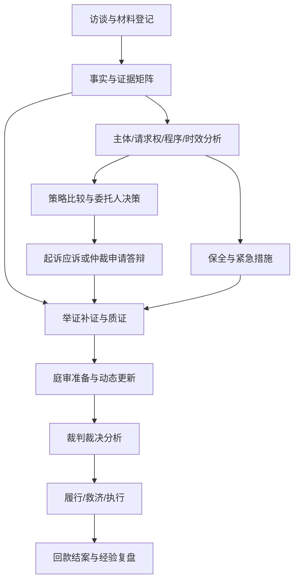

# 中国法律 AI 的业务全景、任务依赖与交付质量研究

研究日期：2026-10-21（Asia/Shanghai）  
研究角色：独立子研究；供智合 AI 现场研究的主文档整合使用。  
研究范围：中国内地法律实务，重点为诉讼仲裁、合同交易、公司常年法律顾问、合规与知识管理。涉及境外法域时必须另行确定适用法和专业审阅人。  
证据边界：本报告没有操作或观察智合 AI 页面，因此不将下面的功能建议写成“智合 AI 已有”或“智合 AI 缺失”。模块表是完整性对照基准，产品事实以主研究的现场记录为准。文中的产品结构、交付标准与优先级是研究者判断；法源核验结果另有明确来源。

## 一、核心判断

1. 法律产品不宜以“提示词数量”作为完整性的主要指标。用户真正需要的是从材料到事实、从事实到争点、从争点到规则、从规则到选择、从选择到交付与执行的一条可复查链。
2. 菜单应以“业务工作台”为第一层，以“案件／交易／企业项目阶段”为第二层，以具体交付件为第三层。案由、行业、身份、文书类型作为筛选标签，避免把“劳动合同”“起诉状”“案例检索”“图片识别”混在同一层。
3. 上传图片属于输入能力。OCR、表格还原、原始载体管理、文字校对、证据编号、证明对象分析是不同的任务，不能用一个“图片识别 skill”替代。
4. 最重要的共享资产是经过确认的事实表、证据表、法源表、期限表、主体表和版本记录。多个入口重复提问、分别生成互相矛盾的事实，说明产品仍是提示词集合，尚未成为业务系统。
5. 文书起草只是中间成果。“送达及回复”“履行及催办”“判后执行”“调查整改验证”“条款履约监控”“成果入库及失效更新”才使业务闭环。
6. 风险等级不能只按措辞严厉程度划分。应分别判断事实可靠性、规则适用、金额或自由等利益影响、不可逆外部动作和信息披露范围；生成草稿、提交法院和向对方发送草稿有不同门槛。
7. 提示词中最值得加强的不是“你是资深律师”，而是事实边界、来源定位、时间版本、争议观点、可复算过程、缺项处理和外部动作条件。

## 二、已经联网核验、足以改变产品设计的事项

| 核验事项 | 核验结果（只列设计相关部分） | 产品含义 | 一手或官方来源 |
|---|---|---|---|
| 仲裁法版本 | 2025-09-12 修订的《仲裁法》自 2026-03-01 施行 | 2026 年的仲裁模块必须记录适用时间；机构规则与法律分别核验，不能继续默认旧法模板 | [教育部转载主席令第五十四号](https://www.moe.gov.cn/jyb_xwfb/s6052/moe_838/202509/t20250915_1413498.html)、[济南仲裁委员会公布的法律文本入口](https://zcb.jinan.gov.cn/col/col10350/art/2026/art_5de7a6c6d76342cf9452dea107bd5394.html) |
| 起诉状／答辩状形态 | 最高法、司法部、全国律协发布的 67 类示范文本于 2025-07-14 全国推广，采用积极引导、尊重选择的原则 | 提供要素式填表与传统文本两种输出；不能将示范文本误说成所有案件的强制格式；保存模板版本 | [最高法发布通知](https://www.court.gov.cn/fabu/xiangqing/468671.html)、[最高法答记者问](https://www.court.gov.cn/zixun/xiangqing/470651.html) |
| 电子材料与证明力 | 电子化材料的“视同原件”问题与内容真实性、合法性、关联性及证明力判断不是同一问题 | 区分“可读文字”“复制件一致性”“原始载体及形成过程”“证明对象”，不给截图自动盖真实性结论 | [人民法院在线诉讼规则](https://www.court.gov.cn/fabu/xiangqing/309551.html)、[最高法理解与适用](https://www.court.gov.cn/zixun/xiangqing/309561.html) |
| 电子证据审查 | 《民事诉讼证据规定》第 14、15、19、93 条等涉及电子数据、原件、编号说明和真实性判断 | 证据整理应输出来源及定位；保留原文件、提取方式和完整性信息；不能把转写内容当成法院已采信事实 | [最高法公布的证据规定](https://www.court.gov.cn/zixun/xiangqing/212721.html) |
| 类案的地位 | 最高法类案检索指导意见区分指导性案例的参照与其他类案的参考 | 案例检索应展示案例身份、相似点与差异、适用规则和引用目的，不能把所有判例视作相同效力的先例 | [最高法关于类案检索的官方介绍](https://www.court.gov.cn/zixun/xiangqing/243991.html) |
| 权威案例渠道 | 人民法院案例库面向社会开放，收录指导性案例与经审核的参考案例 | 它适合作为优先检索渠道之一，但不能将某一数据库的检索结果等同全体司法实践 | [最高法关于案例库上线的说明](https://www.court.gov.cn/zixun/xiangqing/426222.html) |
| 公司法时间适用 | 新《公司法》自 2024-07-01 施行，最高法另有时间效力司法解释 | 公司常法模块必须有“行为发生日／决议日／设立日／当前处理日”等字段，不能只加载最新法条 | [最高法关于时间效力解释的发布](https://www.court.gov.cn/zixun/xiangqing/436481.html)、[国家法律法规数据库的解释 PDF](https://wb.flk.npc.gov.cn/sfjs/PDF/dacb8164c9c9478d97df6ad878703ab4.pdf) |
| 保密与利益冲突 | 《律师法》第 38、39 条规定执业保密与相关利益冲突限制 | 需要委托前主体识别、冲突复核、事项隔离与资料处理规则；知识库检索不能跨客户默认共享 | [司法部平台《律师法》全文](https://xzfy.moj.gov.cn/c/2021-01-06/487877.shtml) |
| 个人信息处理 | 《个人信息保护法》分别涉及合法性基础、委托处理、敏感信息、跨境提供和影响评估等 | 上传权限不等于任意加工、转发或对外发送权限；数据合规要做活动级判断，不能只生成一份隐私政策 | [网信办公布的《个人信息保护法》](https://www.cac.gov.cn/2021-08/20/c_1631050028355286.htm) |
| 合规闭环 | 《中央企业合规管理办法》涉及风险识别、流程审查、风险应对、调查整改、评价和责任机制，其直接适用对象有范围 | 可借鉴其闭环结构设计通用企业合规模块；不得对所有民企机械宣称具有同样法定义务 | [国务院国资委《中央企业合规管理办法》](https://wap.sasac.gov.cn/n2588035/n2588320/n2588335/c26018430/content.html) |
| 个人信息合规审计 | 《个人信息保护合规审计管理办法》自 2025-05-01 施行，并附合规审计指引 | 增加审计证据、底稿、发现、整改与验证；“生成整改制度”不是审计完成的充分条件 | [网信办管理办法及附件](https://www.cac.gov.cn/2025-02/14/c_1741233507681519.htm)、[实施答记者问](https://www.cac.gov.cn/2025-05/27/c_1750056480898746.htm) |
| 数据出境制度衔接 | 2024 年《促进和规范数据跨境流动规定》调整了相关制度的适用与衔接 | 跨境模块必须检索处理时点规则、行业和地区要求及实际数据流，不应在提示词内写死单一阈值或单一路径 | [网信办官方答记者问](https://www.cac.gov.cn/2024-03/22/c_1712776611649184.htm) |
| 行政诉讼起诉期限更新 | 最高法《适用行政诉讼起诉期限若干问题的解释》（法释〔2026〕3 号）自 2026-05-01 施行，专门细化起算、最长期间、扣除延长及复议后等问题 | 不能将未告知起诉期限与 20 年／5 年最长起诉期限混写，不能继续只凭旧模板计算；必须按行为、知悉内容与主体、送达等事实分别判断 | [最高法发布及解释全文](https://www.court.gov.cn/zixun/xiangqing/498801.html) |
| 申请执行时效与受理 | 2022 年修正《民诉法解释》第 481 条区分超过申请执行时效后的受理与时效抗辩等后果 | 不得写“过两年就无法申请”；应核验起算、中止中断、对方异议及履行情况等，再判断具体后果 | [最高法 2022 年修法发布](https://www.court.gov.cn/zixun/xiangqing/353741.html)、[上海市政府公布的 2022 年解释全文](https://fgw.sh.gov.cn/cmsres/83/83dec480701a40f489e3dcb623c4e833/8be625f6495bae6fa4d9f9525ec5fbb8.pdf) |
| 行政处罚听证申请 | 《行政处罚法》第 64 条规定告知后五日内要求听证，第 85 条明确该五日为工作日，不含法定节假日 | 听证申请与一般回复、陈述申辩及救济期限分列；期限引擎须读取单位、起算事实和适用日历，不能算成五个自然日 | [市场监管总局公布的法律全文](https://www.samr.gov.cn/zw/zfxxgk/fdzdgknr/tzsbs/art/2023/art_3712fbfaaed942b3b6b66f14d5288723.html) |
| 刑事及行政处罚新旧法 | 刑法第 12 条确立相关从旧兼从轻规则；行政处罚法第 37 条也规定行为后规则变化时不予或较轻处罚的适用，二者各有规范与条件 | 不能一律“适用行为时版本”或“适用核验日最新版本”；刑事司法解释时间效力、已决案件和程序规则另核，不把一个原则机械推广到全部规范 | [刑法第12条政府文本](https://www.audit.gov.cn/n7/n34/n58/c109675/content.html)、[最高法时间效力说明](https://www.court.gov.cn/zixun/xiangqing/2642.html)、[行政处罚法全文](https://www.samr.gov.cn/zw/zfxxgk/fdzdgknr/tzsbs/art/2023/art_3712fbfaaed942b3b6b66f14d5288723.html) |

以上只核验与产品结构直接相关的事项，不构成对每个专业模块的穷尽法源检索。每次承办具体事项仍需按业务事实、地区、时点和程序重新检索。

## 三、建议的信息架构与公共对象

### 3.1 业务层级

```text
法律工作台
├─ 争议解决
│  ├─ 受理与方案：访谈、事实、主体、请求权、管辖、时效、保全、预算
│  ├─ 诉讼：起诉／应诉、举证、质证、庭审、裁判、救济、执行
│  ├─ 商事仲裁：协议与机构、申请／答辩、组庭、审理、裁决、司法审查与执行
│  └─ 谈判调解：利益分析、方案比较、协议、履行跟踪
├─ 合同与交易
│  ├─ 交易设计与立项
│  ├─ 起草、审核、比对、谈判
│  ├─ 尽调、签署与交割
│  └─ 履约、变更、解除、争议预防
├─ 公司与常年顾问
│  ├─ 主体、股权、治理、决议
│  ├─ 用工、知识产权、商业运营
│  ├─ 投融资、重组、退出
│  └─ 日常咨询、培训、法律事项看板
├─ 合规与调查
│  ├─ 义务识别与风险评估
│  ├─ 制度、流程、培训
│  ├─ 事件、举报与调查
│  └─ 整改、审计、有效性验证
└─ 研究与知识管理
   ├─ 法规、案例、专题研究
   ├─ 模板、条款、案例与业务经验
   ├─ 脱敏、审阅、发布、权限
   └─ 新法监测、版本、失效与回溯
```

专业方向是覆盖在以上流程上的标签：劳动人事、婚姻家事与财富传承、建设工程与房地产、知识产权、金融资管、税务、刑事、行政、破产重整、涉外海商等。不能因为五个工作台已齐备，就宣称所有专业领域已覆盖。刑事辩护、行政争议、破产等还需要自己的阶段、权利与文书模型。

### 3.2 最小公共对象

| 对象 | 必需字段 | 设计要点 |
|---|---|---|
| 法律事项 | matter_id、业务线、委托人、角色、目标、地区／机构、关键时间、承办人、阶段 | 同一事项的多个技能共享经确认的信息，变更应可回溯 |
| 主体 | 标准名称、曾用名、统一标识、关联关系、事项角色、信息来源、核验时间 | 防同名误认；关联关系是有来源的断言，不能凭猜测建立 |
| 材料 | material_id、名称、上传者、版本、原文件、页数、时间、保密级别、处理范围 | 保存原件与派生文本的关系；图片、OCR、转写各有版本 |
| 事实断言 | fact_id、内容、发生时间、陈述主体、来源页码／时间码、确认状态、冲突、反证 | 事实状态区分当事人陈述、材料显示、争议事实、已认定事实、推论 |
| 证据 | evidence_id、原始载体、来源、取得过程、完整性、证明对象、争议、定位 | 同一文件可支持多个事实；“证明对象”是分析结果，不是证据本身 |
| 法源 | authority_id、标题、机关、效力类别、公布／施行／失效日、版本、原文链接、定位、核验日 | 具体条文与法源整体的版本关联；只展示标题不算核验 |
| 案例 | case_id、案号、法院、程序／生效信息、案例类别、关键事实、裁判规则、相似／差异、来源 | 不能仅凭案号看起来真实就算已查证 |
| 期限与金额 | 事项、基准事实、规则来源、起止日、计算单位、起算及末日规则、适用工作日／节假日日历、利率／基数、复核人 | 诉讼期限、时效、合同期限分别建模；工作日与自然日不混用；金额使用确定性计算 |
| 风险／问题 | issue_id、触发事实、规则、影响、可能性、证据状态、应对、负责人、期限 | 风险等级与理由分开；区分事实未明、法律争议与已确认违法 |
| 交付件 | 类型、来源快照、草稿／审定状态、版本、审阅意见、审批／发送记录 | 修改事实后提示所有受影响交付件重新复核 |
| 行动 | 动作、对象、附件、截止时间、执行人、授权范围、执行状态、回执 | 草稿生成与对外提交分离；审批复用明确有效的授权 |
| 知识条目 | 适用条件、原事项、脱敏版本、客户／团队范围、审核人、到期复核日 | 不因“加入知识库”就抹去保密与来源限制 |

## 四、跨业务共同的门槛与基础技能

### 4.1 审阅门槛定义

本节的 G0—G5 是产品建议，用来标记任务就绪程度，不是额外创造法定审批，也不是每次点击都要求弹出确认。

- **G0 范围可用**：事项身份、处理目标、资料权限和既有授权范围明确；涉及委托接受时按机构制度完成利益冲突复核。
- **G1 材料可用**：页码、日期、金额、主体、OCR 疑点、缺页及材料矛盾可定位；关键缺失明确保留，不猜填。
- **G2 规则可用**：地区、适用法、行为和程序时点已明确；关键法源及案例能够查到原文并核对适用版本。
- **G3 方案可用**：律师或法务对请求、责任、策略、重大风险、数额及有利不利事实作实质审阅；内部整理类任务可按风险授权简化。
- **G4 对外可用**：发送／提交的具体版本、收件人、附件、签署／盖章、权限及动作范围已由有权限的人确认。既有明确授权可继续复用，超出范围才补充确认。
- **G5 沉淀可用**：归档版本、保密范围、脱敏结果、知识复用权限与后续复核责任明确。

### 4.2 公共模块对照表

| 编号／模块 | 关键输入 | 标准输出 | 质量与审阅门槛 |
|---|---|---|---|
| B01 事项分流与需求澄清 | 用户自然语言、身份、目标、阶段、紧急时间 | 事项卡、任务建议、仅关键缺项问题、近期行动 | G0；区别“咨询解释”与“代理办理”，不假装已接受委托 |
| B02 客户及相对方识别 | 主体清单、别名、关联关系、既有客户及事项记录 | 待核验主体、候选冲突清单、冲突处理记录 | G0；匹配是线索，不能自动宣布无冲突或冲突成立 |
| B03 文件预检与分拣 | 原文件、文件夹、邮件及附件 | 材料清单、版本／重复／缺页／不可读报告 | G1；先报告无法读取和未覆盖部分 |
| B04 图片／扫描件 OCR | 扫描件、语言、版式要求 | 原图对应文本、坐标／页码、疑字及表格还原 | G1；关键姓名、金额、日期单独校验，保留原图 |
| B05 音视频整理 | 合法取得的录音录像、说话人线索、术语表 | 带时间码转写、说话人待确认项、摘要、行动 | G1；听不清保留标记；不把说话人推测写成确认身份 |
| B06 主体／金额／日期抽取 | 文档及文本、字段规则 | 结构化数据、原文定位、冲突／缺项 | G1；抽取与法律定性分开 |
| B07 事实时间线 | 多来源材料、访谈、补充说明 | 时间线、事实状态、矛盾清单、补证问题 | G1；事件发生日与材料形成日分列 |
| B08 法源和案例核验 | 争点、地区、时间、拟用引文 | 原文、效力／状态、定位、核验结果、未查得事项 | G2；“搜索没有结果”不能写成法律不存在 |
| B09 期限与数额计算 | 触发事实、程序类型、规则、金额变量 | 逐步计算表、假设、来源、缺项及分支情景 | G2/G3；确定性计算、关键日期复核；不依语言模型心算 |
| B10 比对及修订追踪 | 两版或多版文件、比较基准、红线 | 实质变化、文字变化、金额及定义联动、修订理由 | G1/G3；不只比较文本，检查附件与引用链 |
| B11 文档生成与打包 | 审定事实、模板、附件、排版要求 | 可编辑文书、附件表、目录、格式与一致性检查 | G3/G4；文内数字、当事人名称、附件编号交叉核对 |
| B12 交付与后续行动 | 审定版本、对象、既有权限、截止时间 | 交付记录、回执、待办、失败或退回原因 | G4；真实记录执行成功与失败，不以“已生成”替代“已提交” |

## 五、诉讼与仲裁全流程

### 5.1 依赖关系



每个分支均可返回事实和证据矩阵。新材料不是只加到聊天窗口，而应触发受影响的请求、期限、检索结论和文书版本重新检查。

### 5.2 模块表

| 编号／模块 | 关键输入 | 标准输出 | 审阅门槛与失败条件 |
|---|---|---|---|
| L01 首次咨询与访谈准备 | 当事人身份、目标、初步叙述、已有材料 | 访谈提纲、材料清单、紧急风险及下一步 | G0/G1；识别临近期限，不据单方叙述直接给确定责任结论 |
| L02 事实与法律关系还原 | 合同、流水、沟通、履行材料 | 关系图、事实时间线、事实／推论／争议分栏 | G1；每项关键事实可定位，矛盾不被摘要抹平 |
| L03 请求权及抗辩分析 | 已整理事实、目标、对方立场、规则 | 请求权基础、构成要件—事实—证据表、抗辩、替代路径 | G2/G3；不能只列支持委托人的规则，必须检查不利事实 |
| L04 当事人适格与责任主体 | 主体身份、合同链、股权或担保关系 | 拟列主体、角色及理由、待查关系、责任形式 | G2/G3；关联主体不自动等于共同责任主体 |
| L05 管辖与程序选择 | 争议解决条款、主体、履行事实、标的、阶段 | 候选法院／机构、依据、协议问题、程序路线 | G2/G3；地区与机构规则要核验；劳动等专门路径独立判断 |
| L06 时效与程序期限 | 发生日、知悉日、通知及送达凭证、程序节点 | 时效及期限表、假设分支、补充证明 | G2/G3；起算事实不明时给分支，不生成伪精确截止日 |
| L07 费用与利益测算 | 金额、请求、地区规则、预算、回收预期 | 计算明细、诉讼／仲裁与谈判情景比较 | G2/G3；分别列法定成本、服务费、担保等估计，不编确定概率 |
| L08 保全与紧急措施 | 风险事实、财产线索、拟申请范围、担保条件 | 可选措施、证据缺口、申请草稿、后续节点 | G2/G3/G4；主体、范围、担保、错误申请风险须实质审阅 |
| L09 调查与补证计划 | 要件矩阵、证据缺口、持有人及线索 | 补证清单、取得路径、优先级、调查申请草稿 | G2/G3；不得建议非法取证、毁损证据或影响证人陈述 |
| L10 起诉状／答辩状 | 请求方案、确认事实、证据、法院模板 | 要素式／传统文书、请求核对表、附件清单 | G3/G4；不把未知事实填成真实；核对最新适用模板 |
| L11 仲裁条款及程序方案 | 完整条款、合同、机构规则、时间、涉外要素 | 协议分析、规则版本、机构／仲裁地等问题、程序计划 | G2/G3；2026 年注意新法；商事仲裁与劳动仲裁分开 |
| L12 仲裁申请／答辩与程序函 | 审定请求、材料、机构要求、程序命令 | 申请／答辩、证据目录、组庭及程序请求草稿 | G3/G4；请求、费用、送达、语言等按适用规则核对 |
| L13 证据目录与举证说明 | 原文件、编号、证明对象、页码 | 目录、证据册、事实关联、原件核对事项 | G1/G3/G4；目录文字不能夸大证据内容与证明力 |
| L14 质证意见与反证 | 对方证据、原始载体线索、己方事实 | 逐证真实性／合法性／关联性及证明力分析、追问与反证 | G2/G3；不能对所有对方证据一概“不认可” |
| L15 类案与争点专题 | 待决问题、关键事实、程序及地区、已用案例 | 检索策略、正反案例、相似差异、规则分歧、适用结论 | G2/G3；数据库覆盖与未查得范围明示，不以样本频率冒充胜率 |
| L16 庭审准备与模拟 | 争点、证据、诉辩意见、程序进展 | 庭审提纲、发问、法官疑问、对方最强论证、回答边界 | G3；模拟不能设计诱导虚假证词，承认事项需标明权限和风险 |
| L17 庭审笔录与庭后代理 | 笔录、录音、庭审记录、庭后补充要求 | 纠错核对、未回应争点、补证任务、庭后意见草稿 | G1/G3/G4；法庭笔录、内部笔记与回忆内容分别标记 |
| L18 谈判与调解 | 双方利益、法律方案、底线与授权、履行能力 | 方案比较、谈判议题、和解草稿、担保与履约安排 | G3/G4；不暴露己方授权底线；法律可行与商业可接受分别列明 |
| L19 裁判／裁决研读与救济 | 完整文书、送达、卷宗、委托人目标 | 结果及义务、事实与法律争点、救济选项、期限及材料 | G2/G3；商事仲裁撤销／不予执行不机械套用上诉模板 |
| L20 执行、回款与结案 | 生效依据、履行状态、财产线索、执行记录 | 执行申请、财产线索、执行异议问题、回款台账、结案复盘 | G2/G3/G4/G5；申请执行成功不等于实际回收，状态单独跟踪 |

### 5.3 应作为专业包而不是泛用入口的场景

- 劳动争议：用工关系、工资和考勤证据、仲裁与诉讼衔接、群体影响、当地口径；不要与商事仲裁共用“仲裁法”规则。
- 婚姻家事与继承：身份、未成年人及隐私、家庭资产和债务、财产与抚养安排、情绪及沟通目标；不宜默认对抗最强即最优。
- 建设工程：合同层级、工程量、签证变更、结算审计、鉴定资料、项目时间线；表格计算与材料相互矛盾是核心。
- 知识产权：权利稳定性、权属链、侵权比对、技术或作品证据、商业秘密保密措施；不能只用文本相似率判断侵权。
- 刑事：身份与阶段、强制措施、卷宗权限、会见与调查问题、构成要件和证据标准；必须有专门的权利与阶段模型。
- 行政：被诉行为、机关职责、起诉／复议路径、原告资格、期限、举证与审查范围；不能照搬民事请求权模型。
- 破产与重组：主体、债权、担保、重整价值、程序参与角色、管理人及法院要求；不是债务催收文书的集合。

## 六、合同、交易与尽职调查

### 6.1 先确定审查任务，再进入条款

合同审核至少区分：为哪一方服务、交易目标与真实流程、合同及附件是否完整、议价空间、不可接受事项、金额与履行期限、法域、现阶段（拟签／已签／履行中／违约后）。同一个条款在不同位置、履行阶段和商业条件下可能有不同处理方式。“全面找出所有风险”容易生成没有优先级且不可谈判的报告。

《民法典》合同编并非只有合同起草规则，还包含履行、保全、变更转让、终止及违约责任等结构；产品围绕生命周期设计，比只按合同名称堆积模板更贴近业务。[全国人大国家法律法规数据库《民法典》全文](https://wb.flk.npc.gov.cn/flfg/PDF/bd53dd912c1048f2aecbaa229238334b.pdf)

### 6.2 模块表

| 编号／模块 | 关键输入 | 标准输出 | 审阅门槛与失败条件 |
|---|---|---|---|
| T01 交易结构设计 | 商业目的、参与方、资产／服务、资金及税务约束 | 交易结构选项、文件清单、权利义务流、关键假设 | G2/G3；法律、税务、财务、商业判断分清，待专业复核项明列 |
| T02 主体与资质核验 | 主体标识、业务、许可、公开及提供资料 | 身份及权限、资质线索、待核验事项、来源日期 | G1/G2/G3；公开信息未查得不是资质不存在的确定结论 |
| T03 合同要素访谈 | 交易背景、价款、交付验收、期限、责任、争议解决 | 条款清单、缺项及互斥选择、需业务决策事项 | G1/G3；先收关键条件，不用默认值替用户决定核心商业条款 |
| T04 合同起草 | 确认要素、模板／条款库、立场、适用法 | 合同草案、变量清单、起草说明、附件框架 | G2/G3；占位符未清理不得标为可签；模板适用条件可见 |
| T05 合同体检与风险分级 | 全套合同、业务流程、立场和红线 | 风险表、条款定位、严重性与理由、修改建议 | G2/G3；区分强制规则、争议风险和纯商业偏好 |
| T06 红线修订与清洁版 | 原合同、接受边界、审批规则 | 修订版、清洁版、逐条理由及联动修订 | G3；保护交易逻辑与定义一致性，避免无授权扩大责任 |
| T07 双语合同与法律翻译 | 原文、语言、法域、优先语言、术语表 | 对照译文、术语表、不等值概念、歧义点 | G1/G2/G3；不把域外法律概念自动等同中国法概念 |
| T08 多版本比对与谈判准备 | 对方版、己方版、批注、议价历史 | 争议条款表、交换条件、底线、可接受替代文本 | G3；不得向对方版本携带内部底线或客户保密批注 |
| T09 尽调计划与资料清单 | 交易类型、目标主体、范围、重要性、时间 | 范围与排除事项、资料清单、访谈计划、问题台账 | G0/G3；信息范围与交易决策相关，避免无限收集 |
| T10 尽调审阅与问答 | 数据室材料、公开资料、答复、访谈 | 发现表、材料来源、矛盾、补充询问、待证事项 | G1/G2/G3；事实发现、法律评价、对方承诺分栏 |
| T11 尽调报告与交易保护 | 发现台账、重大性标准、商业方案 | 红旗报告、完整报告、条件／保证／赔偿／交割安排映射 | G3；按决策影响排序，不用材料摘录冒充尽调结论 |
| T12 签署授权与交割管理 | 最终文件、授权、条件先决、签署人、交割清单 | 签署核对、交割条件证据、缺口、closing bible | G3/G4；实际成就与对方宣称成就区分；签署版与审批版一致 |
| T13 履约义务抽取与提醒 | 已签合同、附件、变更、履约事件 | 义务台账、触发条件、负责人、通知及凭证 | G1/G3；同一义务的续期、豁免、变更要连同更新 |
| T14 变更、解除与终止 | 已签合同、履行现状、违约、通知及证据 | 路线比较、条件与风险、通知草案、交接及结算事项 | G2/G3/G4；解除意图、依据、送达与生效时点需核对 |
| T15 债权与损失管理 | 账单、发票、验收、收款、损失凭证、利息规则 | 对账与损失表、催告、补证计划、争议移交包 | G2/G3/G4；金额计算可复算、重复请求和重叠损失标记 |

## 七、公司常法与企业法律运营

| 编号／模块 | 关键输入 | 标准输出 | 审阅门槛与失败条件 |
|---|---|---|---|
| C01 公司法律画像 | 登记、章程、股权、组织、许可、核心业务 | 法律主体树、治理结构、合规边界、待核验事项 | G1/G2；集团、公司、分支、项目与实际控制关系不混同 |
| C02 设立与资本事项 | 设立日、资本与出资、章程、计划 | 可选方案、出资与登记事项、时间表、所需文件 | G2/G3；核验公司法时间适用及过渡规则，不简单套“五年” |
| C03 股东会／董事会及决议 | 章程、议题、权限、通知、表决安排、关联关系 | 会议方案、文件包、程序核对、决议草案 | G2/G3/G4；不能仅因正文合法就忽略召集、表决、回避和签署问题 |
| C04 股权变动与激励 | 股权结构、协议、资格、计划、税务输入 | 方案比较、权利义务、交易文件、内部程序与实施条件 | G2/G3；法律可行、税务及会计评价分别复核 |
| C05 董监高与关联交易 | 任职、利益关系、事项决策、授权 | 义务与冲突问题、审议路径、披露与留痕材料 | G2/G3；不凭职位名称直接作责任成立结论 |
| C06 融资、担保与重大交易 | 融资条件、担保、章程、财务及交易资料 | 权限核对、风险表、文件安排、条件及交割清单 | G2/G3/G4；跨公司利益、授权及担保范围须实质审阅 |
| C07 劳动用工全周期 | 人员身份、地区、规章制度、劳动合同、工资考勤 | 入职／履约／调岗／离职文件、证据与程序检查 | G2/G3/G4；个人信息最小化，经营决定不由模型代作 |
| C08 知识产权与商业秘密运营 | 权属、研发与创作、合作协议、许可、保密管理 | 权属链、保护及许可方案、台账、风险整改 | G2/G3；版权、商标、专利、技术秘密等分别设规则包 |
| C09 日常法律咨询与意见 | 明确的问题、事实、业务选择、时限 | 简明结论、依据、条件、风险与具体行动 | G2/G3；事实不足可先给条件性意见与关键追问 |
| C10 业务培训与政策解释 | 受众、实际流程、制度、已核验规则 | 培训材料、场景题、操作卡、培训记录 | G2/G3；面向业务人员说清触发条件与做法，避免只有法条 |
| C11 重大项目与年度法务报告 | 事项、预算、工时、风险、成果、管理目标 | 项目看板、服务报告、风险趋势、下一年度计划 | G1/G3；禁止把咨询数量直接包装为规避损失的确定金额 |
| C12 解散、清算、退出与交接 | 主体状态、决策、资产债务、合同、人员、争议 | 程序路线、债权债务台账、文件与行动清单 | G2/G3/G4/G5；破产、一般清算及简易退出分别判断 |

应支持的企业类型标签包括有限责任公司／股份有限公司、上市／非上市、国有／民营、金融及其他许可行业、集团与单体、新设与存量公司。标签不是装饰，它们决定需要加载哪些规则、信息与审阅人。

## 八、合规、调查与风险事件

### 8.1 推荐闭环

适用义务识别 → 现状和数据流调查 → 风险评估 → 制度及控制设计 → 实施和培训 → 监测与举报 → 调查与事件处置 → 整改验证 → 审计及管理改进。

合规不能压缩成“生成某行业合规制度”。需要具体业务活动、义务、控制、证据与责任人一一对应。《中央企业合规管理办法》的闭环适合作为结构参考，但在通用产品内应明确它的直接适用范围。[国资委官方办法](https://wap.sasac.gov.cn/n2588035/n2588320/n2588335/c26018430/content.html)

### 8.2 模块表

| 编号／模块 | 关键输入 | 标准输出 | 审阅门槛与失败条件 |
|---|---|---|---|
| R01 适用义务及监管地图 | 行业、地区、资质、业务、组织、时点 | 义务清单、适用触发条件、主管机关、更新责任 | G2/G3；征求意见稿、倡议、强制规则、合同义务分开 |
| R02 风险识别与评估 | 流程、访谈、事件、控制证据、重要性标准 | 风险登记册、评分依据、控制缺口、优先级 | G1/G3；评分是方法判断，不能伪装精确统计概率 |
| R03 制度与控制设计 | 现有制度、职责、系统、流程、义务清单 | 制度及流程、控制点、岗位责任、表单、证据要求 | G2/G3；不复制别的行业制度，也不凭制度存在断言控制有效 |
| R04 个人信息／数据活动盘点 | 系统、字段、数据流、角色、供应商、保存及出境 | 处理活动台账、角色与基础待核验、敏感／出境问题 | G0/G1/G2/G3；“内部使用”“已公开”都不是当然无限使用依据 |
| R05 数据专项评估与文件 | 活动台账、适用规则、现有控制、第三方合同 | 影响评估底稿、通知／协议草稿、整改及决策事项 | G2/G3/G4；跨境路径需按当时制度核验，不写死规则阈值 |
| R06 用工／广告／消费者等专项 | 实际业务、材料、销售及人事流程、行业规则 | 专项检查表、证据、发现、整改 | G2/G3；专项包逐个维护，不以一个“企业合规”提示覆盖全部 |
| R07 第三方与供应链合规 | 相对方、关联关系、地域、业务、合同与调查资料 | 风险画像、准入条件、合同控制、持续监测点 | G0/G2/G3；同名、制裁等匹配仅为待核验线索，避免直接定性 |
| R08 举报受理与调查计划 | 举报、资料范围、角色与权限、紧急风险 | 分流、利益冲突、保全计划、访谈及取证方案 | G0/G3；举报内容与核实事实分开；严格控制访问范围 |
| R09 访谈与事实调查 | 访谈授权、合法取得材料、调查范围、已知问题 | 非诱导提问、访谈纪要、矛盾、事实发现台账 | G1/G3；不要求“让证人承认”；不篡改、删改原始记录 |
| R10 事件响应与监管沟通 | 事件时间线、影响、应急方案、适用报告规则 | 行动清单、责任人、待核实范围、报告草稿 | G2/G3/G4；法定报告与其他沟通分别核验；不能生成虚假确定情况 |
| R11 整改与有效性验证 | 发现、根因、责任人、整改措施、执行证据 | 整改台账、抽样／验证计划、完成依据、遗留风险 | G3；发制度、培训签到、承诺整改不自动等于风险关闭 |
| R12 合规审计与管理复盘 | 范围、标准、证据、底稿、既往发现 | 工作底稿、发现、报告、整改与复核跟踪 | G2/G3/G4/G5；报告与证据可追溯，范围限制与未完成程序明示 |

个人信息审计可参考 2025 年实施的办法及附件指引；是否应开展、由谁开展、频次和报告义务需要按主体及实际情况判断。[网信办管理办法全文](https://www.cac.gov.cn/2025-02/14/c_1741233507681519.htm)

## 九、法律研究与知识管理

| 编号／模块 | 关键输入 | 标准输出 | 审阅门槛与失败条件 |
|---|---|---|---|
| K01 研究问题定义 | 业务问题、事实、地区、时间、决策用途 | 可检索问题树、检索范围、关键词、交付深度 | G1；不将宽泛主题直接当成可回答的争点 |
| K02 法规检索与沿革 | 问题树、效力与时间要求 | 法规表、修订沿革、适用条款、冲突与待核验 | G2；现行版本与行为时版本分别保存 |
| K03 案例检索与比对 | 争点、关键事实、程序、地区、期望范围 | 检索日志、案例矩阵、正反结论、异同与样本限制 | G2/G3；不只输出“相似案号”，不声称检索穷尽 |
| K04 研究备忘录 | 核验法源、案例矩阵、业务事实 | 问题、结论及条件、分析、争议、建议与来源 | G2/G3；结论强度与证据相称，未核验依据不得藏入脚注 |
| K05 案件／项目复盘 | 审定交付、过程、结果、实际问题 | 可复用经验、失败点、适用前提、更新事项 | G5；区分可复用规则与客户特定、保密或偶然信息 |
| K06 脱敏与知识发布 | 原材料、允许复用范围、脱敏规则 | 脱敏件、残留检查、知识条目、审批及权限 | G0/G5；删除姓名仍可能因组合信息再识别，需内容复核 |
| K07 模板与条款库 | 审定模板、适用范围、历史问题、版本 | 模板元数据、变量、可选条款、禁用条件、审核状态 | G2/G3/G5；模板要有维护人和复核日，不能永久“最新版” |
| K08 知识问答与引用回链 | 权限范围、问题、知识库 | 有权限的答案、原文定位、冲突版本、无答案说明 | G0/G2；当前用户无权访问的内容不得通过摘要泄露 |
| K09 新法影响分析 | 监测范围、已用法源、存量模板与合同 | 变化、适用时间、受影响资产、修改建议、责任人 | G2/G3；新法发布不等于立即全面替换旧法；过渡规则需检查 |
| K10 质量评测与知识退役 | 实际任务、已审定样本、错误、规则变更 | 缺陷分类、回归任务、失效清单、修复及验证 | G3/G5；评测记录事实／引用／推理／文档／动作错误各自影响 |

## 十、对提示词质量的批判性判断

### 10.1 常见问题及改造方向

| 常见写法或产品表现 | 具体缺陷 | 应改成的约束 |
|---|---|---|
| “你是二十年经验的顶尖律师” | 身份想象不能解决事实与法源问题，还可能增强无根据的确定语气 | 明确服务对象、任务阶段、范围、输入、证据及输出条件 |
| “全面找出所有法律风险” | 范围不定、轻重不分，往往把商业偏好也说成违法 | 先定义业务目标、立场、红线、重要性；区分法律／证据／履约／商业问题 |
| “依据最新法律法规” | 不说明法域、行为时、争议时、程序时；可能错误溯及 | 必填地区与时间，核对现行及历史版本、过渡规则 |
| “引用真实案例” | 没有原文核验、案号、定位及相似性要求 | 需要可访问原文、案例类别、关键事实、异同和引证用途 |
| “分析胜诉率” | 数据范围、标注和分母不明，模型给数字容易形成伪精确 | 做情景分析与风险因素；只有具备可验证统计数据时才报告相应样本指标 |
| “根据上传文件写一份起诉状” | 单方材料不能自然变成确定事实；请求与证据可能断裂 | 先要件和证据矩阵，缺项问题，再生成带明确待确认项的草稿 |
| “生成完整合同，细节自行补全” | 自动决定金额、期限、风险和争议解决，超出起草任务 | 核心商业条款不得猜填；缺少则列问题或显式占位 |
| “逐一反驳对方全部证据” | 鼓励机械否认，可能忽视真实不利证据与自认 | 逐证区分形式、来源、内容、证明对象及反证，允许认可真实部分 |
| “识别截图，作为证据提交” | OCR 能力与证据效力混淆 | 保留原载体、形成过程、取得方式、完整性、来源定位和待核验问题 |
| “不要遗漏任何内容” | 没有可验证覆盖范围，大文件可能实际未读取 | 先列材料清单、页码覆盖、失败文件，再报告阅读和输出范围 |
| 所有输出都写“供参考，请咨询律师” | 泛泛免责声明替代质量控制；无法知道具体哪里不确定 | 对每项重要结论标记依据、假设、缺口、审阅人和下一步 |
| “从对方视角攻击我方” | 容易把猜测包装成对方真实意图 | 明确为模拟论证，列依据、不确定性及可验证的反证任务 |
| 工具成功即报告业务完成 | 文件生成、上传、提交、受理、送达、履行是不同状态 | 每步记录真实状态、回执、失败和下一责任人 |
| “合规整改完成”只因生成制度 | 缺少实施证据和有效性测试 | 每项发现映射控制、实施证据、验证方法、剩余风险与关闭人 |

### 10.2 通用提示词应有的九段结构

1. **任务与交付**：为谁、在什么阶段、解决哪个问题、交付给谁。
2. **已知背景**：角色、业务目标、地区、行为及程序时间；经确认字段可复用。
3. **输入与权限**：材料列表、允许处理的范围、哪些工具和外部来源可用。
4. **事实规则**：陈述、材料显示、争议、推论分别处理；缺失不猜填。
5. **工作步骤**：先清点再分析；先争点再检索；先核验再成文。
6. **法源规则**：按问题核对原文、效力、适用时间、地点与案例类别。
7. **输出结构**：正文加必要的证据／法源／计算／待办表，避免堆长篇分析。
8. **质量校验**：关键结论回链、反方论证、金额日期一致、附件和引文交叉核对。
9. **停止和升级条件**：关键材料缺失、规则未核验、超出范围、外部动作或需专业决策时，说明具体缺口；仍继续完成不依赖缺口的工作。

不建议要求模型展示内部思维过程。要求展示可以复查的依据、法律适用链、计算、假设和分歧，足以支持专业判断。

## 十一、可供主文档直接改写的流程提示词样本

以下为独立优化建议，不是智合 AI 页面原文。实际产品应将固定部分固化为技能，将事项变量放入简短表单，并复用已确认信息。

### P01 材料转事实与证据矩阵

```text
任务：为当前法律事项整理事实与证据，暂不作最终责任判断。
输入：材料清单、当事人说明、事项目标。使用已有事项字段，不重复询问。
先列所有文件的可读性、版本、页数、缺页、OCR疑点和实际阅读范围。
逐项提取事实，标记“当事人陈述／材料显示／争议／推论／已认定”；每项附材料编号及页码、段落或时间码。
分别记录事件发生时间与材料形成时间；冲突内容并列，不择一当作事实。
输出：①事项摘要；②时间线；③事实—证据矩阵；④证据来源、原始载体及完整性待核验项；⑤按对法律结论影响排序的补充问题。
姓名、主体、金额、日期和关键引文逐项核对。未读材料及无法判断内容显式列出。
不得修改原始材料，不得把OCR结果、截图内容或单方陈述直接标成法院已认定事实。
```

### P02 争议策略与请求权分析

```text
任务：为[委托人/角色]在[阶段]比较争议解决方案，目标为[目标]。
基于已确认事实、证据矩阵及[地区/机构/关键时间]分析。关键缺项只问会改变请求、程序、期限或重大风险的问题，其余可先给条件性方案。
先列争点与可能的请求权、抗辩和程序选项，再核验适用规则及版本。
对每条路径列：构成要件、支持事实、证据及定位、反证、不利规则、对方最强论证、补证需求。
输出：①结论及适用条件；②请求与抗辩矩阵；③诉讼/仲裁/谈判等可行路径比较；④期限和金额待复核表；⑤优先行动及需委托人决策事项。
不得虚构案号、法条或胜诉率；正反依据均需核验。把商业选择、事实风险和法律结论分开。
此任务只生成分析与草稿，对外提交或发送按已有授权另行执行。
```

### P03 起诉状／答辩状生成

```text
任务：根据已审阅的诉辩方案生成[起诉状/答辩状]草稿。
核对：当事人及代理信息、具体请求及金额、管辖与程序、事实和证据、时间、拟提交法院、需要使用的模板版本。
如适用官方示范文本，支持要素式填写，并保留用户选择的传统文本形式；不宣称所有案件必须使用同一格式。
仅以已有确认事实成文。未知日期、金额或事实用明确待补项，不自行补全。对争议事实使用准确的诉辩立场表达。
输出：①可编辑文书；②每项请求—依据—证据核对表；③材料附件清单；④未解决问题和提交前检查。
校验主体、数字、页码、请求之间的相容性以及可能构成自认或超出代理权限的表述。
完成起草不等于提交；需要提交时使用已确认的具体版本、附件和提交权限。
```

### P04 立场明确的合同审核与红线

```text
任务：站在[一方]立场审核[交易/合同]，现阶段为[拟签/已签/履约/违约后]。
输入：合同及全部附件、真实业务流程、议价空间、业务红线、金额与期限、适用法。先识别未提供附件、定义冲突及扫描疑点。
按“交易能否按目标履行”梳理权利义务，再检查强制规则、授权与效力、对价交付、验收付款、变更退出、责任、担保与争议解决。
每项输出：条款定位、具体触发情景、法律或履约后果、严重性及理由、推荐修改、可谈判替代、需业务决定事项。
法律强制要求、争议风险与商业偏好分别标识。避免为形式完整而增加与业务无关的义务。
输出风险优先清单和必要修订稿，检查定义、附件、交叉引用、日期、金额及责任上限的联动。
不猜填核心商业条件；引用规则须核验法域、时间与原文。拟对外版移除内部底线与保密批注。
```

### P05 以交易保护为目标的尽调

```text
任务：为[交易决策]开展[范围]法律尽调，重要性标准为[标准]。
先列范围、排除事项、材料覆盖和缺失。对材料、公开来源和访谈分别记录来源、时间及可靠性；对方陈述不得当作已独立核验事实。
按“发现—事实证据—适用规则—交易影响—可处理方式”建台账，重大矛盾优先发问。
每项重大问题提出可选保护：补充资料、先决条件、交割前整改、陈述保证、赔偿、价格/结构调整或持续义务；是否采用属于交易决策。
输出：①红旗摘要；②完整发现表；③补充问题；④交易文件和交割清单的映射；⑤范围限制与待核验事项。
不把公开检索未命中写成没有诉讼、处罚、负债或权利瑕疵的保证。不填补财务税务等专业结论。
```

### P06 公司治理事项文件包

```text
任务：为[具体治理事项]拟定程序方案和文件包。
读取：公司类型、设立时间、章程及修订、股权结构、关联关系、议题、拟作出行为的时间、通知及已有决议。
核对法律及章程权限、适用版本和时间效力；会议召集、通知、出席、表决、回避、记录、签署和后续登记/公示分别检查。
输出：①程序路线与待决问题；②通知/议案/决议/记录等草稿；③条件与附件；④执行待办及责任人。
不得因章程或材料缺失而假定标准条款适用，不替股东、董事或管理层作商业决定。
涉及出资、担保、关联交易、董监高责任或重大争议的关键判断需专业审阅后使用。
```

### P07 合规风险到整改验证

```text
任务：对[业务活动/范围]做合规差距分析并形成可验证的整改计划。
确认主体、行业、地区、业务及数据流、时间、现有控制、适用义务和评估范围。
逐项建立：义务/来源—触发条件—业务事实—现有控制—实施证据—缺口—影响—措施—负责人—期限—验证方法。
区分“规则不适用”“已满足且有证据”“材料不足”“存在差距”“规则存在解释争议”。
制度或承诺存在只能证明文件状态，不能自动证明执行有效。对根因和重复风险给控制改进建议。
输出管理层摘要、发现台账、整改任务、验证计划、范围限制及需专业判断/对外报告的事项。
不得把适用于特定主体的监管要求一概扩展给所有企业；不确定的规则先查官方原文并保留时点。
```

### P08 法律研究备忘录与知识沉淀

```text
任务：回答[具体法律问题]，服务于[决策用途]，地区、行为及程序时间为[字段]。
先拆成可检索问题，优先核验立法机关、主管部门和司法机关原文，记录检索范围、时间、来源、有效状态和版本。
案例分别记录类别、案号、关键事实、争点、裁判规则、与本事项的相同和不同；支持与反对结论都应处理。
输出：①结论及条件；②关键事实与假设；③逐争点分析；④分歧与不足；⑤可执行建议；⑥可追溯来源表。
没有查得可靠依据时明确说明，不编引文、案号或规则。普通个案不当然形成普遍规则。
若要求入库，另生成经脱敏的知识条目，注明适用前提、来源权限、审核人和复核日；未经允许不跨客户复用材料。
```

## 十二、技能和工具应如何承接这些流程

以下是业务能力与工具通道的映射建议，不表示任何产品已经实现相应 MCP。工具选择要以实际连接和接口许可为准。

| 能力 | 技能应固化的业务逻辑 | 可能需要的工具／连接 | 关键边界 |
|---|---|---|---|
| 材料处理 | 文件覆盖、抽取、原文定位、疑点、事实状态 | 文件读取、OCR、音视频转写、表格解析 | 原件保留；图片文字不自动变为采信事实 |
| 法律研究 | 争点拆解、版本核验、来源地位、正反比较 | 官方法库／案例库、获授权商业数据库、网页检索 | 接入数量不是查全能力；不得越过账户和数据权限 |
| 文书与合同 | 模板条件、事实与要件、修订联动、格式校验 | 文档编辑、差异比较、模板和条款库、导出 | 不用空泛提示词替代已定版模板；不可改坏原文 |
| 计算与期限 | 起算事实、规则版本、变量、情景、复算 | 计算器、表格、日历、任务系统 | 模型解释与确定性计算分工；期限变更需传播 |
| 事项管理 | 目标、阶段、任务依赖、责任人、交付版本 | 项目台账、日历、客户关系及文件库 | 已授权动作复用，敏感范围变化可被识别 |
| 对外办理 | 对象、版本、附件、动作权限、回执 | 邮件、法院或仲裁平台、电子签约等 | 起草、发送、提交、受理、签署和生效状态不同 |
| 知识管理 | 脱敏、适用前提、审核、权限、失效更新 | 知识库、全文检索、权限系统、监测工具 | 不能通过摘要或向量检索绕过事项级隔离 |

技能应明确可接受输入、前置条件、步骤、输出契约、校验规则和失败处理。提示词是其中的一部分；MCP 是接入能力的方式。某入口挂上一个 MCP，不等于该入口就完成了专业法律能力。

## 十三、供智合 AI 现场研究逐项核对的缺口清单

这里的“缺口”指法律业务完整性应检查的事项，是否确实缺失由现场证据判定。

| 优先级 | 应检查的能力 | 如果没有，会造成什么问题 | 最小补齐方式 |
|---|---|---|---|
| P0 | 事项公共事实、证据、主体及法源对象 | 不同入口生成互相矛盾的内容，无法复查 | 共用事项卡与来源定位；变更影响提醒 |
| P0 | 原文件与派生内容的关联、实际读取范围 | 幻想读完、OCR 错字进入核心文书 | 材料预检、覆盖报告、关键字段校对 |
| P0 | 法源版本、地区与时间核验 | 最新法错误溯及；旧仲裁模板继续使用 | 法源表、时点字段、核验和过渡规则 |
| P0 | 请求／结论与证据的对应关系 | 文书流畅但缺少责任要件或举证支撑 | 要件—事实—证据—规则矩阵 |
| P0 | 对外动作的对象、版本、附件和回执 | 草稿被误发，或未提交却宣称已完成 | 明确动作记录与权限复用机制 |
| P0 | 客户及事项权限、保密与知识入库 | 混用客户资料，摘要泄露，错误跨项目复用 | 事项隔离、脱敏、范围化共享与审计 |
| P1 | 67 类示范文本与要素式填写 | 文书生成与实际常用提交材料脱节 | 模板登记、字段映射、传统文本并存 |
| P1 | 正反案例、相似差异与未查得范围 | 搜到同案由即当作有利规则 | 检索日志与类案矩阵 |
| P1 | 计算、期限及触发事实复核 | 伪精确金额和截止日误导行动 | 确定性计算、分支条件、人工复核 |
| P1 | 仲裁、劳动仲裁、诉讼的专门流程 | 不同制度互相套模板 | 不同工作流与规则包，统一共享事实 |
| P1 | 谈判、调解、履约、执行及回款 | 起诉或合同生成后失去连续服务能力 | 结果导向台账、待办、回执与跟踪 |
| P1 | 尽调发现与交易文件／交割保护映射 | 产生长报告但不能支持交易决定 | 发现—影响—保护—执行清单 |
| P1 | 合规整改的实施证据与验证 | 生成制度即宣告风险消失 | 根因、责任人、验证与关闭条件 |
| P1 | 新法变更对存量资产影响 | 知识与模板长期陈旧，更新无法传播 | 法源依赖、受影响资产、复核责任 |
| P2 | 企业经营、行业及专业方向标签 | 大量泛用提示词不能贴近实际业务 | 标签驱动必填字段、规则及模板 |
| P2 | 可解释的质量评测与缺陷归因 | 只能凭输出像不像律师来判断好坏 | 事实、来源、规则、推理、文档、动作分项评测 |

## 十四、优先级建议与验证方法

### 14.1 建设顺序

第一阶段先补材料可靠性、来源回链、法源时点、共用事实和外部动作状态。它们是所有业务共享的基础，比再增加几十个文书标题更有价值。

第二阶段将诉讼／仲裁与合同两个高频流程做成从输入到交付的完整样板：诉讼侧“事实—请求—证据—诉状—质证—执行”；合同侧“业务条件—审核—修订—签署—履约”。

第三阶段扩展公司常法、合规调查、专业行业包和知识更新，将同一套质量约束复用到新场景。专业包的规模应按真实任务及维护能力增长，而非以菜单数量驱动。

### 14.2 用工作样本验证，而不是只看展示文案

每个技能至少使用：材料齐全、缺关键资料、资料矛盾、旧法新法交界、扫描误识别、存在不利事实、无可核验来源、超出任务范围等不同样本。对于纯排版等低影响技能可简化；涉及对外动作的样本要同时检查实际状态。

建议分项评估：

| 维度 | 应验证的问题 |
|---|---|
| 事实 | 是否虚构、错认主体或丢掉不利事实；来源能否定位 |
| 来源 | 法条、案号、引文是否可核验；时间和效力类别是否准确 |
| 法律分析 | 是否覆盖关键要件、程序和反方观点；是否把前提不明写为确定结论 |
| 金额与时间 | 是否可复算；起算条件、工作日等规则和变量是否明确 |
| 交付 | 是否满足实际使用的结构、格式、附件和版本要求 |
| 行动 | 是否在授权范围内操作；成功、失败与回执是否真实 |
| 信息控制 | 是否超范围取用或输出客户、员工或第三方信息 |
| 业务价值 | 是否减少后续返工，帮助作出实际决策并推动下一阶段 |

本报告不对未观察到的竞品功能评分，也不把上述建议宣称为某产品的内部实现。主研究可将现场每个入口映射到 B/L/T/C/R/K 编号，并标记“已观察、未观察、需登录、需真实任务验证”，这样既能保留模仿价值，也能看清真正需要补齐的业务逻辑。
