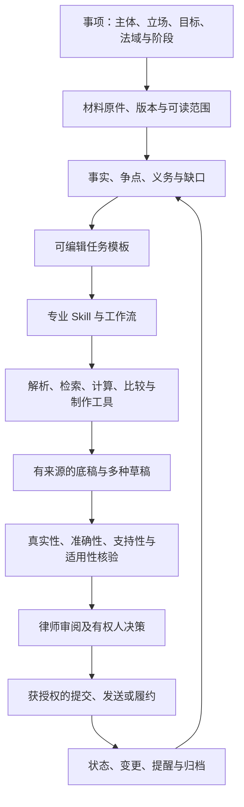

# 智合 AI：当日观察、业务重构与设计裁决

研究日期：2026-10-23，Asia/Shanghai。方法：computer use 操作可见网页、固定公开源码静态检查、两个 subagent 的官方来源联网研究。目的：形成可复用的法律工作方法与产品设计文档。

## 1. 研究结论

最值得借鉴的是从具体法律工作出发，把参数、材料、专业步骤、外部能力和可编辑成果连起来。推荐主线为：**法律事项 → 当前阶段与目标 → 材料和事实 → 专业方法 → 工具 → 核验 → 律师审阅 → 后续履约和归档**。

场景卡负责让用户开始工作；本次提示词表达目标与范围；Skill 固定专业步骤、分支和验收；专家工作流编排多个 Skill；MCP 提供模板、资源和工具的连接与发现。它们通过同一事项关联，不能用数量相加宣称独立功能。

## 2. 当日实测与证据边界

| 对象 | 本日证据 | 文档处理 |
|---|---|---|
| 主站首页 | 三类业务、九领域、36 项预设逐卡点击并读取编辑器值 | H01—H36；保存标题、字符数和内容摘要哈希；优化文本逐项对应 |
| Skill 工作台 | 十类身份、59 项预设逐卡点击并读取完整编辑器值；59 份文本互异 | S01—S59；九类各六项，通用五项；保存独立点读台账 |
| 原始预设与优化稿 | 本日读取页面预填内容；工作区已有原创优化库 | 页面任务语义与原创文本分开，不把历史原创稿改称竞品逐字原文 |
| 官方开源 | 固定提交的 70 个源 Skill、34 个专家配置，由技术 subagent 重新静态审查 | 原文、许可、改进方法、兼容性缺口分别保留；不称其为今日线上最新实现 |
| 市场、专家与 MCP | 依据可见管理页面与独立补充台账记录 | 页面字段、厂商说明、固定源码和真实运行是不同证据 |
| 同类产品与规范 | 两位 subagent 本日联网读取官方产品页、规范与中国官方法律资料 | 明确官方声明与独立设计建议；没有操作竞品付费账户 |

通过主站登录入口后，页面呈现已登录状态。Skill 子站起初长时间空白或加载中，随后成功加载；还检查了已有 Safari 会话。手机号、验证码、账户标识、跳转令牌均不进入交付文档。未提交 95 个场景执行任务，未上传客户材料、创建专家、配置真实 MCP、安装或运行上游包。

当日证据文件：[主站 36 项台账](首页36预设-当日点读台账.json)、[工作台 59 项台账](工作台59预设-当日点读台账.json)。台账保存内容摘要而不批量转载网页完整表达；公开 MIT Skill 的完整正文与资源另有合法来源备份。

## 3. 业务导航应怎样重排

建议主导航以业务对象为一级、工作阶段为二级，专业领域和身份作筛选。首页仍可提供“诉讼仲裁、非诉业务、企业法务”等熟悉快捷入口，后台统一复用方法。

| 一级对象 | 工作阶段 | 主要成果 |
|---|---|---|
| 客户与事项受理 | 咨询、主体、利冲、目标、范围、报价与委托 | 事项卡、缺口表、利冲待复核清单、服务方案 |
| 案件与争议 | 诉前、保全、立案/仲裁、证据、庭审、裁判、救济、执行、结案 | 请求权矩阵、证据目录、文书、庭审包、执行与复盘包 |
| 合同 | 需求澄清、起草、审查、回稿、谈判、签约、履行、变更、解除、续期 | 条款风险表、替代文本、修订稿、清洁稿、义务台账 |
| 公司与交易 | 结构、尽调、治理、文件、条件落实、交割、整合、投后与退出 | 尽调矩阵、治理文件、交割清单、责任与证据台账 |
| 常年法务与合规 | 分诊、规则与流程映射、审查、调查、整改、培训、监测和复评 | 管理层一页纸、义务矩阵、制度、整改与服务报告 |
| 知识与专业经营 | 研究、条款库、先例、复盘、更新、内容、获客、投标、费用与团队 | 可追溯知识资产、方法包、课程、提案、经营报表 |



## 4. 本日预设复核后的十四项裁决

| 问题 | 改进 | 专门验收 |
|---|---|---|
| 示例中的人名、金额、日期可能被当真 | 页面示例与已确认事项分别保存；任务开始前核参数来源 | 清空示例后不残留上案主体或金额 |
| 再审与“两年”的前提混淆，日期缺年份 | 先识别程序、起算事件与适用规则；缺参只出分支 | 不靠星期猜年，不在未知生效日时给确定再审截止日 |
| 类案分布被外推为胜诉或缓刑概率 | 保存检索式、纳排、全文、去重、裁判链和样本限制 | 报告样本分母；不把样本支持率改为个案概率 |
| 红蓝推演可能引导回避不利事实 | 每问准备证据位置、可确认范围、真实未知和补证动作 | 不利事实得到正面回应；模拟陈述不写入事实库 |
| 均值数据被用于逐人裁员成本 | 群体预算与逐人法定计算分别处理 | 无逐人资料时只提供明确假设的预算情景 |
| D+n 缺统一基准，交割日期矛盾 | 每条相对日期绑定独立事件 ID 与确认状态 | 签署日、拟交割日、实际交割日不混用 |
| 个人信息性质与角色被示例预设 | 用真实字段、目的、资金/业务/数据流复核角色与义务 | 不把去标识化或承诺不外传当作路径成立条件 |
| “生成”被写成“可提交” | 草稿、审定、签署、发送、提交、送达、履行各自记录 | 没有回执不称已提交；没有履约证据不称已回款 |
| 一个“引用已核验”标签掩盖不同问题 | 分别记录存在、准确、支持、适用 | 真法条不支持命题时仍报论证缺口 |
| 通用合同审查代替所有专业审查 | 金融、税务、反垄断、公告、交割等保留专项规则和工具依赖 | 未具备能力就列缺口，不靠通用角色补出已查结论 |
| H25 将核心团队竞业统一写为三年 | 区分员工离职后、在职、股东或出让方交易义务与培训服务期 | 不对所有员工生成统一三年离职限制；交易义务不机械套员工模板 |
| H11 给定赔偿请求与工龄工资不自然对应 | 原数与条件化复算并列，报告差额及口径，不静默改诉请 | 不为匹配金额倒算参数；年休假缺参不从 H09 继承 |
| S39 容易照搬境外一般沉默权说法 | 依中国具体法域阶段区分如实回答、无关问题拒答及权利保障 | 具体程序规则有来源，不引导虚假供述 |
| S54 以绿卡或所得税身份替代美国遗产税身份 | 分开被继承人/继承人、domicile、所得税身份、资产与协定 | 未获当地法税核验不按绿卡或账户所在地直接测税 |

再审与执行的具体规则及期限应从当时适用的正式法源核验。本章只记录错误前提与产品处理要求，法律规则和专业样本见后续研究章；不能在欠缺程序事实时对某案计算截止日。

上述新增专项的官方依据、适用条件与可复制补充指令见[独立覆盖复核](独立复核-覆盖与提示词.md)。这些补充已合并到 H11、H25、S03、S24、S39、S43、S53、S54 的最终提示词，使用者不必自行拼接补丁。

## 5. 点卡之后应出现的输入表单

场景卡建议显示“能交付什么、需要什么、预计步骤”三件事。点击后打开可编辑任务草稿和材料区，保留示例作为独立参考；不自动发送。

| 字段 | 展示方式 | 设计理由 |
|---|---|---|
| 事项与目标 | 项目选择＋一句话目标 | 连续工作与新事项分开 |
| 我方立场 | 明确主体、身份和目标 | 买方/卖方、原告/被告不能由名称猜测 |
| 当前阶段 | 按业务给枚举，并允许未知 | 决定工序与期限类型 |
| 法域、事实日期、核验日 | 分别输入；保留日/月/年精度 | 现行规则与历史适用分开 |
| 材料 | 文档、图片、表格、音视频及版本清单 | 能看见真正纳入了哪些材料 |
| 专项关注 | 可增删问题，与客户标准关联 | 保留机构方法而不过度追问 |
| 交付 | 草稿、矩阵、修订文件、管理摘要等 | 用具体成果约定完成条件 |
| 方法与工具 | 推荐方法、实际可用源、预计外部数据 | 不把“请检索”当成数据库已授权 |
| 确认与限制 | 关键缺参、冲突、部分可做范围 | 先完成可做部分，关键条件单独分支 |

用户提到“上传图片”，实际可能是四种不同需求：截图证据、扫描合同、广告审查或结构图参考。上传是输入方式，OCR 是处理工具，专业 Skill 应根据要证明或要审查的事情选择。专家头像上传不属于案件图片分析能力。

## 6. 提示词到 Skill 的转换方法

每项场景保留三层文本：用户可读的一句话目标；可编辑的本次提示词；按需加载的 Skill 方法。避免把全部规则都堆在输入框里。

一项可复用 Skill 至少包含：稳定 ID、中文标题、触发与排除、输入契约、材料预检、分步方法、条件分支、工具依赖、输出契约、关键质量门槛、失败回退、版本与评测样例。权限由可信执行层控制，不能由 Skill 中“必须调用”等用语自动扩大。

```text
请为【事项】完成【阶段】的【交付件】，我方立场为【】，法域与事实时段为【】，核验截至【】，材料版本为【】。
先核对关键参数及材料覆盖，将页面示例、客户陈述、文件记载、争议与已确认事实分开；仅追问会影响当前结论的必要缺口。
按争点、条款或业务义务组织分析：事实与定位、规则与版本、匹配理由、主要反论、条件性判断、下一动作。
只使用实际可用且范围已授权的工具；无法读取、无全文、覆盖受限或工具失败时准确标出影响，不补造已检索结果。
金额与期限先确认口径，再做可复算计算；缺关键参数给情景或待核，不能用“最保守”默认替用户决定。
交付可编辑草稿、底稿、来源表、未决事项和下一动作。核对主体、日期、金额、请求、附件与跨文件一致性，说明真实完成范围。
```

## 7. 开源资产的迁移修正

固定提交 `83df6b13a60b2dfeaf30001c7894bcb45a59fcc4` 含 70 项源 Skill 与 34 个专家工作流。来源为 [legal-agent-skills 固定提交](https://github.com/Decikingship/legal-agent-skills/tree/83df6b13a60b2dfeaf30001c7894bcb45a59fcc4)，MIT；`Copyright (c) 2026 John He (Decikingship)`。保留许可和署名；数据库、接口订阅与客户数据权限另行取得。

本日技术静态检查新增发现：

- 70 项的中文 `name` 与英文目录不匹配，按 Agent Skills 标准迁移时应使用稳定 slug，中文保存在展示元信息；平台自己的格式可另作适配。
- 合同审查、条款范本两处引用固定快照中不存在的 `nonlit-draft-contract`。应补实现或改为明确的缺依赖分支，不能映射到含义不同的来华合同审查来凑数。
- 期限、金额没有统一“最短/最低即安全”的默认值，必须显式分支。
- 脱敏要考虑事实组合、日期、金额和关系的重新识别可能性，不能仅删除姓名。
- Skill 中的 HTTP 客户端与契约声明不证明线上生产服务或 MCP 的实现行为。

详见[70 项兼容性审计](静态审计-70技能兼容性.json)及技术研究章。以上是固定源码问题，不是已经复现的线上故障。没有运行上游脚本或真实接口。

## 8. 推荐五条实施与验证路径

| 路径 | 首批范围 | 必需产物 | 阻断交付的错误 |
|---|---|---|---|
| 买卖合同争议 | 多材料、图片、对账、证据、诉状、庭审 | 事实证据表、分段测算、文书、补证与反论 | 主体错、金额无法复算、证据位置造假 |
| 采购合同审查 | 立场、正文附件、风险、替代条款、回稿 | 风险表、修订稿、清洁稿、义务台账 | 漏读附件、立场错、修订与报告冲突 |
| 劳动争议 | 受理、时间、工资、证据、请求与反论 | 逐项请求表、计算与证据、仲裁草稿 | 均值冒充逐人结果、程序前提未经核实 |
| 广告图文审查 | 完整画面、行业和渠道、证明材料 | 画面定位、风险依据、替换建议、复查点 | 只查敏感词、遗漏小字或图片暗示 |
| 企业合规更新 | 企业画像、新旧规则、义务与整改 | 义务矩阵、负责人、截止条件、复评证据 | 未判断适用就群发提醒、整改无证据 |

每条至少使用正常、缺资料、材料矛盾、旧规则、扫描不清、工具失败和中途恢复样本。文档、配置、静态审查、工具联通、业务运行、专业验收分别登记；不以提示词存在或模型自评替代验收。

## 9. 交付内容与使用限制

正文逐项给出 95 场景、70 项公开技能、40 项额外官方展示功能、34 个专家、公共能力和社区方法家族。各条均区分输入、优化指令、方法组合、成果与专属验收。

“全部”的可验证含义是本次已读取的入口、既有固定开源范围与已记录的产品模块。市场条目会持续变化；未公开的后台系统提示词、社区私有 Skill 正文、检索路由及真实数据隔离不由页面推断。社区目录覆盖与社区内部指令逐项取得是不同完成状态。

完整开放原文可查[70 项 MIT 技能原文合辑](../2026-10-21-智合AI调研/70项技能原文合辑.md)与[固定上游源码](../2026-10-21-智合AI调研/上游来源/legal-agent-skills/README.md)。本报告的优化提示词是工作区原创设计，不冒充网页隐藏指令或官方法律结论。
