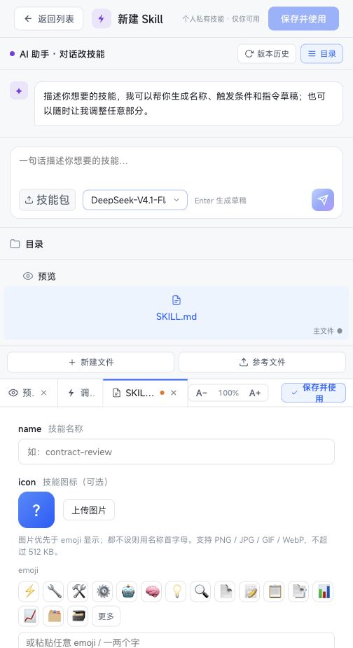

# 产品配置、MCP 与完整模块核对

观察日期：2026-10-23。来源：[主站](https://www.zhiexa.com/agents/home)、[工作台](https://skill.zhiexa.com/)、[技能市场](https://skill.zhiexa.com/skills?section=market)、[官方手册](https://skill.zhiexa.com/user-guide)、[官方开源说明](https://skill.zhiexa.com/static/open-source-skills.html)。界面可见、手册说明与真实运行分别记录。

## 1. 官方使用手册已更新为 v1.4

今天通过 computer use 打开并阅读的手册显示 **v1.4，更新于 2026-10-22，共 17 章**。旧基线记载的 v1.3 / 2026-10-19 仅保留为历史版本。下面归纳当前手册模块，并给出法律业务设计要求；未逐流程运行的功能不写成实测成功。

| 章节 | 官方功能范围摘要 | 法律业务的独立设计要求 |
|---|---|---|
| 01 首次任务 | 登录、工作区、材料、目标、跟进与实际文件检查 | 首次引导选择真实小任务，保留未完成状态 |
| 02 工作台 | 历史、会话、项目、能力与文件入口 | 在同一事项中继续工作，新事项避免继承旧事实 |
| 03 对话与执行 | 模型和思考、官方技能自动匹配、计划、暂停、持续工作、多媒体与分享 | 自动选择与权限独立；计划、预算和动作授权分开；停止不等于撤回已做动作 |
| 04 文件交付 | 上传、解析、预览、修改、下载、全账号文件、未归档与回收站、桌面文件夹 | 原件/识别件/草稿/审定稿分版本；下载实体可打开，处理范围可核对 |
| 05 Skill | 广场、安装、按需使用、手动调用、自建、导入、更新、发布与团队共享 | 来源、版本、工具依赖和许可明确；发现方法不等于完成业务 |
| 06 关键官方方法 | 按法律工作场景选择技能并准备材料 | 入口按目标组织，底层核验、计算和排版复用 |
| 07 专家/数字员工 | 能力组合、委派、聘用、自建、参考资料、试用与共享 | 专家配置可说明顺序和边界，角色名称不等于执业身份 |
| 08 项目 | 会话、文件、项目记忆、阶段与助手整理、归档及工作区 | 助手整理先为候选；事实、阶段、待办由用户确认后使用 |
| 09 个人记忆 | 来源/时间、身份确认、编辑、模式选择与关闭 | 客户陈述不变成用户个人背景，事项事实保存在项目 |
| 10 连接器 | 平台接外部服务、外部 AI 调平台数字员工两种方向 | 数据目的地、工具范围、费用、账号和令牌生命周期独立管理 |
| 11 定时任务 | 站内结果、周期规则、个人企微、指定微信群、测试与试跑、执行/投递状态 | 法定期限另有专业核验；群结果分享范围、调用账号和材料域必须可见 |
| 12 团队 | 资源、钱包、成员角色与额度、工作区、团队项目 | 内容访问、编辑、签发和对外共享分别管理 |
| 13 积分账单 | 余额、领取、会员、消费、流水、订单、费用确认与执行额度 | 数据查询、模型、解析费用分别呈现；研究不自动购买服务 |
| 14 活动公告 | 企业服务季、主体核验、报告审阅、归档、服务记录和恢复 | 计划日期、能力开放、查询授权、报告完成、真实服务分别记录 |
| 15 律师名录 | 检索、认证/榜单/案例标识、建联、律师中心与线索 | 公开信息、平台核验与自述分开；匹配分不等于服务质量保证 |
| 16 设置隐私 | 账号、助手行为、生成偏好、记忆、项目、数据导出与会话分享 | 导出元数据与实际附件分开；分享快照、有效期、产物下载和后续对话范围明确 |
| 17 问题反馈 | 故障定位、文件/额度/任务问题、完成质量评价与反馈进度 | 质量闭环收集实际错误与修复证据，避免只按满意度训练 |

独立判断：当前产品已经具备方法、材料、持续事项、协作、自动化和专业服务承接的全景。借鉴时重点设计这些对象之间的状态与交接，不应把所有能力压缩成一排聊天快捷卡。

## 2. Skill 创建器：本日打开空白表单

可见字段包括名称、图标/图片、emoji/配色、触发描述、两级分类和 Markdown 指令。编辑器将预览、SKILL.md 主文件、参考文件、新建文件、技能包、版本历史与 AI 对话改技能分开。保存并使用是独立动作，本次没有保存或生成技能。

有价值的交互是让用户能够看见“正文＋资源＋版本”，并通过具体任务调试。建议增加适用/排除、输入输出契约、工具能力清单、失败分支、迁移兼容性和正常/缺参/冲突回归样本。触发描述负责发现，不应兼任权限策略。

“上传图片”在这里是技能图标，页面写 PNG/JPG/GIF/WebP、512 KB 上限；这是头像素材要求，不能移植为案件附件大小或 OCR 限制。业务材料的格式与上限应从实际上传入口读取。

## 3. 专家创建器：本日打开空白表单

可见配置：名称、用于委派匹配的描述、头像/图标、两级分类、技能绑定、可选提示词、微信欢迎词与收到词、执行模型、轮次上限、过程展示及试运行。技能栏最多 20 项。没有创建、聘用、试运行或分享专家。

从个人技能库导入是复制快照；后续个人技能改删不影响专家内副本；专家中上传的技能不进入个人库。设计上必须记录上游来源、版本与差异，提供明确的更新选择，不能假定所有副本自动同步。

本日可见的“展示执行过程”开关，开启文案描述在当前对话执行且技能内容可见；关闭文案描述独立子代理与独立沙箱、只返结果。与此同时，列表宣传概括为独立干净环境。二者需要在产品设计中解释清楚：**过程可见性、上下文隔离、执行隔离、技能正文访问权是四种不同属性。** 本研究没有用实际任务验证其隔离机制，不凭文案保证代码与数据安全。

退出空白专家页时出现放弃未保存改动确认，本次放弃的是研究过程中打开的空白新建草稿，未修改已有配置。

## 4. MCP 两种方向及本日访问范围

本日手册 v1.4 明确区分：

1. **入站能力接入平台**：本平台助手调用外部知识库、业务系统等提供的工具；通过推荐目录或新增服务器配置，再在对话启用。
2. **出站能力供给外部宿主**：外部 AI 通过平台服务地址和接入令牌，向绑定的数字员工派任务；使用所属账号的能力、积分与并发限制。

这是以平台视角区分调用方向，并不是给某个 MCP 协议对象贴入站/出站类型。工具定义、数据授权与业务动作还需分别管理。

本日从管理页点击连接器后，独立标签与 Safari 重试仍出现空白或持续加载；内置浏览器记录过渲染错误。今天未重新读到新增服务器表单，**不能把昨日表单观察当成今天字段已复核**。本日可以确认连接器入口与最新手册的双向说明，真实服务器配置、连通、OAuth 刷新和令牌权限未测试。

### 4.1 历史表单基线（2026-10-22）

历史现场记录包含名称、URL、描述、Streamable HTTP / Legacy HTTP+SSE、公开/Bearer/OAuth 鉴权、自定义请求头、工具白名单、对话启用、允许 HTTP、测试和添加。空白工具白名单说明会暴露全部工具；“对话中启用”当时预选。页面的协议版本标签不能直接证明后端实现版本。

这组字段可用于规划自建连接器设计，但开发前应以新页面和实际握手测试重新确认。建议显示将启用的具体工具，避免空白名单静默放行；HTTP 降级、认证、凭据保存和外发范围由可信配置与运行层控制。

### 4.2 面向法律业务的连接器清单

| 能力 | 需连接的真实服务 | 方法层责任 | 不应混淆 |
|---|---|---|---|
| 法规与沿革 | 授权法源数据库/官方全文 | 法域、版本、时际适用及引用核验 | 检索命中与正确适用 |
| 案例 | 裁判全文、案件链、案例库 | 相似事实、法院说理、反例与参考边界 | 文章评析与法院裁判观点 |
| 企业资料 | 授权企业公开数据 | 主体消歧、记录状态、来源与覆盖 | 风险线索与已证责任 |
| OCR/文档解析 | 本地或授权解析器 | 原件定位、关键字段与失败页复核 | 文字识别与真实性鉴定 |
| 音视频 | 授权转写与时间戳工具 | 说话人、否定词、原话与纪要 | 转写标签与真实身份 |
| 金额/期限 | 确定性引擎与适用规则配置 | 确定参数、互斥关系和日期精度 | 日历运算与法律期限判断 |
| Word/表格/展示 | 文档与图表制作工具 | 内容、修订、引用、跨文件一致性 | 版式好看与法律内容正确 |
| 机构知识 | 有权限的 DMS/知识库 | 客户隔离、范本版本、原场景和失效条件 | 旧案经验与当前法源 |
| 事项/义务台账 | 机构案件、合同或项目系统 | 状态、责任人、触发条件和履行证据 | 生成提醒与动作已经完成 |

技术章给出的工具名与 Schema 全属自建设计建议，不是智合私有 API。手册中推荐目录、密钥、收费和外部宿主能力须以各服务实际授权为准。

## 5. 项目、个人记忆、团队与自动化的关键交接

当前手册明确区分个人长期偏好与项目事实；待确认个人条目不作为已确定记忆。建议事项库保存材料记载、客户陈述、争议和确认状态，个人记忆只保存可跨案使用的偏好。

项目的移出、归档和删除有不同效果；手册说明删除项目不连带删除会话和文件，归档停止向新任务带入该项目背景。不要把这些动作实现成同一批量清理开关。

普通团队会话归发起人，团队项目有更广的团队读取范围；工作区切换只决定新会话归属。自建产品应在归档和添加资料时显示真实共享对象，不能只根据顶部当前工作区推断旧会话归属。

定时任务中，免费固定测试消息与真正执行 AI 的立即试跑不同；执行成功、网关接收、群里可见和成员已读不同。手册还说明切换群推送会新建任务会话，并限制自动带入私聊记忆；这些属于官方描述，尚未实测。建议新规任务只在有实质变化或需要动作时提醒，并保留无可靠信息、未覆盖和投递失败的状态。

## 6. 开源页面的当日核对

今天公开说明页仍展示 70 技能、34 专家、MIT，注明数量核实日为 2026-10-14，并指向本报告使用的固定提交。六个底座、二十七个诉讼、二十四个非诉和十三个工具技能相加为 70。

来华业务专题包含九个技能，已计入该 70 项，不能再加九。页面同时指出最新内容以仓库为准；本报告锁定快照，不用公开页面标题证明 105 个市场官方条目全部有可取得源码。70 项在今日市场的 65 官方＋5 基础匹配，额外 40 官方依公开展示语义原创重构。

## 7. 本日模块完成度

| 完成状态 | 内容 |
|---|---|
| 逐项页面读取 | 36 首页＋59 工作台预设；316 条市场目录；专家和 Skill 空白配置；官方手册 v1.4；官方开源说明 |
| 固定源码静态审查 | 70 源 Skill、34 专家及依赖/命名问题 |
| 原创逐项设计 | 95 场景、70 开源方法、40 额外官方、206 社区可见任务、34 专家及公共工序 |
| 未取得 | 隐藏系统提示、社区私有 Skill 正文、生产工具路由、后台实现和数据库内部配置 |
| 未运行验收 | 全场景任务、客户材料上传、真实 MCP/API、团队共享、群推送、付费、正式提交和多文件成品测试 |

按这些状态使用本报告：可直接进入原型与方法评审，开发时补真实服务适配与样本验收；不能直接拿文档覆盖数宣称已经具备等量生产能力。
